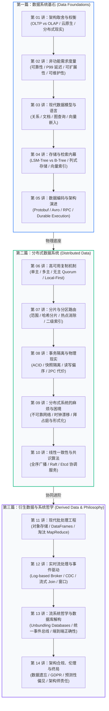

# 核心实战精炼：十年架构演化与第二版全景路线图

从 2017 年第一版问世到 2026 年最新第二版全面重构，分布式数据系统的底层地壳结构发生了深刻剧变：
1. **硬件与存储拓扑重构**：以 AWS S3 为代表的廉价云对象存储与高速 NVMe 固态硬盘彻底颠覆了传统的附着式本地硬盘假设，**存算分离（Storage-Compute Disaggregation）**成为云原生数据库的默认标配；
2. **AI 与多模态浪潮**：向量嵌入（Vector Embeddings）、近似最近邻检索（HNSW / IVFFlat）以及训练集 DataFrame 处理成为核心基础设施的重要组成部分；
3. **协同与开发范式演进**：离线批处理中 MapReduce 彻底被历史淘汰，现代向量化引擎与数据流取而代之；而在分布式服务编排中，**持久化执行（Durable Execution）**与**本地优先（Local-First / CRDT）**重塑了跨网络业务状态机的实现路径。

本专栏基于 Martin Kleppmann 与 Chris Riccomini 的最新第二版原著，全面抛弃空洞的学院派说教与特定云厂商的营销包装，直击数据密集型系统的物理本质与工程权衡。

---

## 1. 核心技术决策矩阵：DDIA 两版十年演进范式跃迁

| 演进维度 | 第一版范式（2017） | 第二版核心变革（2026） | 现代生产级替代选型 | 核心权衡与架构驱动依据 |
| :--- | :--- | :--- | :--- | :--- |
| **存储底座与介质** | 绑定物理机本地 HDD/SSD，依赖本地文件系统与 RAID 容错 | **存算分离**：以 S3/GCS 对象存储为底座，计算节点按需挂载并使用本地 NVMe 作高速缓存 | AWS Aurora, Snowflake, Neon, WarpStream | 计算资源弹性秒级伸缩，存储具备近乎无限容量与 11 个 9 耐久度；代价是引入网络 I/O 延迟与分层复杂性 |
| **高维数据检索** | 关系型 B-Tree 索引与全文倒排索引（Lucene / Elasticsearch） | **向量检索（Vector Search）**深度融入通用数据系统，支撑语义搜索与 LLM RAG | pgvector, Qdrant, Milvus, ClickHouse Vector | 将非结构化文本/图像映射为高维稠密向量；牺牲严格精度（近似召回）以换取毫秒级多维语义检索 |
| **批处理架构** | Hadoop HDFS + MapReduce 批处理管道，基于磁盘频繁落盘 | **向量化流式执行与 DataFrames**；MapReduce 正式退役，全面转向内存流式管道与列式格式 | Apache Arrow, DuckDB, Apache Spark 3.x, Polars | 利用 SIMD 向量化指令与列式存储（Parquet），吞吐量提升数量级，大幅降低批处理延迟与资源消耗 |
| **长流程分布式协同** | 裸 RPC 调用 + 两阶段提交（2PC）或手工编写 Saga 状态机与补偿逻辑 | **持久化执行引擎（Durable Execution）**，代码即状态机，单节点宕机透明漂移恢复 | Temporal, Restate, Cadence, AWS Step Functions | 消除手动编写重试、去重、状态恢复的偶然复杂度；权衡依据是需要引入专用工作流运行时与持久化日志 |
| **多主复制与边缘协同** | 集中式主从复制与基于数据中心的多主仲裁，中心化倾向显著 | **本地优先软件（Local-First）**与数据同步引擎（Sync Engines），基于 CRDT 边缘合并 | ElectricSQL, Automerge, Yjs, Replicache | 极致的用户交互零网络延迟与离线编辑能力；代价是必须接受最终一致性与因果冲突合并策略复杂性 |
| **分布式正确性验证** | 依赖单元测试、集成测试与人工编写的基准压力测试 | **形式化规范（Formal Methods）**与大规模随机对抗测试（Randomized Testing） | TLA+, Jepsen, Antithesis, Chaos Mesh | 分布式并发与网络故障空间过于庞大，暴力或手工测试无法穷尽边界；形式化与全状态探索成为金融级基线 |
| **分布式共识演进** | Paxos 理论主导，但工业界缺乏易于理解与落地的标准实现 | **实用共识收敛**：Raft 成为绝对通用标准，基于租约（Lease）与协调服务成熟落地 | etcd, Consul, Apache Kafka (KRaft), SOFAJRaft | 去除对 ZooKeeper 等重量级依赖，通过易于形式化推理的 Raft 协议保证配置与元数据强一致性 |
| **数据流集成** | 批处理与实时流相互割裂的双轨架构（Lambda 架构），逻辑重复维护 | **数据库解构（Unbundling）**与 CDC（变更数据捕获）驱动的统一事件日志骨干 | Debezium, Apache Kafka, Apache Flink, Redpanda | 将数据库写前日志（WAL）提升为系统间一等数据流，实现记录系统与任意衍生系统的一致性持续投影 |
| **隐私合规与法务** | “大数据”狂热：全量收集、永久保留所有用户数据以备未来分析 | **架构级隐私与数据最小化（Datensparsamkeit）**，支持被遗忘权（Right to Be Forgotten） | 加密可擦除日志（Crypto-shredding）, GDPR Pipeline | 数据留存转变为重大法律合规负债；架构上必须在不可变日志（Append-only Logs）中设计可逆擦除机制 |
| **系统规模考量** | 盲目推崇分布式与微服务，轻视单机硬件的摩尔定律潜力 | **重估单机极限（One Big Server）**，单机多核与高速 NVMe 支撑 90% 业务场景 | DuckDB, SQLite, 现代化 PostgreSQL 单机集群 | 分布式系统的网络与协同代价极其高昂；单台 128 核/1TB 内存机器足以承载大多数企业核心负载 |

---

## 2. 现代生产级技术范式：存算分离下的轻量查询引擎

第二版的核心技术风向标之一是：**“大数据的时代已经演化为现代数据流与轻量存算分离”**。借助嵌入式列式执行引擎（如 DuckDB）直接跨网络对对象存储中的 Parquet 数据湖进行原生下推查询，开发者无需部署庞大的 Hadoop/Spark 分布式集群，即可在单台工作站或无状态微服务容器中以百倍性能完成海量聚合分析：

```python
import duckdb
import time

def query_disaggregated_datalake():
    """
    生产级范式：无状态计算节点直接接入云对象存储（存算分离）
    执行向量化列式下推查询，无需在本地维护沉重的文件副本或数据仓库集群
    """
    con = duckdb.connect(database=":memory:")
    
    # 1. 注册 S3 / 云原生对象存储认证配置
    con.execute("""
        INSTALL httpfs;
        LOAD httpfs;
        SET s3_region='us-east-1';
        SET s3_endpoint='s3.amazonaws.com';
        -- 开启本地缓存与推迟扫描优化
        SET preserve_insertion_order=false;
    """)

    print("🚀 开始跨存算分离架构执行分析型聚合查询...")
    start = time.perf_counter()

    # 2. 投影与谓词下推：仅读取所需的列与对应元数据分区（Parquet Chunk 裁剪）
    query = """
        SELECT 
            region,
            date_trunc('month', transaction_time) AS sales_month,
            count(order_id) AS total_orders,
            sum(amount) AS total_revenue,
            approx_count_distinct(customer_id) AS unique_buyers
        FROM read_parquet('s3://production-lakehouse/events/year=2026/*.parquet')
        WHERE status = 'COMPLETED'
          AND transaction_time >= '2026-01-01'
        GROUP BY 1, 2
        ORDER BY total_revenue DESC
        LIMIT 10;
    """
    
    result = con.execute(query).df()
    elapsed = time.perf_counter() - start

    print(f"✅ 查询完成！耗时: {elapsed:.2f}s | 返回聚合行数: {len(result)}")
    return result

if __name__ == "__main__":
    query_disaggregated_datalake()
```

---

## 3. 全景实战路线图：三大篇章与十四讲知识体系

本专栏严格遵循 2026 最新第二版 DDIA 的科学推演逻辑，分为三大有机进阶阶段：



### 三大实战阶段核心目标
1. **阶段一：数据系统基石（第 1 ~ 5 讲）**  
   攻克单机核心物理瓶颈：从硬盘扇区读写与缓存命中出发，吃透 LSM-Tree 的写放大与 B-Tree 的就地更新权衡；深入现代向量索引；掌握向前/向后兼容的序列化契约与持久化执行引擎。
2. **阶段二：分布式数据系统（第 6 ~ 10 讲）**  
   穿越不可靠的网络鸿沟：透彻推导复制延迟、脑裂、时钟漂移等分布式物理故障；逐一击破弱隔离级别下的脏读、不可重复读与写偏斜（Write Skew）；最终掌握工业级 Raft 共识的数学证明与工程实现。
3. **阶段三：衍生数据与系统哲学（第 11 ~ 14 讲）**  
   重塑现代企业全局数据架构：摒弃传统的离散数据孤岛，将数据库彻底“解构（Unbundle）”为写入日志、CDC 流、缓存与只读衍生视图；建立端到端状态机的一致性校验与现代数据法律伦理边界。

---

## 4. 架构避坑清单 (Do's & Don'ts)

| 架构决策维度 | 严禁行为 (Don'ts) | 推荐最佳工程实践 (Do's) |
| :--- | :--- | :--- |
| **单机与分布式** | 盲目为了“面向简历编程”或过早推断海量规模，在新系统初始阶段强行引入分布式分片与微服务。 | 优先压榨现代单机硬件极限（Scale-up），在业务复杂性或吞吐量真正超越垂直扩容上限前保持单节点单体。 |
| **存储介质选型** | 在云原生环境继续沿用老旧的本地盘 RAID 假设，导致计算实例无法弹性伸缩与动态调度。 | 采用存算分离架构，以高耐久对象存储（S3/GCS）作为权威持久化底座，本地挂载高速 NVMe 作为临时缓存。 |
| **数据一致性** | 迷信“分布式两阶段提交（2PC）能保证跨微服务强一致”，忽视其高昂的网络开销与全局阻塞风险。 | 业务层拥抱异步事件驱动与基于 CDC 的最终一致性，跨服务复杂长流程采用 Durable Execution（持久化工作流）。 |
| **批处理与实时流** | 继续维护两套完全割裂的离线批处理代码（Hadoop）与实时流代码（Storm），造成业务逻辑对齐噩梦。 | 拥抱基于统一事件日志（Log-based Broker）与 CDC 的现代流批一体范式，将批处理视作有限事件流的特例。 |
| **法务与数据治理** | 盲目信奉“数据越多越好”，将全量用户行为数据永久存入冷存储而不做生命周期管理与隐私合规审计。 | 践行数据最小化（Datensparsamkeit）原则，架构层面内置加密擦除（Crypto-shredding）与合规自动化流水线。 |

<!-- split -->

# 原著完整参考：十年演进与第二版全景导读

市面上有成百上千种数据库与存储系统可供选型。究竟哪一种才是满足你应用需求的最佳工具？

最简单的回答只有一句话：“**视情况而定（It depends）**”。

而这个回答背后的详尽推导与完整全貌，正是本专栏所要交付的全部内容。

不同的数据存储与处理技术，其背后都在做出截然不同的工程取舍；**没有任何一种孤立的方案能够适用于所有现实业务场景**。一个为特定系统量身定制、运行得极其完美的存储架构，若直接套用在另一个业务场景中，往往会表现得一塌糊涂。

本专栏绝不仅局限于剖析某一家特定的商业软件或开源工具，而是带领读者俯瞰整个数据系统的完整技术全景，客观、严谨且深入地比对各类核心架构方案的优势、物理极限与内在妥协。

:::en
> **Original**: There are hundreds of databases to choose from. Which one should you use for your application? The short answer is, “It depends.” The long answer is…this book. Different technologies for storing and processing data make different trade-offs, and no one approach is best for all situations. The system that is a perfect fit for one application is badly suited to another. This book is a guide to the entire landscape of data systems, not just looking at one product, but comparing the strengths and weaknesses of many systems.

**📌 核心术语与语境解析**：
- **Trade-offs** [ˈtreɪd ɒfs]：*工程取舍/权衡*。计算机系统设计中不存在“银弹”，获得高写入吞吐往往需要牺牲即时读取性能或强一致性保证。
- **Landscape of data systems** [ˈlændskeɪp]：*数据系统技术全景*。涵盖关系型、文档型、图模型、键值、向量、批处理与流处理等在内的整体技术版图。
- **It depends** [ɪt dɪˈpendz]：*视具体上下文而定*。架构设计的最高准则，必须基于访问模式、读写比、延迟容忍度与故障模型做理性决策。
:::

尽管现代数据处理与存储技术的生态纷繁复杂、瞬息万变，但其赖以运转的底层第一性原理却是历久弥新、历经考验而始终稳固的。

一旦你真正吃透了这些底层根基，便能拥有穿透技术迷雾的从容与洞察力：一眼看清某款新工具在宏观架构版图中的真实生态位，准确掌握如何将其威力发挥到极致，同时避开其潜藏在暗处的致命缺陷。

本专栏的核心重心，正是这些历经风霜而不磨灭的架构底层原理。

本专栏既不是教你机械调用某一个特定 API 的入门速查手册，也不是充斥着枯燥抽象数学公式的学院派教科书。相反，我们将深度剖析在真实工业界取得巨大成功的标杆系统：
- 那些作为现代主流互联网应用基石的核心底层引擎；
- 那些在严苛生产环境中日复一日经受数亿级高并发、极低延迟与苛刻高可用检验的系统架构。

我们将直探这些系统的底层实现细节，拆解其关键算法的物理运行脉络，并透彻论证设计者在当年做出各项技术抉择背后的深层考量。在这一趟探索旅程中，我们将共同建立起思考数据密集型系统的科学认知模型——**不仅知其然（系统如何运作），更知其所以然（为何必须这样设计）**。

:::en
> **Original**: Although the landscape of technologies for processing and storing data is diverse and fast-changing, the underlying principles endure. If you understand those principles, you’re in a position to see where each tool fits in, how to make good use of it, and how to avoid its pitfalls. This book focuses on those principles. While this book is not a tutorial for using one particular tool, it isn’t a textbook full of dry theory either. Instead, we will look at many examples of successful data systems... We will dig into the internals of those systems, tease apart their key algorithms, and discuss the trade-offs they have made.

**📌 核心术语与语境解析**：
- **Underlying principles endure** [ˌʌndəˈlaɪɪŋ ˈprɪnsəplz ɪnˈdjʊə]：*底层第一性原理历久弥坚*。框架与产品数年一换，但 B-Tree、LSM-Tree、WAL、Quorum 等基石理念数十年未变。
- **Avoid pitfalls** [əˈvɔɪd ˈpɪtfɔːlz]：*避开陷阱*。洞察技术方案在边界工况（如网络抖动、脑裂、倾斜负载）下的物理脆弱点。
- **Tease apart key algorithms** [tiːz əˈpɑːt]：*拆解核心算法*。逐层剖析如 Raft 选举、SSIndex 索引、跳表与 MVCC 内部机制。
:::

研读完本专栏之后，你将建立起清晰稳固的技术直觉：
- 能够准确判定何种技术方案在何种特定业务诉求下最为契合；
- 理解如何将不同的基础工具像乐高积木一样紧密咬合，拼装出一套坚不可摧的企业级系统底座；
- 能够精准推演业务系统在黑盒底层的真实行为，从而做出经得起时间考验的架构决策，并在凌晨生产环境发生突发诡异故障时，迅速顺藤摸瓜定位根因。

---

## 专栏指导哲学：理论深度与工程实战的完美融合

本专栏的核心指导思想，在于将极其广阔的视角融会贯通：
- 既立足于严谨深厚的理论基石，又紧扣接地气的生产级工程实战；
- 既全面吸纳前沿学术界的突破性成果，又绝不摒弃半个世纪以来沉淀下的经典智慧。

软件工程行业往往极容易被“最新、最潮、包装最华丽”的营销概念所吸引，甚至对那些数十年前就已经被学术界彻底解决的古典理念嗤之以鼻。

这往往是一个代价惨痛的认知误区。计算机领域许许多多极其强大、颠覆性的根基思想，早在数十年前的顶尖研究中便已奠定。

然而另一方面，纯粹的学术界有时又缺乏对工业界生产真实痛点的敏锐触觉。本专栏的目标正是融合二者之所长：**既保持学术级严密求证与对细节的极致推敲，又紧密围绕工业级生产环境对高可用、低成本与稳定交付的务实诉求**。

:::en
> **Original**: The guiding philosophy of this book is to bring together a broad range of perspectives: both theoretical and practical, both recent and old. The computing industry tends to be attracted to things that are new and shiny and to look down on ideas that are considered old or academic. That is a mistake; many powerful, foundational ideas in computing arose from research, some recent, some decades ago. On the other hand, academia sometimes lacks a clear idea of what issues are important in practice. This book combines the best of both: academic precision and attention to detail with an industrial focus on practicality.

**📌 核心术语与语境解析**：
- **New and shiny** [njuː ænd ˈʃaɪni]：*光鲜新潮的噱头*。指行业中频繁涌现但未经验证的新概念或重复造轮子的营销包装。
- **Academic precision** [ˌækəˈdemɪk prɪˈsɪʒn]：*学术严密性*。用严格的一致性数学定义（如线性一致性、因果一致性）替代模糊工程臆测。
- **Industrial focus on practicality** [ɪnˈdʌstriəl ˈfəʊkəs ɒn ˌpræktɪˈkæləti]：*工业界务实导向*。关注工程落地的网络延迟、机器折旧成本、运维复杂度与 SLO 指标。
:::

---

## 本专栏的目标受众

只要你符合以下任意一种情况，本专栏都将为你带来巨大的工程价值与认知跃迁：

1. **后端开发工程师、软件架构师与技术负责人**：你需要为正在负责的系统做出关键技术决策——例如针对具体业务场景评估选型，并制定最稳健的集成方案；
2. **数据工程师与云原生平台工程师**：你渴望看清底层数据流转与分布式协同的完整脉络。尽管现代云原生托管服务替你封装并隐藏了绝大多数技术细节，但洞悉底层的运作原理对于深度性能压测优化与排查疑难死锁故障至关重要；
3. **高可用系统追求者**：你希望掌握如何让系统优雅支撑数千万级高并发用户，如何在硬件局部宕机时实现秒级自愈与业务零感知，以及如何在业务形态持续狂奔演化的数年周期内，让系统架构依然易于维护与扩展；
4. **分布式系统设计（System Design）求职者**：你正在备战一线大厂的系统架构深度面试，渴望彻底告别生硬背诵套路模板，掌握自底向上的数据系统设计推演逻辑；
5. **技术极客与深度好奇者**：你对全球顶级超大规模互联网服务背后的技术引擎怀有强烈好奇，渴望穿透浮夸的流行词汇，精准掌握各类现代存储与分布式协同引擎的物理本质。

:::en
> **Original**: You’re a software engineer, software architect, or technical manager who needs to make decisions about the architecture of the systems you work on... You’re a data engineer who wants to understand the wider context of the systems you deal with, or a cloud engineer who wants insights into the underpinnings of the systems you’re using... You want to learn how to make data systems scalable, highly available, operationally robust, and easier to maintain in the long run.

**📌 核心术语与语境解析**：
- **Operationally robust** [ˌɒpəˈreɪʃənli rəʊˈbʌst]：*高运维鲁棒性*。在配置误操作、硬件亚健康、流量洪峰等生产恶劣条件下系统依旧不崩溃且能可控降级。
- **System design interview** [ˈsɪstəm dɪˈzaɪn ˈɪntəvjuː]：*系统设计面试*。考察高并发、分区容错、数据一致性与吞吐量估算的综合架构推演。
- **Underpinnings of systems** [ˈʌndəpɪnɪŋz]：*系统底层支撑结构*。操作系统内核页缓存、零拷贝、网络套接字缓冲等物理运行环境。
:::

---

## 2026 最新第二版核心演进背景

自 2017 年第一版问世以来，技术世界经历了一场狂飙突进的蜕变。在第二版中，原作者 Martin Kleppmann 携手分布式流处理权威 **Chris Riccomini**，对全书内容进行了彻底重构与升级，以全面反映过去十年来整个工业界发生的深刻技术变迁：

### 1. 人工智能与机器学习数据底座的全面融入
尽管本专栏的定位并非单纯讨论大模型算法本身，但现代数据密集型系统必须支撑起 AI/ML 的基础设施需求。第二版系统性增补了直接赋能机器学习的核心数据架构：
- 用于高维语义搜索与大模型外部记忆库的**向量索引（Vector Indexes）**；
- 用于高效模型训练特征工程的 **DataFrames 矩阵与多维数组**数据抽象；
- 支撑 PB 级多模态非结构化训练数据吞吐的现代批处理流水线。

### 2. 存算分离与云原生架构的全局贯穿
第一版成书时，很多系统仍然假设数据紧密存放在计算节点本地附着硬盘上。而第二版将**云原生范式（Cloud-Native Architecture）**作为一条明线贯穿始终——系统化揭示现代数据库如何依托 Amazon S3、Google Cloud Storage 等廉价、高持久、具备近乎无限容量的云对象存储来彻底重塑传统存储引擎的读写链路。

:::en
> **Original**: The biggest technical changes that have affected this book since the first edition are the explosion of interest in AI and the rise of cloud native data systems architectures. While this book is not about AI per se, we have added coverage of data systems that support AI and machine learning, including vector indexes (used for semantic search), DataFrames (used for training datasets), and batch processing systems for preparing large amounts of training data. Cloud native ideas, such as building data systems on top of object stores instead of local disks, have been woven in throughout the book.

**📌 核心术语与语境解析**：
- **Vector indexes** [ˈvektər ˈɪndeksɪz]：*向量索引*。如 HNSW 图索引、IVFFlat 倒排聚类，专为高维向量余弦距离与点积搜索设计的专用索引结构。
- **Object stores instead of local disks**：*以对象存储替代本地磁盘*。云原生架构的根本转折点，将持久性与容灾卸载给分布式对象存储服务。
- **DataFrames** [ˈdeɪtəfreɪmz]：*数据帧*。结构化二维表格内存表示标准（如 Apache Arrow），跨语言无开销零拷贝交互的标准载体。
:::

### 3. 现代化前沿主题的新增与旧范式的果断淘汰
除了上述重大变革，第二版还系统性引入了过去几年在工程界大放异彩的先进范式：
- **同步引擎与本地优先软件（Sync Engines & Local-First Software）**：重塑端与云之间的数据所有权与离线协同机制；
- **工作流引擎与持久化执行（Workflow Engines & Durable Execution）**：以 Temporal 和 Restate 为代表的透明持久化状态机编排；
- **形式化方法与大规模随机测试（Formal Methods & Randomized Testing）**：借助 TLA+ 与 Jepsen 检验复杂分布式协议与故障注入；
- **数据隐私法律与伦理工程化**：深入剖析欧盟 GDPR 等严苛法案对底层只追加日志（Append-only Logs）等不可变设计带来的物理冲击与工程解法。

与此同时，第二版果断进行了“技术断舍离”——曾经在分布式计算领域叱咤风云但如今已基本成为历史遗迹的 **MapReduce 被全面重构淘汰**，由现代基于 DAG 的流式与向量化计算引擎全面替代。全书总篇幅相比第一版增加了约 60 页，内容更为紧凑、现代而精悍。

:::en
> **Original**: We have also added discussions of sync engines and local-first software, workflow engines and durable execution, formal methods and randomized testing, GraphQL, and various other technologies that are worth knowing about. We have included a bit of legal context as well, by exploring the impact of the EU General Data Protection Regulation (GDPR) and related law. We’ve also taken a few things away—for example, as MapReduce is now largely obsolete, we have rewritten the batch processing chapter accordingly.

**📌 核心术语与语境解析**：
- **Durable execution** [ˈdjʊərəbl ˌeksɪˈkjuːʃn]：*持久化执行*。在代码级别自动透明持久化函数调用、变量状态与重试上下文，消除了手动管理长事务补偿逻辑的负担。
- **Local-first software** [ˈləʊkl fɜːst]：*本地优先软件*。数据默认读写驻留在终端用户设备本地，云端仅充当协作中继与备份，提供亚毫秒响应。
- **Randomized testing** [ˈrændəmaɪzd ˈtestɪŋ]：*对抗性随机故障测试*。模拟恶劣并发交错、网络丢包抖动与磁盘单扇区损坏的高级系统检验方法。
- **Obsolete** [ˈɒbsəliːt]：*过时的/已被淘汰的*。如 MapReduce 因高频磁盘落盘与调度开销过大，在生产界已被现代流批引擎全面取代。
:::

---

## 专栏研读心法与行动指南

分布式系统是一座庞大而充满诱惑的迷宫。如果你试图单凭记忆去死记硬背各种数据库的配置参数，很快就会陷入认知过载的泥潭。

研读本专栏最有效的策略是：**抓大放小，由浅入深，自底向上构建因果链条**：
1. **不要孤立看待每一章**：第 4 讲探讨的 LSM-Tree 与 SSTable 结构，正是第 12 讲实时流处理日志段组织以及第 6 讲复制日志物理传输的基石；
2. **在双栏对照中刻意练习**：充分利用博客的独立滚动工作台，左栏阅读提炼出的决策矩阵与架构图，右栏细品英文难词与原著严谨论证；
3. **带着凌晨排障的实战问题去推演**：每当你读到一个一致性模型或故障场景，不妨在心中反问：“如果现在机房交换机断电、心跳租约过期，我的集群到底会发生什么？”

十年技术变迁，分布式系统的大厦愈发巍峨，但其地基始终由那几块最坚硬的磐石奠定。

现在，让我们一起推开这扇大门，开启《数据密集型系统架构实战（第二版）》的探索征程！
