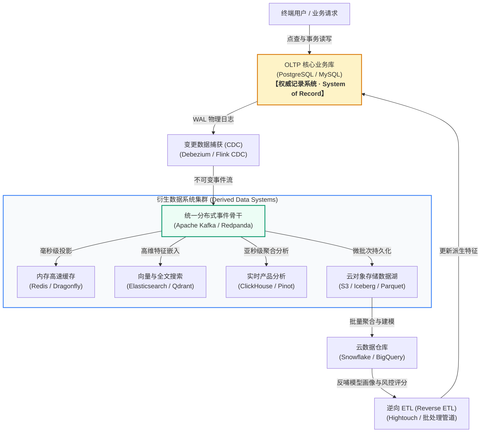

# 核心实战精炼：现代数据架构的权衡取舍法则

架构设计的本质不是寻找“最优解”，而是在互相冲突的物理与业务约束之间，寻找**当前上下文下的最佳权衡（Best Trade-off）**。

在数据密集型系统（Data-Intensive Applications）中，系统的主要瓶颈不再是 CPU 算力，而是**数据规模、状态变更速率、并发冲突、网络不可靠性以及持久性保障**。

---

## 1. 核心架构决策矩阵：五大关键权衡维度

| 决策维度 | 候选方案 | 关键物理特征与瓶颈 | 推荐生产级选型 | 权衡决策依据（何时选用） |
| :--- | :--- | :--- | :--- | :--- |
| **工作负载特征** | **OLTP**（在线事务处理）<br/>vs<br/>**OLAP**（在线分析处理）<br/>vs<br/>**HTAP**（混合事务分析） | **OLTP**：高并发行级点查与增删改，毫秒级要求，B-Tree 为主；<br/>**OLAP**：大批量连续列式扫描与统计聚合，秒级/分级，列存为主；<br/>**HTAP**：双引擎封装或行存+列存副本 | **OLTP**：PostgreSQL, MySQL<br/>**OLAP**：ClickHouse, Snowflake<br/>**HTAP**：TiDB, SingleStore | 严禁在 OLTP 库直接跑大聚合分析；业务对聚合时效要求在秒级以内且预算充足时才选用专用 HTAP；绝大多数场景采用“OLTP + CDC + 数仓”物理隔离方案 |
| **数据形态演进** | **数据仓库**<br/>vs<br/>**数据湖**<br/>vs<br/>**逆向 ETL** | **数仓**：Schema-on-Write，结构严谨，面向 BI 分析；<br/>**数据湖**：Schema-on-Read，存放原始日志与非结构化 Parquet/向量；<br/>**逆向 ETL**：将数仓沉淀特征反哺业务系统 | **数仓**：Snowflake, BigQuery<br/>**湖仓**：S3 + Iceberg / Delta<br/>**逆向 ETL**：Hightouch, Airbyte | 数据探索初期与机器学习训练数据优先入湖（Sushi 原则：生数据更优）；业务财务报表入数仓；高价值用户画像与模型评分通过逆向 ETL 回流到 CRM/业务库 |
| **基础设施交付** | **自建托管**（Self-Hosted）<br/>vs<br/>**云原生全托管**（Cloud-Native Managed） | **自建**：机器折旧与物理掌控，但需组建专属 SRE 团队维护磁盘扩容、跨机房容灾；<br/>**云原生**：开箱即用高可用与存算分离，但牺牲底层控制权且存在流量/API 计费锁定 | **自建**：物理机 K8s + MinIO + PG 集群<br/>**托管**：AWS Aurora, Google Cloud Spanner | 负载平稳且具备成熟基础设施运维能力选用自建；流量峰谷剧烈、初创起步或业务要求极快交付选用云原生托管；需防范云厂商网络出口费（Egress Fees）暴雷 |
| **拓扑演化规模** | **单机极限**（One Big Server）<br/>vs<br/>**分布式协同**（Distributed System） | **单机**：进程内调用，无网络分区与时钟漂移，但受物理机 CPU/RAM/IOPS 上限约束；<br/>**分布式**：近乎无限水平扩展与异地容灾，但引入网络故障、弱一致性、分布式死锁与数据分片代价 | **单机**：DuckDB, 高配单实例 PostgreSQL<br/>**分布式**：CockroachDB, Kafka, Cassandra | 优先垂直扩容（现代 128 核/1TB 内存机器足以承载 90% 互联网业务），遵循 COST 原则（配置过百核集群前先测单机基准）；仅在数据量超数 TB 或跨地域强合规时上分布式 |
| **存储介质范式** | **传统存算一体**（Coupled Storage-Compute）<br/>vs<br/>**现代存算分离**（Disaggregated Storage-Compute） | **存算一体**：计算节点与本地 SSD 紧密绑定，I/O 延迟极低（微秒级），但无法独立扩缩容；<br/>**存算分离**：计算节点无状态，数据落入 S3 等高持久对象存储，通过本地 NVMe 作只读缓存 | **一体**：Redis, ClickHouse Baremetal<br/>**分离**：AWS Aurora, Neon, WarpStream | 极端写延迟敏感（金融撮合）保留存算一体；云原生与现代分析型系统全面转向存算分离以获得弹性伸缩与近乎零闲置成本 |

---

## 2. 现代生产级技术范式：权威记录与衍生系统的一致性协同

在数据系统设计中，最危险的陷阱是将系统状态散落在多个互不隶属的数据库中。必须明确界定**记录系统（System of Record）**与**衍生数据系统（Derived Data System）**。

以下 Go 生产范式展示了：以关系型数据库为权威单一事实来源，借助事务保障写入，并通过轻量幂等缓存维护衍生视图，杜绝缓存击穿与双写并发漂移：

```go
package datarecord

import (
	"context"
	"database/sql"
	"encoding/json"
	"errors"
	"fmt"
	"time"

	"github.com/redis/go-redis/v9"
)

// UserProfile 代表权威业务事实（System of Record 中的规范实体）
type UserProfile struct {
	UserID    string    `json:"user_id"`
	Email     string    `json:"email"`
	Tier      string    `json:"tier"`
	UpdatedAt time.Time `json:"updated_at"`
}

type ProfileService struct {
	db    *sql.DB       // 记录系统权威源（PostgreSQL）
	rdb   *redis.Client // 衍生数据系统（加速只读缓存）
	ttl   time.Duration
}

func NewProfileService(db *sql.DB, rdb *redis.Client) *ProfileService {
	return &ProfileService{
		db:  db,
		rdb: rdb,
		ttl: 30 * time.Minute,
	}
}

// UpdateTier 权威更新流程：严格保证事实源率先持久化，再淘汰衍生缓存
func (s *ProfileService) UpdateTier(ctx context.Context, userID, newTier string) error {
	tx, err := s.db.BeginTx(ctx, &sql.TxOptions{Isolation: sql.LevelReadCommitted})
	if err != nil {
		return fmt.Errorf("begin tx: %w", err)
	}
	defer tx.Rollback()

	// 1. 写入权威记录系统（Single Source of Truth）
	now := time.Now().UTC()
	query := `UPDATE user_profiles SET tier = $1, updated_at = $2 WHERE user_id = $3`
	res, err := tx.ExecContext(ctx, query, newTier, now, userID)
	if err != nil {
		return fmt.Errorf("execute update: %w", err)
	}
	if rows, _ := res.RowsAffected(); rows == 0 {
		return errors.New("user not found")
	}

	if err := tx.Commit(); err != nil {
		return fmt.Errorf("commit tx: %w", err)
	}

	// 2. 淘汰衍生系统缓存（即使删除失败，也可依赖 TTL 最终一致修复）
	cacheKey := fmt.Sprintf("derived:profile:%s", userID)
	if err := s.rdb.Del(ctx, cacheKey).Err(); err != nil {
		// 生产实践：仅记录报警日志，绝不向客户端抛出阻断性错误，因为权威事实已成功持久化
		fmt.Printf("WARN: failed to evict derived cache for %s: %v\n", cacheKey, err)
	}
	return nil
}

// GetProfile 读路径：衍生系统未命中（Cache Miss）时安全回退至权威事实源
func (s *ProfileService) GetProfile(ctx context.Context, userID string) (*UserProfile, error) {
	cacheKey := fmt.Sprintf("derived:profile:%s", userID)

	// 1. 尝试从衍生缓存获取
	val, err := s.rdb.Get(ctx, cacheKey).Result()
	if err == nil {
		var p UserProfile
		if err := json.Unmarshal([]byte(val), &p); err == nil {
			return &p, nil
		}
	}

	// 2. 缓存未命中或损坏，回退至权威记录系统
	query := `SELECT user_id, email, tier, updated_at FROM user_profiles WHERE user_id = $1`
	var p UserProfile
	err = s.db.QueryRowContext(ctx, query, userID).Scan(&p.UserID, &p.Email, &p.Tier, &p.UpdatedAt)
	if err != nil {
		return nil, fmt.Errorf("query system of record: %w", err)
	}

	// 3. 异步/同步将衍生数据回填至缓存系统
	if bytes, err := json.Marshal(p); err == nil {
		_ = s.rdb.Set(ctx, cacheKey, bytes, s.ttl).Err()
	}

	return &p, nil
}
```

---

## 3. 架构拓扑：现代企业多模态数据流全局架构

在当今成熟的工业界体系中，没有单一数据库能包办所有诉求。标准方案是建立以 **CDC（变更数据捕获）**为中枢的多模态数据管道：



---

## 4. 架构避坑清单 (Do's & Don'ts)

| 架构维度 | 严禁行为 (Don'ts) | 推荐工程实践 (Do's) |
| :--- | :--- | :--- |
| **查询隔离** | 允许运营团队或 BI 工具直连生产环境主 OLTP 库执行未分页的复杂多表 `JOIN` 与 `GROUP BY`。 | 必须实施严格物理隔离：通过只读从库处理轻量报表，海量聚合分析走 CDC 导入 ClickHouse/数仓。 |
| **系统角色** | 允许微服务各自修改缓存中的字段，并指望定期反向刷回关系库，导致事实源定义混乱。 | 严格践行权威源（System of Record）原则：所有业务事实仅在权威库初次确权，缓存绝不作为真理源。 |
| **扩展考量** | 在初期数据仅有数千万行（几百 GB）时，盲目引入分库分表与跨节点分布式事务中间件。 | 坚守单节点性能极限原则（COST）：单台配置合理的 PostgreSQL 搭配优质索引足以支撑极高 QPS。 |
| **云服务预算** | 盲目将大量高频随机 I/O 或海量网络数据传输（Egress）直接挂载在云托管按量计费服务上。 | 将容量规划转变为**财务规划（FinOps）**；对高频内网传输实施跨可用区内网互通与本地缓存旁路。 |
| **数据留存与法律** | 秉持老旧的“大数据囤积”思维，永久无期限保留所有用户的 IP 轨迹、位置信息与完整行为日志。 | 坚守数据最小化（Datensparsamkeit）：非核心敏感数据按生命周期主动删除，不可变存储预留加密擦除机制。 |

<!-- split -->

# 原著完整参考：数据系统架构中的权衡取舍

> “**世上没有完美的解决方案；有的只是权衡取舍（There are no solutions; there are only trade-offs）。你所能期盼的最好结果，不过是在特定约束下争取到最合理的权衡罢了。**”
> 
> —— Thomas Sowell，2005 年访谈

数据是当今绝大多数现代软件应用的核心。随着 Web、移动应用、SaaS（软件即服务）与云计算的爆发，将来自海量不同用户的数据汇聚存储在共享的数据基础设施中已成为标准常态。无论是用户交互日志、业务交易凭证，还是设备感知与物联网传感器流，都需要被安全持久化并可供即时检索分析。

当数据量足够小、一台单机计算机即可轻松容纳与处理时，软件系统的设计通常非常简单。然而，随着数据规模以数量级激增、请求吞吐量突破物理极限，数据必须跨越多台物理节点进行分布与协同，这就带来了一系列极其棘手的工程难题。更为严峻的是，随着业务形态不断演进，单一数据库系统往往无法同时兼顾所有维度的需求，我们被迫将具备不同物理特性的多个存储与计算系统组合起来使用。

如果一个软件系统的主要挑战集中在**数据规模、数据状态演进、并发访问的一致性保障、节点故障下的容错能力以及业务服务的高可用性**，我们便将这类系统统称为**数据密集型系统（Data-Intensive Applications）**。

:::en
> **Original**: There are no solutions; there are only trade-offs. […] But you try to get the best trade-off you can get, and that’s all you can hope for. (Thomas Sowell) We call an application data-intensive if data management is one of the primary challenges in developing the application. While in compute-intensive systems the challenge is parallelizing a very large computation, in data-intensive applications we usually worry more about things like storing and processing large data volumes, managing changes to data, ensuring consistency in the face of failures and concurrency, and making sure services are highly available.

**📌 核心术语与语境解析**：
- **Trade-offs** [ˈtreɪd ɒfs]：*权衡取舍*。系统架构的核心基石，任何设计决策都是在相互矛盾的属性（如延迟 vs 一致性）之间达成平衡。
- **Data-intensive** [ˈdeɪtə ɪnˈtensɪv]：*数据密集型*。系统物理瓶颈受制于数据量、I/O 吞吐、网络带宽与状态协调，有别于受 CPU 矩阵计算瓶颈制约的“计算密集型（Compute-intensive）”。
- **High availability** [haɪ əˌveɪləˈbɪləti]：*高可用性*。系统在局部网络分区、硬盘损毁或服务器重启时，依然能够无中断对外提供服务的能力。
:::

这类系统通常由一组标准的基础架构构件组合而成：
- **数据库（Databases）**：持久保存数据，使得本应用或其他协作服务后续能够精准定位并读取；
- **缓存（Caches）**：在内存中暂存高开销计算的结果或热点数据，以大幅度提升后续读请求的响应速度；
- **搜索索引（Search Indexes）**：允许用户通过关键字进行高维度检索，或者提供多字段组合过滤筛选；
- **流处理引擎（Stream Processing）**：在事件或状态变更发生的一瞬间，对其进行近实时的流式处理；
- **批处理系统（Batch Processing）**：定期处理并聚合海量累积的历史数据块。

在构建现代应用时，我们通常选择若干现成的数据存储或服务组件，并通过应用层业务代码将它们胶合在一起。如果你所做的工作完全处于各组件的设计目标之内，这个拼装过程往往十分顺畅。

然而，随着系统规模不断扩张，挑战便开始接踵而至：市场上存在着形形色色、特性迥异的数据库，究竟该如何科学选型？缓存的淘汰策略与更新时序各有哪些利弊？当单一工具无法满足全部业务需求时，如何安全可靠地将多种异构组件拼装咬合？

本专栏正是为了解答这些核心问题而写。正如我们将反复看到的那样：**没有任何一种架构方案在本质上绝对优于其他方案，每一种技术路线都有其难以割舍的利弊代价**。

---

## 术语界定：前端与后端

在深入讨论之前，我们需要界定现代应用的核心术语：
- **前端（Frontend）**：运行在用户终端设备上的代码（如 Web 浏览器中的 JavaScript，或移动端原生 App）。前端有时也会在本地管理部分数据，但最大的数据基础设施挑战几乎全部落在后端；因为前端仅需处理单个用户的数据，而后端则必须代管所有用户的并发读写。
- **后端（Backend）**：通常以 HTTP（或 WebSocket/gRPC）对外暴露服务接口，由无状态的业务逻辑代码与一层或多层数据基础设施（数据库、缓存、消息队列等）组成。**业务代码通常保持无状态（Stateless）**——当一个请求处理完毕，它会遗忘该请求的所有临时上下文；任何需要在跨请求之间持久存续的信息，必须保存在客户端或服务端的专业数据基础设施中。

在现代企业中，围绕数据开展工作的技术角色通常分为三大阵营：
1. **后端工程师（Backend Engineers）**：构建直接处理读写请求的线上服务，服务于外部真实用户或内部调用链；
2. **业务分析师（Business Analysts）**：挖掘业务数据并产出 BI 报表，辅助管理层做出商业决策；
3. **数据科学家（Data Scientists）**：挖掘深层数据洞察，或基于机器学习/AI 训练推荐引擎、风控反欺诈与排序模型。

分析师与数据科学家虽然工具栈不同，但有一个共同的底层特征：**他们都在对系统已经产生的数据进行“只读分析”，极少会直接反向修改生产库的历史事实**。

这种诉求的分化，催生了整个数据系统架构中最重要的物理二分法：
- **操作型系统（Operational Systems）**：承载业务日常运转的在线服务，以提供低延迟读写响应为第一诉求；
- **分析型系统（Analytical Systems）**：专为深度聚合分析量身定制，存放操作型系统数据的只读副本，并对大范围扫描进行物理结构优化。

两者的割裂促成了两种新兴关键角色的崛起：**数据工程师（Data Engineers）**负责搭建连接操作型与分析型系统的桥梁管道与基座；**分析工程师（Analytics Engineers）**则专注于在数仓内构建易于分析的模型与维度表。

---

## 操作型系统 vs 分析型系统（OLTP vs OLAP）

在早期商业数据处理中，数据库的单次写入通常对应一笔真实的商业交易（Transaction）——比如完成一次销售、向供应商下采购单或发放薪酬。后来，“事务”这一术语被泛化为代表“构成逻辑整体的一组原子读写操作”。

即使现代数据库存储的内容涵盖了社交媒体动态、游戏走位、通讯录联络人等各种丰富形态，其底层访问模式依然与商业交易如出一辙：通常是一次读取或修改少量记录，通过主键索引精准定位（**点查，Point Query**）。这类交互式场景被称为**在线事务处理（Online Transaction Processing, OLTP）**。

相比之下，分析型查询的访问模式截然不同：分析师极少按主键查询单个用户的某一行数据，而是需要**扫描成百万上亿条记录，并对其执行聚合统计（如计数、求和、均值、分位数等）**。这种模式被称为**在线分析处理（Online Analytical Processing, OLAP）**。

下表总结了 OLTP 与 OLAP 两大系统的核心特征对照：

| 特性维度 | 操作型系统（OLTP） | 分析型系统（OLAP） |
| :--- | :--- | :--- |
| **主要读取模式** | 点查（基于 Key 精准抓取极少量记录） | 大范围扫描并聚合海量数据记录 |
| **主要写入模式** | 随机、实时的单条插入、就地更新与删除 | 批量定时导入（ETL）或持续事件流追加 |
| **典型最终用户** | Web / App 线上真实终端消费者 | 内部业务分析师、数据科学家与管理层决策者 |
| **机器自动化用例** | 鉴权校验、余额扣减、订单状态流转 | 实时反欺诈风控模型、异常交易模式挖掘 |
| **查询类型特征** | 固定结构、高度预定义在业务代码中 | 随意多维探索、即席 Ad-hoc 查询、交互式看板 |
| **请求并发量** | 极高并发（每秒数万甚至数百万小请求） | 较低并发（并发请求少，但单次查询消耗大量 CPU/IO） |
| **数据所代表的含义** | 数据的**最新状态**（当前时间点的当前值） | 随时间流逝发生的一切**不可变历史事件流** |
| **数据存储规模** | GB 到 TB 级别 | TB 到 PB 甚至 EB 级别 |

:::en
> **Original**: Even though databases started being used for many kinds of data—posts on social media, moves in a game, contacts in an address book, and much, much more—the basic access pattern remained similar to processing business transactions. An operational system typically looks up a small number of records by a key (this is called a point query). Records are inserted, updated, or deleted based on the user’s input. Because these applications are interactive, this access pattern became known as online transaction processing (OLTP). However, databases also started being increasingly used for analytics, which has very different access patterns compared to OLTP.

**📌 核心术语与语境解析**：
- **Point query** [pɔɪnt ˈkwɪəri]：*点查*。通过特定唯一键（如主键索引）精确定位单一记录的高效读操作。
- **OLTP** (Online Transaction Processing)：*在线事务处理*。面向终端交互，追求亚秒级延迟与行级并发写控制。
- **OLAP** (Online Analytical Processing)：*在线分析处理*。面向决策报表，通过宽表与列式扫描处理大吞吐聚合。
:::

在 OLTP 系统中，绝不允许普通用户随意执行任意手写 SQL，因为这既有未授权越权风险，还会触发消耗海量内存的大表扫描，瞬间拖垮整个在线业务。OLTP 数据库跑的几乎全是硬编码在业务代码中的确定性查询。

而在 OLAP 系统中，分析师则拥有随心所欲编写复杂 SQL、或者通过 Tableau / Looker 自动生成多维查询的完全自由度。

此外，近年来兴起了一类介于两者之间、**面向终端用户提供低延迟聚合查询的产品分析引擎（Real-Time Product Analytics）**，代表系统包括 Apache Pinot、Apache Druid 以及 ClickHouse。它们直接接入实时数据流，在亚秒级内完成大规模聚合计算，专为面向用户的分析看板设计。

---

## 数据仓库与数据湖的演进

在 20 世纪 80 年代以前，企业通常尝试在同一个数据库上混跑事务与报表。然而，由于两者的物理访问特征根本冲突，企业最终普遍转向将分析查询剥离到独立的物理数据库中——这便是**数据仓库（Data Warehouse）**。

企业往往拥有数十甚至上百个 OLTP 系统（电商下单、仓储物流、门店 POS 机、财务结算），数据散落在各自独立的孤岛中。业务分析师不能直接跨库查询 OLTP 的核心原因包括：
1. **数据孤岛（Data Silos）**：不同系统独立演进，无法直接单条 SQL 执行跨库 Join；
2. **Schema 不匹配**：适合 OLTP 的范式化模型（3NF）在大规模多表关联分析时极其低效；
3. **性能冲突（Resource Contention）**：高开销分析查询会耗尽 CPU 并长期持有锁，直接导致生产交易瘫痪；
4. **网络安全与权限隔离**：OLTP 核心库通常部署在受严格隔离的内网专区。

数据仓库通过定时全量转储或持续增量同步，将数据从所有 OLTP 库中抽取出来，清洗、重构为适于分析的星型模型（Star Schema）或雪花模型，然后装载进入数仓。这一标准流程被称为 **ETL（Extract-Transform-Load）**。


有时，为了利用现代数仓强大的分布式算力，数据会先直接装载入仓，再在数仓内部通过 SQL/dbt 执行转换，这种变体模式称为 **ELT（Extract-Load-Transform）**。

### HTAP（混合事务/分析处理）真的能替代数仓吗？
虽然包括 TiDB、SingleStore 在内的 **HTAP 数据库**试图统一事务与分析，但它们在工业界中**并不能完全取代数据仓库**。其核心原因在于微服务设计准则提倡“每个服务拥有自己独立的 OLTP 数据库”——一家公司可能拥有上百个微服务 OLTP 数据库，而数据仓库必须跨越所有这些系统，提供企业级的全局视角。HTAP 真正的舞台在于：**当某一个单一业务本身既需要低延迟点写，又需要立即对自身历史数据做大范围实时分析时（例如实时风控或在线流失预警）**。

### 从数据仓库到数据湖（Data Lake）
传统数仓强依赖于严格的关系型表格模型（Schema-on-Write），但数据科学家的工作形态却截然不同：
- 他们需要进行特征工程（Feature Engineering），将原始数据提取为稠密向量或多维矩阵；
- 他们需要处理用户评价文本（NLP）、图片、音视频等非结构化素材；
- 他们更习惯使用 Python（Pandas, scikit-learn）或分布式数据流框架（Apache Spark），而非单纯写 SQL。

因此，**数据湖（Data Lake）**应运而生。数据湖本质上是一个集中式的低成本文件存储池（通常建立在云对象存储之上），它不强加任何统一的 Schema。数据湖既可以存放 Parquet、Avro 格式的结构化数据库转储文件，也可以任意存放原始音视频、日志与传感器读数。这催生了著名的**生数据原则（The Sushi Principle）**：“**未经加工清洗的生数据往往更好（Raw data is better）**”，因为不同业务方可以根据各自未来的未知算法需求，自由地将原始素材二次加工提炼。

:::en
> **Original**: The difference from a data warehouse is that a data lake simply contains files, without imposing any particular file format, data model, or schema. Files in a data lake might be collections of database records, encoded using a file format such as Avro or Parquet, but a data lake can equally well contain text, images, videos, sensor readings, sparse matrices, feature vectors... Besides being more flexible, a data lake is also often cheaper than relational data storage, since it can use commoditized file storage such as object stores.

**📌 核心术语与语境解析**：
- **Data lake** [ˈdeɪtə leɪk]：*数据湖*。以原始格式集中存储海量结构化与非结构化数据的存储库，采用读时模式（Schema-on-Read）。
- **The Sushi Principle** [ˈsuːʃi ˈprɪnsəpl]：*生数据原则*。主张尽可能原汁原味地保留不可变原始输入，避免清洗过程永久丢失信息。
- **Feature engineering** [ˈfiːtʃər ˌendʒɪˈnɪərɪŋ]：*特征工程*。将原始业务数据转化为机器学习模型可消费的高维向量的过程。
:::

---

## 记录系统与衍生数据系统

为了理清全局系统中错综复杂的数据流向，本专栏确立了一组至关重要的概念分水岭：

### 记录系统（Systems of Record）
也被称为**单一事实来源（Single Source of Truth）**。它持有数据的权威、正统版本。当一条新事实产生时（如用户点击购买），它必须率先落盘在此。任何事实在此处仅被规范化（Normalized）表达一次。如果其他系统与记录系统发生冲突，以记录系统中的数值为准。

### 衍生数据系统（Derived Data Systems）
衍生数据是取用现有权威源数据，经过某种转换、过滤或聚合处理后得到的结果。**如果衍生系统遭遇损毁或丢失，你完全可以从原始权威记录系统中重新将其全量重放计算出来**。
- 经典案例是**缓存（Cache）**：如果缓存命中则加速返回；若缓存缺失或节点崩溃，业务代码可以透明回退查询底层主数据库；
- 索引（Indexes）、物化视图（Materialized Views）、全文检索引擎、以及基于历史日志训练产出的机器学习模型权重，全部属于衍生系统。

:::en
> **Original**: A system of record, also known as a source of truth, holds the authoritative or canonical version of data. When new data comes in—for example, as user input—it is first written here. Each fact is represented exactly once... Data in a derived system is the result of taking existing data from another system and transforming or processing it in some way. If you lose derived data, you can re-create it from the original source. A classic example is a cache: data can be served from the cache if present, but if the cache doesn’t contain what you need, you can fall back to the underlying database.

**📌 核心术语与语境解析**：
- **System of record** [ˈsɪstəm əv rɪˈkɔːd]：*记录系统/权威事实源*。具有法定最高权威的数据持久化载体，数据首次写入并严格校验。
- **Derived data** [dɪˈraɪvd ˈdeɪtə]：*衍生数据*。由主记录经函数变换得到的从属数据，本质是冗余的性能加速副本。
- **Canonical version** [kəˈnɒnɪkl ˈvɜːʃn]：*规范版本/正统版本*。经过严格唯一性约束、排除了多副本分歧的标准事实表示。
:::

必须强调：**一种数据库软件本身并不会天生贴上“记录系统”或“衍生系统”的标签**。这完全取决于你在架构中如何使用它。明晰何处为真理、何处为派生，是驾驭现代大规模分布式系统的最关键一步。

---

## 云原生系统架构与存算分离

软件交付模式存在着一条清晰的光谱：


从最左侧完全由自己团队研发并部署在自有物理机房的定制软件，到最右侧完全由第三方全托管、仅通过 API 访问的 SaaS 平台，中间则是自建运行开源软件（无论是部署在机房裸机还是云主机 IaaS 上）。

### 云服务的真正利弊代价
云服务本质上是将基础设施的运维工作外包给第三方提供商：
- **核心收益**：免除硬件采购与机房布线、快速原型交付、在流量存在剧烈潮汐波峰时弹性调整容量，以极低试错成本获得专业 SRE 级的底座保障；
- **潜藏暗礁**：
  - **丧失控制权**：出现未知底层 Bug 或网络抖动时，无法像自建机房那样登录宿主机抓取内核 trace，只能被动提工单；
  - **停机束手无策**：云厂商全区瘫痪时，只能静坐等待其修复；
  - **供应商锁定（Vendor Lock-in）**与高昂的 API/出口网络计费（Egress Fees）；
  - **硬件利用率悖论**：对于负载极度平稳可预测的团队，长期租用云主机往往比直接购置物理机昂贵得多。

### 存算分离（Storage and Compute Disaggregation）
云原生时代在技术实现层带来的最深远变革，是**存算分离**。

在传统物理机架构中，同一台计算机同时承担计算（CPU/内存）与存储（挂载磁盘 RAID）职责。而在现代云原生数据系统中：
- 计算节点（VM 或容器）完全无状态化，本地附着的 NVMe 固态硬盘仅作为**易失性读缓存（Ephemeral Cache）**；
- 长期数据的持久性与高可用性全部卸载给专业的云对象存储系统（如 Amazon S3 或 Azure Blob）。对象存储具有近乎无限的容量空间，并在底层跨多个机房自动分片纠删码冗余，提供多达 11 个 9 的持久性保障。

:::en
> **Original**: In a traditional systems architecture, the same computer is responsible for both storage (disk) and computation (CPU and RAM), but in cloud native systems, these two responsibilities have become somewhat separated, or disaggregated... Snowflake is a cloud-based analytical database (data warehouse) that relies on S3 for data storage, and some other services, in turn, build upon Snowflake.

**📌 核心术语与语境解析**：
- **Storage-compute disaggregation** [ˌdɪsæɡrɪˈɡeɪʃn]：*存算分离/解耦*。计算与存储生命周期解耦，计算集群可秒级关停缩容至零，存储成本恒定低廉。
- **Ephemeral cache** [ɪˈfemərəl kæʃ]：*临时易失缓存*。计算实例被回收或漂移时不保证存续的本地高速存储，用于吸收读热点。
- **Multitenant** [ˈmʌltiˌtenənt]：*多租户*。多个互相不可信的组织在底层共享物理机硬件资源，需要通过内核命名空间与配额严格隔离。
:::

---

## 单机极限 vs 分布式系统协同现实

一个跨越网络由多台机器互相协同构成的系统即为**分布式系统（Distributed System）**。采用分布式的驱动力主要源自：
1. **固有业务分布**：两个终端用户通过各自手机聊天，必然需要网络中继交互；
2. **存算分离跨服务调用**：无状态计算节点与云对象存储分离，数据传输必须走内网；
3. **容灾与高可用（Fault Tolerance）**：防止单机甚至整个数据中心遭遇火灾或停电中断；
4. **吞吐量与数据规模（Scalability）**：单机物理极限无法承载时进行数据分片分流；
5. **地理就近低延迟（Latency）**：将只读副本部署在全球靠近用户的边缘节点；
6. **资源弹性（Elasticity）**：按流量潮汐动态申请和退还节点以节省开支；
7. **数据主权合规（Legal Compliance）**：特定国家法律要求公民金融/医疗数据必须存放在本国境内。

### 分布式的残酷代价：COST 原则
然而，分布式系统从来不是免费的午餐。网络随时可能中断、丢包或发生不可预测的延迟抖动；跨网络 RPC 调用的开销比进程内内存函数调用**慢数万倍**；跨节点的数据一致性排障和全链路可观测性极其繁琐。

更发人深省的是，学术界提出的著名 **COST 评价指标（Configuration that Outperforms a Single Thread，即超越单线程所需的最少配置）**揭示了一个残酷现实：**很多在大规模分布式集群（如包含上百个 CPU 核心的 Hadoop 集群）上耗时数分钟的任务，若改用单台高配物理机上的精简单线程程序，耗时往往只要几秒钟**！

现代单台高配工作站可以轻松拥有 128 个物理 CPU 核心、数 TB 的高速内存与数百 TB 的 PCIe NVMe 固态硬盘。在借助现代单节点向量化引擎（如 DuckDB、SQLite、PostgreSQL）的情况下，绝大多数中小企业的数据分析与事务负载根本无需过早跨入分布式的泥潭。

:::en
> **Original**: Troubleshooting a distributed system is often difficult—if the system is slow to respond, how do you figure out where the problem lies? More nodes are not always faster; in some cases, a simple single-threaded program on one computer can perform significantly better than a cluster with over 100 CPU cores. For all these reasons, performing a task on a single machine is often much simpler and cheaper than setting up a distributed system.

**📌 核心术语与语境解析**：
- **COST metric** [ˈmetrɪk]：*超越单线程基准配置*。衡量分布式计算框架是否真正产生净收益的标准——如果百核集群还不如单核单机跑得快，则说明分布式系统开销反客为主。
- **Observability** [əbˌzɜːvəˈbɪləti]：*可观测性*。通过指标（Metrics）、结构化日志（Logs）与分布式链路追踪（Traces）对黑盒分布式系统进行故障定位的能力。
- **Scale-up vs Scale-out**：*垂直伸缩 vs 水平扩展*。升级单机更强配置 vs 堆叠更多普通节点协同。
:::

---

## 数据系统、法律与社会伦理

软件架构师与数据工程师的职责绝不仅局限于为企业商业利益服务；我们对广大用户的权益与人类社会承担着不可推卸的伦理与法律责任。

自 2018 年欧盟《通用数据保护条例》（GDPR）出台以来，加州 CCPA 等严苛法案席卷全球，对数据系统设计带来了根本性的物理冲击：
1. **被遗忘权（Right to Be Forgotten）与不可变日志的物理冲突**：现代许多分布式数据系统（如 Kafka、LSM-Tree）建立在不可变只追加日志（Append-only Logs）之上。如何在物理上禁止修改的历史文件中彻底抹除特定用户的数据？工程解法通常包括**加密可擦除日志（Crypto-shredding）**：为每个用户独立生成数据加密密钥，并在收到删除请求时将该密钥从全局密钥库永久销毁，使得不可变历史日志中的密文永远无法再被还原解密。
2. **数据最小化原则（Datensparsamkeit）**：与大数据时代“盲目囤积一切数据”的贪婪思维相反，该原则要求**仅收集实现具体明确业务目标所必需的最小数据范围，且在使用目的达成后立即销毁**。数据不仅是资产，更是潜在的巨大法律合规负债；一旦发生黑客泄露或敏感轨迹被滥用，企业将面临毁灭性的公信力崩塌与巨额罚款。

:::en
> **Original**: Legal considerations are influencing the very foundations of data system design. For example, the GDPR grants individuals the right to have their data erased on request (the right to be forgotten). However, many data systems rely on immutable constructs such as append-only logs as part of their design. This principle of data minimization (sometimes known by the German term Datensparsamkeit) runs counter to the “big data” philosophy of storing lots of data speculatively in case it turns out to be useful in the future. But data minimization fits with the GDPR...

**📌 核心术语与语境解析**：
- **Right to be forgotten** [raɪt tə bi fəˈɡɒtn]：*被遗忘权*。用户要求服务提供方彻底擦除其所有个人身份信息与历史记录的法定权利。
- **Datensparsamkeit** [ˈdaːtənˌʃpaːɐ̯zaːmkaɪt]：*数据最小化/数据节约原则*（德语核心词汇）。系统在设计之初就应克制数据采集欲望，不存储多余冗余数据。
- **Crypto-shredding** [ˈkrɪptəʊ ˈʃredɪŋ]：*加密擦除*。通过物理销毁特定实体的非对称密钥，达到在不可变介质中逻辑销毁该实体对应数据的密码学工程手段。
:::

---

## 本章小结与后续路线

本章探讨了贯穿数据密集型系统架构的核心权衡法则：
- **业务诉求驱动系统分化**：OLTP 面向高并发点查与最新事实确权，OLAP 面向大吞吐聚合分析；
- **清晰辨析事实源头**：确立唯一的记录系统（System of Record），其他一切缓存、索引与数仓皆为衍生数据（Derived Data）；
- **理性审视云与分布式**：充分评估云原生存算分离的弹性与成本模型，保持对单机硬件极限的敬畏，避免陷入过早分布式的复杂度泥潭；
- **技术与伦理合规的交织**：在架构底层深度践行数据最小化与隐私保护，守护数据安全边界。

在接下来的**第 02 讲**中，我们将深入系统设计的量化核心：**如何精确定义与度量可靠性、P99 延迟分位数、可扩展性与可维护性等非功能性需求**。
