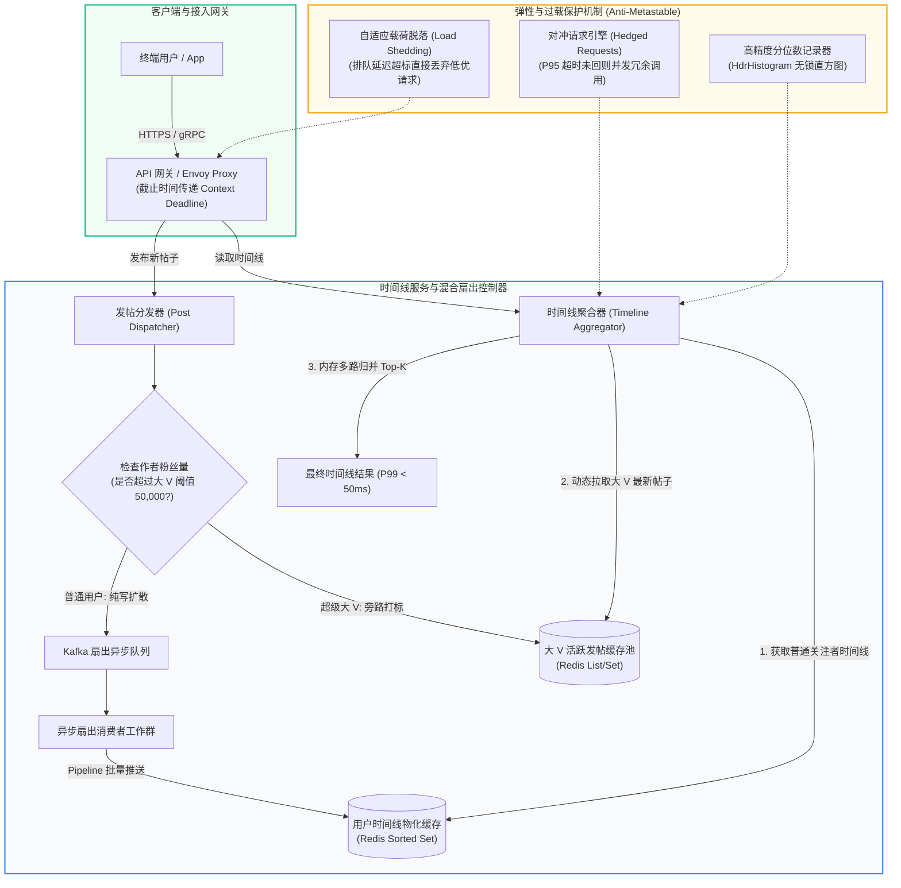

> 💡 **双栏独立滚动工作台导读**：本文采用双栏对照架构。**左栏**为架构决策矩阵、高并发扇出拓扑与生产避坑清单 (Do's & Don'ts)；**右栏**为原著完整参考译文，附有关键段落的英文原文展开与难词解析。左右两栏可独立滚动，并支持顶栏自定义宽度比例（7:3 / 5:5 / 3:7）与拖拽调节。

# 核心实战精炼：非功能性需求建模与容错韧性

在构建生产级分布式数据系统时，功能性需求（用户界面、API 接口、CRUD 流程）往往最直观，但决定系统生死存亡的却是**非功能性需求（Nonfunctional Requirements）**：系统在遭遇十倍突发洪峰时是否会雪崩？机房静默位翻转或磁盘故障时能否无感自愈？复杂微服务链路中的 P99 长尾延迟如何侵蚀用户体验？

Martin Kleppmann 与 Chris Riccomini 在第二版中深化了对“亚稳态故障（Metastable Failure）”、“尾延迟放大（Tail Latency Amplification）”以及“分位数直方图不可直接算术平均”等现代工业界痛点的理论推导与工程定式。

---

## 1. 核心技术决策矩阵：非功能性指标与生产防御治理

| 维度 | 传统天真做法 | 现代分布式工业标准 | 生产级治理方案与技术选型 | 核心权衡与底层驱动依据 |
| :--- | :--- | :--- | :--- | :--- |
| **性能度量** | 汇报平均响应时间（Mean Latency） | 严控分位数分布：P50（典型等待）、P95、P99、P99.9（长尾极端） | 客户端嵌入式分位数采样：HdrHistogram, t-digest, DDSketch | 算术平均极易掩盖长尾毛刺；高价值重度消费用户的账户数据最庞大，其请求往往天然落在 P99.9 尾端。 |
| **突发超载防御** | 客户端简单等间隔无脑重试（Immediate Retry） | 亚稳态故障防御：指数退避加随机抖动（Jitter）、服务端载荷脱落（Load Shedding） | Envoy / Resilience4j 熔断器、自适应并发限制（Netflix Concurrency Limits） | 避免“重试风暴（Retry Storm）”将暂时过载的下游直接击垮至死锁崩塌，甚至降级后因积压队列依然无法自行恢复。 |
| **时间线扇出架构** | 纯读时关联（Fan-out on Read）或全量写时推送（Fan-out on Write） | **混合推拉架构（Hybrid Fan-out）**：普通用户写时推送，超级大 V 读时动态合并 | Redis Sorted Sets（时间线缓存）+ Kafka（异步分发）+ ClickHouse（冷历史） | 大 V 发推若强行触发写扩散，单次发文瞬间放大为千万级写入操作，导致后台写入队列严重堆积堵塞。 |
| **服务扇出放大** | 单体服务串行执行，或简单并行发送 RPC 却未设尾部对齐策略 | **尾延迟对齐策略**：树状微服务请求中引入对冲请求（Hedged Requests）与短超时取消 | gRPC 截止时间传递（Deadline Propagation）、Envoy 局部对冲重试 | 根据概率论 $P(\text{slow}) = 1 - (1-p)^n$，一次前端请求若并行依赖 100 个微服务子调用，哪怕单服务 P99 仅为 1%，整体命中长尾概率高达 63.4%！ |
| **分位数跨节点汇总** | 将各微服务节点上报的 P99 延迟直接做算术平均 | **直方图合并（Histogram Aggregation）**：保留分桶计数与原始精度草图 | Prometheus Native Histograms, VictoriaMetrics, OpenTelemetry Metrics | 分位数是不可加函数（Non-additive），将两个分区的 P99 相加或求平均在数学上完全无意义且会严重低估尾部延迟。 |
| **容错与故障域** | 依赖高可靠硬件冗余（如双电源、企业级高端 SAN 存储） | **软件级容错基线（Fault-Tolerant by Software）**：假设廉价节点随时崩溃、网络随时分区 | Raft 共识集群、混沌工程故障注入（Chaos Mesh, Antithesis） | 廉价云实例常态化抢占回收（Spot Preemption），硬件单点高可用成本极其高昂且无法抵御拜占庭或静默数据损坏。 |

---

## 2. 生产系统架构拓扑：高并发社交时间线扇出与尾延迟治理

下图展示了兼顾**大 V 写放大消除**、**微服务尾延迟对冲**与**亚稳态过载自愈**的现代生产级架构拓扑：



---

## 3. 生产级实战代码：指数抖动退避与自适应熔断客户端

在分布式微服务交互中，为彻底避免**亚稳态故障（Metastable Failure）**引发重试风暴，客户端必须严格实现**指数退避（Exponential Backoff）配合完全随机抖动（Full Jitter）**，并在下游出现持续错误时果断切断流量：

```python
import time
import random
import math

class CircuitBreakerOpenException(Exception):
    """熔断器开启异常"""
    pass

class AdaptiveCircuitBreaker:
    """
    生产级自适应熔断器与指数抖动退避客户端
    抵御重试风暴，打破亚稳态正反馈过载循环
    """
    def __init__(self, failure_threshold=5, recovery_timeout_sec=10.0):
        self.failure_threshold = failure_threshold
        self.recovery_timeout_sec = recovery_timeout_sec
        self.consecutive_failures = 0
        self.state = "CLOSED"  # 状态: CLOSED, OPEN, HALF_OPEN
        self.last_failure_time = 0.0

    def record_success(self):
        self.consecutive_failures = 0
        self.state = "CLOSED"

    def record_failure(self):
        self.consecutive_failures += 1
        self.last_failure_time = time.time()
        if self.consecutive_failures >= self.failure_threshold:
            self.state = "OPEN"

    def allow_request(self) -> bool:
        if self.state == "CLOSED":
            return True
        if self.state == "OPEN":
            if time.time() - self.last_failure_time > self.recovery_timeout_sec:
                self.state = "HALF_OPEN"
                return True
            return False
        # HALF_OPEN 状态允许探针请求
        return True

def call_downstream_service_with_jitter(breaker: AdaptiveCircuitBreaker, 
                                        max_retries=4, 
                                        base_delay=0.1, 
                                        max_delay=2.0):
    """
    带有 Full Jitter 指数退避的 RPC 调用执行器
    睡眠时间计算公式: sleep = uniform(0, min(max_delay, base_delay * 2^attempt))
    """
    for attempt in range(max_retries + 1):
        if not breaker.allow_request():
            raise CircuitBreakerOpenException("🚨 熔断器处于 OPEN 状态，保护下游服务，拒绝发出请求！")

        try:
            # 模拟执行 RPC 调用
            response = execute_rpc_call(attempt)
            breaker.record_success()
            return response
        except Exception as err:
            breaker.record_failure()
            if attempt == max_retries:
                raise RuntimeError(f"❌ 达到最大重试次数 {max_retries}，请求彻底失败: {err}")
            
            # Full Jitter 计算：避免各并发客户端在同一时刻爆发谐振重试
            ceiling = min(max_delay, base_delay * (2 ** attempt))
            sleep_time = random.uniform(0, ceiling)
            time.sleep(sleep_time)

def execute_rpc_call(attempt: int):
    # 模拟网络瞬时抖动与偶发异常
    if random.random() < 0.6 and attempt < 2:
        raise TimeoutError("504 Gateway Timeout")
    return {"status": 200, "data": "OK"}
```

---

## 4. 架构避坑清单 (Do's & Don'ts)

| 架构决策维度 | 严禁行为 (Don'ts) | 推荐最佳工程实践 (Do's) |
| :--- | :--- | :--- |
| **SLA/SLO 度量** | 仅依赖 Prometheus 的 `avg(http_request_duration_seconds)` 监控看板汇报系统性能。 | 采用高精度分位数直方图（如 P90, P99, P99.9），建立以用户真实痛苦感知为核心的 SLO。 |
| **分位数统计聚合** | 将跨数据中心或多台无状态 API 实例计算得出的 P99 指标再次取算术平均来评估全局表现。 | 在单机记录并导出原始分桶数据（Histogram Buckets），在监控中心由时序数据库统一计算全局联合分位数。 |
| **超载故障自愈** | 遭遇流量暴增与队列堆积时，只单纯依赖横向扩容（Autoscaling）来解决性能雪崩。 | 部署主动载荷脱落（Load Shedding）与分级降级策略；新启动的容器若未预热完成，严禁瞬间注入大流量。 |
| **高并发读写模型** | 无论关注者数量多寡，对所有用户一刀切采用纯写扩散（全推）或纯读聚合（全拉）。 | 采用混合模式（Hybrid）：对粉丝数 < 50,000 的普通用户采用写时物化推入；对千万级大 V 采用读时实时归并。 |
| **分布式依赖调用** | 在调用链下游数十个微服务时，任由单个慢性子节点无限制阻塞全局线程池。 | 强制在整个 RPC 调用栈中透传绝对截止时间（Context Deadline），并在超时发生时主动向上向下广播中断。 |
| **硬件容错心态** | 认为配置了高端 RAID 磁盘阵列与冗余交换机后，软件层便无需再考虑单扇区损坏或节点失联。 | 软件层设计必须遵循“硬件随时会挂”的第一性假设，关键写入依赖 WAL 日志校验和（CRC32）与多机共识副本。 |

<!-- split -->

# 原著中文精译：定义非功能性需求（第二版精译与语境解析）

> “互联网设计得如此精巧绝伦，以至于大多数人将其视作如太平洋一般的自然资源，而非一件人类手工造物。试问上一次在如此庞大尺度下运作却几乎毫无差错的技术是什么？”  
> —— **Alan Kay**，接受《Dr. Dobb’s Journal》访谈（2012）

当你着手构建一个应用程序时，首当其冲被列在清单顶部的，往往是该程序必须提供的业务功能：需要哪些交互界面、哪些按钮、以及每一项操作应当如何运转以实现预期的业务目的。这些构成了你的**功能性需求（Functional Requirements）**。

然而除此之外，你必然还会面临一系列**非功能性需求（Nonfunctional Requirements）**：例如，系统必须足够敏捷迅速、高度可靠、具备法律合规性、具备安全防御力且在长远周期内易于维护。这些需求往往不会被白纸黑字地显式写在产品说明书中，因为它们看起来似乎是理所当然的；然而，它们与软件的功能性本身同等重要——一个慢到让人难以忍受或动辄丢失数据的系统，在现实世界中根本没有存在的价值。

许多非功能性需求（如网络渗透防御与信息安全）超出了本专栏的核心讨论范畴。但在本讲中，我们将聚焦于数据密集型架构中最核心的四大支柱：
1. **精确定义与度量系统的性能（Performance）**；
2. **界定服务的可靠性（Reliability）**——即在各种物理软硬件发生故障的恶劣境况下，系统依然能够持续且正确地提供服务；
3. **构建可扩展性（Scalability）**——当系统承载的业务负载持续倍增时，拥有高性价比、低复杂度的容量扩充路径；
4. **确保长期的可维护性（Maintainability）**——让代码库与生产运维平滑演化，不沦为无法维护的泥潭。

---

## 案例研究：社交网络时间线（以 X/Twitter 为例）

为了使这些抽象的概念变得具象可感，我们以一个类似 X（前身为 Twitter）的社交网络系统为例，深入推演高并发访问背后的架构取舍。

假设系统整体承载的业务负载指标如下：
- 全球用户每日发布 **5 亿条推文（Posts）**，平均每秒产生约 **5,800 条写入请求**；
- 在突发热点事件（如世界杯决赛或重大突发新闻）期间，写入峰值可陡增至每秒 **150,000 条**；
- 系统平均每个用户关注 200 人，同时每个用户平均拥有 200 个关注者（但分布极度倾斜：大多数普通用户仅有十几个好友，而少数超级名人拥有超过 1 亿关注者）。

### 数据模型与关联表达

如果将这些数据保存在关系型数据库中，基础关系模式如图 2-1 所示：包含用户表（Users）、帖子表（Posts）以及表达单向关注关系的关联表（Follows）。


*图 2-1：社交网络关注关系的典型关系型模式定义*

该社交网络最核心的高频读取操作，是渲染用户登录后的**主页时间线（Home Timeline）**——即向当前用户展示其关注对象所发布的最新帖子列表。在纯粹的关系模型中，可通过以下 SQL 关联查询实现：

```sql
SELECT posts.*, users.* 
FROM posts
  JOIN follows ON posts.sender_id = follows.followee_id
  JOIN users   ON posts.sender_id = users.id
WHERE follows.follower_id = :current_user
ORDER BY posts.timestamp DESC
LIMIT 1000;
```

为了执行这条查询，数据库首先需要检索 `follows` 表找出当前用户关注的所有好友，然后查找这些好友近期发布的全部推文，最后按照时间戳进行多路合并与全局降序排序，最终截取前 1,000 条返回。

社交帖子对时效性有着严苛要求。假设我们期望好友发帖后，关注者在 5 秒之内便能刷出该动态。如果采用客户端轮询（Polling）策略，假设有 1,000 万活跃用户同时在线，每隔 5 秒轮询一次，就意味着数据库每秒必须承载 **200 万次时间线复杂关联查询**！

这种方案的计算开销是灾难性的：若平均关注 200 人，每秒 200 万次时间线读取乘以 200 个被关注者，相当于**每秒产生 4 亿次帖子检索与多路合并**。对于那些关注了数千人的重度用户而言，单次查询便足以让单机 CPU 完全瘫痪。

---

### 物化视图与时间线更新（扇出推拉权衡）

如何破解这一读性能瓶颈？关键解法在于两点：
1. 服务端放弃被动轮询，转为在检测到新推文时向在线客户端主动推送；
2. **预先计算查询结果**，将原本在读取阶段执行的高开销多表 Join 卸载，让用户请求直接命中预计算的只读缓存。


*图 2-2：写时扇出（Fan-out on Write）：在发帖瞬间将消息投递到每一位关注者的专属收件箱*

具体而言，我们为每个用户在内存存储（如 Redis）中维护一个专属的“主页时间线收件箱”。每当某位创作者发帖时，后台工作进程立刻查出其所有粉丝列表，并将该推文的主键 ID 插入到每位粉丝的时间线列表中。

当一个初始业务请求在下游引发大量连锁次级请求时，我们称之为**扇出（Fan-out）**。

在写时扇出模式下，每秒 5,800 条发帖乘以 200 个平均粉丝（即扇出系数为 200），后台每秒仅需执行约 **116 万次高效的内存队列插入操作**。相比读时方案高达 4 亿次的磁盘/复杂索引检索，这种方案将读取操作直接退化为常数时间 $O(1)$ 的内存分片读取，性能大幅飙升。即便遇到突发流量洪峰，扇出投递也可以放入消息队列异步削峰，用户的主页加载依然极致轻快。

这种预先计算并持续增量更新查询结果的过程，在数据库理论中被称为**物化（Materialization）**，而时间线缓存便是**物化视图（Materialized View）**的经典形态。

物化机制的本质是**空间换时间、写放大换读吞吐**。然而，这一设计在遭遇长尾极端情况时会遭遇严峻挑战：
- **倾斜的大 V 发帖（Celebrity Fan-out）**：当拥有 1 亿粉丝的超级名人发帖时，单次发文瞬间在后台产生 1 亿次内存写入操作！写入队列将发生灾难性堆积，严重拖垮普通用户的时间线投递时效。
- **混合范式落地**：现代工业界的标准解法是**推拉结合的混合架构**。对绝大多数普通用户继续沿用写时扇出物化；而对大 V 的帖子则豁免扇出，单独存放在高频读取池中。当粉丝打开时间线时，网关动态拉取预计算的时间线列表，并在内存中并发与大 V 的最新帖子做一次极轻量级的二路归并。

:::en
> **Original**: When one initial request results in several downstream requests being carried out, we use the term fan-out to describe the factor by which the number of requests increases. At a rate of 5,800 posts per second, if the average post reaches 200 followers (i.e., a fan-out factor of 200), we will need to do just over 1 million home timeline writes per second... When a celebrity account with a very large number of followers makes a post, we have to do a lot of work to insert that post into the home timelines of each of their millions of followers. In this case, dropping some of those writes is not OK. One way of solving this problem is to handle celebrity posts separately from everyone else’s posts: we can save ourselves the effort of adding celebrity posts to millions of timelines by storing them separately and merging them with the materialized timeline when it is read.

**📌 核心术语与语境解析**：
- **Fan-out** [ˈfæn aʊt]：*扇出/请求放大系数*。在分布式消息或 RPC 拓扑中，单点触发引发下游并发展开的比例。
- **Materialized View** [məˈtɪəriəlaɪzd vjuː]：*物化视图*。不同于普通虚拟视图（每次查询现场计算），物化视图在底层保留物理计算结果副本，由后台监听变更增量更新。
- **Celebrity Problem** [səˈlebrəti ˈprɒbləm]：*大 V / 热点 Key 偏斜问题*。分布式系统中极端不均匀的数据分布（Zipf 定律），单节点或单 Key 承受超高集中负载。
:::

---

## 描述性能：排队延迟与亚稳态故障（Metastable Failure）

在度量软件系统的运行效率时，工程界最关注两大核心指标：
- **响应时间（Response Time）**：客户端发出请求直到收到最终响应之间所耗费的完整物理耗时（单位为毫秒或微秒）；
- **吞吐量（Throughput）**：系统在单位时间内成功处理的请求数或数据传输体量（如 QPS、TPS、MB/s）。

响应时间与吞吐量之间存在着强烈的非线性内在关联。如图 2-3 所示：


*图 2-3：随着服务吞吐量逐渐逼近硬件极限容量，排队效应导致响应时间呈现指数级陡增*

当系统的处理吞吐量处于低水位时，CPU 能够迅速消化到达的任务，响应时间保持在极低基线。然而，一旦吞吐量逼近硬件上限，**排队延迟（Queueing Delay）**便开始呈指数级暴增。因为硬件的核心数量与 I/O 通道是有限的，后到的请求必须等待先前的请求排队执行完毕，排队时间往往远超代码实际的运算时间。

### 生产灾难：亚稳态故障（Metastable Failure）与重试风暴

第二版中着重强调了分布式系统中极其危险的系统级崩溃现象——**亚稳态故障（Metastable Failure）**。

当系统被推向满负荷极限时，往往会滑入一条恶性正反馈循环：
1. 由于排队队列积压，响应时间剧烈上升；
2. 上游客户端触发超时判定，认为请求丢失，立刻并发发起重新尝试；
3. 这一波重试洪峰使原本就已经窒息的服务端雪上加霜，形成灾难性的**重试风暴（Retry Storm）**；
4. 服务端由于内存暴涨、频繁垃圾回收（GC Pause）以及线程上下文切换激增，自身实际工作效率急剧下降；
5. **最致命的特征**：即便此时外部流量完全恢复到日常的正常水位，系统依然深陷自发的高负载状态中无法自愈，除非运维人员彻底切断外部流量、重启全部实例并排空队列！

为抵御这一系统级崩溃，生产架构必须严守以下防御原则：
- **客户端退避**：重试逻辑绝不可机械连续发送，必须采用带有完全随机抖动的**指数退避（Exponential Backoff with Full Jitter）**；
- **熔断机制（Circuit Breaker）**：当下游持续返回错误或超时，客户端主动熔断快速失败，阻断流量传播；
- **主动载荷脱落（Load Shedding）**：服务端在检测到请求等待时间超标或 CPU 逼近临界水位时，果断直接拒绝处理低优先级请求，保全核心生命线；
- **背压机制（Backpressure）**：当下游消费能力不足时，逆向向上游生产者施加阻力，迫使其调慢发送速率。

:::en
> **Original**: If a system is close to overload, with throughput pushed close to the limit, it can sometimes enter a vicious cycle where it becomes less efficient and hence even more overloaded... Even when the load is reduced again, such a system may remain in an overloaded state until it is rebooted or otherwise reset. This phenomenon is called a metastable failure, and it can cause serious outages in production systems. To avoid retries overloading a service, you can increase and randomize the time between successive retries on the client side (exponential backoff) and temporarily stop sending requests to a service that has returned errors or timed out recently (by using a circuit breaker). The server can also detect when it is approaching overload and start proactively rejecting requests (load shedding).

**📌 核心术语与语境解析**：
- **Metastable Failure** [ˌmetəˈsteɪbl ˈfeɪljər]：*亚稳态故障*。系统进入一种由于内部正反馈自激维持的持续过载脆弱状态，即使触发故障的瞬时扰动消失，系统也无法自行脱困。
- **Retry Storm** [ˌriːˈtraɪ stɔːm]：*重试风暴*。超时引起的连锁并发重试，使下游请求体量成倍翻番并最终引发雪崩。
- **Load Shedding** [ləʊd ˈʃedɪŋ]：*载荷脱落/主动抛载*。系统在过载时主动丢弃次要请求（如返回 HTTP 429 或 503），确保留在队列内的请求能成功完成。
- **Exponential Backoff with Jitter** [ˌekspəˈnenʃl ˈbækɒf wɪð ˈdʒɪtər]：*带抖动的指数退避*。每次重试等待时间倍增并在区间内引入随机数，打碎并发请求的时钟共振。
:::

---

## 延迟度量模型：服务时间、网络延迟与排队耗时

在实际工程讨论中，“延迟（Latency）”与“响应时间（Response Time）”常被混为一谈，但原著在此作出了极其严格的物理切分（如图 2-4 所示）：


*图 2-4：一次请求交互中响应时间、服务时间、网络延迟与排队延迟的物理组成*

1. **响应时间（Response Time）**：是终端调用方眼中的全流程耗时，包含了请求在网络上传播、在服务端等待以及代码实际执行的所有开销；
2. **服务时间（Service Time）**：是目标机器的 CPU、磁盘或内部逻辑实际处理该请求的物理持续时长；
3. **排队延迟（Queueing Delay）**：请求已抵达机器，但在操作系统内核套接字缓冲区、Web 服务器线程池或工作队列中等待被调度的空转耗时；
4. **网络延迟（Network Latency）**：数据包跨越交换机、路由器与物理光纤传播的光电延迟与协议栈缓冲延迟。

由于服务端 CPU 核心数量受限，少数执行极其缓慢的耗时请求便足以霸占工作线程，导致后续到达的大批轻量请求全部被阻塞在后方排队——这一物理瓶颈被称为**队头阻塞（Head-of-line Blocking）**。因此，**衡量系统性能的唯一定位锚点必须立足于客户端侧**，服务端内部度量的服务时间极易掩盖漫长的排队现实。

---

## 均值的欺骗性与分位数（Percentiles）度量

在度量性能时，技术团队极易犯下一个致命错误：汇报算术平均响应时间（Mean Latency）。

算术平均值在数学上抹平了一切长尾波动，根本无法反映多数真实用户的实际等待体感。更为科学严密的度量工具是**分位数（Percentiles）**：


*图 2-5：采样样本下的响应时间分布：中位数（P50）与长尾高分位数（P95、P99、P99.9）*

- **中位数（Median / P50）**：将所有请求按耗时从快到慢排序，正好处在中间位置的值。若 P50 为 200ms，意味着整整一半的用户请求能在 200ms 内得到响应，是评估典型体验的最佳指标；
- **长尾分位数（Tail Latencies: P95, P99, P99.9）**：用于揭示系统中最恶劣的离群值。例如 P99 为 1.5 秒，代表 99% 的请求在 1.5 秒内完成，但仍有 1% 的请求耗时超越此界限。

### 为什么亚马逊极度重视 P99.9？

在亚马逊内部服务规范中，许多微服务的 SLA 严苛锚定在 **P99.9（千分之一的长尾）**。

其背后的商业与架构驱动力极其深刻：**在电商平台上，遭遇最慢响应时间的用户，往往恰恰是账户内数据量最庞大、购买历史最丰富、购物车塞得最满的顶级高价值客户（High-Value Customers）**！由于他们的历史交易记录极为庞杂，后端的聚合查询自然最吃力。如果技术团队轻视长尾尾巴，受伤害最深的恰恰是给平台贡献绝大部分利润的核心客户。

至于为何不在工业界进一步追求优化 P99.99（万分之一）？因为此时网络突发的偶发丢包、操作系统不可控的页面缺页中断（Page Fault）以及垃圾回收停顿等随机物理噪音已占据主导地位，继续优化该极端指标的边际收益递减，且工程成本呈指数级膨胀。

---

## 尾延迟放大效应（Tail Latency Amplification）与分位数计算禁忌

在现代微服务与云原生架构中，用户发起的一次简单前端点击，在后端往往需要扇出（Fan-out）并发调用几十上百个微服务组件：


*图 2-6：尾延迟放大（Tail Latency Amplification）：单一下游的偶发迟钝直接拖垮整个全局请求*

即便所有并行发出的子调用都在同时进行，前端也必须等待**耗时最长的那一个子调用**返回后才能完成整体验收。

数学推导极其残酷：假设单次下游微服务调用的 P99 异常率为 1%（$p = 0.01$），如果一次端到端业务需要同时向 100 个微服务发出并行调用，则该请求至少命中一次慢请求的概率为：
$$P(\text{Slow}) = 1 - (1 - p)^n = 1 - (1 - 0.01)^{100} = 1 - 0.366 = 63.4\%$$

原本在单一节点看来仅有 1% 几率发生的极端长尾，在经过 100 次扇出放大后，**演变成了让高达 63.4% 的最终用户直接遭遇漫长卡顿**！这就是臭名昭著的**尾延迟放大效应（Tail Latency Amplification）**。

### 服务水平目标（SLO）与服务水平协议（SLA）

分位数是现代系统衡量服务可用性与性能契约的标准语言：
- **SLO（Service Level Objective，服务水平目标）**：团队内部设定的量化健康底线。例如：“主页接口的 P99 响应时间必须小于 800ms，且月度有效请求成功率不低于 99.95%”；
- **SLA（Service Level Agreement，服务水平协议）**：面向外部客户签署的具备法律或经济惩罚效应的商业契约。若未达到预定指标，服务商通常需要向客户退还部分服务费用或支付违约赔偿金。

### 严正警示：分位数不可做算术平均

在监控系统开发中，一个极为普遍却大错特错的做法是：将各个服务器节点自行计算好的 P99 汇总，然后求算术平均得出集群的总体 P99。

**在统计学上，分位数属于不可直接相加或平均的非线性指标（Non-additive Metrics）**。两个分布形状完全不同的节点，直接平均它们的分位数在数学上毫无意义，会严重掩盖局部的超级长尾。

正确收集与跨节点聚合全局分位数的唯一工业级路径，是借助**流式直方图算法（Streaming Histograms）**：
- **HdrHistogram**：通过无锁高动态范围几何分桶，在极低内存占用下实现高精度全量延迟记录；
- **t-digest / DDSketch**：通过自适应聚类质心（Centroids），支持跨节点将直方图草图（Sketches）直接合并，从而在中央监控节点计算出严密精准的全局联合分位数。

:::en
> **Original**: High percentiles are especially important in backend services that are called multiple times as part of serving a single end-user request. Even if you make the calls in parallel, the request still needs to wait for the slowest of the parallel calls to complete. It takes just one slow call to make the entire end-user request slow... Even if only a small percentage of backend calls are slow, the chance of getting a slow call increases if an end-user request requires multiple backend calls, so a higher proportion of such end-user requests end up being slow (an effect known as tail latency amplification). Beware that averaging percentiles (e.g., to reduce the time resolution or to combine data from several machines) is mathematically meaningless. The right way of aggregating response time data is to add the histograms.

**📌 核心术语与语境解析**：
- **Tail Latency Amplification** [teɪl ˈleɪtənsi ˌæmplɪfɪˈkeɪʃn]：*尾延迟放大*。多路并发子调用由于“木桶短板效应”，使得上游遭遇慢调用的宏观概率呈几何级数恶化。
- **Service Level Objective (SLO)**：*服务水平目标*。技术团队衡量系统是否稳定可接受的客观定量阈值。
- **Mathematically Meaningless** [ˌmæθəˈmætɪkli ˈmiːnɪŋləs]：*数学上完全无意义*。直接对分位数做加权或算术平均会产生严重的统计谬误。
- **HdrHistogram** [eɪtʃ diː ɑːr ˈhɪstəɡræm]：*高动态范围直方图*。由 Gil Tene 设计的高效无锁延迟追踪结构，覆盖微秒到小时级别的精确记录。
:::

---

## 可靠性与容错基线：从物理硬件到人员组织

对于软件系统而言，人们对可靠性（Reliability）的直观共识是：**在恶劣逆境、软硬件故障以及用户非预期操作的冲击下，系统依然能持续且正确地提供服务**。

为了精确剖析系统故障，必须从严厘清以下两组核心概念：
- **故障（Fault）**：系统内部某一个独立组件停止按照预期规范工作（例如单块机械硬盘坏道、一个微服务节点 OOM 宕机、网络交换机单端口丢包）；
- **失效（Failure）**：系统作为一个整体，彻底丧失了向用户继续提供承诺服务的能力（即全面突破了 SLO 底线，对外呈现瘫痪）。

### 容错（Fault Tolerance）与混沌工程

若系统在某些特定类型的局部组件发生故障时，整体依然能对外部用户维持正常运转，我们称该系统具备**容错能力（Fault-Tolerant）**。

如果系统内某一个单一组件出现故障就会直接击穿防御、导致全局系统整体失效，该组件就是架构中的**单点故障（Single Point of Failure, SPOF）**。

在容错架构中，一个极其反直觉却至关重要的生产实践是：**主动在生产环境中故意注入故障**！
- 绝大多数灾难性的严重故障，根因往往不是核心业务逻辑的缺陷，而是由于异常分支处理（Error Handling）长期未经真实演练，潜藏着未被捕获的暗病；
- 依托**混沌工程（Chaos Engineering）**（如 Chaos Mesh 或 Netflix Chaos Monkey），在工作时间随机杀死容器、断开交换机端口、注入网络延迟，持续锤炼系统的自愈链路。

---

### 硬件与软件故障的工业界真实底色

许多初学者对硬件抱有不切实际的幻想。原著列举了严苛的工业级硬件故障统计实相：
1. **机械硬盘（HDD）**：年化故障率约为 2% ~ 5%。在一个拥有 10,000 块磁盘的大型存储集群中，平均每天必然有至少一块硬盘彻底损坏；
2. **固态硬盘（SSD）**：年化物理损毁率约 0.5% ~ 1%，但每块盘每年平均遭遇一次**不可纠正位错误（Uncorrectable Bit Error）**，且在出厂全新盘中即有发生，位翻转率甚至超越机械盘；
3. **静默 CPU 算错（Silent Data Corruption）**：现代半导体芯片极度微缩，工业界真实数据显示，大约每 1,000 台服务器中就有一台的 CPU 核心会因制造物理微瑕而偶尔**算出完全错误的算术结果**！有些导致崩溃，有些则悄无声息地写入了错误数据；
4. **系统性软件缺陷（Systematic Software Faults）**：与硬件故障的相对独立散发不同，软件缺陷往往是跨节点的系统性同因故障（Correlated Failures）。一个未考虑閏秒的时钟逻辑、一个偶发的死锁逻辑，一旦被特定输入触发，会瞬间导致集群内所有节点在同一时刻集体崩溃。

### 组织与人为失误：无指责复盘（Blameless Postmortem）

统计数据表明，在大型互联网基础设施的故障原因中，**运维人员的配置变更失误高居榜首**，硬件故障仅占 10% ~ 25%。

当发生事故时，将根因草率归咎于“某位工程师粗心大意”是极其业余且有害的。人的行为是庞大“社会技术系统（Sociotechnical System）”的投射。成熟的工程组织推行**无指责复盘（Blameless Postmortem）**：
- 鼓励当事人完整坦白故障细节，深入反思系统工具在设计上为何允许如此危险的误操作轻易发生；
- 通过配置沙箱检验、金丝雀灰度发布（Canary Deployment）、自动化一键秒级回滚与防御性接口设计，在软件工程层面吸收与化解人性的必然失误。

---

## 可扩展性与可维护性三原则

可扩展性（Scalability）绝非一个非黑即白的单维标签。脱离具体负载模型去高谈“系统是否具备扩展性”是毫无意义的。

### 架构演进与现代存算分离

评估可扩展性，首先必须对当前负载建立多维画像：读写比例、缓存命中率、数据倾斜程度。

在物理资源组织形态上，系统演进经历了三个阶段：
1. **共享内存架构（Shared-Memory / Scale-up）**：单台具备数百核 CPU 与数十 TB 内存的高端服务器，编程简单但硬件成本呈超线性飙升；
2. **共享磁盘架构（Shared-Disk）**：多台计算节点挂载同一 SAN/NAS 存储阵列，容易遭遇存储网络互联与锁竞争瓶颈；
3. **无共享架构（Shared-Nothing / Scale-out）与现代存算分离**：第二版指出，现代系统的标准范式已演化为：**无状态计算节点彻底无共享，依托高速网络动态挂载底层的云对象存储（S3/GCS）与分布式日志**。计算与存储解耦独立扩缩容，兼具弹性与低成本。

### 软件可维护性（Maintainability）三大基石

软件全生命周期的绝大部分开销从来不是初期的编写开发，而是漫长的维护迭代。原著奠定了指导数据系统设计的**可维护性三原则**：

1. **可运维性（Operability）**：为运维与 SRE 团队提供优良的体验。系统具备深度可观测性（Metrics, Logs, Distributed Tracing）、提供易于理解的心智模型（“如果我执行操作 A，系统必定发生行为 B”）、支持自愈并允许人工安全干预；
2. **简单性（Simplicity）**：**全力铲除偶然复杂度（Accidental Complexity）**。所谓偶然复杂度，是指由于软件实现糟糕、滥用前沿框架或设计过度所引入的非业务固有的额外复杂性。保持简单的最强大武器是**良好、正交且坚固的抽象（Abstractions）**；
3. **可演化性（Evolvability）**：保持系统的敏捷可塑性（Extensibility）。当未来不可预测的全新业务场景降临时，工程师能够从容修改与扩展系统，而无需在牵一发而动全身的技术债务中举步维艰。

:::en
> **Original**: It is widely recognized that the majority of the cost of software is not in its initial development but in its ongoing maintenance—fixing bugs, keeping its systems operational, investigating failures, adapting it to new platforms, modifying it for new use cases, repaying technical debt, and adding new features. Operability: Make it easy for the organization to keep the system running smoothly. Simplicity: Make it easy for new engineers to understand the system, by implementing it using well-understood, consistent patterns and structures and avoiding unnecessary complexity. Evolvability: Make it easy for engineers to make changes to the system in the future, adapting it and extending it for unanticipated use cases as requirements change.

**📌 核心术语与语境解析**：
- **Accidental Complexity** [ˌæksɪˈdentl kəmˈpleksəti]：*偶然复杂度*。弗雷德·布鲁克斯在《人月神话》中提出的经典概念，指由工程实现手段拙劣或技术选型失误人为制造出来的麻烦，而非问题领域固有的本质复杂度。
- **Operability** [ˌɒpərəˈbɪləti]：*可运维性*。系统对日常部署、健康检查、日志归档、动态扩容等运维行为的友好度。
- **Evolvability / Extensibility** [ˌiːvɒlvəˈbɪləti]：*可演化性/可塑性*。代码和架构拥抱未知变化的能力，允许在不重写整个世界的前提下平滑迭代。
- **Blameless Postmortem** [ˈbleɪmləs pəʊstˈmɔːtəm]：*无指责复盘*。将事故视作系统防御漏洞的暴露与学习契机，禁止追责个人，专注于强化工程防御体系。
:::
