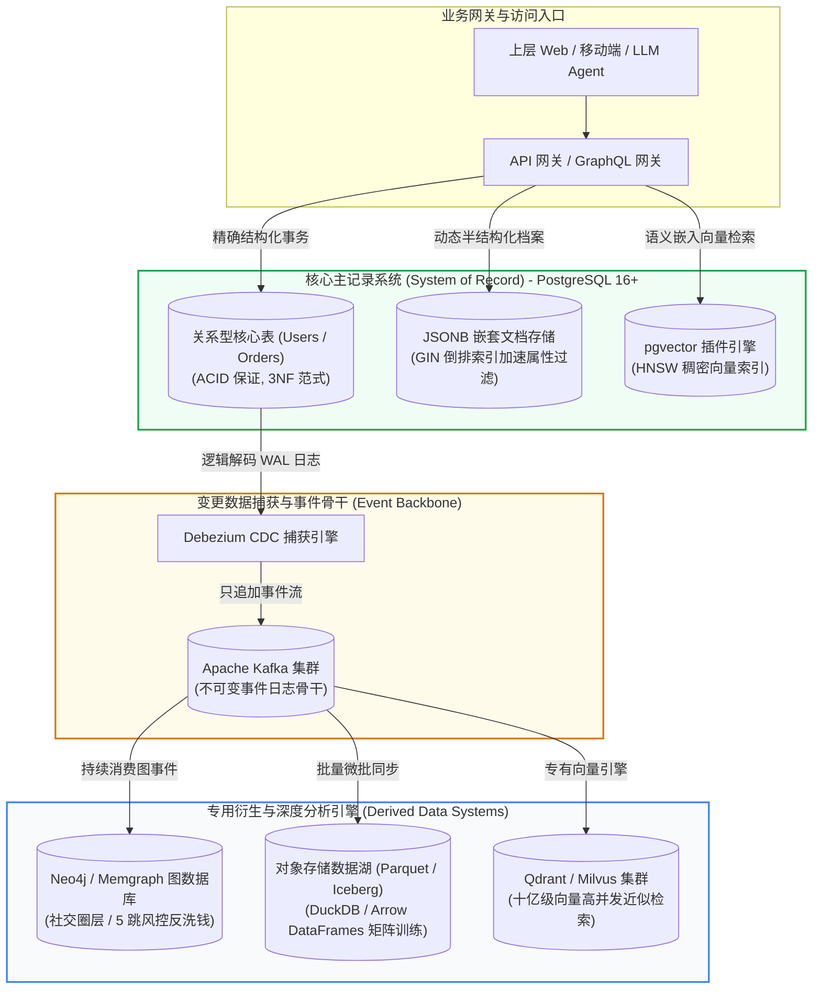

# 核心实战精炼：现代数据模型全景与多模态架构取舍

正如路德维希·维特根斯坦所言：“**我的语言的边界，意味着我的世界的边界**”。在软件架构设计中，**数据模型（Data Models）**不仅决定了数据以何种物理形态在磁盘与内存中落盘，更从底层深深禁锢或解放了我们思考业务问题的方式。

在第一版成书时，行业正处于“NoSQL 颠覆传统关系数据库”的躁动争鸣期；而在 2026 年最新第二版中，争论尘埃落定并走向了**深刻的融合与分工**：
1. **关系型与文档型互相吸纳**：PostgreSQL 的 `jsonb` 与二级索引使关系型完全具备文档库的灵活性，而 MongoDB 等文档库也补齐了多文档 ACID 事务与分片 Join；
2. **图模型与递归计算工程化**：属性图（Cypher）与 SQL 递归公共表表达式（CTE）在反洗钱、社交推荐与知识图谱中确立坚实地位；
3. **第二版重磅增补：事件溯源、DataFrames 与高维向量嵌入**：不可变事件日志（Append-only Event Log）成为极致写入优化的范式；以 Apache Arrow 为代表的 DataFrames 成为机器学习特征工程基石；而**向量嵌入（Vector Embeddings）**则直接将非结构化语义检索升格为系统的一等公民模型。

---

## 1. 核心技术决策矩阵：五大数据模型与多模态融合选型

| 数据模型维度 | 物理数据结构与抽象 | 最擅长关联模式 | 模式契约机制 (Schema) | 典型工业级引擎 | 核心优势与致命反模式 |
| :--- | :--- | :--- | :--- | :--- | :--- |
| **关系模型 (Relational)** | 行式表格、元组集合、B-Tree 索引、外键约束 | 高度范式化的 1:N 与多表关联（Join） | **写时模式 (Schema-on-write)**：严格强类型，DDL 显式迁移 | PostgreSQL, MySQL, CockroachDB | **优势**：保证数据一致性，消除数据冗余；<br/>**反模式**：深度递归关系引发几十次多表 Join 导致性能雪崩；难以优雅应对深度嵌套动态树。 |
| **文档模型 (Document)** | 自包含树状文档（JSON / BSON / MessagePack） | 强自包含的 1:N 树状层级，少跨文档关联 | **读时模式 (Schema-on-read)**：结构隐式动态解析 | MongoDB, Couchbase, DynamoDB | **优势**：单次读取即可获取全部层级上下文（数据局部性极佳）；<br/>**反模式**：在高度交织的多对多关系中强行反范式化拷贝，导致更新异常与级联修改风暴。 |
| **属性图模型 (Property Graph)** | 顶点（Vertices）、有向边（Edges）、标签与键值属性 | 高度交织的 N:M 关联，深度多跳网络遍历 | 灵活模式或无模式（Schema-optional） | Neo4j, Memgraph, AWS Neptune, KùzuDB | **优势**：指针式索引跳转（Index-free Adjacency），任意跳数遍历耗时稳定；<br/>**反模式**：超大单节点（超级顶点 Supernode）扇出遍历导致内存溢出与单机 CPU 锁死。 |
| **事件溯源 (Event Sourcing)** | 不可变只追加事件流（Append-only Event Log） | 时间序列事件依赖，按时间轴投影派生视图 | 强模式演进（Protobuf / Avro + Schema Registry） | Kafka, EventStoreDB, MartenDB | **优势**：极致的顺序写吞吐量，天然审计跟踪，随时向后重放重建历史；<br/>**反模式**：将事件流当作随机即席查询库（Ad-hoc Query）使用。 |
| **向量嵌入与 DataFrames** | 稠密浮点高维向量空间（1536/3072维）、Arrow 列式内存矩阵 | 高维几何空间余弦夹角与欧氏距离近邻关联 | 显式维度与张量数据类型规范 | pgvector, Qdrant, Milvus, DuckDB, Polars | **优势**：支持模糊语义检索、多模态以图搜图与 LLM 上下文对齐；<br/>**反模式**：脱离元数据过滤直接全空间暴力扫描（Flat Scan）；用向量替代结构化精确匹配。 |

---

## 2. 生产系统架构拓扑：现代统一多模态数据底座

下图展示了现代企业如何以 **PostgreSQL + 外部向量与图引擎** 协同，构建“关系 + 文档 + 向量 + 知识图谱”一体化融合拓扑：



---

## 3. 生产级实战代码：多模态混合检索与 SQL 递归图遍历

在现代 PostgreSQL 架构中，无需部署多套离散中间件，即可优雅实现**文档属性过滤 + 向量近邻检索 + 递归图遍历**的融合实战：

```sql
-- ========================================================
-- 1. 混合多模态模式定义：结合 关系型 + 文档 JSONB + 高维向量
-- ========================================================
CREATE EXTENSION IF NOT EXISTS vector;

CREATE TABLE tech_articles (
    article_id   BIGSERIAL PRIMARY KEY,
    title        TEXT NOT NULL,
    metadata     JSONB NOT NULL,         -- 文档型：灵活存放标签、作者信息与审核状态
    embedding    vector(1536),           -- 向量型：大模型文本嵌入 (OpenAI text-embedding-3-small)
    created_at   TIMESTAMPTZ DEFAULT NOW()
);

-- 为 JSONB 文档创建 GIN 倒排索引，为高维向量创建 HNSW 余弦相似度图索引
CREATE INDEX idx_articles_metadata ON tech_articles USING GIN (metadata);
CREATE INDEX idx_articles_embedding ON tech_articles USING hnsw (embedding vector_cosine_ops)
    WITH (m = 16, ef_construction = 64);

-- ========================================================
-- 2. 混合多模态检索：JSONB 属性精确剪枝 + 向量语义近似检索
-- ========================================================
EXPLAIN ANALYZE
SELECT 
    article_id,
    title,
    metadata->>'author' AS author_name,
    1 - (embedding <=> '[0.012, -0.045, ... , 0.089]') AS cosine_similarity
FROM tech_articles
WHERE metadata @> '{"status": "PUBLISHED", "category": "distributed-systems"}'
ORDER BY embedding <=> '[0.012, -0.045, ... , 0.089]' ASC
LIMIT 5;

-- ========================================================
-- 3. SQL 递归公共表表达式 (WITH RECURSIVE) 实现图多跳社交遍历
-- 寻找当前用户关注者的 3 度关注好友（社交网络图搜索）
-- ========================================================
WITH RECURSIVE social_graph_traversal AS (
    -- 锚点成员 (Anchor Member): 起始第 1 度关注好友
    SELECT 
        followee_id AS user_id, 
        1 AS depth, 
        ARRAY[follower_id, followee_id] AS path
    FROM user_follows
    WHERE follower_id = 10086

    UNION ALL

    -- 递归成员 (Recursive Member): 沿关注链向外多跳扩展
    SELECT 
        f.followee_id, 
        sgt.depth + 1, 
        array_append(sgt.path, f.followee_id)
    FROM user_follows f
    JOIN social_graph_traversal sgt ON f.follower_id = sgt.user_id
    WHERE sgt.depth < 3 
      AND NOT (f.followee_id = ANY(sgt.path)) -- 防止图环路死循环 (Cycle Detection)
)
SELECT DISTINCT user_id, min(depth) AS shortest_hop
FROM social_graph_traversal
WHERE user_id <> 10086
GROUP BY user_id
ORDER BY shortest_hop ASC, user_id ASC
LIMIT 20;
```

---

## 4. 架构避坑清单 (Do's & Don'ts)

| 架构决策维度 | 严禁行为 (Don'ts) | 推荐最佳工程实践 (Do's) |
| :--- | :--- | :--- |
| **ORM 映射与查询** | 毫无节制地依赖 ORM 懒加载关联对象，任由程序产生严重的 **N+1 次高频数据库往返**。 | 针对复杂关联业务，手写显式 SQL `JOIN` 或通过 ORM 的预加载（Eager Loading / `select_related`）一次性抓取。 |
| **文档模型设计** | 误把文档库当垃圾桶，将具有强一对多、随时无限增长的日志数组硬塞在单文档内导致超限。 | 树状文档仅用于表达生命周期强绑定的一对多关系；无界列表必须拆分为独立集合并通过外键关联。 |
| **图遍历保护** | 在执行 Cypher 或递归 SQL 查询时，未做深度限制与环路检测，直接触发全图笛卡尔积。 | 必须显式限制最大跳数（如 `depth <= 4`），并在查询路径中维护已访问节点数组（Visited Array）杜绝环路。 |
| **高维向量检索** | 在上百万规模的向量空间中执行无索引的暴力距离计算（Exact k-NN Flat Scan）。 | 针对生产海量检索必须构建近似最近邻索引（HNSW 或 IVFFlat），并先做标量元数据预过滤（Pre-filtering）。 |
| **模式演进治理** | 盲目信奉“无模式（Schemaless）就是零负担”，在应用层肆意写入不可向后兼容的异构脏数据。 | 文档型数据库务必在应用层维护模式契约（如 Pydantic / JSON Schema），或依托模式注册中心做兼容性校验。 |

<!-- split -->

# 原著中文精译：数据模型与查询语言（第二版精译与语境解析）

> “我的语言的边界，意味着我的世界的边界。”  
> —— **Ludwig Wittgenstein**，《逻辑哲学论》（*Tractatus Logico-Philosophicus*，1922）

数据模型或许是整个软件工程开发中最核心的基石，因为它所产生的深远影响，不仅关乎底层代码该如何编写，更直接深刻地**塑造了我们如何抽象与推演所要解决的现实问题**。

现代大多数应用程序，都是通过将一层数据模型叠置在另一层数据模型之上而构建起来的。对于每一个层次而言，核心焦点都在于：**它如何借助下一层更低阶的模型来得以优雅表达？**
1. **现实业务域**：作为业务开发者，你凝视真实世界（人、组织、商品、资金流向、硬件传感器等），并将其抽象为应用层专用的面向对象实体或数据结构；
2. **通用数据抽象**：当你需要对这些结构进行持久化时，你将其表达为通用数据模型——例如关系数据库中的表格、JSON/XML 文档、抑或图结构中的顶点与边。这正是本讲的核心舞台；
3. **底层存储引擎**：数据库内部的系统工程师决定了如何将上述文档、关系元组或图，转化为内存、磁盘或网络中的具体物理字节组织。我们将在下一讲（第 4 讲）深度剖析存储引擎；
4. **硬件物理层**：在最底层的物理世界中，硬件工程师则将字节映射为半导体电流、光纤光脉冲或磁盘磁场。

在复杂应用中，中间可能还嵌套着更多的派生抽象层（如基于 API 构建的 API），但其核心哲学始终如一：**每一层通过对外暴露一套清晰、干净的数据模型，隐藏了其下所有层次的残酷物理复杂性**。这种模块化抽象，使得数据库研发团队与业务应用开发团队能够高效协作。

---

## 声明式查询语言的哲学与优势

在本讲讨论的众多查询语言中（包括 SQL、Cypher、SPARQL 与 Datalog），绝大多数都属于**声明式查询语言（Declarative Query Languages）**。

与传统的命令式编程（Imperative Programming，如 C、Java 或 Python）截然不同：在声明式语法中，你只需清晰描述**你所期望获取的目标数据具备何种特征与约束**（例如：符合什么过滤条件、按什么字段排序、进行何种聚合统计），而**无需指定计算机具体以何种步骤去达成这一目标**。

数据库内部的**查询优化器（Query Optimizer）**会自动决定：该挑选哪一个辅助索引、该按什么顺序执行多表连接、该采用嵌套循环连接（Nested Loop Join）还是哈希连接（Hash Join）。

声明式语言之所以拥有无与伦比的生命力，在于两大根基优势：
1. **表达精炼且心智负担低**：比手动手写复杂迭代算法短小得多；
2. **与执行引擎细节彻底解耦**：数据库底层可以全面重写优化算法、引入向量化执行引擎甚至在多核 CPU 与集群节点间自动实现**无缝并行计算**，而应用层数以万计的声明式查询语句无需做任何一行代码改动！而在手写的命令式循环中，若想改造成多线程或分布式并行，几乎意味着推倒重来。

:::en
> **Original**: Many of the query languages discussed in this chapter (such as SQL, Cypher, SPARQL, and Datalog) are declarative, which means that you specify the pattern of the data you want—what conditions the results must meet and how you want the data to be transformed (e.g., sorted, grouped, and aggregated)—but not how to achieve that goal. The database system’s query optimizer can decide which indexes and join algorithms to use and in which order to execute various parts of the query... A declarative query language is attractive because it is typically more concise and easier to write than an explicit algorithm. More importantly, it hides implementation details of the query engine, which makes it possible for the database system to introduce performance improvements without requiring any changes to queries.

**📌 核心术语与语境解析**：
- **Declarative Query Language** [dɪˈklærətɪv ˈkwɪəri ˈlæŋɡwɪdʒ]：*声明式查询语言*。只声明目标数据的逻辑约束而不规定具体算法步骤的编程范式。
- **Query Optimizer** [ˈkwɪəri ˈɒptɪmaɪzər]：*查询优化器*。关系型引擎的智慧大脑，基于统计信息（Statistics）搜索最优物理执行计划（Execution Plan）。
- **Implementation Hiding** [ˌɪmplɪmenˈteɪʃn ˈhaɪdɪŋ]：*实现隐藏/封装*。将逻辑访问契约与物理存储/并发结构彻底剥离，赋予系统透明进化的自由度。
:::

---

## 关系模型与文档模型：对象-关系阻抗失配

当今工业界最广为人知的数据模型无疑是 SQL，其根基是 **Edgar Codd 于 1970 年奠定的关系模型（Relational Model）**。数据被组织为一系列关系（在 SQL 中称为表），每一张表都是无序元组（在 SQL 中称为行）的集合。

然而，现代业务代码大多由面向对象语言（Java、Python、Go、TypeScript）编写。这种语言世界与关系数据库之间存在着一道深刻的语义鸿沟，被称为**对象-关系阻抗失配（Object-Relational Impedance Mismatch）**。

### 阻抗失配与 ORM 的两面性

对象关系映射框架（ORM，如 Hibernate、ActiveRecord、Prisma）试图通过自动化转换层抹平这一鸿沟，但它们在生产界饱受争议：
- **N+1 次查询噩梦**：遍历查询 N 条文章评论时，ORM 的懒加载（Lazy Loading）往往会在后台悄无声息地向用户表发出额外的 N 次单行查询，导致数据库在瞬时间被无意义的小查询网络往返淹没；
- **伪装的透明性**：ORM 无法真正替开发者屏蔽底层物理差异，开发者最终仍被迫同时在对象图与关系范式两套完全不同的思维模式下反复切换。

---

### 一对多关系的建模：简历档案对比

让我们以 LinkedIn 用户的电子简历为例，对比两种模型的物理表达。一份完整的简历由唯一标识 `user_id` 统揽，包含姓名、多段教育背景、多份任职经历以及多项联系方式。

在纯粹的关系模型中，必须进行高度的表拆分与范式化（如图 3-1 所示）：


*图 3-1：在关系型模式中表示用户档案：教育经历、职位与联系方式被迫分散在多张从表，通过外键引用*

当需要展示该用户的完整页面时，应用程序要么执行繁琐的多表 Join，要么连续执行多次 SQL 查询。

而在以 JSON 为代表的文档数据模型中，整个简历是一个浑然一体、树状自包含的独立实体（如图 3-2 所示）：


*图 3-2：在文档模型中表示用户档案：所有一对多关系天然嵌套在一个自包含的树状 JSON 文档内*

文档模型在此类场景中展现出压倒性的优势：
- **数据局部性（Data Locality）**：整份档案在底层物理磁盘或内存中存放在连续的存储块中，一次高效的单次读取即可装配全部上下文；
- **心智契合**：树状文档结构与现代前端 UI 的组件渲染结构以及应用内存中的对象树高度同构。

---

### 范式化、反范式化与多对一/多对多困境

然而，真实世界的数据绝非全是一对多的简单树状结构。

一旦系统中出现**多对一（Many-to-One）**或**多对多（Many-to-Many）**关联，文档模型自包含的假象就会破灭：
- **多对一标准化（Normalization）**：如图 3-3 所示，用户的工作地区或毕业院校，如果直接存储为明文字符串，会导致大量重复；且一旦院校更名，必须扫描全量文档级联修改。标准做法是存为数字 ID，指向独立的字典表；


*图 3-3：多对一关系：引入唯一的地区与行业 ID，消除字符串冗余并保证引用统一性*

- **多对多关联（Many-to-Many）**：如图 3-4 所示，技能点与同事之间的相互点赞背书（Endorsements），构成了错综复杂的多对多网状结构。


*图 3-4：复杂的多对多关系：用户与技能之间形成交叉关联网络*

如果强行在文档库中通过“数据拷贝（Denormalization）”把相关信息硬拷贝到各个文档内部，系统很快将陷入可怕的**写入放大与数据不一致**泥潭；而若在文档库中仅保留 ID 引用，由于大多数文档引擎对跨分片 Join 的支持极为孱弱或性能低下，应用层不得不退化为手写多轮网络往返去拼接数据。

---

### 读时模式 vs 写时模式与两者的殊途同归


*图 3-6：写时模式（严格静态类型检查）与读时模式（动态解释运行时解析）的本质区别*

- **写时模式（Schema-on-write）**：关系数据库的传统定式，类似于静态编译型语言。数据在写入磁盘前，必须经过严格的列类型校验与模式强制。模式变更需要耗费开销执行 DDL 迁移；
- **读时模式（Schema-on-read）**：文档数据库的特质，类似于动态脚本语言。存储引擎只管把原始字节当黑盒写入，结构解释权完全推迟到读取应用层。在处理数据源极其异构、上游格式不可控的场景时具备极高弹性。

进入 2026 年，关系型与文档型的界限已高度模糊。PostgreSQL、MySQL 等现代关系数据库引入了功能强悍的原生 `jsonb` 数据类型与倒排索引，使得开发者可以在同一个事务内同时享受**关系型的强外键约束**与**文档型的半结构化无模式自由度**。

:::en
> **Original**: Object-relational mapping (ORM) frameworks like ActiveRecord and Hibernate reduce the amount of boilerplate code required for this translation layer, but they are often criticized... ORMs are complex and can’t completely hide the differences between the two models, so developers still end up having to think about both the relational and the object representations of the data... Document databases and relational databases started out as very different approaches to data management, but they have grown more similar over time. Relational databases added support for JSON types and query operators, and the ability to index properties inside documents. Some document databases added support for joins, secondary indexes, and declarative query languages.

**📌 核心术语与语境解析**：
- **Impedance Mismatch** [ɪmˈpiːdəns ˈmɪsmætʃ]：*阻抗失配*。物理学借用词，在此特指面向对象语言的内存指针图与关系型二维表格在映射转换时产生的结构性摩擦与开销。
- **Schema-on-read** [ˈskiːmə ɒn riːd]：*读时模式*。底层不强制固定模式，数据的格式与含义仅在读取时由消费端代码负责动态解释。
- **Data Locality** [ˈdeɪtə ləʊˈkæləti]：*数据局部性*。将经常需要一同访问的数据连续存放在同一物理页或磁盘簇中，减少随机 I/O 寻道时间。
- **Convergence of Models** [kənˈvɜːdʒəns]：*数据模型收敛/融合*。各主流数据系统不再孤立割裂，而是普遍演变为兼具文档、关系与复杂索引的多模态混合引擎。
:::

---

## 图状数据模型与遍历语言

当数据之间的**多对多关联变得极其密集、深邃且彼此高度交织**时，无论是关系型还是文档型都会显得极其笨拙与力不从心。此时，将数据建模为**图（Graph）**是最自然的第一性原理选择。

一个图由两类核心元素构成：
1. **顶点（Vertices / Nodes）**：代表实体（例如：人、地点、事件、交易单号）；
2. **边（Edges / Relationships）**：代表实体之间的方向性关联（例如：好友关系、出生于、向某人转账）。


*图 3-7：属性图模型直观展现：Lucy 出生于爱达荷，Alain 出生于法国，二人结婚并共同居住在伦敦*

### 属性图（Property Graph）与 Cypher 查询语言

在工业界最广泛采用的属性图模型中，每个顶点包含唯一 ID、一组向外发出的边、一组进入的边以及键值属性集；每条边包含唯一 ID、起点顶点、终点顶点、关系标签（如 `BORN_IN`）以及自身的一组键值属性。

Neo4j 推出的 **Cypher 语言**将声明式图查询推向了极致优雅的境界。例如，要查询“所有出生在美国、如今定居在欧洲的人名”，在 Cypher 中表达如下：

```cypher
MATCH (person:Person) -[:BORN_IN]-> () -[:WITHIN*0..]-> (us:Location {name: 'United States'}),
      (person)        -[:LIVES_IN]-> () -[:WITHIN*0..]-> (eu:Location {name: 'Europe'})
RETURN person.name
```

语法中的箭头 `-[:BORN_IN]->` 直观模拟了图遍历的路径，`[:WITHIN*0..]` 则以简洁的星号表达了**任意深度的递归跨级归属**（例如：市 $\rightarrow$ 州 $\rightarrow$ 国家 $\rightarrow$ 大洲）。

相比之下，若在传统关系数据库中实现相同的不定跳数多级层级检索，开发者必须编写极其冗长晦涩的 **SQL 递归公共表表达式（`WITH RECURSIVE`）**，且性能极度依赖优化器能否有效剪枝。

### 三元组存储（Triple Stores）与 Datalog 逻辑推演

除了属性图，图模型的另一大分支是源自语义网（Semantic Web）的**三元组存储（Triple Stores）**与 **SPARQL 语言**。所有信息被极简地拆解为三元组：
$$\langle \text{主体 Subject}, \text{谓词 Predicate}, \text{客体 Object} \rangle$$
例如：`(Lucy, bornIn, Idaho)` 以及 `(Idaho, within, USA)`。

而在更深邃的学术与特定垂直领域，**Datalog** 提供了基于一阶逻辑规则的递归推导能力。开发者定义由事实衍生新虚拟视图的推理规则，系统自动展开推演，展示了极其强大的形式化表达力。

:::en
> **Original**: A graph consists of two kinds of objects: vertices (also known as nodes or entities) and edges (also known as relationships or arcs)... In the property graph model, each vertex consists of a unique identifier, a set of outgoing edges, a set of incoming edges, and a collection of properties. Cypher is a declarative query language for property graphs... It allows complex graph traversals to be expressed concisely using an intuitive ASCII-art syntax that mirrors the visual structure of the graph.

**📌 核心术语与语境解析**：
- **Property Graph** [ˈprɒpəti ɡrɑːf]：*属性图模型*。允许在顶点和边上直接附带任意键值属性的现代工业级图数据建模范式。
- **Index-free Adjacency** [ˈɪndeks friː əˈdʒeɪsənsi]：*无索引邻接*。图数据库特有的底层存储特性：每个顶点直接在内存/磁盘中持有其关联边的物理指针，避免了传统数据库每次跳转都需要查 B-Tree 索引的高昂开销。
- **Cypher** [ˈsaɪfər]：*Cypher 图查询语言*。以字符艺术（ASCII-art）箭头形式直观表达图路径模式匹配的声明式语言标准。
:::

---

## 第二版重大演化：事件溯源、DataFrames 与高维向量空间

第二版 DDIA 在数据模型维度最激动人心的跃迁，在于系统性地将**分析、流式与 AI 原生数据模型**纳入了核心版图。

### 1. 极致写入建模：事件溯源（Event Sourcing）

在传统的 CRUD 模型中，数据库记录被原地不断覆盖修改（Update-in-place），历史痕迹荡然无存。

如果我们将思维彻底倒转：**如果我们完全不关心读取性能，只希望拥有极致的写入吞吐量与绝对的因果审计性，该如何建模？**
答案就是**只追加不可变事件日志（Append-only Event Log）**。
- 每次业务操作都被封装为一个自包含的、具备时间戳的不可变事件（如 `OrderPlaced`, `PaymentReceived`, `ItemRefunded`）；
- 核心存储底座无需维护复杂的 B-Tree 索引与就地锁更新，只做纯粹的顺序追加写入，性能逼近磁盘物理极限；
- 所有面向用户端的高效读取界面，都是通过后台消费者监听事件流，持续投递更新的**物化视图（Materialized Views）**。

### 2. 分析与机器学习基石：DataFrames 与多维数组

在数据科学与机器学习场景中，SQL 的纯文本二维表格显得笨重而不合时宜。**DataFrame 模型（如 Apache Arrow、Polars、Pandas）**与高维张量矩阵成为了通用语言。

如图 3-9 所示，通过将关系型的离散评分表转换为高维稀疏矩阵，结合独热编码（One-hot Encoding），非结构化数据被彻底数字化为线性代数可直接运算的向量：


*图 3-9：将关系型用户-电影评分表转换为稀疏二维矩阵，为机器学习线性代数矩阵分解铺平道路*

### 3. AI 时代的新一等公民：高维向量嵌入（Vector Embeddings）

第二版深入洞察到，大语言模型与多模态 AI 的爆发，催生了一种全新的核心数据模型——**高维稠密向量空间（Dense Vector Spaces）**。
- 文本、音频、图片被深度神经网络投射为数千维的浮点数组；
- 传统的精确相等匹配在向量空间中毫无意义，查询的核心在于**语义距离度量**（余弦相似度 Cosine Similarity、内积 Dot Product 或欧氏距离 L2 Distance）；
- 现代数据系统不再将向量视为孤立的二进制 BLOB，而是通过专有向量索引（如 HNSW、IVFFlat）将其作为一等公民内置进查询规划器中，实现了**结构化元数据 SQL 过滤与语义向量相似度近邻检索的同事务融合**。

:::en
> **Original**: In complex applications it can sometimes be difficult to find a single data representation that is able to satisfy all the ways that the data needs to be queried and presented. In such situations, it can be beneficial to write data in one form and then derive from it representations that are optimized for different types of reads... The DataFrame data model is supported by Pandas, Apache Spark, and other systems... A common use of DataFrames is to transform data from a relational-like representation into a matrix or multidimensional array representation, which is the form in which many ML algorithms expect their input.

**📌 核心术语与语境解析**：
- **Event Sourcing** [ɪˈvent ˈsɔːsɪŋ]：*事件溯源*。将业务领域的一切状态变化表示为不可变事件序列的架构模式，系统当前状态由回放事件历史派生而来。
- **DataFrame** [ˈdeɪtəfreɪm]：*数据帧*。强类型的列式内存二维表格抽象，提供矢量化批处理与高效线性代数转换算子。
- **Vector Embedding** [ˈvektər ɪmˈbedɪŋ]：*向量嵌入*。将真实世界的复杂非结构化语义实体映射至高维连续几何向量空间的数学表征技术。
- **Append-only Log** [əˈpend ˈəʊnli lɒɡ]：*只追加日志*。仅在末尾写入且永不就地修改的物理存储结构，是现代分布式可靠性与高吞吐写的物理基石。
:::
