> 💡 **双栏独立滚动工作台导读**：本文采用双栏对照架构。**左栏**为四类主流存储引擎决策矩阵、LSM 与 HNSW 复合流转拓扑与避坑清单 (Do's & Don'ts)；**右栏**为原著完整参考译文，附有关键段落的英文原文展开与难词解析。左右两栏可独立滚动，并支持顶栏自定义宽度比例（7:3 / 5:5 / 3:7）与拖拽调节。

# 核心实战精炼：现代存储引擎底层物理机理与索引权衡

诺贝尔物理学奖得主理查德·费曼曾深刻指出：“**计算机从根本上说并非在‘计算’，它们本质上是档案归档系统**”。数据库底层最质朴的契约只有两条：
1. 当你向它交付数据时，它必须安全稳固地持久化；
2. 当你稍后向它索取数据时，它必须以可接受的延迟将数据精准寻回。

在第二版中，存储引擎的讨论边界得到了前所未有的现代扩展：不仅透彻推导了 **LSM-Tree（写放大/压实颠簸）** 与 **B-Tree（就地更新/预写日志）** 在固态硬盘（NVMe SSD）上的物理较量，更系统剖析了 **SIMD 向量化列式执行** 以及现代 AI 基础设施的基石——**高维向量嵌入（Vector Embeddings & HNSW 索引）**的底层数学与数据结构。

---

## 1. 核心技术决策矩阵：四类主流存储引擎全景剖析

| 引擎家族 | 核心物理数据结构 | 物理写入范式 | 读写放大特征 | 硬件亲和性与瓶颈 | 典型工业级代表 | 最佳生产场景与禁忌 |
| :--- | :--- | :--- | :--- | :--- | :--- | :--- |
| **B-Tree 家族** | 多叉平衡平衡树、固定物理页（4KB~16KB）、WAL 预写日志 | **就地更新 (Update-in-place)**：覆盖写入对应磁盘页 | 读放大极低（严格树高寻道）；写放大较高（微小修改引发整页写盘） | 依赖低延迟随机读写 IOPS；高频写导致 SSD 磨损加剧 | MySQL InnoDB, SQLite, PostgreSQL, WiredTiger | **最佳**：高频高精度随机点查、强事务 ACID；<br/>**禁忌**：超大吞吐量无序流式连续盲写。 |
| **LSM-Tree 家族** | 内存跳表（MemTable）+ 不可变有序串表（SSTable）+ 布隆过滤器 | **只追加写 (Append-only)**：后台异步归并压实（Compaction） | 写入放大可控（顺序 I/O）；读放大与空间放大较高（需查多层 SSTable） | 榨干顺序写入带宽；压实线程容易与前台写请求争抢 I/O 引发写停顿（Write Stall） | RocksDB, LevelDB, Apache Cassandra, ScyllaDB | **最佳**：高频日志、时序指标、分布式写入密集型存储；<br/>**禁忌**：对尾延迟抖动极其敏感的超强确定性点查场景。 |
| **列式存储 (Columnar)** | 按列连续切分的数据块、字典压缩、游程编码（RLE）、位图索引 | **批量切块追加 (Batch Bulk-Append)**：不可变段归并 | 读取超少列聚合极快（投影裁剪）；不支持低开销的单行细粒度就地更新 | 极度亲和 CPU L1/L2 缓存行与 SIMD 向量化指令；随机点查极其缓慢 | ClickHouse, DuckDB, Apache Parquet, Snowflake | **最佳**：大规模数仓聚合（OLAP）、日志审计大宽表；<br/>**禁忌**：高并发低延迟行级 CRUD 事务。 |
| **高维向量索引 (Vector ANN)** | 分层导航小世界图（HNSW）、倒排聚类中心（IVFFlat）、乘积量化（PQ） | **高维拓扑构图与量化聚类**：内存常驻图节点与边跳转 | 内存放大极高（HNSW 需几十字节边指针/向量）；计算密集（浮点余弦点积） | 重度依赖海量物理内存与 CPU AVX-512 / GPU 张量加速指令 | pgvector, Qdrant, Milvus, LanceDB | **最佳**：大模型 RAG 语义搜索、图像多模态特征检索；<br/>**禁忌**：结构化精确等值过滤（必须混合元数据索引）。 |

---

## 2. 生产系统架构拓扑：高吞吐 LSM-Tree 写入与 HNSW 向量索引图

下图呈现了前台 **LSM-Tree 顺序落盘与分层压实**，以及后台 **高维向量 HNSW 多层跳跃网络** 的底层物理运转全貌：

```mermaid
flowchart TD
    subgraph LSMWritePath["LSM-Tree 写入与压实流转链路"]
        WriteReq["客户端写入请求 (Put Key-Value)"] --> WAL["预写日志 (WAL.log)<br/>(磁盘顺序追加, 宕机恢复保证)"]
        WriteReq --> MemTable["活跃内存跳表 (Active MemTable)<br/>(并发跳表 Concurrent SkipList)"]
        
        MemTable -->|达到阈值 64MB| ImmMemTable["只读冻结跳表 (Immutable MemTable)"]
        ImmMemTable -->|后台 Flush 线程| L0_SST["Level 0 SSTable 集合<br/>(Key 范围相互重叠)"]
        
        L0_SST -->|Size-Tiered / Leveled 压实| L1_SST["Level 1 SSTable 集合<br/>(全局 Key 有序无重叠)"]
        L1_SST -->|逐层下推归并| L2_SST["Level 2+ 深度持久化层<br/>(压缩率极高, 冷数据存储)"]
        
        Bloom["布隆过滤器 (Bloom Filter)<br/>(快速判定 Key 是否绝对不存在)"] -.->|加速检索| L0_SST
        Bloom -.->|拦截磁盘 I/O| L1_SST
    end

    subgraph VectorHNSW["高维向量 HNSW 分层导航小世界索引"]
        QueryVec["查询向量 (Query Vector)"] --> TopLayer["第 2 层 (稀疏顶层): 极少数长距离跳跃节点"]
        TopLayer -->|贪心贪婪搜索最近邻| MidLayer["第 1 层 (过渡层): 中等稠密度导航路由"]
        MidLayer -->|逐层下降对齐| BottomLayer["第 0 层 (底层数据层): 包含全量向量的致密图"]
        BottomLayer --> FinalANN["返回 Top-K 语义最近邻集合"]
    end

    style LSMWritePath fill:#f8fafc,stroke:#3b82f6,stroke-width:2px
    style VectorHNSW fill:#fffbeb,stroke:#d97706,stroke-width:2px
```



---

## 3. 生产级实战代码：微型 LSM-Tree 存储引擎核心精简实现

理解 LSM 引擎的第一性原理，莫过于亲手实现其核心骨架——**内存跳表缓冲、预写日志持久化、SSTable 稀疏索引与二分寻道**：

```python
import os
import struct
import bisect

class MiniLSMStorageEngine:
    """
    微型生产级 LSM-Tree 原型
    涵盖：WAL 日志、内存 MemTable、SSTable 稀疏索引与二分快速检索
    """
    def __init__(self, data_dir="./lsm_data", memtable_threshold=1000):
        self.data_dir = data_dir
        self.threshold = memtable_threshold
        os.makedirs(data_dir, exist_ok=True)
        self.wal_path = os.path.join(data_dir, "current.wal")
        self.wal_file = open(self.wal_path, "a+b", buffering=0)
        self.memtable = {}  # 内存有序字典/跳表映射
        self.sstable_sparse_indexes = [] # 存储各个 SSTable 的稀疏索引元数据
        self.sstable_counter = 0

    def put(self, key: str, value: str):
        # 1. 先顺序追加写入 WAL 日志，保证持久性
        k_bytes, v_bytes = key.encode("utf-8"), value.encode("utf-8")
        record = struct.pack(f"!II{len(k_bytes)}s{len(v_bytes)}s", 
                             len(k_bytes), len(v_bytes), k_bytes, v_bytes)
        self.wal_file.write(record)

        # 2. 写入内存 MemTable
        self.memtable[key] = value

        # 3. 检查是否达到刷盘阈值
        if len(self.memtable) >= self.threshold:
            self.flush_memtable()

    def flush_memtable(self):
        """将内存 MemTable 冻结并按顺序写入全新的不可变 SSTable 文件"""
        sstable_name = f"sstable_{self.sstable_counter:05d}.db"
        sstable_path = os.path.join(self.data_dir, sstable_name)
        
        sorted_keys = sorted(self.memtable.keys())
        sparse_index = []  # 稀疏索引：每隔 16 个 Key 记录一次物理字节偏移量
        offset = 0

        with open(sstable_path, "wb") as f:
            for idx, k in enumerate(sorted_keys):
                v = self.memtable[k]
                k_b, v_b = k.encode("utf-8"), v.encode("utf-8")
                chunk = struct.pack(f"!II{len(k_b)}s{len(v_b)}s", 
                                    len(k_b), len(v_b), k_b, v_b)
                if idx % 16 == 0:
                    sparse_index.append((k, offset))
                f.write(chunk)
                offset += len(chunk)

        # 记录稀疏索引到内存路由表，清空 MemTable 与 WAL
        self.sstable_sparse_indexes.insert(0, {"file": sstable_path, "index": sparse_index})
        self.sstable_counter += 1
        self.memtable.clear()
        self.wal_file.close()
        self.wal_file = open(self.wal_path, "w+b", buffering=0)

    def get(self, key: str) -> str:
        # 1. 优先查活跃内存 MemTable (最热数据)
        if key in self.memtable:
            return self.memtable[key]

        # 2. 由新到旧依次扫描各个不可变 SSTable 的稀疏索引
        for entry in self.sstable_sparse_indexes:
            sparse_index = entry["index"]
            keys_only = [item[0] for item in sparse_index]
            pos = bisect.bisect_right(keys_only, key) - 1
            if pos < 0:
                continue
            
            start_offset = sparse_index[pos][1]
            # 根据稀疏索引定位扇区，执行局部顺序小扫描 (最多扫描 16 条)
            with open(entry["file"], "rb") as f:
                f.seek(start_offset)
                for _ in range(16):
                    header = f.read(8)
                    if not header or len(header) < 8:
                        break
                    k_len, v_len = struct.unpack("!II", header)
                    curr_k = f.read(k_len).decode("utf-8")
                    curr_v = f.read(v_len).decode("utf-8")
                    if curr_k == key:
                        return curr_v
                    if curr_k > key:
                        break # 已超越目标 Key，提前终止
        return None
```

---

## 4. 架构避坑清单 (Do's & Don'ts)

| 架构决策维度 | 严禁行为 (Don'ts) | 推荐最佳工程实践 (Do's) |
| :--- | :--- | :--- |
| **LSM 压实调优** | 在高并发写入场景忽视压实监控，任由后台 I/O 耗尽带宽触发系统**写停顿（Write Stall）**。 | 精细配置压实并发线程数与速率限制（Rate Limiting），针对不同读写比选用分层（Leveled）压实。 |
| **SSD 介质与 B-Tree** | 在廉价 QLC 固态硬盘上运行写入极度频繁的 B-Tree 引擎，导致整页就地覆盖写迅速烧毁盘片。 | 对写入吞吐极端敏感的场景优先采用 LSM 架构，或在 B-Tree 上开启事务提交组缓冲（Group Commit）。 |
| **布隆过滤器配置** | 贪图节省几兆内存而关闭布隆过滤器，导致大量查询不存在 Key 时必须逐层穿透磁盘读 SSTable。 | 为所有 LSM 树配备布隆过滤器（通常按每 Key 分配 10 bits，假阳性率降至 1% 以下），拦截 99% 的无效磁盘 I/O。 |
| **列式存储滥用** | 将 ClickHouse 或 Parquet 数据湖作为在线交易（OLTP）的用户订单行级即时修改库。 | 列式引擎仅用于批量不可变导入与只读多维分析；行级修改必须由前台行存数据库（PostgreSQL/MySQL）承接。 |
| **向量维度与召回** | 在向量数据库中无脑选用暴力 Flat 精确计算，或者设置极低索引构建参数导致召回率（Recall）断崖。 | 生产向量检索务必构建 HNSW 索引（参数 `m=16~64`, `ef_construction=64~200`），并在标量过滤后执行向量对齐。 |

<!-- split -->

# 原著中文精译：存储与检索内幕（第二版精译与语境解析）

> “生活的一大不幸在于，每个人给事物起的名字往往都有那么一点不对头。这导致理解世界上的一切变得比本应的样子更为艰难。一台‘计算机’，其核心工作根本不是在做算术意义上的‘计算’……它们本质上是**档案归档系统**。”  
> —— **Richard Feynman**，特立独行思考研讨会（*Idiosyncratic Thinking seminar*，1985）

在最第一性原理的层面上，数据库的核心职责无非是两件事：
1. 当你向其传入数据时，它必须安全地存储下这些数据；
2. 当你未来再次索取时，它必须能完整无误地将数据检索出来交付给你。

在上一讲中，我们探讨了数据模型与查询语言——即你向数据库交付数据时的语法格式，以及向其索取数据时的逻辑交互界面。而本讲我们将**彻底站到数据库软件内部实现者的视角**：推演数据库究竟在磁盘与内存中如何排布这些字节，以及在遭遇海量数据洪峰时，它是如何以微秒级耗时将目标记录从数以亿计的块中瞬间寻回的。

作为业务应用开发者，你或许永远不会亲手去从零编写一个生产级存储引擎，但你**必须为你的业务系统挑选最贴切的存储引擎**。为了在错综复杂的生产工况下正确调优并预判系统行为，你必须吃透引擎在黑盒底层究竟在进行着怎样的物理运转。

---

## 最简数据库的启示：世界上最简单的键值存储

让我们从世界上最简单的数据库开始探索。仅凭两行 Bash 脚本，便能构建出一套可工作的键值存储：

```bash
#!/bin/bash

db_set () {
    echo "$1,$2" >> database
}

db_get () {
    grep "^$1," database | sed -e "s/^$1,//" | tail -n 1
}
```

其运转流程极其纯粹：
- 写入时，`db_set key value` 仅仅是将新的一行逗号分隔记录直接追加（Append）到文件末尾；
- 读取时，`db_get key` 则使用 `grep` 从头到尾扫描全文件，提取所有以该键开头的行，并使用 `tail -n 1` 截取最后一条出现的记录（即最新的更新值）。

### 写入与读取的终极工程权衡

仔细观察这两个微型函数，蕴藏着数据系统设计中最深刻的二元对立：
- **`db_set` 拥有接近硬件物理极限的写入性能**：因为向文件末尾执行顺序追加（Append-only），是任何现代存储介质（无论是机械硬盘还是高速固态硬盘）上最廉价、最高效的操作；
- **`db_get` 的检索性能则是灾难性的**：每次查询一个键，系统都必须自始至终扫描全量文件，其算法时间复杂度为残酷的 $O(n)$。若数据库积累了数亿条记录，单次点查便需要耗费数分钟。

为了打破这种检索窘境，我们必须引入一种额外的派生数据结构——**索引（Index）**。

索引的本质是**基于主数据额外构建的辅助元数据路径**。你可以根据访问模式随心所欲地添加或删除索引，这绝不会篡改数据库的真实业务内容，只会改变查询的耗时。然而，天底下没有免费的午餐：**任何精心构建的索引都会在写入时引入不可避免的额外开销**。因为每次新增或更新数据时，数据库不仅要顺序写日志，还必须同步刷新所有的辅助索引结构。

**存储系统设计的核心主线，正是这场永恒的妥协**：精心设计的索引极大加速了读取，但代价是消耗额外的存储空间并拖慢写入速度。

:::en
> **Original**: The db_set function has pretty good performance for something that is so simple, because appending to a file is generally very efficient. Similarly to what db_set does, many databases internally use a log, which is an append-only data file... On the other hand, the db_get function has terrible performance if you have a large number of records in your database. Every time you want to look up a key, db_get has to scan the entire database file from beginning to end... To efficiently find the value for a particular key in the database, we need a different data structure: an index... An index is an additional structure that is derived from the primary data. Many databases allow you to add and remove indexes, and this doesn’t affect the contents of the database; it affects only the performance of queries. Maintaining additional structures incurs overhead, especially on writes.

**📌 核心术语与语境解析**：
- **Append-only Log** [əˈpend ˈəʊnli lɒɡ]：*只追加日志*。永远只向末尾写入而不做就地修改的文件结构，能够将磁盘随机 I/O 转化为顺序 I/O。
- **Index Overhead** [ˈɪndeks ˈəʊvəhed]：*索引开销*。维护辅助检索树或哈希表对写入吞吐量产生的不可避免的惩罚。
- **Primary Data vs Derived Data**：*主数据与派生数据*。主数据是业务权威真理源头，索引则是可根据主数据随时重建的派生加速路径。
:::

---

## 事务型存储引擎（OLTP）：LSM-Tree 与不可变文件

如何既保留只追加日志的极致顺序写吞吐，又能让点查达到微秒级？

### 哈希索引的极限与 Bitcask

最朴素的尝试是在内存中维护一个全量**哈希表（In-Memory Hash Index）**（如图 4-1 所示）：将每一个 Key 映射到其在磁盘只追加日志文件中的字节偏移量（Byte Offset）。


*图 4-1：以内存哈希表为辅助索引的只追加日志引擎（Bitcask 模式）*

当读取某个 Key 时，直接查内存哈希表拿到精确偏移量，执行一次磁盘寻道即可命中数据。Riak 默认的 Bitcask 引擎便是这种架构。但它存在着无法逾越的致命缺陷：
1. **内存容量硬瓶颈**：所有的 Key 必须全量装入物理内存，一旦 Key 数量突破千万级便直接 OOM；
2. **范围查询彻底失效**：哈希函数打散了大小顺序，无法支持 `WHERE id BETWEEN 100 AND 200` 这样的区间范围扫描。

---

### SSTable 与 LSM-Tree 的精巧构型

为了攻克哈希索引的软肋，我们将只追加文件的结构做一个关键约束：**要求文件内部的所有键值对严格按照 Key 的字典序排序**！这种文件格式被称为**有序字符串表（Sorted String Table，简称 SSTable）**。

SSTable 带来了三大革命性的物理优势：
1. **稀疏内存索引（Sparse Index）**：内存中不再需要记录每一个 Key 的偏移，只需每隔几个 KB 的数据块记录一次锚点 Key（如图 4-2 所示）。查找目标 Key 时，只需在内存稀疏索引中做二分查找确定大致区间，随后从磁盘加载一小段连续数据块顺序扫描即可；
2. **两路归并排序（Merge Sort）的极高效率**：后台将多个小 SSTable 归并为一个全局紧凑大文件的过程，在算法上正是经典的高效多路归并，仅需顺序流式读写，绝无昂贵的随机磁盘跳跃；
3. **块级压缩（Block Compression）**：由于数据按键有序排列，相邻记录往往具有极高相似度，以 64KB 为单位进行 ZSTD/Snappy 压缩能达到极高压缩比。


*图 4-2：LSM-Tree 完整写入闭环：内存跳表（MemTable）缓存、持久化 WAL 日志与后台多级 SSTable 归并压实*

写入生命周期推演：
1. **内存跳表缓冲（MemTable）**：当写入到达时，数据首先被插入到基于内存的并发红黑树或跳表（SkipList）中，自动保持有序；
2. **预写日志（WAL）护航**：在写内存的同时，同步顺序追加写入一份磁盘 WAL 日志，用于机器突发断电时的数据完全恢复；
3. **沉淀落盘（Flush）**：当 MemTable 尺寸达到阈值（如 64MB），将其冻结为不可变状态，由后台专用线程将其整盘顺序写入磁盘，生成一个崭新的 Level-0 SSTable；
4. **后台压实（Compaction）**：后台工作线程持续启动归并流程，将覆盖更新的旧值与被标记墓碑（Tombstone）的删除记录彻底擦除，维持存储紧凑。

这种基于有序不可变文件合并构建的存储架构，被称为**日志结构合并树（Log-Structured Merge-Tree，简称 LSM-Tree）**。

---

### 性能守护神：布隆过滤器（Bloom Filters）

LSM-Tree 最大的潜在弱点在于查找一个不存在的 Key：引擎必须自顶向下逐层翻遍各个历史 SSTable 文件，直到最底层才能断定该 Key 确实不存在，产生灾难性的**读放大（Read Amplification）**。


*图 4-3：布隆过滤器：使用多个哈希函数映射到位图，高效拦截不存在 Key 的无效磁盘 I/O*

**布隆过滤器（Bloom Filter）**是 LSM-Tree 的终极护城河：它是一套内存友好的概率型数据结构。每个 SSTable 文件都附带一个布隆过滤器。如果布隆过滤器判定该键“不存在”，那么它**绝对不可能存在**，系统无需发起任何物理磁盘读取；只有当其判定“可能存在”时，引擎才会真正深入磁盘寻道。

:::en
> **Original**: In an SSTable, we require that the sequence of key-value pairs is sorted by key... This gives SSTables several big advantages over log segments with hash indexes: Merging segments is simple and efficient, even if the files are larger than the available memory... In order to find a key in the file, you no longer need to keep an index of all the keys in memory... You can still keep an in-memory index telling you the offsets for some of the keys, but it can be sparse: one key for every few kilobytes of file is sufficient, because a few kilobytes can be scanned very quickly... Storage engines based on this principle of merging and compacting sorted files are often called LSM storage engines.

**📌 核心术语与语境解析**：
- **SSTable (Sorted String Table)** [ˌes es ˈteɪbl]：*有序字符串表*。数据段在磁盘内部按键严格保序且完全只读不可变的文件标准格式。
- **MemTable** [ˈmemteɪbl]：*内存表*。LSM 树驻留在内存中的有序写入缓冲区，通常由高效跳表（SkipList）实现。
- **Compaction** [kəmˈpækʃn]：*压实/合并*。后台线程将多个碎片化 SSTable 重新多路归并排序、剔除历史过期版本与墓碑标记的整理过程。
- **Bloom Filter** [bluːm ˈfɪltər]：*布隆过滤器*。利用多次散列映射的位图结构，能在极小内存开销下零误判地剔除不存在的元素。
:::

---

## 经典王者 B-Tree 与 LSM-Tree 的深度较量

在整个数据库技术历史上，**B-Tree（及其变种 B+Tree）是经受了半个世纪考验、统治力最持久的索引之王**。从关系数据库之父 Edgar Codd 的时代到今天的 MySQL InnoDB 与 PostgreSQL，B-Tree 始终是默认的核心存储引擎。

### B-Tree 的物理世界：就地覆盖写与撕裂写防御

与 LSM-Tree 将全量写入打散为不可变日志文件的哲学截然相反，**B-Tree 采用就地更新（Update-in-place）范式**。

B-Tree 将存储介质严格划分为固定尺寸的**页（Pages / Blocks，通常为 4KB 或 16KB）**。每一页在磁盘上拥有固定的物理地址，并通过内存页指针相互连接构成平衡多叉树：


*图 4-4：B-Tree 结构：从根页出发逐层根据键范围向下寻道，叶子页满载时触发向上一分为二的页分裂*

当需要更新某个键时，B-Tree 引擎定位到该键所在的物理叶子页，将新值在内存中写入该页，随后将其写回磁盘并直接覆盖原有扇区。

若写入导致该页容量超出上限，该页将裂变为两个半满页，并在父级路由节点更新范围边界——这一过程被称为**页分裂（Page Split）**。

**撕裂写（Torn Writes）的致命威胁与 WAL**：  
计算机硬件写磁盘从来不是原子性的。若服务器在覆盖写入 16KB 数据页的中途突遭断电，磁盘上将残留半页新数据与半页旧数据，导致整个数据页校验和彻底损坏！为了抵御撕裂写灾难，B-Tree 引擎必须在写入数据页之前，强制先写一份磁盘**预写日志（Write-Ahead Log, WAL，在 InnoDB 中被称为 Redo Log）**。只有在 WAL 顺序落盘后，才允许向真正的数据页执行覆盖写。

---

### LSM-Tree 与 B-Tree 的终极性能权衡

| 性能与工程对比维度 | B-Tree 存储引擎 | LSM-Tree 存储引擎 |
| :--- | :--- | :--- |
| **写入吞吐量** | 较低。微小修改也必须写整页（如 16KB），且存在大量的随机磁盘寻道。 | **极高**。前台操作全为内存跳表写 + WAL 顺序连续追加，完全榨干磁盘物理带宽。 |
| **写放大 (Write Amplification)** | 较高。更新 10 字节数据往往触发整页 16KB 写入（写放大倍数可达数百倍）。 | 中等至较高。尽管初始顺序写快，但在后台反复的多级 Compaction 过程中数据会被多次重写。 |
| **读取延迟稳定性** | **极高确定性**。树高通常仅为 3~4 层，点查只需 3~4 次稳定寻道（且大部分顶层缓存在内存）。 | 存在抖动。点查可能需要顺序跨多个 SSTable 层级判定，极度依赖布隆过滤器与页缓存。 |
| **磁盘碎片与空间放大** | 容易碎片化。页分裂后容易留下大量半满页空洞，空间利用率相对较低。 | **空间极其紧凑**。定期压实消除所有历史垃圾与空洞，且顺序排列带来超高的压缩比。 |
| **压实扰动 (Write Stall)** | 几乎不存在。背景线程主要是定期刷脏页（Checkpointing），负载平稳。 | **存在压实雪崩风险**。当瞬时写入速度超越后台压实速度时，引擎会被迫强行挂起前台写入（写停顿）。 |

:::en
> **Original**: B-trees break the database down into fixed-size blocks or pages, traditionally 4 KB in size... Each page can be identified using an address or location, which allows one page to refer to another—similar to a pointer, but on disk rather than in memory... When you want to update the value for an existing key in a B-tree, you search for the leaf page containing that key, change the value in that page, and write the page back to disk (any references to that page remain valid)... A rule of thumb is that LSM-trees are typically faster for writes, whereas B-trees are thought to be faster for reads. Reads are typically slower on LSM-trees because they have to check several different data structures and SSTables at different stages of compaction.

**📌 核心术语与语境解析**：
- **Write Amplification** [raɪt ˌæmplɪfɪˈkeɪʃn]：*写放大*。实际写入物理磁盘介质的字节数与业务上层逻辑写入字节数的比例。过高的写放大会严重损耗固态硬盘寿命。
- **Torn Write** [tɔːn raɪt]：*撕裂写/断裂写*。写盘过程中断电导致的仅有部分物理扇区被成功写入的数据页彻底损坏事故。
- **Write Stall** [raɪt stɔːl]：*写停顿*。LSM 引擎后台压实 I/O 跟不上前台写入堆积速度时，主动拒绝或阻塞外部请求的自保机制。
- **Page Split** [peɪdʒ splɪt]：*页分裂*。B-Tree 节点装满后在中间分裂为两半并向父节点晋升分割键的平衡重构操作。
:::

---

## 分析型存储引擎（OLAP）：列式存储与 SIMD 向量化执行

在数据仓库与海量分析（OLAP）场景中，查询的模式与在线事务（OLTP）有着云泥之别：
- OLTP 查询通常是根据主键 ID 抓取单行记录的几十个字段；
- OLAP 查询则是针对上亿行数据，仅仅检索其中的 2~3 列做全局聚合（例如：`SELECT avg(price), sum(tax) FROM transactions WHERE date > '2026-01-01'`）。

若在传统行式存储中执行该分析，引擎必须将包含数十个无用字段的庞大行数据完整从磁盘拉入内存，90% 以上的磁盘 I/O 与内存带宽全被浪费在无意义的垃圾字段搬运上！


*图 4-7：行式存储与列式存储布局对比：列式存储将同一列的全部值在磁盘与内存中物理连续紧凑排布*

### 列式存储的物理奇迹：极致压缩与 SIMD 向量化

列式存储（如 ClickHouse、DuckDB、Apache Parquet）将**每一列的所有数值单独存储在连续的文件块中**。这赋予了分析引擎两项神级武器：

1. **超高压缩比（Column Compression）**：如图 4-8 所示，由于同一列存放的全是相同数据类型的数据，可以通过**位图索引（Bitmap Encoding）**、**游程编码（Run-Length Encoding, RLE）**与字典编码将数亿行数据压缩至原体积的 5% ~ 10%；


*图 4-8：列式压缩艺术：通过位图与游程编码，将重复率极高的字段极度微缩*

2. **SIMD 向量化执行（Vectorized Query Execution）**：如图 4-9 所示，现代 CPU 具备单指令多数据（SIMD）扩展指令集（如 AVX-512）。计算引擎可以一口气将数千个数字装入 CPU 寄存器，在单时钟周期内并发并行完成过滤与累加，彻底消灭函数调用开销与分支预测失败惩罚。


*图 4-9：CPU 缓存友好的向量化执行：在紧凑内存数组上跑满硬件 SIMD 流水线*

:::en
> **Original**: In a column-oriented storage engine, you don’t store all the values from one row together; instead, you store all the values from each column together. If each column is stored in a separate file, a query only needs to read and parse those columns that are used in that query, which can save a tremendous amount of work... Column-oriented storage often lends itself very well to data compression... In addition to reducing the volume of data that needs to be loaded from disk, column-oriented storage layouts are also good for making efficient use of CPU cycles—for example, using vectorized processing that operates on chunks of column data in the CPU’s L1 cache using SIMD instructions.

**📌 核心术语与语境解析**：
- **Column-Oriented Storage** [ˈkɒləm ˈɔːrientɪd ˈstɔːrɪdʒ]：*列式存储*。按列切分并持久化数据的存储范式，是现代海量分析与数据湖底座的绝对标配。
- **SIMD (Single Instruction, Multiple Data)**：*单指令多数据流*。现代 CPU 硬件指令集特性，单条机器指令可并发对多个数据通道执行相同算术操作。
- **Run-Length Encoding (RLE)** [rʌn leŋθ ɪnˈkəʊdɪŋ]：*游程编码*。针对连续重复值（如连续 1000 个 0）通过记录“数值+重复次数”实现无损高效压缩的算法。
:::

---

## 倒排索引与高维向量嵌入（Vector Embeddings）

在基础结构化数据之外，现代数据系统必须全面承载**文本语义与多模态 AI 检索**。

### 倒排索引与全文检索

在搜索引擎（如 Elasticsearch / Lucene）中，核心底层是**倒排索引（Inverted Index）**（如图 4-10 所示）：它将文档切词为词项（Terms），并为每个词项维护一份单调递增的文档编号列表——**倒排列表（Postings List）**。通过对不同词项的倒排列表执行位图交集运算（Bitwise AND），即可瞬时查出同时命中多个关键词的全部文档。


*图 4-10：全文检索倒排索引：从分词映射到文档编号列表（Postings List）*

---

### 第二版核心新增：高维向量嵌入（Vector Embeddings）与 HNSW

然而，传统的全文关键词匹配无法理解“同义词”与“深层意图”。大语言模型与多模态技术将文档投射为**高维浮点稠密向量（Dense Vectors，常见维度为 768 / 1536 / 3072）**。


*图 4-11：高维嵌入向量空间：语义相似的实体在几何空间中彼此聚集，通过计算向量距离衡量语义亲疏*

高维空间的核心计算不再是文本字符串比较，而是几何距离：
- **余弦距离（Cosine Distance）**：关注两向量在空间中的夹角方向，常用于文本语义相似度；
- **点积内积（Dot Product）**：综合考虑夹角与模长，常用于推荐系统；
- **欧氏距离（Euclidean L2 Distance）**：两点之间的直线物理空间跨度。

#### 维数灾难与近似最近邻（ANN）

在数百万级 1536 维的向量空间中，执行全局暴力全量扫描（Exact k-NN Flat）需要消耗天文数字般的算力。

工业级向量引擎全面转向**近似最近邻算法（Approximate Nearest Neighbors, ANN）**：
- **HNSW（Hierarchical Navigable Small World，分层导航小世界图）**：构建类似于跳表（SkipList）的多层有向图。顶层稀疏，允许大跨度快速跳跃逼近目标区域；底层致密，执行局部贪心微调。HNSW 提供了目前工业界最高的检索召回率与极低的查询延迟，但代价是构建时内存消耗庞大；
- **IVFFlat（倒排文件聚类）**：先使用 K-Means 将向量空间划分为数千个聚类中心（Voronoi Cells），查询时仅扫描距离查询向量最近的若干个簇内的向量，内存占用极小；
- **乘积量化（Product Quantization, PQ）**：将高维浮点向量拆解为多个低维子向量并量化为编码簿（Codebooks），将内存占用压缩数倍。

在工程选型中，现代系统不再强制将向量独立部署为孤岛中间件：**在主数据库（如配备 pgvector 的 PostgreSQL）内原位集成 HNSW 索引**，使得开发者能够在同一行 SQL 中无缝结合关系元数据过滤与高维语义检索，消除了昂贵的跨服务数据同步延迟。

:::en
> **Original**: To understand a document’s semantics—its meaning—semantic search indexes use embedding models to translate a text document into a vector of floating-point values, called a vector embedding... The vector represents a point in a multidimensional space... Embedding models use much larger vectors (often over 1,000 numbers)... Search engines use distance functions such as cosine similarity or Euclidean distance to measure the distance between vectors... In semantic search, finding the exact nearest neighbors can be very expensive, so search systems often use approximate nearest neighbor (ANN) algorithms that trade a small amount of accuracy for a large improvement in search speed. One popular algorithm is Hierarchical Navigable Small World (HNSW).

**📌 核心术语与语境解析**：
- **Vector Embedding** [ˈvektər ɪmˈbedɪŋ]：*向量嵌入*。将现实世界非结构化数据通过神经网络映射为多维稠密浮点数组的语义表征。
- **Approximate Nearest Neighbor (ANN)**：*近似最近邻检索*。允许极微小的召回率精度损失，换取数量级检索性能提升的向量图/聚类算法集合。
- **HNSW (Hierarchical Navigable Small World)**：*分层导航小世界*。基于概率跳跃图结构的顶级向量索引算法，具备出色的对数级检索复杂度。
- **Cosine Similarity** [ˈkəʊsaɪn ˌsɪməˈlærəti]：*余弦相似度*。通过计算两向量夹角余弦值评估其在语义空间方向一致性的度量标准。
:::
