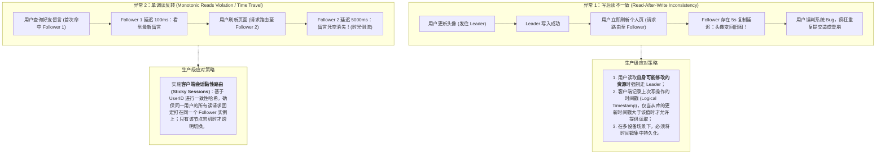
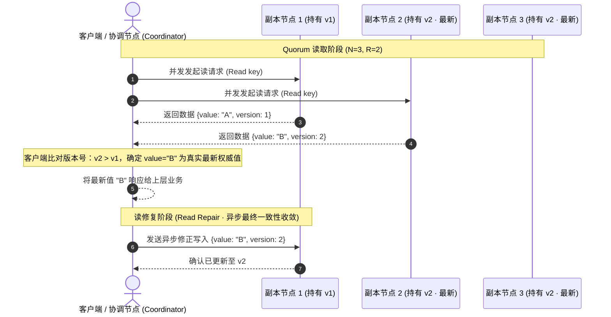

# 核心实战精炼：高可用数据复制的三大范式与一致性边界

数据复制（Replication）是指在通过网络互联的多台物理机器上保留相同数据的完整副本。其核心架构诉求有三：
1. **降低访问延迟**：将数据存储在地理上更接近用户的边缘节点或多地域机房；
2. **提升系统可用性与持久性**：当个别节点硬件故障、掉电或网络分区时，系统整体仍能透明无损地对外提供服务；
3. **线性扩展读取吞吐量**：通过多节点分摊读请求负载（Scale-out Reads）。

如果数据永远只读不变，复制在工程上极易实现；**复制的所有本质复杂性，全部源自如何协调跨节点的数据变更（Handling Changes）**。

---

## 1. 核心架构决策矩阵：三大复制范式权衡比对

| 复制模型 | 写入拓扑与路由 | 写入延迟与吞吐 | 读取一致性保证 | 典型并发冲突处理 | 推荐生产级选型 | 核心适用场景 |
| :--- | :--- | :--- | :--- | :--- | :--- | :--- |
| **单主复制 (Single-Leader)** | 严格单点写：所有写操作路由到唯一 Leader，Leader 顺序写入 WAL 并向 Followers 广播日志流 | **写吞吐受限**（受制于单个 Leader 硬件）； **写延迟**：半同步下为 Leader + 1 个同步从库落盘时间 | 强一致（主库读）或**最终一致性**（从库读存在复制延迟） | 无写冲突（Leader 单点串行化全序裁决） | PostgreSQL, MySQL, Redis, AWS Aurora | 读多写少、事务强一致依赖、架构复杂度预算有限的典型通用业务 |
| **多主复制 (Multi-Leader)** | 分布式多点写：每个数据中心或边缘客户端各拥有一个本地 Leader，跨机房异步同步复制流 | **写吞吐高**（各 DC 本地并发写入，吞吐线性叠加）； **写延迟极低**（本地即时确认） | 跨地域最终一致性；可能遭遇严重的时间倒流与数据分歧 | 必须解决并发写冲突：LWW（丢弃数据）、CRDT 自动无损合并、或应用层补偿 | CouchDB, DynamoDB 全球表, Cassandra (多DC模式) | 跨洲跨地域高可用部署、协作编辑工具（Figma/飞书文档）、本地优先应用 |
| **无主复制 (Leaderless / Quorum)** | 客户端直连/协调器广播：客户端同时并发向 $N$ 个对等副本发起读写，满足 $W + R > N$ 仲裁规则 | **高可用容错强**（允许部分副本掉线无需故障切换）； **写入延迟**取决于最慢的 Quorum 确认节点 | 满足 Quorum 强重叠时提供最新值，但边界异常（并发写/网络丢包）退化为最终一致 | 最后写入胜出（LWW 丢失因果性）、版本向量（Version Vectors）多值返回 | Apache Cassandra, ScyllaDB, Amazon Dynamo | 极端高写入可用性诉求、无严格 ACID 跨行事务、接受偶尔数据修复与合并的系统 |

---

## 2. 复制延迟引发的三大致命异常与工程解决规范

在单主异步复制中，从库由于网络抖动或大事务重放，不可避免产生**复制延迟（Replication Lag）**。若直接允许客户端读取从库，将触发严重业务逻辑混乱：

---

## 3. 生产级架构拓扑：Quorum 读写重叠与 Read Repair 机制

在无主复制（如 Cassandra / Dynamo 架构）中，系统通过参数配置三元组 $(N, W, R)$：
- $N$：副本总数（通常为奇数，如 3 或 5）；
- $W$：写成功所需的法定节点确认数；
- $R$：读成功所需查询的法定节点数。

**核心强重叠不变量：$W + R > N$**。只要此条件满足，读取的 $R$ 个副本中必定至少包含一个持有最新版本数据的节点：

---

## 4. 故障切换中的“脑裂”陷阱与防护体系

在单主复制系统中，当 Leader 节点因网络抖动或 GC 长停顿失去响应时，集群必须执行**故障切换（Failover）**。如果处置不当，将引发最灾难性的故障——**脑裂（Split-Brain）**：

| 故障演进阶段 | 物理故障发生过程 | 灾难性后果 | 生产级防护防御体系 |
| :--- | :--- | :--- | :--- |
| **误报与假死** | 旧 Leader 因执行全量 Checkpoint 或 Full GC 陷入短暂卡顿，心跳检测超时 | Followers 误判 Leader 死亡，通过 Raft 选出新 Leader | 调优心跳超时窗口（如 3~5 个心跳周期），避免敏感抖动误判 |
| **并发双写 (Split-Brain)** | 网络分区导致旧 Leader 恢复但未感知被罢免，继续接收客户端写入；同时新 Leader 也在接收写入 | 数据分歧冲突、自增主键重叠、事务完整性全盘被破坏 | **屏障保护机制（Fencing Tokens）**：每次选主递增纪元（Epoch / Term），底座存储拒绝旧 Epoch 写请求 |
| **异步丢数据** | 旧 Leader 尚未同步给 Followers 的写请求滞留在自身 WAL 中，重启后被降级为 Follower | 旧日志与新 Leader 日志冲突，必须被强制丢弃 | 采用半同步复制（Semi-synchronous）；丢弃的数据做离线归档审计（Discarded Log Audit） |
| **物理关机隔离** | 旧 Leader 无法确定自身是否被孤立 | 旧主库继续向业务假响应 | **STONITH 机制**（Shoot The Other Node In The Head），通过智能 PDU 硬件强制切断旧节点电源 |

---

## 5. 架构避坑清单 (Do's & Don'ts)

| 决策维度 | 严禁行为 (Don'ts) | 推荐最佳工程实践 (Do's) |
| :--- | :--- | :--- |
| **复制模式选型** | 在跨城公网长距离传输链路中盲目开启**全同步复制（Fully Synchronous）**，导致主库写入完全受制于公网最慢链路抖动。 | 采用**一主一同步（半同步 Semi-Sync）+ 若干异步只读从库**的经典拓扑，保障至少一份从库落盘的同时隔离公网长尾延迟。 |
| **读写分离陷阱** | 在对从库开启只读扩展后，业务代码不加区分地全量读从库，导致用户刚发布的内容刷新后出现“时空倒流”。 | 严格实行**写后读一致性（Read-your-writes）路由**：通过 Cookie 携带写时间戳，或用户个人信息编辑后 5 秒内强制读主。 |
| **无主并发解决** | 在 Cassandra 等无主系统中使用 **LWW（最后写入胜出）**处理高频并发累加计数器或数组追加，导致无声丢失写入。 | 并发合并必须基于 **CRDT（无冲突复制数据类型）**或在应用层使用包含因果依赖的**版本向量（Version Vectors）**。 |
| **故障自动切换** | 在缺乏分布式共识（如 etcd/ZooKeeper）与可靠 Fencing 屏障的情况下，在业务进程内部自研粗糙的自动提升主库脚本。 | 接入成熟经过严苛测试的高可用编排方案（如 Patroni for PostgreSQL、Orchestrator for MySQL），坚决杜绝人工未验证脚本切换。 |
| **从库生命周期** | 从库发生延迟积压时，仅简单重启从库进程，导致重放 WAL 期间连接堆积拉垮主库复制通道。 | 监控从库 Replication Lag 指标，一旦超过阈值立即从负载均衡器摘除读流，待追平后平滑放量。 |

<!-- split -->

# 原著完整参考：高可用数据副本（Replication）

> “**一件可能会出错的事情与一件绝不可能出错的事情，它们之间最大的区别在于：当一件绝不可能出错的事情真正出错了，它往往会变得彻底无法触及、无法修复。**”
> 
> —— Douglas Adams, 《基本上无害》（Mostly Harmless, 1992）

数据复制（Replication）指的是在通过网络互联的多台物理机器上保留相同数据的完整副本。正如第 1 讲中所讨论的那样，跨机器复制数据的核心驱动力主要体现在三个方面：
- **降低延迟（Reduce Latency）**：使数据在物理距离上尽可能靠近遍布全球的最终用户；
- **提高容错与可用性（High Availability）**：即使系统中的某些节点遭遇硬件损坏或断电，整个系统依然能够无中断持续运行；
- **水平扩展吞吐量（Scale-out Read Throughput）**：将海量读取请求分散到多个机器副本上共同承担。

本章首先建立一个基础假设：**你的整个数据集规模足够小，以至于单台物理机就足以完整容纳全量数据**。在第 7 讲中，我们将打破这一假设，探讨将海量数据切分分散到不同机器上的**数据分片（Sharding / Partitioning）**技术。

如果被复制的数据永远是静态只读的，复制将变得轻而易举——你只需要将文件通过网络完整拷贝到每一台机器上即可宣告完工。**数据复制的所有核心工程难点，全部集中在如何处理持续发生的数据变更（Handling Changes）**。

在本章中，我们将系统推演工业界用来在节点间同步数据变更的三大核心复制算法流派：
1. **单主复制（Single-Leader Replication）**；
2. **多主复制（Multi-Leader Replication）**；
3. **无主复制（Leaderless Replication）**。

几乎当今世界上所有的分布式数据库，其底层复制骨干都归属于这三类流派之一。

:::en
> **Original**: Replication means keeping a copy of the same data on multiple machines that are connected via a network. If the data that you’re replicating does not change over time, replication is easy; you just need to copy the data to every node once, and you’re done. All the difficulty in replication lies in handling changes to replicated data, and that’s what this chapter is about. We will discuss three families of algorithms for replicating changes between nodes: single-leader, multi-leader, and leaderless replication.

**📌 核心术语与语境解析**：
- **Replication** [ˌreplɪˈkeɪʃn]：*数据副本/复制*。通过网络在多个异地节点维护一致状态副本的技术总称。
- **Handling changes** [ˈhændlɪŋ ˈtʃeɪndʒɪz]：*处理数据变更*。并发读写下保障变更全序广播与冲突消解的核心难点。
- **Single-leader vs Leaderless**：*单主 vs 无主*。集中式单点协调与去中心化 Quorum 投票的本质哲学差异。
:::

---

## 备份与副本的区别与互补

很多工程师容易混淆数据库的**副本复制（Replication）**与**数据备份（Backups）**。这两者具有完全不同的工程目标：
- **副本复制**：以极高时效性（亚秒级）将一个节点的写操作同步到其他存活节点，核心用于实现节点故障时的瞬时高可用容灾与读分流；
- **数据备份**：保留历史特定时间点的不可变快照（Snapshot）。**如果你在生产环境中执行了一条错误的 `DROP TABLE` 或带错条件的误更新，复制机制会在几百毫秒内忠实地将这一灾难性删除同步至所有副本**！此时只有利用离线冷备份才能找回被误删的数据。

因此，复制与备份绝非二选一，而是互为补充的基石。在构建复制拓扑时，常常需要从历史快照备份启动一个全新从库；反之，归档复制日志流（如 MySQL Binlog、PostgreSQL WAL）也是实现**按时间点任意还原（Point-in-Time Recovery, PITR）**的底层支柱。

---

## 单主复制（Single-Leader Replication）

存储数据库副本的每个节点被称为**副本（Replica）**。为了确保每个副本都能感知并写入所有数据变更，工业界最广泛采用的经典范式是**主从架构（Primary-Backup 或 Active/Passive）**：
1. 集群中指定一个节点为**主库（Leader / Primary）**。所有客户端发起的写入请求必须路由给 Leader，Leader 率先将数据写入其本地权威存储；
2. 其余副本被称为**从库（Followers / Read Replicas / Secondaries）**。每当 Leader 将数据写入本地磁盘后，它便将这次数据变更封装为**复制日志（Replication Log）**或变更事件流（Change Stream）发送给所有从库。每个 Follower 按照与 Leader 完全一致的顺序在其本地依序重放日志；
3. 客户端读取数据时，可以向 Leader 发起查询，也可以向任意 Follower 发起只读查询。但所有数据写操作必须由 Leader 唯一定夺。

单主复制是关系型数据库（PostgreSQL、MySQL、Oracle Data Guard）以及许多分布式消息队列（Kafka、RabbitMQ Quorum Queues）的默认基石。在分片数据库中，每个独立的分片（Shard）通常也由一个独立的单主副本集群来承载。

### 同步复制 vs 异步复制
一个极具争议的权衡在于复制过程是同步（Synchronous）还是异步（Asynchronous）：

- **全同步复制（Synchronous）**：Leader 必须等待所有 Followers 全部落盘并返回 ACK 确认，才向客户端响应写成功。
  - *优点*：从库保证拥有最新数据，Leader 突然熔断时绝不丢失任何数据；
  - *致命缺陷*：**任意一台从库因网络抖动、机房重连或垃圾回收卡顿，都会导致整个集群的写操作全面阻塞死锁**！这严重破坏了系统的高可用性。
- **全异步复制（Asynchronous）**：Leader 本地写入成功后立即通知客户端，异步在后台向 Followers 广播日志。
  - *优点*：即使所有从库全部挂掉，主库依然能无阻塞快速接受写请求；
  - *致命缺陷*：如果 Leader 在日志尚未到达从库前发生物理硬件损坏彻底宕机，**尚未复制的写入将永久丢失**！
- **半同步复制（Semi-synchronous）**：工业生产中的务实黄金折中——集群中仅配置一个 Follower 为同步确认，其余为异步。当这个同步从库故障时，系统自动将另一个健康的异步从库提升为同步节点，既封堵了单点数据丢失风险，又避免了全集群雪崩。

:::en
> **Original**: The advantage of synchronous replication is that the follower is guaranteed to have an up-to-date copy of the data that is consistent with the leader. If the leader suddenly fails, we can be sure that the data is still available on the follower. The disadvantage is that if the synchronous follower doesn’t respond, the write cannot be processed. The leader must block all writes and wait until the synchronous replica is available again.

**📌 核心术语与语境解析**：
- **Synchronous replication** [ˈsɪŋkrənəs ˌreplɪˈkeɪʃn]：*同步复制*。客户端写请求必须等待远端副本落盘确认方能返回，追求数据零丢失（RPO=0）。
- **Replication lag** [ˌreplɪˈkeɪʃn læɡ]：*复制延迟*。异步从库追赶主库最新状态之间存在的物理时间差。
- **Semi-synchronous** [ˈsemi ˈsɪŋkrənəs]：*半同步*。折中容错范式，保证至少两台机器持有最新写入事实。
:::

---

## 复制日志的物理实现技术

Leader 如何将变更流编码并传递给 Follower？工业界主要演进出四种流派：

1. **基于语句的复制（Statement-based Replication）**  
   Leader 记录执行的原始 SQL 文本（如 `INSERT INTO users ...`）并转发给从库。
   - *缺陷*：调用非确定性函数（`NOW()`、`RAND()`）、依赖自增 ID 或触发器时，从库重放会产生严重的数据分歧。现代系统已基本废弃单纯的语句复制。
2. **写前日志传输（WAL Shipping）**  
   底层存储引擎（如 LSM-Tree 或 B-Tree）将磁盘块和字节偏移量层面的写前日志（PostgreSQL WAL）通过网络字节流直接投递给 Follower。
   - *优点*：实现极度紧凑高效；
   - *缺陷*：复制与底层物理存储格式深度绑定，使得主从节点无法跨大版本平滑滚动升级。
3. **基于行的逻辑日志复制（Logical / Row-based Log Replication）**  
   以行（Row）为粒度记录变更事件（如 MySQL Binlog Row 格式）：插入包含新行全字段，更新包含主键与变更字段的新旧值。
   - *优点*：与底层存储解耦，可轻松支持不同版本间的滚动发布，同时成为**变更数据捕获（CDC, Change Data Capture）**反哺外部数仓的核心标准载体。
4. **基于触发器的复制（Trigger-based Replication）**  
   在应用层通过注册数据库 Trigger 将变更写入自定义审计变更表，常用于异构数据库搬迁或跨云同步。开销最高且极易引入隐蔽 Bug。

---

## 复制延迟引发的一致性问题剖析

在异步复制系统中，由于从库存在延迟，系统仅能满足**最终一致性（Eventual Consistency）**。但在秒级延迟窗口内，用户会观察到极其严重的体验撕裂：

### 1. 写后读一致性（Read-After-Write Consistency）
用户提交了一篇动态或修改了头像，页面刷新后请求落在一个发生延迟的从库上，导致用户看到自己刚刚的修改全部消失：

- **工程破局点**：对于用户自己可能修改的内容（如“我的个人主页”），强制路由到 Leader 读取；只有查看其他用户内容时才走从库；或者利用客户端保存上一次写操作的时间戳，从库追赶上该时间戳前拒绝提供读取。

### 2. 单调读一致性（Monotonic Reads）
用户反复刷新一个帖子评论区，第一眼看到了好友的新留言（请求打在追平的从库 1），再次刷新时请求被打在严重延迟的从库 2 上，留言凭空消失：

- **工程破局点**：单调读保证**如果一个用户看到了较新的数据，他绝不会再看到更旧的数据**。标准解法是**会话黏性（Sticky Routing）**：基于用户 ID 执行 Hash 路由，固定打在同一个只读从库上。

:::en
> **Original**: Monotonic reads is a guarantee that this kind of anomaly does not happen. It’s a lesser guarantee than strong consistency, but a stronger guarantee than eventual consistency. When you read data, you may see an old value; monotonic reads means that if one user makes several reads in sequence, they will not see time go backward—i.e., they will not read older data after having previously read newer data.

**📌 核心术语与语境解析**：
- **Monotonic reads** [ˌmɒnəˈtɒnɪk riːdz]：*单调读一致性*。保证单个用户按时序观察状态时，绝不会发生历史倒退的因果一致性级别。
- **Time go backward**：*时光倒流*。分布式系统中由于不同副本进度不齐而产生的经典反直觉异常。
:::

---

## 多主复制（Multi-Leader Replication）

单主复制的致命阿喀琉斯之踵是：**所有的写入流量必须汇聚于单点 Leader**。一旦主库与外界网络中断，整个系统的写入将彻底瘫痪。

在**多主复制（Multi-Leader / Active-Active）**架构中，集群中存在多个允许接收写入的 Leader 节点。当一个 Leader 接收到写入时，它负责将该数据变更异步广播给系统中的所有其他 Leaders。

### 核心适用场景
1. **多数据中心运营**：美东与美西机房各设一个 Leader，本地域用户写入本地机房享受毫秒级低延迟，跨机房由 Leaders 之间在公网异步追赶；
2. **离线协同与本地优先（Local-First）**：移动手机 App 或 Web 客户端在离线断网时依然允许编辑修改（此时手机本身即为一个微型 Leader），网络恢复后自动与云端 Leader 相互合并同步；
3. **协作式实时编辑**：如 Google Docs、Figma，每个客户端通过操作转换（OT）或 CRDT 算法进行本地无锁修改与最终状态收敛。

### 核心挑战：并发写冲突（Handling Write Conflicts）
多主复制最大的技术噩梦是**写冲突**。如果机房 A 的用户将标题修改为 "Title A"，同时机房 B 的用户将同一记录修改为 "Title B"，单主架构下 Leader 会串行化二者；但多主架构下两个写入都在本地被判成功！

处理写冲突的标准手段：
- **冲突避免（Conflict Avoidance）**：将特定用户的写入强制通过一致性路由锁定在同一个机房处理，根本杜绝并发冲突；
- **最后写入胜出（Last Write Wins, LWW）**：为每个写操作附加物理时间戳，时间戳最大者覆盖其他写入。**此方案极其危险，会造成严重无声的数据丢失**；
- **无冲突复制数据类型（CRDTs）**：通过精心设计的代数数据结构，使得无论乱序或重复接收何种操作，最终各个节点都能自动数学收敛至唯一相同状态。

---

## 无主复制（Leaderless Replication）与 Quorum 仲裁

以 Amazon Dynamo 及其开源衍生品 Cassandra、Riak 为代表的**无主复制（Leaderless Replication）**彻底摒弃了主库的概念。客户端可以直接向任意一个副本节点发送写入与读取请求。

### 读写 Quorum 仲裁规则
假设系统中副本总数为 $N$，每次写入必须获得至少 $W$ 个副本成功落盘的确认；每次读取必须同时向至少 $R$ 个副本发起查询。

**只要 $W + R > N$，我们读取的 $R$ 个副本中就必然至少包含一个持有最新版本数据的节点**！这被称为法定人数（Quorum）保证。

### 数据的自愈修复机制
在无主系统中，掉线重启的节点如何找回落下的数据？
1. **读修复（Read Repair）**：当客户端并发读取 $R$ 个节点时，若发现节点 1 返回版本 1，而节点 2、3 返回版本 2，客户端立即识别出节点 1 存在滞后。客户端在将最新值版本 2 返回给用户的同时，**顺手向节点 1 投递一次异步写操作将其修复**；
2. **反熵过程（Anti-Entropy Process）**：后台常驻守护进程，周期性通过**默克尔树（Merkle Trees）**哈希比对副本间的数据差异，高效寻找并同步缺失的数据块。

:::en
> **Original**: If there are n replicas, every write must be confirmed by w nodes to be considered successful, and we must query at least r nodes for each read. As long as w + r > n, we expect to get an up-to-date value when reading, because at least one of the r nodes we’re reading from must be on of the w nodes with the most recent write. Reads and writes that obey these r and w values are called quorum reads and writes.

**📌 核心术语与语境解析**：
- **Quorum** [ˈkwɔːrəm]：*法定人数/仲裁*。分布式系统中执行读写操作时必须获得确认的最小重叠节点集合。
- **Read repair** [riːd rɪˈpeə]：*读修复*。客户端在读取数据发现副本分歧时，顺带向旧副本回写最新值的自愈机制。
- **Anti-entropy** [ˌænti ˈentrəpi]：*反熵后台修复*。利用哈希树比对差异，在后台持续收敛分歧状态的同步协议。
:::

---

## 本章小结

高可用数据副本是构建一切弹性分布式系统的基石，但必须牢记：
- **单主复制**：通过单一中心化 Leader 换取了全序一致性与最简单的冲突控制，但在写吞吐与跨机房高可用上面临单点物理瓶颈；
- **多主复制**：极大释放了跨地域写入与离线优先交互能力，但必须引入 CRDT 等高级冲突解决算法来对冲数据分歧；
- **无主 Quorum 复制**：以牺牲绝对事务一致性为代价，换取了极端容错环境下的近乎无限高可用性。

在下一讲（**第 07 讲**）中，我们将打破“单机能容纳全量数据”的假设，深入研究**数据分片与路由（Sharding）**技术，探讨如何将 TB/PB 级海量数据安全切割并跨数百台服务器平滑重平衡。
