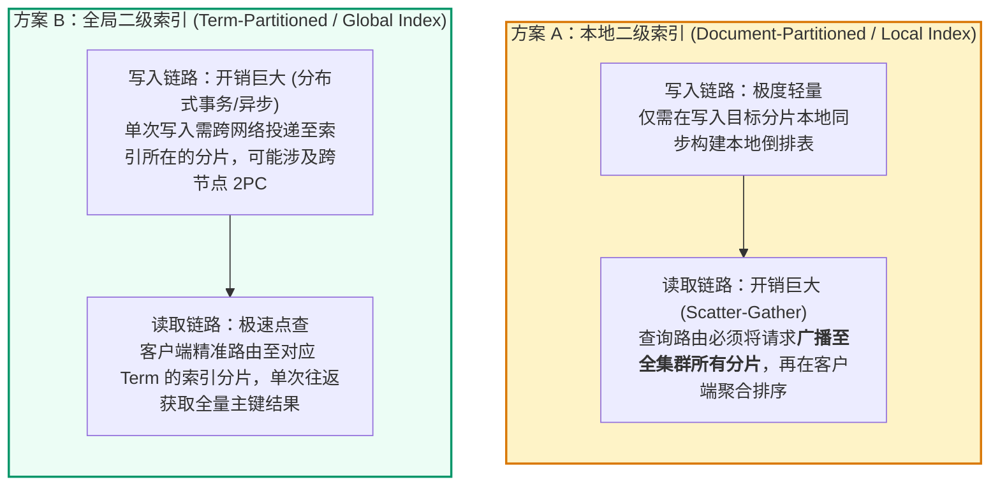
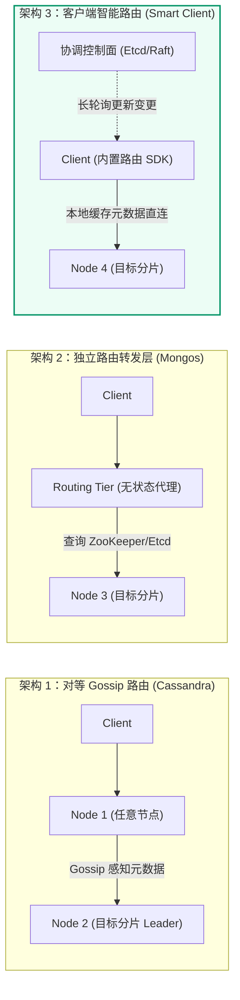

> 💡 **双栏独立滚动工作台导读**：本文采用双栏对照架构。**左栏**为核心精炼架构、实战代码与避坑决策；**右栏**为原著完整参考译文，附有关键段落的英文原文展开与难词解析。左右两栏可独立滚动，并支持顶栏自定义宽度比例（7:3 / 5:5 / 3:7）与拖拽调节。

# 核心实战精炼：海量数据分片、路由拓扑与热点重平衡

当单台机器的磁盘容量不足以容纳全量数据，或者写入吞吐量突破了单个物理节点的 I/O 上限时，数据必须被切分为较小的子集并分散存储在不同节点上。这一技术被称为**数据分片（Sharding / Partitioning）**。

在实际生产系统中，**分片通常与副本（Replication）深度绑定**：每个分片拥有一个 Leader 和若干 Followers，节点既担任某些分片的 Leader，又作为其他分片的 Follower。分片解决了吞吐与存储的**水平可扩展性（Scale-out）**，而副本提供了**高可用与容错**。

---

## 1. 核心架构决策矩阵：四大主流分片策略权衡比对

| 分片策略 | 数据分布逻辑与寻址依据 | 范围查询能力 | 数据倾斜与热点风险 | 适用生产级引擎 | 核心架构选型决策依据 |
| :--- | :--- | :--- | :--- | :--- | :--- |
| **基于键范围分片 (Key Range)** | 维护动态边界边界元数据（如 `A-C`, `D-F`），连续键值物理相邻存放 | **极高**：单分片内连续扫描，支持高效前缀与范围查（`BETWEEN`） | **极高**：时间戳或自增主键将导致所有写流量持续猛砸同一个尾部“热分片” | Bigtable, Apache HBase, CockroachDB, TiDB | 业务对大范围区间扫描有强诉求，且 Partition Key 具有良好天然发散度（如字典、按用户散列 UUID） |
| **基于哈希分片 (Hash of Key)** | 对 Partition Key 执行强散列（如 Murmur3 / MD5），将散列值均匀投射到分片槽位 | **极差**：范围查询退化为跨所有分片的 Scatter-Gather 广播 | **低**：伪随机打散消除物理相邻倾斜，但无法消除单一超级热点 Key（如热点明星大 V） | Cassandra, Redis Cluster, MongoDB Hashed Shard | 典型的点查（Point Query）密集型业务，读写操作皆带 Key，追求全集群负载绝对均摊 |
| **一致性哈希 (Consistent Hashing)** | 将分片与节点映射至虚拟哈希环（Virtual Nodes），节点加入/退出时仅迁移邻近槽位 | 极差（同哈希分片） | 低，虚拟节点数量充足时数据分布平滑 | Dynamo 体系, Akka, 软件负载均衡器 | 节点动态频繁上下线的对等（P2P）分布式网络或边缘缓存节点集群 |
| **租户隔离分片 (Multi-Tenant Cell)** | 以 Tenant ID 为路由基准，将单一客户全量数据隔离锁定在独立逻辑/物理 Shard | 支持单租户内高效自由跨表查询与事务 | **存在长尾倾斜**：不同租户规模差异巨大，大客户需要二次拆分 | SaaS 企业级系统, 单元化多活金融架构 | 强数据隐私隔离、合规要求严格（GDPR/本地数据驻留）、单租户独立备份与防爆炸半径隔离 |

---

## 2. 跨分片二级索引治理：本地索引 vs 全局索引

数据按主键分片之后，一旦业务需要通过非主键字段（如商品按品类、按价格范围搜索）建立**二级索引（Secondary Index）**，便会触发经典的分布式索引权衡困境：



### 生产级选择准则
- **优先本地索引**：绝大多数分布式 OLTP 数据库（如 MongoDB、Cassandra、Elasticsearch）默认采用本地二级索引。为了规避漫无边际的 Scatter-Gather 广播灾难，**必须在查询条件中尽量强制包含 Partition Key**（将请求收敛到单一分片）；
- **慎用全局索引**：仅在读远多于写、且单次查询必须亚毫秒响应的场景下，通过异步 CDC 管道在外部系统（如 Elasticsearch / 专用索引表）构建全局衍生索引，严禁在线写链路引入同步分布式事务。

---

## 3. 生产级架构拓扑：路由发现层与动态重平衡防雪崩

客户端如何得知特定键应当发往哪个节点？业界演进出三大经典路由架构：



---

## 4. 生产级实战范式：加盐消除热点 Key（Key Salting）

当出现顶级名人大 V（如数千万粉丝的超级用户发布爆款事件）时，单一哈希分片会被击穿。以下生产范式展示如何通过**前缀加盐打散写入 + 多路并发 Scatter-Gather 聚合读取**消除物理热点：

```go
package sharding

import (
	"context"
	"fmt"
	"math/rand"
	"sync"
	"time"
)

const SaltRange = 10 // 将热点数据均匀打散至 10 个虚拟槽位

// WriteHotEvent 写入端：通过随机盐前缀将同一超级 Key 打散至多个分片槽位
func WriteHotEvent(ctx context.Context, hotKey, payload string) error {
	salt := rand.Intn(SaltRange)
	// 将物理存储 Key 变为 "key#3"、"key#7" 等，强制哈希路由打在不同机器上
	physicalKey := fmt.Sprintf("%s#%d", hotKey, salt)
	
	return persistToCluster(ctx, physicalKey, payload)
}

// ReadAggregatedHotEvents 读取端：并发 Scatter-Gather 抓取全部盐前缀分片并合并
func ReadAggregatedHotEvents(ctx context.Context, hotKey string) ([]string, error) {
	var (
		wg      sync.WaitGroup
		mu      sync.Mutex
		results []string
	)

	errCh := make(chan error, SaltRange)

	for i := 0; i < SaltRange; i++ {
		wg.Add(1)
		go func(salt int) {
			defer wg.Done()
			physicalKey := fmt.Sprintf("%s#%d", hotKey, salt)
			
			items, err := queryFromCluster(ctx, physicalKey)
			if err != nil {
				errCh <- err
				return
			}

			mu.Lock()
			results = append(results, items...)
			mu.Unlock()
		}(i)
	}

	wg.Wait()
	close(errCh)

	if len(errCh) > 0 {
		return nil, <-errCh
	}
	return results, nil
}

// 模拟集群底层读写
func persistToCluster(ctx context.Context, key, payload string) error {
	// 生产中根据 key 路由到底层 Shard
	return nil
}

func queryFromCluster(ctx context.Context, key string) ([]string, error) {
	return []string{fmt.Sprintf("event-from-%s", key)}, nil
}
```

---

## 5. 架构避坑清单 (Do's & Don'ts)

| 决策维度 | 严禁行为 (Don'ts) | 推荐最佳工程实践 (Do's) |
| :--- | :--- | :--- |
| **重平衡算法** | 使用简单求模算法 `Hash(key) mod N` 作为分片策略，导致每增减一台节点全量 99% 的数据发生物理迁移。 | 采用**固定分区数（Fixed Partitions）**（预分配数千个逻辑槽位，仅在节点间平移槽位所有权）或**一致性哈希**。 |
| **全自动重平衡** | 在未做防抖保护的情况下开启无人值守的全自动重平衡；当某节点因轻微 GC 抖动超时，集群立即疯狂搬迁数百 GB 数据导致全网瘫痪。 | **实施全自动化探测 + 人工最终审批确认（Human-in-the-loop）**，或设定极其保守的迁移带宽阈值与冷却时间。 |
| **二级索引设计** | 在大促高并发核心交易链路上，频繁执行未包含 Partition Key 的跨分片本地二级索引全局扫（Scatter-Gather）。 | 架构设计期强制业务遵循**查询主干维度收敛**，非分片主维度的复杂检索全量异步双写同步至外部搜索引擎。 |
| **热点预防** | 假设哈希分片能万无一失解决所有倾斜问题，对单 Key 写入 QPS 突破单机承载极限未做任何监控防线。 | 建立上游流量监控，对 Top 100 写入热点键提前实施应用层内存聚合合并、或者加盐前缀拆分方案。 |
| **事务范围控制** | 肆意编写跨越多个不同分片的分布式长事务，指望底层 2PC 保证数据原子性。 | 重新审视领域模型划分，尽量将高频协作实体设计在**同一个 Partition Key 聚合根边界内部**，将跨分片交互转为异步最终一致性。 |

<!-- split -->

# 原著完整参考：数据分片（Sharding）

> “**显然，我们必须打破顺序执行的思维桎梏，不再给计算机设限。我们必须确立数据的定义、优先级与属性描述；我们必须陈述关系的本质，而非纠缠于过程细节。**”
> 
> —— Grace Murray Hopper，1962 年访谈

分布式数据库通常通过两种互补的方式在多个物理节点之间分布数据：
1. **数据复制（Replication）**：在多个不同节点上保留相同数据的完整副本，我们在第 6 讲中已系统推演；
2. **数据分片（Sharding / Partitioning）**：当系统的数据体量极为庞大，或者写入请求的吞吐量极其迅猛，以至于单台物理机无论如何升级配置都无法承担时，系统将数据切分为若干较小的子集（即分片），并将不同的分片存放在不同的节点上。

在标准体系下，分片的划分遵循一个基本准则：**系统中的每一条数据（每一行记录、每一个文档）在逻辑上必须严格属于且仅属于某一个特定的分片**。从微观角度看，每一个分片本质上就是一个微型的独立数据库，尽管顶层系统可能会支持跨越多个分片的原子操作。

在工程生产实践中，**分片绝大多数情况下都会与副本机制深度融合**。也就是说，每一个分片自身的多个副本会被打散分布在多台机器上，以提供故障容错。


一个物理节点可以同时宿主多个分片。如图 7-1 所示，节点 1 既充当了分片 1 的主库（Leader），同时又担任了分片 2 的只读从库（Follower）。只要集群中每个分片在任意时刻都有且仅有一个确定的 Leader，整个主从复制与故障转移法则便能完美复用。

:::en
> **Original**: Sharding is usually combined with replication, so that copies of each shard are stored on multiple nodes. This means that even though each record belongs to exactly one shard, it may still be stored on several different nodes for fault tolerance. A node may store more than one shard... Each node may be the leader for some shards and a follower for other shards, but each shard still has only one leader.

**📌 核心术语与语境解析**：
- **Sharding / Partitioning** [ˈʃɑːdɪŋ]：*数据分片/分区*。将海量数据依规则切分并分布于多机以实现水平扩展的核心机制。
- **Fault tolerance** [fɔːlt ˈtɒlərəns]：*容错性*。分片多副本打散存储，确保单节点宕机不导致任何一个分片处于完全不可服务状态。
- **Shard leader** [ʃɑːd ˈliːdə]：*分片主库*。负责处理该特定分片范围内所有强一致写入请求的核心权威实例。
:::

---

## 术语起源与分片动因

在不同数据库产品中，“分片”有着截然不同的专有称谓：
- Kafka 中称为 **Partition（分区）**；
- CockroachDB 中称为 **Range（数据区间）**；
- HBase 与 TiDB 中称为 **Region（区域）**；
- Couchbase 中称为 **vBucket**；
- Cassandra 中称为 **Token-Range**；
- Bigtable 与 ScyllaDB 中称为 **Tablet（数据片）**。

引入分片的最核心驱动力是**可扩展性（Scalability）**。如果系统瓶颈仅在于读取 QPS 过高，通常只需要增加只读从库即可解决（读扩展）；但如果系统面临的是**写入吞吐量爆表**或**数据存储物理体积超出一块甚至一组磁盘的硬件极限**，分片就是唯一出路。

然而，架构师必须保持极度克制：**分片是一把极其沉重的双刃剑，它只属于超大规模系统的万不得已之选**。当单台配置合理的服务器（如 128 核、1TB 内存、数十 TB NVMe 固态硬盘）依然能从容应对业务时，坚守单机单库是明智之举。

一旦引入分片，原本极其简单的全表扫描会退化为跨全网机器的 Scatter-Gather 广播；跨分片的数据关联（Join）性能极其低下；而为了确保跨多个分片修改的数据一致性，又不得不引入开销高昂且极易超时的分布式事务（2PC）。

---

## 多租户（Multi-Tenant）与单元化架构

在现代 SaaS 软件与云原生系统中，分片不仅用于纯粹的数据扩容，更是实现**多租户隔离与单元化架构（Cell-Based Architecture）**的关键武器：
1. **物理资源与性能隔离**：避免某个大租户执行高耗时分析操作时产生“吵闹邻居（Noisy Neighbor）”效应拖垮全局；
2. **爆炸半径控制（Blast Radius）**：将租户集合切分到不同自治 Cell 中，一个 Cell 崩溃绝不波及其他租户；
3. **法律合规与数据主权（Data Residency）**：通过路由层将欧盟公民租户的分片严格钉死在法兰克福数据中心，将北美租户分片钉在弗吉尼亚数据中心。

---

## 键值数据的两大核心分片范式

系统如何决定哪条数据归属于哪个分片？核心存在两大技术路线：

### 1. 基于键范围分片（Key Range Sharding）
为每个分片指定一段连续的键范围边界（如字典分卷：从 A 到 B、从 C 到 E）：


- **核心优势**：范围查询极其高效！如果你需要遍历查询键在 `2026-01-01` 到 `2026-01-31` 之间的所有事件，系统能够精准定位到单个分片并执行连续磁盘顺序读取；
- **致命弱点**：**极端容易引发写入热点倾斜（Hotspots）**！在现实世界中，若以自增 ID 或时间戳为 Partition Key，由于时间永远单调递增，**当前所有最新的并发写入将全部集中倾泻在最后一个分片节点上**，而集群中其余几十台机器却处于完全闲置状态。

### 2. 基于键哈希分片（Hash of Key Sharding）
为了摧毁上述热点倾斜，系统在将 Key 投递给分片前，首先通过单向散列哈希函数（如 32 位 Murmur3）计算伪随机散列值，将键均匀散落在哈希槽中：


- **核心优势**：只要哈希函数设计优良，即使原始键具有极高连续性，数据也会被均匀抛洒至全集群各节点；
- **核心妥协**：**彻底丧失了范围扫描能力**！原本在逻辑上相邻的两个键在哈希后被打散在不同的物理节点上，任何微小的范围查询（如 `ORDER BY`）都必须向全量分片发起全广播查询。

:::en
> **Original**: By using a hash of the key for partitioning, you lose a nice property of key range partitioning: the ability to do efficient range queries. Keys that were once adjacent are now scattered across all the partitions, so their sort order is lost... In MongoDB, if you have enabled hash-based sharding, any range query must be sent to all partitions. Some databases (e.g. Cassandra) achieve a compromise: a compound primary key consisting of several columns. Only the first part of that key is hashed, but the other columns are used as a concatenated index.

**📌 核心术语与语境解析**：
- **Hash of key** [hæʃ əv kiː]：*键哈希分片*。利用确定性伪随机哈希算法打破空间局部性，实现写负载均匀打散。
- **Compound primary key** [ˈkɒmpaʊnd ˈpraɪməri kiː]：*复合主键*。第一字段哈希用于定位分片，后续字段保留排序用于分片内部高效范围扫描（Cassandra 经典架构）。
:::

---

## 动态重平衡（Rebalancing）的艺术与陷阱

随着业务规模扩张，集群中必然会经历增加新机器或替换故障节点的过程。分片与槽位在节点间的转移被称为**重平衡（Rebalancing）**。

### 1. 为什么严禁使用 `Hash mod N`？
在初学者设计中，往往采用 `hash(key) % N`（$N$ 为机器数）。这一算法在分布式存储中是灾难性的：**当节点数由 10 变为 11 时，几乎所有键的模值都会发生改变，导致整个集群 90% 以上的数据发生大规模跨网搬迁**，瞬间击垮生产网络与磁盘 I/O。

### 2. 固定数量分片（Fixed Number of Partitions）
更为稳健的工程实践是在系统初始化时创建远大于物理节点数的逻辑分片（例如预分配 1024 个逻辑分片）。每台物理机托管上百个逻辑分片：


当新机器加入集群时，只需从每台旧机器上“匀出”几个完整的逻辑分片平移给新机器即可，未受影响的分片在迁移期间保持无中断服务。

### 3. 全自动重平衡的危险性
许多系统支持无人值守的全自动动态重平衡（Automatic Rebalancing）。然而在生产实战中，这一特性往往是**灾难级级联故障的元凶**：
- 节点 A 因瞬时网络拥塞或 Java GC 长时间卡顿，协调层误判其死亡；
- 协调层立即触发全自动重平衡，命令其他节点开始跨网搬迁数百 GB 的分片；
- 沉重的迁移 I/O 使得相邻节点网络负荷瞬间飙升，引发相邻节点相继超时“假死”；
- 整个集群陷入无法自拔的雪崩恶性循环。

因此，**半自动化（系统规划迁移路线，由 SRE 人工审批确认执行）**是金融级系统最推崇的稳健防御范式。

---

## 二级索引跨分片：Scatter-Gather 的物理极限

当用户不按主键查询，而是按“汽车颜色为红色、品牌为宝马”检索时，系统如何处理分片？


在采用**本地二级索引（Document-Partitioned Index）**的系统中：
- 每个分片仅负责为自己节点所托管的文档建立索引；
- 写入非常轻量，无需跨网协同；
- **但任何一次根据二级属性的读取，必须同时广播给所有分片（Scatter-Gather）！**
- 哪怕整个集群拥有 100 个节点，查询响应时间也完全受制于**最慢的一个分片（长尾延迟 P99 放大效应）**。

因此，在分片系统设计中，业务逻辑层必须极力配合：在所有高频高并发接口中，尽可能强制透传主分片键，将查询精确锁定在单一分片内部。

---

## 本章小结

数据分片是突破单机物理极限、实现理论无限扩展的终极武器，但必须直面其带来的物理碎裂代价：
- **键范围分片**赋予了范围扫描能力，但极易引入写入时间戳热点；
- **哈希分片**换取了负载均匀分布，但彻底剥夺了相邻排序特性；
- **本地二级索引**导致跨分片 Scatter-Gather 广播放大；
- **重平衡**需严密防范误判雪崩，坚持审慎的工程治理准则。

在下一讲（**第 08 讲**）中，我们将直面最棘手的分布式系统深水区：**事务与隔离级别（Transactions）**，揭开 ACID 表面承诺下的物理幻象与弱隔离级别的致命陷阱。
