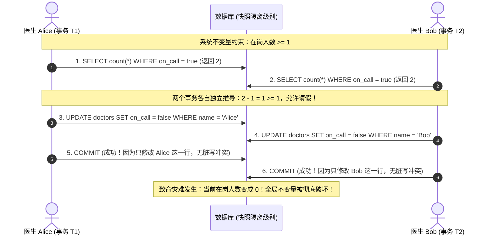
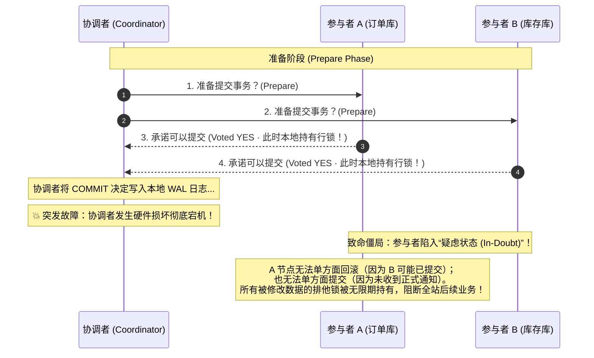

# 核心实战精炼：事务安全基石、隔离级别陷阱与分布式两难

事务（Transaction）是数据库系统提供给应用开发者最伟大的抽象之一：它将一组离散的读写操作打包为一个单一的逻辑执行单元。其核心承诺是：**要么全盘成功（Commit），要么在遭遇软硬件故障时干净彻底地回滚（Abort / Rollback）**。

然而，**“ACID”这个营销词汇掩盖了极多物理现实的残酷妥协**。在并发执行与分布式网络环境下，不同的隔离级别（Isolation Levels）意味着不同的性能吞吐与数据不一致风险。

---

## 1. 核心架构决策矩阵：标准隔离级别与并发异常全景谱系

| 隔离级别 (Isolation Level) | 脏读 (Dirty Read) | 脏写 (Dirty Write) | 读偏斜 / 不可重复读 (Read Skew) | 更新丢失 (Lost Update) | 写偏斜 (Write Skew) | 幻读 (Phantom Read) | 底层主流工业级实现范式 | 生产级性能开销与代价 |
| :--- | :--- | :--- | :--- | :--- | :--- | :--- | :--- | :--- |
| **读未提交 (Read Uncommitted)** | ❌ 发生 | 预防（行排他锁） | ❌ 发生 | ❌ 发生 | ❌ 发生 | ❌ 发生 | 仅读最新内存行，无锁读 | 开销极低，但业务逻辑极度危险，生产环境严禁使用 |
| **读已提交 (Read Committed)** | ✅ 免疫 | ✅ 免疫 | ❌ 发生（单事务内多次读取结果不一致） | ❌ 发生（并发计数递增被覆盖） | ❌ 发生 | ❌ 发生 | 行级写排他锁 + 读取旧版本快照（Oracle/PG/MySQL 默认） | 开销很低，适合常规点查业务，但长事务或备份会遭遇数据不一致 |
| **快照隔离 (Snapshot Isolation / Repeatable Read)** | ✅ 免疫 | ✅ 免疫 | ✅ 免疫（全事务观察开始瞬间的一致性快照） | 需额外手段（原子更新 / `FOR UPDATE` / CAS） | ❌ **发生**（各自基于旧前提修改互不冲突的不同行） | ❌ 发生（针对范围检索的新增行） | **MVCC（多版本并发控制）**：读不阻塞写，写不阻塞读 | 极佳的读吞吐，适合数据报表与大批量只读备份；需定期清理 MVCC 垃圾元组 |
| **可串行化 (Serializability)** | ✅ 免疫 | ✅ 免疫 | ✅ 免疫 | ✅ 免疫 | ✅ 免疫 | ✅ 免疫 | 1. **两阶段锁（2PL）**（读写互斥，悲观锁）<br/>2. **实际单线程执行**（Redis/VoltDB）<br/>3. **可串行化快照隔离（SSI）**（乐观锁） | **2PL**：锁竞争严重，吞吐断崖下跌，极易死锁；<br/>**SSI**：高冲突下事务大量被 Abort 中止重试 |

---

## 2. 深入死角：“写偏斜（Write Skew）”物理本质剖析

很多工程师误以为开启了**可重复读（Repeatable Read / 快照隔离）**就能高枕无忧。事实上，快照隔离无法解决**写偏斜（Write Skew）**。

### 经典案例：值班医生清空危机
医院要求“任意时刻必须至少保留一名医生在岗值班”。当前 Alice 与 Bob 两人同时在岗（数量 = 2）。此时两人几乎在同一瞬间申请休假离岗：



### 破解写偏斜的生产级三道防线
1. **显式悲观加锁（`SELECT ... FOR UPDATE`）**：强制将读取前提转化为独占行锁，迫使第二个事务串行阻塞等待；
2. **物化冲突（Materializing Conflicts）**：人工引入代表前提约束的实体行（如将“值班表状态”独立成一行锁定）；
3. **升级至可串行化快照隔离（SSI）**：底层存储引擎跟踪事务间的 SIREAD 依赖图，在 Commit 瞬间主动检测到前置读依赖被并发篡改，果断中止（Abort）并回滚其中一个事务。

---

## 3. 生产级架构拓扑：两阶段提交（2PC）的致命缺陷与 Saga 补偿

跨越多个数据库实例或微服务边界时，经典的**两阶段提交协议（2PC）**常被用于实现跨节点原子性。然而在生产现实中，**2PC 具有极其危险的单点阻塞特性**：



### 现代化工业替代方案：Saga 事务编排 + 本地消息表
现代微服务架构全面废弃跨服务同步 2PC，转为采用**最终一致性 Saga 模式**：
- 每个服务仅执行本地单机 ACID 事务；
- 成功后通过**变更数据捕获（CDC / 本地消息表）**异步发布领域事件；
- 下游服务失败时，触发反向**补偿事务（Compensating Transactions）**进行对冲撤销。

---

## 4. 生产级代码实战：防更新丢失的原子 CAS 范式

以下 Go 生产范式展示了在避免分布式全表锁的前提下，如何利用**原子条件写入（Compare-And-Set）**与**乐观重试循环**彻底免疫更新丢失（Lost Update）：

```go
package txsafe

import (
	"context"
	"database/sql"
	"errors"
	"fmt"
	"time"
)

var ErrOptimisticLockConflict = errors.New("optimistic lock conflict: concurrent write detected")

type AccountService struct {
	db *sql.DB
}

// SafeDeductBalance 线程安全与并发安全的扣款逻辑：基于 Version 乐观锁与防更新丢失机制
func (s *AccountService) SafeDeductBalance(ctx context.Context, accountID string, amount int64, maxRetries int) error {
	for attempt := 0; attempt < maxRetries; attempt++ {
		// 1. 读取当前状态与版本号
		var balance int64
		var version int64
		query := `SELECT balance, version FROM accounts WHERE id = $1`
		err := s.db.QueryRowContext(ctx, query, accountID).Scan(&balance, &version)
		if err != nil {
			return fmt.Errorf("read account: %w", err)
		}

		// 2. 业务不变量校验
		if balance < amount {
			return errors.New("insufficient funds")
		}

		newBalance := balance - amount

		// 3. 原子 CAS 条件更新：仅在版本号未被他人篡改时提交变更
		updateQuery := `
			UPDATE accounts 
			SET balance = $1, version = version + 1 
			WHERE id = $2 AND version = $3
		`
		res, err := s.db.ExecContext(ctx, updateQuery, newBalance, accountID, version)
		if err != nil {
			return fmt.Errorf("execute update: %w", err)
		}

		rows, err := res.RowsAffected()
		if err != nil {
			return fmt.Errorf("get rows affected: %w", err)
		}

		// 4. 校验是否命中乐观锁冲突
		if rows == 1 {
			// 更新成功，退出重试
			return nil
		}

		// 发生并发交错冲突，实施带抖动的指数退避
		time.Sleep(time.Duration(10*(1<<attempt)) * time.Millisecond)
	}

	return ErrOptimisticLockConflict
}
```

---

## 5. 架构避坑清单 (Do's & Don'ts)

| 决策维度 | 严禁行为 (Don'ts) | 推荐最佳工程实践 (Do's) |
| :--- | :--- | :--- |
| **ACID 认知** | 盲目相信供应商宣传的“全量 ACID 支持”，误以为默认开启最高可串行化隔离级别。 | 查阅数据库源码与官方文档核实**默认隔离级别**（PostgreSQL 默认为 Read Committed，MySQL 默认为 Repeatable Read）。 |
| **并发递增** | 在应用代码中采用 `x = Read(); x = x + 1; Write(x)` 模式，导致高并发更新丢失。 | 优先使用数据库**原子原语更新**：`UPDATE table SET val = val + 1 WHERE id = ?`，或使用 CAS 版本号。 |
| **长事务防线** | 在一个事务中执行远程 HTTP/RPC 外部网络调用，导致数据库连接与底层行锁长时间无法释放。 | **事务必须尽可能短小纯粹**：所有外部网络 I/O 必须剥离在事务外部执行，本地事务仅包含确定性 SQL 读写。 |
| **写偏斜防御** | 在快照隔离级别下，仅依靠简单的业务代码 `if (count >= 1)` 判断并发安全性。 | 涉及跨行前提推导的不变量校验，必须使用 `SELECT ... FOR UPDATE` 显式排他加锁，或切换至 SSI。 |
| **分布式提交** | 在微服务之间通过跨公网的 XA / 2PC 协调器执行强一致提交，导致网络分区时全链路阻塞死锁。 | 全面解耦分布式调用：改用基于**本地消息表 + CDC + 消息中间件**的异步最终一致性 Saga 编排。 |

<!-- split -->

# 原著完整参考：事务与隔离级别（Transactions）

> “**一些学者曾断言：通用两阶段提交（2PC）由于其带来的巨大性能损耗和可用性瓶颈，根本无法在生产系统中大规模落地。然而我们坚信：宁可让应用层工程师在业务出现性能瓶颈时再去排查因过度滥用事务导致的局部问题，也绝不能让他们在底层缺乏事务保护的环境下，日复一日地在业务代码里痛苦修补各种数据并发漏洞。**”
> 
> —— James Corbett 等人，《Spanner: Google 的全球级分布式数据库》（2012）

在数据密集型系统的残酷物理现实中，可能会发生形形色色的异常故障：
- 数据库软件内核或底层硬件随时可能崩溃（包括在一组写入进行到一半的危急关头）；
- 业务应用服务进程随时可能被操作系统杀掉或宕机（包括在执行一系列强依赖操作的中间环节）；
- 网络中断可能毫无征兆地切断应用与数据库之间、或者数据库各节点之间的通信链路；
- 多个并发客户端可能在同一微秒向数据库写入相同数据，无声覆盖彼此的数据修改；
- 客户端可能读到被部分更新的残缺脏数据；
- 客户端之间的并发竞态（Race Conditions）会诱发难以复现、匪夷所思的数据错乱 Bug。

为了构建高可靠系统，工程师必须耗费巨大的心力去对冲所有这些故障。然而，手工实现容错处理极其繁琐易错。

数十年来，**事务（Transaction）一直是简化这些问题的首选杀手级利器**。事务允许应用程序将多次读写操作打包为一个逻辑执行单元：
- 概念上，事务中的所有操作被视为一个单一原子步骤；
- 要么全盘成功，达成**提交（Commit）**；
- 要么全盘失败，触发**中止或回滚（Abort / Rollback）**。

一旦事务中止，应用无需纠结“究竟哪些行改了、哪些没改”，只需安全地重新发起重试即可。事务极大地简化了应用层的错误处理负担。

:::en
> **Original**: For decades, transactions have been the mechanism of choice for simplifying these issues. A transaction is a way for an application to group several reads and writes together into a logical unit. Conceptually, all the reads and writes in a transaction are executed as one operation; either the entire transaction succeeds, resulting in a commit, or it fails, resulting in an abort or rollback. If it fails, the application can safely retry. With transactions, error handling becomes much simpler for an application, because it doesn’t need to worry about partial failures.

**📌 核心术语与语境解析**：
- **Transaction** [trænˈzækʃn]：*事务*。将多步数据读写打包为原子不可分割逻辑单元的数据库基础抽象。
- **Abort / Rollback** [əˈbɔːt / ˈrəʊlbæk]：*中止/回滚*。发生任何局部故障时，彻底撤销并丢弃未完成事务所做的一切修改。
- **Partial failures** [ˈpɑːʃl ˈfeɪljəz]：*部分失败*。一组关联操作中一部分成功落盘而另一部分崩溃丢失的灾难性状态。
:::

---

## ACID 的真实内涵与神话祛魅

事务提供的安全性承诺通常被凝练为著名的首字母缩略词 **ACID**（Atomicity, Consistency, Isolation, Durability）。该词由 Theo Härder 和 Andreas Reuter 于 1983 年提出。

然而在工业现实中，各个数据库厂商对 ACID 的实现标准大相径庭，甚至充满了模糊与营销包装：

### 1. 原子性（Atomicity）
在多线程并发编程中，“原子操作”通常指其他线程无法观察到操作的中间状态。**但在 ACID 上下文中，原子性与并发毫无关系（并发由隔离性 I 负责）**！ACID 中的原子性指的是：**在发生故障时，系统具备将已执行的一半写操作安全丢弃并回滚的能力（Abortability）**。如果系统不能安全回滚，便谈不上原子性。

### 2. 一致性（Consistency）
“一致性”是计算机科学中被严重滥用的词汇。在 ACID 中，一致性指的是**应用层所定义的数据不变量（Invariants）**（例如“借贷必须平衡”、“账户余额不能为负”）。
必须指出：**数据库自身根本无法理解所有的业务逻辑规则；保证一致性绝大多数时候是应用程序自身的责任！可以说：C 属于应用程序，而 A、I、D 才真正属于数据库底座**。

### 3. 隔离性（Isolation）
隔离性保证同时并发运行的多个事务彼此不受干扰。经典可串行化定义要求：**即便事务是并发交叉执行的，其最终结果也必须与按某种先后顺序串行单线程执行的结果完全等价**。

### 4. 持久性（Durability）
持久性承诺一旦事务成功提交，其写入的数据即便在遭遇机房断电或硬件重启时也绝不会丢失。在单机数据库中，这通常依赖于将数据同步刷入非易失性磁盘写前日志（WAL）；在分布式系统中，持久性则依赖于数据已被成功复制到指定法定人数（Quorum）的机器节点上。

:::en
> **Original**: In practice, one database’s implementation of ACID does not equal another’s. For example, there is a lot of ambiguity around the meaning of isolation. The high-level idea is sound, but the devil is in the details... Atomicity, in the context of ACID, is not about concurrency. Rather, ACID atomicity describes what happens if a client wants to make several writes, but a fault occurs after some of the writes have been processed... The ability to abort a transaction on error and have all writes from that transaction discarded is the defining feature of ACID atomicity.

**📌 核心术语与语境解析**：
- **ACID** (Atomicity, Consistency, Isolation, Durability)：*原子性、一致性、隔离性、持久性*。事务安全的核心评价维度。
- **Abortability** [əˌbɔːtəˈbɪləti]：*可中止性*。ACID 原子性的物理本质——发生局部故障时干净回滚所有副作用的能力。
- **Invariants** [ɪnˈveəriənts]：*业务不变量*。业务系统必须在事务前后永远保持成立的数据契约。
:::

---

## 弱隔离级别与并发异常深度剖析

完全的可串行化隔离级别会带来巨大的性能吞吐折损。因此，绝大多数关系型数据库系统默认采用**弱隔离级别（Weak Isolation Levels）**。了解弱隔离级别下的经典并发异常，是防御线上严重数据事故的必修课：

### 1. 读已提交（Read Committed）与脏读/脏写
- **脏读（Dirty Read）**：事务 A 正在修改某一行但尚未提交，事务 B 却能读取到事务 A 尚未定决的中间值。若事务 A 随后发生回滚，事务 B 便基于一个根本从未发生过的幻影事实做出了错误决策！


- **防脏读实现**：数据库维护旧版本值；当某行被写事务持有时，其他读事务只能读取该行在写操作发生前最后提交的旧快照。

### 2. 快照隔离（Snapshot Isolation）与读偏斜（Read Skew）
即便消除了脏读，在“读已提交”级别下依然会发生**不可重复读（Non-repeatable Read）或读偏斜（Read Skew）**。
例如 Alice 在银行有两张卡，余额各为 500 元。转账事务将 100 元从卡 1 转至卡 2：
- Alice 查卡 1 时读到 500 元；
- 转账事务完成提交（卡 1 变 400，卡 2 变 600）；
- Alice 紧接着在同一报表中查询卡 2，读到 600 元。
- Alice 惊呼自己的总资产凭空变成了 1100 元！


- **破局之道：快照隔离（MVCC）**。每个事务在开启时被赋予一个单调递增的事务 ID（TxID）。**事务中的所有读操作均基于该事务开始时刻的一致性全局快照**：


每个元组被打上 `created_by` 与 `deleted_by` 的事务版本号标签。通过严格的可见性规则过滤掉比当前 TxID 更晚提交的写入，从而实现**读不阻塞写、写不阻塞读**的高并发壮举。

---

## 写偏斜（Write Skew）与可串行化快照隔离（SSI）

如左栏所述，写偏斜是快照隔离无法抵御的致命幽灵：两个事务并发读取相同前提，但各自修改了不同的一行，最终联合破坏全局约束：


### 可串行化的三大实现路径
为了彻底终结写偏斜与幻读，必须实现真正的**可串行化（Serializability）**：
1. **真正的单线程串行执行（Actual Serial Execution）**  
   如 Redis 或 VoltDB，完全废弃锁，所有事务作为内存存储过程在单个 CPU 核心上严格按先后顺序排队执行。速度极快，但事务必须极短且数据必须全部驻留内存。
2. **两阶段锁（Two-Phase Locking, 2PL）**  
   数十年来 SQL 的经典霸主。读加共享锁（S 锁），写加排他锁（X 锁）。读阻塞写，写阻塞读。锁的持有直到事务完全 Commit 才能释放。吞吐量极差，死锁频发。
3. **可串行化快照隔离（SSI - Serializable Snapshot Isolation）**  
   革命性的现代乐观控制算法（被 PostgreSQL 与 CockroachDB 采纳）。事务照常在 MVCC 快照上以极高速度无锁运行；但在提交瞬间，底层**基于因果图检测是否存在读写冲突循环（SIREAD 锁依赖检测）**。一旦检测到写偏斜风险，立即主动中止冲突事务并让其重试。

:::en
> **Original**: Serializable snapshot isolation (SSI) is an optimistic concurrency control technique: rather than blocking if another transaction potentially conflicts with yours, transactions continue anyway, in the hope that everything will turn out all right. When a transaction wants to commit, the database checks whether anything bad happened (i.e., whether isolation was violated); if so, the transaction is aborted and has to be retried.

**📌 核心术语与语境解析**：
- **SSI** (Serializable Snapshot Isolation)：*可串行化快照隔离*。兼具 MVCC 高读吞吐与严格串行化安全保证的现代突破性算法。
- **Optimistic concurrency control** [ˌɒptɪˈmɪstɪk kənˈkʌrənsi kənˈtrəʊl]：*乐观并发控制*。假设冲突概率极低，执行阶段不加阻塞锁，提交时统一校验因果冲突。
:::

---

## 分布式事务与两阶段提交（2PC）的死穴

当事务需要跨越多个独立的分布式节点时，必须协调所有节点达成一致提交。


### 2PC 致命困境：协调者宕机导致“疑虑状态（In-Doubt）”
两阶段提交最大的死穴在于：**它是一个强阻塞协议（Blocking Protocol）**！


当所有参与者在第一阶段投出赞成票（Vote YES）后，它们等于放弃了单方面 Abort 的权力。如果协调者（Coordinator）在此时突然物理烧毁宕机，**所有参与节点只能无限期停滞在“疑虑状态”，永久持有本地数据库行锁，导致整个生产系统的后续更新全盘挂死**！

这也是现代分布式系统倾向于在微服务层放弃 2PC、全面转向基于事件日志驱动的 Saga 补偿事务或本地消息表的根本原因。

---

## 本章小结

事务绝非简单的“开箱即用”黑盒，而是充满了深刻的工程取舍：
- **明确 ACID 物理边界**：牢记一致性（C）归属于业务规则推导，原子性（A）本质是可中止回滚能力；
- **警惕弱隔离陷阱**：快照隔离能阻断不可重复读，但对写偏斜束手无策；
- **谨慎评估分布式提交**：2PC 的强阻塞性是高可用架构的潜在定时炸弹，在微服务协同中应优先拥抱异步最终一致性。

在下一讲（**第 09 讲**）中，我们将直面分布式系统的终极至暗时刻：**不可靠网络、时钟漂移、进程漫长假死与拜占庭故障**。
