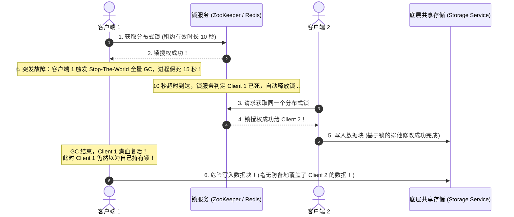
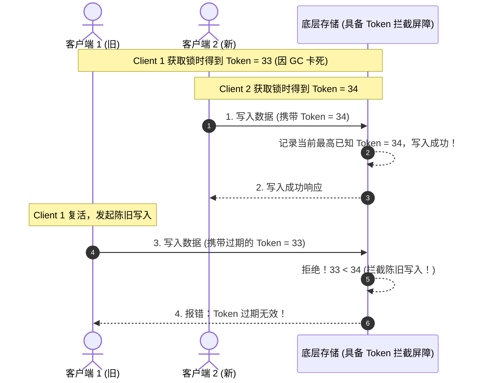

# 核心实战精炼：直面分布式深渊——不确定性与防御性架构

在单台计算机上，硬件在绝大多数情况下表现出令人心安的**确定性（Determinism）**：要么完全正常运转，要么彻底蓝屏崩溃（Crash-Stop）。

然而，一旦跨越网络构建分布式系统，我们便踏入了一个充斥着**部分失效（Partial Failures）、不可靠网络、时钟不可逆漂移与进程漫长假死**的混沌深渊。在分布式领域，**“墨菲定律”不是一种修辞，而是随时上演的物理必然**。

---

## 1. 核心架构决策矩阵：分布式物理故障谱系与防御防御体系

| 物理失效维度 | 典型物理发生场景 | 传统天真假设 (Naive Assumptions) | 致命系统性灾难 | 推荐生产级防御方案与架构模式 |
| :--- | :--- | :--- | :--- | :--- |
| **异步网络不可靠** | 交换机端口闪断、跨机房光纤被挖断、网络缓冲区溢出丢包 | 假设超时未收到 ACK 即代表远端“未执行”并盲目重试 | 重复扣款、订单状态机紊乱、写入雪崩 | **业务幂等键（Idempotency Key）** + 指数退避抖动重试 + 熔断降级 |
| **时钟漂移与跳跃** | NTP 服务器步进同步、晶振受机房温度漂移、闰秒调整 | 假设物理时钟在各机器绝对同步，使用 `System.currentTimeMillis()` 裁决并发先后 | **数据因果颠倒**：后发生的数据因本地时间慢了几毫秒而被当成旧数据静默覆盖抛弃（LWW 陷阱） | 放弃物理时钟定序，使用**逻辑时钟（Lamport / 向量时钟）**或硬件级 **TrueTime（置信区间 $[\text{earliest}, \text{latest}]$）** |
| **进程不可控暂停 (GC/Paging)** | JVM 触发长时间 Full GC、操作系统缺页中断换入换出、虚拟化宿主机迁移休眠 | 假设在本地判断“租约（Lease）尚未到期”时，执行写入一定是安全的 | 租约已在网络端过期，旧节点满血复活并发写入底层存储，制造脑裂与数据覆写 | **Fencing Token（防护令牌）**：底座存储强制校验单调递增令牌，拒绝陈旧 Epoch 写入 |
| **拜占庭故障 (Byzantine Faults)** | 内存单比特翻转（Bit Flip）、网络数据包损坏穿透 TCP 校验、恶意节点伪造协议消息 | 假设所有节点都忠实遵循代码逻辑、绝不说谎 | 核心元数据被悄悄污染、静默数据损坏无法自愈 | 数据块端到端**加密校验和（SHA-256）**；在不可信公网区块链采用 PBFT/Raft 拜占庭共识 |
| **算法正确性边界** | 网络延迟、节点故障与并发读写发生极端复杂交错 | 仅依赖人工编写的单元测试与集成测试，自测“跑通即正确” | 极端网络分区或主备切换时偶发性丢数据，排查耗时数月 | **形式化验证（TLA+ / PlusCal）** + **对抗性混沌测试（Jepsen / Chaos Mesh）** |

---

## 2. 深度死角：分布式锁租约陷阱与 Fencing 令牌防御

在分布式系统中，使用 Redis 或 ZooKeeper 实现“分布式锁”是极为常见的模式。然而，由于**进程暂停（Process Pauses）**的存在，绝大多数基于“租约时间（TTL）”的分布式锁都存在致命设计缺陷：



### 生产级终极解法：Fencing Tokens（防护令牌）
客户端在获取锁的同时，锁服务必须返回一个**单调递增的令牌（Fencing Token，如自增版本号 33、34）**。底层存储在处理写入时，必须原子记录并比对该令牌：



---

## 3. 生产级实战代码：带 Fencing Token 屏障的原子写入范式

以下 Go 生产范式展示了在底座存储层如何以强原子性校验 Fencing Token，杜绝假死节点的数据覆写：

```go
package fencing

import (
	"context"
	"database/sql"
	"errors"
	"fmt"
)

var ErrStaleFencingToken = errors.New("fencing token is stale: rejected concurrent write from zombie client")

type ProtectedStorage struct {
	db *sql.DB
}

func NewProtectedStorage(db *sql.DB) *ProtectedStorage {
	return &ProtectedStorage{db: db}
}

// WriteWithFencing 带防护令牌的排他安全写入：
// 即使客户端由于 GC 停顿导致本地租约失效，过期的写入也会在数据库层被安全阻断
func (s *ProtectedStorage) WriteWithFencing(ctx context.Context, resourceID string, token int64, payload []byte) error {
	tx, err := s.db.BeginTx(ctx, &sql.TxOptions{Isolation: sql.LevelReadCommitted})
	if err != nil {
		return fmt.Errorf("begin tx: %w", err)
	}
	defer tx.Rollback()

	// 1. 检查并锁定当前资源的最高有效 Token
	var currentHighestToken int64
	query := `
		SELECT highest_fencing_token 
		FROM resource_fencing 
		WHERE resource_id = $1 
		FOR UPDATE
	`
	err = tx.QueryRowContext(ctx, query, resourceID).Scan(&currentHighestToken)
	if err != nil && !errors.Is(err, sql.ErrNoRows) {
		return fmt.Errorf("check fencing token: %w", err)
	}

	// 2. 核心拦截判定：如果传入的 Token 小于或等于数据库已知最高 Token，立即阻断！
	if token <= currentHighestToken {
		return fmt.Errorf("%w: current=%d, rejected=%d", ErrStaleFencingToken, currentHighestToken, token)
	}

	// 3. 令牌有效，原子提升水位线并写入业务载荷
	upsertTokenQuery := `
		INSERT INTO resource_fencing (resource_id, highest_fencing_token)
		VALUES ($1, $2)
		ON CONFLICT (resource_id) DO UPDATE 
		SET highest_fencing_token = EXCLUDED.highest_fencing_token
	`
	if _, err := tx.ExecContext(ctx, upsertTokenQuery, resourceID, token); err != nil {
		return fmt.Errorf("advance fencing token: %w", err)
	}

	writePayloadQuery := `
		UPDATE resource_data 
		SET payload = $1, last_updated_token = $2 
		WHERE resource_id = $3
	`
	if _, err := tx.ExecContext(ctx, writePayloadQuery, payload, token, resourceID); err != nil {
		return fmt.Errorf("write payload: %w", err)
	}

	return tx.Commit()
}
```

---

## 4. 架构避坑清单 (Do's & Don'ts)

| 决策维度 | 严禁行为 (Don'ts) | 推荐最佳工程实践 (Do's) |
| :--- | :--- | :--- |
| **时钟排序** | 在分布式日志收集或数据库更新中，依赖单机物理墙上时间戳（`time.Now()`）作为全局事务全序裁决依据。 | 采用**逻辑序列号（Lamport Timestamps / Raft Term + LogIndex）**；对强一致时间诉求接入具备置信区间的硬件级 TrueTime。 |
| **分布式锁** | 使用缺乏 Fencing 令牌屏障的简单 Redis 分布式锁来保护关键金融账户扣款或文件系统写入。 | 锁服务必须返回**单调自增 Epoch / Fencing Token**，并在底层资源接收端实现原子单调递增拦截校验。 |
| **网络超时设置** | 将微服务 RPC 调用超时时间设置为极其敏感的几毫秒，一遇到微小网络抖动立即疯狂重试。 | 科学评估网络 P99.9 延迟，设置合理的超时窗口；重试必须配置**指数退避（Exponential Backoff）与随机抖动（Jitter）**。 |
| **GC 与租约** | 在 Java/Go 服务中，将心跳上报间隔与租约过期时间设为相同量级（如心跳 3s，租约 5s），未给 GC 停顿留出缓冲。 | 租约时长至少应为心跳检测周期的 3~5 倍，且业务代码在执行写操作前必须预留充足的“安全裕度窗口（Safety Margin）”。 |
| **测试完备性** | 迷信本地功能测试与简单的代码审查，误以为没有报错的分布式系统就没有并发竞态 Bug。 | 引入 **Jepsen 混沌网络故障注入框架**，对网络分区、单点宕机、时钟突变与节点假死执行高强度对抗性测试。 |

<!-- split -->

# 原著完整参考：不可靠分布式现实（The Trouble with Distributed Systems）

> “**事故真是些奇奇怪怪的玩意儿——在它们真正发生之前，你永远觉得它们绝不可能发生。**”
> 
> —— A.A. Milne，《小熊维尼的房子》（The House at Pooh Corner, 1928）

构建高可靠系统意味着确保整个系统在各类局部故障（Faults）发生时，依然能够无中断对外提供服务。

然而，在日常开发中，工程师往往极容易沉溺于“**顺境链路（The Happy Path）**”——毕竟在绝大多数正常时刻，系统都能平稳运转。人们倾向于忽视那些看似罕见的边缘极端工况。

如果你立志于让分布式系统在严酷现实中生存下来，**你必须从根本上重塑自己的心智模型：将最大的注意力聚焦于“一切可能出错的极端异常”之上，哪怕发生的概率只有百万分之一**。在一个规模足够庞大的分布式集群中，“百万分之一的罕见故障”每天都在发生数百次。

在单台计算机上写程序与在跨网络的多台计算机上编写分布式系统，有着本质维度的物理断层：**在单机上，软硬件的失效通常是确定性的（Deterministic）；而在分布式系统中，部分失效（Partial Failures）带来了无穷无尽的不确定性**。

:::en
> **Original**: Working with distributed systems is fundamentally different from writing software on a single computer—the main difference being that things can go wrong in lots of new and exciting ways. When you are writing a program on a single computer, it normally behaves in a fairly predictable way: either it works or it doesn’t... An individual computer with good software is usually either fully functional or entirely broken, but not something in between. In a distributed system, there may well be some parts of the system that are broken in an unpredictable way, even though other parts of the system are working fine. This is known as a partial failure.

**📌 核心术语与语境解析**：
- **Partial failure** [ˈpɑːʃl ˈfeɪljə]：*部分失效/局部故障*。分布式系统中局部节点或交换机崩溃而其余部分仍在盲目运转的不确定性状态。
- **Deterministic** [dɪˌtɜːmɪˈnɪstɪk]：*确定性的*。输入与环境相同则输出必然完全一致的理想物理模型。
- **The happy path** [ˈhæpi pɑːθ]：*顺境路径*。缺乏容错考虑、假设所有网络与节点永远完美的理想化代码路径。
:::

---

## 不可靠网络与物理现实

当今互联网以及绝大多数数据中心内部网络（以太网）全部属于**异步分组网络（Asynchronous Packet Networks）**。在这种网络中，一个节点向另一个节点发送消息包时，**底层网络绝对不承诺该包何时到达，甚至绝不承诺它是否能够到达**！

当你向对端发送一个请求但迟迟没有收到响应时，在物理上你**绝对无法区分以下三种根本原因**：


1. **请求在传输途中丢失了**（机房交换机配置错误或网线被拔掉）；
2. **对端节点已经彻底宕机崩溃**（电源烧毁或操作系统内核崩溃）；
3. **请求已成功执行，但对端返回的响应确认包在半路丢失了**。

发送方唯一能获知的信息仅仅是：“我尚未收到回复”。处理该问题的常规手段是**设置超时（Timeout）**。但超时发生后，发送方依然处于完全两眼一抹黑的盲目状态：你根本不知道远端到底有没有执行写入。若贸然重试，极易造成资金重复扣除或数据重复插入。

---

## 不可靠时钟：物理时间的致命诱惑

在分布式系统中，时间至关重要：确定请求是否超时、统计服务延迟、计算指标 P99、判定会话 Cookie 过期。

然而，计算机内部的物理晶振时钟极其脆弱不可靠：
- **墙上时钟（Time-of-day Clock / `CLOCK_REALTIME`）**：表示当前绝对日期时间。它极度依赖 NTP 协议与远程时间服务器同步。当本地晶振漂移过大或遭遇闰秒时，**NTP 守护进程会强行让本地时钟向前跳跃或向后回拨（Step-adjustment）**！对于业务代码而言，这意味着你连续两次读取时间，第二次读取的时间竟然可能比第一次还要早（**时间倒流**）；
- **单调时钟（Monotonic Clock / `CLOCK_MONOTONIC`）**：永远单调递增，绝不回退，专用于计算同一台机器上两个时间点之间的流逝区间（`Duration`）。但它无法跨机器做绝对时间比对。

### 为什么依赖物理时间戳（LWW）是灾难性的？
许多无主数据库（如 Cassandra）使用**最后写入胜出（Last Write Wins, LWW）**：以客户端上报的物理时钟作为因果裁决依据。


如图 9-3 所示：
- 节点 1 写入 $x = 1$，本地时钟为 42.004 秒；
- 紧接着发生的节点 2 写入 $x = 2$，但节点 2 的本地时钟遭遇负向漂移，时间戳记录为 42.003 秒！
- 按照 LWW 规则，系统竟然判定时间戳更大的 $x = 1$ 胜出，**导致在真实世界中后发生的 $x = 2$ 被永久丢弃并静默蒸发**！

因此，**在分布式系统中，严禁依赖不可靠的物理墙上时钟来为并发事件进行因果全序编排**。

:::en
> **Original**: Even with a high-accuracy GPS receiver and careful calibration, clock synchronization remains an inexact science: there is always some uncertainty in the time returned by a clock. Google’s TrueTime API in Spanner addresses this by explicitly reporting the uncertainty: when you ask for the current time, you get back an interval [earliest, latest], guaranteed to contain the true time.

**📌 核心术语与语境解析**：
- **Clock skew / drift** [klɒk skjuː / drɪft]：*时钟偏斜/时钟漂移*。物理硬件石英晶体因温度震动导致振荡频率偏差的物理现象。
- **TrueTime API** [truː taɪm]：*Google Spanner 的 TrueTime 机制*。利用原子钟与 GPS 接收器，将时间不确定性显式量化为置信区间 $[\text{earliest}, \text{latest}]$。
- **LWW (Last Write Wins)**：*最后写入胜出*。一种简单粗暴的冲突解决策略，由于依赖物理时钟而具有高风险的数据静默丢失隐患。
:::

---

## 进程停顿与分布式锁的崩溃

即使网络与时钟全部正常，计算机进程自身的执行节奏也绝非严丝合缝的连续流水线：
- **垃圾回收停顿（Stop-the-world GC Pauses）**：Java 或 Go 运行时可能突然暂停所有业务线程数秒，以扫描并清理堆内存；
- **虚拟化与容器休眠**：在云原生环境中，宿主机发生过载或执行动态虚拟机热迁移时，虚拟机可能被瞬时挂起暂停数十秒；
- **操作系统缺页中断与线程调度**。

如左栏图 9-4 所示，如果客户端从 ZooKeeper 获取了有效时长为 10 秒的分布式锁租约，但在执行写操作前不幸遭遇了 15 秒的 Full GC 停顿：
- 客户端在停顿前自认为持有锁；
- 停顿期间租约在服务端静默过期，锁被转移给客户端 2；
- 客户端 1 从 GC 中苏醒过来，**它根本无法察觉自己刚刚经历了 15 秒的灵魂出窍**，继续发起写入，彻底击穿数据完整性！


**唯有在底座存储层实施 Fencing Token 屏障（如图 9-6），才能彻底封死这一致命裂缝**。

---

## 拜占庭故障与系统模型演变

在分布式理论研究中，科学家们对故障模型进行了精确分类：
1. **崩溃-停止模型（Crash-Stop）**：节点一旦故障即永远停止运行，绝不复活；
2. **崩溃-恢复模型（Crash-Recovery）**：节点可能随时崩溃或失去网络响应，但随后会重新启动并尝试重放本地 WAL 恢复状态；
3. **拜占庭故障（Byzantine Faults）**：节点不仅会崩溃，还可能“说谎”、伪造消息、发送自相矛盾的数据（例如恶意黑客入侵或硬件内存比特翻转）。

在企业内网数据中心，我们通常假设节点不存在恶意篡改行为（非拜占庭环境）。但随着系统规模突破数十万核，**形式化验证（Formal Methods，如 TLA+）**与**自动化混沌故障注入（Chaos Testing / Jepsen）**已成为验证分布式一致性协议实现完备性的不可或缺的标准工具。


---

## 本章小结

分布式系统的世界是一个充满偏执与怀疑论的残酷领域：
- **放弃网络确定性假设**：超时不代表未执行，必须强制业务层实现幂等防御；
- **识破物理时钟的幻觉**：不可靠时钟无法充当因果真相的裁判者；
- **防范进程假死与脑裂**：分布式锁必须配备强单调递增的 Fencing Tokens 屏障；
- **接受混沌注入检验**：唯有在最极端的故障交错下经受住考验的系统，才有资格在生产中承载核心资产。

在下一讲（**第 10 讲**）中，我们将迎来分布式领域的最高王冠：**线性一致性与共识算法（Consistency and Consensus）**，深入剖析 Raft 与 Paxos 是如何在这一片混乱的废墟之上，奇迹般构建出不可动摇的强一致性堡垒。
