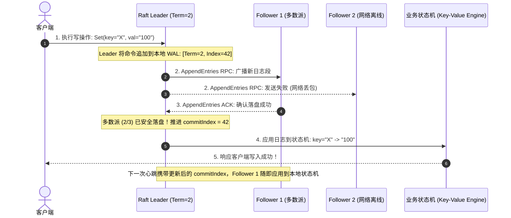

# 核心实战精炼：共识的算法王冠与强一致性落地法则

在分布式系统由不可靠网络、时钟漂移和假死崩溃构成的废墟之上，我们如何构建出一套坚不可摧、表现得如同单台物理机一样确定的软件系统？

答案就是**分布式共识（Consensus）**与**线性一致性（Linearizability）**。共识问题被公认为分布式计算领域最困难、也最迷人的核心王冠：**让一组互不信任、随时可能遭遇网络分区的对等节点，就某一项决策或操作全序日志达成绝对不可动摇的统一法定裁决**。

---

## 1. 核心架构决策矩阵：分布式一致性阶梯与共识协议全景

| 一致性模型 / 协议 | 核心数学定义与直觉保证 | 读写延迟与吞吐 | 网络分区容忍度 | 典型工业级实现 | 生产级适用场景与架构边界 |
| :--- | :--- | :--- | :--- | :--- | :--- |
| **最终一致性 (Eventual Consistency)** | 停止写入后，所有副本最终收敛至相同状态；但读操作不保证时效性，可能读到任意旧版本 | **延迟极低**（本地即时读写）；<br/>吞吐极高 | 极高（AP 系统，分区期间各机房继续接写） | Dynamo, Cassandra, CouchDB, CRDTs | 社交互动点赞、商品只读展示、离线文档编辑协同 |
| **因果一致性 (Causal Consistency)** | 满足“并发事件乱序，有因果关联事件严格有序”；不满足全序线性化 | 读写延迟低，无需跨机房单点全局同步 | 较高（弱网或多地域容灾友好） | 向量时钟系统, MongoDB 因果会话 | 社交评论回帖、对话上下文流转、具备明确父子依赖的工作流 |
| **线性一致性 (Linearizability)** | **原子性与最新鲜性（Recency）**：系统对外伪装为单副本单机，一旦某个读请求读到了新值，后续所有读请求绝对不可能再读到旧值 | **延迟受网络 RTT 约束**（读写均需网络往返确认）；吞吐较低 | 必须满足多数派活体（Quorum: $N/2 + 1$）；无法容忍脑裂分区 | etcd, Consul, Google Spanner, TiKV (Raft) | 分布式选主、分布式锁、跨库全局唯一自增发号器、金融强记账 |
| **两阶段提交 (2PC)** | 跨异构系统的原子提交（全要么要么都不），是**原子提交协议而非高可用共识协议** | 极度高昂，受制于最慢节点；产生锁阻塞 | **极差（无容错）**：协调者或单点宕机导致全系统锁死疑虑 | XA 规范, Java JTA 事务 | 传统同机房数据库集群；微服务生产界已全面边缘化 |
| **Raft / Multi-Paxos** | **高可用复制状态机（RSM）**：基于 Term 选举与多数派确认，保证提交日志不可逆全序追加 | 优良（Leader 直发，多数派落盘即返回，通常 1~2 次 RTT） | **强容忍**：只要集群中 $N/2 + 1$ 个节点健康存活即可持续无损提供服务 | etcd (KRaft), CockroachDB, SOFAJRaft | 生产级分布式数据库存储引擎底座、K8s 控制面元数据治理 |

---

## 2. 深度思辨：CAP 定理的工程真伪辩析

工业界常年流传着一个肤浅的神话：“系统可以在一致性（C）、可用性（A）、分区容错性（P）之间任选其二（如所谓的 CA 系统）”。

**在真实物理世界中，“CA 系统”根本不存在！**
- 网络不是由理想光纤构成的黑洞，交换机丢包、光缆施工中断等**网络分区（Network Partitioning, P）是客观存在的物理事实**；
- 当网络发生分区断裂时，系统被割裂为互不相通的孤岛。此时架构师**被迫只能在以下两者之间做二选一**：
  1. **选择线性一致性（CP）**：少数派节点拒绝处理写请求，或者等待直到网络恢复，系统牺牲了部分可用性；
  2. **选择高可用性（AP）**：孤岛各自允许本地写入，但分区愈合时必然面临数据分歧与冲突修复，系统牺牲了线性一致性。

---

## 3. 生产级架构拓扑：Raft 复制状态机与全序广播链路

所有实用共识算法（Raft、Paxos、Zab）在本质上都等价于**全序广播（Total Order Broadcast）**，进而驱动**复制状态机（Replicated State Machine, RSM）**的确定性演化：



---

## 4. 生产级实战范式：基于 etcd 实现租约保活与分布式互斥锁

以下 Go 生产范式展示了如何基于工业级共识系统（etcd）利用**租约（Lease）心跳自动续期、版本修订号（ModRevision）以及事件 Watch 机制**构建无死锁、无漂移的健壮分布式锁：

```go
package distributedlock

import (
	"context"
	"fmt"
	"time"

	clientv3 "go.etcd.io/etcd/client/v3"
	"go.etcd.io/etcd/client/v3/concurrency"
)

type DistributedLockManager struct {
	client *clientv3.Client
}

func NewLockManager(endpoints []string) (*DistributedLockManager, error) {
	cli, err := clientv3.New(clientv3.Config{
		Endpoints:   endpoints,
		DialTimeout: 5 * time.Second,
	})
	if err != nil {
		return nil, fmt.Errorf("connect to etcd: %w", err)
	}
	return &DistributedLockManager{client: cli}, nil
}

// ExecuteWithLock 基于 Raft 共识强一致性的分布式锁安全执行业务操作
func (m *DistributedLockManager) ExecuteWithLock(ctx context.Context, lockKey string, ttlSeconds int, task func(context.Context) error) error {
	// 1. 创建基于 Raft 共识的 Session 会话，由 etcd 客户端在后台协程持续执行租约心跳 KeepAlive
	session, err := concurrency.NewSession(m.client, concurrency.WithTTL(ttlSeconds))
	if err != nil {
		return fmt.Errorf("create etcd session: %w", err)
	}
	defer session.Close()

	// 2. 初始化互斥锁对象：利用 etcd Revision 机制自动形成公平排队队列
	mutex := concurrency.NewMutex(session, fmt.Sprintf("/locks/%s", lockKey))

	fmt.Printf("🔒 正在竞争分布式锁 [%s]...\n", lockKey)
	if err := mutex.Lock(ctx); err != nil {
		return fmt.Errorf("acquire lock: %w", err)
	}
	fmt.Printf("✅ 成功获取分布式锁！持有 Revision=%d\n", mutex.Header().Revision)

	// 确保执行完毕释放锁
	defer func() {
		_ = mutex.Unlock(context.Background())
		fmt.Printf("🔓 分布式锁 [%s] 已安全释放\n", lockKey)
	}()

	// 3. 执行受临界区保护的核心业务逻辑
	return task(ctx)
}
```

---

## 5. 架构避坑清单 (Do's & Don'ts)

| 决策维度 | 严禁行为 (Don'ts) | 推荐最佳工程实践 (Do's) |
| :--- | :--- | :--- |
| **CAP 选型** | 盲目在架构文档中宣称自身系统是“满足 CA 的分布式架构”，忽视网络分区客观存在。 | 直面物理约束：明确系统在网络分区断裂时的降级策略是 **CP（牺牲可用性保一致）** 还是 **AP（接受脏读保可用）**。 |
| **共识集群规模** | 误以为“Raft 节点越多越安全”，部署包含 11 个或 15 个节点的超大共识集群，导致写吞吐被多数派网络往返直接拖死。 | 共识集群规模必须保持为**较小的奇数（推荐 3 节点或 5 节点）**；大规模客户端读流通过无投票权的只读 Learner 节点分流。 |
| **线性一致性代价** | 在所有高并发只读 API 接口上无节制强制要求线性一致性读取，导致数据库 QPS 严重受限。 | 业务层深度审视：绝大多数查询只需要**因果一致性（Causal）**或**读已提交快照**；仅在鉴权、选主和记账关键点开启线性读。 |
| **分布式锁超时** | 认为获取到了 etcd 锁就代表“万无一失”，临界区内包含无超时控制的大批量慢查询或大文件网络传输。 | **临界区操作必须快**；且底层数据落盘端必须严格实施基于 Revision 的 **Fencing Token 单调校验**防范 GC 假死逃逸。 |
| **自研共识算法** | 为了规避引入 etcd/ZooKeeper 等基础设施依赖，在业务进程内手写简陋的心跳选举代码当作共识层。 | **严禁在生产自研未经形式化证明的共识算法！**必须直接采用工业界历经淬炼的组件（etcd、Raft 官方库、Consul）。 |

<!-- split -->

# 原著完整参考：一致性与共识算法（Consistency and Consensus）

> “**一句古老的格言告诫我们：‘出海航行切莫携带两块航海天文钟；要么带上一块，要么带上三块。’**”
> 
> —— Frederick P. Brooks Jr.，《人月神话》（The Mythical Man-Month, 1995）

在第 9 讲中，我们详尽剖析了分布式系统中可能发生的种种灾难性故障。如果我们要让系统在各类不可靠网络与单点崩溃的废墟中依然正确可靠地运转，就必须构建起一套坚不可摧的**容错机制（Fault Tolerance）**。

在数据系统工程中，容错最强大的杀手锏是**副本机制（Replication）**。然而，一旦引入多副本，系统立即面临不一致性的剧烈冲击：读取可能落在一个发生延迟的从库上返回过期的陈旧数据；若多个副本并发接写，又必须面对复杂的数据分歧冲突。

面对这些冲突，业界存在两大针锋相对的核心哲学：
1. **最终一致性哲学（Eventual Consistency）**：将存在多副本分歧的物理现实暴露给应用程序，由业务开发人员在应用层通过重试、合并算法或 CRDT 去直面并化解冲突；
2. **强一致性哲学（Strong Consistency）**：在系统内部将所有副本同步的复杂性彻底封装，**使整个分布式系统对外呈现出如同一台单一机器、单一副本一样的行为直觉**。这种方式极大解放了业务工程师的心智带宽，但代价是必须承受网络延迟与性能吞吐上的物理折损。

在本章中，我们将登顶强一致性分布式系统的理论巅峰，重点攻关三大核心领域：
- 为模糊的“强一致性”建立精确的数学模型——**线性一致性（Linearizability）**；
- 探究全局唯一 ID 生成与因果全序（Total Order）的内在本质；
- 剖析分布式系统在发生任意网络分区与节点崩溃时，依然能实现强一致性自愈的终极答案——**共识算法（Consensus Algorithms，如 Raft）**。

:::en
> **Original**: If you want a replicated database to be as simple as possible to use, you should make it behave as if it were a consistent single-node database. Then users don’t have to worry about replication lag, conflicts, and other inconsistencies... This is the idea behind linearizability (also known as atomic consistency, strong consistency, immediate consistency, or external consistency). The basic idea is to make a system appear as if there is only one copy of the data, and all operations on it are atomic. In a linearizable system, as soon as one client successfully completes a write, all clients reading from the database must be able to see the value just written.

**📌 核心术语与语境解析**：
- **Linearizability** [ˌlɪniəraɪzəˈbɪləti]：*线性一致性*。分布式强一致性顶峰，要求所有操作表现得如同在一个全局单一时钟线上原子瞬时完成。
- **Atomic consistency** [əˈtɒmɪk kənˈsɪstənsi]：*原子一致性*。线性一致性的学术别称，强调写操作的不可分割原子生效点。
- **Recency guarantee** [ˈriːsnsi ˌɡærənˈtiː]：*最新鲜性保证*。读操作绝不返回陈旧旧值，必须反映已完成写操作的最新状态。
:::

---

## 线性一致性（Linearizability）的严密定义与直觉图解

线性一致性的底层基本直觉极其朴素：**让系统在外表上呈现出“世上只有一份唯一的数据副本”，并且对该数据的一切读写操作都是原子生效的**。

在非线性一致的系统中，用户会遭遇极其费解的困惑。如图 10-1 所示：


Aaliyah 和 Bryce 坐在同一间客厅收看同一场球赛。比赛决胜一球刚刚打进，Aaliyah 刷新手机页面读到了最新比分，兴奋地告诉了 Bryce。Bryce 紧随其后在自己的手机上点击刷新，然而他的请求被打在了一个发生延迟的从库上，导致他的手机显示“比赛仍在进行中”！在外部物理时间上，Bryce 的查询明明发生在 Aaliyah 获知最新比分之后，但他却读到了过去的陈旧状态——**这便彻底粉碎了线性一致性**。

### 线性化点（Linearization Points）的精确判定
为了科学判定一个系统是否满足线性一致性，我们来看三个并发客户端对寄存器 $x$ 执行操作的经典时序：


在图 10-3 中，当客户端 C 发起 $x = 1$ 的写入过程中，客户端 A 和 B 并发读取：
- 只要没有任何一个读请求读到新值 1，读操作返回 0 是允许的；
- **但关键转折点在于：一旦客户端 A 的某一次读取率先返回了新值 1，系统中的线性化点便已不可逆地锚定！在此之后发起的任何读操作（无论来自客户端 A 还是 B），都必须绝对强制返回新值 1，绝对不允许再发生倒退回 0 的反复横跳！**


图 10-4 展示了所有合法操作在开始与结束时间窗口之间，都能找到一个**不可逆、单向递增的虚拟全局生效点（Linearization Point）**。

---

## CAP 定理的物理本质与网络延迟代价

为什么不是所有分布式系统都默认开启线性一致性？因为维持这一幻象需要付出极为沉重的物理代价。


如图 10-5 所示，当机房之间的网络发生断裂分区时：
- 节点 1 位于分区 A，节点 2 位于分区 B；
- 客户端向节点 1 写入新值；节点 1 无法跨越断裂的网络同步给节点 2；
- 此时若客户端从节点 2 发起读取：
  - 如果节点 2 允许响应，它只能返回旧值，**线性一致性被破坏（选择 AP）**；
  - 如果系统必须坚守线性一致性，节点 2 只能**拒绝响应或超时报错，系统可用性被破坏（选择 CP）**。

更深刻的物理定律由 Attiya 和 Welch 在数学上证明：**在线性一致性系统中，任何读写操作的往返延迟下限，必定严格正比于各物理节点之间的网络传输往返延迟（RTT）**。在无法超越光速的物理宇宙中，追求绝对强一致性必然要为高延迟买单。

:::en
> **Original**: The CAP theorem is sometimes framed as: consistency, availability, and partition tolerance: pick two out of three. Unfortunately, putting it this way is misleading, because network partitions are a form of fault, so they aren’t something you have a choice about: they will happen whether you like it or not... A better way to state CAP would be: either Consistent or Available in the presence of a Partition.

**📌 核心术语与语境解析**：
- **CAP theorem** [kæp ˈθɪərəm]：*CAP 定理*。由 Eric Brewer 提出、Gilbert 与 Lynch 严密证明的分布式计算基础物理定律。
- **Network partition** [ˈnetwɜːk pɑːˈtɪʃn]：*网络分区*。由于交换机故障或光缆切断导致节点间无法通信、系统分裂为孤岛的物理故障。
- **Misleading** [ˌmɪsˈliːdɪŋ]：*具误导性的*。“三选二”是典型误导，因为网络分区无法人为规避，架构只能在分区发生时二选一。
:::

---

## 全序广播与共识的等价性

在分布式计算中，产生全局严格自增 ID 绝非易事。单机雪花算法（Snowflake）基于时间戳，容易受时钟回拨影响；而 Lamport 时间戳虽然满足因果先后，但**无法即时做出唯一性判定**（例如两个用户并发抢注同一个用户名时，Lamport 时间戳在事后比对前无法即时拦截）。

即时做出唯一性裁决必须依赖**全序广播（Total Order Broadcast）**：
1. **可靠交付（Reliable Delivery）**：绝不丢失消息，一旦一条消息在一个节点被交付，它必将在所有健康节点被交付；
2. **全序一致（Totally Ordered Delivery）**：所有节点必须按照完全相同的顺序交付所有消息。


计算机科学家已经严格证明：**全序广播在数学上与分布式共识是完全等价的**。全序广播就是共识算法在持续产生的一个个决策槽位。

---

## 现代共识算法实战：Raft 状态机复制内幕

在过去，Paxos 算法以其极度抽象晦涩而臭名昭著。2014 年，斯坦福大学的 Diego Ongaro 与 John Ousterhout 提出了专为工程易理解性设计的 **Raft 算法**，在过去十年内迅速统治了整个工业界：


### Raft 的核心运行脉络
1. **任期机制（Terms）**：时间被划分为单调递增的逻辑任期（Term = 1, 2, 3...）。每个任期至多通过多数派投票选出唯一的 Leader；
2. **日志匹配不变量（Log Matching Property）**：如果两个节点上的某条日志拥有相同的 Term 和 Index，那么该日志必定记录了相同的操作，且此前所有的历史日志序列也必然完全等价；
3. **领导者完备性（Leader Completeness）**：在选举阶段，Follower 节点只会投票给**日志比自己更新（Term 更大，或 Term 相同但 Index 更长）**的候选人。这确保了当选的新 Leader 必然完整持有过去所有任期中已被多数派提交的全部历史日志！

通过这一精巧设计，Raft 彻底根除了脑裂与历史数据倒流的可能，成为支撑现代 Kubernetes（etcd）、CockroachDB、TiKV 等核心基础设施的稳固心脏。

:::en
> **Original**: Consensus algorithms such as Raft, Paxos, and Zab use a formal model that assumes a partially synchronous system with crash-recovery nodes. In this model, algorithms are guaranteed to be safe (never returning an incorrect result) even in the presence of arbitrary network delays, partitions, and node restarts. When network conditions improve and a majority of nodes are able to communicate, they are also guaranteed to make progress.

**📌 核心术语与语境解析**：
- **Crash-recovery model** [kræʃ rɪˈkʌvəri]：*崩溃-恢复模型*。节点可随时崩溃并重启重放日志继续参与共识的现实系统模型。
- **Safety vs Liveness** [ˈseɪfti / ˈlaɪvnəs]：*安全性与活性*。安全性保证“绝不发生坏事”（不出现分歧）；活性保证“系统最终必定能做出决策”（在网络恢复后继续向前推进）。
- **Replicated State Machine** [ˈreplɪkeɪtɪd steɪt məˈʃiːn]：*复制状态机 (RSM)*。相同的确定性状态机按完全相同的日志顺序执行，必然演化出完全一致的内存状态。
:::

---

## 本章小结

一致性与共识是分布式系统大厦最核心的拱顶石：
- **线性一致性**抹平了分布式多副本的时序裂痕，让系统对外呈现如单机般确定的最新鲜保证；
- **CAP 定理揭示了物理宿命**：网络分区无法避免，架构设计必须在 CP 严格一致性与 AP 弹性可用性之间做出坚定抉择；
- **Raft 等共识算法**将不可靠网络与随时宕机的废墟，化作了具备严谨数学证明的高可用复制状态机，为整个现代云原生世界筑牢了坚不可摧的信任底座。

至此，**《数据密集型系统架构实战（第二版）》第二篇（分布式数据系统）全部完结**！在接下来的第三篇（**第 11 ~ 14 讲**）中，我们将踏入更高维度的宏观架构范式：探索现代批处理、实时 CDC 流系统哲学以及终局架构伦理。
