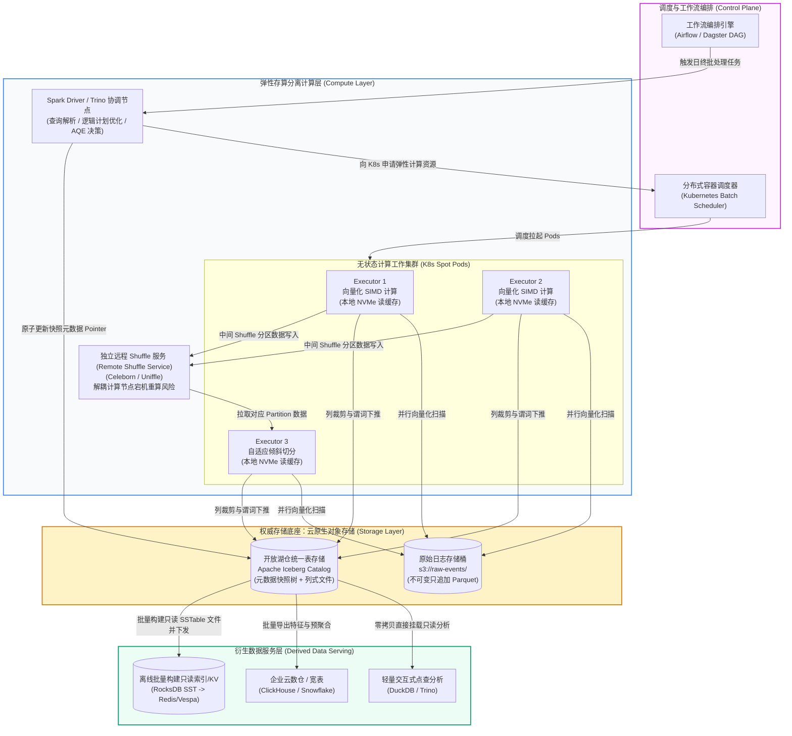

> 💡 **双栏独立滚动工作台导读**：本文采用双栏对照架构。**左栏**为核心精炼架构、实战代码与避坑决策；**右栏**为原著完整参考译文，附有关键段落的英文原文展开与难词解析。左右两栏可独立滚动，并支持顶栏自定义宽度比例（7:3 / 5:5 / 3:7）与拖拽调节。

# 核心实战精炼：现代批处理系统与湖仓架构演进

在数据密集型系统全景中，在线系统（OLTP/服务化 RPC）追求微秒与毫秒级的极低延迟，而**批处理系统（Batch Processing / 离线系统）**则追求**海量吞吐量（Throughput）与全量计算的一致性**。

批处理的最核心哲学基石在于：**输入数据集是只读不可变的（Immutable Inputs），输出数据是从头全新派生的（Derived Outputs），计算过程严禁产生外部未隔离的读写副作用**。这一原则赋予了批处理系统无与伦比的“人类级容错能力（Human Fault Tolerance）”——当算法逻辑出现 Bug 时，工程师无需在复杂生产状态库中执行破坏性数据订正，只需回滚代码并重新调度离线任务，即可确定性地重建出完全正确的衍生视图。

在 2026 年的现代工业实践中，批处理基础设施已经完成了从第一代“Hadoop HDFS + 粗粒度 MapReduce 落盘”到现代“云原生对象存储（S3/GCS）+ 开放湖仓表格式（Apache Iceberg / Delta Lake）+ 内存向量化 DAG 引擎（Apache Spark / DuckDB / Trino）”的彻底跃迁。

---

## 1. 核心架构决策矩阵：分布式批处理技术演化与权衡

| 决策维度 | 传统 Hadoop / MapReduce | 现代湖仓存算分离架构 | 推荐技术选型 | 核心权衡与物理驱动依据 |
| :--- | :--- | :--- | :--- | :--- |
| **持久化存储底座** | 本地附着盘 + HDFS（依赖三副本与计算局部性 Data Locality） | 云对象存储（S3 / MinIO）+ 本地高速 NVMe 缓存 | AWS S3, Apache Iceberg, MinIO | 云机房网络带宽（100Gbps+）消除了本地计算优先的优势；存算分离实现存储容量与计算节点独立秒级缩放，大幅削减闲置成本。 |
| **计算执行模型** | 双阶段（Map -> Spill -> Reduce），中间结果强制落盘序列化 | 内存流式 DAG（有向无环图）+ SIMD 列式向量化执行 | Apache Spark 3.x, DuckDB, Apache Arrow | 避免 MapReduce 每一步在磁盘与网络上的高昂 I/O 放大；流水线化执行使迭代型任务（机器学习、图计算）吞吐提升 10~100 倍。 |
| **Shuffle 数据重排** | Mapper 本地磁盘分桶排序，Reducer HTTP 拉取合并，极易产生小 I/O 与长尾堵塞 | 存算解耦的独立 Remote Shuffle Service (RSS)，避免计算节点宕机导致 Shuffle 重算 | Apache Uniffle, Celeborn, ESS | 解耦计算 Executor 与 Shuffle 数据生命周期，计算节点被抢占回收（Spot 实例）时无需重新跑整条 Mapper 链。 |
| **关联计算（Join）** | 依赖 Map-Side Hash Join 或全量 Reduce-Side Sort-Merge Join | 基于数据大小动态自适应（AQE），广播小表或倾斜键裂变哈希关联 | Spark AQE, Trino Dynamic Filtering | 广播哈希关联（Broadcast Hash Join）完全规避 Shuffle 传输；自适应查询执行根据运行时统计信息动态切分倾斜数据分片。 |
| **元数据与 ACID 契约** | Hive Metastore 目录级元数据，无事务，并发写直接脏覆盖或文件丢失 | 开放表格式（Open Table Format）：文件级快照元数据、ACID 事务与 Time Travel | Apache Iceberg, Delta Lake | 文件级快照将元数据操作转化为对象存储原子提交，支持并发安全写入、时间旅行回溯与毫秒级分区裁剪。 |
| **单机极限 vs 集群** | 动辄启动包含数十台节点的 Hadoop 集群跑简单聚合分析 | 优先单节点极致列式向量化，单机 128 核/1TB 内存承载百 GB 数据 | DuckDB, Polars, 单机 Arrow | 坚守 COST 原则：避免分布式网络通信、序列化与集群调度的固有开销，中等规模批任务单机执行耗时通常低于集群调度开销。 |

---

## 2. 现代生产级技术范式：湖仓一体架构下的健壮批处理管道

以下生产级 Python 范式展示了：如何利用 **Apache Iceberg + PySpark + 自适应优化（AQE）** 构建健壮的离线批处理管道，包含**不可变快照隔离**、**广播哈希关联（规避 Shuffle）**、**倾斜键自适应切分**与**小文件合并提交**：

```python
"""
湖仓一体生产级批处理 ETL 规范实现
特性：Iceberg 事务快照提交、自适应查询执行 (AQE)、防倾斜广播关联与分区重写
"""

import sys
from pyspark.sql import SparkSession
from pyspark.sql import functions as F
from pyspark.sql.types import *

def build_spark_lakehouse_session() -> SparkSession:
    """构建集成了 Apache Iceberg 开放表格式与云对象存储底座的 Spark 会话"""
    return (
        SparkSession.builder
        .appName("Lakehouse-Batch-ETL-Production")
        # 启用 Apache Iceberg Catalog 扩展
        .config("spark.sql.extensions", "org.apache.iceberg.spark.extensions.IcebergSparkSessionExtensions")
        .config("spark.sql.catalog.lakehouse", "org.apache.iceberg.spark.SparkCatalog")
        .config("spark.sql.catalog.lakehouse.type", "hadoop")
        .config("spark.sql.catalog.lakehouse.warehouse", "s3a://production-lakehouse/warehouse/")
        # 开启自适应查询执行 (Adaptive Query Execution, AQE) - 核心工业级防倾斜优化
        .config("spark.sql.adaptive.enabled", "true")
        .config("spark.sql.adaptive.coalescePartitions.enabled", "true")
        .config("spark.sql.adaptive.skewJoin.enabled", "true")
        .config("spark.sql.adaptive.autoBroadcastJoinThreshold", "67108864") # 64MB 自动广播小表
        .config("spark.sql.shuffle.partitions", "200")
        .getOrCreate()
    )

def run_daily_activity_aggregation(spark: SparkSession, batch_date: str):
    """
    执行每日用户交互行为聚合分析任务
    遵循纯函数原则：读只读输入，写不可变隔离分区，确保幂等重算性
    """
    print(f"🚀 [Batch ETL] 开始执行批处理任务，计算批次日期: {batch_date}")

    # 1. 读取只读事实流快照（Raw Event Logs）
    # 借助 Iceberg 隐藏分区与元数据下推，仅扫描目标日期数据块
    events_df = (
        spark.read.table("lakehouse.raw_layer.user_activity_events")
        .filter(F.col("event_date") == batch_date)
        .select("event_id", "user_id", "page_url", "response_time_ms", "timestamp")
    )

    # 2. 读取用户静态维度表（User Demographics Dimension）
    # 小表或中型维度表采用显式 broadcast 提示，完全消除网络 Shuffle 开销
    users_df = (
        spark.read.table("lakehouse.dim_layer.dim_users")
        .select("user_id", "country", "account_tier", "is_bot")
        .filter(F.col("is_bot") == False) # 过滤脏数据
    )

    # 3. 关联与聚合计算（Sort-Merge Join 会在数据规模悬殊时自动降级为 Broadcast Hash Join）
    aggregated_metrics = (
        events_df.join(F.broadcast(users_df), on="user_id", how="inner")
        .groupBy("country", "account_tier", "page_url")
        .agg(
            F.count("event_id").alias("total_views"),
            F.countDistinct("user_id").alias("unique_visitors"),
            F.avg("response_time_ms").alias("avg_response_time"),
            F.percentile_approx("response_time_ms", 0.99).alias("p99_response_time")
        )
        .withColumn("batch_date", F.lit(batch_date))
        .withColumn("processed_at", F.current_timestamp())
    )

    # 4. 幂等写入衍生分析表：利用 Iceberg 动态分区覆盖（Dynamic Partition Overwrite）
    # 若重跑历史批次，原子替换旧快照，严禁数据重复累加
    target_table = "lakehouse.analytics_layer.daily_page_metrics"
    
    (
        aggregated_metrics.writeTo(target_table)
        .tableProperty("write.format.default", "parquet")
        .tableProperty("write.parquet.compression-codec", "zstd")
        .overwritePartitions() # 纯幂等覆盖指定分区
    )

    print(f"✅ [Batch ETL] 批处理任务成功落盘并完成元数据原子提交: {target_table}")

if __name__ == "__main__":
    date_arg = sys.argv[1] if len(sys.argv) > 1 else "2026-10-25"
    session = build_spark_lakehouse_session()
    try:
        run_daily_activity_aggregation(session, date_arg)
    finally:
        session.stop()
```

---

## 3. 生产系统架构拓扑：现代云原生湖仓一体离线批处理计算拓扑

现代工业界彻底淘汰了 HDFS 存算耦合集群，构建了以**对象存储为不可变单事实源、独立 Shuffle 集群为解耦枢纽、自适应向量化引擎为执行器**的拓扑：



---

## 4. 架构避坑清单 (Do's & Don'ts)

| 架构维度 | 严禁行为 (Don'ts) | 推荐最佳工程实践 (Do's) |
| :--- | :--- | :--- |
| **I/O 边界与副作用** | 在批处理算子（如 Map / FlatMap）内部直接向在线 OLTP 数据库发起逐行 RPC 查询或单条更新（N+1 查询噩梦）。 | 严守“纯函数”输入输出边界：所有依赖的外部维度表必须预先全量/增量批量 Dump 入湖，通过批处理引擎内部的高性能哈希关联完成计算。 |
| **数据倾斜治理** | 忽略业务数据严重倾斜（如以特定默认值 `user_id = null` 或超级大 V 账号作为 Shuffle Key），导致单个 Reducer 内存溢出（OOM）或耗时拖垮全局。 | 开启自适应执行（AQE Skew Join）；对极端倾斜键手工实施**盐化加随机前缀（Salting）**，将单 Key 离散打散到多个分区并行处理，最后二次聚合。 |
| **小文件爆炸治理** | 批处理输出未指定合并逻辑，任由高并发 Spark 任务向对象存储写入数百万个几 KB 大小的碎片文件，瘫痪元数据服务与后续读扫描。 | 写入时控制并行度（`repartition` / `coalesce`）；定期在湖仓后台运行异步文件合并与排序整理任务（`OPTIMIZE / Compaction`），维持单个 Parquet 文件在 128MB~512MB 黄金区间。 |
| **容错与幂等重跑** | 批处理直接向存储目标目录以追加模式（Append）写数据，一旦任务在 99% 进度时崩溃重试，导致下游数据重复翻倍。 | 强制践行幂等覆盖（Idempotent Overwrite）与开放表快照事务机制：任务全部成功后才原子提交文件清单指针；中间失败产生的文件由垃圾回收线程自动清理。 |
| **资源分配与选型** | 盲目遵循“数据分析必上分布式集群”教条，对几十 GB 的日常数据分析任务启动笨重庞大的 Spark 集群，把 90% 的时间浪费在资源申请与网络握手。 | 坚守 COST 原则：数据量在单机内存与 NVMe 承受范围内时，坚决优先选用单机向量化引擎（如 DuckDB、Polars），秒级得出计算结果，成本降低 95%。 |

<!-- split -->

# 原著完整参考：第 11 章 批处理系统（Batch Processing）

> “**如果一个系统受单一设计者的个人意志影响过于强烈，它便很难走向普遍的成功。一旦初始设计完成并趋于健壮，真正的严峻考验才刚刚拉开帷幕——来自不同技术视角的人们将开始基于它开展各自天马行空的实验。**”
> 
> —— Donald Knuth，《TeX 的错误》（The Errors of TeX, 1989）

在前几章中，我们探讨的核心基本上围绕着“客户端发出请求或查询，系统以最快速度返回响应或结果”。这是现代大量在线数据系统默认的运行形态：Web 浏览器请求页面、微服务之间通过 RPC 互相调用、数据库读取索引、缓存拦截点查。我们统称这类交互为**在线系统（Online Systems）**。响应时间（Response Time）与可用性是在线系统的核心衡量基准。

然而，在许多核心工程场景中，我们需要执行规模庞大得多的复杂计算，或者处理体量远远超出单次交互式请求所能容纳的数据集。例如：训练大型机器学习模型、对数月沉淀的历史业务日志进行清洗和格式转换、为整站数十亿实体重新生成倒排索引、跨海量数据表执行全量报表统计。

这类计算任务被称为**批处理作业（Batch Processing Jobs）**，承载它们的系统通常被称为**离线系统（Offline Systems）**。

批处理作业读取只读的不可变输入数据，并在每次运行时从头生成全新的输出数据。与数据库中频繁就地原地更新的读写事务（Read-Write Transactions）截然不同，批处理作业的输出完全是**基于输入派生出的衍生数据（Derived Data）**。如果你对计算产出的结果不满意，或者发现业务逻辑中存在缺陷，你只需彻底删除输出目录，修复代码中的 Bug，然后重新调度执行该作业即可。

通过将输入视为不可变实体并严格规避向外部世界产生读写副作用，批处理系统获得了极佳的物理性能以及一项至关重要的属性：**人类级容错能力（Human Fault Tolerance）**。

:::en
> **Original**: By treating inputs as immutable and avoiding side effects (such as writing to external databases), batch jobs achieve good performance as well as other benefits:
> • If you introduce a bug into the code and the output is wrong or corrupted, you can simply roll back to a previous version of the code and rerun the job, and the output will be correct again. [...] Most databases with read/write transactions do not have this property: if you deploy buggy code that writes bad data to the database, rolling back the code will do nothing to fix that data. The idea of being able to recover from buggy code has been called human fault tolerance.
> • As a consequence of this ease of rolling back, feature development can proceed more quickly than in an environment where mistakes could mean irreversible damage. This principle of minimizing irreversibility is beneficial for Agile software development.

**📌 核心术语与语境解析**：
- **Human fault tolerance** [ˈhjuːmən fɔːlt ˈtɒlərəns]：*人类级容错*。分布式计算中最珍贵的容错维度。在线事务数据库一旦写入损坏数据，代码回滚也无法修复已污染的状态；而批处理因输入不可变且无外部副作用，使代码回滚重算成为廉价、安全的操作。
- **Minimizing irreversibility** [ˈmɪnɪmaɪzɪŋ ˌɪrɪˌvɜːsəˈbɪləti]：*最小化不可逆性*。敏捷架构的核心守则——设计系统时优先保留反悔与重做的物理通道，避免陷入“一处笔误破坏永久状态”的绝境。
- **Throughput vs Latency**：*吞吐量 vs 延迟*。批处理的核心量化目标是吞吐量（每秒处理的数据体积或记录数），可以容忍任务运行数分钟甚至数小时；在线系统的核心量化目标则是低延迟。
:::

---

## 经典起源与哲学启示：从 Unix 工具链到分布式系统

为了深刻理解分布式批处理的本质，让我们从单台计算机上的标准 Unix 命令行工具切入。

假设你维护着一台运行 NGINX 的 Web 服务器，访问日志以行为单位持续追加写入：

```text
216.58.210.78 - - [27/Jun/2025:17:55:11 +0000] "GET /css/typography.css HTTP/1.1" 200 3377 "https://martin.kleppmann.com/" "Mozilla/5.0 Chrome/137.0.0.0"
```

如果你希望统计该站点访问量最高的前 5 个热门 URL 页面，你可以在 Unix Shell 中用管道将简单命令串联起来：

```bash
cat /var/log/nginx/access.log |
  awk '{print $7}' |
  sort             |
  uniq -c          |
  sort -r -n       |
  head -n 5
```

这串命令优雅地完成了任务：`awk` 提取请求 URL，第一道 `sort` 将相同 URL 聚集在一起，`uniq -c` 统计相邻相同行的出现频次，第二道 `sort -r -n` 按频次从大到小逆向数值排序，最后 `head -n 5` 输出前五名。

这看似只是一段简单的脚本，却完美体现了现代批处理的核心设计范式：

1. **统一的数据接口（Uniform Interface）**：所有程序都以字节流或文本行为通用契约，使得互不相识的工具可以任意自由组合；
2. **职责单一与关注点分离（Separation of Concerns）**：`sort` 专精于高效排序，`uniq` 专精于连续行去重，没有任何单个程序试图包揽全局；
3. **不可变输入与无副作用（Immutable Inputs & No Side Effects）**：原始日志文件未被做任何原地修改，输出被重定向到标准输出或新文件；如果某一步中断，原始数据完好无损；
4. **内存超限时的优雅溢写（External Sort）**：当待排序数据量超越物理内存容量时，GNU `sort` 会自动将其切分为若干块在内存排序，落盘为临时文件，并在最终阶段执行多路归并（Merge Sort）。这正是 MapReduce 与现代分布式 Shuffle 算法的原型！

:::en
> **Original**: The Unix philosophy of small, single-purpose programs that compose together using a uniform interface (pipes and stdin/stdout) was decades ahead of its time. When the data fits in memory, awk and in-memory hash tables are fast; but when data exceeds RAM, sort automatically switches to external sorting (sorting chunks in memory, writing them to disk, and merging them). This is the very foundation upon which MapReduce was designed to scale across thousands of machines.

**📌 核心术语与语境解析**：
- **Uniform Interface** [ˈjuːnɪfɔːm ˈɪntəfeɪs]：*统一接口契约*。分布式生态中各组件无缝互通的前提，在现代体系中由 Apache Arrow 内存格式和 Parquet 磁盘格式继承。
- **External Merge Sort** [ɪkˈstɜːnl mɜːdʒ sɔːt]：*外部多路归并排序*。打破单机内存瓶颈的基础算法，当待处理数据远大于 RAM 时，分块排序后写盘再流式归并。
:::

---

## 分布式存储与调度编排的现代化跃迁

当单台机器的 CPU、磁盘带宽与存储容量彻底被海量数据淹没时，计算必须跨越网络扩展到数百上千台机器。与单机操作系统类似，分布式批处理框架需要两大基础设施构件：**分布式存储（Filesystem / Storage）**与**分布式作业调度器（Scheduler / Resource Manager）**。

### 分布式文件系统 vs 云对象存储（HDFS 到 S3 的范式转移）

在初代 Hadoop 时代，主流存储是 **HDFS（Hadoop Distributed File System）**。HDFS 依赖每台计算节点内部挂载的廉价本地硬盘，主节点（NameNode）维护元数据，数据块（默认 128MB）在工作节点（DataNode）之间复制多份（通常为 3 副本）。

HDFS 的核心设计假设是**数据计算局部性（Data Locality）**：既然跨机房网络带宽极其昂贵且狭窄，那么调度器就应该把 Map 计算任务调度到物理上存放该数据块的同一台服务器甚至同一个机架上运行，从而消除网络传输。

然而，随着云计算基础设施与高速机房网络的演进，这一假设被彻底打破：
- **高速网络普及**：现代数据中心内网络带宽已普遍达到 100Gbps ~ 400Gbps，机架间网络传输不再是主要物理瓶颈；
- **存算分离的经济学优势**：本地附着盘导致存储与计算强绑定，当存储写满而 CPU 闲置时，企业不得不采购更多昂贵的服务器；
- **云对象存储（S3 / GCS / Azure Blob）**：具备近乎无限的弹性容量、极高的耐用性（11 个 9）以及低廉的存储成本。现代批处理系统全面转向以对象存储为持久化底座。虽然对象存储在写入延迟和目录原子重命名（Rename）操作上有所妥协，但开放表格式（Apache Iceberg 等）通过快照元数据树巧妙绕过了对象存储没有 POSIX 文件系统语义的限制。

### 作业调度与编排工作流

批处理作业很少单独运行，它们通常被组织为庞大的**有向无环图（DAG, Directed Acyclic Graph）工作流**。上游作业清洗原始点击流，中间作业计算用户特征与画像，下游作业聚合业务大盘并生成报表。

在早期，Hadoop 体系使用 Oozie 或 Azkaban 这类笨重的 XML 配置文件驱动工作流；在现代工业界，基于代码即配置的通用编排系统（如 **Apache Airflow、Dagster、Prefect**）已成为标配。调度器负责根据数据到达时间、依赖拓扑与资源限制（CPU/内存），动态向下游计算引擎发起作业触发。

---

## MapReduce 计算模型与函数式编程本质

2004 年 Google 发布的 MapReduce 论文奠定了现代大规模批处理的基础。MapReduce 将复杂的跨网络分布式并发控制简化为极其纯粹的函数式抽象：**Map 映射**与 **Reduce 归约**。


*Figure 11-1. A MapReduce job with three mappers and three reducers*

在如上图所示的典型 MapReduce 作业中，整个数据处理流动被严格划分为清晰的四个阶段：
1. **分片读取（Splitting & Reading）**：输入数据集被切分为若干分片（Shards/Splits），每个 Mapper 独立读取其对应的数据分片并解析出输入记录；
2. **映射阶段（Map）**：用户编写的 Mapper 函数被调用，它从每条输入记录中提取并过滤出零个或多个键值对 `(key, value)`；
3. **数据重排（Shuffle & Sort）**：框架根据 `hash(key) % num_reducers` 决定每条记录归属于哪一个 Reducer。**在发送给 Reducer 之前，所有具有相同 key 的键值对都会被严格排序聚合在一起**；
4. **归约阶段（Reduce）**：Reducer 函数接收一个键以及该键对应的所有值迭代器 `(key, [v1, v2, v3...])`，执行聚合、求和或进一步转换，并将最终结果写入输出文件。

:::en
> **Original**: Figure 11-1 shows the dataflow in a MapReduce job. We assume that the input to the job is sharded, and the shards are labeled m1, m2, and m3. [...] The mapper extracts keys and values from the input. The key will be used to route the record to the appropriate reducer: all records with the same key will end up at the same reducer.
> Crucially, the shuffle is not random: it partitions the data by key, and within each partition, it sorts the keys. It is this sorting and partitioning that makes MapReduce fundamentally powerful—it transforms an unstructured pool of records into a structured, collated stream where grouping and joining can be performed linearly in a single pass.

**📌 核心术语与语境解析**：
- **Shuffle is not random** [ˈʃʌfl ɪz nɒt ˈrændəm]：*洗牌重排绝非随机*。日常语言中“Shuffle”常让人联想到洗扑克牌的随机打乱，但在分布式计算中，Shuffle 恰恰相反：它根据哈希分区精准路由，并在分区内部严格排序，使同类实体在物理上聚集。
- **Mapper Spill** [spɪl]：*映射端内存溢写*。Mapper 在内存缓冲区达到阈值时，在本地磁盘上对排好序的键值对进行阶段性落盘写出。
- **Stragglers** [ˈstræɡləz]：*长尾落后者/掉队节点*。分布式计算中最痛苦的瓶颈——当集群中 999 台机器都已计算完毕，仅因 1 台机器硬件损坏或出现极端数据倾斜，导致整个全局批任务被卡死无法向前推进。
:::

---

## 分布式关联计算（Distributed Joins）与分组

在真实业务中，很少有分析仅依赖单一数据集。大多数价值来自**多表关联（Joins）**：例如将海量用户行为点击日志（Activity Events）与相对静态的用户注册资料表（User Profiles）进行关联。


*Figure 11-2. A join between a log of user activity events and a database of user profiles*

在离线批处理体系中，绝不允许在 Mapper 或 Reducer 中直接发起网络请求去查询在线数据库（这会导致可怕的 RPC 网络往返延迟并直接将线上数据库打崩）。所有关联计算必须通过离线算法在引擎内部闭环解决。主要实现模式有三种：

### 1. 归并排序关联（Sort-Merge Join / Reduce-Side Join）

这是最通用、最强壮的关联策略。无论两张表有多大，只要两表的数据量都能按关联键分片，该算法就能稳定执行：


*Figure 11-3. A sort-merge join on user ID; if the input datasets are sharded into multiple partitions*

- **运作机制**：如 Figure 11-3 所示，Mapper 同时读取行为日志和用户表，以关联键（如 `user_id`）作为输出 Key。Shuffle 阶段确保所有相同 `user_id` 的记录（无论是行为事件还是用户资料）都被路由到同一个 Reducer。由于 Reducer 接收到的输入按键已完全排序，Reducer 只需在内存中维护简单的滑动窗口指针，即可在线性时间内顺次完成两张表的笛卡尔积或内连接。
- **优缺点**：极其健壮，不受数据量规模限制；但缺点是**所有数据都必须经历昂贵的全局 Shuffle 网络传输与磁盘排序**。

### 2. 广播哈希关联（Broadcast Hash Join / Map-Side Join）

当参与关联的两张表中，**其中一张表足够小（如小于几十 MB 到几百 MB 的维度表）**时，我们可以采用极其高效的广播关联：
- **运作机制**：Driver 节点将小表完整读取，在内存中构建哈希表，并将其网络**广播（Broadcast）**到集群中的所有计算节点。
- **物理优势**：每个 Mapper 只需并行读取大表自己的分片数据，在进程内查询本地内存哈希表完成拼接匹配即可。**完全不需要 Shuffle，不需要跨节点网络传输大表，也不需要任何落盘排序！**

### 3. 分区哈希关联（Partitioned Hash Join）

如果两张大表原本就采用了**完全相同的哈希分片算法与分片数量（Bucket-by-Key）**进行预先分区存储，那么关联时只需要让每个 Mapper 将对应编号的分区分片加载到本地内存构建哈希表并流式扫描另一方即可，同样无需全局 Shuffle。

### 数据倾斜（Hotspot Keys / Skew）应对之道

如果某个特定 Key 占据了整个数据集极其夸张的比例（例如超级名人的粉丝事件、或者未经清洗的 `user_id = 0 / NULL`），采用 Sort-Merge Join 会导致所有这些记录被倾倒给单个 Reducer，直接引发**节点内存溢出（OOM）**或出现耗时极度漫长的**掉队者（Straggler）**。

工程上的解法包括：
1. **加盐打散（Salting）**：在倾斜严重的 Key 后面随机追加一个数字后缀（如 `celebrity_id_01` 到 `celebrity_id_20`），将原本集中在一处的数据强行均匀切碎分发给 20 个 Reducer 并行处理；在第二阶段再对结果进行汇总归约；
2. **自适应查询执行（Adaptive Query Execution, AQE）**：运行时监测中间 Shuffle 文件大小，一旦发现倾斜严重的分区，自动将其物理拆分为多个连续子分片并发处理。

---

## 超越 MapReduce：现代数据流引擎与湖仓一体融合

虽然 MapReduce 在分布式批处理历史上留下了浓墨重彩的开创性印记，但其固有缺陷在十年发展中暴露无遗：
- **强制双阶段抽象**：复杂的业务流水线必须被拆分为数十个互相串联的独立 MapReduce 作业，代码极其繁冗；
- **极端磁盘 I/O 浪费**：每个作业的输出都必须经过三副本写入分布式存储（如 HDFS），下一个作业又从存储全部读出、反序列化，中间产生了极其恐怖的磁盘读写与网络放大。

### 现代数据流引擎（Spark / Flink / Tez）

现代第二代与第三代数据流引擎将整个计算作业视为统一的**有向无环图（DAG）**。作业中的算子（Filter、Map、Join、Aggregate）被流水线化（Pipelining）编排。数据在内存中从一个算子直接流向下一个算子，仅在发生多对多依赖（如 Shuffle 边界）时才在本地内存或独立 Shuffle 服务暂存，大幅削减了不必要的磁盘持久化。

同时，现代引擎引入了**列式内存格式（Apache Arrow）**与**代码生成/向量化执行引擎（SIMD Vectorized Execution）**，计算瓶颈彻底从“等待磁盘 I/O”转移到了“充分榨干 CPU 缓存与向量化流水线”。

### 批处理与云数据仓库的合流（Lakehouse 范式）

正如原著第二版重点强调的，**传统批处理与云数据仓库（Data Warehouses）之间的边界已经彻底模糊**：

:::en
> **Original**: Historically, data warehouses ran on specialized hardware appliances and supported SQL-based analytical queries over relational data. Batch processing frameworks like MapReduce set out to provide greater scalability and flexibility [...]. Over time, the two have become much more similar. Modern batch processing frameworks now support SQL as a language for writing batch jobs, and they achieve good performance [...] by using columnar storage formats such as Parquet and optimized query execution engines. Meanwhile, data warehouses have grown more scalable by moving to the cloud and implementing many of the same scheduling, fault tolerance, and shuffling techniques that distributed batch frameworks do.

**📌 核心术语与语境解析**：
- **Data Lakehouse** [ˈdeɪtə ˈleɪkhaʊs]：*湖仓一体*。将数据湖（低成本对象存储、不可变文件开放格式、灵活数据多模态）与数据仓库（ACID 事务、元数据管理、SQL 优化执行）两者的优势融为一体的新一代架构。
- **Open Table Formats** [ˈəʊpən ˈteɪbl ˈfɔːmæts]：*开放表格式*。以 Apache Iceberg、Delta Lake、Apache Hudi 为代表的技术，通过不可变元数据快照树管理 Parquet 文件集合，彻底解决了云对象存储缺乏原子性重命名的问题。
- **Time Travel** [taɪm ˈtrævl]：*时间旅行/快照穿越*。允许分析查询指定回溯到历史上任意时间点或任意快照版本，保证批处理任务在只读快照上运行时具备严格的一致性隔离。
:::

现代数据基础设施的终极形态是：底层统一接入云原生对象存储，数据以开放的列式 Parquet 文件持久化存储，上层元数据由 Apache Iceberg 或 Delta Lake 维护快照一致性，而无论是离线批处理引擎（Spark）、交互式 SQL 引擎（Trino / DuckDB）还是云数仓（Snowflake / BigQuery），都可以直接跨存算分离架构对同一份数据源进行并行下推查询与衍生计算。

---

## 本章小结与系统推演

批处理系统揭示了构建极其可靠的数据系统的核心思想：
- **不可变性带来的纯洁性**：将输入视为只读历史，输出视为纯函数派生物，使得系统具备了天然的人类容错与确定性重算能力；
- **解耦计算局部性与弹性**：网络带宽的飞跃彻底终结了 MapReduce 时代对物理机本地盘的迷信，存算分离成为绝对通用真理；
- **关联算法的物理本质**：在海量无序数据面前，外部排序（Sort-Merge）与广播哈希（Broadcast Hash）是击破网络瓶颈与内存极限的根本法宝；
- **向流处理的平滑过渡**：批处理假定输入数据是有界的（Bounded）、完整的有限集合；然而在现实世界中，数据往往是连续不断、永不终结产生的。

在接下来的**第 12 讲**中，我们将跨入**流处理系统（Stream Processing）**的广阔疆域：探讨当输入数据集不再有明确边界、事件以无休止的日志流形式滚滚而来时，系统如何借助 CDC、事件驱动状态机与精确一次（Exactly-Once）机制维持状态的一致性演进。
