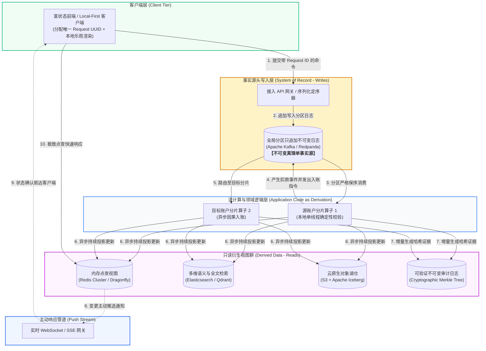

> 💡 **双栏独立滚动工作台导读**：本文采用双栏对照架构。**左栏**为核心精炼架构、实战代码与避坑决策；**右栏**为原著完整参考译文，附有关键段落的英文原文展开与难词解析。左右两栏可独立滚动，并支持顶栏自定义宽度比例（7:3 / 5:5 / 3:7）与拖拽调节。

# 核心实战精炼：解构数据库与流系统哲学体系

在传统软件工程中，关系型数据库（RDBMS）常被视作不可分割的中心化黑盒黑箱——它将**事务写前日志（WAL）、B-Tree 存储索引、查询解析优化器、缓存置换、锁管理器与约束检查**全部高度捆绑（Bundled）在单个数据库进程之中。

然而，随着海量分布式并发、异构存储（全文检索、向量数据库、实时湖仓）以及全球多机房容灾的兴起，单体捆绑式数据库开始暴露出无法调和的物理矛盾：
- 试图使用跨分片分布式事务（2PC / XA）强行绑定所有异构组件，导致网络延迟剧增，系统吞吐暴跌；
- 在线业务的就地覆写（In-place Mutation）无情销毁了历史上下文，使得跨系统审计、数据回滚与因果追踪变得极度困难；
- 模式迁移（Schema Migration）与业务演进如同在疾驰的列车上更换引擎，动辄锁表停机。

Martin Kleppmann 与 Chris Riccomini 在第二版中提出了前瞻性的系统哲学：**解构数据库（Unbundling Databases）**。将数据库的各层构件拆解为开放、独立的分布式服务——以**只追加不可变日志（Append-only Log）**作为全局事实源骨干，以**状态化流处理器（Stream Processors）**作为纯函数派生中枢，以下游各种定制引擎作为**只读物化视图（Materialized Views）**。同时，将网络系统经典的**端到端论证（End-to-End Argument）**引入数据系统，以确定性因果推演彻底替代昂贵的跨节点阻塞协调。

---

## 1. 核心架构决策矩阵：传统捆绑系统 vs 现代解构数据体系

| 架构决策维度 | 传统单体捆绑数据库 (Bundled RDBMS) | 现代解构无捆绑系统 (Unbundled Systems) | 生产级推荐技术选型 | 核心权衡与物理驱动依据 |
| :--- | :--- | :--- | :--- | :--- |
| **状态协调范式** | **跨分片强一致分布式事务（2PC）**：协调者两阶段全局加锁，任意参与者宕机导致全局阻塞。 | **分片事件日志 + 确定性流处理状态机**：避免全局协调（Coordination-Avoiding），分区内保序流式推演。 | Kafka KRaft 分区日志 + Flink 状态机 / Temporal | 2PC 的可用性随参与节点数呈指数级下降 $A = a^n$；解构系统将跨分片转账拆分为异步因果事件链，彻底消除全局阻塞等待。 |
| **数据演进与迁移** | **就地在线 DDL（In-place ALTER）**：直接在生产库修改表结构，高风险且容易发生大事务长锁。 | **并行轨道模式（Railways Migration）**：保留不可变历史日志，新建并行消费者生成全新物化视图，灰度平滑切换。 | Kafka Compacted Topic + 新索引 Consumer | 历史原始事件永不删除；重构只需重放历史日志构建全新数据结构，若新系统有缺陷可随时回滚切回旧轨道，实现真正的零停机。 |
| **读写路径解耦** | **读写一体强锁**：同一个存储引擎既要承受高并发事务写入，又要支撑复杂多表点查与全表分析。 | **读写彻底分离（CQRS / Derived Views）**：写入路径仅追加轻量日志，读取路径从专用物化视图（ES / Redis / ClickHouse）高速服务。 | Kafka (写路径) -> RocksDB / Elastic / Qdrant (读路径) | 写入关注轻量、持久与因果全序；读取关注高维查询与极致索引；解构系统让写路径与读路径各自按照物理最优形态独立伸缩。 |
| **正确性保障边界** | **依赖底层局部保证**：盲目相信数据库层面的事务隔离，忽视网络层重试或前端超时造成的逻辑重复提交。 | **端到端原则（End-to-End Argument）**：由客户端发起唯一幂等令牌（Request ID），全链路自上而下抑制重复。 | 客户端 UUID 令牌 + 服务端幂等过滤表 | 网络丢包或网关超时无法靠底层数据库事务解决；端到端原则指出：高层业务逻辑必须在最外圈闭环实现正确性校验。 |
| **审计与数据信任** | **被动依靠关系表审计触发器**：数据可能被拥有 DBA 权限的内部人员直接通过 SQL 修改篡改。 | **加密可验证数据结构（Verifiable Merkle Log）**：不可变日志结合密码学哈希链与 Merkle 树，实现防篡改审计。 | Certificate Transparency 模型, QLDB 哲学 | 践行“信任，但必须验证（Trust, but Verify）”；让数据的历史演进轨迹具备数学可证明的完整性与不可伪造性。 |

---

## 2. 现代生产级技术范式：无协调分片事件流转账与 Merkle 审计状态机

以下生产级 Rust 范式展示了原著 Figure 13-2 中的核心设计思想：**在完全不使用昂贵分布式 2PC 事务的前提下，通过分片不可变日志、单线程确定性推演与 Merkle 树哈希链，实现高吞吐无锁账户转账与防篡改审计**：

```rust
//! 生产级解构系统范式：基于不可变分片日志与 Merkle 树的无协调转账状态机
//! 遵循 Martin Kleppmann & Chris Riccomini 第二版流系统哲学

use sha2::{Digest, Sha256};
use std::collections::HashMap;

/// 客户端发起的转账请求指令（端到端唯一定位）
#[derive(Debug, Clone)]
pub struct TransferCommand {
    pub request_id: String,     // 客户端生成的全局唯一幂等令牌（端到端去重）
    pub source_account: String, // 源分片账户
    pub dest_account: String,   // 目标分片账户
    pub amount: u64,            // 转账金额（以分为单位，规避浮点精度误差）
}

/// 源分片在确定性扣款后发出的不可变领域事件
#[derive(Debug, Clone)]
pub enum AccountEvent {
    Debited {
        request_id: String,
        account_id: String,
        amount: u64,
        new_balance: u64,
    },
    Credited {
        request_id: String,
        account_id: String,
        amount: u64,
        new_balance: u64,
    },
    TransferDeclined {
        request_id: String,
        account_id: String,
        reason: String,
    },
}

/// 源账户分片流处理器：单线程顺序处理本分区请求，无需跨分片全局锁
pub struct AccountShardProcessor {
    pub shard_id: u32,
    balances: HashMap<String, u64>,
    processed_requests: HashMap<String, bool>, // 幂等去重表
    audit_merkle_root: [u8; 32],               // 增量密码学 Merkle 状态根
}

impl AccountShardProcessor {
    pub fn new(shard_id: u32) -> Self {
        Self {
            shard_id,
            balances: HashMap::new(),
            processed_requests: HashMap::new(),
            audit_merkle_root: [0u8; 32],
        }
    }

    pub fn set_balance(&mut self, account_id: &str, amount: u64) {
        self.balances.insert(account_id.to_string(), amount);
    }

    /// 处理转账请求：验证幂等性与余额，原子发射事件并增量更新 Merkle 审计根
    pub fn process_transfer_request(&mut self, cmd: &TransferCommand) -> Vec<AccountEvent> {
        // 1. 端到端幂等检查：若已处理过该 request_id，直接忽略（Duplicate Suppression）
        if self.processed_requests.contains_key(&cmd.request_id) {
            println!("⚠️ [Shard {}] 忽略重复的转账请求: {}", self.shard_id, cmd.request_id);
            return vec![];
        }
        self.processed_requests.insert(cmd.request_id.clone(), true);

        let current_balance = self.balances.get(&cmd.source_account).copied().unwrap_or(0);

        // 2. 本地确定性约束判定（无需与其他分片协商）
        if current_balance < cmd.amount {
            let event = AccountEvent::TransferDeclined {
                request_id: cmd.request_id.clone(),
                account_id: cmd.source_account.clone(),
                reason: "Insufficient funds".to_string(),
            };
            self.update_merkle_tree(&format!("DECLINED:{}:{}", cmd.request_id, cmd.source_account));
            return vec![event];
        }

        // 3. 执行本地扣款，产出 Debited 事件
        let new_balance = current_balance - cmd.amount;
        self.balances.insert(cmd.source_account.clone(), new_balance);

        let debit_event = AccountEvent::Debited {
            request_id: cmd.request_id.clone(),
            account_id: cmd.source_account.clone(),
            amount: cmd.amount,
            new_balance,
        };

        // 4. 将状态变动写入不可逆密码学 Merkle 树（Trust, but Verify）
        let audit_payload = format!("DEBIT:{}:{}:{}", cmd.request_id, cmd.source_account, cmd.amount);
        self.update_merkle_tree(&audit_payload);

        println!("✅ [Shard {}] 源账户扣款成功: {} - 余额: {}", self.shard_id, cmd.source_account, new_balance);
        vec![debit_event]
    }

    /// 增量更新防篡改 Merkle 审计根哈希
    fn update_merkle_tree(&mut self, payload: &str) {
        let mut hasher = Sha256::new();
        hasher.update(&self.audit_merkle_root);
        hasher.update(payload.as_bytes());
        self.audit_merkle_root = hasher.finalize().into();
    }

    pub fn get_audit_hash_hex(&self) -> String {
        hex::encode(self.audit_merkle_root)
    }
}
```

---

## 3. 生产系统架构拓扑：全链路解构数据系统与端到端响应流

现代企业解构系统的核心在于：**将原本封闭在单机数据库中的 WAL 日志提取为一等公民消息总线，下游按需解耦装配专用引擎**：



---

## 4. 架构避坑清单 (Do's & Don'ts)

| 架构维度 | 严禁行为 (Don'ts) | 推荐最佳工程实践 (Do's) |
| :--- | :--- | :--- |
| **跨分片事务选型** | 在横向扩展的微服务集群中无脑采用两阶段提交（2PC / XA 事务），将几十个分区的可用性强绑定。 | 践行**协调避免（Coordination-Avoiding）架构**：将长事务拆解为由日志驱动的单分片步骤；通过分阶段事件流与业务补偿逻辑（Compensating Transactions）化解冲突。 |
| **数据覆写与历史丢失** | 在生产系统核心表上执行原地 `UPDATE` 或硬删除 `DELETE`，将产生变更的业务意图和时序轨迹彻底抹杀。 | 采用**不可变账本（Append-only Ledger）**：永远只追加新事件（事实记账法），当前状态作为对历史事件流的物化积分；通过版本化墓碑记录删除。 |
| **端到端幂等缺位** | 仅依赖流引擎底层号称的“内部 Exactly-Once”，客户端重试时不断生成全新的随机请求，导致服务端重复扣款。 | 必须实施**端到端请求标识（End-to-End Request ID）**：由客户端或最前端网关生成全局唯一幂等令牌；服务端与流处理器在处理链路最前沿拦截并抑制重复。 |
| **盲信系统与缺失校验** | 盲目相信云服务商或数据库软件“零故障、数据绝对持久”的商业宣传，完全不做数据链路端到端一致性对账。 | 践行“**信任，但必须验证（Trust, but Verify）**”：在关键交易链路构建基于 Merkle 树或周期性对账引擎的异步校验程序，主动探测硬件位翻转或软件隐蔽 Bug。 |
| **单体黑盒全包** | 试图寻找一个既能支撑千万级高频写、又能秒级跑深度关联分析、还能做复杂图查询和全文搜索的“全能万能数据库”。 | 坚定拥抱**解构数据库（Unbundling）**：让写前日志成为系统骨干，不同领域视图分别采用最适合其物理数据结构的专用引擎（ClickHouse / Elasticsearch / Redis）。 |

<!-- split -->

# 原著完整参考：第 13 章 流系统哲学与未来架构（A Philosophy of Streaming Systems）

> “**如果一件事物的终极目的不在于其自身，而在于其他目标，那么它的最终目的绝不可能仅仅是维持其自身的存在。正如一位船长的心愿绝不是保全托付给他的船只，因为一艘船的终极使命在于远航。**  
> （常被引述为：*如果船长的最高使命是保全船只，那他理应让它永远停泊在港湾。*）”
> 
> —— 圣托马斯·阿奎那，《神学大全》（Summa Theologica, 1265–1274）

在本书前十二章中，我们探讨了构建**可靠、可扩展且可维护**的数据系统所需的各种基石：从单机存储引擎（B-Tree 与 LSM-Tree）、数据编码与演进，到分布式复制、分片路由、事务隔离与共识算法，再到批处理与流处理。

在本书的第一版中，最后一章名为“数据系统的未来”。而在最新的第二版中，我们将这些思想全面升华并聚焦为一个更加鲜明、自洽的体系：**流系统哲学（A Philosophy of Streaming Systems）**。本章相较于以往章节更具主张性（Opinionated），它不再只是客观罗列各种竞品方案的优缺点，而是站在前沿架构高度，深入阐述一种将现代事件流、解构系统与端到端不可变账本融会贯通的软件构建哲学。

---

## 通过派生数据组合专用工具

在复杂系统中，没有任何一种单一工具能完美兼顾所有维度的业务诉求：
- 关系型数据库（OLTP）擅长点查与事务保障；
- 全文搜索引擎（Search Index）擅长倒排索引与模糊匹配；
- 缓存（Cache）擅长纳秒级的内存读取；
- 列式数据仓库（OLAP）擅长海量连续扫描与聚合。

当我们需要同时使用多种工具时，最大的难题是如何在它们之间**安全、可靠地同步数据**。

在传统思维中，人们习惯使用分布式事务（如两阶段提交 2PC）试图将写入操作原子地跨越到关系库和搜索引擎。然而我们在第 8 章与第 10 章中已经彻底证明：**分布式事务的代价极其高昂，它要求所有节点同时在线响应，严重牺牲了系统的可用性与吞吐量，且极易引发级联阻塞**。

更优越的解法是**派生数据（Derived Data）**：确立一个写入系统的记录源（System of Record），将其变更转化为全序事件流，其他所有索引、缓存和数仓仅仅作为**派生状态（Derived State）**以异步方式单向更新。这种方式彻底解耦了组件之间的可用性依赖：即使搜索引擎暂时停机几分钟，核心业务依然可以正常向主库写入，搜索引擎重启后只需沿着日志流断点续传即可恢复一致。

:::en
> **Original**: A recurring theme in this book has been that for any given problem, there are several solutions, each with its own pros, cons, and trade-offs. [...] If the highest aim of a captain was to preserve his ship, he would keep it in port forever. Analogously, if our only goal was to avoid making mistakes, we would not write any software. But we want to build useful software, which means we must take calculated risks, and we must design our architectures in a way that minimizes the blast radius of inevitable failures.
> Combining specialized tools by deriving data is fundamentally better than distributed transactions because it untangles the operational dependencies between systems. If one derived store is slow or temporarily unavailable, it does not impede the primary write path.

**📌 核心术语与语境解析**：
- **Blast radius** [blɑːst ˈreɪdiəs]：*爆炸半径*。系统故障或局部崩溃所波及的物理范围。解构系统通过单向事件流隔离故障域，防止单个组件故障拖垮整个全局拓扑。
- **Derived Data vs Distributed Transactions**：*衍生数据 vs 分布式事务*。现代分布式系统的根本路线抉择：是用异步、可重放的确定性派生数据流，还是用同步阻塞且脆弱的 2PC 跨系统事务。
:::

---

## 解构数据库（Unbundling Databases）

什么是数据库？如果你将关系型数据库（如 PostgreSQL 或 Oracle）内部拆开来看，你会发现它由许多互相协作的子构件严密封装而成：
1. **持久化与序列化**：写前日志（WAL / Commit Log），负责在磁盘上记录操作历史；
2. **读加速结构**：B-Tree、哈希表、倒排索引，用于加速点查与多维过滤；
3. **隔离与并发**：锁管理器（Lock Manager）与快照版本维护（MVCC）；
4. **计算与优化**：SQL 编译器、查询规划器与执行引擎；
5. **复制与复制协议**：在节点间同步 WAL 日志并选举 Leader。

在过去的半个世纪中，所有这些构件被死死“捆绑（Bundled）”在同一个庞大的单体二进制程序中。

**解构数据库（Unbundling Databases）**的核心哲学是：**打破这个黑盒，将原本属于数据库内部的核心组件解放出来，映射到分布式系统的大尺度网络中**！


*Figure 13-1. In a search index, writes (document updates) meet reads (queries).*

如 Figure 13-1 所示，在一个解构的架构中：
- **Kafka / 分布式日志** 充当了**解构后的写前日志（Unbundled WAL）**；
- **Apache Flink / 流处理器** 充当了**解构后的触发器与物化视图计算器**；
- **Elasticsearch / Redis / ClickHouse** 充当了**解构后的专用次级索引（Secondary Indexes）**；
- **应用程序代码** 充当了**解构后的存储过程（Stored Procedures）**。

在 Figure 13-1 的搜索索引示例中，清晰展示了**写路径（Write Path）**与**读路径（Read Path）**的汇流：写入时，文档变更进入流处理管道被索引化并更新倒排索引；读取时，用户查询直接击中预先物化好的索引。写入与读取在最底层的衍生数据存储中完成交汇，二者在物理架构上完全解耦、独立优化。

### 铁路换轨模式：无痛模式迁移（Schema Migrations on Railways）

在传统捆绑式数据库中，最令架构师胆战心惊的操作莫过于在线模式迁移（ALTER TABLE）。面对上百亿行的单表，哪怕添加一个索引或修改一个字段类型，都可能导致整表死锁或长达数小时的性能骤降。

而在解构系统中，模式演进极其优雅，犹如**给疾驰的列车铺设并行铁轨（Railways Migration）**：
1. 原始事件流（Kafka Topic）被永久保存在只追加日志或对象存储中；
2. 当需要升级业务逻辑或采用全新的存储引擎时，你无需动现有在线服务分毫；
3. 你只需编写一个新的流处理任务或部署一套全新的衍生存储，将其**消费 Offset 重置到日志的开端**，全量回放历史数据构建全新的物化视图；
4. 当新视图的消费进度追平最新事件时，在 API 网关处轻巧地将读流量逐步灰度切换至新视图；
5. 验证无误后，安全下线旧视图。如果不慎发现新逻辑存在缺陷，随时回滚流量，旧系统毫发无损！

---

## 围绕数据流设计应用程序

当我们将数据库解构后，应用程序本身的定位也发生了根本转变。

传统的三层架构是：`前端 -> 无状态业务逻辑层 -> 集中式数据库`。应用程序不断向数据库发起 CRUD 交互，业务逻辑夹杂在数据库读写往返（Round-trips）的等待中。

而在流系统哲学中，**应用程序代码的本质是一个纯粹的派生函数（Application Code as a Derivation Function）**：

$$\text{Derived State}_{t} = f(\text{Derived State}_{t-1}, \text{Input Event}_t)$$

- 应用程序不再主动侵入数据库进行原地破坏性修改；
- 应用程序作为流处理器，持续监听不可变事件流，并将状态变更确定性地投影到本地嵌入式存储（如 RocksDB）或下游视图中；
- **代码与状态彻底分离**：计算逻辑可以随时销毁和重新部署，状态可以随时从事件源头重新派生。

### 响应式状态推送与 Local-First（本地优先）

传统应用依赖客户端不断向服务器发起 HTTP 轮询（Pull）来获取最新数据。而在基于流的现代系统中：
- **读取也是事件（Reads are events too）**：客户端提交查询可以被建模为一个短暂的事件；
- **主动变更推送（Push-based State）**：流引擎在物化视图产生变化的瞬间，通过持久连接（WebSocket / SSE）直接将增量变更推送到前端；
- **本地优先软件（Local-First Software）**：结合 CRDT（无冲突复制数据类型），客户端在本地维护完整的离线可写状态副本，在网络连通时自动与全局流总线进行确定性双向合并，带来极致的零网络延迟交互体验。

---

## 数据库的端到端论证（The End-to-End Argument for Databases）

1984 年，Saltzer、Reed 和 Clark 发表了计算机网络历史上最著名的经典论文之一：《系统设计中的端到端论证》（End-to-End Arguments in System Analysis）。

该论证的核心洞见是：**在底层通信子系统中实现某种功能（如可靠传输、数据去重、错误校验），往往是不充分且不必要的；因为高层应用程序无论如何都必须在上层自行实现端到端的完整校验，底层盲目的过度承诺只会带来严重的性能开销和虚假的安全感**。

Martin Kleppmann 将这一深刻原则首次系统性地应用到了数据系统设计中：

:::en
> **Original**: The end-to-end argument states that a function should not be provided at a lower level of a system unless it can be completely and correctly implemented at that level. In data systems, this principle has profound implications. For example, a database may guarantee serializable transactions, but if the network connection between the client and the database drops after the commit succeeded, the client cannot know whether the transaction committed or not. If the client retries, it might perform the operation twice. Therefore, serializability at the database level does not prevent duplicate transactions; duplicate suppression must be implemented end-to-end.

**📌 核心术语与语境解析**：
- **End-to-End Argument** [end tu end ˈɑːɡjumənt]：*端到端论证*。分布式系统顶层设计法则——正确性与幂等性必须由最外层业务终点闭环保证，底层局部的可靠性无法替代全链路校验。
- **Idempotency Token / Request ID** [aɪˈdɛmpoʊtənsi ˈtoʊkən]：*幂等令牌*。由客户端在发起请求的最源头生成的全局唯一标识，跨越整个网络、网关、消息队列与存储，作为端到端去重的终极凭证。
:::

例如：即便底层关系数据库提供了完美的串行化事务（Serializability），但如果客户端在向服务端发送扣款请求后遭遇了 Wi-Fi 闪断，客户端收不到 ACK 响应，它就无法得知扣款究竟是成功了还是失败了。如果用户再次点击“重试”，系统就可能扣款两次！
因此，底层的数据库事务根本无法解决重复扣款；**唯有在客户端生成唯一的 Request ID，并在全链路推行幂等去重，才能在端到端尺度上达成真正的正确性**。

---

## 无需全局共识的多分片事务处理

在分布式系统中，最棘手的难题之一是**强制执行全局约束（如账户余额不能透支、用户名全局唯一）**。传统认知认为这必须依赖昂贵的跨分片分布式锁或 Paxos/Raft 共识机制。

然而，在流系统哲学中，等价的正确性可以通过**分片日志与确定性事件流处理器**在不发生任何全局阻塞的情况下完美实现！


*Figure 13-2. Checking whether a source account has enough money and atomically transferring money to a destination account and a fees account, using event logs and stream processors*

如 Figure 13-2 所示，展示了一个从源账户扣款、向目标账户入账并扣除平台手续费的无协调跨分片转账全流程：

1. **客户端赋码入队**：客户端为该转账请求分配唯一的 `request_id`，根据源账户 ID 计算哈希，将请求追加到源账户所在的分片日志中；
2. **源分片确定性判决**：源账户分片的流处理器按序读取该日志。由于每个账户的操作严格收敛在单个分片内，处理器可以单线程无锁判断源账户余额是否充足。如果余额不足，直接产出 `Declined` 拒绝事件；如果余额充足，**立即在本地扣除转账金额和手续费**，并在其输出流中原子广播两条新事件：
   - 发送给目标账户所在分片的 `Credit`（入账）指令；
   - 发送给手续费账户所在分片的 `CreditFee`（入账）指令。
3. **目标分片因果入账**：目标账户分片和手续费分片的流处理器各自独立消费这两条指令，执行加法入账。由于加法操作具备数学上的可交换性与幂等性（结合 `request_id` 去重），即使目标分片短暂延迟，系统最终必然收敛一致！

**整个过程中，没有任何两阶段提交，没有任何全局锁，系统在极度高并发下依然保持了如同单机一般的严格正确性！**

---

## 信任，但必须验证（Trust, but Verify）

传统软件架构往往建立在一个过于天真的假设之上：“只要数据库厂商宣称支持 ACID 事务，只要硬件控制器没有报警，数据就绝对是百分之百正确且不可篡改的”。

然而现实极其残酷：硬件随时可能发生偶发性的静默位翻转（Silent Bit Rot），软件代码中无处不在的深层并发竞态 Bug 随时可能污染表中的某一列数据。更严峻的是，拥有 DBA 权限的特权账号可以绕过所有审计直接使用 SQL 修改数据库底层数据。

流系统哲学的终极防线是：**面向可审计性设计（Designing for Auditability）——践行“信任，但必须验证（Trust, but Verify）”**。

1. **不可变账本（Immutable Ledgers）**：永远禁止破坏性的就地更新。每一个业务决策都作为一条带因果签名的事件被永久追加；
2. **密码学审计数据结构（Cryptographic Audit Logs / Merkle Trees）**：借鉴 Git 提交历史与数字证书透明度（Certificate Transparency, RFC 6962）的设计，流处理器定期将系统状态哈希化为 **Merkle 树（默克尔树）**。任何对历史数据的悄然篡改，都会导致根哈希产生翻天覆地的剧变并立即触发报警；
3. **端到端对账与连续审计（Continuous Reconciliation）**：独立运行的只读审计流水线在后台持续对比事实源日志与下游物化视图，使得系统不仅在理论上具备一致性，更在数学与工程层面上获得了持续可证明的完整性。

---

## 本章小结与系统推演

第 13 章为我们揭示了一幅宏伟的未来分布式数据系统蓝图：
- **解构数据库**：将单体数据库的 WAL、状态存储、流计算与视图彻底解耦，组装为高吞吐、强韧性的无捆绑生态；
- **流表二象性贯穿全局**：不可变事件流是时间轴上的第一因，所有数据表皆为对历史事件的积分投影；
- **端到端原则主导正确性**：不把赌注全盘押在底层脆弱的局部事务上，依靠客户端 Request ID 与幂等性筑牢防线；
- **消除全局阻塞协调**：通过分片日志与确定性状态机化解多节点事务冲突；
- **可审计与可验证性**：以不可变日志与密码学 Merkle 树守护系统最根本的数字诚信。

在专栏的终章——**第 14 讲**中，我们将跨出纯粹的系统技术参数，直面每一位现代软件架构师无法回避的终极命题：**数据伦理、隐私合规与人类社会的责任（Doing the Right Thing）**。
