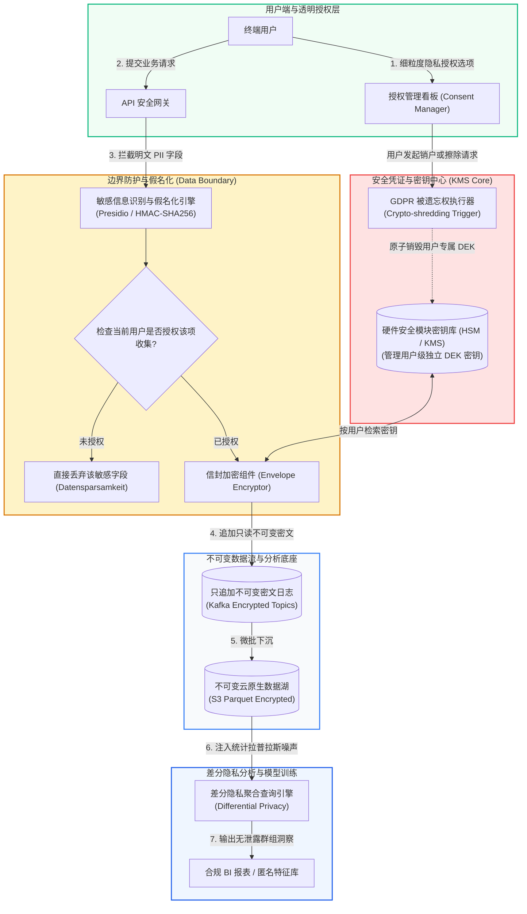

# 核心实战精炼：数据伦理、隐私保护与系统治理工程

技术从来都不是价值中立的。每一行存储架构代码、每一个高并发索引设计、每一个推荐算法目标函数，都会深刻影响真实人类的权益、自由与尊严。

在数据密集型系统的设计全景中，工程师往往专注于性能指标：吞吐量多高、P99 延迟多低、高可用保障几个 9。然而，Martin Kleppmann 与 Chris Riccomini 在第二版的收官之章发出了振聋发聩的拷问：**系统能够运转（Can it work?），并不意味着它应当被这样构建（Should it be built this way?）**。

在 2026 年的现代工业现实中，数据不仅是商业资产，更演化为潜在的巨大**法律合规负债（Legal Liability）与社会伦理炸弹**：
- **大数据贪婪的破产**：从前无节制囤积所有用户行为痕迹的“大数据”思维，被全球严苛法律（如欧盟 GDPR、加州 CCPA）倡导的**数据最小化原则（Datensparsamkeit）**彻底颠覆；
- **物理与法律的冲突**：只追加不可变日志（Append-only Log）在分布式系统带来高吞吐与容错，却与法规赋予用户的**被遗忘权（Right to Be Forgotten）**产生根本矛盾。架构师必须借助**加密擦除（Crypto-shredding）**在数学层面上优雅化解物理不可变与逻辑销毁的冲突；
- **算法偏见与回音室效应**：单纯以用户点击率或停留时长为目标函数的机器学习，会迅速滑向强化成见、算法歧视与社会极化的泥潭。

---

## 1. 核心架构决策矩阵：数据伦理与工程合规治理矩阵

| 治理决策维度 | 传统大数据掠夺范式 | 现代数据合规与伦理标准 | 生产级技术落地选型 | 核心权衡与物理驱动依据 |
| :--- | :--- | :--- | :--- | :--- |
| **数据采集哲学** | **投机性全量囤积（Hoarding）**：默认采集所有硬件设备指纹、剪贴板、位置与点击流，“万一未来有用呢”。 | **数据最小化（Datensparsamkeit）**：仅采集实现明确特定功能所需的绝对最小数据集，目的达成即销毁。 | 细粒度隐私网关 + 生命周期 TTL 规则 | 囤积的数据不仅增加海量存储账单，一旦发生黑客泄密或合规稽查，每条多余的明文记录都对应巨额罚单与商誉暴跌。 |
| **被遗忘权与不可变性** | **以技术不可行为由推脱**：“不可变日志（Kafka/S3）在物理上无法修改，无法删除用户数据”。 | **加密可擦除日志（Crypto-shredding）**：每个用户拥有独立的数据加密密钥（DEK），销毁密钥使历史密文永久不可逆。 | HashiCorp Vault / AWS KMS + 信封加密 | 兼顾分布式不可变日志的高吞吐与 GDPR 强合规要求；无需重写几个 PB 的底层 Parquet 历史文件即可在毫秒级实现逻辑物理双重失效。 |
| **敏感字段流转** | 生产日志直接打印明文用户手机号、身份证、家庭住址与银行卡号。 | **字段级确定性脱敏与假名化（Pseudonymization）**：敏感 PII 进消息队列前在接入网关全自动哈希脱敏与掩码。 | Presidio PII 识别引擎, OpenSSL HMAC-SHA256 | 研发、测试与分析团队绝大多数场景无需查看明文身份；假名化在保留数据关联分析能力的同时阻断身份直接逆向识别。 |
| **算法优化目标** | 单纯追求**停留时长（Dwell Time）**与**点击转化率（CTR）**，任由推荐引擎推荐挑衅与极端内容。 | **多目标平衡与多样性惩罚（Fairness & Serendipity）**：在排序损失函数中注入反偏见惩罚项与内容多样性探索。 | 差分隐私（Differential Privacy）, Fairlearn 框架 | 算法过度拟合即时点击会制造极化回音室与成瘾依赖；加入多样性因子守护公众身心健康，构建可持续的平台生态。 |
| **用户授权与交互** | **暗黑模式（Dark Patterns）**：将同意条款深埋在数十页密密麻麻的法律文本中，默认打勾且取消按钮隐蔽。 | **透明细粒度知情同意（Granular Consent）**：模块化授权选择，允许用户按功能维度随时撤回授权且不影响基础服务。 | OneTrust 合规面板, OpenID Connect 隐私 Claims | 虚假同意在法律与公众信任面前不堪一击；清晰透明的控制权能够赢得高价值用户的长期品牌忠诚度。 |

---

## 2. 现代生产级技术范式：加密擦除（Crypto-shredding）与合规销毁流水线

在构建基于不可变事件日志（Kafka）或列式数据湖（S3 Parquet）的现代架构时，直接执行全量物理文件重写以删除单个用户的数据成本极高且极易损坏快照。

以下生产级 Python 范式展示了：利用**信封加密（Envelope Encryption）**与 **KMS 密钥生命周期管理**，实现优雅的“加密可擦除日志（Crypto-shredding）”——当收到用户注销或遗忘请求时，原子销毁其专属数据密钥，使得不可变历史数据在密码学层面永远化为不可逆随机噪声：

```python
"""
生产级加密擦除 (Crypto-shredding) 与被遗忘权合规实现
遵循 GDPR 第 17 条与 DDIA 第 14 章架构伦理要求
"""

import os
import base64
import json
from typing import Dict, Optional
from cryptography.hazmat.primitives.ciphers.aead import AESGCM

class KeyManagementService:
    """
    轻量生产级 KMS 模拟器（实际生产中对接 AWS KMS / HashiCorp Vault）
    管理每个独立用户的数据加密密钥 (Data Encryption Key, DEK)
    """
    def __init__(self):
        # 实际生产中保存在受硬件安全模块 (HSM) 保护的托管密钥库中
        self._key_store: Dict[str, bytes] = {}
        self._audit_log = []

    def get_or_create_user_key(self, user_id: str) -> bytes:
        """为特定用户获取或生成唯一的 256 位 AES-GCM 数据密钥"""
        if user_id not in self._key_store:
            # 生成加密安全的 32 字节 (256-bit) 随机密钥
            self._key_store[user_id] = AESGCM.generate_key(bit_length=256)
            self._audit_log.append(f"KEY_GENERATED for user: {user_id}")
        return self._key_store[user_id]

    def shred_user_key(self, user_id: str) -> bool:
        """
        核心合规操作：彻底销毁用户的密钥（Crypto-shredding）
        一旦密钥销毁，不可变存储中所有该用户历史密文在数学上永远不可解密
        """
        if user_id in self._key_store:
            # 覆写内存并删除字典键，防止内存取证恢复
            del self._key_store[user_id]
            self._audit_log.append(f"KEY_SHREDDED (Right to be Forgotten) for user: {user_id}")
            print(f"🔥 [KMS] 用户专属密钥已彻底销毁！用户 ID: {user_id}")
            return True
        return False

    def has_key(self, user_id: str) -> bool:
        return user_id in self._key_store

class PrivacyCompliantPipeline:
    """
    集成加密擦除的数据管道
    支持在只追加不可变日志与对象存储中安全流转
    """
    def __init__(self, kms: KeyManagementService):
        self.kms = kms

    def encrypt_and_append_record(self, user_id: str, sensitive_payload: dict) -> str:
        """写入路径：使用用户独立密钥加密敏感个人身份信息 (PII)"""
        user_key = self.kms.get_or_create_user_key(user_id)
        aesgcm = AESGCM(user_key)
        
        # 生产安全随机初始化向量 (Nonce/IV 12 字节)
        nonce = os.urandom(12)
        raw_data = json.dumps(sensitive_payload).encode("utf-8")
        
        ciphertext = aesgcm.encrypt(nonce, raw_data, associated_data=user_id.encode("utf-8"))
        
        envelope = {
            "user_id": user_id,
            "nonce": base64.b64encode(nonce).decode("utf-8"),
            "ciphertext": base64.b64encode(ciphertext).decode("utf-8"),
            "is_encrypted": True
        }
        return json.dumps(envelope)

    def decrypt_record(self, raw_envelope_str: str) -> Optional[dict]:
        """读取路径：若用户密钥已被擦除，解密必然失败，安全返回 None"""
        envelope = json.loads(raw_envelope_str)
        user_id = envelope["user_id"]

        if not self.kms.has_key(user_id):
            # 密钥已销毁：说明用户行使了被遗忘权，数据等同于在物理上被抹除
            return None

        user_key = self.kms.get_or_create_user_key(user_id)
        aesgcm = AESGCM(user_key)
        
        nonce = base64.b64decode(envelope["nonce"])
        ciphertext = base64.b64decode(envelope["ciphertext"])
        
        try:
            decrypted_bytes = aesgcm.decrypt(nonce, ciphertext, associated_data=user_id.encode("utf-8"))
            return json.loads(decrypted_bytes.decode("utf-8"))
        except Exception as e:
            # 密钥不匹配或密文遭篡改
            return None

# 单元验证范式
if __name__ == "__main__":
    kms = KeyManagementService()
    pipeline = PrivacyCompliantPipeline(kms)

    # 1. 用户正常使用阶段：写入敏感数据（如医疗健康记录或精确 GPS 轨迹）
    user_uid = "usr-8899-privacy"
    medical_record = {"diagnosis": "Hypertension", "prescription": "Amlodipine", "heart_rate": 78}
    
    immutable_log_line = pipeline.encrypt_and_append_record(user_uid, medical_record)
    print(f"📦 不可变日志中的安全密文存储条目:\n{immutable_log_line}\n")

    # 2. 正常读取：系统能够正常还原明文
    print("🔓 尝试正常解密读取:", pipeline.decrypt_record(immutable_log_line))

    # 3. 用户依法行使 GDPR“被遗忘权”：触发加密擦除
    kms.shred_user_key(user_uid)

    # 4. 后续读取：尽管不可变日志文件本身未作任何物理修改，但数据已永远无法还原
    print("🔒 密钥销毁后尝试再次读取:", pipeline.decrypt_record(immutable_log_line))
```

---

## 3. 生产系统架构拓扑：企业级全流程隐私与合规治理中枢

下图展示了从**客户端知情同意、网关假名化脱敏、信封加密持久化、差分隐私分析到自动化加密擦除**的端到端治理闭环：



---

## 4. 架构避坑清单 (Do's & Don'ts)

| 治理维度 | 严禁行为 (Don'ts) | 推荐最佳工程实践 (Do's) |
| :--- | :--- | :--- |
| **数据采集边界** | 抱持“大数据贪婪”思维，未经用户明示许可，私自采集剪贴板信息、后台持续定位与设备 WiFi 扫描列表。 | 严格践行**数据最小化（Datensparsamkeit）**：仅采集支撑当前核心业务功能所必需的字段，杜绝投机性采集；对各字段设立明确的生命周期 TTL。 |
| **敏感信息存储** | 将明文手机号、身份证号、银行卡号直接写入全局 Kafka Topic、应用 Debug 日志或未加密的 S3 数据湖。 | 核心敏感字段在最外层接入网关实施**假名化与字段级信封加密**；通用只读分析走**差分隐私（Differential Privacy）**加噪导出。 |
| **被遗忘权履行** | 以“底层是不可变只追加存储（Kafka/Parquet）在物理上无法修改”为借口，拒绝配合用户注销并拒绝删除历史数据。 | 构建**加密可擦除日志架构（Crypto-shredding）**：为每个用户绑定独立密钥，用户注销时直接销毁其对应密钥，在密码学层面达成合规物理销毁。 |
| **算法目标设定** | 推荐算法完全被即时指标（点击率、播放时长、停留时间）绑架，放任低俗、造谣与极端挑衅内容肆虐以收割流量。 | 在排序算法的目标函数中引入**多样性探索因子（Diversity）、反沉迷软约束**与定期的算法偏见审计，守护用户心智健康。 |
| **工程师道德底线** | 秉持“我只是打工人，业务怎么提我就怎么写”的冷漠心态，对公司系统存在的隐私窃取、大数据杀熟或系统性歧视视而不见。 | 坚守职业伦理准则（如 ACM 伦理守则）：技术人员对系统造成的社会后果承担不可推卸的连带道德责任，勇于向上级提出伦理风险并拒绝编写有害代码。 |

<!-- split -->

# 原著完整参考：第 14 章 做正确的事（Doing the Right Thing）

> “**用这世间的一切美好、丑陋与残酷去喂养人工智能系统，却妄想让它仅仅倒映出美好，这纯粹是一场脱离现实的幻想。**”
> 
> —— Vinay Uday Prabhu 与 Abeba Birhane，《大型数据集：计算机视觉的一场惨胜？》（Large Datasets: A Pyrrhic Win for Computer Vision?, 2020）

在本书的最后一章，让我们从繁杂的底层技术实现中抽身出来，站在更高维度的视角审视我们的工作。

在整本书中，我们详尽剖析了各种各样的数据系统架构，权衡了它们的利弊得失，探讨了构建可靠、可扩展且可维护系统所需的精妙算法与模式。然而，我们始终遗漏了整个技术图景中最根本、最核心的拼图——我们必须在这一章中将其补齐。

**每一个系统的诞生都有其明确的目的；我们所采取的每一次架构决策，都会同时带来预期的与意料之外的深远后果**。系统的商业目的或许仅仅是为了盈利或提高效率，但它的现实后果却可能波及千家万户。作为亲手构建这些系统的软件架构师与数据工程师，我们有不可推卸的责任去深思熟虑这些后果，确保我们的技术产物不被用来危害人类社会。

我们习惯将“数据（Data）”当成冰冷抽象的概念来谈论，但请永远记住：**绝大多数数据集的底层本质是关于人——关于人的行为、人的偏好、人的身份、人的尊严**。我们必须以人道主义和敬畏之心来对待这些数据。用户是活生生的人，人类的尊严神圣不可侵犯。

软件开发已经不再是纯粹的极客玩具，它正在演变为一系列重大的伦理抉择。虽然学术界和行业协会制定了指引准则（例如 ACM 软件工程伦理与专业实践守则），但在日常高压的商业交付节奏中，这些伦理考量却极少被深入讨论和严格执行。

---

## 偏见与歧视（Bias and Discrimination）

由算法做出的决策，并不天然地比由人类肉身做出的决策更好或更公正。

每一个凡人都可能带有固有的偏见，哪怕他们极力克制，历史上形成的歧视性制度也早已潜移默化地渗透在社会各个角落。人们一度寄予厚望：如果我们将决策权交给客观的“数据”，而不是依赖人类主观凭直觉的评判，或许能够消除偏见，给那些经常遭受不公待遇的群体带来更平等的机遇。

然而残酷的现实是：**机器学习与预测算法是在历史数据上训练出来的。如果历史数据本身就内嵌了人类社会的系统性偏见、歧视与不平等，那么算法不仅会全盘继承这些偏见，更会披上‘数学客观性’的伪善外衣，将历史的不公永久固化并以更大的规模自动化放大！**

例如：
- 预测性警务（Predictive Policing）算法根据历史逮捕记录向特定贫困社区派驻更多警力，导致该区域微小违法行为被记录的频次远高于富人区，从而在数据上“证明”了该区域犯罪率更高，形成恶劣的**正反馈自我实现预言（Self-fulfilling prophecy）**；
- 银行贷款审批与简历初筛模型若盲目以历史成功样本为基准，会自动将某些特定性别、族裔或毕业院校背景的申请者直接降权或淘汰。

:::en
> **Original**: Feeding AI systems on the world’s beauty, ugliness, and cruelty, but expecting it to reflect only the beauty is a fantasy. [...] Decisions made by an algorithm are not necessarily any better or any worse than those made by a human. Every person is likely to have biases, even if they actively try to counteract them. [...] But algorithms are trained on historical data. If the historical data reflects past discrimination, the algorithm will learn to replicate and institutionalize that discrimination under the guise of mathematical objectivity. A predictive model does not just predict the future; in many cases, it actively constructs the future through self-fulfilling feedback loops.

**📌 核心术语与语境解析**：
- **Algorithmic Bias** [ˌælɡəˈrɪðmɪk ˈbaɪəs]：*算法偏见/算法歧视*。机器学习模型因训练集历史偏差或不当损失函数，对特定群体产生系统性不公正对待的物理现象。
- **Self-fulfilling Prophecy** [ˌself fʊlˈfɪlɪŋ ˈprɒfəsi]：*自我实现预言*。系统的预测行为反向干预了现实世界，迫使现实世界朝着预测的方向演变，制造虚假的因果闭环。
- **Accountability** [əˌkaʊntəˈbɪləti]：*问责制/可追责性*。当自动化系统做出错误或有害决策时，必须能够清晰定位责任归属，严禁用“这只是算法算出来的”作为推卸人类过错的挡箭牌。
:::

---

## 责任与问责制：不能把锅甩给算法

当自动化决策系统导致某个无辜的人被错误拘留、被剥夺按揭贷款资格或被医疗系统拒绝报销时，谁该为此承担法律与道德责任？

绝不能允许企业管理者或工程师耸耸肩说：“这是复杂的黑盒模型计算出来的结果，我们也不知道它为什么这么判定，所以没有人应该负责”。**自动化系统从来不是免责的护身符。将权力授予算法的人，必须对算法产生的所有后果负全责！**

如果一个系统的重要决策会严重影响个人的生计与自由，该系统必须具备：
1. **可解释性（Explainability）**：能够向当事人清晰解释决策依据的核心特征与推导逻辑；
2. **异议与申诉权（Right to Appeal）**：必须保留人类专家介入复核的终审机制（Human-in-the-loop）；
3. **可审计性追踪（Audit Trail）**：保留决策瞬间完整的输入快照与模型版本证据。

---

## 极化回音室与反馈循环（Feedback Loops）

即便是看似危害较轻的娱乐或电商推荐算法，也隐藏着颠覆社会公共健康的巨大风险。

现代推荐引擎为了最大化商业利益，通常以用户**即时点击率（CTR）、完播率或停留时长**作为唯一优化目标。人类心理学研究表明：挑衅性言论、阴谋论、恐慌煽动与极端对立观点，最容易激发人类大脑的杏仁核警觉，从而诱发最高的互动与停留。

当推荐算法精准迎合这种心理本能时，会迅速将用户推入狭隘封闭的**极化回音室（Echo Chambers）**与**信息茧房**：
- 用户只能看到与自己既有偏见完全一致的信息；
- 误导性虚假信息（Misinformation）与极端思潮在算法的推波助澜下病毒式扩散；
- 社会共识被撕裂，选举与公共卫生防疫等严肃民主治理机制遭到毁灭性打击。

作为数据系统的创造者，我们不能对这些下游社会毒害装聋作哑。优化目标函数的权重必须纳入公共利益与内容健康度考量。

---

## 监控的思想实验（The Surveillance Thought Experiment）

在科技行业中，人们极度崇拜诸如“数据驱动决策（Data-driven Decision Making）”这样的光鲜口号。

Martin Kleppmann 与 Chris Riccomini 在书中提出了一个震撼人心的**思想实验**：

:::en
> **Original**: As a thought experiment, try replacing the word "data" with "surveillance", and observe whether common phrases still sound so good:
> • “In our surveillance-driven organization we collect real-time surveillance streams and store them in our surveillance warehouse.”
> • “Our surveillance scientists use advanced analytics and surveillance processing in order to derive new insights.”
> This thought experiment is unusually polemic for this book, Designing Surveillance-Intensive Applications, but it cuts straight to the core. A lot of data collection is euphemistically referred to as “analytics”, “telemetry”, or “personalization”, but in plain English, it is mass surveillance.

**📌 核心术语与语境解析**：
- **Surveillance Capitalism** [sɜːˈveɪləns ˈkæpɪtəlɪzəm]：*监控资本主义*。肖莎娜·祖博夫（Shoshana Zuboff）提出的核心概念，指将人类私人经验单向无偿转化为行为数据，并包装为预测产品进行交易的新型经济逻辑。
- **Data Exhaust** [ˈdeɪtə ɪɡˈzɔːst]：*数据排气/数据废气*。行业曾将用户无意中遗留的点击与轨迹贬低为“废料”，借此粉饰对用户隐私的大规模免费掠夺。
- **Mass Surveillance** [mæs sɜːˈveɪləns]：*全景大规模监控*。在缺乏对等制衡的前提下，对数亿公民的行踪、通信、浏览历史与社交关系执行全天候无死角的数字追踪。
:::

请闭上眼睛默念这几句话：
- *“在我们这家**监控驱动（Surveillance-driven）**的企业中，我们实时采集无休止的**监控数据流（Surveillance streams）**，并将它们持久化存放在**监控数据仓库（Surveillance warehouse）**中。”*
- *“我们的**监控科学家（Surveillance scientists）**运用高级分析技术处理**监控计算**，以便挖掘出全新的商业洞察。”*

这听起来让人不寒而栗，但剥离掉那些文过饰非的商业公关辞令（诸如“埋点分析”、“遥测数据”、“个性化体验”），**当今无数互联网巨头所从事的物理行径，本质上就是前所未有的大规模商业监控！**

### 知情同意与选择自由的幻觉

许多企业辩解称：“用户是自愿使用我们的免费服务的，他们勾选了服务条款和隐私协议，这就代表他们知情同意”。

这种辩解完全脱离现实：
1. **霸王条款与暗黑模式**：长达数十页晦涩难懂的法律文书根本不是写给普通人看的；选择框常常被设计为默认勾选，取消路径被刻意隐藏；
2. **缺乏真正的替代选项**：当某一即时通讯工具或搜索平台演变为事实上的社会水电气基础设施时，如果用户选择“不同意”，代价就是被彻底剥夺现代社会生活与工作的可能。这根本不是自由契约，而是**不平等权力下的数字勒索**。

---

## 隐私与数据使用：“隐私已死”的谎言

行业中常有人兜售一种虚无主义论调：“在现代互联网时代，隐私早就死了（Privacy is dead）；既然人们每天都在社交媒体上自愿晒出各种自拍与日常琐事，就说明大家根本不在乎隐私”。

**这种论调极其荒谬，它建立在对‘隐私’一词的恶意曲解之上！**

**拥有隐私绝不意味着‘把一切都藏在黑暗中当成秘密’；拥有隐私的真正含义是：人类拥有自主选择‘何时、向谁、透露自己何种维度的信息’的不可剥夺的自由权利！**

一个人愿意将风景照片公开发布在朋友圈，绝不意味着他同意被广告商无死角追踪他在所有网页上的浏览足迹、夜间所处酒店位置或私密聊天记录。混淆这二者是科技公司洗白无节制监控的最常见伎俩。

---

## 历史的镜像：重温工业革命的教训

回顾人类历史，当前的数字化浪潮与 18~19 世纪的**工业革命（Industrial Revolution）**有着惊人的惊人相似性。

工业革命凭借蒸汽机与纺织机械带来了人类物质文明的巨大飞跃，但在其野蛮生长的早期阶段：
- 工厂老板为了压榨微薄的利润，让年仅几岁的儿童在致命的齿轮边无休止劳作；
- 危险的冲压机床没有任何防护栏保护，工人动辄被绞断手臂；
- 工业毒烟与污水肆意倾倒，河流化为剧毒死海。

在当时，工厂主们同样言之凿凿：“任何法律监管都会扼杀英国工业的国际竞争力！”然而，人类文明最终没有任由野蛮吞噬：通过工人们前赴后继的抗争与立法机关的介入，**劳动保护法、童工禁令、工厂安全生产标准与环保法规**逐步确立。机械设备加上了保护罩，工业文明才最终摆脱了血泪走向成熟。

今天的数据基础设施正处于其野蛮发展的“早期工业革命阶段”：个人隐私被随意贱卖，算法偏见肆虐，数据泄露频发。**数据最小化（Datensparsamkeit）、GDPR 被遗忘权与加密擦除，就是现代数据工业的‘机床安全防护罩’！**

---

## 架构师的使命与职业伦理

作为终章的结语，Martin Kleppmann 与 Chris Riccomini 向每一位投身分布式系统与软件工程的同行提出了诚挚的期许：

1. **拒绝成为盲目的平庸之恶（Banality of Evil）**：软件工程师绝不能以“我只是按照产品经理的 PRD 写代码”为由免除良心审判。如果一项功能明显涉及欺诈、严重侵犯弱势群体或非法窃取隐私，拒绝编写是有良知的工程师的尊严底线；
2. **在架构底层捍卫人道边界**：在系统设计之初，就将数据最小化、加密擦除、差分隐私与不可篡改审计作为一等公民设计进去，而不是作为事后敷衍合规检查的创口贴；
3. **推动行业标准与立法成熟**：积极支持阳光下的数据治理法规，用坚实的技术实现让法律倡导的个人权利真正落地为可执行的工程实体。

数据密集型系统的终极价值，不在于我们搬运了多少 PB 的字节，也不在于我们撑起了多夸张的瞬时 QPS，而在于**这些系统是否让身处其中的每一个人生活得更从容、更有尊严、更受尊重**。

这，才是我们所有人应当致力的“正确的事（Doing the Right Thing）”。
