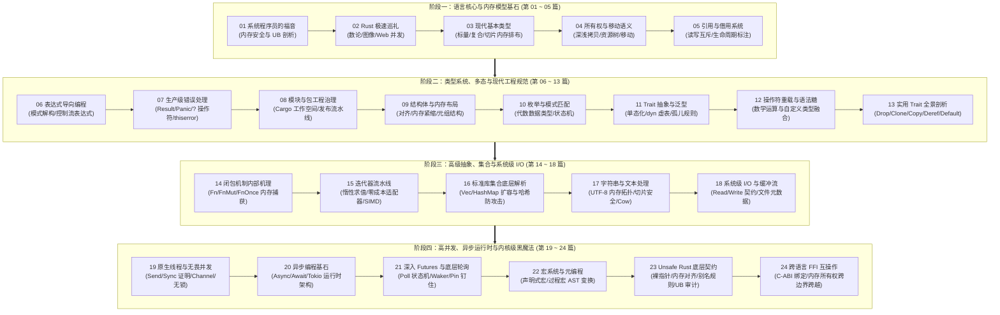

# 核心实战精炼：Rust 现代系统级工程全景工作台

## 1. 现代系统级编程语言技术决策矩阵

在 2026 年的现代工业级软件工程中，系统级编程（Systems Programming）的定义正在经历深刻重塑。从 Linux 内核正式将 Rust 确立为第二官方语言、Windows 与 Android 核心驱动的关键模块重写，到云原生基础设施（Kata Containers、Firecracker、Envoy）乃至前沿 AI 推理引擎（Candle、Burn）的架构选型，开发团队面临的核心诉求高度收敛：**在不牺牲裸机级性能的前提下，彻底根除内存安全黑洞与并发数据竞争**。

下表系统化对比了当今主流的四种系统级开发语言在关键工程维度上的权衡：

| 评估维度 | Rust (2024/2026 Edition) | C++ (C++23 / C++26) | Go (1.25+) | Zig (0.14+) |
| :--- | :--- | :--- | :--- | :--- |
| **内存安全模型** | **编译期所有权与借用检查器**：彻底消灭悬垂指针、双重释放、缓冲区溢出，零运行时开销。 | **开发者自律 + 智能指针**：`unique_ptr`/`shared_ptr` 缓解泄漏，但 UAF 与悬垂引用仍需 ASan 动态探测。 | **并发标记清除垃圾回收 (GC)**：无悬垂指针，但存在运行时 STW 停顿与 2x~3x 内存放大。 | **显式分配器与手动管理**：无隐式隐藏控制流，依赖静态分析与测试，仍需开发者手动保证生命周期。 |
| **并发安全保证** | **编译期无畏并发**：通过 `Send` 与 `Sync` 自动推理类型安全性，编译期杜绝数据竞争（Data Races）。 | **弱约束内存模型**：提供 `std::atomic` 与互斥量，但编译器不阻止数据竞争，严重依赖 TSan 抽样。 | **CSP 协程通道**：Goroutine 调度极具生产力，但多协程直接读写共享内存仍会发生数据竞争。 | **手动同步原语**：提供轻量级线程与原子原语，无编译器级别数据竞争所有权追踪。 |
| **抽象损耗与性能** | **严格零成本抽象**：泛型单态化、迭代器内联展开、无虚表动态分发惩罚（除非显式使用 `dyn Trait`）。 | **零成本抽象基石**：内联与模板单态化优异，但多继承虚函数与异常栈展开存在隐式开销。 | **非零抽象开销**：接口基于双指针虚表动态分发，逃逸分析导致隐式堆分配，运行时调度器占用 CPU。 | **无隐藏控制流**：极致裸机硬件映射，`comptime` 编译期元编程零运行时开销。 |
| **裸机与内核能力** | **原生 `#[no_std]` 支持**：可剥离标准库直接运行在裸机、固件或微内核上，完美兼容 C-ABI。 | **原生支持裸机**：历史底蕴深厚，支持嵌入式裸机与驱动开发，ABI 兼容性强。 | **不适合裸机与实时内核**：强绑定运行时调度器与垃圾回收器，无法剥离作为操作系统微内核。 | **极度适配裸机与嵌入式**：支持无 libc 独立构建，代码尺寸极小，交叉编译极其轻量。 |
| **包治理与供应链** | **现代化统一工具链**：Cargo 一站式构建、测试、文档、依赖锁定与 SemVer 语义化版本合规。 | **构建系统碎片化**：CMake、Conan、vcpkg、Bazel 割裂并存，缺少官方统一依赖仓库。 | **原生 `go mod`**：简单轻量，但条件编译与底层链接控制力相对薄弱。 | **`build.zig` 构建系统**：代码即构建逻辑，内置 C/C++ 交叉编译交叉链接工具链。 |
| **严重漏洞消除率** | **根治 70% 典型 CVE**：消除内存越界、类型双重解释等历史顽疾（获 NSA / CISA / 微软强力背书）。 | **依赖动态检测工具链**：需在 CI/CD 中长期挂载 ASan、MSan、UBSan 等工具修补漏网漏洞。 | **消除内存破坏漏洞**：但可能发生并发 Goroutine 泄漏、死锁以及内存占用失控。 | **依赖手动防御**：相比 C 消除未定义行为默认分支，但在释放后使用方面仍需严格人工代码审查。 |
| **核心适用场景** | 高性能网络网关、操作系统内核、数据库存储引擎、加密安全组件、高性能分布式系统。 | 3D AAA 游戏引擎、高频量化交易系统、遗留大型工业级图形与 CAD 工业软件。 | 云原生微服务、企业级后台 API、DevOps 自动化运维工具链。 | 轻量级嵌入式微控制器驱动、自给自足的替代型小工具、轻量级 C 库替换。 |

---

## 2. 专栏全景：四大进阶阶段路线图与知识拓扑

本专栏严格基于 2026 年最新第 3 版《Programming Rust》全面重构，摒弃脱离生产的“语法玩具”式教学，将全书 24 章的核心知识链路系统化拆解为**四大进阶阶段**：



### 四大阶段学习重点与工程产出对照表

| 阶段划分 | 覆盖篇目 | 核心能力培养目标 | 关键工程产物与工业级检验标准 |
| :--- | :--- | :--- | :--- |
| **阶段一：语言核心与内存模型基石** | 第 01 ~ 05 篇 | 建立编译期所有权、移动语义、借用检查与生命周期的物理心智模型。 | 彻底告别“与借用检查器摔跤”，写出零拷贝、无多余内存分配的基础数据结构。 |
| **阶段二：类型系统与现代工程规范** | 第 06 ~ 13 篇 | 掌握代数数据类型建模、工业级错误链传播、Cargo 大工程多 Package 治理与 Trait 静态多态。 | 产出自包含完整语义的类型安全状态机，使用 `thiserror`/`anyhow` 搭建规范错误处理骨架。 |
| **阶段三：高级抽象与系统级 I/O** | 第 14 ~ 18 篇 | 深入闭包捕获机制、掌握零开销迭代器流水线、标准集合扩容细节与安全系统级 I/O 读写。 | 编写高吞吐文本流解析器，利用 `Cow` 实现零拷贝字符串处理与带缓冲文件 I/O 优化。 |
| **阶段四：高并发、异步与内核级实战** | 第 19 ~ 24 篇 | 掌握原生多线程并发、Tokio 异步事件循环、Pinning 物理自引用、宏元编程、Unsafe 与 FFI。 | 落地工业级高并发异步网络服务器，编写安全包裹 C 库的 FFI 抽象层并通过 Miri 安全审计。 |

---

## 3. 生产级代码范式：RAII 资源守卫与工业级错误处理体系

在 C/C++ 系统级编程中，忘记释放文件锁、未能正确处理错误状态或者发生异常时析构未执行，是死锁与数据破坏的罪魁祸首。Rust 通过 **RAII（Resource Acquisition Is Initialization）** 和枚举类型 `Result<T, E>`，将资源释放与错误处理深度融合在语言核心语法中。

下面演示一个生产级系统资源安全守卫范式——基于文件排他锁的结构体设计：

```rust
use std::fs::{File, OpenOptions};
use std::io::{self, ErrorKind};
use std::os::unix::fs::OpenOptionsExt;
use std::path::{Path, PathBuf};

/// 生产级错误类型枚举：穷尽系统资源操作中可能出现的所有边界异常
#[derive(Debug)]
pub enum FileLockError {
    /// 底层系统 I/O 错误（包含底层 OS errno）
    Io(io::Error),
    /// 锁已被其他进程持有（非阻塞探测失败）
    AlreadyLocked { path: PathBuf, pid: Option<u32> },
    /// 文件路径非法或包含不可解析字符
    InvalidPath(PathBuf),
}

impl std::fmt::Display for FileLockError {
    fn fmt(&self, f: &mut std::fmt::Formatter<'_>) -> std::fmt::Result {
        match self {
            Self::Io(err) => write!(f, "底层操作系统 I/O 异常: {err}"),
            Self::AlreadyLocked { path, pid } => {
                write!(f, "文件锁 [{}] 已被其他进程占用 (PID: {:?})", path.display(), pid)
            }
            Self::InvalidPath(path) => write!(f, "指定的目标文件路径非法: {}", path.display()),
        }
    }
}

impl std::error::Error for FileLockError {
    fn source(&self) -> Option<&(dyn std::error::Error + 'static)> {
        match self {
            Self::Io(err) => Some(err),
            _ => None,
        }
    }
}

impl From<io::Error> for FileLockError {
    fn from(err: io::Error) -> Self {
        Self::Io(err)
    }
}

/// 生产级 RAII 文件锁守卫：独占底层文件句柄，在离开作用域时由 Drop 自动且确定性解锁
pub struct SafeFileLock {
    file: File,
    path: PathBuf,
}

impl SafeFileLock {
    /// 尝试以非阻塞方式获取排他文件锁
    pub fn try_acquire<P: AsRef<Path>>(path: P) -> Result<Self, FileLockError> {
        let path_buf = path.as_ref().to_path_buf();
        
        // 使用明确的打开权限：读写 + 如果不存在则创建 (0o644 权限掩码)
        let file = OpenOptions::new()
            .read(true)
            .write(true)
            .create(true)
            .mode(0o644)
            .open(&path_buf)?;

        // 利用 libc::flock 执行系统级排他文件锁定 (LOCK_EX | LOCK_NB)
        #[cfg(unix)]
        {
            use std::os::unix::io::AsRawFd;
            let fd = file.as_raw_fd();
            let ret = unsafe { libc::flock(fd, libc::LOCK_EX | libc::LOCK_NB) };
            if ret != 0 {
                let last_err = io::Error::last_os_error();
                if last_err.kind() == ErrorKind::WouldBlock {
                    return Err(FileLockError::AlreadyLocked {
                        path: path_buf,
                        pid: None,
                    });
                }
                return Err(FileLockError::Io(last_err));
            }
        }

        Ok(Self {
            file,
            path: path_buf,
        })
    }

    /// 获取底层只读引用的安全借用视图，防止外界直接调用闭包意外关闭文件
    pub fn file(&self) -> &File {
        &self.file
    }

    /// 获取受保护文件的规范路径
    pub fn path(&self) -> &Path {
        &self.path
    }
}

/// 核心工程保证：通过 Drop 特性实现析构守卫，杜绝锁泄漏
impl Drop for SafeFileLock {
    fn drop(&mut self) {
        #[cfg(unix)]
        {
            use std::os::unix::io::AsRawFd;
            let fd = self.file.as_raw_fd();
            // 在对象离开作用域被释放时，无论正常返回还是发生 panic，必定触发解锁
            let _ = unsafe { libc::flock(fd, libc::LOCK_UN) };
        }
    }
}
```

---

## 4. 全专栏统一核心术语契约表

为了确保专栏前后技术概念的高度严谨与前后呼应，建立以下核心术语契约：

| 中文规范术语 | 英文对照 (English) | 系统级工程精准定义与架构内涵 |
| :--- | :--- | :--- |
| **所有权** | Ownership | Rust 的核心资源管理模型：每个值都有且仅有一个所有者变量，超出作用域自动触发析构。 |
| **移动语义** | Move Semantics | 赋值或传参时直接浅拷贝栈上元数据并转移所有权，源变量瞬间失效，彻底杜绝双重释放。 |
| **借用检查器** | Borrow Checker | Rust 编译器的核心组件，在编译期静态验证指针别名与可变性，杜绝空指针与悬垂指针。 |
| **生命周期标注** | Lifetimes Annotation | 由泛型参数 `'a` 表达的元数据，向编译器证明被借用引用的有效范围不短于目标数据生命周期。 |
| **RAII 机制** | RAII (Resource Acquisition Is Initialization) | 将系统底层资源（内存、句柄、锁、Socket）的生命周期与栈对象的存活作用域刚性绑定。 |
| **零成本抽象** | Zero-Cost Abstractions | Bjarne Stroustrup 提出的工程原则：未使用的功能无需付出代价；使用时无法通过手写更优底层代码击败。 |
| **数据竞争** | Data Races | 两个并发执行流同时访问同一物理内存位置，且至少有一个访问为写操作，且没有同步保障的未定义行为。 |
| **无畏并发** | Fearless Concurrency | 依托 `Send`（跨线程转移所有权）与 `Sync`（跨线程共享借用）Trait，由编译器在静态期证明并发无竞争。 |
| **单态化** | Monomorphization | 编译器在编译期将泛型函数或结构体按具体类型展开为独立的专用机器码，彻底消除动态虚表分发损耗。 |
| **特征对象** | Trait Objects (`dyn Trait`) | 胖指针结构（数据指针 + vtable 虚表指针），在需要异构集合或插件化系统时提供显式动态运行时分发。 |
| **钉住机制** | Pinning (`Pin<P>`) | 编译期内存防移动契约，确保自引用结构体（如异步状态机生成的 Future）在内存中的绝对地址不会漂移。 |
| **未定义行为** | Undefined Behavior (UB) | 编程语言标准不施加任何语义约束的非法状态，编译器被允许做任何假设，常导致安全黑洞或任意代码执行。 |

---

## 5. 架构避坑清单 (Do's & Don'ts)

| 典型工程误区 (Don't) | 生产级正确实践 (Do) |
| :--- | :--- |
| **初学者与借用检查器对抗，遇到生命周期报错便滥用 `.clone()` 复制深层大堆内存。** | 深入理解所有权树，优先使用不可变借用 `&T`、切片 `&[T]`，或者在读多写少场景使用 `Cow<'a, T>`。 |
| **在业务关键路径与库代码中随意调用 `.unwrap()` 或 `.expect()`，埋下运行时 Panic 炸弹。** | 严格使用 `Result<T, E>` 建模可能失败的逻辑，搭配 `?` 操作符层层传播错误，并在应用边界做兜底日志。 |
| **在非必要场景全局包裹 `Arc<Mutex<T>>` 逃避生命周期，导致严重的锁争用与运行时死锁。** | 优先采用基于通道（Channel）的消息传递模型，或使用读写锁 `RwLock`，实现读写并行分离。 |
| **为了编写通用代码而过度设计高阶泛型，导致单态化生成海量冗余机器码，引发二进制体积爆炸。** | 在泛型方法内部将非类型相关的重型 I/O 或算法逻辑抽离为普通私有非泛型函数，收敛编译产物体积。 |
| **将 `unsafe` 关键字视作避开编译器限制的“万能加速开关”，随手编写裸指针算术。** | 严守“Unsafe 封装在最小可信基底（TCB）”准则，对外暴露 100% 安全的 API，并通过 Miri 严格验证 UB。 |

<!-- split -->

# 原著完整参考：前言（Preface）

Rust 是一门专注于**系统级编程（Systems Programming）**的现代语言。

在当今的工业界，这个定位确实需要作进一步阐明——因为对于绝大多数从事业务开发或应用层编码的工程师而言，“系统编程”听起来往往有些陌生甚至遥远。然而，它却无声无息地构成了整个现代数字世界的地基。

试想这样一个日常场景：你合上了手提电脑。操作系统瞬间检测到了这一硬件事件，暂停了所有正在运行的进程，关闭了高分辨率显示屏，并将整台计算机置于低功耗休眠状态。稍后，当你重新翻开电脑时，屏幕与各类外设硬件再度通电初始化，所有程序精准无误地从它们刚才中断的地方无缝恢复执行。我们早已对这种流畅体验习以为常，视作理所当然——但正是系统程序员们编写了成千上万行严谨、高效且精密的底层代码，才让这一切稳定发生。

:::en
> **Original**: Rust is a language for systems programming. This bears some explanation these days, as systems programming is unfamiliar to most working programmers. Yet it underlies everything we do. You close your laptop. The operating system detects this, suspends all the running programs, turns off the screen, and puts the computer to sleep. Later, you open the laptop: the screen and other components are powered up again, and each program is able to pick up where it left off. We take this for granted. But systems programmers wrote a lot of code to make that happen.

**📌 核心术语与语境解析**：
- **Systems Programming** [ˈsɪstəmz ˈproʊɡræmɪŋ]：*系统级编程*。直接操作物理硬件、操作系统抽象、内存分配与底层 I/O 资源的高性能软件工程，与依赖运行时厚重虚拟机的应用层开发相对。
- **Suspends** [səˈspendz]：*挂起/暂停执行*。操作系统内核将进程的寄存器状态、内存页映射与执行上下文冻结并持久化至 RAM 或交换分区的低功耗保护过程。
- **Underlies** [ˌʌndərˈlaɪz]：*作为...的基础/构成地基*。体现系统软件在应用软件与物理硅晶圆芯片之间的中枢承托地位。
:::

## 1. 什么是系统级编程？

系统级编程并非局限于单一面貌，它广泛支撑着以下 14 大核心工程领域：

* **操作系统（Operating Systems）**：如 Linux 内核、微内核架构、实时嵌入式调度器。
* **各类设备驱动程序（Device Drivers）**：GPU 图形驱动、NVMe 固态硬盘控制器、USB 与雷电总线接口协议栈。
* **文件系统（Filesystems）**：ZFS、Btrfs、ext4 等高可靠海量数据持久化引擎。
* **数据库底层引擎（Databases）**：LSM-Tree、B+ 树索引结构、WAL 预写日志与事务隔离管理器。
* **极端资源受限或极高可靠性设备**：心脏起搏器、汽车航天 ECU 电子控制单元、深空探测器。
* **密码学与安全核心（Cryptography）**：椭圆曲线签名、TLS 1.3 握手、零知识证明证明系统。
* **多媒体编解码器（Media Codecs）**：AV1、H.265/HEVC、FLAC 等音视频读写与硬件加速解码软件。
* **音视频实时处理管线（Media Processing）**：低延迟语音降噪合成、实时计算机视觉与图像编辑渲染引擎。
* **内存管理运行时组件（Memory Management）**：工业级垃圾回收器（Garbage Collector）与内存分配器（如 jemalloc、mimalloc）。
* **字体与文本光栅化渲染（Text Rendering）**：将矢量字体与字形轮廓极速转换为高 DPI 屏幕亚像素阵列。
* **高级编程语言运行时实现**：V8 JavaScript 引擎、CPython 字节码解释器、WebAssembly JIT 编译器。
* **高性能网络协议栈（Networking）**：DPDK 用户态网卡驱动、QUIC 传输层协议、高性能反向代理。
* **虚拟化与软件容器（Virtualization & Containers）**：KVM 虚拟机监控器、轻量级 microVM（如 Firecracker）、OCI 容器运行时。
* **大规模科学计算仿真与游戏引擎（Scientific Simulations & Games）**：物理碰撞检测、气象流体动力学、三维渲染管线。

简而言之，**系统级编程就是“资源受限编程”（Resource-constrained Programming）**。在这片战场上，软件对**每一个字节的内存排布**与**每一个 CPU 时钟周期**的消耗都有着决定系统生死存亡的严苛考量。

支持一个看似最基础的移动端或桌面 App 稳定运行，其背后所牵涉的底层系统级代码量之庞大，往往令人叹为观止。

:::en
> **Original**: In short, systems programming is *resource-constrained* programming. It is programming when every byte and every CPU cycle counts. The amount of systems code involved in supporting a basic app is staggering. This book will not teach you systems programming. In fact, this book covers many details of memory management that might seem unnecessarily abstruse at first if you haven't already done some systems programming on your own. But if you are a seasoned systems programmer, you'll find that Rust is something exceptional: a new tool that eliminates major, well-understood problems that have plagued a whole industry for decades.

**📌 核心术语与语境解析**：
- **Resource-Constrained** [rɪˈsɔːrs kənˈstreɪnd]：*资源受限的*。内存、CPU 缓存局部性、能耗与延迟预算处于极度紧俏状态的工程场景。
- **Abstruse** [əbˈstruːs]：*深奥难懂的/晦涩的*。指代诸如虚拟内存页换入换出、内存对齐与内存屏障等底层细节对应用层开发者带来的认知门槛。
- **Seasoned Systems Programmer** [ˈsiːznd ˈsɪstəmz ˈproʊɡræmər]：*经验丰富的系统程序员*。常年与 C/C++ 内存段错误、未定义行为及数据竞争斗争的资深工程师。
:::

## 2. 谁应该阅读本专栏？

如果你已经是一位长年使用 C 或 C++ 的系统级工程师，并且正在积极寻找能够摆脱野指针、悬垂引用与段错误折磨的现代化替代方案，那么本专栏正是为你量身打造的。

同时，如果你是在其他编程语言（如 C#、Java、Go、Python 或 TypeScript）中深具造诣的应用架构师与资深开发者，渴望真正推开底层硬件的大门，探寻性能与可靠性的终极边界，本专栏同样是你的理想之选。

然而，仅仅学习 Rust 的语法结构是不够的。为了最大程度汲取这门现代系统语言的精髓，你需要在实践中积累系统编程的实战经验。本专栏强烈建议大家：**一边研读专栏深度解析，一边亲自动手在 Rust 中构建系统级实战项目**。去尝试构建那些你以往可能从未涉足过的硬核系统——一个支持高并发的微型 HTTP/3 服务器、一个内存键值存储引擎、一个轻量级容器监视器，或是跨线程数据流转无锁队列。本前言开头所列举的 14 个系统编程支柱领域，将为你提供源源不断的灵感。

:::en
> **Original**: If you're already a systems programmer and you're ready for an alternative to C++, this book is for you. If you're an experienced developer in any programming language, whether C#, Java, Python, JavaScript, or something else, this book is for you too. However, you don't just need to learn Rust. To get the most out of the language, you also need to gain some experience with systems programming. We recommend reading this book while also implementing some systems programming side projects in Rust. Build something you've never built before, something that takes advantage of Rust's speed, concurrency, and safety.

**📌 核心术语与语境解析**：
- **Alternative to C++** [ɔːlˈtɜːrnətɪv tuː siː plʌs plʌs]：*C++ 的替代技术方案*。在不妥协系统控制力与执行效率的前提下，提供编译期强制内存安全的系统级选型。
- **Side Projects** [saɪd ˈprɑːdʒekts]：*工程练兵项目*。通过完整端到端的微型工程实践，将编译期借用检查器的规则转化为直觉性肌肉记忆。
:::

## 3. 为什么编著本专栏？

我们在初涉 Rust 时，曾由衷期盼市面上能有一部直击技术本质的工程指引。编写本专栏的核心愿景，就是**直接、深刻且毫无保留地正面攻坚 Rust 那些最庞大、最颠覆以往经验的核心全新概念**。

我们希望用最清晰透彻的语言、直观的内存排布图解与生产级工业代码，把所有权转换、生命周期借用图谱与类型抽象彻底讲透，最大程度降低开发者在黑夜中“盲目试错、与编译器较劲”的挫败感与认知负荷。

:::en
> **Original**: We set out to write the book we wished we had when we started learning Rust. Our goal was to tackle the big, new concepts in Rust up front and head-on, presenting them clearly and in depth so as to minimize learning by trial and error.

**📌 核心术语与语境解析**：
- **Head-on** [ˌhed ˈɑːn]：*迎难而上/正面迎击*。不回避借用检查器与复杂生命周期推演等高难度概念，从底层硬件内存模型直接剖析其必然性。
- **Trial and Error** [ˈtraɪəl ənd ˈerər]：*反复试错*。缺乏对所有权语义物理本质深刻理解时，开发者频繁通过盲目改写代码尝试“讨好”编译器的低效学习陷阱。
:::

## 4. 专栏知识体系全景导航

本专栏严格遵循认知曲线与工程实践规律组织篇幅：

* **第 01 ~ 02 篇**：全面剖析未定义行为（UB）的技术本质与 Rust 的破局之道，随后通过图像渲染、数论工具与并发 Web 服务的实战巡礼建立直观技术体感。
* **第 03 篇**：深入底层基础数据类型（Fundamental Types），透视整数、浮点数、数组、切片与指针的内存对齐与排布。
* **第 04 ~ 05 篇**：**全书最关键的基石**。系统攻坚**所有权（Ownership）**、移动语义（Moves）以及**引用与借用系统（References & Lifetimes）**。建议读者在初次阅读时务必按顺序逐字深研，不可跳读。
* **第 06 ~ 10 篇**：夯实核心系统编程基础：表达式导向控制流（第 06 篇）、**工业级错误处理体系（第 07 篇，重中之重，切勿略过）**、Crates 与模块化工程治理（第 08 篇）、结构体物理布局（第 09 篇）以及代数枚举与模式匹配守卫（第 10 篇）。
* **第 11 ~ 13 篇**：跨越进阶分水岭：**Trait 与泛型（Traits and Generics）**是解锁 Rust 高级抽象多态的关键大门（第 11 篇）。随后的操作符重载（第 12 篇）与实用 Trait（Drop、Clone、Deref 等，第 13 篇）将展示自定义类型如何无缝接入语言内核协议。
* **第 14 ~ 15 篇**：两大顶级系统级生产力利器：**闭包（Closures）**环境捕获机理（第 14 篇）与**迭代器流水线（Iterators）**零成本抽象（第 15 篇）。
* **第 16 ~ 18 篇**：底层系统级数据结构与 I/O 实战：标准集合底层存储与扩容细节（第 16 篇）、UTF-8 文本编码与 Cow 写时克隆（第 17 篇）、系统级输入输出 Read/Write 契约（第 18 篇）。
* **第 19 ~ 21 篇**：现代高并发与异步编程巅峰：无畏多线程（Threads 与 Send/Sync 证明，第 19 篇）、**异步编程基石（Async/Await，第 20 篇）**与**底盘级 Futures 轮询状态机与 Pin 钉住机制（第 21 篇）**。
* **第 22 ~ 24 篇**：系统级内核黑魔法与工业级边界拓展：宏系统与编译期代码生成（第 22 篇）、**Unsafe Rust 底层契约与别名未定义行为审计（第 23 篇）**，以及**跨语言 FFI 外部函数接口互操作（第 24 篇）**。

:::en
> **Original**: Understanding traits and generics unlocks the rest of the book. Closures and iterators, two key power tools that you won't want to miss, are covered in Chapters 14 and 15, respectively. You can read the remaining chapters in any order, or just dip into them as needed. They cover the rest of the language: collections, strings and text, input and output, threads, asynchronous programming, macros, unsafe code, and calling functions in other languages.

**📌 核心术语与语境解析**：
- **Traits and Generics** [treɪts ənd dʒəˈnerɪks]：*特征与泛型*。Rust 实现参数化多态与特设多态（Ad-hoc Polymorphism）的核心机制，通过静态单态化消除虚表运行开销。
- **Asynchronous Programming** [eɪˈsɪŋkrənəs ˈproʊɡræmɪŋ]：*异步非阻塞编程*。基于合作式调度器与轻量级状态机处理海量 I/O 并发的系统编程范式。
- **Unsafe Code** [ʌnˈseɪf koʊd]：*非安全代码*。显式关闭编译器借用检查安全防线的受控区域，允许操作裸指针与跨越 FFI 边界，用于构筑高性能底层安全抽象。
:::

## 5. 工程代码约定与最佳实践建议

在整套专栏中，所有代码示例均遵循严格的工业级可编译标准，旨在直接协助你解决生产环境中的真实系统工程挑战：

* `等宽字体（Constant width）`：用于标识所有程序代码清单、变量名称、函数与方法名、数据类型、关键字、环境变量与系统配置指令。
* *斜体（Italics）*：用于标注首次登场的关键专业技术术语、协议契约名与文件物理路径。
* 专栏所有示例代码均严格契约化设计，杜绝在生产流程中盲目吞并异常，全面展示强类型错误建模。

让我们正式启程，翻开现代系统级工程的全新篇章！
