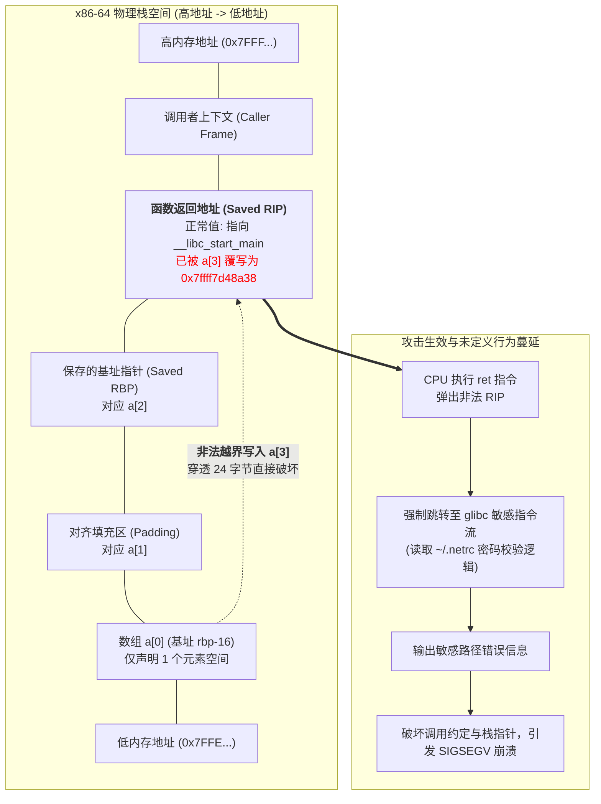
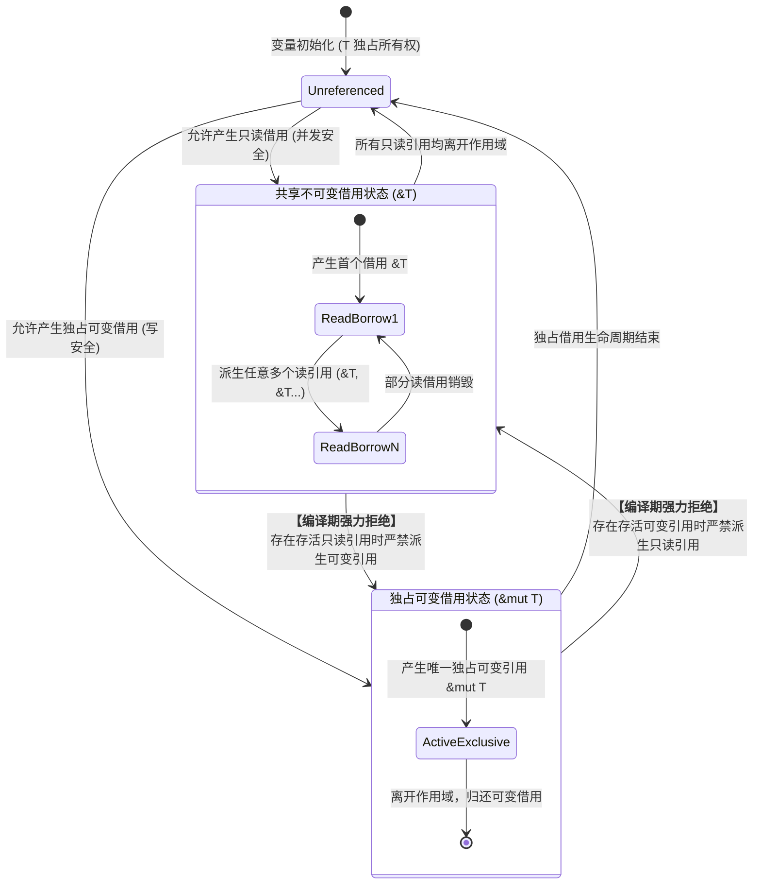
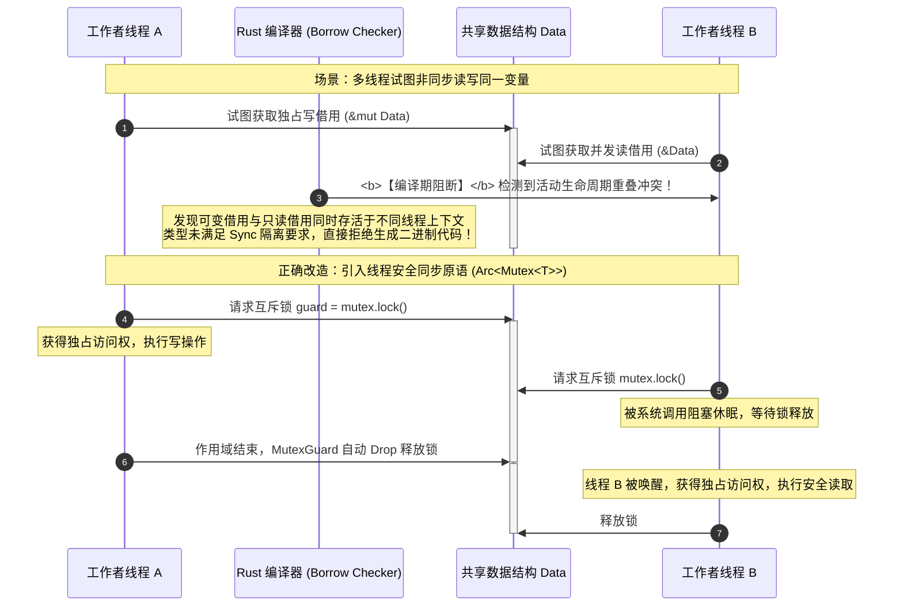

# 核心实战精炼：未定义行为黑洞与 Rust 编译期安全防线

## 1. 核心技术决策矩阵：C/C++ 传统内存陷阱 vs Rust 现代编译期防御机制

在数十年的系统级编程历史中，C 和 C++ 凭借极致的硬件操控力和零运行时开销，奠定了操作系统的基石。然而，这种掌控力的代价是：**编译器将内存正确性与并发安全的所有检查责任全部推卸给了程序员**。即使是经验最丰富、测试最充分的团队，也无法彻底避免未定义行为（Undefined Behavior, UB）的渗透。

下表系统性总结了现代生产环境中高发的底层内存缺陷，以及 Rust 如何从类型系统和编译器层面实现根本性根治：

| 内存与并发缺陷类型 | C/C++ 传统引发原因与灾难后果 | Rust 编译期防御原理与语言级保障 | 工业级消减成效 |
| :--- | :--- | :--- | :--- |
| **栈/堆缓冲区溢出**<br/>*(Buffer Overflow)* | 数组访问无越界检查，越界写入污染调用栈返回地址（RIP）或相邻堆块，引发任意代码执行（CVE 根源）。 | 编译期常量索引严格检查；运行时切片通过带边界检查的引用或安全包装方法（如 `.get()`）拦截，杜绝越界写入。 | **100% 根除**<br/>无法通过安全 Rust 产生缓冲区越界写入。 |
| **悬垂指针与释放后使用**<br/>*(Use-After-Free, UAF)* | 指针指向的内存已被 `free`/`delete`，后续读取获取垃圾数据或遭受堆喷射攻击（Heap Spraying）。 | **所有权（Ownership）与生命周期系统**：编译器严格验证引用的作用域，确保借用绝不比被借用对象存活更久。 | **100% 根除**<br/>编译期直接拒绝悬垂借用，杜绝 UAF。 |
| **双重释放**<br/>*(Double Free)* | 复杂控制流或异常分支中对同一物理内存地址执行两次释放，破坏堆分配器元数据链表。 | **移动语义（Move Semantics）**：赋值或传参转移所有权后源变量立即失效；RAII 特性确保单一变量销毁时仅析构一次。 | **100% 根除**<br/>析构函数在栈展开时自动触发且仅触发一次。 |
| **空指针解引用**<br/>*(Null Pointer Deref)* | 指针可能为 `NULL`/`nullptr`，开发者遗漏检查即引发 `SIGSEGV` 段错误崩溃（十亿美元级设计灾难）。 | **消除原生 Null 概念**：Safe Rust 引用永不为空；可空语义统一使用强类型枚举 `Option<&T>` 显式建模。 | **100% 根除**<br/>解引用前必须进行模式匹配，杜绝意外空崩。 |
| **多线程数据竞争**<br/>*(Data Races)* | 两个线程同时并发访问同一块内存，且至少有一个为非同步写操作，导致脏读与内部状态撕裂。 | **`Send` 与 `Sync` 自动推理** + **别名互斥原则**：同一时刻要么有多个只读引用，要么仅有一个独占可变引用。 | **100% 根除**<br/>编译期保证数据竞争自由（Data-Race-Free）。 |
| **类型双重解释**<br/>*(Type Confusion)* | C 风格裸强制转换 `(Type*)ptr` 绕过类型系统，将浮点数或结构体伪装成指针访问非法地址。 | **严格类型系统**：禁止非安全的任意内存强转；强制转换必须实现安全转换 Trait（如 `From`/`Into`/`TryFrom`）。 | **100% 根除**<br/>杜绝非法内存布局假冒。 |
| **未定义行为蔓延**<br/>*(UB Inlining & DCE)* | 编译器基于“无 UB”假设进行激进优化，直接删除开发者自认为有效的边界防护代码（代码裁剪）。 | **语言级承诺**：Safe Rust 绝无未定义行为；任何非安全边界被严格收敛至带有 `unsafe` 关键字的受控区域。 | **本质扭转**<br/>消除隐式安全隐患，大幅减轻安全审查负担。 |

---

## 2. 深度解密：神秘 C 崩溃代码机理与 Rust 生产级防御范式

### 2.1 原著神秘 C 程序底层逆向深度解密

在原著第一章中，作者给出了一个极度诡异的 C 语言程序：

```c
int main(int argc, char **argv) {
    unsigned long a[1];
    a[3] = 0x7ffff7d48a38UL;
    return 0;
}
```

在作者的机器上，该程序竟然输出了与网络认证凭据相关的提示，随后发生段错误崩溃：

```console
undef: Error: .netrc file is readable by others.
undef: Remove 'password' line or make file unreadable by others.
```

为什么一个看似普通的单元素数组越界赋值，会触发操作系统读取用户主目录私密密码文件（`~/.netrc`）的报错？

#### 底层栈帧结构（x86-64 Linux System V ABI）揭秘

在 x86-64 架构的 Linux 系统中，函数调用栈是从**高内存地址向低内存地址**生长的。当 `main` 函数被调用时，其典型的栈帧内存排布如下：

```text
高内存地址 (High Address)
  ┌──────────────────────────────────────────────────┐
  │ 调用者参数区与外部环境                           │
  ├──────────────────────────────────────────────────┤
  │ 函数返回地址 (Saved RIP / Return Address)        │  <-- [rbp + 8]
  ├──────────────────────────────────────────────────┤
  │ 保存的上一栈帧基址指针 (Saved RBP)               │  <-- [rbp + 0]
  ├──────────────────────────────────────────────────┤
  │ 局部变量对齐填充 (Alignment Padding, 8 字节)     │  <-- [rbp - 8]
  ├──────────────────────────────────────────────────┤
  │ 数组 a[0] (unsigned long, 8 字节)                │  <-- [rbp - 16] (数组基址)
  └──────────────────────────────────────────────────┘
低内存地址 (Low Address)
```

在 64 位编译环境下：
1. `unsigned long` 占用 8 个字节。
2. 数组 `a` 位于局部变量栈空间，基地址为 `rbp - 16`。
3. `a[0]` 对应地址偏移 `+0`（即 `rbp - 16`）。
4. `a[1]` 对应地址偏移 `+8`（即 `rbp - 8`，填充区）。
5. `a[2]` 对应地址偏移 `+16`（即 `rbp + 0`，保存的上一栈帧 RBP）。
6. **`a[3]` 对应地址偏移 `+24`（即 `rbp + 8`，正是函数返回地址 Saved RIP！）**。

当程序执行 `a[3] = 0x7ffff7d48a38UL;` 时，它直接用十六进制常数覆写了当前函数的**返回指令指针（Return Instruction Pointer）**！

而在 glibc 动态链接库的虚拟内存地址空间中，`0x7ffff7d48a38UL` 正好落入了 glibc 内部 `ruserok` 或 `getpass` 模块用于验证用户主目录下 `.netrc` 文件权限的一段机器码分支。

当 `main` 函数执行到 `return 0;` 时，CPU 执行 `ret` 指令，硬件从栈顶弹出被篡改的返回地址，指令寄存器（RIP）直接跳转至该恶意地址执行！由于当前栈帧已经遭到破坏，且寄存器传递的参数并非 glibc 函数所期望的结构，程序在打印出警告后，迅速因非法内存访问触发 `SIGSEGV` 崩溃。

#### 编译器的“失职”：为什么没有报错？

C 语言标准（ISO/IEC 9899）对数组越界的定义极其冷酷：**这是未定义行为（Undefined Behavior, UB）**。
标准明确指出：*对于未定义行为，本国际标准不对程序的行为施加任何约束*。这意味着编译器没有义务发出警告，更没有义务生成运行时安全检查代码。现代优化器（如 Clang/GCC）甚至会基于“程序员永远不会编写未定义行为”的前提，在开启 `-O2` 优化时把与该变量相关的边界逻辑作为“不可达死代码”直接剔除！

---

### 2.2 Rust 生产级防御范式：编译期拦截与安全切片工程

在 Rust 中，类似的代码在编写完成的瞬间就会被防御机制彻底阻绝：

#### 场景 A：静态常量数组越界 —— 编译期直接拒编译

```rust
fn main() {
    let mut a: [u64; 1] = [0];
    // 下面这行代码会导致 Rust 编译器（rustc）直接抛出致命错误，构建彻底中断：
    // error: this operation will panic at runtime
    //   --> src/main.rs:3:5
    //    |
    // 3  |     a[3] = 0x7ffff7d48a38;
    //    |     ^^^^ index out of bounds: the length is 1 but the index is 3
    a[3] = 0x7ffff7d48a38;
}
```

#### 场景 B：动态切片安全访问范式（工业级防御）

当数组索引在运行时由外部动态输入（如网络数据包或配置文件）决定时，Rust 提供了完备的边界保护：

```rust
use std::fmt;

/// 自定义系统级切片访问错误
#[derive(Debug, PartialEq, Eq)]
pub enum BufferAccessError {
    IndexOutOfBounds { index: usize, capacity: usize },
    CorruptedHeader,
}

impl fmt::Display for BufferAccessError {
    fn fmt(&self, f: &mut fmt::Formatter<'_>) -> fmt::Result {
        match self {
            Self::IndexOutOfBounds { index, capacity } => {
                write!(f, "访问越界拦截: 请求索引 [{index}], 切片总容量 [{capacity}]")
            }
            Self::CorruptedHeader => write!(f, "数据包头部损坏，无法安全解析切片"),
        }
    }
}

impl std::error::Error for BufferAccessError {}

/// 生产级网络帧安全读取器
pub struct SafeFrameReader<'a> {
    buffer: &'a [u8],
}

impl<'a> SafeFrameReader<'a> {
    pub fn new(buffer: &'a [u8]) -> Self {
        Self { buffer }
    }

    /// 安全读取特定偏移处的 64 位无符号整数，彻底消除任何越界可能
    pub fn read_u64_at(&self, offset: usize) -> Result<u64, BufferAccessError> {
        // 利用切片的 .get() 方法：返回 Option<&[u8]>，杜绝隐式 Panic 或栈破坏
        let slice = self
            .buffer
            .get(offset..offset + 8)
            .ok_or_else(|| BufferAccessError::IndexOutOfBounds {
                index: offset + 8,
                capacity: self.buffer.len(),
            })?;

        // 依靠类型安全的固定长度数组转换 (TryInto)，零拷贝重组大端序数值
        let bytes: [u8; 8] = slice.try_into().map_err(|_| BufferAccessError::CorruptedHeader)?;
        Ok(u64::from_be_bytes(bytes))
    }
}
```

---

## 3. 并发安全基石：Send/Sync 契约与无畏并发

在 C/C++ 多线程系统中，并发漏洞往往比单线程越界更加隐蔽。数据竞争（Data Race）一旦发生，将导致寄存器刷新不同步、读写乱序与内存撕裂（Memory Tearing）。

Rust 从物理哲学层面提出了系统编程的铁律：**别名与可变性互斥公理（Aliasing XOR Mutability）**。

$$\text{并发安全} \iff (\&T \text{ 共享只读}) \oplus (\&mut T \text{ 独占可变})$$

### 3.1 核心标记 Trait：`Send` 与 `Sync`

Rust 并不依赖庞大的并发虚拟机，而是将并发安全性委托给了类型系统中的两个原生内置特性（Built-in Traits）：

1. **`Send` Trait**：表示该类型的所有权可以安全地从当前线程转移（Move）到另一个线程。
2. **`Sync` Trait**：表示该类型的不可变借用（`&T`）可以安全地在多个线程之间并发共享。

**形式化推论**：
$$\text{类型 } T \text{ 实现了 } Sync \iff \text{引用 } \&T \text{ 实现了 } Send$$

如果一个类型内部包含非线程安全的裸指针（如 `*const T`）或非原子引用计数（如 `Rc<T>`），编译器将自动判定该类型**不满足** `Send` 或 `Sync`。一旦尝试跨线程传递，编译器将在编译期立刻拦截，坚决拒绝生成目标代码！

### 3.2 生产级无畏并发代码范式：多线程安全指标聚合器

```rust
use std::sync::{Arc, Mutex};
use std::thread;

/// 生产级跨线程安全指标聚合器
#[derive(Debug, Default)]
pub struct MetricsCollector {
    request_count: u64,
    error_count: u64,
}

impl MetricsCollector {
    pub fn record_success(&mut self) {
        self.request_count += 1;
    }

    pub fn record_error(&mut self) {
        self.request_count += 1;
        self.error_count += 1;
    }
}

pub fn spawn_worker_pool(num_workers: usize) -> Arc<Mutex<MetricsCollector>> {
    // 使用原子引用计数 Arc 包装线程安全互斥锁 Mutex
    let metrics = Arc::new(Mutex::new(MetricsCollector::default()));
    let mut handles = Vec::with_capacity(num_workers);

    for worker_id in 0..num_workers {
        // 克隆智能指针元数据，底层共享同一物理互斥锁
        let metrics_clone = Arc::clone(&metrics);

        let handle = thread::spawn(move || {
            for i in 0..1000 {
                // lock() 获取互斥守卫 RAII MutexGuard，离开作用域自动析构解锁
                let mut guard = metrics_clone.lock().expect("互斥锁发生中毒 (Poisoned)");
                if i % 10 == 0 {
                    guard.record_error();
                } else {
                    guard.record_success();
                }
            }
            // 线程退出时打印审计
            println!("工作者线程 [{worker_id}] 数据处理完成并安全退出");
        });

        handles.push(handle);
    }

    // 主线程汇聚等待所有子线程执行完毕
    for handle in handles {
        handle.join().expect("子线程发生未捕获 Panic");
    }

    metrics
}
```

---

## 4. 架构拓扑与内存模型图

### 4.1 C/C++ 栈帧破坏导致控制流劫持攻击拓扑图



---

### 4.2 Rust 别名与可变性互斥状态机 (Aliasing XOR Mutability)



---

### 4.3 多线程数据竞争防御时序图 (Data Race Elimination)



---

## 5. 架构避坑清单 (Do's & Don'ts)

| 传统系统级思维陷阱 (Don't) | Rust 现代工程最佳实践 (Do) |
| :--- | :--- |
| **迷信“只要团队足够资深细心，就能靠代码审查杜绝 C/C++ 内存漏洞”。** | 接受人类认知局限性，将内存安全不变量与生命周期全权交由编译器机器静态证明。 |
| **在 Rust 中通过裸指针（`*mut T`）和大量的 `unsafe` 块强行模拟 C 语言编程范式。** | 深入理解所有权树、代数数据类型与 Trait 抽象，仅在硬件抽象层最小化隔离 `unsafe`。 |
| **为了让编译通过，在没有并发开销评估的情况下随意把变量塞入全局静态可变对象。** | 使用类型安全的 `Atomic` 原语、`Mutex` 互斥锁，或者基于消息队列传递数据所有权。 |
| **在切片访问中使用裸数字做无保护索引，并在运行时依赖未捕获的 Panic 兜底。** | 使用 `.get()` 配合 `Result`/`Option` 显式解构，或者在外部验证切片前置条件（Contract-based）。 |

<!-- split -->

# 原著完整参考：第 1 章 系统程序员的福音（Systems Programmers Can Have Nice Things）

> 在特定的工程语境中——例如 Rust 所锁定的系统级应用场景——比竞争对手快上 10 倍甚至是 2 倍，都往往具有一锤定音的决定性意义。它决定了一个系统在工业市场中的终极命运，其残酷程度丝毫不亚于硬件市场的生死抉择。
>
> —— **Graydon Hoare**（Rust 语言奠基者）

> 如今所有的计算机都已走向高度并行化……  
> 并行编程**就是**编程本身的本质。
>
> —— **Michael McCool 等**，《结构化并行编程》

> 恶意国家级攻击者利用 TrueType 字体解析器漏洞实施深度监控；事实证明，**所有的软件都是安全敏感系统**。
>
> —— **Andy Wingo**（知名虚拟机与编译器工程师）

本章之所以选择以这三段振聋发聩的名言作为开篇，绝非偶然。不过，在深入展开之前，不妨让我们先从一个令人困惑的技术谜题开始：以下这段看似平平无奇的 C 语言程序，究竟会产生怎样的运行结果？

```cpp
int main(int argc, char **argv) {
  unsigned long a[1];
  a[3] = 0x7ffff7d48a38UL;
  return 0;
}
```

在原著作者 Jason 的笔记本电脑上，执行这段程序后，终端赫然输出了这样两行诡异的信息：

```console
undef: Error: .netrc file is readable by others.
undef: Remove 'password' line or make file unreadable by others.
```

紧接着，整个程序发生了段错误崩溃。如果你在自己的机器上编译运行它，看到的现象可能完全不同。这背后究竟发生了什么？

答案在于：**这段程序存在致命的技术缺陷**。数组 `a` 声明的物理长度仅为 1 个元素，因此对 `a[3]` 的访问，在 C 语言编程标准中被毫不含糊地定义为**未定义行为（Undefined Behavior, UB）**：

> “当使用了不可移植或错误的程序构造、或使用了错误的数据时所引发的行为；针对该行为，本国际标准**不对其施加任何约束**。”

未定义行为的后果绝不仅仅是产生一个不可预测的输出那么简单——C 语言标准白纸黑字地**赋予了程序做出任何行为的绝对特权**。

在本例中，将特定的十六进制数值写入这个特定数组的第四个物理位置，恰好越界破坏了函数的物理调用栈；使得当 `main` 函数执行退出时，CPU 并未按预期优雅返回操作系统，而是直接跳转到了 C 标准运行时库（libc）中用于从用户家目录读取网络认证密码文件的一段指令分支中！事情自然陷入了灾难性的混乱。

:::en
> **Original**: The program is flawed. The array a is only one element long, so using a[3] is, according to the C programming language standard, *undefined behavior*: Behavior, upon use of a nonportable or erroneous program construct or of erroneous data, for which this International Standard imposes no requirements. Undefined behavior doesn't just have an unpredictable result: the standard explicitly permits the program to do anything at all. In our case, storing this particular value in the fourth element of this particular array happens to corrupt the function call stack such that returning from the main function, instead of exiting the program gracefully as it should, jumps into the midst of code from the C standard library for retrieving a password from a file in the user's home directory. It doesn't go well.

**📌 核心术语与语境解析**：
- **Undefined Behavior (UB)** [ˌʌndɪˈfaɪnd bɪˈheɪvjər]：*未定义行为*。编程语言标准未施加任何限制的操作状态。编译器将假定此类情况永远不会发生，进而可能在优化阶段删除安全分支或生成任意机器码。
- **Call Stack Corruption** [kɔːl stæk kəˈrʌpʃn]：*调用栈破坏*。局部变量越界写入覆盖了栈上保存的帧指针（RBP）或返回地址（RIP），导致控制流发生非预期跳转。
- **Imposes No Requirements** [ɪmˈpoʊzɪz noʊ rɪˈkwaɪərmənts]：*不强加任何要求*。语言规范的免责声明，意味着程序发生数据擦除、崩溃、甚至执行任意代码均在标准合规范围内。
:::

## 1. C 与 C++ 程序员的沉重历史负债

在 C 和 C++ 庞大的语言体系中，存在着数百条旨在规避未定义行为的严苛规则。平心而论，这些规则大多属于常识范畴：不要越界访问你不该碰的物理内存、不要让有符号整数发生算术溢出、不要尝试除以零、不要解引用空指针等等。

然而致命的问题在于：**编译器完全不会在编译期强制执行这些规则；甚至当代码中出现极其明目张胆的违规时，编译器也没有任何义务予以检测或报警**。规避未定义行为的沉重责任，完全且绝对地落在了你——也就是程序员个人的肩膀上。

从软件工程的历史实践来看，我们人类程序员在这方面的表现实在称不上光彩。犹他大学的研究员彭利（Peng Li）曾对 C 与 C++ 编译器进行了底层插桩改造，使编译出的程序能够动态报告自身是否触发了某些形式的未定义行为。研究的最终结论令人不寒而栗：**几乎所有的受测程序都存在未定义行为，即便那些来自业内享有极高盛誉、代码审查标准极其严苛的明星开源项目亦不能幸免**。

在 C 和 C++ 中盲目自负地认为自己能够单凭肉眼与小心谨慎来规避未定义行为，其荒谬程度就好比天真地以为“只要熟记国际象棋的走子规则，就一定能在棋局中击败特级大师”一样不切实际。

如果说偶尔冒出的怪异报错信息或单机崩溃尚可被视为普通的质量缺陷，那么漫不经心导致的未定义行为，自 1988 年莫里斯蠕虫（Morris Worm）利用早期的缓冲区溢出漏洞在初代互联网上大肆蔓延以来，就始终是系统级严重安全漏洞的头号温床。

这就让 C 和 C++ 程序员陷入了进退维谷的尴尬窘境：**这两种语言固然是系统级编程事实上的工业基准，但它们对开发者脑力施加的严苛压力，却几乎必然导致持续不断的崩溃与安全漏洞漏洞百出**。解开我们开篇的小谜题，实际上引发了一个更加宏大的灵魂拷问：难道我们真的不能做得更好吗？

:::en
> **Original**: C and C++ have hundreds of rules for avoiding undefined behavior. They're mostly common sense: don't access memory you shouldn't, don't let arithmetic operations overflow, don't divide by zero, and so on. But the compiler does not enforce these rules; it has no obligation to detect even blatant violations. The responsibility for avoiding undefined behavior falls entirely on you, the programmer. Empirically speaking, we programmers do not have a great track record in this regard... Assuming that you can avoid undefined behavior in C and C++ is like assuming you can win a game of chess simply because you know the rules.

**📌 核心术语与语境解析**：
- **Blatant Violations** [ˈbleɪtnt ˌvaɪəˈleɪʃnz]：*显而易见/明目张胆的违规*。即使在常量求值上下文中代码直接出现明显的越界偏移，传统编译器往往也仅将其静默放行。
- **Empirically Speaking** [ɪmˈpɪrɪkli ˈspiːkɪŋ]：*从经验事实/工程统计角度而言*。基于数十年海量工业级软件 CVE 统计数据得出的客观结论。
- **Morris Worm** [ˈmɔːrɪs wɜːrm]：*莫里斯蠕虫*。1988 年爆发的计算机病毒，系统级安全攻防的里程碑事件，核心攻击手段正是利用 fingerd 守护进程的 `gets()` 缓冲区溢出。
:::

## 2. Rust 替你承担重担

我们对上述宏大拷问的回答，正是围绕篇首引述的三段名言所构建的。

第三段名言所指涉的真实历史事件，是 2010 年震惊全球的“震网”（Stuxnet）工业计算机蠕虫。该蠕虫在渗透受害者的工业离心机控制计算机时，所采用的关键攻击载荷之一，正是利用了嵌入在文字处理文档中的 **TrueType 矢量字体解析器代码中的未定义行为**。

我们可以完全确信：当年编写那段字体解析模块的工程师们，无论如何也不可能预见到自己的代码竟会被国家级黑客组织以此种方式恶意武器化。这一残酷案例无可辩驳地揭示出：**不仅仅是操作系统内核与关键服务器才需要对安全提心吊胆——任何可能从外部不可信数据源接收并解析数据的软件，都随时可能成为被精确狙击的安全靶标**。

对此，Rust 语言向全世界的系统程序员做出了一项极其纯粹的郑重承诺：**只要你的程序通过了编译器的静态检查，它就绝不包含任何未定义行为**。

悬垂指针（Dangling Pointers）、双重释放（Double-frees）、空指针解引用（Null Pointer Dereferences），全部在编译阶段被借用检查器斩草除根。对于动态数组引用的访问，Rust 通过编译期证明与极低开销的运行时边界检查双重把关，彻底杜绝缓冲区溢出：若将本章开头那段不幸的 C 语言程序转写为对应的安全 Rust 代码，程序绝不会发生跳向危险指令流的灵异现象，而是会在边界违规的发生瞬间安全受控地中止并输出明确的错误信息。

不仅如此，Rust 的设计雄心在于：**既要极致安全，又要赋予开发者愉悦顺畅的工程体验**。

为了向程序的运行期行为提供坚不可摧的数理保证，Rust 必然会对你的代码施加比 C/C++ 严苛得多的语法与生命周期限制；完全适应这些约束确实需要一定的练习与工程经验的重构。但从全局来看，Rust 语言展现出了非凡的灵活性与表现力。遍布全球、覆盖各类应用领域的惊人工程落地案例，便是对其表达能力的最好证言。

在我们的实际工程经验中，能够绝对信赖语言在编译期捕获致命缺陷，极大地激发了我们去构筑更大规模、更具雄心的复杂系统的信心。当你可以确信底层的内存管理与指针合法性已被编译器全天候捍卫时，重构一个包含数十万行代码的大型系统便不再是一场令人胆战心惊的冒险。而且，排障调试工作也变得空前纯粹——因为一个局部 Bug 所引发的潜在后果，绝不再包括悄无声息地污染侵蚀程序中完全无关的其他物理内存。

当然，Rust 无法检测出业务逻辑上的所有 Bug（例如算错利息或死循环）。但在工程实践中，**彻底将未定义行为从系统开发的考量清单中永久剔除，彻底且不可逆地改变了整个软件开发的性质，使其迈向了质的飞跃**。

:::en
> **Original**: The Rust language makes you a simple promise: if your program passes the compiler's checks, it is free of undefined behavior. Dangling pointers, double-frees, and null pointer dereferences are all caught at compile time. Array references are secured with a mix of compile-time and run-time checks, so there are no buffer overruns: the Rust equivalent of our unfortunate C program exits safely with an error message. Further, Rust aims to be both *safe* and *pleasant to use*. To make stronger guarantees about your program's behavior, Rust imposes more restrictions on your code than C and C++ do... But in practice, taking undefined behavior off the table substantially changes the character of development for the better.

**📌 核心术语与语境解析**：
- **Dangling Pointers** [ˈdæŋɡlɪŋ ˈpɔɪntərz]：*悬垂指针*。所指向的内存空间已被操作系统回收释放，但指针本身仍然残留原物理地址的非法状态。
- **Double-frees** [ˈdʌbl friːz]：*双重释放*。对同一块动态申请的堆内存地址重复调用销毁释放函数，导致堆分配管理器内部双向链表闭环受损的严重缺陷。
- **Taking UB off the table** [ˈteɪkɪŋ juː-biː ɔːf ðə ˈteɪbl]：*彻底从考量范围中剔除未定义行为*。使系统程序员摆脱对底层内存腐化幽灵的持续性焦虑，将心智模型全面释放给核心业务与系统拓扑设计。
:::

## 3. 并行编程重获驯服

在 C 和 C++ 的世界中，并发编程（Concurrency）的正确性控制是出了名的困难与凶险。绝大多数团队通常只有在单线程架构经过极限调优后仍无法满足硬性吞吐指标时，才会硬着头皮将多线程并发作为“最后不得已的自杀式手段”引入系统。

然而，本章开篇引用的第二段名言深刻指出：**在现代多核心甚至超异构处理器的物理现实下，并行计算已经重要到绝不容许再被当作权宜之计来边缘化**。

令人拍案叫绝的是：**在 Rust 中，用于保障编译期内存安全的那些核心约束，恰好从数理逻辑上等价地保证了 Rust 程序天然免疫于数据竞争（Data Races）**。

在 Rust 体系下，只要数据没有发生变更，你就可以在多个操作系统线程之间随心所欲地自由共享它；而一旦数据涉及并发修改，编译器就会强制要求该数据必须被封装在受控的同步原语（Synchronization Primitives）之中。所有传统的经典并发兵刃——互斥锁（Mutexes）、条件变量（Condition Variables）、通道（Channels）、原子操作（Atomics）等——全部开箱即用。Rust 所做的事情极其纯粹而强大：**由编译器在静态期严格审查你是否合规地使用了它们**。

这使得 Rust 成为驾驭现代高并发多线程编程的梦幻武器。Rust 生态圈还涌现出了大批超越基础并发原语的高阶工业级库（例如 Rayon、Crossbeam、Tokio）：它们能协助你以极低的心智负担将海量并发计算负载均匀摊销至处理器核心池中，或构建出极致性能的高吞吐无锁同步网络。

:::en
> **Original**: Concurrency is notoriously difficult to use correctly in C and C++. Developers usually turn to concurrency only when single-threaded code has proven unable to achieve the performance they need. But the second opening quote argues that parallelism is too important to modern machines to treat as a method of last resort. As it turns out, the same restrictions that ensure memory safety in Rust also ensure that Rust programs are free of data races. You can share data freely between threads, as long as it isn't changing. Data that does change can only be accessed using synchronization primitives.

**📌 核心术语与语境解析**：
- **Data Races** [ˈdeɪtə ˈreɪsɪz]：*数据竞争*。多个执行流非同步且并发读写同一内存位置的恶性并发状态。Rust 通过类型系统在编译期彻底证明并根除该现象。
- **Synchronization Primitives** [ˌsɪŋkrənaɪˈzeɪʃn ˈprɪmətɪvz]：*同步原语*。用于协调并发线程执行时序与内存可见性的底层构件（如 Mutex、RwLock、Atomic）。
- **Method of Last Resort** [ˈmeθəd əv læst rɪˈzɔːrt]：*最后不得已的杀手锏/退路*。指代 C/C++ 开发者因惧怕死锁与内存撕裂，对多线程并发望而却步的避险心理。
:::

## 4. 极致性能毫不妥协

这最终将我们引向了篇首的第一段名言。

在关于系统性能的工程追求上，Rust 与 C++ 之父比雅尼·斯特劳斯特鲁普（Bjarne Stroustrup）在其著名论文《抽象与 C++ 机器模型》中所阐述的宏大野心高度契合：

> “总体而言，C++ 的工程实现始终恪守**零开销原则（Zero-Overhead Principle）**：**凡是你未使用的功能，你绝不需要为此付出任何运行时代价；更进一步：凡是你所使用的功能，即便是你亲自手写汇编，也绝不可能写得比编译器生成的代码更优秀**。”

系统级编程的本质使命，往往就是为了将物理机器的硬件极限压榨到最后一滴性能：
* 在游戏工业中，整台主机的每颗晶体管与 GPU 流处理器都必须全力以赴，为玩家营造极致丝滑的实时视听盛宴；
* 在现代 Web 浏览器内核中，渲染引擎的执行效率直接决定了全球数以亿计的内容创作者所能发挥的体验天花板——在物理硬件的固有算力边界内，必须尽可能将更多的内存配额与 CPU 调度算力让渡给网页内容本身；
* 同样的铁律在操作系统中体现得淋漓尽致：内核存在的意义是将物理硬件资源无损交付给用户空间进程，而不是在内核态自身白白挥霍损耗算力。

但当我们探讨 Rust 是“快速的”这一命题时，它在工程学上真正的内涵究竟是什么？

平心而论，用任何一门通用语言都可以写出极其低效缓慢的代码。更准确的技术表述应当是：**如果你愿意付出严谨的系统架构思考，精打细算地设计你的程序以最大化调动底层机器的硬件潜能，那么 Rust 将在整个工程旅程中为你提供最坚实的技术支撑**。Rust 语言的所有核心语法与标准库均被设计为具备极高效率的默认行为，同时赋予你对内存排布、对齐与 CPU 缓存行利用率的完全终极控制力。

:::en
> **Original**: Rust shares the ambitions Bjarne Stroustrup articulates for C++ in his paper "Abstraction and the C++ Machine Model": In general, C++ implementations obey the zero-overhead principle: What you don't use, you don't pay for. And further: What you do use, you couldn't hand code any better. Systems programming is often concerned with pushing the machine to its limits... But when we say Rust is "fast," what does that really mean? One can write slow code in any general-purpose language. It would be more precise to say that, if you are ready to make the investment to design your program to make the best use of the underlying machine's capabilities, Rust supports you in that effort.

**📌 核心术语与语境解析**：
- **Zero-Overhead Principle** [ˈzɪroʊ ˈoʊvərhed ˈprɪnsəpl]：*零开销原则*。现代系统语言黄金铁律：高级抽象必须在编译期完成单态化或内联降解，绝不在运行期引入不必要的间接跳转与调度损耗。
- **Hand Code Any Better** [hænd koʊd ˈeni ˈbetər]：*手写出更优代码*。编译优化管线（LLVM）利用类型系统提供的不变量信息（如不可变借用无别名保证）生成超越手工编写汇编的向量化机器码。
- **Sets the Ceiling** [sets ðə ˈsiːlɪŋ]：*确立了天花板*。系统层底层架构的吞吐损耗直接决定了上层业务系统所能达到的极限吞吐量。
:::

## 5. 让工程协作前所未有地轻松

我们在本章的标题中，悄悄隐藏了第四段来自著名 Mozilla 工程师罗伯特·奥卡拉汉（Robert O'Callahan）的名言：**“系统程序员同样值得拥有美好事物。”（Systems Programmers Can Have Nice Things）**。

这句话所盛赞的，正是 Rust 在代码共享、依赖复用与工程协同方面带来的划时代工业革新。

Rust 原生配备的一体化包管理与构建驱动工具——**Cargo**，让系统程序员引用并复用托管在公共包注册仓库（crates.io）中的高质量第三方库变得前所未有地优雅。你只需在工程的声明式清单文件中轻敲几行配置，指定依赖库的包名与语义化版本，Cargo 便会自动接管后续所有脏活累活：自动拉取解析复杂的传递性依赖拓扑树、以最高并发度编译所有组件，并将最终产物与系统目标环境精准链接。

你可以把 Cargo 视作系统级编程世界里给出的终极答案——它兼具 npm 或 RubyGems 般丝滑的使用体验，同时又以严密健壮的**语义化版本控制（SemVer）与可复现构建（Reproducible Builds）**作为核心基石。

当今繁荣的 Rust 生态已经能够为系统工程师提供从工业级序列化引擎（Serde）、生产级 HTTP 异步客户端/服务端（Reqwest/Axum）、到现代化底层 Vulkan/Metal 图形抽象接口（wgpu）等无所不包的武器库。语言内置的 Trait 抽象与静态泛型，让开源库接口在兼顾极限性能的同时提供了绝佳的扩展弹性；而 Rust 官方标准库则确立了统一的通用基础类型词汇表，使得不同团队、不同库之间的拼装组合宛如榫卯契合般浑然天成。

在接下来的篇章中，我们将通过几个精心设计的实操代码工程，全面展开这些令人振奋的技术特性，带你身临其境地见证现代系统级工程实战的独特魅力！

:::en
> **Original**: We hid a fourth quote in the title of this chapter: "Systems programmers can have nice things." Robert O'Callahan wrote this, referring to Rust's support for code sharing and reuse. Rust's package manager and build tool, Cargo, makes it easy to use libraries published by others on Rust's public package repository, the crates.io website. You simply add the library's name and required version number to a file, and Cargo takes care of downloading the library, along with whatever other libraries it uses in turn, compiling everything, and linking the whole lot together. You can think of Cargo as Rust's answer to NPM or RubyGems, with an emphasis on sound version management and reproducible builds.

**📌 核心术语与语境解析**：
- **Nice Things** [naɪs θɪŋz]：*美好事物*。指代长期被 C/C++ 简陋的头文件拷贝与 CMake 配置文件折磨的底层开发者，终于拥有了现代工程脚手架与自动化包管理体系。
- **Reproducible Builds** [ˌriːprəˈduːsəbl bɪldz]：*可复现构建*。通过 `Cargo.lock` 精确锁定全部依赖项的 SHA-256 校验和与确切构建参数，确保任何团队成员在任何机器上均能产出完全一致的目标二进制代码。
- **Sound Version Management** [saʊnd ˈvɜːrʒn ˈmænɪdʒmənt]：*健全的版本治理机制*。严格遵从 SemVer 语义化规范，杜绝依赖地狱（Dependency Hell）与动态链接符号冲突。
:::
