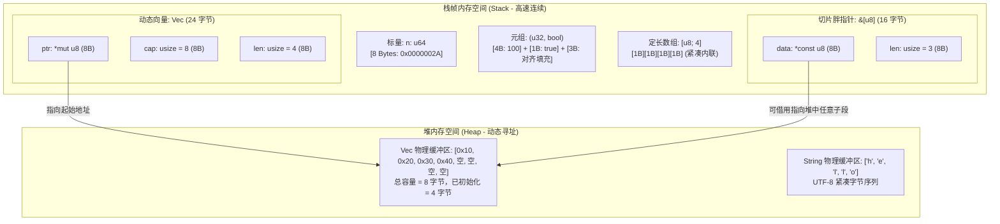

> 💡 **双栏独立滚动工作台导读**：本文采用双栏对照架构。**左栏**为现代系统级工程实战精炼架构、设计决策矩阵、生产级核心代码与避坑指南；**右栏**为原著完整参考译文，附有关键段落的英文原文展开与核心术语解析。左右两栏可独立滚动，并支持顶栏自定义宽度比例（7:3 / 5:5 / 3:7）与拖拽调节。

# 核心实战精炼：现代系统级类型系统与内存物理排布

## 1. 架构选型与内存布局决策矩阵

在系统级工程中，类型的选择直接决定了内存占用、CPU 缓存命中率以及数据拷贝开销。

### 1.1 集合与连续存储类型物理模型矩阵

| 存储类型 | 内存分配位置 | 栈占用 (64位机器) | 堆重分配开销 | 缓存局部性 | 典型生产场景 |
| :--- | :--- | :--- | :--- | :--- | :--- |
| **定长数组 `[T; N]`** | 纯栈上分配 (Inline) | $N \times \text{sizeof}(T)$ 字节 | **0（无堆分配）** | **极佳（连续紧凑栈内存）** | 固定包头缓冲区、加密密钥哈希、嵌入式与微内核环境 |
| **动态向量 `Vec<T>`** | 栈控制块 + 堆缓冲区 | 24 字节 (`ptr`, `cap`, `len`) | 扩容时 $2\times$ 重新分配并 `memcpy` | 堆内存连续，存在间接寻址 | 长度不可预知的数据集、动态缓冲流、业务主集合 |
| **收缩装箱切片 `Box<[T]>`**| 栈指针 + 堆缓冲区 | 16 字节 (`ptr`, `len`) | **不可变（无法扩容）** | 堆内存连续，无冗余容量槽 | 只读大型配置表、解析完成后冻结的静态列表（节省 8 字节） |
| **切片视图 `&[T]` / `&mut [T]`** | 纯栈上胖指针 (Fat Pointer) | 16 字节 (`ptr`, `len`) | **0（零拷贝借用）** | 取决于底层数据源 | 函数参数首选契约、零拷贝协议解析、分治子区间处理 |
| **堆装箱对象 `Box<T>`** | 栈指针 + 堆单值 | 8 字节 (`ptr`) | 分配单块堆内存 | 产生指针解引用间接访问 | 递归数据结构（树/图）、超大结构体防爆栈、所有权移交堆 |

### 1.2 字符串与文本类型选型矩阵

| 类型 | 内部物理排布 | 内存所有权 | 编码保证 | 跨语言/跨系统场景 |
| :--- | :--- | :--- | :--- | :--- |
| **`&str` (字符串切片)** | 16 字节胖指针 (`*const u8`, `len`) | 借用（只读视图） | **强制严格有效 UTF-8** | 函数入参标准契约、静态字面量、零拷贝分词 |
| **`String`** | 24 字节控制块 (`*mut u8`, `cap`, `len`) | 独占拥有堆缓冲区 | **强制严格有效 UTF-8** | 动态拼接文本、接收外部用户输入、报文组装 |
| **`Cow<'a, str>`** | 枚举（借用 `Borrowed(&'a str)` / 拥有 `Owned(String)`）| 写时克隆 (Copy-on-Write) | **强制严格有效 UTF-8** | 绝大多数只读、仅在遇到转义字符时才分配堆内存的高性能解析器 |
| **`std::path::Path` / `PathBuf`** | 封装 `OsStr` / `OsString` 的无大小标记类型 | 视图 / 拥有 | 平台原生文件系统路径（Linux 上任意字节，Windows 上 WTF-16） | 文件系统路径操作、跨平台目录遍历 |
| **`std::ffi::CStr` / `CString`** | 以 `\0`（NUL 字符）结尾的连续字节序列 | 借用 / 拥有堆 | 任意兼容 C 语言字节流（不保证 UTF-8） | C-ABI FFI 动态链接库调用、Linux 原生系统调用交互 |

### 1.3 数值溢出处理策略矩阵

| 处理策略 | 对应 API 族 | 溢出时行为表现 | 性能开销 | 核心工程应用领域 |
| :--- | :--- | :--- | :--- | :--- |
| **检查型算术 (Checked)** | `.checked_add()`, `.checked_mul()` | 返回 `Option<T>`，溢出返回 `None` | 极低（单条条件分支指令） | 金融记账系统、加密币精度计算、安全认证计数器 |
| **饱和型算术 (Saturating)** | `.saturating_add()`, `.saturating_sub()` | 钳制在类型边界（`MAX` 或 `MIN`） | 极低（现代 CPU 包含原生饱和指令） | 音频采样混音、图像像素亮度计算、服务限流防刷滑动窗口 |
| **回绕型算术 (Wrapping)** | `.wrapping_add()`, `.wrapping_mul()` | 二进制补码回绕（$2^N$ 模运算） | **0（CPU 硬件原生溢出舍弃）** | 密码学哈希（SHA-256、BLAKE3）、伪随机数生成器、环形缓冲区指针 |
| **溢出报告算术 (Overflowing)**| `.overflowing_add()` | 返回 `(T, bool)` 元组 | 极低（直接读取 CPU 溢出标志位 Carry Flag） | 多精度大整数运算库（BigInt）、软浮点计算引擎 |

---

## 2. 核心原理与心智模型：内存排布拓扑与切片胖指针

理解 Rust 类型系统的精髓，必须在脑海中建立**物理内存空间拓扑图**。



### 关键架构推论：
1. **胖指针（Fat Pointer）的双字（Two-Word）本质**：
   普通引用 `&T` 仅是一个单机器字长（64位系统下为 8 字节）的内存地址指针；而动态大小类型（Dynamically Sized Types, DST）如 `[T]` 和 `str` 无法在编译期确定大小，因此它们的借用形式 `&[T]` 和 `&str` 是**胖指针**，包含两个机器字长：**指向首元素的指针 (`ptr`)** + **元素的物理数量 (`len`)**。
2. **零成本抽象的切片参数化**：
   如果一个函数接受 `&[T]` 作为入参，调用者既可以传入固定大小栈数组 `&[T; N]`，也可以传入堆向量 `&Vec<T>` 的完整切片，甚至是任意子切片 `&v[2..5]`。无需重载，无需内存分配，执行效率完全等价于直接传递裸指针与长度。

---

## 3. 生产级系统工程代码范式

### 3.1 零拷贝文本解析引擎：Cow 优化实战

在处理高频日志或网络协议反序列化时，绝大多数键值对无需转义修改，此时应直接借用输入缓冲区的切片；仅在遇到转义字符时才在堆上动态分配 `String`。

```rust
//! 生产级零拷贝键值解析器
//! 结合 Cow<'a, str> 实现最小堆分配优化

use std::borrow::Cow;

#[derive(Debug, PartialEq, Eq)]
pub struct QueryParam<'a> {
    pub key: Cow<'a, str>,
    pub value: Cow<'a, str>,
}

pub fn parse_query_param(raw: &str) -> Option<QueryParam<'_>> {
    let (key_part, val_part) = raw.split_once('=')?;

    let decode = |s: &str| -> Cow<'_, str> {
        if s.contains('+') || s.contains('%') {
            // 包含转义符号，退化为拥有所有权的堆分配 String
            let mut decoded = String::with_capacity(s.len());
            let mut chars = s.chars();
            while let Some(ch) = chars.next() {
                match ch {
                    '+' => decoded.push(' '),
                    '%' => {
                        let hex: String = chars.by_ref().take(2).collect();
                        if let Ok(b) = u8::from_str_radix(&hex, 16) {
                            decoded.push(b as char);
                        } else {
                            decoded.push('%');
                            decoded.push_str(&hex);
                        }
                    }
                    other => decoded.push(other),
                }
            }
            Cow::Owned(decoded)
        } else {
            // 纯净字符串，完全零拷贝借用入参切片
            Cow::Borrowed(s)
        }
    };

    Some(QueryParam {
        key: decode(key_part),
        value: decode(val_part),
    })
}

#[test]
fn test_cow_zero_copy_optimization() {
    let raw = "user=alex&title=Rust%20Engineering";
    let pairs: Vec<_> = raw.split('&').filter_map(parse_query_param).collect();

    // "user" 和 "alex" 无转义符号，均为 Cow::Borrowed
    assert!(matches!(pairs[0].key, Cow::Borrowed(_)));
    assert!(matches!(pairs[0].value, Cow::Borrowed(_)));

    // "Rust%20Engineering" 含转义，晋升为 Cow::Owned
    assert!(matches!(pairs[1].value, Cow::Owned(_)));
    assert_eq!(pairs[1].value, "Rust Engineering");
}
```

### 3.2 嵌入式/内核环境：基于栈数组的无分配环形缓冲区

```rust
//! 纯栈上分配的固定容量环形队列 (StackRingBuffer)
//! 零堆分配、具备强安全边界检查与回绕算术

pub struct StackRingBuffer<T, const CAP: usize> {
    buffer: [Option<T>; CAP],
    head: usize,
    tail: usize,
    count: usize,
}

impl<T: Copy, const CAP: usize> StackRingBuffer<T, CAP> {
    pub const fn new() -> Self {
        assert!(CAP > 0, "环形队列容量必须大于 0");
        Self {
            buffer: [None; CAP],
            head: 0,
            tail: 0,
            count: 0,
        }
    }

    #[inline]
    pub fn is_full(&self) -> bool {
        self.count == CAP
    }

    #[inline]
    pub fn is_empty(&self) -> bool {
        self.count == 0
    }

    pub fn push(&mut self, item: T) -> Result<(), &'static str> {
        if self.is_full() {
            return Err("队列已满，拒绝写入");
        }
        self.buffer[self.tail] = Some(item);
        // 回绕指针算术
        self.tail = (self.tail + 1) % CAP;
        self.count += 1;
        Ok(())
    }

    pub fn pop(&mut self) -> Option<T> {
        if self.is_empty() {
            return None;
        }
        let item = self.buffer[self.head].take();
        self.head = (self.head + 1) % CAP;
        self.count -= 1;
        item
    }
}
```

---

## 4. 架构避坑清单 (Do's & Don'ts)

| 决策维度 | 严禁反模式 (Don'ts) | 生产推荐范式 (Do's) |
| :--- | :--- | :--- |
| **数值溢出假设** | 依赖调试模式下的整型溢出 Panic 保护，误以为 Release 模式下行为完全一致。 | 明确 Release 模式下整型溢出默认触发**补码回绕**，关键逻辑强制使用 `checked_*` 或 `saturating_*` 算术。 |
| **字符串字节切片** | 使用字节索引直接对字符串切片（如 `&my_str[0..2]`），当遇到多字节 UTF-8 字符（如中文或 Emoji）时触发进程崩溃。 | 严禁随意按字节索引切割 UTF-8 字符串；必须按 `str::char_indices()` 或 `str::chars()` 提取合法 Unicode 边界。 |
| **浮点数判等** | 对 `f32` / `f64` 直接使用 `==` 比较或尝试将其作为 `BTreeMap` / `HashMap` 的 Key。 | 由于 `NaN != NaN` 违背全序关系（`Ord`），浮点数只能实现 `PartialEq`；排序和比较需使用 `f64::total_cmp()`。 |
| **函数接口设计** | 在公共 API 的只读入参中声明 `fn process(v: &Vec<T>)` 或 `fn parse(s: &String)`。 | 遵循解引用强制多态（Deref Coercion），函数入参强制声明为切片抽象 `fn process(v: &[T])` 与 `fn parse(s: &str)`。 |
| **堆内存浪费** | 在数据准备完毕后长期持有不再扩容的巨大 `Vec<T>`，导致 `capacity >> len` 浪费宝贵的物理内存。 | 调用 `v.shrink_to_fit()` 释放冗余堆内存，或将其冻结转换为装箱切片 `v.into_boxed_slice()` 节省 8 字节控制块。 |
| **指针越界访问** | 为追求性能盲目套用 `unsafe { *slice.get_unchecked(i) }` 绕过边界检查。 | 现代 LLVM 能够自动向量化并消除循环体中的边界检查；优先使用标准迭代器遍历切片，杜绝潜在的内存悬垂。 |

<!-- split -->

# 原著完整参考：基础类型系统：标量、复合、指针与切片（Slice）内存排布

在探索 Rust 的宏伟蓝图之前，必须首先建立对其**基础类型系统（Fundamental Types）**的微观认知。与高级脚本语言将所有变量包装为带垃圾回收标记的动态对象不同，Rust 是一门系统级语言：**程序中的每一个值在内存中占用多少字节、排布在栈上还是堆上、如何通过寄存器传递，全部都在类型系统中有着严密、清晰且确定的静态表征**。

这种确定性不仅赋予了系统极致的运行效能与紧凑的内存足迹，更是 Rust 编译器能够在编译期彻底捍卫内存安全的物理基石。

:::en
> **Original**: Programs are made of data and instructions. The fundamental types in Rust are the building blocks from which all more complex types are constructed. A type specifies how bits in memory are to be interpreted, what operations can be performed on them, and how much storage they occupy.
> Rust is designed to give you precise control over your program's memory layout and processor resource usage, without sacrificing type safety.

**📌 核心术语与语境解析**：
- **Fundamental Types** [ˌfʌndəˈmentl taɪps]：*基础类型*。构成复杂数据结构的原语类型，直接映射到底层硬件架构的标量与复合单元。
- **Memory Layout** [ˈmeməri ˈleɪaʊt]：*内存排布/布局*。数据结构各字段在虚拟内存地址空间中的偏移量、字节对齐与连续性物理拓扑。
:::

---

## 1. 数值类型体系（Numeric Types）

Rust 提供了极其详尽的数值类型，其位宽在所有硬件平台上保持一致，不随编译器或宿主操作系统发生漂移。

### 1.1 整型分类与平台字长

| 长度 (Bits) | 有符号整型 (Signed) | 无符号整型 (Unsigned) | 表达数值范围 |
| :--- | :--- | :--- | :--- |
| **8 位** | `i8` | `u8` (常用作字节 Byte) | `-128 ~ 127` / `0 ~ 255` |
| **16 位** | `i16` | `u16` | $-2^{15} \sim 2^{15}-1$ / $0 \sim 2^{16}-1$ |
| **32 位** | `i32` (默认整型推导) | `u32` | 约 $-21.4$ 亿 $\sim 21.4$ 亿 / $0 \sim 42.9$ 亿 |
| **64 位** | `i64` | `u64` | 约 $-9.22 \times 10^{18} \sim 9.22 \times 10^{18}$ |
| **128 位** | `i128` | `u128` | 极大整数运算、UUID 整数表示 |
| **指针字长** | `isize` | `usize` (对象计数与索引首选) | 32位系统为 4 字节，64位系统为 8 字节 |

在系统级编程中，`usize` 与 `isize` 对应宿主机上的裸指针大小。数组和向量的索引、切片的长度、内存偏移量均统一采用 `usize`，这从类型系统层面杜绝了 32 位与 64 位平台间指针转换的越界隐患。

### 1.2 整型溢出（Integer Overflow）的双重世界

在 C 语言中，有符号整型溢出属于未定义行为（UB）；而在 Java 等语言中，整型溢出被强制规范为二进制补码回绕。

Rust 采取了极其务实且安全的双重策略：
- **调试构建（Debug Build）**：编译器在生成的机器码中插入溢出检测指令。一旦发生运算溢出，程序立即触发 **Panic** 并终止运行，协助开发者在测试阶段定位边界 Bug；
- **发布构建（Release Build）**：为了追求极致机器执行性能，编译器会移除溢出检测，此时运算遵循标准的**二进制补码回绕（Two's Complement Wrapping）**。

如果你需要对溢出进行精细化控制，绝不应依赖编译模式，而应调用标准库提供的四大专用算术函数族：
1. **检查型方法（Checked）**：如 `a.checked_add(b)`，返回 `Option<T>`；
2. **回绕型方法（Wrapping）**：如 `a.wrapping_mul(b)`，无论何种编译模式一律严格回绕；
3. **饱和型方法（Saturating）**：如 `a.saturating_add(b)`，溢出时停留在类型的最大/最小值；
4. **溢出报告方法（Overflowing）**：如 `a.overflowing_sub(b)`，返回 `(T, bool)` 元组指示是否发生借位。

### 1.3 浮点类型与 IEEE 754 标准

Rust 包含两种 IEEE 754 标准浮点数类型：单精度 `f32` 与双精度 `f64`（默认推导浮点类型）。

浮点数字面量的语法极其灵活：


需要特别注意的是：浮点数包含特殊的非数（`NAN`）、正无穷大（`INFINITY`）与负无穷大（`NEG_INFINITY`）。因为 `NAN != NAN`，浮点数不具备完全等价关系，因此标准库中的 `f32` 与 `f64` 实现了 `PartialEq` 和 `PartialOrd`，但**没有实现 `Eq` 和 `Ord`**。这意味着你不能将浮点数直接作为标准哈希表 `HashMap` 的 Key。

---

## 2. 布尔类型（bool）与元组（Tuple）

### 2.1 布尔类型（bool）
Rust 的 `bool` 类型严格只占用 **1 个字节**，其合法值仅有 `true` 和 `false`。
Rust 坚决杜绝任何形式的隐式隐式类型转换（Implicit Coercion）：整型数值 `0` 或非零指针**绝不会**被隐式提升为布尔类型。`if` 条件表达式与 `while` 循环守卫中的判定条件必须是严格的 `bool` 类型。

### 2.2 元组（Tuple）
元组是将不同类型的若干值打包成单一复合值的最轻量形式：

```rust
let text_and_number: (&str, i32) = ("hello", 42);
```

元组元素的访问通过点号加常量数字索引完成（如 `text_and_number.0`、`text_and_number.1`）。

**单元类型（Unit Type `()`）**：
不包含任何元素的空元组 `()` 被称为**单元类型**。它在内存中占用 **0 字节（Zero-sized Type, ZST）**。任何没有显式返回值的函数、表达式代码块，其求值结果都是 `()`。这对应了 C/Java 中的 `void`，但它是一个完备的一等类型。

---

## 3. 指针类型体系：引用、Box 与裸指针

Rust 拥有极其严密的指针家族分工，确保安全与性能兼备：

```rust
// 1. 共享引用与可变引用 (安全、非空、受借用检查器终生监视)
let x = 10;
let r: &i32 = &x;

// 2. 堆装箱指针 (独占堆内存，RAII 离开作用域自动释放)
let b: Box<i32> = Box::new(20);

// 3. 裸指针 (仅用于 FFI 与底层驱动，解引用必须在 unsafe 块中)
let raw_p: *const i32 = &x;
```

:::en
> **Original**: Rust has several pointer types. A reference is a safe, non-owning pointer managed by the borrow checker. A `Box<T>` is an owning pointer to a value allocated on the heap. Raw pointers `*const T` and `*mut T` are like C pointers: they can be null, dangling, or unaligned, and dereferencing them is unsafe.

**📌 核心术语与语境解析**：
- **Raw Pointer (`*const T`, `*mut T`)** [rɔː ˈpɔɪntə]：*裸指针*。绕过借用检查器管辖的原生机器地址指针，允许为空或悬垂，仅在 Unsafe Rust 契约下允许解引用。
- **Boxed Value (`Box<T>`)** [bɒkst ˈvæljuː]：*堆装箱值*。拥有堆内存唯一所有权的智能指针，离开作用域自动调用析构函数释放堆空间。
:::

---

## 4. 连续序列：定长数组、向量与切片（Slice）

在 Rust 中，连续存储的数据根据**大小确定性**与**所有权模型**划分为三种完全不同的形态：

### 4.1 定长数组 `[T; N]`
数组的大小 `N` 是编译期常量，是其类型签名的一部分（例如 `[u8; 32]` 与 `[u8; 64]` 是完全互不兼容的不同类型）。数组数据全部直接内联分配在拥有它的上下文（通常是当前线程的执行栈）中，不存在任何堆开销与额外指针跳转。

### 4.2 动态向量 `Vec<T>`
向量是在堆上分配的、可动态伸缩的动态数组。在 64 位机器上，向量在栈上占据固定的 **24 字节**，由三个字长构成：
- `ptr`：指向堆上连续缓冲区的指针；
- `cap`：堆缓冲区的总物理容量（Capacity）；
- `len`：当前已初始化的有效元素数量（Length）。

### 4.3 切片（Slice）：胖指针视图

切片 `[T]` 是对某块连续内存序列的**无所有权视图**。由于切片长度在编译期无法静态预知，它属于动态大小类型（DST）。因此，我们在日常代码中接触到的几乎全都是它的借用形态：`&[T]` 或 `&mut [T]`。


如上图所示：
- 切片 `sa` 借用了栈上数组 `a` 的一部分；
- 切片 `sv` 借用了堆上向量 `v` 的一部分。

无论是栈内存还是堆内存，切片胖指针在栈上始终稳定占据 **16 字节**：
- **指针 (`data: *const T`)**：指向切片起始元素的物理内存地址；
- **长度 (`len: usize`)**：切片包含的元素个数。

---

## 5. 字符（char）与字符串系统（String & &str）

### 5.1 字符类型（char）
Rust 的 `char` 占用 **4 个字节（32 位）**，代表一个合法的 **Unicode 标量值（Unicode Scalar Value, USV）**，取值范围为 `0x0000 ~ 0xD7FF` 以及 `0xE000 ~ 0x10FFFF`。
这意味着像汉字“錆”（Rust 的日文汉字，见下图）或 Emoji 表情符号，在 Rust 中均是一个单一的 `char`。


### 5.2 字符串切片 `&str` 与堆字符串 `String`

这是每一个初学 Rust 的工程师必须攻克的概念分水岭：


1. **`String`（拥有所有权的堆字符串）**：
   在栈上占用 24 字节（`ptr`, `cap`, `len`），指向堆上一块**严格保证为有效 UTF-8 编码**的字节缓冲区。具备动态追加、拼接与扩容能力；
2. **`&str`（字符串切片，胖指针）**：
   在栈上占用 16 字节（`ptr`, `len`）。它不拥有底层内存，仅仅是指向由其他人（可以是 `String`、静态常量区、甚至栈内存）持有的 UTF-8 文本序列的一个只读视图。

:::en
> **Original**: A `String` has a resizable buffer allocated on the heap, whereas a `&str` is a slice: a borrowed reference to a sequence of UTF-8 text owned by someone else. String literals are `&'static str` references that point to preallocated text stored in read-only program memory.

**📌 核心术语与语境解析**：
- **UTF-8 Invariant** [juː tiː ef eɪt ɪnˈveəriənt]：*UTF-8 不变量*。Rust 语言标准库对 `String` 和 `&str` 的核心契约保证：底层字节序列在任何时刻都必须是 100% 合法的 UTF-8，否则在构造时即触发 Panic。
- **Static String Literal (`&'static str`)** [ˈstætɪk]：*静态字符串字面量*。硬编码在可执行二进制文件数据段（.rodata）中的文本切片，拥有与程序同生共死的 `'static` 生命周期。
:::

### 5.3 为什么 Rust 不允许通过整数下标直接索引字符串？

在 Python 或 C++ 中，`s[i]` 是司空见惯的操作。但在 Rust 中，`s[0]` 将直接遭到编译器无情拒绝！

**深层系统级原因**：
UTF-8 是一种**可变长度编码（Variable-width Encoding）**：ASCII 字符占 1 字节，拉丁语族占 2 字节，中日韩字符占 3 字节，Emoji 占 4 字节。如果允许 $O(1)$ 的整数下标访问，开发者很容易将多字节字符切成两半，破坏 UTF-8 编码的完整性。因此，若要遍历字符，必须显式调用：
- `s.chars()`：按 Unicode 标量值逐字符迭代；
- `s.bytes()`：按原始底层无符号字节序列逐个迭代。

---

## 6. 类型别名（Type Aliases）与领域建模

通过 `type` 关键字，可以为冗长复杂的类型声明语义鲜明的别名：

```rust
type NodeId = u64;
type MetricRegistry = std::collections::HashMap<String, Vec<f64>>;
```

类型别名不是创建全新的独立类型，而是为既有类型提供等价标识。它在编译期完全透明，不会带来任何运行时成本。

---

## 7. 结语：扎根于物理内存的抽象大厦

从标量整数的位宽与溢出语义，到动态向量与胖指针切片的空间布局，Rust 展现出了一种独特的系统编程美学：**它从未试图对程序员隐藏计算机底层硬件的物理真相**。

相反，它将栈、堆、指针、容量与 UTF-8 编码的内在规律，全部严谨地固化在现代类型系统之中。正是这种对内存排布的绝对掌控力，构成了全书后续所有高级特性——从所有权转移、借用检查，到并发线程安全——得以稳固建立的钢铁地基。
