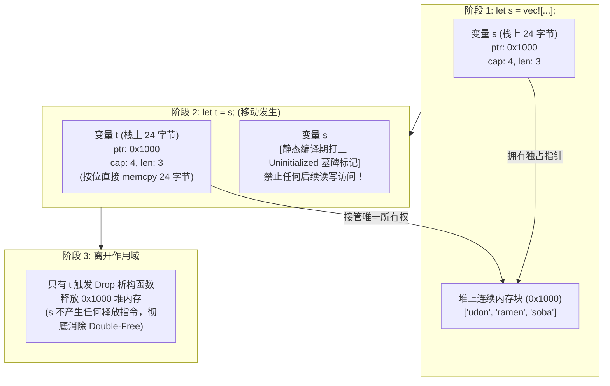

> 💡 **双栏独立滚动工作台导读**：本文采用双栏对照架构。**左栏**为现代系统级工程实战精炼架构、设计决策矩阵、生产级核心代码与避坑指南；**右栏**为原著完整参考译文，附有关键段落的英文原文展开与核心术语解析。左右两栏可独立滚动，并支持顶栏自定义宽度比例（7:3 / 5:5 / 3:7）与拖拽调节。

# 核心实战精炼：所有权树、移动语义物理机制与零成本资源生命周期

## 1. 架构选型与生命周期管控决策矩阵

系统级软件的核心挑战是资源（内存、文件句柄、套接字、锁）的确定性生命周期管理。

### 1.1 主流语言资源管理范式对比矩阵

| 管理范式 | 代表语言 | 资源回收时机 | 运行时开销 | 典型潜在故障 | 架构适用场景 |
| :--- | :--- | :--- | :--- | :--- | :--- |
| **手工申请释放** | C | 显式 `free()` 调用 | 极低（纯指令调用） | 悬垂指针、Double-Free、内存泄漏 | 操作系统极底层微内核、引导加载程序 |
| **析构函数 + 拷贝/移动** | C++ | 作用域结束 (RAII) | 中等（默认隐式深拷贝引发性能骤降） | 误用已移动对象（UAF）、野指针 | 高性能服务、游戏引擎（依赖工程师严格自律） |
| **追踪式垃圾回收 (Tracing GC)** | Java, Go | 不可预测的后台 GC 周期 | 较高（$2\times$ 内存换低停顿，STW 抖动） | GC 尖峰停顿、非内存资源泄漏（GC 不管文件句柄） | 企业级业务系统、Web API 后端 |
| **静态所有权与移动语义** | **Rust** | **编译期确定，作用域退出即刻析构** | **0（零运行时垃圾回收器，零非必要深拷贝）** | **编译期直接拦截一切野指针与竞争** | **高可靠基础设施、存储引擎、数据库内核、网络网关** |

### 1.2 集合容器元素提取范式决策矩阵

在 Rust 中，数组或动态向量拥有其内部元素的所有权，直接执行 `let x = v[0]` 会引发编译器所有权转移拦截。下表为生产级标准移出解法：

| 移出方法 | 核心 API / 语法 | 内部执行机理 | 容器长度变化 | 适用场景 |
| :--- | :--- | :--- | :--- | :--- |
| **弹出末尾** | `v.pop()` | 移除尾部元素并缩容 | $\text{len} \gets \text{len} - 1$ | 栈式 LIFO 处理、无序消费 |
| **快速调换移出** | `v.swap_remove(i)` | 将末尾元素覆盖至索引 $i$ 处并缩减长度 | $\text{len} \gets \text{len} - 1$ ($O(1)$) | **不保证顺序的高吞吐任务窃取与无锁调度** |
| **原地默认值置换** | `std::mem::take(&mut place)` | 原地写入 `Default::default()`，移出旧值 | 长度不变 | 结构体或容器原地清空并提取原有完整数据 |
| **原地指定值替换** | `std::mem::replace(&mut place, new_val)` | 写入新值，无拷贝移出旧值 | 长度不变 | 有限状态机状态切换、缓冲区轮换交换 |
| **可选容器提取** | `opt.take()` | 内部等价于 `mem::replace(&mut opt, None)` | 变为 `None` | 可空字段的所有权安全移出 |
| **批量范围切片榨取** | `v.drain(range)` | 返回拥有元素的迭代器，底层内存原地位移 | 移除指定区间元素 | 批量数据分包转发、流水线阶段切分 |

### 1.3 共享所有权选型矩阵

| 所有权模式 | 智能指针类型 | 线程安全性 | 引用计数开销 | 内部可变性搭档 | 生产推荐场景 |
| :--- | :--- | :--- | :--- | :--- | :--- |
| **独占所有权** | `T` / `Box<T>` | 视 `T` 是否实现 `Send` | **0 开销** | 外部 `mut` 独占借用 | 生产首选，树状非共享资源模型 |
| **单线程共享引用** | `Rc<T>` | **非线程安全** (未实现 `Send`/`Sync`) | 极低（非原子整型自增减） | `RefCell<T>` / `Cell<T>` | 单线程图算法、UI DOM 节点树、编译器 AST 语法树 |
| **多线程原子共享引用** | `Arc<T>` | **线程安全** (当 `T: Send + Sync`) | 中等（CPU 缓存行锁与原子指令 `LOCK XADD`） | `Mutex<T>` / `RwLock<T>` | 跨线程只读配置共享、线程池任务上下文共享 |
| **弱引用破环指针** | `Weak<T>` | 对应 `Rc` / `Arc` 派生 | 不计入 `strong_count` | 需先 `.upgrade()` 升级为强引用 | 观察者订阅模式、父子双向树、缓存失效机制（防止内存泄漏环） |

---

## 2. 核心原理与心智模型：按位浅复制与编译期作废

必须在底层物理机器指令视角透视 Rust 的 **Move（移动语义）**：



### 关键架构推论：
1. **Move 是零运行时成本的浅层按位拷贝（Shallow Bitwise Memcpy）**：
   在底层机器码中，`let t = s` 仅仅是在栈帧上将 24 字节的结构体直接 `memcpy` 到新变量的栈槽位中，完全**不遍历堆内存**，因此即使底层向量包含千万级数据，移动操作也仅耗费几纳秒！
2. **所有权树（Ownership Tree）**：
   程序中所有值构成了以活动栈帧为根的严密树状拓扑。当某个根节点退出作用域时，析构器会沿树枝级联向下执行 `drop()`。没有任何孤立节点，没有循环所有权，无需任何运行时 GC 遍历。

---

## 3. 生产级系统工程代码范式

### 3.1 类型态模式（Typestate Pattern）：基于所有权转移的高可靠协议状态机

利用函数消费 `self`（移动所有权）的机制，使得状态机在编译期即可强制杜绝非法状态调用：

```rust
//! 基于 Typestate 模式的安全网络连接状态机
//! 非法调用在编译期直接报错，零运行时开销

pub struct Disconnected;
pub struct Connecting;
pub struct Connected {
    stream_id: u32,
}

pub struct TcpSession<State> {
    address: String,
    state: State,
}

impl TcpSession<Disconnected> {
    pub fn new(address: String) -> Self {
        Self {
            address,
            state: Disconnected,
        }
    }

    /// 消费当前断开状态的会话，转换为连接中状态
    pub fn start_connect(self) -> TcpSession<Connecting> {
        println!("正在连接目标节点: {}...", self.address);
        TcpSession {
            address: self.address,
            state: Connecting,
        }
    }
}

impl TcpSession<Connecting> {
    /// 握手成功，消费连接中状态，返回具备收发能力的已连接会话
    pub fn complete_handshake(self, stream_id: u32) -> TcpSession<Connected> {
        println!("握手成功，流分配 ID: {}", stream_id);
        TcpSession {
            address: self.address,
            state: Connected { stream_id },
        }
    }
}

impl TcpSession<Connected> {
    /// 只有在 Connected 状态下，编译器才暴露 send_payload 方法！
    pub fn send_payload(&self, data: &[u8]) {
        println!("通过流 [{}] 发送 {} 字节载荷", self.state.stream_id, data.len());
    }

    /// 优雅关闭连接，重新退化为 Disconnected 状态
    pub fn close(self) -> TcpSession<Disconnected> {
        println!("关闭流 [{}]，重置会话", self.state.stream_id);
        TcpSession {
            address: self.address,
            state: Disconnected,
        }
    }
}

#[test]
fn test_typestate_compile_time_safety() {
    let session = TcpSession::new("10.0.0.1:8080".to_string());
    
    // session.send_payload(b"hello"); 
    // ^^^ 编译直接报错：方法不存在于 TcpSession<Disconnected> 上！

    let connecting = session.start_connect();
    let connected = connecting.complete_handshake(1001);
    
    connected.send_payload(b"PING");
    let _closed = connected.close();
}
```

### 3.2 高性能任务窃取调度：基于 `swap_remove` 的 $O(1)$ 缓冲区移出

```rust
//! 生产级无锁工作负载窃取器
//! 利用 swap_remove 实现 O(1) 任务提取

pub struct Task {
    pub id: u64,
    pub payload: Vec<u8>,
}

pub struct WorkerQueue {
    tasks: Vec<Task>,
}

impl WorkerQueue {
    pub fn new() -> Self {
        Self { tasks: Vec::new() }
    }

    pub fn push(&mut self, task: Task) {
        self.tasks.push(task);
    }

    /// O(1) 复杂度提取任意索引任务（通过末尾元素原地置换）
    pub fn steal_task(&mut self, index: usize) -> Option<Task> {
        if index < self.tasks.len() {
            Some(self.tasks.swap_remove(index))
        } else {
            None
        }
    }
}
```

---

## 4. 架构避坑清单 (Do's & Don'ts)

| 决策维度 | 严禁反模式 (Don'ts) | 生产推荐范式 (Do's) |
| :--- | :--- | :--- |
| **引用计数防环** | 在图结构或双向父子树中双向持有 `Rc<T>` 或 `Arc<T>`，导致强引用计数永远无法清零造成严重内存泄漏。 | 双向链路中子节点持父节点必须使用弱引用 `Weak<T>`，彻底打破所有权环状图。 |
| **盲目深拷贝** | 遇到借用检查器报错时，未经思考无脑在所有变量后追加 `.clone()` 消除报错。 | 梳理系统所有权拓扑，优先通过引用借用 `&T`、生命周期重构或 `mem::replace` 解决，杜绝不必要的内存开销。 |
| **容器直接移出** | 试图编写 `let item = vec[i];` 提取未实现 `Copy` 的结构体，导致编译错误。 | 使用 `vec.swap_remove(i)`（乱序 $O(1)$）、`vec.pop()`（末尾）、或包装为 `Option<T>` 后调用 `.take()`。 |
| **滥用 Copy 特征** | 为包含几十个字段或可能未来扩充的大型结构体随意派生 `#[derive(Copy, Clone)]`。 | 仅对内存尺寸极小（通常 $\le 16$ 字节且为基础标量组合）的类型派生 `Copy`，避免隐式栈拷贝拖垮性能。 |
| **深层递归 Drop** | 构造超深（如几十万层）的链表或嵌套树，当根节点 Drop 时引发递归调用，瞬间打爆系统执行栈。 | 为深层嵌套链表/递归树手工实现 `Drop` 特征，使用循环迭代遍历逐级移出并释放节点，规避栈溢出。 |
| **多线程跨核共享** | 对跨线程只读配置盲目套用 `Mutex<T>`，造成读锁争用与 CPU Cache Ping-Pong 抖动。 | 使用 `ArcSwap<T>` 或 `Arc<T>` 配合无锁写时置换，实现只读操作零争用极速并发读取。 |

<!-- split -->

# 原著完整参考：所有权与移动语义（Move）：脱离 GC 的确定性资源生命周期

无论何种编程语言，若要在生产环境中构建可靠、高效的软件，其最核心的技术底座始终是对**内存与系统资源（Memory & Resources）**的妥善治理。

在过去的半个世纪中，软件工程界主要形成了两大阵营：
1. **安全至上阵营（垃圾回收 GC）**：Java、Python、Go、JavaScript 等语言选择由运行时追踪式垃圾回收器统管一切。虽然极大地减轻了程序员的心智负担并消除了内存非法访问，但其付出的代价是：巨大的内存放大（Memory Overhead）、无法预测的 GC 停顿（Stop-the-World Latency）以及对非内存底层资源（如互斥锁、套接字）治理的疲软；
2. **性能至上阵营（手工控制）**：C 与 C++ 选择将生杀大权完全赋予开发者。它带来了登峰造极的硬件控制力与极限性能，但随之而来的是数十年来盘踞在各大操作系统的幽灵Bug：内存泄漏、悬垂指针（Dangling Pointers）、双重释放（Double Free）以及数据竞争。

**Rust 走出了一条石破天惊的第三条道路**：它在不依赖任何运行时垃圾回收器的前提下，通过其独特的**所有权（Ownership）与移动语义（Move Semantics）**，在编译期提供了坚如磐石的内存安全与零成本抽象。

:::en
> **Original**: All programs must manage the resources they use while running. Systems programming languages give you control over memory, but doing so safely has traditionally required immense discipline. Rust's radical innovation is ownership: a system of static rules enforced at compile time that govern how resources are allocated, shared, and freed.
> In Rust, every value has a single owner that determines its lifetime. When the owner is freed, the owned value is freed too.

**📌 核心术语与语境解析**：
- **Ownership** [ˈəʊnəʃɪp]：*所有权*。Rust 语言核心规律：每个值在任意时刻只能有一个明确的拥有者变量；拥有者生命周期终结时，值自动被回收。
- **Move Semantics** [muːv sɪˈmæntɪks]：*移动语义*。当所有权从一个变量转移到另一个变量时，源变量被标记为无效，底层资源物理指针无需深拷贝。
:::

---

## 1. 所有权哲学与树状模型

为了理解所有权，我们首先观察 C++ 标准库中的 `std::string`。一个字符串对象存放在栈帧上，内部持有一个指针指向在堆上动态分配的字符缓冲区：


在 C++ 中，栈上的对象拥有其在堆上的缓冲区。当栈变量离开其作用域时，其析构函数（Destructor）会自动被调用并释放堆内存。

Rust 继承并深化了这一优雅思想。在 Rust 中，一个 `Vec<i32>` 同样在栈上分配控制块，并拥有其在堆上的连续元素缓冲区：


```rust
fn print_padovan() {
    let mut padovan = vec![1, 1, 1]; // 堆缓冲区在此处分配
    for i in 3..10 {
        let next = padovan[i-3] + padovan[i-2];
        padovan.push(next);
    }
    println!("P(1..10) = {:?}", padovan);
} // padovan 离开作用域，其拥有的堆缓冲区在此处被确定性释放！
```

进一步地，当一个栈帧中存在多个局部变量时，每个局部变量各自清晰地拥有自己的堆资源：


甚至对于极为复杂的深层复合结构（如嵌套结构体、包含树状子节点的向量），在 Rust 中都严格表现为一棵**所有权树（Ownership Tree）**：


**所有权树的关键不变量**：
每一个节点都有且仅有一个父节点拥有者。没有任何两个指针可以同时作为某个堆缓冲区的“拥有者”。因此，当根节点变量被释放时，整棵树会严格按由叶至根的确定性顺序完成级联析构。**绝不会有任何资源被遗漏，也绝不会有任何内存被重复释放两次**。

---

## 2. 移动语义（Moves）：三语言史诗对比

当我们把一个变量赋值给另一个变量时，不同语言的底层行为呈现出截然不同的哲学：

### 2.1 Python 的引用共享模型
在 Python 中，所有变量本质上都是指向对象的共享引用指针。一个列表在内存中的表示如下：


当执行 `t = s` 和 `u = s` 时，Python 仅仅是将多个变量指向同一个底层对象，并不断递增其引用计数（Reference Count）：


这种方式内存拷贝开销小，但由于任何一个变量都能随意篡改底层对象，并发场景下极易发生数据竞争，迫使 Python 必须引入全局解释器锁（GIL）。

### 2.2 C++ 的默认昂贵深拷贝模型
在 C++ 中，赋值操作符默认执行的是**深拷贝（Deep Copy）**：


当执行 `t = s` 和 `u = s` 时，C++ 会在堆上重新分配全新的内存块，并将底层的每个字符串全部逐字节深度复制一遍：


这种模型虽然保证了各个变量互不干扰，但如果容器规模庞大，一次隐式赋值就会带来数兆字节的无谓内存分配与拷贝，严重拖垮系统吞吐量。

### 2.3 Rust 的零成本移动模型（Move）
Rust 展现了完全不同的智慧。考察以下 Rust 代码：

```rust
let s = vec!["udon".to_string(), "ramen".to_string(), "soba".to_string()];
```

此时变量 `s` 独占拥有由三个 `String` 组成的堆向量：


现在，我们将 `s` 赋值给 `t`：

```rust
let t = s;
```

在 Rust 中，这引发了一次 **Move（移动）**：


**底层的物理真相极为震撼**：
1. **纯浅层拷贝**：Rust 仅仅将栈上的 24 字节（`ptr`, `cap`, `len`）从 `s` 的栈位按位复制到 `t` 的栈位中；堆上的任何数据均原封未动！
2. **源变量即刻失效**：赋值完成后，`s` 在编译器的静态追踪中被标记为“未初始化（Uninitialized）”。
3. **彻底防范双重释放**：如果此时你尝试读取 `s`，编译器会直接报出经典编译错误：`borrow of moved value: 's'`。当变量离开作用域时，只有新拥有者 `t` 会触发堆释放逻辑。

:::en
> **Original**: In Rust, for most types, operations like assigning a value to a variable, passing it to a function, or returning it from a function don't copy the value: they *move* it. The source relinquishes ownership of the value to the destination, and the source becomes uninitialized.
> Because moves do not copy the heap data, moving a vector with millions of elements takes only a few processor instructions.

**📌 核心术语与语境解析**：
- **Relinquish Ownership** [rɪˈlɪŋkwɪʃ]：*让渡所有权*。源变量在执行赋值、函数传参或返回时，主动放弃对底层资源的拥有权与控制权。
- **Uninitialized State** [ˌʌnɪˈnɪʃəlaɪzd]：*未初始化状态*。变量让渡所有权后在编译器心智模型中的法律地位，任何尝试读取未初始化变量的行为都会被编译器静态扼杀。
:::

---

## 3. 移动语义与日常控制流

移动不仅发生在简单赋值语句中，还渗透在 Rust 的所有基础结构中：
- **函数传参**：将变量作为入参传递给按值接收的函数时，所有权移交函数形参，外部变量失效；
- **函数返回**：函数将构建的值作为结果 `return` 时，所有权顺畅流转给外层调用者；
- **复合类型构造**：将字段填充进结构体或元组时，字段所有权被移交给新复合结构。

### 移动与循环保护
Rust 编译器具有精密的控制流敏感性分析（Flow-sensitive Analysis）：

```rust
let x = vec![10, 20, 30];
if condition {
    consume(x); // x 在此分支被移出
}
// 后续如果访问 x，编译器能精确判断并阻止可能的未初始化访问！
```

而在循环中，如果一个变量在循环体内部被移动，除非在循环体末尾重新为该变量赋予全新的值，否则下一次迭代将会试图使用已移出的变量，编译器将直接报错拦截。

---

## 4. 移动与容器元素索引访问

很多初学者遭遇的第一个编译挫折是试图从向量中“拿”出一个元素：

```rust
let v = vec!["101".to_string(), "102".to_string(), "103".to_string()];
let first = v[0]; // 编译报错：cannot move out of index of Vec
```

**为什么 Rust 坚决禁止这样做？**
如果允许 `let first = v[0]`，那么向量 `v` 的第 0 个槽位就会变成未初始化状态，而其后的槽位仍然有效。动态向量要求其内部元素在内存中必须是完全初始化且连续紧凑排布的。如果向量中散落着“空洞”，当向量整体被 `drop` 时，它将根本无法获知哪些元素需要析构！

**标准的四种工程解决范式**：
1. **弹出尾部**：`v.pop()`；
2. **快速置换移出**：`v.swap_remove(index)`；
3. **原地值替换**：`std::mem::replace(&mut v[index], "fallback".to_string())`；
4. **包装为可空类型**：如果定义为 `Vec<Option<String>>`，则可以优雅调用 `v[index].take()`。

---

## 5. Copy 类型：移动语义的唯一豁免者

并不是 Rust 中的所有类型在赋值时都会发生移动。考察以下代码：

```rust
let string1 = "sombre".to_string();
let string2 = string1; // 发生了 Move！string1 失效

let num1: i32 = 36;
let num2 = num1;       // 发生了 Copy！num1 依然完好有效！
```

其内存对比一目了然：


在 Rust 中，实现了 `Copy` 标记特征（Marker Trait）的类型在赋值、传参和返回时，执行的是标准的**位拷贝（Bitwise Copy）**，且赋值后源变量依然完全有效。

**什么类型可以实现 `Copy`？**
- 所有的标量数字类型（`i8`~`i128`、`u8`~`u128`、`f32`、`f64`、`usize`、`isize`）；
- 布尔类型 `bool` 与字符类型 `char`；
- 所有元素均实现了 `Copy` 的元组或固定大小数组；
- 共享只读引用 `&T`（因为只读引用不拥有底层数据，复制引用仅是多了一份指针）。

**铁律**：**任何在析构时需要释放额外堆内存或操作系统资源的类型（如 `String`、`Vec`、`File`），都绝对不能实现 `Copy` 特征！** 如果一个类型持有了需要显式释放的资源，一旦被隐式 Copy，就会瞬间退化为 C 语言双重释放的灾难现场。

---

## 6. 共享所有权：Rc 与 Arc

在某些复杂的工业场景中（例如图计算、树状 GUI 组件树），一个值确实需要被系统中多个彼此独立的组件共同持有，此时单一所有权模型显得过于苛刻。为此，Rust 标准库提供了引用计数指针：


1. **`Rc<T>`（单线程引用计数指针）**：
   在堆上分配控制块，包含被包装的值、一个强引用计数（`strong_count`）和一个弱引用计数（`weak_count`）。克隆 `Rc`（如 `rc.clone()`）仅仅是将强引用计数原子/非原子自增 1，开销极低；只有当所有持有的 `Rc` 全部析构、计数归零时，底层的值才会被释放；
2. **`Arc<T>`（原子引用计数指针）**：
   `Arc` 是 `Atomic Reference Counted` 的缩写。内部计数器采用 CPU 级别的原子指令（Atomic CAS / Fetch-Add）维护，能够安全地在多个操作系统线程之间共享；

### 必须警惕的死穴：引用计数循环泄漏
如果两个 `Rc` 或 `Arc` 对象相互持有对方的强引用，它们的计数将永远无法归零，导致内存产生永久泄漏：


**破局方案**：通过标准库提供的弱引用 `Weak<T>` 替换其中一条边。弱引用不计入 `strong_count`，不拥有对象生命周期，在访问时需先调用 `.upgrade()` 探测对象是否依然存活，从而完美规避环状所有权死锁。

---

## 7. 结语：建立所有权的心智模型

所有权与移动语义是 Rust 赋予整个计算机工业最惊艳的礼物。它彻底粉碎了“高性能系统级控制”与“高级语言内存安全”不可兼得的历史神话。

当你学会站在所有权树状结构的角度去审视系统架构时，你的代码不仅不再有内存泄漏与野指针的梦魇，更会呈现出一种空前紧凑、自解释且具备物理确定性的现代系统工程美感。
