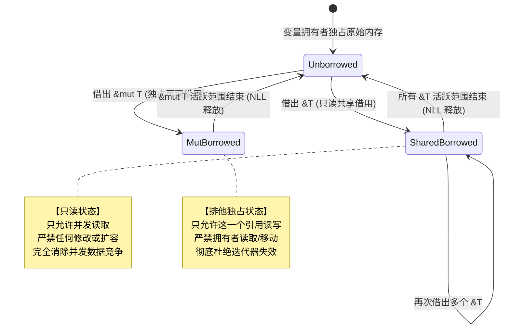

> 💡 **双栏独立滚动工作台导读**：本文采用双栏对照架构。**左栏**为现代系统级工程实战精炼架构、设计决策矩阵、生产级核心代码与避坑指南；**右栏**为原著完整参考译文，附有关键段落的英文原文展开与核心术语解析。左右两栏可独立滚动，并支持顶栏自定义宽度比例（7:3 / 5:5 / 3:7）与拖拽调节。

# 核心实战精炼：借用检查器数学本质、生命周期拓扑与胖指针边界

## 1. 架构选型与借用模式决策矩阵

引用的本质是安全、无所有权的指针。Rust 通过编译期借用检查器，彻底消除了空指针异常与并发数据竞争。

### 1.1 引用与可变性控制选型矩阵

| 指针/包装类型 | 别名与可变性契约 | 检查发生时机 | 跨线程安全 (`Send`/`Sync`) | 运行时内存与 CPU 开销 | 架构适用场景 |
| :--- | :--- | :--- | :--- | :--- | :--- |
| **共享引用 `&T`** | 多读、**零写**（只读视图） | 编译期静态分析 | 视 `T: Sync` 决定 | **0 开销**（单字长裸指针） | 函数只读参数、零拷贝遍历、全局不可变状态 |
| **独占可变引用 `&mut T`**| **单写、零别名**（排他独占） | 编译期静态分析 | 视 `T: Send` 决定 | **0 开销**（单字长裸指针） | 原地更新缓冲、状态变更、分治原地排序 |
| **单线程单元 `Cell<T>`** | 允许通过 `&self` 原地替换 | 纯编译期静态 | **未实现 `Sync`**（禁止跨线程） | **0 开销**（直接按位复制更新） | 包含 `Copy` 类型的小型字段、单线程轻量计数器 |
| **动态借用 `RefCell<T>`**| 内部可变性，动态追踪借用 | **运行时动态计数** | **未实现 `Sync`**（禁止跨线程） | 每次借用维护 `isize` 计数器，失败则 Panic | 单线程复杂图节点、Mock 测试桩、UI 树回调变更 |
| **原子互斥锁 `Mutex<T>`** | 跨线程排他独占访问 | 运行时获取操作系统锁 | **线程安全** (`Sync`) | 锁竞争引起上下文切换与内核调用开销 | 跨线程共享可变状态、并发任务队列聚合 |
| **原子读写锁 `RwLock<T>`**| 跨线程多读单写访问 | 运行时动态读写锁 | **线程安全** (`Sync`) | 维护读写计数，读多写少场景开销优于 Mutex | 高频并发只读读取、低频批量全量替换的路由表 |

### 1.2 胖指针（Fat Pointer）物理架构对照矩阵

在 Rust 中，不仅有占据单个机器字长的普通引用，还有承载附加元数据的**胖指针**：

| 胖指针形态 | 内部两字长物理排布 | 占用栈空间 (64位) | 解引用寻址机制 | 典型系统工程价值 |
| :--- | :--- | :--- | :--- | :--- |
| **切片胖指针 `&[T]` / `&str`** | `(data_ptr: *const T, len: usize)` | 16 字节 | `ptr + index * sizeof(T)`，配合边界检查 | 统一吸收数组与向量，实现极致性能的零拷贝视图 |
| **特征对象胖指针 `&dyn Trait`**| `(data_ptr: *const (), vtable: *const ())` | 16 字节 | 通过 `vtable` 偏移量查询虚函数指针进行动态分发 | 插件架构、多态协议分发、隔绝泛型代码膨胀 |
| **瘦指针 `&T` / `Box<T>`** | `(data_ptr: *const T)` | 8 字节 | 直接寻址目标内存，单指令访问 | 编译期单态化（Monomorphization）最高效代码生成 |

### 1.3 生命周期标注模式矩阵

| 模式 | 形式范例 | 编译器推导机制 | 借用关系约束 | 适用生产场景 |
| :--- | :--- | :--- | :--- | :--- |
| **生命周期省略 (Elision)** | `fn first(s: &str) -> &str` | 编译器自动套用三条省略规则 | 输出引用绑定到输入引用的生命周期 | 90% 的普通工具函数与标准数据提取方法 |
| **单显式生命周期 `'a`** | `fn longest<'a>(x: &'a str, y: &'a str) -> &'a str` | 调用方取两者的交集（重叠存活期） | 输出引用的存活期绝不能超过入参中存活较短者 | 多分支返回引用的合并函数、结构体持有字段借用 |
| **子类型生命周期约束** | `struct Parser<'a, 'b: 'a> { ctx: &'a Context, buf: &'b [u8] }` | 显式要求 `'b` 存活期长于等于 `'a` | `'b` 包含 `'a`，保证内部引用间调用安全 | 复杂解析器引擎、持有上下文引用的嵌套流式组件 |
| **静态生命周期 `'static`** | `&'static str`, `T: 'static` | 伴随整个可执行程序生命周期 | 永不注销、全局持久、或不持有任何局部临时借用 | 线程派生边界（`thread::spawn`）、编译期常量、全局只读配置 |

---

## 2. 核心原理与心智模型：读写互斥定律与生命周期拓扑

### 核心公理：别名与可变性互斥（Aliasing XOR Mutability）

Rust 借用检查器的全部安全根基，可以提炼为一条不可动摇的数学定理：
$$\text{共享（Aliasing）} \oplus \text{可变性（Mutability）} = \mathbf{True}$$

在任意给定的时间切片内，针对同一块内存区域：
- **要么存在任意数量的只读共享借用（`&T`）**；
- **要么存在恰好一个独占可变借用（`&mut T`）**；
- **两者绝不可同时并存！**



### 为什么 Rust 的 `&T` 远比 C/C++ 的 `const T*` 安全？
在 C/C++ 中，`const int* p` 仅仅是当前指针承诺“我不通过 `p` 修改内存”，但宿主完全可以通过另一个非 const 别名指针 `int* q` 并发篡改该内存，导致读取方读到脏数据或崩溃。

**在 Rust 中，`&T` 是对整块内存状态的绝对承诺**：只要存在哪怕一个 `&T` 借用，**整个系统中的任何其他代码（包括原始拥有者）都绝对无法修改被引用的底层数据**！这种“全系统级只读冻结”在编译期静态实现，运行时零开销。

---

## 3. 生产级系统工程代码范式

### 3.1 零拷贝网络协议帧解析器（Zero-Copy Frame Parser）

通过显式生命周期标注，结构体直接借用网络套接字接收到的原始字节切片，实现真正的“零内存分配、零深拷贝”高吞吐解析：

```rust
//! 生产级零拷贝网络协议帧解析器
//! 生命周期参数 'a 确保解析出的报文绝不超出底层字节缓冲区的生命周期

#[derive(Debug, PartialEq, Eq)]
pub enum FrameCommand {
    Heartbeat,
    DataPublish,
    Authenticate,
}

#[derive(Debug, PartialEq, Eq)]
pub struct NetworkFrame<'a> {
    pub magic: u16,
    pub command: FrameCommand,
    pub session_token: &'a str,
    pub payload: &'a [u8],
}

#[derive(Debug, thiserror::Error)]
pub enum ParseError {
    #[error("报文长度不足最小包头大小")]
    IncompleteHeader,
    #[error("非法魔数标记: {0:#X}")]
    InvalidMagic(u16),
    #[error("未知协议指令: {0}")]
    UnknownCommand(u8),
    #[error("Token 非法 UTF-8 编码: {0}")]
    Utf8Error(#[from] std::str::Utf8Error),
}

pub fn parse_frame<'a>(packet: &'a [u8]) -> Result<NetworkFrame<'a>, ParseError> {
    // 最小包头: Magic(2B) + Cmd(1B) + TokenLen(1B) + PayloadLen(4B) = 8B
    if packet.len() < 8 {
        return Err(ParseError::IncompleteHeader);
    }

    let magic = u16::from_be_bytes([packet[0], packet[1]]);
    if magic != 0xCAFE {
        return Err(ParseError::InvalidMagic(magic));
    }

    let command = match packet[2] {
        0x01 => FrameCommand::Heartbeat,
        0x02 => FrameCommand::DataPublish,
        0x03 => FrameCommand::Authenticate,
        other => return Err(ParseError::UnknownCommand(other)),
    };

    let token_len = packet[3] as usize;
    let payload_len = u32::from_be_bytes([packet[4], packet[5], packet[6], packet[7]]) as usize;

    let offset = 8;
    if packet.len() < offset + token_len + payload_len {
        return Err(ParseError::IncompleteHeader);
    }

    let token_slice = &packet[offset..offset + token_len];
    let session_token = std::str::from_utf8(token_slice)?;

    let payload_offset = offset + token_len;
    let payload = &packet[payload_offset..payload_offset + payload_len];

    Ok(NetworkFrame {
        magic,
        command,
        session_token,
        payload,
    })
}

#[test]
fn test_zero_copy_parsing() {
    let mut raw_packet = vec![
        0xCA, 0xFE, // Magic
        0x02,       // DataPublish
        0x04,       // Token Len = 4
        0x00, 0x00, 0x00, 0x03, // Payload Len = 3
    ];
    raw_packet.extend_from_slice(b"AUTH"); // Token
    raw_packet.extend_from_slice(b"XYZ");  // Payload

    let frame = parse_frame(&raw_packet).expect("解析失败");
    assert_eq!(frame.command, FrameCommand::DataPublish);
    assert_eq!(frame.session_token, "AUTH");
    assert_eq!(frame.payload, b"XYZ");
}
```

### 3.2 切片分治安全并发：突破借用检查器边界

借用检查器无法静态识别 `slice[0]` 与 `slice[1]` 是两个不重叠的内存单元。如果直接尝试两次借用可变引用，编译器会无情拦截。此时必须利用标准库的 `split_at_mut` 安全地进行多路可变借用：

```rust
//! 生产级切片分治并行写入模式
//! 将一个可变切片安全拆分为两段互不重叠的可变子切片

pub fn parallel_process_halves<T, F1, F2>(slice: &mut [T], left_op: F1, right_op: F2)
where
    T: Send,
    F1: FnOnce(&mut [T]) + Send,
    F2: FnOnce(&mut [T]) + Send,
{
    let mid = slice.len() / 2;
    // split_at_mut 内部通过 Unsafe 构造两个不相交的可变切片，并导出完全安全的借用接口
    let (left, right) = slice.split_at_mut(mid);

    std::thread::scope(|s| {
        s.spawn(|| left_op(left));
        s.spawn(|| right_op(right));
    });
}
```

---

## 4. 架构避坑清单 (Do's & Don'ts)

| 决策维度 | 严禁反模式 (Don'ts) | 生产推荐范式 (Do's) |
| :--- | :--- | :--- |
| **迭代器失效** | 在遍历容器切片（持存 `&T`）的同时，在循环体内部调用 `v.push()` 或 `v.clear()` 修改容器。 | 遍历借用与修改容器绝对互斥。收集需要修改的索引或指令，退出遍历作用域后统一批量应用。 |
| **过度生命周期标注** | 盲目为每个引用参数标注不同生命周期（如 `<'a, 'b, 'c>`），引入不必要的生命周期缠绕。 | 充分信任编译器的**生命周期省略规则（Elision Rules）**，仅当编译器无法判定返回值归属时才显式介入。 |
| **悬垂借用逃逸** | 尝试从函数返回局部栈变量的引用（如 `fn get() -> &String`）。 | 严禁返回指向局部栈帧的引用；根据需要直接返回拥有所有权的 `String`、`Vec<T>` 或全局常量 `'static` 借用。 |
| **自引用结构陷阱** | 在同一个结构体中，声明一个字段拥有数据，另一个字段借用该字段的引用。 | Rust 移动语义会变更结构体栈地址导致内部借用变为野指针。优先存储下标偏移量 `usize`，或改用平坦切片设计与 `Pin`。 |
| **RefCell 运行时爆炸** | 在复杂回调网络中滥用 `RefCell<T>`，误以为逃过了编译期借用检查即可高枕无忧。 | `RefCell` 仅将借用检查推迟到运行时，同时持有 `borrow_mut()` 和 `borrow()` 仍会立即触发 Crash，必须极其收敛使用。 |
| **大粒度可变借用** | 长时间持有涵盖整个大型结构体的 `&mut Self`，阻塞同函数体内对其他独立字段的并行借用。 | 拆细方法粒度，只对具体受影响的子字段借用 `&mut self.buffer`，保持其余字段可自由访问（拆分借用 Disjoint Field Borrowing）。 |

<!-- split -->

# 原著完整参考：引用与借用检查器（Borrow Checker）：生命周期不变量与胖指针边界

在上一章中，我们领略了 Rust **所有权与移动语义（Ownership & Moves）**的优雅与纯粹：每一个值都有清晰的唯一拥有者，跨变量传递时所有权平滑流转。

然而，如果一门语言只允许所有权树和绝对移动，编程将变得极度繁琐和反人性：
- 如果你仅仅是想把一个动态向量打印到终端，你就必须将向量的所有权移交给打印函数；
- 打印完毕后，为了后续还能继续使用该向量，打印函数又不得不将该向量再完整地返回出来！

这不仅破坏了代码的可读性，更完全违背了现代系统工程的基本交互范式。

为了彻底解决这一痛点，Rust 引入了**引用（References）**机制——它允许程序在不转移所有权的前提下，安全地**借用（Borrow）**对某个值的访问权限。

:::en
> **Original**: Ownership is very clean, but it's too restrictive. If we pass a value to a function, we must relinquish ownership, and then the function must pass it back if we want to use it again.
> To address this, Rust has references. A reference is a non-owning pointer: it allows you to access a value without taking ownership of it. Creating a reference is called *borrowing* the value: what you borrowed, you must eventually return to its owner.

**📌 核心术语与语境解析**：
- **Non-owning Pointer** [nɒn ˈəʊnɪŋ ˈpɔɪntə]：*非拥有型指针*。只提供对内存数据的寻址与访问权，不负责在作用域退出时析构该内存的借用引用。
- **Borrowing** [ˈbɒrəʊɪŋ]：*借用*。通过 `&` 或 `&mut` 获取临时访问权的过程。借用具备严格的时空边界，所有权始终留在原始拥有者手中。
:::

---

## 1. 引用基础与语法解构

Rust 中的引用主要分为两大形态：
1. **共享引用（Shared Reference）`&T`**：
   允许读取所引用的值，但**绝对不可修改它**。共享引用实现了 `Copy`，你可以同时创建成百上千个共享引用，它们可以安全地并发读取同一块数据；
2. **可变引用（Mutable Reference）`&mut T`**：
   允许对所引用的值进行独占读取与原地修改。但为了绝对杜绝数据竞争，在可变引用活跃期间，**严禁存在对该内存的任何其他引用（无论是只读还是可变）**。

### 1.1 自动解引用与点号操作符（`.`）

在 C/C++ 中，访问结构体普通成员使用点号 `.`，而通过指针访问必须使用箭头 `->`，或者必须手动书写 `(*ptr).field`。

Rust 极大地简化了这一体验：**点号操作符（`.`）具备全自动隐式解引用能力**！无论你持有的引用嵌套了多少层（例如 `&&&Point`），直接调用 `p.x`，编译器都会自动沿引用链逐级追踪到最底层的具体值：


### 1.2 引用本身的赋值与重定向

当我们将一个新的引用赋值给一个可变引用变量时，改变的是**引用本身的指向（Pointer Re-pointing）**，而不是修改被引用的底层对象：


```rust
let x = 10;
let y = 20;
let mut r = &x; // r 最初指向 x

r = &y;         // r 现在重新指向了 y！x 和 y 自身完全没有变化。
```

### 1.3 引用永不为空（Never Null）

在 Rust 的安全边界内，**绝对不存在所谓的 Null 引用**！
编译器保证任何一个合法的 `&T` 或 `&mut T` 必定指向一块在物理内存中真实存在、结构完整且已经完成初始化的有效数据。如果一个变量在逻辑上确实可能“缺失”，系统工程中必须显式使用标准枚举包装：`Option<&T>`。

---

## 2. 胖指针（Fat Pointers）的物理本质

我们通常认为指针就是一个单纯的 64 位机器物理内存地址。但在 Rust 中，某些特殊引用的体型是普通指针的两倍（占用 16 字节），这就是**胖指针（Fat Pointer）**：

1. **切片引用 `&[T]` / `&str`**：
   底层由一个机器字长的起始元素指针（`ptr`）和一个记录元素总个数的长度计数器（`len`）构成；
2. **特征对象引用 `&dyn Trait`**：
   底层由一个指向具体实例数据的指针和一个指向该类型虚函数表（Virtual Method Table, vtable）的指针构成。

胖指针的设计体现了 Rust 的**零成本抽象原则**：将长度与虚表元数据随指针携带，而不是侵入式地强行塞在每个具体对象的内部堆结构中，从而保持了最底层内存布局的极致紧凑。

---

## 3. 引用安全性与生命周期不变量（Lifetimes）

借用检查器如何确保引用永远不会变成“悬垂指针（Dangling Pointer）”？
答案是：**生命周期分析（Lifetime Analysis）**。

### 3.1 局部变量借用与包含约束

编译器在编译期会为每一个变量和引用推导出一个抽象的“存活区间”——即**生命周期（Lifetime）**：


**借用检查器的核心铁律**：
**引用的生命周期，必须严格被局限在被借用目标的生命周期内部！** 引用存活的每一微秒，被借用对象都必须处于绝对健康的存活状态。

如果代码试图让一个短命变量的借用逃逸给一个长寿命的引用变量，编译器会判定生命周期约束存在不可调和的逻辑冲突：


而合法的代码生命周期必须如齿轮般严密咬合，引用的作用域必须完全封闭在所有者的生命周期边界之内：


:::en
> **Original**: Rust cannot allow a reference to outlive the value it points to. If that happened, the reference would dangle: it would point to memory that had already been freed, leading to undefined behavior.
> The borrow checker enforces this by assigning a *lifetime* to every reference in the program, and verifying that the reference's lifetime is contained within the lifetime of the referent.

**📌 核心术语与语境解析**：
- **Dangling Pointer** [ˈdæŋɡlɪŋ ˈpɔɪntə]：*悬垂指针/野指针*。指向已经被释放或作废的无效内存地址的危险指针。
- **Lifetime Containedness** [ˈlaɪftaɪm kənˈteɪndnəs]：*生命周期包含性*。借用检查器的核心约束：引用的有效使用区间必须是被引用目标生命周期的严格子集。
:::

### 3.2 函数边界处的生命周期参数

当引用跨越函数边界传递时，编译器通常采用局部独立编译策略（不跨函数体深入追踪）。因此，函数的类型签名必须充当双方的严密法律契约：

```rust
fn find_smallest<'a>(records: &'a [Record]) -> &'a Record {
    // 明确告诉编译器：返回的借用引用的生命周期，与传入的 records 切片完全相同！
    &records[0]
}
```

生命周期参数 `'a` 并不是由函数硬性指定的运行时时间段，而是**由调用者决定的抽象生命周期交集**。

### 3.3 结构体中的引用

如果一个结构体内部持有引用字段，该结构体必须显式声明生命周期参数：

```rust
struct RequestContext<'a> {
    trace_id: u64,
    headers: &'a [Header],
}
```

这明确提醒任何使用 `RequestContext` 的工程师：**该结构体实例自身的寿命，绝不可超越它所借用的 `headers` 切片！**

---

## 4. 共享与可变的终极对立：对迭代器失效的降维打击

在传统的 C++、Java 或 Python 编程中，最隐蔽、最令人头疼的运行时 Bug 之一是**迭代器失效（Iterator Invalidation）**。

考察以下场景：你正在用一个指针或切片遍历一个动态数组，此时某个地方执行了 `v.push(item)`。当动态数组容量不足时，系统会在堆上开辟一块全新的两倍大内存，并将原数据复制过去，随后**释放原有的旧内存块**。
此时，原先持有的遍历指针瞬间沦为指向已释放垃圾内存的**悬垂指针**！在 C++ 中，这直接引发段错误或安全漏洞；在 Java 中，运行时不得不抛出 `ConcurrentModificationException`。

而在 Rust 中，这一历史级痼疾在编译期被彻底消灭：


```rust
let mut wave = vec![0.0, 1.0];
let slice = &wave[..]; // 产生了一个只读共享借用 &wave

wave.push(2.0); // 编译直接拦截！
// 错误原因：push 需要 &mut wave（可变独占借用），但此时只读借用 slice 仍在活跃！
```

借用检查器不仅监视根变量，更在整个所有权树的上下层级中施加严格的锁定效应：


---

## 5. 跨语言对比：Rust 共享引用 vs C 语言 `const*`

很多精通 C 语言的工程师初学 Rust 时，容易将 `&T` 等同于 C 语言的 `const T*`。这是一种极其危险的误解。

- **C 语言中的 `const T*`**：
  这仅仅是一个“只读视图协议”。它只约束当前指针不能用于写操作，但它**完全无法阻止其他代码通过非 const 的普通指针同时修改这块内存**！因此，C 语言的 `const` 无法防止并发读写引发的数据竞争或脏读；
- **Rust 中的共享引用 `&T`**：
  这是一项全系统级的不变量保证。**当 `&T` 存在时，编译器绝对禁止任何人（甚至包括原始变量拥有者自身）对底层数据进行任何修改**！它是真正意义上的编译期只读只读隔离。

---

## 6. 终极思想升维：告别对象海洋，拥抱价值之树

面向对象编程（OOP）几十年来倡导将世界建模为无数相互引用、相互调用的网状实体：


正如上图所示，当程序规模扩大时，系统逐渐蜕化为一团杂乱无章的“**对象海洋（Sea of Objects）**”——没有任何人能准确说出某个对象到底被多少个指针所暗中引用，也没有任何人敢轻易析构一个对象，因为谁也不知道会不会在另一个角落引发雪崩般的悬垂野指针。这也是为什么面向对象语言几乎不得不强制依赖庞大而臃肿的垃圾回收器。

而 Rust 为现代系统级软件工程指明了一条全新的清澈航道——**价值之树（Tree of Values）**：


在 Rust 的世界中：
1. **所有权清晰分明**：每一个值在树上都有明确的挂载根基；
2. **借用短暂而受限**：引用只是树枝间临时的飞檐走壁，绝不允许形成永久纠缠的无序拓扑；
3. **资源释放完全确定**：随着执行栈的起伏，系统资源如落叶归根般自然、精准、零消耗地完成确定性回收。

通过对引用与借用检查器物理本质的深刻领悟，你所构建的系统不仅将彻底告别空指针与内存竞争，更将在纷繁复杂的业务演进中，永远保持着如巨木参天般条理清晰的架构掌控力。
