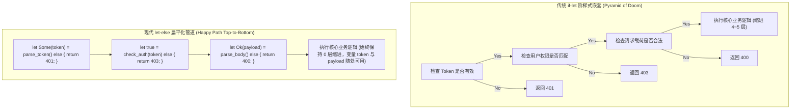

> 💡 **双栏独立滚动工作台导读**：本文采用双栏对照架构。**左栏**为现代系统级工程实战精炼架构、设计决策矩阵、生产级核心代码与避坑指南；**右栏**为原著完整参考译文，附有关键段落的英文原文展开与核心术语解析。左右两栏可独立滚动，并支持顶栏自定义宽度比例（7:3 / 5:5 / 3:7）与拖拽调节。

# 核心实战精炼：表达式导向控制流与现代模式匹配范式

## 1. 架构选型与控制流决策矩阵

在系统工程中，选择恰当的控制流模式不仅能直接消除深层嵌套带来的认知过载，更能借助类型系统在编译期消除未捕获的分支漏洞。

### 1.1 模式解构与卫语句范式决策矩阵

| 控制流模式 | 典型语法形态 | 分支穷尽性要求 | 嵌套深度表现 | 解构变量作用域 | 生产架构推荐场景 |
| :--- | :--- | :--- | :--- | :--- | :--- |
| **现代卫语句 `let-else`** | `let Some(v) = opt else { return; };` | 单一模式解构，`else` 强制发散 | **极佳（零嵌套，保持主干代码绝对平坦）** | **直接延伸到外部宿主代码块** | **生产唯一首选入参校验、鉴权守卫、解包退出** |
| **单模式匹配 `if let`** | `if let Some(v) = opt { ... } else { ... }` | 仅匹配单一解构分支 | 中等（产生一层缩进大括号） | 仅在花括号 `{ ... }` 内部有效 | 仅关心成功分支并执行局部操作，且无需发散退出的场景 |
| **完备模式匹配 `match`** | `match expr { Pat1 => ..., Pat2 => ... }` | **强制全覆盖（Exhaustive）** | 中等（统一在大括号内分流） | 局限于各个分支内部 | 状态机分发、多枚举解析、复杂组合条件过滤 |
| **函数式组合子链** | `opt.and_then(...).map(...)` | 隐式处理空值/错误 | **零缩进（链式方法调用）** | 闭包参数内部 | 纯函数式变换、无副作用的数据流流转管道 |
| **提前返回提取 `?` 操作符** | `let v = opt.ok_or(Err)?;` | 隐式解构 `Ok`，`Err` 提前返回 | **极佳（行内行首无额外缩进）** | 外部宿主代码块 | 标准 `Result` / `Option` 错误沿调用栈向上传播 |

### 1.2 循环构造与求值能力决策矩阵

| 循环结构 | 终止条件控制 | 携带值返回能力 | 编译器初始化证明 | 生产推荐场景 |
| :--- | :--- | :--- | :--- | :--- |
| **无限循环 `loop`** | 显式 `break` 或进程退出 | **支持 (`break expr;`)** | **100% 保证循环后代码感知变量已赋值** | **带返回值状态机、连接断线重试、轮询调度器** |
| **条件循环 `while`** | 布尔表达式求值为 `false` | 仅返回单元类型 `()` | 无法证明循环至少执行一次 | 简单条件等待、双指针相向逼近算法 |
| **模式循环 `while let`** | 模式匹配失败时退出 | 仅返回单元类型 `()` | 无法证明至少执行一次 | 消费队列流（`while let Some(msg) = rx.recv()`） |
| **迭代循环 `for in`** | 消耗底层迭代器至 `None` | 仅返回单元类型 `()` | 依赖迭代器长度分析 | 容器元素遍历、固定数值区间循环、批处理切片 |

### 1.3 代码块隔离范式矩阵

| 代码块类型 | 语法特征 | 编译期行为与机器码生成 | 生产适用场景 |
| :--- | :--- | :--- | :--- |
| **标准代码块 `{}`** | `{ let x = 1; x + 2 }` | 限制局部变量作用域，尾表达式直接求值产出 | 限制变量生命周期、局部锁守卫生命周期最小化 |
| **带标签代码块 `'blk: {}`** | `'search: { if found { break 'search val; } fallback }` | 充当行内表达式计算，允许通过 `break 'blk` 提前退出求值 | 复杂行内短路计算，避免抽取一次性私有工具函数 |
| **内联常量块 `const {}`** | `const { assert!(size_of::<T>() <= 64) }` | **纯编译期求值**，在编译期强制校验断言 | 编译期内存布局静态断言、常量表内联生成 |
| **不安全代码块 `unsafe {}`**| `unsafe { *raw_ptr }` | 允许解引用裸指针、调用 FFI 函数，其余类型规则依旧生效 | 操作系统系统调用交互、高性能无边界切片访问 |

---

## 2. 核心原理与心智模型：表达式求值与控制流发散拓扑

### 2.1 现代卫语句（`let-else`）对金字塔嵌套的降维打击

在传统工程代码中，连续的校验逻辑会导致代码向右漂移（The Dreaded Pyramid of Doom）：



### 2.2 底类型（Never Type `!`）与控制流发散原理

在 Rust 类型系统中，`!` 被称为**底类型（Bottom Type）**或**空类型（Uninhabited Type）**。
- `!` 表示一个**永远不可能产生任何值**的计算结果（例如 `panic!()` 宏、`std::process::exit()`、死循环 `loop {}`、以及控制流转移语句 `return`、`break`、`continue`）；
- 在类型论（Type Theory）中，底类型是任何其他类型的**绝对子类型（Subtype of All Types）**。因此，`!` 可以被自动、隐式地强制转换为任何具体类型（无论是 `i32`、`String` 还是复杂结构体）；
- 正是这一优雅的数学属性，使得 `let x: u32 = match val { Some(n) => n, None => return };` 能够通过严格的类型检查：`return` 表达式求值得到 `!`，而 `!` 可以被合情合理地视为 `u32`！

---

## 3. 生产级系统工程代码范式

### 3.1 生产级 RPC 请求解析：基于 `let-else` 的扁平化防卫管道

```rust
//! 生产级 RPC 网关请求解析管道
//! 利用 let-else 范式构建无嵌套、自解释的快速失败卫语句

use std::net::SocketAddr;

#[derive(Debug)]
pub struct RequestHeader {
    pub client_addr: Option<SocketAddr>,
    pub auth_bearer: Option<String>,
    pub content_type: Option<String>,
}

#[derive(Debug)]
pub struct ValidatedContext {
    pub client_ip: SocketAddr,
    pub token: String,
}

#[derive(Debug, PartialEq, Eq)]
pub enum GatewayError {
    MissingClientAddress,
    Unauthorized,
    UnsupportedContentType,
}

pub fn validate_incoming_request(header: RequestHeader) -> Result<ValidatedContext, GatewayError> {
    // 卫语句 1: 必须包含合法客户端来源地址
    let Some(client_ip) = header.client_addr else {
        eprintln!("[安全警报] 拒绝无客户端 IP 的匿名调用");
        return Err(GatewayError::MissingClientAddress);
    };

    // 卫语句 2: 必须包含有效的 Bearer 授权 Token
    let Some(ref raw_token) = header.auth_bearer else {
        return Err(GatewayError::Unauthorized);
    };

    let Some(token) = raw_token.strip_prefix("Bearer ") else {
        return Err(GatewayError::Unauthorized);
    };

    // 卫语句 3: Content-Type 必须为 application/json
    let Some("application/json") = header.content_type.as_deref() else {
        return Err(GatewayError::UnsupportedContentType);
    };

    // 所有卫语句顺利击穿，进入完全平坦的业务上下文构建：
    Ok(ValidatedContext {
        client_ip,
        token: token.to_string(),
    })
}
```

### 3.2 生产级指数退避重试机：基于 `loop { break value; }` 的值产出设计

```rust
//! 生产级指数退避连接重试状态机
//! 使用 loop 表达式直接产出已建立的连接，无需外部声明可变空变量

use std::time::Duration;

pub struct DatabaseConnection {
    pub endpoint: String,
}

pub fn connect_with_retry(endpoint: &str, max_retries: usize) -> Result<DatabaseConnection, &'static str> {
    let mut attempts = 0;
    let mut backoff = Duration::from_millis(50);

    // loop 是一个完整的表达式，其 break 携带的值直接成为循环表达式的求值结果！
    let conn = loop {
        attempts += 1;
        println!("正在尝试连接 {} (第 {} 次)...", endpoint, attempts);

        // 模拟连接尝试
        if attempts == 3 {
            // 连接建立成功，通过 break 携带初始化完成的对象跳出循环
            break DatabaseConnection {
                endpoint: endpoint.to_string(),
            };
        }

        if attempts >= max_retries {
            // 超过最大重试阈值，直接发散返回错误
            return Err("连接重试次数超限，网络不可达");
        }

        std::thread::sleep(backoff);
        backoff *= 2; // 指数级拉长退避时间
    };

    // 编译器 100% 确认 conn 在此处已经完全初始化，无需 Option 包装！
    Ok(conn)
}
```

### 3.3 现代 Rust 编译期静态断言：`const` 块布局校验

```rust
//! 使用现代 Rust 的 const 块进行编译期内存对齐与尺寸断言
//! 任何破坏硬件对齐的改动在编译阶段立即拦截，零运行时开销

#[repr(C, align(64))]
pub struct CacheAlignedBuffer {
    pub data: [u8; 64],
}

// 编译期断言：确保结构体严格等于 64 字节（匹配现代 CPU L1 Cache Line）
const _: () = {
    assert!(std::mem::size_of::<CacheAlignedBuffer>() == 64, "尺寸必须为 64 字节");
    assert!(std::mem::align_of::<CacheAlignedBuffer>() == 64, "对齐必须为 64 字节");
};
```

---

## 4. 架构避坑清单 (Do's & Don'ts)

| 决策维度 | 严禁反模式 (Don'ts) | 生产推荐范式 (Do's) |
| :--- | :--- | :--- |
| **卫语句编写** | 在嵌套的 `if let Some(x) = opt` 中层层剥洋葱，导致核心业务向右缩进 8 个 Tab。 | 强制采用现代 `let Some(x) = opt else { return ... };`，将错误提前切断，保持主干代码零嵌套。 |
| **发散控制要求** | 在 `let-else` 的 `else` 块中忘记发散退出（例如仅写了 `println!("error");` 未写 `return`/`break`）。 | `let-else` 的 `else` 块**必须发散**（返回底类型 `!`），必须以 `return`、`break`、`continue` 或 `panic!` 终止。 |
| **尾分号陷阱** | 在作为函数返回值的尾表达式末尾随手添加分号 `;`，导致编译器报错“期望返回具体类型，实则返回了 `()`”。 | 谨记 Rust 表达式规则：末尾不带分号表示求值返回，带分号表示求值后丢弃结果并产出单元类型 `()`。 |
| **数值危险强转** | 在整型转换中滥用 `x as u16`，当 `x` 超过 65535 时产生静默高位截断甚至有符号符号位反转 Bug。 | 涉及可能溢出或跨符号的转换，强制使用 `TryFrom` / `TryInto`（如 `u16::try_from(x)?`）进行严格防御。 |
| **状态机退出设计** | 使用外部声明 `let mut conn = None; while ... { conn = Some(...); }` 繁琐包装。 | 使用原生的 `loop { break value; }` 表达式，直接将循环结果赋值给不可变变量，消除中间可变状态。 |
| **冗余模式匹配** | 对只需简单映射或解包的逻辑手写大量冗长的 `match opt { Some(x) => x + 1, None => 0 }`。 | 优先使用标准库内聚的高阶组合子 `opt.map_or(0, \|x\| x + 1)`，提升工程表达的紧凑性与语义密度。 |

<!-- split -->

# 原著完整参考：表达式导向与控制流：模式匹配（Pattern Matching）与 let-else 范式

在表面看来，Rust 的基本控制流结构与 C、C++ 或 Java 颇为相似：有 `if` 分支、有 `while` 循环、有函数调用、也有类似 switch 的 `match`。

然而，在这种熟悉的表象之下，潜藏着一个极其深刻的范式分野：
**在 C 和 Java 中，语句（Statements）与表达式（Expressions）存在着严格的人工二元割裂；而在 Rust 中，几乎一切语法构造都是表达式（Expressions）。**

这种**表达式导向（Expression-oriented）**的语言哲学并非 Rust 凭空发明，而是源自 Lisp、ML 等函数式语言的辉煌传统。在系统级编程的语境下，它为代码带来了前所未有的表达紧凑度、静态类型自洽性与极高密度的工程掌控力。

:::en
> **Original**: Rust is what is called an *expression language*. In languages like C and Java, statements and expressions are separate syntactic categories. An `if` statement does not produce a value and cannot appear in the middle of an expression. In Rust, almost everything is an expression: `if` expressions, `match` expressions, and even blocks produce values.
> This makes the language more concise and more uniform. You don't need a special ternary operator `? :` because a regular `if` expression already serves that role.

**📌 核心术语与语境解析**：
- **Expression-oriented Language** [ɪkˈspreʃn ˈɔːrientɪd ˈlæŋɡwɪdʒ]：*表达式导向语言*。所有语法构造均参与求值并产出具体结果的语言体系，与传统的“语句式（Statement-based）”语言形成鲜明对比。
- **Syntactic Uniformity** [sɪnˈtæktɪk ˌjuːnɪˈfɔːməti]：*语法一致性/均一性*。代码块、条件分支与循环在语法规则和求值机制上遵循相同的底层规约，消除特殊情况与特例语法。
:::

---

## 1. 块（Blocks）与声明的本质

在 Rust 中，由一对花括号包围的代码区域是一个**块表达式（Block Expression）**：

```rust
let display_name = {
    let first = get_first_name();
    let last = get_last_name();
    format!("{first} {last}") // 尾表达式，求值产出 String
};
```

### 1.1 尾表达式与分号的物理意义

块表达式的值，等于其内部**最后一个表达式的值**。
如果最后一个表达式末尾**没有分号**，它的值就会顺理成章地成为整个块的求值结果；
如果最后一个表达式末尾**加上了分号**，该表达式就会被强制求值并丢弃，此时整个块的求值结果自动退化为**单元类型 `()`**。

这一微小却至关重要的语法规则，彻底取代了其他语言中冗余的关键字（如三元操作符 `condition ? a : b` 在 Rust 中直接写为 `if condition { a } else { b }`）。

### 1.2 局部作用域与变量遮蔽（Shadowing）

块表达式不仅用于计算值，更是系统资源隔离与生存周期的天然容器。在块内声明的变量只在当前块内可见，离开大括号即刻触发析构（Drop）。

此外，Rust 鼓励在同一作用域内对变量进行**合法遮蔽（Shadowing）**：

```rust
let raw_input = "  1024  \n";
let input = raw_input.trim();
let input: u32 = input.parse().expect("必须为合法整数");
```

在系统工程中，变量遮蔽是一种极其健康的防御性实践：它避免了在作用域中充斥着无意义的中间变量名（如 `input_trimmed`, `input_parsed`），并确保一旦数据转换完成，最初的未清洗数据便无法再被误用。

---

## 2. 分支控制：if 与 match 表达式

### 2.1 if 表达式与类型一致性
因为 `if` 是一个产出值的表达式，所有分支（`if`、`else if`、`else`）必须返回**完全相同的静态类型**：

```rust
let status_code = if is_healthy { 200 } else { 503 };
```

如果遗漏了 `else` 分支，那么当条件为 `false` 时将无法产生任何值。因此，**省略 `else` 的 `if` 表达式的求值结果必须是 `()`**。

### 2.2 match 表达式与模式穷尽性（Exhaustiveness）

Rust 的 `match` 是世界上最精密、最强大的控制流分支机制之一：

```rust
let message = match status {
    HttpStatus::Ok => "服务正常运转",
    HttpStatus::NotFound => "资源不存在",
    HttpStatus::InternalServerError => "服务器内部故障",
    HttpStatus::Other(code) => "未知响应状态码",
};
```

**match 的核心不变量：穷尽性检查（Exhaustiveness Checking）**。
编译器会强行审查所有可能的分支情况。如果你的枚举添加了一个全新的变体，而某个 `match` 没有将其包含在内，编译将立即报错拒绝。这在大型软件工程演进中是无价之宝：它消除了传统大型系统中“新加了一个状态码，却遗漏了某个边缘模块处理”的隐形生产事故。

---

## 3. 卫语句的现代演进：从 if let 到 let-else

在日常系统编程中，我们经常遇到只需解包某个特定枚举变体（如 `Some` 或 `Ok`），若失败则需要快速退出当前函数的场景。

### 3.1 传统的 if-let 局限性

```rust
if let Some(user) = fetch_user(user_id) {
    // 整个业务逻辑必须包裹在这层缩进内！
    process_user(user);
} else {
    return Err("用户未找到");
}
```

当连续存在 3 个以上的条件校验时，`if let` 会造成代码向右无限漂移，核心业务逻辑被挤压在多重大括号的深处。

### 3.2 现代 Rust 的杀手锏：`let-else` 范式

为了彻底解决这一工程痛点，Rust 正式引入了 `let-else` 语法：

```rust
let Some(user) = fetch_user(user_id) else {
    return Err("用户未找到");
};

// 核心业务平坦展开在最外层，user 变量在后续作用域随处可用！
process_user(user);
```

:::en
> **Original**: A `let else` statement lets you match a pattern and bind variables, diverging if the pattern doesn't match. The `else` block must diverge: it must evaluate to the `!` (never) type, which means it must end with a statement like `return`, `break`, `continue`, or `panic!`.
> This pattern keeps the happy path at the top level of indentation, making code much easier to read and maintain.

**📌 核心术语与语境解析**：
- **Diverging Expression** [daɪˈvɜːdʒɪŋ ɪkˈspreʃn]：*发散表达式*。永远不会正常将控制流交还给后续指令的代码路径，其静态类型为底类型 `!`。
- **Happy Path** [ˈhæpi pɑːθ]：*主干/正常执行路径*。软件工程中业务无故障顺利流转的黄金链路。`let-else` 确保了 Happy Path 始终保持零缩进。
:::

---

## 4. 循环表达式与有值返回

Rust 提供了四种循环构造：`loop`、`while`、`while let` 与 `for in`。

### 4.1 为什么 Rust 必须拥有 `loop`？

许多从其他语言转向 Rust 的工程师都会好奇：既然已经有了 `while true`，为什么 Rust 还要专门设计一个 `loop` 关键字？

**深层原因在于静态流分析（Definite Assignment Analysis）**：
编译器对 `while` 条件表达式的求值往往是保守的——它无法在所有情况下证明循环体至少会执行一次。因此：

```rust
let x;
while true {
    x = 42;
    break;
}
println!("{}", x); // 编译报错：借用可能未初始化的变量 x！
```

而在 Rust 编译器的眼里，`loop` 意味着**无条件的无限循环**：进入 `loop` 后，跳出它的唯一途径只能是显式的 `break` 或返回。因此，编译器能够 100% 静态断定：在 `break` 之后，内部初始化的变量必定已经就绪！

### 4.2 通过 `break` 返回值

`loop` 是一个完备的表达式，可以通过 `break value;` 将结果直接输出：

```rust
let target = loop {
    let candidate = generate_random_seed();
    if is_prime(candidate) {
        break candidate; // 候选质数直接成为 loop 表达式的结果！
    }
};
```

### 4.3 标签循环（Labeled Loops）与跨层跳出

当多层循环嵌套时，可以通过生命周期标记语法为循环添加标签：

```rust
'search_matrix: for row in &grid {
    for &cell in row {
        if cell == TARGET {
            found = true;
            break 'search_matrix; // 直接跳出外层矩阵循环！
        }
    }
}
```

---

## 5. 控制流发散与神奇的底类型 `!`（Never Type）

在 Rust 的类型推导中，有一个最特殊的隐形功臣——**`!`（Never Type）**。

考察这段代码：

```rust
let x: i64 = match parse_number() {
    Ok(num) => num,
    Err(_) => panic!("严重解析故障"),
};
```

为什么这行代码能够通过编译？
`num` 的类型是 `i64`，而 `panic!()` 宏根本不会产出任何数字，它直接终止了当前线程！

在 Rust 中，`panic!()`、`return`、`break` 和 `std::process::exit()` 的求值结果不是 `()`，而是 `!`。
在类型系统的代数体系中，**`!` 可以被自由统一为系统中的任意类型**。正因如此，无论一个表达式需要返回字符串、浮点数还是庞大的结构体，你都可以安全地在其中一条分支里插入发散代码，而绝不会引发任何类型不兼容报错。

---

## 6. 运算符与表达式求值机制

Rust 的运算符设计同样恪守着严格的静态强类型契约：

1. **算术与位运算符**：
   除法 `/` 对整数执行截断除法，对浮点数执行 IEEE 754 除法；取模 `%` 的结果符号与被除数保持一致；
2. **比较运算符**：
   数值判等 `==` 与大小比较 `<` 要求两端操作数必须为**完全相同的静态类型**。严禁将 `i32` 与 `u32` 直接混比；
3. **显式类型转换（`as`）的边界与风险**：
   `as` 运算符允许在基本标量类型之间进行强转（如 `u8 as u32` 或浮点转整型）。然而，**`as` 强转在发生整型截断或浮点溢出时是静默执行的**。在生产级高可用系统中，应尽可能使用实现了标准特征的 `TryFrom` 与 `TryInto`，以便在转换失败时安全拦截；
4. **闭包表达式（Closures）**：
   `|x, y| x * y + offset` 同样是一等公民表达式。闭包根据其对外部环境的捕获方式，自动实现 `Fn`、`FnMut` 或 `FnOnce` 特征。

---

## 7. 结语：表达式导向塑造的现代工程优雅

从单行简短的代码块，到严密完备的 `match` 模式矩阵；从平坦清爽的 `let-else` 卫语句，到能够产出计算结果的 `loop` 状态机——Rust 的表达式导向哲学彻底重塑了系统级代码的面貌。

它不仅消除了传统语句式语言中大量冗余的中间临时变量和反常识语法，更让整套类型系统在每一个代码块的边缘严密咬合。当你掌握了表达式流转的心智模型，你写下的每一行 Rust 代码都将兼具函数式编程的高密度自解释性，与底层机器执行指令的极致冷峻与高效。
