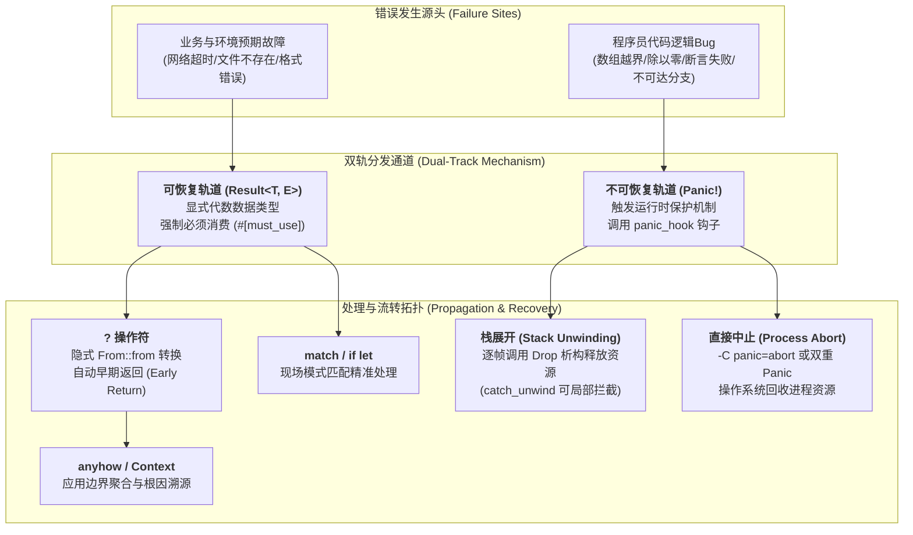
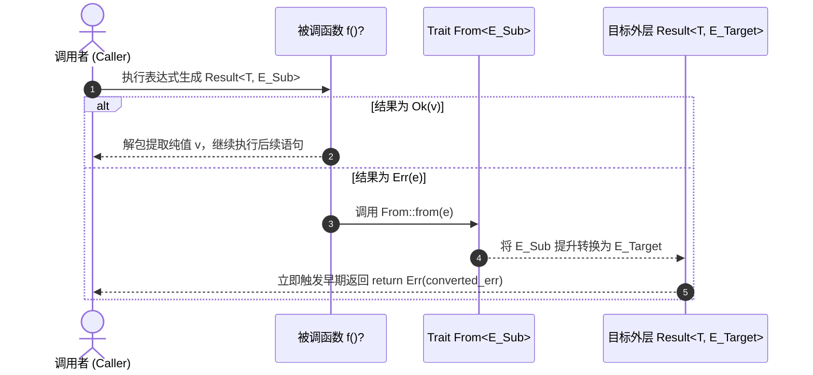

# 核心实战精炼：现代系统级双轨错误处理与分层治理

## 1. 核心架构选型矩阵：主流语言错误模型与 Rust 选型全景

在系统级工程中，错误处理不仅关乎代码的可读性，更直接决定了系统的吞吐量、内存安全性、可观测性与异常安全性（Exception Safety）。数十年来，系统编程界在“返回错误码”与“栈展开异常”之间经历了反复博弈。

下表系统化对比了主流系统语言与应用语言的错误处理范式，以及 Rust 生态中核心治理方案的工程权衡：

| 评估维度 | C 语言 (errno / 错误码) | C++ (try-catch 异常) | Go (val, err 多返回值) | Rust 标准核心 (`Result<T, E>` / Panic) | Rust 生态 (`thiserror` / `anyhow`) |
| :--- | :--- | :--- | :--- | :--- | :--- |
| **错误表达形式** | 返回整型状态码，全局 `errno` 共享状态。 | 显式 `throw`，类型化异常对象。 | 显式多返回值 `(value, error)` 惯用元组。 | 代数数据类型：枚举 `Result<T, E>` 显式建模。 | 库层使用 `thiserror` 强类型枚举；应用层使用 `anyhow` 动态上下文容器。 |
| **类型安全与强制检查** | **零检查强制**：极易被开发者遗漏忽略，导致雪崩。 | **弱类型约束**：未捕获异常导致 `std::terminate` 崩溃。 | **约定俗成**：编译器不强制校验 `err != nil`，易解引用空指针。 | **编译期绝对强制**：带 `#[must_use]` 属性，不处理即抛出编译警告/错误。 | **高度类型安全**：库边界向后兼容，业务层自动捕获调用栈与因果链。 |
| **运行时损耗 (Happy Path)** | 零开销（仅寄存器传值）。 | 零开销异常表（Itanium C++ ABI），正常路径开销极小。 | 极低（寄存器传两个指针），但存在逃逸分析堆分配倾向。 | **绝对零成本抽象**：机器码级别等价于带标志位的单寄存器或结构体传参。 | 零额外开销；`anyhow` 仅在错误发生时分配单一堆指针。 |
| **运行时损耗 (Error Path)** | 零开销。 | 极重（Dwarf 栈元数据解析、帧展开、虚表定位，耗时达微秒级）。 | 极低（仅普通 if 条件跳转）。 | **极低**：普通控制流跳转；栈展开仅在发生非预期 Panic 时按需触发。 | 极低，仅在异常路径构造上下文包装节点并记录 Backtrace。 |
| **因果链追踪与根因分析** | 极差，无上下文追踪，上下文在多层调用中彻底丢失。 | 依赖嵌套异常类，难以追溯无异常侵入的低层调用链。 | 需手动依赖 `fmt.Errorf("%w", err)` 形成显式链条。 | 标准库 `std::error::Error::source` 提供标准递归溯源接口。 | **工业级自动化**：`.context()` 链式注入上下文，终端完美呈现完整因果链。 |
| **适用边界** | 遗留系统、极简内核。 | 传统桌面软件、游戏引擎（禁用异常的子集广泛流行）。 | 云原生微服务、轻量 CLI 工具。 | **现代通用系统**：高并发网关、嵌入式裸机、存储引擎、内核模块。 | **工业级事实标准**：公共库使用 `thiserror`，顶层可执行应用使用 `anyhow`。 |

---

## 2. 生产级架构代码范式：分层模块化工业级错误处理体系

在大型复杂系统（如分布式存储节点或网络微服务）中，错误处理应严格遵循**“下层强类型领域错误暴露，上层统合上下文追踪”**的分层架构原则：

- **底层与核心库（Libraries / Domain Modules）**：严禁使用 `anyhow` 或盲目 Panic，必须通过 `thiserror` 定义穷尽语义、强类型、自解释的专属错误枚举，实现 `std::error::Error` 与 `Display`。
- **业务顶层与可执行边界（CLI / Services / main）**：使用 `anyhow::Result<T>` 统一汇聚所有底层错误，利用 `.context()` 记录关键运行时状态（如文件路径、网络目标、重试次数），并在程序退出时向 `stderr` 打印格式化根因链。

```rust
// Cargo.toml 依赖声明:
// [dependencies]
// thiserror = "2.0"
// anyhow = "1.0"
// tracing = "0.1"

use std::fs::File;
use std::io::{self, Read};
use std::net::SocketAddr;
use std::path::{Path, PathBuf};
use thiserror::Error;
use anyhow::{Context, Result as AnyResult, bail};

// ============================================================================
// 1. 底层核心领域模块：使用 thiserror 严格定义领域错误 (Crate/Library 级别)
// ============================================================================

/// 节点配置解析错误枚举：穷尽所有可能的领域失败边界
#[derive(Debug, Error)]
pub enum ConfigError {
    #[error("配置文件 I/O 操作失败: {path}")]
    Io {
        path: PathBuf,
        #[source]
        source: io::Error,
    },

    #[error("配置格式非法: 行号 {line}, 原因: {reason}")]
    InvalidSyntax {
        line: usize,
        reason: String,
    },

    #[error("网络监听地址解析无效: '{raw_address}'")]
    InvalidAddress {
        raw_address: String,
        #[source]
        source: std::net::AddrParseError,
    },

    #[error("缺少关键配置项: {0}")]
    MissingRequiredField(&'static str),
}

/// 系统节点配置结构体
#[derive(Debug, Clone)]
pub struct NodeConfig {
    pub node_id: u64,
    pub listen_addr: SocketAddr,
    pub max_connections: usize,
}

impl NodeConfig {
    /// 从文件路径加载并解析配置（强类型领域 API）
    pub fn from_file<P: AsRef<Path>>(path: P) -> Result<Self, ConfigError> {
        let path_ref = path.as_ref();
        let mut file = File::open(path_ref).map_err(|source| ConfigError::Io {
            path: path_ref.to_path_buf(),
            source,
        })?;

        let mut content = String::new();
        file.read_to_string(&mut content).map_err(|source| ConfigError::Io {
            path: path_ref.to_path_buf(),
            source,
        })?;

        Self::parse_str(&content)
    }

    /// 字符串内容解析逻辑
    pub fn parse_str(content: &str) -> Result<Self, ConfigError> {
        let mut node_id = None;
        let mut listen_addr = None;
        let mut max_connections = 1024; // 默认值

        for (line_idx, raw_line) in content.lines().enumerate() {
            let line = raw_line.trim();
            if line.is_empty() || line.starts_with('#') {
                continue;
            }

            let parts: Vec<&str> = line.splitn(2, '=').collect();
            if parts.len() != 2 {
                return Err(ConfigError::InvalidSyntax {
                    line: line_idx + 1,
                    reason: "缺少等号键值对分隔符".to_string(),
                });
            }

            let key = parts[0].trim();
            let val = parts[1].trim();

            match key {
                "node_id" => {
                    let id: u64 = val.parse().map_err(|_| ConfigError::InvalidSyntax {
                        line: line_idx + 1,
                        reason: format!("无法将 '{val}' 解析为有效 u64 节点 ID"),
                    })?;
                    node_id = Some(id);
                }
                "listen_addr" => {
                    let addr = val.parse().map_err(|source| ConfigError::InvalidAddress {
                        raw_address: val.to_string(),
                        source,
                    })?;
                    listen_addr = Some(addr);
                }
                "max_conns" => {
                    let conns: usize = val.parse().map_err(|_| ConfigError::InvalidSyntax {
                        line: line_idx + 1,
                        reason: format!("无法将 '{val}' 解析为有效并发连接数"),
                    })?;
                    max_connections = conns;
                }
                unknown => {
                    return Err(ConfigError::InvalidSyntax {
                        line: line_idx + 1,
                        reason: format!("未知的配置键名: '{unknown}'"),
                    });
                }
            }
        }

        Ok(NodeConfig {
            node_id: node_id.ok_or(ConfigError::MissingRequiredField("node_id"))?,
            listen_addr: listen_addr.ok_or(ConfigError::MissingRequiredField("listen_addr"))?,
            max_connections,
        })
    }
}

// ============================================================================
// 2. 业务运行时顶层：使用 anyhow 进行动态上下文注入与故障编排 (App 级别)
// ============================================================================

/// 模拟网络监听绑定服务
fn bind_network_socket(addr: SocketAddr) -> AnyResult<()> {
    // 模拟端口绑定失败（如权限不足或端口占用）
    if addr.port() < 1024 {
        bail!("无权绑定低位特权端口 (port: {})，请以 root 身份运行或更换端口", addr.port());
    }
    Ok(())
}

/// 启动分布式节点引擎：层层附加上下文
pub fn bootstrap_node(config_path: &Path) -> AnyResult<NodeConfig> {
    // 读取并加载配置，通过 .with_context 动态追加业务现场上下文
    let config = NodeConfig::from_file(config_path)
        .with_context(|| format!("加载系统节点配置文件失败: {}", config_path.display()))?;

    // 绑定网络套接字
    bind_network_socket(config.listen_addr)
        .with_context(|| format!("网络监听初始化中断: 目标地址 [{}]", config.listen_addr))?;

    Ok(config)
}

// ============================================================================
// 3. 应用程序入口 main()：统一捕获、打印根因调用链与优雅退出
// ============================================================================

fn main() {
    // 设置自定义 Panic 钩子，确保崩溃时捕获结构化日志并记录堆栈
    std::panic::set_hook(Box::new(|info| {
        let backtrace = std::backtrace::Backtrace::capture();
        eprintln!("🔥 [CRITICAL PANIC] 触发非预期崩溃: {info}\n堆栈跟踪:\n{backtrace}");
    }));

    let config_file = Path::new("/etc/bookorbit/cluster_node.conf");

    // 运行主干业务并处理顶级 Result
    if let Err(err) = bootstrap_node(config_file) {
        // 利用 anyhow 的 {:?} 或递归遍历打印完整的错误因果链（Source Chain）
        eprintln!("❌ 致命错误: 节点启动失败！");
        eprintln!("━━━━━━━━━━━━━━━━━━━━━━━━━━━━━━━━━━━━━━━━━━━━━━━━━━━━━");
        eprintln!("摘要信息: {err}");
        eprintln!("因果链路跟踪 (Root Cause Chain):");
        for (index, cause) in err.chain().enumerate() {
            eprintln!("  [{index}] => {cause}");
        }
        eprintln!("━━━━━━━━━━━━━━━━━━━━━━━━━━━━━━━━━━━━━━━━━━━━━━━━━━━━━");

        // 安全非零退出
        std::process::exit(1);
    }

    println!("✅ 节点成功启动并接入服务集群！");
}
```

---

## 3. 核心机制图解：双轨错误体系与 `?` 运算符展开拓扑

### 3.1 Rust 双轨错误处理架构拓扑



### 3.2 `?` 操作符底层编译展开与 `From` 契约机理



---

## 4. 核心术语与物理模型映射表

| 核心术语 | 英文对照 | 物理实现与工程本质 | 典型应用与注意事项 |
| :--- | :--- | :--- | :--- |
| **栈展开** | Stack Unwinding | 发生 Panic 时，运行时从当前栈帧向调用方逐层回溯，顺序执行每一帧上局部变量的 `Drop` 析构函数，防止资源泄漏。 | 默认模式。需保证析构函数本身绝不发生第二次 Panic，否则升级为直接中止。 |
| **直接中止** | Process Abort | 发生 Panic 时跳过所有析构直接发送信号（如 `SIGABRT`）终结进程，由操作系统内核统一回收物理内存与句柄。 | 通过 `-C panic=abort` 开启，可大幅减小嵌入式或 WASM 二进制体积并杜绝展开开销。 |
| **惊恐钩子** | Panic Hook | `std::panic::set_hook` 注册的全局函数，在栈展开或进程中止发生之前最优先执行。 | 用于将崩溃原因与 Backtrace 调用栈重定向至统一日志系统（如 `tracing`）。 |
| **早期返回** | Early Return | 通过 `?` 操作符在遭遇 `Err` 时直接从当前函数跳出并返回，省去繁冗的多层嵌套 `if/else`。 | 函数返回签名必须兼容 `Result` 或 `Option`。 |
| **因果链溯源** | Error Source Chain | 基于 `std::error::Error::source(&self)` 方法构成的单向链表，指向引发当前上层错误的底层根因对象。 | 应用层使用 `anyhow` 格式化打印 `{:#}` 时自动递归输出所有嵌套诱因。 |
| **单态错误包装** | `thiserror` Derive | 基于宏元编程自动生成 `Display` 与 `From` 实现，属于纯编译期展开，对运行时开销与二进制为零惩罚。 | 适用于任何公开发布的底层库与中间件，禁止在库中强依赖 `anyhow`。 |

---

## 5. 架构避坑清单 (Do's & Don'ts)

| 典型工程误区 (Don't) | 生产级正确实践 (Do) |
| :--- | :--- |
| **在公共库或关键基础组件的代码中随意调用 `.unwrap()` 或 `.expect()`。** | 在库中必须始终将潜在失败封装为 `Result<T, E>` 返回，把错误处理权完全交还给调用者。 |
| **在公共 SDK / 模块的对外公开 API 中使用 `anyhow::Result<T>`。** | 库对外接口必须暴露强类型枚举（配合 `thiserror`），以便下游调用者针对特定错误变体进行模式匹配。 |
| **在业务顶层直接吞噬错误（如使用 `let _ = operation()` 忽略关键写操作结果）。** | 仅在无害且不可挽回的次级路径（如写入 `stderr` 失败）使用 `let _`，关键写操作必须检查或打日志记录。 |
| **直接将底层的 `std::io::Error` 穿透透传给外部上层，丢失语义。** | 将底层系统 I/O 错误包装为领域错误（如 `ConfigError::Io { path, source }`），保留上下文路径。 |
| **在实现 `Drop` 特征的析构函数内部调用可能触发 Panic 的方法。** | `drop` 函数内部必须保持异常安全，绝不可引发二次 Panic，否则运行时会立即强制 Abort 进程。 |

<!-- split -->

# 原著完整参考：第 7 章 错误处理（Error Handling）

> 我早就知道，只要我活得足够久，这种事情终究是会发生的。
>
> —— **乔治·伯纳德·萧**（George Bernard Shaw，谈及死亡）

Rust 处理错误的方式足够独树一帜，因而完全值得专门开辟一个简明而深刻的章节来进行专项阐述。这里并没有任何晦涩艰深的理论概念，有的只是可能与你以往编程经验截然不同的全新设计哲学。本章将全面覆盖 Rust 中两种截然不同的错误处理范式：**Panic（恐慌/崩溃）** 与 **`Result` 枚举**。

普通、符合预期的错误使用 `Result` 类型进行建模。`Result` 通常代表由程序外部环境诱发的异常状态——例如无效的输入数据、突发的网络中断或是文件系统权限被拒绝。此类状况的发生并不取决于代码本身是否存在缺陷；即使是一个逻辑上绝对完美无暇、毫无 Bug 的程序，在实际生产运行中也必然会周期性地遭遇它们。本章绝大部分篇幅都将倾注于此类错误的治理。不过，我们首先将从 Panic 切入，因为在两者之中，它的逻辑相对更为直接纯粹。

而 Panic，则是专门为了应对另一类截然不同的错误而设计的——即那些**在设计上根本“绝不应该发生”的错误**。

---

# 1. 深入理解 Panic 机制

当程序遭遇了某种极其离谱的反常状态，以至于可以彻底断定程序本身的内部逻辑存在严重 Bug 时，程序就会发生 Panic。典型的场景包括：

* 数组或切片越界访问
* 整数除以零
* 对一个恰好处于 `Err` 状态的 `Result` 调用了 `.expect()`
* 运行时断言失败（Assertion failure）

此外，Rust 标准库还提供了 `panic!()` 宏，用于在你的代码探测到底层状态已被破坏、因而需要主动且直接触发 Panic 的场景。`panic!()` 宏接受与 `println!()` 完全兼容的格式化参数，便于动态构建详实的崩溃报错信息。

这些诱发条件的共同特征在于——不避讳地说——**它们全部是程序员自身的过错**。系统工程中一条行之有效的黄金法则是：“切勿随意 Panic（Don't panic）”。

然而，人非圣贤，孰能无过。当那些原本绝不该发生的错误真的猝不及防地降临时——系统究竟该何去何从？令人赞叹的是，Rust 为架构师赋予了自主裁量权。在发生 Panic 时，Rust 既可以选择**栈展开（Unwind the stack）**，也可以直接**中止进程（Abort the process）**。在默认编译配置下，Rust 采取栈展开策略。

:::en
> **Original**: A program panics when it encounters something so messed up that there must be a bug in the program itself... What these conditions have in common is that they are all — not to put too fine a point on it — the programmer's fault. A good rule of thumb is: "Don't panic." But we all make mistakes. When these errors that shouldn't happen do happen — what then? Remarkably, Rust gives you a choice. Rust can either unwind the stack when a panic happens or abort the process. Unwinding is the default.

**📌 核心术语与语境解析**：
- **Unwinding** [ʌnˈwaɪndɪŋ]：*栈展开/帧回溯*。运行时顺着物理调用栈逐帧清理局部对象并执行析构的过程，类似于现代 C++ 的异常栈清理机制。
- **Abort** [əˈbɔːrt]：*直接中止*。跳过所有局部对象的清理流程，直接通知操作系统通过信号终止当前进程，实现最彻底的硬性断电式防御。
- **Rule of Thumb** [ruːl əv θʌm]：*经验法则/黄金准则*。工程中经过实践反复检验的最优默许实践。
:::

---

## 1.1 栈展开（Unwinding）

想象一个海盗分赃的经典场景：船长分得全部掠夺战利品的一半，普通船员则平分剩下的另一半。（海盗最痛恨浮点数分数，因此如果任何一次除法无法整除，计算结果将向下取整，余下的残余金币统统归船上的鹦鹉所有。）

```rust
fn pirate_share(total: u64, crew_size: usize) -> u64 {
    let half = total / 2;
    half / crew_size as u64
}
```

这段代码可能相安无事地运行了几个世纪，直到某一天，一场激烈的海战导致整艘海盗船上只有船长一人生还。如果我们向该函数传入一个大小为 0 的 `crew_size`，底层硬件将触发除以零操作。在 C++ 中，这将直接陷入未定义行为（Undefined Behavior）；而在 Rust 中，它会触发受控的 Panic，其典型执行流程如下：

* 终端控制台打印出格式化错误信息：

  ```console
  thread 'main' panicked at pirates.rs:3780:9:
  attempt to divide by zero
  note: Run with `RUST_BACKTRACE=1` for a backtrace.
  ```

  正如提示信息所指出的，如果你配置了环境变量 `RUST_BACKTRACE=1`，Rust 还会在此时将当前完整的物理调用栈轨迹转储打印出来。
* **物理调用栈被逐层展开**。这一过程与 C++ 的异常处理机制极其相似。

  当前函数正在使用的所有临时变量、局部变量以及传入参数都将被有序 `drop` 销毁。销毁一个值本质上就是为其执行善后清理工作：程序正在使用的任何 `String` 或 `Vec` 所占用的堆内存将被立刻释放，所有打开的 `File` 句柄将被安全关闭，依此类推。用户为自定义类型实现的 `drop` 析构方法也会被依序调用。在 `pirate_share()` 这个特定案例中，没有任何需要清理的外部堆资源。

  一旦当前函数调用的栈帧清理完毕，运行时就会回退至其调用方函数，以完全相同的方式析构后者的变量与参数。随后，回溯继续向调用链的上层推进，以此类推，沿着调用栈一路向上清理。
* **最终，当前线程退出**。如果发生 Panic 的线程恰好是主线程（Main Thread），那么整个操作系统进程都将随之退出（返回一个非零的退出状态码）。

或许，“Panic（惊恐/恐慌）”这个词对于如此严密、井然有序的生命周期清理流程而言，本身就是一个具有误导性的称谓。**Panic 绝非系统崩溃（Crash），更绝非未定义行为**。它在语义上其实更接近于 Java 中的 `RuntimeException`，或是 C++ 中的 `std::logic_error`。其运行时行为是被严格定义的；只不过，这种状态在正常业务中本不应出现。

**Panic 是具备内存安全保障的（Panic is safe）**。它绝不会打破 Rust 的任何安全边界；哪怕你非常不幸地在标准库某个方法的执行中途触发了 Panic，它也绝对不会在物理内存中遗留下任何悬垂指针或处于半初始化状态的非法结构体。Rust 的底层设计哲学在于：在任何真正灾难性的物理破坏发生**之前**，抢先拦截非法的数组越界或除零操作。既然继续盲目向下执行是极其危险的，Rust 因而选择启动栈展开。然而，进程内的其余健康线程完全可以继续保持正常运转。

**Panic 的作用域严格限定在单线程内部**。一个线程发生 Panic，其他线程依然可以照常处理各自的业务。父线程完全可以通过特定的通信原语探测子线程的 Panic 并优雅地接管后续工作。

此外，Rust 标准库还提供了一种显式**捕获（Catch）**栈展开的机制，允许受灾线程在崩溃中幸存下来并继续运行——标准库函数 `std::panic::catch_unwind()` 正是为此而生。Rust 内置的自动化测试执行引擎（Test Harness）正是依托该机制，才能在某个测试用例发生断言失败后，依然能够安全捕获异常并继续执行后续测试用例。（不仅如此，在编写需要被 C 或 C++ 代码跨语言调用的 Rust FFI 接口时，该机制也是不可或缺的，因为跨越非 Rust 语言边界的栈展开会导致进程立即硬性中止。）

架构师可以通过线程隔离与 `catch_unwind()` 来构建容错性极高的高可用系统。但必须谨记一个关键前提：**这些工具只能捕获那些通过“栈展开”形式传播的 Panic**。并非所有 Panic 都会走栈展开通道。

---

## 1.2 进程直接中止（Aborting）

栈展开固然是 Rust 默认的 Panic 策略，但在某些特殊的极限工程场景下，Rust 并不会尝试进行栈展开，而是直接硬性中止整个进程：

* **栈空间耗尽与栈溢出（Stack overflow）**：
  当失控的无限递归耗尽了物理调用栈的可用空间时，这是致命的毁灭性灾难。Rust 会在终端打印警告信息并立即中止整个进程。在 Linux 平台上，Rust 会在进程初始化时安装专门的 `SIGSEGV` 信号处理器，用于精确探测程序何时试图越界写入栈底的防线保护页（Guard page）。对于拥有超大局部栈帧的函数，编译器会自动注入“栈探测（Stack Probing）”指令，确保跳跃式访问绝不会绕开保护页探测。
* **物理内存耗尽（Out of memory, OOM）**：
  这种状况通常超出了 Rust 语言本身的调控范畴。当程序向系统申请内存分配时，绝大多数现代操作系统几乎总是由于 Overcommit 机制而应允请求。随后，如果物理内存陷入极度紧缺，操作系统内核的 OOM Killer 会四处巡视，通过强制杀死占用内存庞大的进程来回收资源。在极少数堆分配器显式返回失败的场合，Rust 会立即中止进程。如果你在特定程序中需要弹性应对分配失败，可以使用如 `Vec::try_reserve` 这样的可失败分配方法。
* **双重 Panic（Double panic）**：
  如果在执行某个对象的 `.drop()` 析构函数期间，代码不幸触发了第二次 Panic，且此时 Rust 运行时仍在为第一次 Panic 忙碌地进行栈展开，那么 Rust 将不再抱有幻想，而是直接硬性中止整个进程。
* **编译期全局配置 `panic=abort`**：
  Rust 的 Panic 运行时行为是完全高度可定制的。如果你在编译源码时向编译器传递 `-C panic=abort` 标志，那么程序在遭遇第一次 Panic 时就会立即直接中止进程。由于在该模式下编译器无需生成庞大的栈展开元数据，编译出的最终可执行二进制体积将大幅缩减。

---

## 1.3 惊恐钩子（The Panic Hook）

当一个线程陷入 Panic 时，在正式启动栈展开或中止进程之前，它所执行的第一道工序实际上是触发**Panic 钩子函数（Panic Hook）**。该钩子可以通过标准库的 `std::panic::set_hook()` 函数进行全局自定义配置。系统默认的 Panic 钩子行为是将错误描述信息以及（在启用了 `RUST_BACKTRACE` 时）调用栈轨迹输出至 `stderr`。

如果你的系统级工程具备结构化日志系统，最佳实践是安装一个自定义的 Panic 钩子，确保所有 Panic 详情能够被无缝写入日志文件。否则，特别是发生在后台工作线程或异步任务中的 Panic，极易在无声无息中被漏报。在采用 `tracing` 日志生态的现代项目中，Panic 钩子的配置范式如下：

```rust
use std::backtrace::Backtrace;
use std::panic::PanicHookInfo;

/// 自定义 Panic 钩子：将 Panic 详细元数据重定向输出至 tracing 日志系统
fn report_panic(panic_info: &PanicHookInfo) {
    let stack = Backtrace::force_capture();
    tracing::error!("{panic_info}\n\n{stack}");
}

fn main() {
    setup_logging();
    std::panic::set_hook(Box::new(report_panic));
    // ... 后续系统启动逻辑
}
```

标准库中的 `Backtrace` 类型负责捕获当前上下文的物理执行栈。它原生实现了 `Display` 与 `Debug` 格式化。值得强调的是，Rust 并不对调用栈回溯的绝对完整性或精准度做硬性担保；捕获到的实际帧信息往往取决于你的编译配置 Profile、目标底层硬件架构以及符号表剥离策略。在整个进程生命周期中，仅需调用一次 `set_hook` 即可对全局生效。

---

## 1.4 辅助 Panic 声明式宏

除了通用的 `panic!()` 宏之外，Rust 语言还为系统开发者提供了一组专门用于在特定语境下无条件触发 Panic 的辅助宏。它们同样支持格式化占位符，但在软件工程语义上有着鲜明的职责划分：

* **`todo!(message...)`**：用于标记尚未完成编写的临时代码占位符。若在代码审查（Code Review）中发现了它，通常意味着开发者在提交前遗漏了最终实现。其触发时的默认报错信息为 `not yet implemented`。
* **`unimplemented!(message...)`**：类似于 `todo!()`，但它传递的工程信号是“该功能在当前架构设计中被有意省略暂不支持”。其触发时的默认报错信息为 `not implemented`。
* **`unreachable!(message...)`**：用于标注在逻辑不变量的保护下、控制流在物理上绝不可能抵达的代码分支（例如死循环之后的语句）。其触发时的默认报错信息为 `internal error: entered unreachable code`。

至此，关于 Rust 中 Panic 的底层探讨告一段落。在日常工程中，普通业务代码完全没有义务处处防御 Panic。期望程序中的每一个底层函数都具备预测并修复自身代码逻辑 Bug 的能力，显然是极其不切实际的。而那些由外部物理环境诱发的异常，则是另一片截然不同的战场。

:::en
> **Original**: Rust offers a few more macros that unconditionally panic, with optional format string arguments, just like panic!(). Each adds a different short prefix to the panic message, but the real difference between them is in what they mean to programmers: todo!(), unimplemented!(), unreachable!()... It's unreasonable to expect every function in a program to anticipate and cope with bugs in its own code. Errors caused by other factors are another kettle of fish.

**📌 核心术语与语境解析**：
- **Logical Invariant** [ˈlɑːdʒɪkl ɪnˈveriənt]：*逻辑不变量*。系统在整个生命周期中必须恒定为真的核心数学或状态假设。破坏不变量是触发 Panic 的合法理由。
- **Another Kettle of Fish** [əˈnʌðər ˈketl əv fɪʃ]：*完全是另一码事/另一片天地*。英语习语，强调外部环境引发的常规错误与代码内在缺陷在治理范式上的根本割裂。
:::

---

# 2. 深入理解 Result 类型系统

Rust 抛弃了传统的非类型安全异常机制。取而代之的是：任何具备失败可能性的函数，都必须在其返回签名中白纸黑字地显式宣告：

```rust
fn get_weather(location: LatLng) -> Result<WeatherReport, io::Error>
```

`Result` 类型代表了潜在的失败。调用 `get_weather()` 函数时，其返回结果必然是两种可能之一：要么是一个**成功结果** `Ok(weather)`（内部包裹着新鲜生成的 `WeatherReport` 数据）；要么是一个**错误结果** `Err(error_value)`（内部包含着一个详尽阐释故障根因的 `io::Error` 对象）。

Rust 编译器严格要求开发者在调用该函数时必须给出应对方案。如果不针对 `Result` 执行某种形式的处理，你就根本无法穿透枚举外壳访问到内部的 `WeatherReport`；若对返回的 `Result` 视而不见，编译器更会无情地发出强力告警。

---

## 2.1 捕获与就地处理错误

处理 `Result` 最详尽、最彻底的方式，莫过于使用强大的 `match` 模式匹配表达式：

```rust
match get_weather(hometown) {
    Ok(report) => {
        display_weather(hometown, &report);
    }
    Err(err) => {
        eprintln!("查询天气数据失败: {err}");
        schedule_weather_retry();
    }
}
```

这是 Rust 对其他编程语言中 `try/catch` 结构给出的正统回应。当你决意就地正面化解异常、而不是将其推卸给上游调用方时，`match` 表达式正是你的核心武器。

---

## 2.2 打印与输出错误信息

在生产环境中，有时化解错误的唯一可行途径就是将其记录到终端或日志并继续向前运转。

标准库预先定义了若干经典的错误类型，例如 `std::io::Error`、`std::fmt::Error`、`std::str::Utf8Error` 等等。它们无一例外都实现了一个通用的标准化契约接口——**`std::error::Error` Trait**。这意味着它们共享以下核心能力：

* **支持 `Display` 与 `Debug` 格式化**：
  所有错误类型都可以与 `println!()`、`eprintln!()`、`format!()` 乃至 `panic!()` 顺畅协作。使用 `{}` 占位符打印通常只展示简明扼要的高层摘要；而使用 `{:?}` 占位符则会输出包含底层操作系统错误码（OS Error Code）在内的结构化技术细节。
* **`err.to_string()`**：
  将错误转换为完整的 `String` 字符串，等价于 `format!("{err}")`。
* **`err.source()`**：
  返回一个 `Option<&(dyn Error + 'static)>`，指向引发当前错误的底层诱因（如果存在的话）。例如，一次底层的网络超时错误可能导致银行转账事务失败，进而导致你的游艇贷款违约被银行扣押。如果顶级错误 `err.to_string()` 显示为 `"游艇已被银行强制查封"`，那么其 `err.source()` 揭示的诱因可能是 `"向联合游艇维护公司转账 300 美元失败"`；而该错误的 `.source()` 则可能是一个底层的 `io::Error`，精确记录了断网的套接字描述符。这第三层错误便是系统根因（Root Cause），因此它的 `.source()` 将最终返回 `None`。

打印单个错误对象并不会自动级联打印它的根因。如果你希望在终端完整 dump 出整条因果链，可以借助以下通用打印函数：

```rust
use std::error::Error;
use std::io::{self, Write};

/// 向标准错误输出递归 dump 完整的错误因果链
fn print_error(mut err: &dyn Error) {
    let _ = writeln!(io::stderr(), "错误: {err}");
    while let Some(source) = err.source() {
        let _ = writeln!(io::stderr(), "诱因 (caused by): {source}");
        err = source;
    }
}
```

值得注意的是，绝大多数原生的 Rust 错误类型并不会自作主张地捕获物理调用栈，因为在每次构造错误时执行栈回溯的开销绝非微不足道。然而，业界广受欢迎的 `anyhow` 开源库则在底层无缝整合了栈捕获能力。

:::en
> **Original**: Printing an error value does not also print out its source. If you want to be sure to print all the available information, use this function: `fn print_error(mut err: &dyn Error)...` Most Rust error types do not include a stack trace, since the cost of capturing a trace is not always negligible. However, the popular `anyhow` crate provides a ready-made error type that includes a stack if `RUST_BACKTRACE` is set.

**📌 核心术语与语境解析**：
- **Root Cause** [ruːt kɔːz]：*根本诱因/根因*。引发上层业务层层级联崩溃的最底层物理异常，通常位于 `source()` 链表的终端。
- **Negligible Cost** [ˈneɡlɪdʒəbl kɔːst]：*可忽略不计的开销*。Rust 坚守零成本抽象，默认不捕获 Backtrace 确保了高频错误创建的高性能。
:::

---

# 3. 错误传播与 `?` 操作符

在绝大多数可能产生错误的系统调用现场，我们往往并不希望就地消化它们。在每一处可能出错的角落都生硬地插入一个长达数十行的 `match` 块，不仅会让业务核心逻辑支离破碎，更会带来不堪重负的代码膨胀。

相反，当故障发生时，我们最普遍的诉求是**将错误向调用栈上层传递，交由更宏观的高层决策者统一处理**。这就是所谓的错误传播（Propagating errors）。

Rust 专为此设计了极其优雅的 **`?` 操作符**。你可以将 `?` 直接附加在任何能够产生 `Result` 的表达式末尾：

```rust
let weather = get_weather(hometown)?;
```

`?` 的行为取决于函数执行的结果：
* **若为成功（`Ok`）**：它会自动解包出内部的纯值。在上述代码中，变量 `weather` 的类型不再是 `Result`，而是直接解开的 `WeatherReport`。
* **若为错误（`Err`）**：它会立即强制从当前所在的外层函数中提前返回（Early Return），并将错误沿着调用链原封不动地向上传导。为了确保这一点能够工作，**`?` 操作符只能在返回签名明确兼容 `Result`（或 `Option`）的函数体内使用**。

`?` 操作符的背后没有任何神秘黑魔法。使用繁琐的 `match` 块完全可以写出语义等价的代码：

```rust
let weather = match get_weather(hometown) {
    Ok(success_value) => success_value,
    Err(err) => return Err(err.into()),
};
```

在系统级 I/O 密集型代码中，错误的潜伏无处不在，`?` 操作符常常高频闪现：

```rust
use std::fs;
use std::io;
use std::path::Path;

fn move_all(src: &Path, dst: &Path) -> Result<(), io::Error> {
    for entry_result in src.read_dir()? {  // 打开目录可能失败
        let entry = entry_result?;         // 迭代读取目录项可能失败
        let dst_file = dst.join(entry.file_name());
        fs::rename(entry.path(), dst_file)?;  // 重命名移动物理文件可能失败
    }
    Ok(()) // 全部平稳完成！
}
```

值得一提的是，`?` 操作符同样优雅适配于 `Option` 类型。在返回类型为 `Option` 的函数中，你可以对 `Option` 值应用 `?`；当遇到 `None` 时，函数将自动提前返回 `None`。

---

# 4. Result 核心内置操作方法

将错误无休止地向上传递终有尽头；在系统的某个中枢层级，它们终归必须得到实质性处理。

尽管 `match` 表达式是通用的基础解法，但在许多标准场景下依然显得过于繁复。因此，`Result` 内置了一组高度精炼的组合子方法（Combinators）：

* **`result.is_ok()` 与 `result.is_err()`**：
  返回布尔值，用于无副作用地快速判定当前状态。
* **`result.ok()` 与 `result.err()`**：
  将 `Result<T, E>` 分别转换为 `Option<T>` 或 `Option<E>`，丢弃另一侧的值。
* **`result.unwrap_or(fallback)`**：
  若成功则返回 `T`，若失败则丢弃错误并返回预设的默认备选值 `fallback`。
* **`result.unwrap_or_else(fallback_fn)`**：
  延迟计算备选值。仅在遇到 `Err` 时，才会触发传入的闭包或函数生成兜底数据，避免在正常路径下进行不必要的重型对象分配。
* **`result.unwrap()`**：
  成功则返回 `T`；若为 `Err` 则直接触发 Panic。在某些不变量已被严格前置证明的场合，此方法有其用武之地。
* **`result.expect(message)`**：
  与 `.unwrap()` 类似，但允许你在 Panic 崩溃信息中附带一条详尽的诊断线索。
* **`result.map(convert_fn)`**：
  仅在当前为 `Ok(v)` 时执行转换闭包，将其映射为新的 `Ok(new_v)`；若为 `Err` 则保持原样透传。
* **`result.map_err(convert_fn)`**：
  镜像方法。仅在当前为 `Err(e)` 时执行转换逻辑，常用于将异构的局部错误统一提升为外部模块的通用错误类型。
* **`result.as_ref()` 与 `result.as_mut()`**：
  将 `Result<T, E>` 分别转化为借用形式 `Result<&T, &E>` 或 `Result<&mut T, &mut E>`。由于上述大部分消费性方法（如 `.ok()`、`.map()`）都会夺取 `self` 的所有权，因此在需要保留原 `Result` 结构完整性的前提下，先行调用 `.as_ref()` 建立只读引用借用是不可或缺的工程惯例。

---

# 5. Result 类型别名与大工程实践

在研读工业级 Rust 基础库的官方 API 文档时，你经常会看到类似这样省略了错误类型的函数签名：

```rust
fn remove_file(path: &Path) -> Result<()>
```

这绝不意味着该函数不可能失败，而是意味着它采用了**类型别名（Type Alias）**。在大型模块中，如果成百上千个底层函数返回的错误类型高度统一，重复书写长篇累牍的错误类型将严重劣化代码的可读性。标准库 `std::io` 模块便内置了这样一行经典别名：

```rust
pub type Result<T> = result::Result<T, Error>;
```

通过引入 `std::io` 命名空间，`io::Result<()>` 即可直接作为标准简写形式，代码整洁度获得质的跃升。

---

# 6. 多错误类型协同与归一化

在现实工程中，一段逻辑往往需要同时操作多种不同子系统，导致潜在的错误类型呈现多样化。假设我们要从一个文本文件中逐行读取纯数字：

```rust
use std::io::{self, BufRead};

fn read_numbers(file: &mut dyn BufRead) -> io::Result<Vec<i64>> {
    let mut numbers = vec![];
    for line_result in file.lines() {
        let line = line_result?;         // 此处产生 io::Error
        numbers.push(line.parse()?);     // 此处产生 std::num::ParseIntError
    }
    Ok(numbers)
}
```

编译器将会严正报错：
```console
error: `?` couldn't convert the error to `std::io::Error`
   |
12 |     numbers.push(line.parse()?);
   |                       -------^ the trait `From<ParseIntError>` is not implemented for `std::io::Error`
   = note: the question mark operation (`?`) implicitly performs a conversion on the error value using the `From` trait
```

其深层原因在于：`line_result?` 产出的是 `io::Error`，而 `line.parse()?` 产出的则是 `ParseIntError`。当前的 `read_numbers` 返回签名将错误类型牢牢锁定在了 `io::Error` 上，而标准库并未为 `io::Error` 实现针对 `ParseIntError` 的隐式 `From` 转换 Trait。

一种权宜之计是手动调用 `.map_err()` 进行类型强行适配：

```rust
let num = line.parse().map_err(io::Error::other)?;
numbers.push(num);
```

但这显然充满杂音且语义扭曲：文本内容的格式损坏在概念上并不属于底层物理 I/O 故障。Rust 工业界通过两大经过严苛验证的开源实践彻底解决了这一难题。

---

# 7. 通用错误容器：anyhow 生产级运用

对于位于应用程序顶层的业务流转，引入 `anyhow` 库通常是最具开发生产力的选择：

```toml
[dependencies]
anyhow = "1.0"
```

通过将函数返回签名改为 `anyhow::Result<T>`，原先遭遇类型冲突的 `?` 操作符便能瞬间恢复魔力——它会自动将任何实现了 `std::error::Error` 的异构错误统统转化为内部的 `anyhow::Error` 结构：

```rust
fn read_numbers(file: &mut dyn BufRead) -> anyhow::Result<Vec<i64>> {
    let mut numbers = vec![];
    for line_result in file.lines() {
        let line = line_result?;     // 自动将 io::Error 转换为 anyhow::Error
        numbers.push(line.parse()?); // 自动将 ParseIntError 转换为 anyhow::Error
    }
    Ok(numbers)
}
```

实际上，标准库本身也具备一个粗糙的类似能力：`Box<dyn std::error::Error + Send + Sync + 'static>`。然而，`anyhow` 赋予了诸多不可替代的工业级威力：
* 格式化打印 `anyhow::Error` 时，默认自动递归展开整条 `source` 故障因果链；
* 提供便捷的 `.context()` 与 `.with_context()` 机制，让工程师无需新建结构体即可动态注入业务执行现场上下文；
* 提供 `anyhow::bail!()` 与 `anyhow::ensure!()` 宏，以极简的语法直接触发错误提前返回；
* 在启用 `RUST_BACKTRACE` 环境变量时，自动将调用栈抓取并挂接在错误对象内部。

如果上游调用者偶尔需要针对特定类型的错误进行特殊恢复，可以使用其提供的泛型方法 `err.downcast_ref::<T>()` 对底层具体类型进行动态类型反查（Downcast）。

**架构边界警示**：`anyhow` 是为应用程序、业务服务与 `main()` 函数量身定做的利器；**严禁在公开发布的底层公共库（Libraries）的核心 API 中暴露 `anyhow::Error`**。在库中使用它会强行向下游消费者转嫁额外的外部依赖，更会剥夺下游通过穷尽模式匹配精确捕获特定错误的权利，迫使消费者退化为依靠正则表达式解析报错文本的野蛮做法。

---

# 8. 强类型领域错误定义：thiserror 宏驱动

为了向外部调用者提供契约分明、语义严谨的公开 API，各类知名开源库（如 `reqwest::Error`、`sqlx::Error`）均采取显式定义独立错误枚举的策略。

若完全手动手写一个兼容标准库接口的错误类型，开发者必须编写大量的模式匹配样板代码：不仅要为枚举实现 `Display` 和 `Debug`，还要手写每一个变体的 `From` 转换以及 `std::error::Error::source` 虚表路由。

而现代 Rust 工程通过 **`thiserror` 库**消除了所有机械繁琐的模板代码：

```toml
[dependencies]
thiserror = "2.0"
```

借助 `thiserror` 派生宏，强类型领域错误模型的构建仅需数行优雅的代码：

```rust
use std::io;
use std::num::ParseIntError;

#[derive(Debug, thiserror::Error)]
pub enum NumberFileError {
    #[error("读取配置文件遭遇底层 I/O 阻碍")]
    Io(#[from] io::Error),

    #[error("配置文件内存在非法数据格式")]
    Parse(#[from] ParseIntError),
}
```

* `#[derive(thiserror::Error)]`：由宏在编译期全自动为枚举合成极其严密的 `std::error::Error` 与 `Display` 契约代码。
* `#[error("...")]`：精确指定该错误分支在被输出打印时的格式化模板字符串，支持内联访问结构体字段。
* `#[from]`：不仅自动为该类型实现对应的 `From<T>` Trait（使 `?` 操作符能够无缝自动转换），更会自动将包裹的底层错误路由绑定至 `.source()` 根因追踪接口中。

由 `thiserror` 生成的所有代码均属于标准的 Safe Rust 纯语法展开。下游依赖方完全不需要在自己的 `Cargo.toml` 中显式依赖 `thiserror`，即可直接享受类型安全与模式匹配的全部红利。

---

# 9. 应对“绝对不可能发生”的错误

在特定语境下，开发者凭借对前置业务逻辑的不变量审查，能够**100% 确定某个可能会返回 `Result` 的操作在当前上下文绝不可能发生错误**。

例如，在编写配置文件词法分析器时，你已经通过前置的 `char::is_ascii_digit()` 循环遍历，在物理上严格验证了目标切片内的每一个字符均为纯 ASCII 数字。此时，你调用 `digits.parse::<u64>()` 试图将其转化为数值。从类型系统来看，`parse` 依然会返回一个 `Result`，因为它无法感知你此前在外部循环中建立的数学不变量。

如果你此时编写的代码已经处于 `anyhow::Result` 的外层函数中，直接补上一个 `?` 自然省心省力。但若不然，面对一个理论上绝不可能发生错误的 `Result`，去耗费心力编写冗长的错误分支无疑是令人沮丧的。此时，最为合情合理的选择便是直接调用 `.unwrap()`：

```rust
let num = digits.parse::<u64>().unwrap();
```

它的本质就是告诉编译器：“我保证此处必然成功；如果我的理论证明出现了纰漏，就直接触发 Panic 让我立刻知晓。”

值得深思的是，在我们上述这起真实的案例中，程序员的直觉其实是错误的！即便字符串内的每一个字符确实都是合法的数字，但如果输入的数字串长度超过了 20 位，数值在转换时就会瞬间触发 `u64` 算术溢出错误（Overflow error）！在此种情境下盲目使用 `.unwrap()` 就会直接埋下一个可被外部恶意畸形输入诱爆的生产环境 Panic 炸弹。

不过，在现实工程中确实存在错误在物理上绝对不可触发的真实场景。例如，标准库的 `Write` Trait 为字节流写入定义了一组通用方法，其返回签名统一为 `io::Result<usize>`；但如果你是在内存中向一个 `Vec<u8>` 执行写入，除非物理内存彻底耗尽，否则在逻辑上是绝不可能产生 I/O 故障的。在此类经过严苛证明的纯内存场景中，使用 `.unwrap()` 或带清晰注释的 `.expect("写入内存向量不应失败")` 消除 `Result` 是完全成熟且合规的工程决断。

---

# 10. 显式忽略错误与边界处理

在极少数场景中，我们可能需要彻底忽略某些操作产生的次要错误。

例如，在我们此前实现的 `print_error()` 调试函数内部，向 `stderr` 打印错误本身在理论上也可能会发生写入失败（例如当标准错误流被管道重定向至外部进程、而该外部消费进程恰好被提前终止退出时）。在正在汇报主错误的紧急时刻，试图去深度处理汇报本身的失败往往是不合时宜的。然而，Rust 编译器会对任何未被显式使用的 `Result` 抛出 `unused result` 告警。

使用 `let _ = ...` 惯用语法可以显式告知编译器此处的忽略是有意为之：

```rust
let _ = writeln!(io::stderr(), "错误: {err}"); // 明确告知编译器丢弃该写入的结果
```

---

# 11. 在 main() 函数中优雅治理错误

在大多数底层与中层逻辑中，错误应当被允许顺着调用链逐层冒泡传递。然而，当错误一路向上传递最终抵达进程的顶级入口 `main()` 时，推卸责任的链条必须终结，程序必须做出终极决断。

普通模式下的 `main()` 函数是不支持直接使用 `?` 操作符的，因为其默认返回签名为单元类型 `()`：

```rust
fn main() {
    calculate_tides()?; // 编译报错：无法向更外层继续推卸责任
}
```

在小型脚本或快速原型中，最粗暴直接的方式是在 `main()` 尾部追加 `.expect("计算失败")`。但这会导致终端打印出充斥着内部文件行号与栈回溯提示的惊悚输出，对最终用户极不友好。

现代 Rust 允许将 `main()` 函数的签名直接声明为返回 `Result`：

```rust
fn main() -> Result<(), TideCalcError> {
    let tides = calculate_tides()?;
    print_tides(tides);
    Ok(())
}
```

`main` 函数在语言标准中支持返回任何实现了 `std::process::Termination` Trait 的类型。若返回 `Ok(())`，系统静默退出并返回 0；若返回 `Err`，运行时会调用其 `Debug` 格式化打印错误详情，并返回非零退出码。

然而，若想获得最优雅、最符合工业发布标准的命令行用户体验，莫过于在 `main` 内部进行顶层捕获并实施定制化渲染：

```rust
fn main() {
    if let Err(err) = calculate_tides() {
        print_error(&err);
        std::process::exit(1);
    }
}
```

如此一来，终端的输出将保持绝对的干净利落，既杜绝了令人生畏的 Panic 崩溃噪音，又准确向运维人员传达了故障根因。

---

# 12. 为何选择 Result？系统级编程的设计深意

通盘审视了 Rust 的整套错误处理生态之后，我们终于能够深刻领悟为何 Rust 毅然舍弃了传统的异常机制、转而坚定拥抱 `Result`：

1. **强制显式决策，杜绝疏忽盲区**：Rust 强迫开发者在每一处可能出错的边界都必须在源码中留下显式的处理决策痕迹。在复杂的系统级代码中，未被留意的隐式异常跳跃是导致资源泄漏与状态机损坏的头号杀手。
2. **极简而醒目的传播符号**：最普遍的决策——即向上推卸传播——在语法上仅仅耗费一个微小的字符 `?`。它既杜绝了类似 C 与 Go 语言中铺天盖地的样板胶水代码，又保持了高度的可读性：任何人扫视一段代码，都能对潜在的非本地跳跃点一目了然。
3. **函数契约的绝对透明化**：一个函数究竟是否可能失败，直接白纸黑字地刻在其类型签名中。当你重构底层函数使其变为可失败操作时，编译器会立即精准捕获所有下游影响并强制你同步更新。
4. **编译期消除遗漏可能**：通过 `#[must_use]` 机制，Rust 严防死守任何无意识的忽略错误行为，彻底根绝 C 语言中忘记检查返回值而埋下的静默数据腐化。
5. **值语义赋予的强大表达力**：`Result` 本质上就是普通的强类型数据。你可以将成千上万个 `Result` 打包存入单个 `Vec` 集合中，从而极其自然地对批处理中的“部分成功、部分失败”这类复杂工业场景进行内存建模。

这一设计的代价在于：相较于其他语言，你在 Rust 中必须在错误建模与系统防御上倾注更多的工程心力。但在系统级编程这片每一字节和每一周期都至关重要的疆域里，这一切付出都将兑现为坚不可摧的工程可靠性。
