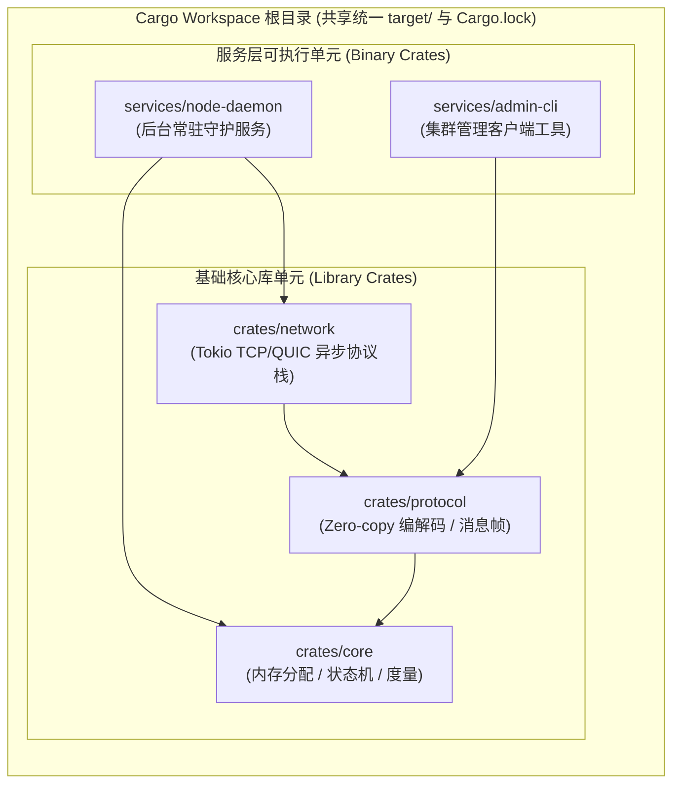

# 核心实战精炼：现代系统级工作区工程骨架与可见性治理

## 1. 核心架构选型矩阵：大型系统工程组织架构对比与权衡

在现代系统级软件工程中，随着代码库跨越十万行甚至百万行门槛，单体文件的简单堆叠将瞬间瓦解团队的协作效率。编译时间（Compile Time）、模块可见性边界、循环依赖防范以及跨平台供应链治理，是决定系统工程成败的核心物理指标。

下表系统化对比了主流系统语言与应用工程在模块化治理模型上的深层权衡：

| 评估维度 | C/C++ 传统方案 (Header + Translation Units) | Go 语言标准方案 (Packages + go.mod) | Java / JVM 方案 (Maven / Gradle Multi-Project) | Rust 现代化体系 (Crates + Modules + Workspaces) |
| :--- | :--- | :--- | :--- | :--- |
| **基本编译单元** | **单个 `.c`/`.cpp` 文件**：每个源文件作为独立编译单元，反复文本展开头文件，导致严重编译膨胀。 | **目录级 Package**：同一个目录下的所有源文件共享命名空间，无法拆分更细粒度内部模块。 | **类文件（`.class`）与 Jar 包**：以类为原子粒度，依赖庞大类加载器（ClassLoader）。 | **Crate（编译单元）**：整个 Crate 作为单一 AST/LLVM 单元统一输入给 rustc，编译器全局内联优化能力极强。 |
| **可见性治理粒度** | **粗暴二元化**：`static` 文件私有，或头文件全部公开暴露；无包级别强隔离机制。 | **首字母大小写**：仅区分公开（大写）与包内私有（小写），无法控制多层包之间的跨包可见性。 | **四级修饰符**：`public`、`protected`、`default`（包级）、`private`，基于继承树管理。 | **细粒度权限阶梯**：`pub`、`pub(crate)`、`pub(super)`、`pub(in path)`，实现最严密的最小特权原则。 |
| **单仓大工程 (Monorepo) 支持** | 依赖复杂的 CMake / Bazel 胶水脚本，构建缓存极易被污染失效。 | 原生 `go.work` 支持工作区，但多包依赖图解析相对简陋。 | Gradle 复合构建（Composite Builds），配置繁复且构建守护进程内存占用居高不下。 | **原生 Cargo Workspace**：共享统一 `target` 目录与 `Cargo.lock`，并行增量构建，依赖解析零漂移。 |
| **语言版本演进机制 (Editions)** | C++20 / C++23 通过编译器参数全局切换，依赖项语法不兼容即全盘受阻。 | 依赖 Go 运行时版本，无跨版本语法级无缝混编能力。 | 依赖 JVM 字节码版本向后兼容，但无法共存不同版本语法。 | **语言版本（Editions）纪元机制**：跨 Edition 依赖完全透明互通，允许旧版 2018 Crate 与 2024 Crate 完美链接。 |
| **文档与契约一体化** | Doxygen / 注释工具独立运行，代码示例极易随版本迭代而静默过期失效。 | `godoc` 原生提取，支持 Testable Examples，但缺乏内联深度校验。 | Javadoc 原生集成，文档内代码缺乏自动化回归测试。 | **Doc-Tests 编译期自检验**：文档中的每一段 Markdown 代码块均作为单元测试被 `cargo test` 自动编译执行。 |

---

## 2. 生产级架构代码范式：分布式微内核服务工作区脚手架

在构建大型系统（如自研分布式存储引擎或实时网关）时，生产级最佳实践是采用 **Cargo Virtual Workspace（虚拟工作区）**，将领域核心、协议编解码、网络通信与 CLI 入口完全物理隔离：

### 2.1 顶级工作区清单：`./Cargo.toml`

```toml
[workspace]
resolver = "3"
members = [
    "crates/core",
    "crates/protocol",
    "crates/network",
    "services/node-daemon",
    "services/admin-cli",
]

# 统一管理整个工作区的共享依赖版本，防止各子包依赖版本碎片化
[workspace.dependencies]
thiserror = "2.0"
anyhow = "1.0"
tokio = { version = "1.40", features = ["full"] }
tracing = "0.1"
bytes = "1.7"
serde = { version = "1.0", features = ["derive"] }
serde_json = "1.0"

# 统一编译 Profile 调优
[profile.dev]
opt-level = 0
debug = true

[profile.release]
opt-level = 3
lto = "fat"            # 跨 Crate 全局链接时优化
codegen-units = 1      # 牺牲单机编译并发，换取极限机器码内联优化
panic = "abort"        # 生产环境崩溃立即中止，剥离展开元数据以收敛二进制体积
strip = true           # 剥离所有调试符号
```

---

### 2.2 核心库 `crates/core` 架构与可见性治理范式

文件：`crates/core/src/lib.rs`
演示细粒度可见性控制（`pub(crate)`、`pub(super)`）与对外部世界的干净再导出（`pub use`）：

```rust
//! # OrbitCore: 分布式节点基础运行时核心库
//!
//! 提供系统级内存管理、节点状态机与底层度量指标追踪。
//!
//! ## 快速上手示例
//! ```rust
//! use orbit_core::prelude::*;
//!
//! let mut node = NodeState::new(1001);
//! assert!(node.is_healthy());
//! ```

#![deny(missing_docs)]
#![warn(clippy::all)]

// 内部子模块声明（模块在独立文件中管理）
mod internal_allocator;
mod metrics;
mod state_machine;

// 1. 面向整个 Crate 内部开放、但绝不向外部消费者泄漏的底层接口
pub(crate) use internal_allocator::RawRingBuffer;

// 2. 面向外部依赖方公开暴露的核心领域类型与预导入 Prelude
pub use state_machine::{NodeState, NodeStatus};
pub use metrics::SystemMetrics;

/// 常用核心类型的统一导入 Prelude
pub mod prelude {
    pub use crate::state_machine::{NodeState, NodeStatus};
    pub use crate::metrics::SystemMetrics;
}
```

文件：`crates/core/src/internal_allocator.rs`
演示内部专用环形缓冲池（仅限本 Crate 可见）：

```rust
/// 环形物理内存缓冲区（仅对 orbit_core 内部可见）
pub(crate) struct RawRingBuffer {
    buffer: Vec<u8>,
    capacity: usize,
    cursor: usize,
}

impl RawRingBuffer {
    /// 构造指定容量的物理缓冲
    pub(crate) fn with_capacity(capacity: usize) -> Self {
        Self {
            buffer: vec![0; capacity],
            capacity,
            cursor: 0,
        }
    }

    /// 写入原始数据切片
    pub(crate) fn write_bytes(&mut self, data: &[u8]) -> usize {
        let to_write = data.len().min(self.capacity - self.cursor);
        self.buffer[self.cursor..self.cursor + to_write].copy_from_slice(&data[..to_write]);
        self.cursor += to_write;
        to_write
    }

    /// 获取当前物理使用量
    #[inline(always)]
    pub(crate) fn bytes_used(&self) -> usize {
        self.cursor
    }
}

#[cfg(test)]
mod tests {
    use super::*;

    #[test]
    fn test_ring_buffer_operations() {
        let mut rb = RawRingBuffer::with_capacity(64);
        let written = rb.write_bytes(b"hello rust");
        assert_eq!(written, 10);
        assert_eq!(rb.bytes_used(), 10);
    }
}
```

文件：`crates/core/src/state_machine.rs`
演示模块嵌套与 `pub(super)` 权限阶梯：

```rust
use crate::internal_allocator::RawRingBuffer;

/// 节点状态枚举
#[derive(Debug, Clone, Copy, PartialEq, Eq)]
pub enum NodeStatus {
    /// 初始化就绪中
    Initializing,
    /// 正常健康运行
    Active,
    /// 严重异常隔离
    Degraded,
}

/// 核心节点状态机
#[derive(Debug)]
pub struct NodeState {
    /// 节点全球唯一 ID（公开可见）
    pub id: u64,
    /// 当前健康状态（公开只读，通过 getter 暴露，字段私有）
    status: NodeStatus,
    /// 内部心跳周期计数器（仅上级模块可见）
    heartbeat_ticks: u64,
}

impl NodeState {
    /// 创建新节点实例
    pub fn new(id: u64) -> Self {
        Self {
            id,
            status: NodeStatus::Active,
            heartbeat_ticks: 0,
        }
    }

    /// 校验节点是否处于健康活跃状态
    pub fn is_healthy(&self) -> bool {
        self.status == NodeStatus::Active
    }

    /// 触发心跳滴答推进（仅当前模块及父级模块可用）
    pub(super) fn tick_heartbeat(&mut self) {
        self.heartbeat_ticks += 1;
    }
}
```

---

### 2.3 构建脚本 `crates/core/build.rs` 范式：编译期环境探测与代码生成

```rust
// crates/core/build.rs
// 构建脚本在编译当前 crate 源码之前，由 Cargo 预先独立编译并运行在宿主机上

use std::env;
use std::fs::File;
use std::io::Write;
use std::path::Path;

fn main() {
    // 1. 探测目标操作系统与 CPU 指令集
    let target_arch = env::var("CARGO_CFG_TARGET_ARCH").unwrap_or_default();
    let target_os = env::var("CARGO_CFG_TARGET_OS").unwrap_or_default();

    println!("cargo:rerun-if-changed=build.rs");
    println!("cargo:rustc-check-cfg=cfg(simd_accelerated)");

    // 若检测为 x86_64 或 aarch64，动态开启自定义编译标志
    if target_arch == "x86_64" || target_arch == "aarch64" {
        println!("cargo:rustc-cfg=simd_accelerated");
    }

    // 2. 动态向 OUT_DIR 输出编译期常量文件
    let out_dir = env::var("OUT_DIR").expect("未定义 OUT_DIR 环境变量");
    let dest_path = Path::new(&out_dir).join("build_info.rs");
    let mut f = File::create(&dest_path).expect("无法创建 build_info.rs");

    let build_time = "2026-10-25T01:08:00Z";
    writeln!(
        f,
        "pub const BUILD_METADATA: &str = \"Arch: {target_arch}, OS: {target_os}, Built at: {build_time}\";"
    ).unwrap();
}
```

---

## 3. 核心机制图解：工作区架构拓扑与 Rust 可见性权限阶梯

### 3.1 现代多 Package 工作区拓扑架构



### 3.2 Rust 语言六级可见性权限阶梯模型


---

## 4. 核心术语与物理模型映射表

| 核心术语 | 英文对照 | 物理实现与底层机理 | 典型应用与注意事项 |
| :--- | :--- | :--- | :--- |
| **Crate（包/编译单元）** | Compilation Unit | rustc 编译器的原子处理单元。输出为 `.rlib` 静态库或二进制 ELF 可执行文件。 | 区分 Binary Crate（含 `main.rs`）与 Library Crate（含 `lib.rs`）。 |
| **工作区** | Workspace | 多个关联 Crate 的集合，共享单个统一的 `Cargo.lock` 文件与单一 `target/` 编译缓存目录。 | 杜绝各子包间同名依赖版本冲突，极大加快多包单仓增量编译速度。 |
| **语言版本** | Editions | Rust 语言的语法演进纪元（2015, 2018, 2021, 2024）。在 AST 前端解析层区分，LLVM IR 与 HIR 阶段完全无缝互通。 | 允许旧 Edition 编写的底层库直接被新 Edition 的上层代码无缝依赖。 |
| **构建脚本** | Build Script (`build.rs`) | 在宿主机上预先编译并执行的辅助程序，可探测外部 C 库、代码生成及发射 `cargo:` 指令。 | 严禁在 `build.rs` 中修改当前源码目录下的文件，仅能写入 `OUT_DIR`。 |
| **文档测试** | Doc-Tests | `rustdoc --test` 提取 Markdown 中的代码块，将其独立包装为测试文件后直接编译运行。 | 保证 API 演化过程中，用户所见文档代码永不发生编译腐化（Bitrot）。 |
| **特征门控** | Cargo Features | 条件编译开关，允许下游按需启用功能分支与传递性依赖，减小最终二进制尺寸。 | 遵循“Features 必须保持纯累加性（Additive）”的工业级设计准则。 |

---

## 5. 架构避坑清单 (Do's & Don'ts)

| 典型工程误区 (Don't) | 生产级正确实践 (Do) |
| :--- | :--- |
| **在子模块设计中滥用 `pub`，将所有结构体与内部字段无脑向外暴露。** | 严格贯彻最小特权原则：库内部辅助逻辑使用 `pub(crate)`，字段优先私有并提供 getter。 |
| **在旧时代遗留思维下，在模块目录中盲目新建大量 `mod.rs` 文件。** | 采用现代 Rust 风格：`foo.rs` 作为主声明，同名目录 `foo/` 存放子模块，避免 IDE 中充斥同名 `mod.rs`。 |
| **在大型工作区中各子包自行声明依赖版本，导致依赖版本漂移与重复编译。** | 在工作区顶级 `Cargo.toml` 中使用 `[workspace.dependencies]` 集中锁定全库公共依赖。 |
| **编写文档示例时为了省事省略实际可运行代码，或随手写出无法编译的伪代码。** | 确保 `///` 文档注释包含可运行的代码示例，每次提交前均通过 `cargo test --doc` 进行严格回归。 |
| **在 `build.rs` 中向当前源码目录任意写出生成的文件，破坏 Git 状态树。** | 严格使用 `std::env::var("OUT_DIR")` 获取生成目录，并通过 `include!(concat!(env!("OUT_DIR"), "..."))` 引入代码。 |

<!-- split -->

# 原著完整参考：第 8 章 Crates 与 Modules（Crates and Modules）

> 这正是 Rust 核心旋律中的一个强音：系统程序员终于能够拥有称心如意的美好事物了。
>
> —— **罗伯特·奥卡拉汉**（Robert O'Callahan），知名浏览器引擎架构师

假设你正在编写一个用于高精度模拟蕨类植物（Ferns）生命周期的系统级程序，其模拟范围从底层的单个生物细胞一直延伸至顶层的宏观植物形态。你的程序就像一株真实的蕨类植物一样，最初必然极其纯粹简朴——所有的源码或许仅仅寄宿在单个 `.rs` 文件之中，犹如一颗刚刚萌发的思想孢子。

然而，随着系统功能的持续繁衍与生长，代码内部必然演化出日益精密的层级架构：不同的代码片段各司其职，物理文件开始分化并蔓延至复杂的目录树结构中。假以时日，它甚至可能成长为整个开源软件生态中不可或缺的坚实基石。对于任何体量超越了几种基础数据结构或数百行代码规模的工程项目而言，**系统化、工程化的模块组织体系都是不可或缺的生命线**。

本章将全面解密 Rust 赋予系统架构师用于驾驭大型复杂软件工程的终极武器：**Crate（包/编译单元）** 与 **Module（模块系统）**。此外，我们将以贯穿全章的蕨类植物模拟器（`fern-sim`）作为实战蓝本，系统探讨涉及 Rust 代码分发与治理的关键工程课题：如何编写标准化文档与自动化文档测试、如何精准抑制不必要的编译器告警、如何依托 Cargo 治理依赖版本与锁定文件、如何将开源组件发布至 crates.io 全球公共制品库、以及 Rust 如何通过语言版本（Editions）机制实现波澜不惊的跨时代演进。

---

# 1. 深入理解 Crate 编译单元

所有的 Rust 程序都是由 **Crate** 构成的。每一个 Crate 都是一个完整自洽、具备高度内聚性的工程单元：它涵盖了构建单个库（Library）或单个可执行程序（Executable）所需的全部源代码，同时紧密集成了与之相关的单元测试、集成测试、示例用例、辅助基准工具以及构建配置元数据。

在你构建蕨类植物模拟器的过程中，你必然会引入来自社区第三方开源生态的高性能库：用于渲染 3D 蕨类模型的图形库、用于生物信息学计算的算法库、以及用于并行任务调度的高并发运行时。这些被依赖的组件库，无一例外均以 Crate 的形式存在并流转（参见下方图 8-1）。


###### 图 8-1. 一个典型的 Crate 及其深层传递依赖图谱

想要直观洞察 Crate 的本质及其协同机理，最便捷的方式莫过于借助 `cargo build --verbose` 命令对一个具备实际依赖的既有工程进行深度编译追踪。以下是在原著第 2 章的并发曼德博（Mandelbrot）计算工程上执行构建的控制台输出实况：

```console
$ cd mandelbrot
$ cargo clean    # 彻底清理此前生成的编译缓存
$ cargo build --verbose
    Updating registry `https://github.com/rust-lang/crates.io-index`
 Downloading autocfg v1.0.0
 Downloading semver-parser v0.7.0
 Downloading gif v0.9.0
 Downloading png v0.7.0

... (自动下载并顺序编译海量传递依赖 Crate)

   Compiling png v0.17.14
     Running `rustc --crate-name png --edition=2018 .../png-0.17.14/src/lib.rs ...`
   ...
   Compiling image v0.25.5
     Running `rustc --crate-name image --edition=2024 .../image-0.25.5/src/lib.rs ...`
```

从底层构建日志中可以清晰窥见：Cargo 正在背后默默调用系统的底层编译器 `rustc`，而每一次独立的 `rustc` 进程调用，其核心任务都是去精确编译**单个 Crate**。

:::en
> **Original**: Rust programs are made of *crates*. Each crate is a complete, cohesive unit: all the source code for a single library or executable, plus any associated tests, examples, tools, configuration, and other junk... Cargo is the Rust package manager. It compiles your project's crates and their dependencies, running rustc with the right options.

**📌 核心术语与语境解析**：
- **Crate** [kreɪt]：*板条箱/编译单元*。Rust 语言层面的原子级编译单元，对应单个静态库或二进制文件。
- **Cohesive Unit** [koʊˈhiːsɪv ˈjuːnɪt]：*高内聚单元*。强调模块高内聚低耦合的软件工程原则。
- **Transitive Dependencies** [ˈtrænzətɪv dɪˈpendənsiz]：*传递性依赖*。你的直接依赖项所隐式依赖的更深层底层库链条。
:::

---

## 1.1 语言版本演进机制（Editions）

在编程语言的发展史上，语言设计团队往往面临一个残酷的“两难困境”：是抱残守缺维持绝对的向后兼容、坐视历史语法缺陷与糟粕在数十年中拖垮整个生态；还是大破大立进行破坏性升级，进而导致整个工业界生态彻底分裂割裂（类似 Python 2 升级至 Python 3 的惨痛阵痛）。

Rust 通过划时代的 **Editions（语言版本纪元机制）** 彻底破解了这一百年难题。

截至目前，Rust 社区已历经四个关键的语言版本纪元：
* **Rust 2015**：语言 1.0 正式稳定时代的奠基基准；
* **Rust 2018**：彻底重构了模块系统（消除了对繁琐 `extern crate` 的依赖），引入了原生 `async`/`await` 与全新的借用检查器（NLL）；
* **Rust 2021**：改进了闭包对结构体字段的不相交捕获机制，将 `TryInto` 与 `IntoIterator` 正式纳入标准库 Prelude；
* **Rust 2024**：进一步收敛语言语法一致性，强化临时变量生命周期判定规则。

你可以在每一个 Crate 的 `Cargo.toml` 中显式指定其所依附的 Edition：

```toml
[package]
name = "fern-sim"
version = "0.1.0"
edition = "2024"
```

**极其关键的工程物理事实在于：Rust 的版本升级绝不会割裂生态**。
Edition 之间的语法差异完全发生在编译器的 AST 语法树解析与前端校验阶段；一旦代码被前端成功降解为 HIR/MIR 中间表示并最终提交给 LLVM 生成机器码时，不同 Edition 编译出的二进制对象在物理 ABI 层面完全是 100% 统一无缝互通的！这意味着：一个基于 Rust 2024 编写的全新应用，完全可以直接依赖一个长达数年未曾修改、依然基于 Rust 2018 乃至 2015 编译的底层库 Crate，两者能够在同一个进程空间中无缝链接并安全共存。

---

## 1.2 构建配置 Profiles

Cargo 原生预设了四大核心编译配置模式（Profiles），用于满足开发调试与生产发布的不同物理诉求：

* **`dev` 模式**：通过 `cargo build` 默认触发。关闭激进的编译器内联优化（`opt-level = 0`），保留完整的调试元数据（Debuginfo），旨在追求极速的增量编译循环。
* **`release` 模式**：通过 `cargo build --release` 显式开启。拉满顶级机器码优化级别（`opt-level = 3`），全面启动跨函数内联与自动循环向量化展开（SIMD），剥离调试符号，专为生产级极致吞吐量而生。
* **`test` 模式**：通过 `cargo test` 触发，在保留调试信息的同时插桩测试断言与测试执行引擎。
* **`bench` 模式**：通过 `cargo bench` 触发，用于执行纳秒级性能基准测试。

开发者可以在项目的根 `Cargo.toml` 中对各 Profile 的物理参数进行深度调优：

```toml
[profile.release]
opt-level = 3
lto = "fat"           # 启动跨 Crate 全局链接时代码优化
codegen-units = 1     # 限制单代码生成单元，换取最大内联深度
panic = "abort"       # 生产环境放弃栈展开，直接中止以收敛二进制尺寸
```

---

# 2. 深入 Module 模块系统

如果说 Crate 构成了 Rust 大厦的整体外壳，那么 **Module（模块）** 则是大厦内部清晰严整的房间隔断。

模块是 Rust 在单个 Crate 内部组织代码的基本单元。一个模块可以容纳函数、结构体、枚举、Trait 乃至嵌套的子模块。

---

## 2.1 模块的声明与嵌套

在 Rust 中，使用 `mod` 关键字显式声明一个模块：

```rust
mod spores {
    use cells::Cell;

    /// 孢子结构体
    pub struct Spore {
        size: f64,
    }

    /// 产生孢子的工厂函数
    pub fn produce_spore(factory: &mut Sporangium) -> Spore {
        Spore { size: 1.0 }
    }

    // 结构体 Sporangium 默认未标注 pub，仅在 spores 模块内部私有可见
    struct Sporangium {
        capacity: usize,
    }
}
```

在 Rust 的世界观中，**模块内部的一切默认全都是私有的（Private）**。若想让外部访问模块内的结构体、枚举或函数，必须显式在其定义前加上 `pub` 关键字。

---

## 2.2 现代文件与目录映射法则

当项目代码量持续扩大时，将所有模块硬塞在同一个 `lib.rs` 文件中显然不再可行。Rust 支持将模块拆分到独立物理文件中：

在 `src/lib.rs` 中：
```rust
pub mod plant_structures;
```

此时，编译器会按顺序在物理磁盘上寻找该模块的对应源文件。在现代 Rust（Rust 2018 及之后版本）中，标准的组织形式推荐如下：

```text
fern-sim/
├── Cargo.toml
└── src/
    ├── lib.rs                   # 根库文件
    ├── plant_structures.rs      # 模块声明文件
    └── plant_structures/       # 同名子目录，用于存放子模块
        ├── roots.rs             # 子模块 plant_structures::roots
        └── stems.rs             # 子模块 plant_structures::stems
```

这种现代目录架构彻底摒弃了此前每层目录都必须强制命名为 `mod.rs` 的旧范式，彻底根除了开发者在 IDE 编辑器中同时打开十几个重名 `mod.rs` 标签页时的认知混乱。

---

## 2.3 细粒度可见性治理与权限阶梯

系统的健壮性严重依赖于“最小特权原则”：不该暴露给外层的内部实现细节，必须通过语言级栅栏将其严密锁死。

Rust 提供了极其细腻的可见性控制修饰符：

* **默认（无修饰）**：完全私有，仅在当前模块以及其直接嵌套的子模块内部可见。
* **`pub`**：全域公开。不仅对当前 Crate 内部公开，更会作为库的公共接口对外暴露给所有依赖该 Crate 的外部消费者。
* **`pub(crate)`**：**Crate 级全局可见**。该项在当前 Crate 内的任何地方均可自由调用，但在 Crate 外部被严格隐藏。这是编写大型复杂库时最重要、最核心的封装防御武器！
* **`pub(super)`**：**仅对直接父级模块公开**。适合用于一组高度协同的平级子模块之间共享内部私有数据。
* **`pub(in crate::path)`**：限定路径可见。仅对指定的某个特定祖先模块路径内部开放，提供严丝合缝的定制级封装。

```rust
pub struct Fern {
    /// 蕨类生长的物理尺寸（全世界公开可见）
    pub size: f64,
    /// 根系深层网络（仅在当前 crate 内部可见，外部使用者不可见）
    pub(crate) root_system: RootSystem,
    /// 内部生化状态机（完全私有，仅在当前模块内部可见）
    internal_state: u64,
}
```

此外，结构体的字段可见性是独立于结构体本身的：**即便一个结构体被标记为 `pub`，其内部字段若未标 `pub`，外部代码依然无法直接读取或构造这些字段**，从而倒逼外部必须通过该结构体提供的构造函数（如 `new()`）与 getter/setter 契约方法进行交互，完美捍卫了业务领域的不变量。

:::en
> **Original**: In Rust, visibility is controlled at the module level. By default, everything is private to its enclosing module. You can make an item available outside its module by marking it pub... Rust also lets you restrict an item's visibility to a specific part of your crate: `pub(crate)` makes an item visible anywhere within the current crate, but not outside it. `pub(super)` makes an item visible only to the parent module...

**📌 核心术语与语境解析**：
- **Visibility** [ˌvɪzəˈbɪləti]：*可见性/访问控制*。语言层面决定某符号能否被特定作用域引用的权限边界。
- **Encapsulation** [ɪnˌkæpsjʊˈleɪʃn]：*封装性*。隐藏内部状态与实现细节、仅对外暴露必要接口的软件工程原则。
:::

---

## 2.4 路径引用与命名空间导入（Paths and Imports）

为了在当前作用域引用其他模块的符号，我们使用 `use` 关键字。

Rust 提供了三种核心绝对/相对路径前缀：
* **`crate::`**：绝对路径前缀，强制从当前 Crate 的根模块（`lib.rs` 或 `main.rs`）开始寻址；
* **`super::`**：相对路径前缀，指向当前模块的物理父级模块；
* **`self::`**：相对路径前缀，指向当前所在模块自身。

```rust
// 从当前 Crate 根路径引入
use crate::plant_structures::Fern;

// 从父模块引入
use super::Cell;

// 嵌套导入与别名
use std::collections::{HashMap, HashSet as FastSet};
```

### 使用 `pub use` 实现门面模式与再导出（Re-exporting）

在大型工程中，代码在物理磁盘上的文件拆分往往极其细碎；但这绝不意味着外部最终用户也希望在一层层深邃冗长的路径（如 `fern_sim::plant_structures::leaves::chloroplast::Fern`）中跋涉。

通过在根库 `lib.rs` 中使用 **`pub use`（再导出）**，我们可以轻松构建经典的设计模式——**门面模式（Facade Pattern）**：

```rust
// 内部物理组织结构
mod cells;
mod plant_structures;
mod simulation;

// 面向全世界优雅地重塑公开门面 API
pub use plant_structures::Fern;
pub use simulation::Terrarium;
```

如此一来，无论内部模块物理结构如何重构迁徙，对外部消费者暴露的 API 路径都将保持绝对的稳健与优雅。

---

# 3. 将单体应用重构成库与多 Binary Crate

当你的工程项目从一个简单的脚本成长为一个企业级应用时，往往需要同时提供多种交互形式：例如既提供后台守护进程（Daemon），又提供管理员命令行工具（Admin CLI），同时核心逻辑还希望能够作为标准库共享给其他第三方系统。

Cargo 提供了原生规范：

```text
fern-sim/
├── Cargo.toml
└── src/
    ├── lib.rs            # 核心库逻辑
    ├── main.rs           # 默认可执行程序入口
    └── bin/              # 专门存放更多独立二进制可执行程序的目录
        ├── admin_tool.rs # 构建生成 target/debug/admin_tool
        └── inspector.rs  # 构建生成 target/debug/inspector
```

在此种布局下，`src/lib.rs` 包含所有的纯业务算法与数据结构。而 `main.rs` 以及 `src/bin/*.rs` 中的可执行程序则作为轻量的胶水层，直接通过 `use fern_sim::*;` 依赖核心库。执行 `cargo build` 时，Cargo 会全自动一次性编译库以及所有的可执行文件。

---

# 4. 属性系统与条件编译（Attributes & `#[cfg]`）

属性（Attributes）是 Rust 用于向编译器注入元数据指导指令的强大机制。

* **外部属性（Outer Attributes）**：语法为 `#[...]`，紧随其后的语言项（函数、结构体、模块等）生效；
* **内部属性（Inner Attributes）**：语法为 `#![...]`，放置在源文件顶部，对当前整个包容文件或当前模块全局生效。

### 条件编译（Conditional Compilation）

在系统级编程中，针对不同操作系统、CPU 指令集或测试配置生成截然不同的机器码是家常便饭。Rust 通过 `#[cfg(...)]` 属性提供原生硬件级支持：

```rust
// 仅在 Linux 平台编译此函数
#[cfg(target_os = "linux")]
fn setup_epoll() { ... }

// 仅在 macOS 平台编译此函数
#[cfg(target_os = "macos")]
fn setup_kqueue() { ... }

// 当开发者显式开启了特定的 feature 标志时编译
#[cfg(feature = "hardware_acceleration")]
pub fn run_cuda_kernel() { ... }
```

---

# 5. 测试与文档一体化（Tests and Documentation）

Rust 将自动化测试与文档建设提升到了语言核心第一公民的高度。

## 5.1 单元测试与集成测试

在任何函数上方标注 `#[test]` 属性，该函数即刻变身为一个自动化测试用例：

```rust
#[test]
fn test_spore_growth() {
    let mut spore = Spore::new();
    spore.absorb_sunlight(10.0);
    assert_eq!(spore.energy(), 10.0);
}

#[test]
#[should_panic(expected = "越界访问")]
fn test_illegal_access_should_panic() {
    let mut v = vec![1, 2];
    let _ = v[99]; // 预期触发 panic
}
```

* **单元测试（Unit Tests）**：通常放置在被测试源码文件的最底部，包裹在一个带有 `#[cfg(test)] mod tests { ... }` 门控的私有模块中。这样可以保证测试代码仅在执行 `cargo test` 时才会被编译，绝不污染正常发布包的尺寸。
* **集成测试（Integration Tests）**：放置在项目根目录下的独立 `tests/` 目录中。集成测试在物理上完全作为一个独立的外部 Crate 运行，强制只能通过 `use` 访问被测库的 `pub` 公开接口，完美模拟了真实外部用户的调用体验。

---

## 5.2 自动化文档与 `rustdoc`

执行 `cargo doc --no-deps --open` 命令，Cargo 会立即启动底层工具 `rustdoc`，全自动扫描你代码中所有的 `pub` 接口与以三斜杠 `///` 书写的 Markdown 文档注释，在 `target/doc/` 目录下生成极为精美、支持全文字段搜索的高保真静态 HTML 文档站点（参见下方图 8-2）。


###### 图 8-2. `rustdoc` 自动生成的现代化 API 文档网页实况

---

## 5.3 划时代的文档测试（Doc-Tests）

在传统的软件工程中，写在 API 文档里的示例代码极易沦为谎言——随着核心函数签名的持续演进，数月前的文档示例往往早已无法编译，误导无数下游开发者。

Rust 彻底根绝了这一顽疾：**文档中的代码块，就是活生生的回归测试用例！**

```rust
/// 计算两个区间是否存在物理重叠。
///
/// # 示例代码
/// ```rust
/// use ranges::overlap;
///
/// assert_eq!(overlap(0..10, 5..15), true);
/// assert_eq!(overlap(0..10, 10..20), false);
/// ```
pub fn overlap(r1: std::ops::Range<usize>, r2: std::ops::Range<usize>) -> bool {
    r1.start < r2.end && r2.start < r1.end
}
```


###### 图 8-3. 嵌入在文档注释中的可执行代码示例

当你执行 `cargo test` 时，`rustdoc` 会暗中将文档中包裹在三反引号内的每一段代码单独提取为微型可执行程序并启动编译运行！一旦你的 API 发生了重构变动导致文档示例无法编译通过，测试流水线将瞬间告警报错。**在 Rust 中，文档绝不可能过时**。

---

# 6. 依赖版本治理与 Cargo.lock 锁定机制

在 `Cargo.toml` 中，我们以 **SemVer（语义化版本号）** 规范精准声明依赖：

```toml
[dependencies]
image = "0.25"       # 等同于 ^0.25，允许 0.25.x 范围内的向下兼容升级
serde = "~1.0.100"   # 仅允许补丁版本升级 (1.0.x)
```

Cargo 的依赖解析器极其稳健：
* **`Cargo.lock` 的核心意义**：
  当你的工程首次构建成功时，Cargo 会将当前每一个依赖库及其深层传递依赖的确切下载版本号、代码校验 Hash 完整记录至 `Cargo.lock` 文件中。
  对于可执行程序工程，**强烈要求必须将 `Cargo.lock` 纳入 Git 版本控制**，从而确保团队中的每一位工程师、以及 CI/CD 构建机器上的每一次编译，所拉取的底层字节流都绝对 100% 物理一致，杜绝“在我电脑上能跑”的诡异依赖漂移灾难。

---

# 7. 工作区（Workspaces）：掌控十万行大型工程

当单个项目膨胀为包含多个微服务、多个底层核心库、以及各类工具链的超级单仓（Monorepo）时，反复在不同子目录中各自为战将导致重复下载依赖与漫长的编译等待。

Rust 官方给出的终极架构方案便是 **Workspaces（工作区）**。

在顶级目录放置一个根 `Cargo.toml`，以虚拟工作区的形式纳管下辖的所有子工程：

```toml
[workspace]
members = [
    "crates/core",
    "crates/network",
    "services/server",
]
```

工作区带来无与伦比的工程优势：
1. **统一唯一的 `Cargo.lock`**：所有子项目共同遵从单个锁定文件，整个工作区绝不会对同一个外部依赖库下载并编译两个不同的小版本；
2. **共享唯一的顶层 `target/` 目录**：所有的中间编译产物（`.o`、`.rlib`）高度复用，子项目间的依赖调用直接走内存级增量编译，构建吞吐量实现数倍提升！

系统程序员终于不必再受制于碎片化的 Make 或 CMake 脚本，依托 Rust 现代化的工作区架构，大型复杂系统工程的构建与治理变得前所未有的坚固与优雅。
