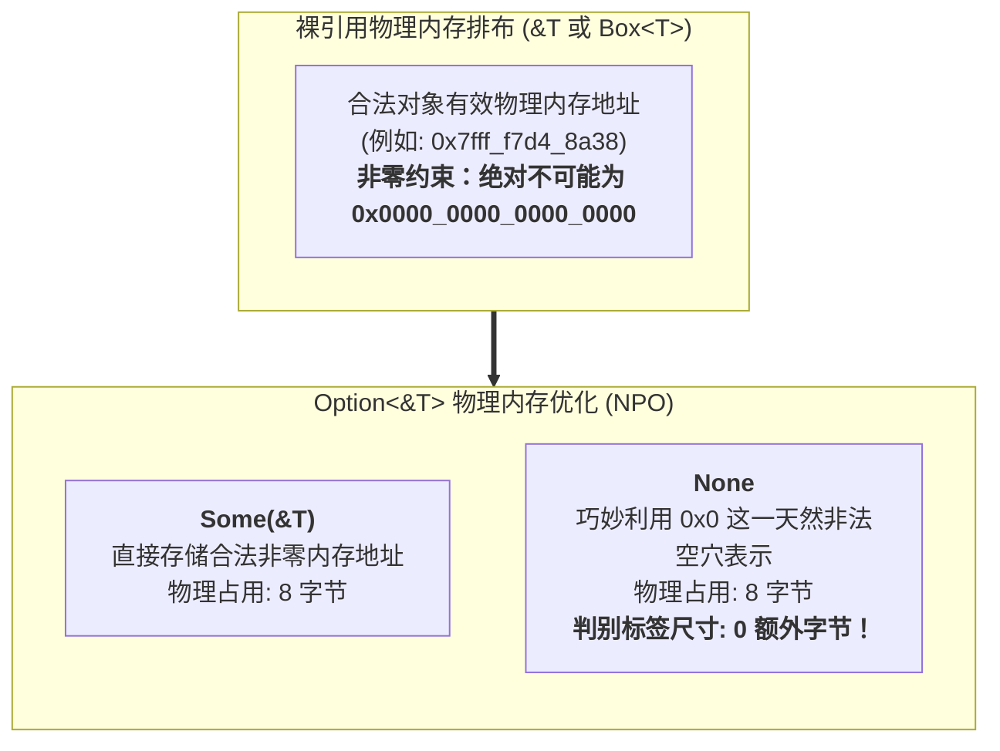

# 核心实战精炼：代数数据类型（ADT）与非空指针优化

## 1. 核心架构选型矩阵：主流语言多态联合体与模式解构对比

在底层系统编程中，如何安全、高效地表达“一个值可能是类型 A、也可能是类型 B”的互斥状态（Sum Types / Tagged Unions），直接决定了状态机、协议编解码器与 AST 解释器的吞吐极限与内存足迹。

下表系统化对比了主流系统级方案与高级语言在可区分联合体（Discriminated Union）上的底层实现与工程权衡：

| 评估维度 | C 语言裸联合体 (`union`) | C++ 现代可变体 (`std::variant`) | Go 语言空接口 (`any` / `interface{}`) | Rust 代数枚举 (`enum` ADT) |
| :--- | :--- | :--- | :--- | :--- |
| **类型安全机制** | **完全无类型安全保障**：开发者需手动维护一个平级 `enum Tag`；若读取错误的联合体字段，直接触发未定义行为（UB）。 | **受控类型安全**：内部保存 `type_index` 整数判别符；访问错误字段时抛出 `std::bad_variant_access` 异常。 | **动态类型检查**：通过运行时反射与 `type switch` 动态分发；编译器无法在静态期检查分支穷尽性。 | **编译期绝对静态安全**：代数数据类型（Tagged Union），唯一被允许的解构途径是模式匹配，彻底消灭类型混淆漏洞。 |
| **分支穷尽性检查** | 无任何静态检查，遗漏分支导致静默穿透或脏读。 | 依赖 `std::visit` 与重载 Lambda，模板报错极其冗长隐晦。 | 无穷尽性检查，未覆盖的 case 会静默落入 `default`。 | **编译期强制穷尽性（Exhaustiveness）**：遗漏任意一个变体即直接拒绝编译构建。 |
| **内存排布与判别标签** | 尺寸等于最大字段尺寸，无额外标签字段。 | 最大字段尺寸 + 8 字节对齐的 `type_index` + 对齐填充，内存膨胀严重。 | **双指针开销（16 字节）**：类型虚表指针（`_type`）+ 数据堆分配指针（`data`），产生隐式堆逃逸。 | **编译器极致压缩**：1 字节紧凑标签（Discriminant）+ 字段智能重排 + 自动利用物理空穴压缩。 |
| **指针空间零开销优化 (NPO)** | 不支持，必须显式分配独立字段区分 NULL。 | 不支持，`std::optional<T*>` 占用 16 字节（8 字节指针 + 8 字节布尔判别符）。 | 原生支持 nil 指针，但无法区分“未初始化的空”与“业务层面的 None”。 | **非空指针优化（NPO & Niching）**：`Option<&T>` 或 `Option<Box<T>>` **物理尺寸恰好等于裸指针（8 字节）**，利用 `0x0` 地址充当 `None` 标记！ |
| **模式解构表达力** | 不支持模式匹配，仅能使用繁琐的 `switch-case`。 | 缺乏原生语法支持，依赖 `std::holds_alternative` 与 `std::get`。 | 仅支持简单的浅层类型 `switch`，无法对嵌套结构进行深层结构解构。 | **图灵完备的模式解构**：支持嵌套解构、切片解构、守卫表达式（Guards）、`@` 绑定与引用解引用模式。 |

---

## 2. 生产级架构代码范式：高性能网络二进制帧解析引擎

在构建高吞吐网络代理或网关时，网络数据包呈现出强烈的“代数结构”：一个数据包要么是握手帧、要么是心跳帧、要么是承载业务数据的切片帧。利用 Rust 枚举与非空指针优化（NPO），可以在栈上以零动态内存分配的极致效率完成深层解析与状态流转：

```rust
use std::net::SocketAddr;
use std::num::NonZeroU32;

// ============================================================================
// 1. 深度代数数据类型建模：网络二进制协议帧
// ============================================================================

/// 标识帧优先级（使用 NonZeroU32 享受物理内存空穴压缩）
#[derive(Debug, Clone, Copy, PartialEq, Eq)]
pub struct Priority(pub NonZeroU32);

/// 客户端握手元数据
#[derive(Debug, Clone, PartialEq, Eq)]
pub struct HandshakeMeta {
    pub client_version: u32,
    pub source_addr: SocketAddr,
}

/// 网络通信协议帧：Tagged Union 典范
/// 使用 #[non_exhaustive] 保障公共库在未来新增变体时不破坏下游消费者的编译兼容性
#[non_exhaustive]
#[derive(Debug, Clone, PartialEq)]
pub enum ProtocolFrame<'a> {
    /// 握手协商帧
    Handshake(HandshakeMeta),

    /// 心跳保活帧（携带时间戳毫秒数）
    Heartbeat { timestamp_ms: u64 },

    /// 业务负载数据切片帧（零拷贝引用底层物理缓冲区）
    DataPayload {
        stream_id: u32,
        priority: Option<Priority>, // 享受 NPO：尺寸依然等同于裸 u32！
        payload: &'a [u8],
    },

    /// 物理断开控制帧
    Disconnect { reason_code: u16, message: &'static str },
}

// ============================================================================
// 2. 模式解构与匹配守卫（Match Guards）生产级引擎
// ============================================================================

pub struct FrameDispatcher;

impl FrameDispatcher {
    /// 高性能帧分发路由引擎：展示全景模式匹配语法
    pub fn process_frame<'a>(&self, frame: &ProtocolFrame<'a>) -> Result<(), &'static str> {
        match frame {
            // 1. 解构元组变体并绑定内部字段
            ProtocolFrame::Handshake(meta) if meta.client_version >= 3 => {
                println!("🤝 [握手通过] 现代客户端协议版本: v{}, 地址: {}", meta.client_version, meta.source_addr);
                Ok(())
            }
            ProtocolFrame::Handshake(meta) => {
                println!("⚠️ [握手拒绝] 客户端协议过旧: v{}", meta.client_version);
                Err("协议版本过低，强制终止握手")
            }

            // 2. 解构结构体变体，并通过匹配守卫过滤心跳
            ProtocolFrame::Heartbeat { timestamp_ms } if *timestamp_ms == 0 => {
                Err("心跳时间戳异常：不可为 0")
            }
            ProtocolFrame::Heartbeat { timestamp_ms } => {
                println!("💓 [保活心跳] 节点对齐时间戳: {timestamp_ms} ms");
                Ok(())
            }

            // 3. 复杂切片模式解构与 @ 作用域全量绑定
            ProtocolFrame::DataPayload {
                stream_id,
                priority,
                // 对内部物理切片进行模式解构：匹配魔数前缀 [0xAA, 0xBB, ..]
                payload: raw_data @ [0xAA, 0xBB, remaining @ ..],
            } => {
                let prio_desc = match priority {
                    Some(p) => format!("加急 (Level {})", p.0),
                    None => "普通 (Normal)".to_string(),
                };
                println!(
                    "📦 [特权业务帧] 流ID: {stream_id}, 优先级: {prio_desc}, 净荷长度: {} 字节",
                    remaining.len()
                );
                // 模拟业务处理
                self.handle_raw_data(raw_data);
                Ok(())
            }

            // 4. 普通业务负载兜底
            ProtocolFrame::DataPayload { stream_id, payload, .. } => {
                println!("📄 [常规业务帧] 流ID: {stream_id}, 尺寸: {} 字节", payload.len());
                Ok(())
            }

            // 5. 优雅断开连接分支
            ProtocolFrame::Disconnect { reason_code, message } => {
                println!("🛑 [连接断开] 状态码: {reason_code}, 详情: '{message}'");
                Ok(())
            }

            // 6. 防御未来潜在新增的变体（#[non_exhaustive] 倒逼兜底分支）
            _ => {
                println!("❓ 收到未知或未支持的未来协议变体，保持静默兼容");
                Ok(())
            }
        }
    }

    fn handle_raw_data(&self, _data: &[u8]) {}
}

// ============================================================================
// 3. 内存与 NPO 验证测试套件
// ============================================================================

fn main() {
    // 物理尺寸证明：非空指针优化（NPO）黑魔法
    // Option<&str> 与裸 &str 具有完全相同的物理尺寸（16 字节），零额外开销！
    assert_eq!(
        std::mem::size_of::<Option<&str>>(),
        std::mem::size_of::<&str>()
    );

    // Option<NonZeroU32> 尺寸与裸 u32 绝对一致（均为 4 字节）
    assert_eq!(
        std::mem::size_of::<Option<NonZeroU32>>(),
        std::mem::size_of::<u32>()
    );

    // 运行实战解构流转
    let dispatcher = FrameDispatcher;

    let payload_bytes = [0xAA, 0xBB, 1, 2, 3, 4, 5];
    let frame = ProtocolFrame::DataPayload {
        stream_id: 101,
        priority: Priority(NonZeroU32::new(1).unwrap()).into(),
        payload: &payload_bytes,
    };

    dispatcher.process_frame(&frame).expect("分发处理失败");
}
```

---

## 3. 核心机制图解：Tagged Union 内存排布与非空指针优化（NPO）

### 3.1 普通枚举 Tagged Union 内存排布模型

```text
以 RoughTime 枚举为例：
enum RoughTime {
    InThePast(TimeUnit, u32), // 字段大小：1 字节 + 4 字节 -> 对齐需要 4 字节边界
    JustNow,
    InTheFuture(TimeUnit, u32),
}

【物理内存 8 字节对齐排布】
Byte 0: [ 判别标签 Discriminant (Tag) = 0, 1, 或 2 ]
Byte 1: [ TimeUnit 枚举 (1 字节)                   ]
Byte 2: [ Padding 填充空洞 (2 字节)                 ] -> 确保后置 u32 满足 4 字节对齐
Byte 4..7: [ u32 数值载荷 (4 字节)                 ]
总计物理消耗：严格对齐为 8 字节！
```

### 3.2 非空指针优化（NPO / Niching 空穴）消除判别标签机理



---

## 4. 核心术语与物理模型映射表

| 核心术语 | 英文对照 | 物理实现与底层机理 | 典型应用与注意事项 |
| :--- | :--- | :--- | :--- |
| **判别标签** | Discriminant / Tag | 编译器为枚举变体分配的整数编号（0, 1, 2...），存储于结构体头部用于指引运行时分支。 | 仅在包含载荷数据的枚举中显式存在；纯 C 风格枚举可直接强转为整数。 |
| **非空指针优化** | Non-Null Pointer Optimization (NPO) | 语言保证安全引用（`&T`、`&mut T`）与 `Box<T>` 永不为 NULL；编译器利用 `0x0` 表示 `None`，彻底消除 `Option` 的标签开销。 | 使得 `Option<Box<T>>` 的内存占用与 C 语言裸指针完全 1:1 等价！ |
| **空穴优化** | Niching / Niche Filling | 类型由于自身定义约束而永远不会取到的无效比特模式（如 `bool` 仅用 0 和 1，其余 254 个比特全为空穴）。 | 允许标准库将枚举标签塞入空穴中，实现多个外层复合枚举零内存膨胀嵌套。 |
| **匹配守卫** | Match Guards (`if expr`) | 附加在模式匹配分支上的条件表达式，在模式结构解构成功后进一步校验动态业务谓词。 | 守卫表达式若求值为 `false`，控制流将自动回溯并尝试下一个匹配分支。 |
| **变量全量绑定** | At Patterns (`ident @ pat`) | 在将复杂内部字段细化解构的同时，将匹配成功的整个子结构整体绑定至单一命名变量。 | 避免在后续逻辑中重新组装或多次深层访问同一字段。 |
| **非穷尽性属性** | `#[non_exhaustive]` | 标记在 `pub enum` 上，禁止下游外部 Crate 使用全覆盖模式匹配（强制下游必须书写 `_ =>` 兜底）。 | 保证底层库在次版本迭代中新增枚举变体时，绝不会破坏下游工程的编译构建。 |

---

## 5. 架构避坑清单 (Do's & Don'ts)

| 典型工程误区 (Don't) | 生产级正确实践 (Do) |
| :--- | :--- |
| **在公共 SDK 中公开发布枚举时，未标记 `#[non_exhaustive]`，导致未来新增变体破坏下游编译。** | 面向外部发布的公共枚举必须慎重评估演进诉求，若未来可能扩充变体，必须显式附加 `#[non_exhaustive]`。 |
| **在递归枚举（如 AST 或链表）中直接内联嵌套自身（如 `enum List { Cons(T, List) }`）。** | 递归枚举必须使用 `Box<T>` 打破无限尺寸循环（`enum List { Cons(T, Box<List>) }`），否则引发编译报错。 |
| **误以为 `Option<T>` 一定比 `T` 多占用 1 个字节甚至 8 个字节的内存。** | 深入理解 NPO：对于引用、`Box`、`NonNull` 以及 `NonZero` 整数，`Option<T>` 与 `T` 物理尺寸绝对完全一致。 |
| **为了使用模式匹配中的局部字段，在匹配分支中强行对大对象调用 `.clone()`。** | 熟练使用 `ref` 或 `ref mut` 关键字仅借用局部字段的引用，或者在 `match` 前显式对容器调用 `.as_ref()`。 |
| **在涉及大量变体分支的匹配中，滥用 `_ =>` 忽略一切未知，导致漏掉关键业务分支。** | 在 Crate 内部尽量利用穷尽性模式匹配，让编译器在新增变体时自动定位所有必须补充处理的代码位置。 |

<!-- split -->

# 原著完整参考：第 10 章 枚举与模式匹配（Enums and Patterns）

在日常工程设计中，软件系统往往需要建模这样一种概念：**某个实体在同一物理时刻，只能处于若干种互斥状态中的某一种**。

例如，一个自动化网络抓取程序中的某个任务，其状态要么是“等待调度（Pending）”、要么是“正在抓取（Running）”、要么是“成功抓取（Success）”、抑或是“遇到致命异常（Failed）”。在传统面向对象语言（如 Java 或 C++）中，这种需求通常不得不通过复杂的类继承层次、带有虚函数表的基类指针、或者一组晦涩脆弱的整数状态码结合联合体来实现。

而在 Rust 中，**枚举（Enum）** 绝不仅仅是 C 语言那种单调乏味的整数别名常量集合。**Rust 的枚举是血统纯正的代数数据类型（Algebraic Data Types, ADT / Sum Types）**——它的每一个分支变体不仅能够拥有完全独立、异构的数据载荷，还能在底层获得编译器无微不至的内存紧缩优化；而与之协同作战的**模式匹配（Pattern Matching）**体系，则赋予了系统架构师在零运行时开销的前提下，以无可匹敌的精准度解构复杂内存拓扑的终极武器。

---

# 1. 深入理解枚举类型

## 1.1 C 语言风格枚举及其整数映射

最简朴的枚举形态是类 C 风格枚举：

```rust
#[derive(Copy, Clone, Debug, PartialEq, Eq)]
enum HttpStatus {
    Ok = 200,
    NotFound = 404,
    InternalServerError = 500,
}
```

默认情况下，Rust 会为无显式赋值的枚举分支自动从 0 开始顺序编号。你可以使用 `as` 操作符将此类无载荷枚举直接强转为整数标量：

```rust
assert_eq!(HttpStatus::NotFound as i32, 404);
```

然而，逆向转换——即试图将一个裸整数强转回对应的枚举类型——在 Safe Rust 中是被坚决禁止的。因为裸整数可能包含枚举定义中从未列出的非法数值（例如将 999 强转为 `HttpStatus`），若任由其进入类型系统，将在后续的分支分发中瞬间诱发未定义行为。

---

## 1.2 携带数据的复合枚举（Tagged Unions）

Rust 枚举真正的革命性威力，在于其各个变体可以**各自携带丰富且异构的数据载荷**：

```rust
#[derive(Copy, Clone, Debug, PartialEq)]
enum TimeUnit {
    Seconds, Minutes, Hours, Days, Months, Years,
}

#[derive(Copy, Clone, Debug, PartialEq)]
enum RoughTime {
    InThePast(TimeUnit, u32),
    JustNow,
    InTheFuture(TimeUnit, u32),
}
```

在此，`RoughTime::JustNow` 不包含任何额外数据；而 `InThePast` 与 `InTheFuture` 则各自包含了一个时间单位和一个 32 位无符号整数。在函数式编程界，这种结构被称为**和类型（Sum Types）**，因为该类型所能表达的可能状态总空间，是其所有分支状态空间的数学总和。

实例化带数据的枚举与调用元组构造函数完全一致：
```rust
let four_score_and_seven_years_ago =
    RoughTime::InThePast(TimeUnit::Years, 4 * 20 + 7);
let three_hours_from_now =
    RoughTime::InTheFuture(TimeUnit::Hours, 3);
```

枚举分支甚至可以直接采用结构体语法：
```rust
enum Shape {
    Sphere { center: Point3d, radius: f32 },
    Cuboid { corner1: Point3d, corner2: Point3d },
}
```

---

## 1.3 枚举在物理内存中的排布机理（Enums in Memory）

在物理底层，携带数据的枚举是如何在物理内存中平铺存储的？

答案是：**存储为一个微小的整数判别标签（Discriminant / Tag），加上足以容纳最大变体字段的连续内存块（Payload）**。
标签字段是 Rust 编译器的内部私有元数据，用于在运行时精准判定当前内存槽位中真正驻留的是哪一个构造变体，进而决定该如何正确解构其字段。

在 64 位体系结构下，上述 `RoughTime` 结构体在物理内存中恰好占据 8 个字节，其真实排布拓扑如下图 10-1 所示：


###### 图 10-1. 物理内存中的 `RoughTime` 变体排布

必须指明的是：**Rust 并不对普通枚举的内存排布顺序做死板的跨版本担保**。这为编译器在后台进行激进的内存压缩优化留出了无限广阔的自由度。例如，编译器完全有权调整标签字段的位置、甚至彻底将标签抹去。

---

## 1.4 非空指针优化（NPO）与物理空穴利用

在系统级工程中，这是 Rust 最令人叹为观止的黑魔法之一。

在 C++ 或 Java 中，指针或对象引用天然可以为 `NULL`。然而在 Rust 中，所有安全引用（如 `&T`、`&mut T`）、智能指针（`Box<T>`）、以及底层包装类型（`NonNull<T>`）均被语言核心白纸黑字地施加了一条物理不可动摇的硬性契约：**它们的物理内存地址绝不可能是 0x0（Null Pointer）**。

这意味着，在 64 位虚拟地址空间中，数值 `0x0000_0000_0000_0000` 对于一个有效的 Rust 引用而言，是一个**在物理上永远绝不可能合法出现的“空穴（Niche）”**！

Rust 编译器敏锐地捕获了这一点，创造出了被工业界奉为神作的**非空指针优化（Non-Null Pointer Optimization, NPO）**：
当你使用 `Option<&T>` 或 `Option<Box<T>>` 时，Rust 编译器根本不需要为 `Option` 额外分配任何独立的 1 字节或 8 字节判别标签！
* 若指针位置的物理二进制值为合法的物理地址，系统直接将其解构为 `Some(&T)`；
* 若指针位置的物理二进制值恰好全为 0（`0x0`），系统直接将其判定为 `None`！

**结果就是：`Option<&T>` 在物理内存中的大小、排布与运行效率，与 C 语言中的单个裸指针完全 100% 绝对一致！**
Rust 不仅彻底根绝了十亿美元级空指针崩溃灾难，而且在此过程中，没有为类型系统抽象付出哪怕 1 个额外比特的内存开销与总线惩罚！

这种优化不仅限于裸指针。对于只有两种可能取值的 `bool`（占用 1 字节但仅利用了 0 和 1 两个值，剩下 254 个比特模式全为空穴）、以及标明永不为 0 的整数类型 `std::num::NonZeroU64`，编译器都会全自动进行“空穴塞入（Niche Filling）”，实现多个枚举嵌套时的惊人零膨胀。

:::en
> **Original**: In memory, enums with data are stored as a small integer tag, plus enough memory to hold all the fields of the largest variant... Rust makes no promises about enum layout, however, to leave the door open for future optimizations. For instance, the Rust compiler can optimize away the tag field for some enums... In particular, Rust guarantees that `Option<&T>` has the same size, alignment, and ABI as a raw pointer.

**📌 核心术语与语境解析**：
- **Discriminant (Tag)** [dɪˈskrɪmɪnənt tæɡ]：*判别标签*。存储于 Tagged Union 内存中用于指示当前有效变体的内部标号。
- **Non-Null Pointer Optimization (NPO)** [nɑːn nʌl ˈpɔɪntər ˌɑːptɪməˈzeɪʃn]：*非空指针优化*。利用引用绝不为 0x0 的语言不变量，将 0x0 地址复用为 None 标记的零开销技术。
- **Niche Filling** [nɪtʃ ˈfɪlɪŋ]：*空穴填充*。将外部判别标签巧妙塞入内部字段未使用的非法比特位中的极致内存压缩算法。
:::

---

## 1.5 基于递归枚举构建复杂富数据结构

枚举与智能指针的结合，能够以极简的代码构筑出强大的递归数据结构。以在内存中完整表示任意合法的 JSON 树形文档为例：

```rust
use std::collections::HashMap;

enum Json {
    Null,
    Boolean(bool),
    Number(f64),
    String(String),
    Array(Vec<Json>),
    Object(Box<HashMap<String, Json>>),
}
```

这段纯粹优雅的 Rust 代码，便足以直接作为世界级序列化工业标准 `serde_json` 库的核心地基。

值得深思的工程细节在于：为何 `Object` 变体内部必须显式套上一个 `Box`？
因为所有 `Json` 枚举实例在内存中都必须拥有**完全相同且固定的物理尺寸**（即等于最大变体的尺寸）。一个 `String` 或 `Vec` 在栈上占用 3 个机器字（24 字节），加上 1 字节标签与对齐填充，整个 `Json` 恰好被压制在 4 个机器字（32 字节）之内（参见下方图 10-2）。
而一个裸的 `HashMap` 自身尺寸极其庞大（通常需要 8 个机器字以上）；如果直接将其平铺内联，将导致系统中数以百万计哪怕只是包含一个简单数字或布尔值的 `Json` 节点，都在物理内存中被迫膨胀至 8 个机器字以上！通过一个 `Box` 指针的巧妙间接隔离，整座系统的内存局部性与紧凑度获得了飞跃。


###### 图 10-2. 物理内存中的 `Json` 变体排布细节

---

## 1.6 泛型枚举与二叉查找树

Rust 中最负盛名的两大泛型枚举，莫过于构成了现代错误处理与可空语义基石的 `Option<T>` 与 `Result<T, E>`：

```rust
enum Option<T> {
    None,
    Some(T),
}

enum Result<T, E> {
    Ok(T),
    Err(E),
}
```

借助泛型枚举与递归所有权，我们可以轻松构建一棵工业级的无锁二叉搜索树：

```rust
// 有序二叉树节点：利用 Option<Box<...>> 享受完美的 NPO 优化
enum BinaryTree<T> {
    Empty,
    NonEmpty(Box<TreeNode<T>>),
}

struct TreeNode<T> {
    element: T,
    left: BinaryTree<T>,
    right: BinaryTree<T>,
}
```

在这棵二叉树中，`BinaryTree::Empty` 仅仅占用单个机器指针尺寸（8 字节），在底层物理上就是一个裸的 NULL 地址指针（参见下方图 10-3），实现了对物理硬件极其贴合的高性能映射。


###### 图 10-3. 物理堆栈空间中驻留的六节点二叉树图谱

---

# 2. 模式匹配机制（Patterns）

有了代数数据类型，我们该如何将其优雅、安全地解包消费？
答案是：**模式匹配（Pattern Matching）**。

模式匹配绝不是高级版的 `switch-case`。模式（Pattern）就像一把精密雕刻的物理铸模；当我们把一个未知的值投射到该铸模上时，若其外形结构完全吻合，铸模就会瞬间将值内部的各个深层子构件“咔哒”一声卡入预设的各个局部命名变量中！

```rust
match rough_time {
    RoughTime::InThePast(units, count) => {
        format!("{count} {} ago", units.plural())
    }
    RoughTime::JustNow => {
        "just now".to_string()
    }
    RoughTime::InTheFuture(units, count) => {
        format!("{count} {} from now", units.plural())
    }
}
```

如果输入的值与当前分支的模式在结构或判别标签上不一致，匹配宣告失败，系统将平滑尝试下一个分支（参见下方图 10-4 不匹配示意图，以及图 10-5 成功匹配解构示意图）：


###### 图 10-4. 模式与目标值不匹配时的流转细节


###### 图 10-5. 成功匹配并触发变量绑定的物理瞬间

---

## 2.1 全景模式解构语法体系

Rust 提供了当今系统级编程语言中最强大、最完备的解构模式库：

* **字面量与通配符**：支持匹配纯数字、字符常量与万能丢弃通配符 `_`；
* **元组与结构体解构**：不仅能够匹配结构体名称，还能精准解包内部特定字段，并使用 `..` 忽略无关字段（参见下方图 10-6）：


###### 图 10-6. 针对复杂结构体的模式精准解构实况

* **引用模式与 `ref` / `ref mut` 关键字**：
  若被匹配的目标对象本身是一个借用引用（例如 `&RoughTime`），为了避免在解构时非法移走内部非 Copy 字段的所有权，我们可以使用 `ref` 修饰符：
  ```rust
  match *account {
      Account { ref name, ref mut balance, .. } => {
          // name 是 &String，balance 是 &mut f64
      }
  }
  ```
* **数组与切片模式**：
  支持直击底层切片的模式提取：
  ```rust
  match slice {
      [] => "空切片",
      [single] => "单元素切片",
      [first, .., last] => "至少包含两个元素，提取首尾",
  }
  ```
* **匹配守卫（Match Guards）**：
  在模式末尾追加 `if <表达式>`，允许在结构解构成功的前提下，进一步通过动态布尔谓词过滤：
  ```rust
  match shape {
      Shape::Sphere { radius, .. } if radius <= 0.0 => {
          panic!("检测到非法物理半径");
      }
      _ => {}
  }
  ```
* **`@` 绑定语法**：
  允许在对局部子模式进行范围约束匹配的同时，将匹配成功的整体值绑定至命名变量：
  ```rust
  match message_id {
      id @ 100..=199 => handle_client_error(id),
      id @ 200..=299 => handle_server_error(id),
      _ => {}
  }
  ```

---

## 2.2 模式可以施展威力的所有法定领地

在 Rust 中，模式不仅仅局限于 `match` 表达式内部。以下所有核心语法位置，本质上都合法接受模式解构：

1. **`let` 声明语句**：`let (x, y) = get_coordinates();`
2. **函数与闭包参数列表**：`fn handle(&(x, y): &(i32, i32)) { ... }`
3. **`for` 迭代器循环**：`for (key, val) in &hash_map { ... }`
4. **`if let` 快捷分支**：`if let Some(user) = fetch_user() { ... }`
5. **`while let` 条件循环**：`while let Ok(line) = stream.read_line() { ... }`

---

# 3. 公共枚举与 API 演化兼容性（`#[non_exhaustive]`）

在系统工程的大规模协作中，如果你正在维护一个向外发布的底层公共库，且你的库中导出了一个包含若干变体的公开枚举：

```rust
pub enum ErrorCode {
    NetworkFailure,
    Timeout,
}
```

下游依赖你的成千上万个应用程序，必然会编写如下穷尽匹配代码：

```rust
match code {
    ErrorCode::NetworkFailure => { ... }
    ErrorCode::Timeout => { ... }
}
```

此时灾难降临了：若你在下个月发布的新版本中，为 `ErrorCode` 增加了一个全新的变体 `DiskFull`，**那么在下游应用拉取你新版库的瞬间，他们的项目将全部因为“未覆盖全部模式分支”而彻底构建失败（Breaking Change）！**

Rust 官方为此引入了 **`#[non_exhaustive]` 属性**：

```rust
#[non_exhaustive]
pub enum ErrorCode {
    NetworkFailure,
    Timeout,
}
```

一旦一个公共枚举被标注为 `#[non_exhaustive]`，Rust 编译器将向所有**外部 Crate** 强制施加一项法律契约：
外部用户在针对该枚举编写 `match` 表达式时，**被强制要求必须书写一个通配兜底分支（`_ =>`）**！否则编译器将直接在外部消费方报错。

如此一来，库的维护团队便获得了在未来的小版本迭代中自由增加新变体的绝对特权，而绝不会导致全世界下游项目的既有匹配逻辑发生任何编译破坏，完美兼顾了静态类型安全性与工业级向前向后兼容性。
