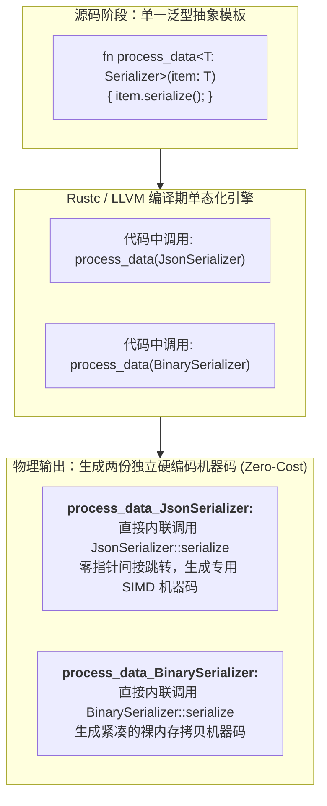
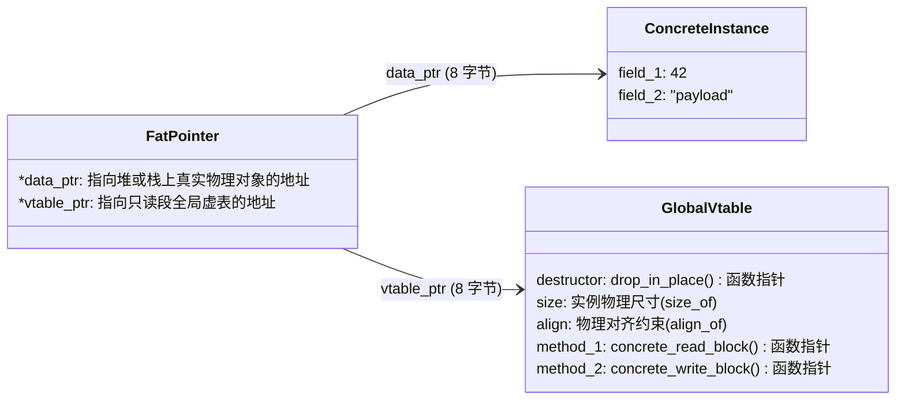

> 💡 **双栏独立滚动工作台导读**：本文采用双栏对照架构。**左栏**为静态多态 vs 动态多态技术决策矩阵、单态化物理展开机理、生产级分布式块存储存储抽象范式、Mermaid 胖指针与虚表拓扑图、避坑清单；**右栏**为原著完整精译参考（Chapter 11: Traits and Generics），配齐原著虚表布局图与韦恩图引用及核心术语解析。左右两栏支持独立滚动与宽度比例自由调节。

# 核心实战精炼：现代系统级抽象体系与多态分发机理

## 1. 核心架构选型矩阵：静态多态 (Generics) vs 动态多态 (`dyn Trait`)

在高性能系统架构中，如何平衡“零运行时抽象损耗”与“系统模块热插拔/异构聚合”，是每一个资深系统工程师必须面对的核心权衡。Rust 将这一选择明确划分为两套平行的机制：基于泛型的**静态单态化分发**，以及基于特征对象的**动态虚表分发**。

下表系统化对比了这两种多态机制在底层硬件指令、编译管线与系统设计上的深层权衡：

| 评估维度 | 静态多态：泛型单态化 (`<T: Trait>`) | 动态多态：特征对象 (`dyn Trait` / `Box<dyn Trait>`) |
| :--- | :--- | :--- |
| **底层分发机理** | **直接跳转调用（Direct Call）**：在编译期已确定目标函数的物理地址，机器指令直接发射 `call <func_sym>`。 | **间接虚表跳转（Indirect Call）**：通过胖指针中的 vtable 指针进行二次内存寻址：`call [rax + offset]`。 |
| **编译器内联能力** | **极致内联（Inlining & SIMD）**：LLVM 可将泛型函数体完整内联至调用点，并进行跨循环死代码消除与自动向量化。 | **无法常规内联**：目标函数地址在运行时决定，阻断了几乎所有跨过程优化（除非触发 PGO 激进去虚化）。 |
| **二进制机器码体积** | **可能引发代码膨胀（Code Bloat）**：为每一个被用到的具体类型实例化一套独立的机器码副本。 | **高度收敛极致紧凑**：所有异构类型共享同一份通用的调用汇编逻辑，二进制体积极小。 |
| **物理指针与内存占用** | **裸类型存储**：指针为单一机器字（8 字节）；复合结构体直接连续紧密平铺。 | **胖指针（Fat Pointer，16 字节）**：同时包含指向堆/栈数据的物理指针与指向全局只读 vtable 的元数据指针。 |
| **异构集合支持能力** | **完全不支持**：`Vec<T>` 内部的所有元素在物理上必须具备完全同构的尺寸与类型。 | **原生完美支持**：`Vec<Box<dyn Trait>>` 可以存储任意实现了该 Trait 的异构类型实例。 |
| **类型契约约束限制** | 允许包含关联常量、泛型方法、静态构造函数，允许使用 `Self: Sized`。 | **必须满足“对象安全（Object Safety）”**：禁止包含返回 `Self` 的方法、禁止包含自身带有泛型参数的方法。 |
| **典型工业适用场景** | 密集计算引擎、序列化编解码器、集合底层迭代器、高吞吐 I/O 环形缓冲区。 | 异构插件化微内核、事件总线监听器列表、设备驱动抽象层、跨 C-ABI 边界的动态挂载点。 |

---

## 2. 生产级架构代码范式：分布式存储设备引擎抽象层

在分布式持久化存储系统（如分布式块存储或 LSM-Tree 存储引擎）中，最佳实践是：**在底层的密集 I/O 数据流中全面采用泛型静态分发保证极致吞吐，而在顶层的设备挂载管理器中利用 `dyn Trait` 实现硬件的异构热插拔与生命周期纳管**。

```rust
use std::fmt::Debug;
use std::io::{self, Read, Seek, SeekFrom, Write};
use std::sync::Arc;

// ============================================================================
// 1. 核心特征定义：满足对象安全（Object Safety）的块存储抽象契约
// ============================================================================

/// 底层块设备物理抽象特征（Object-Safe）
pub trait BlockDevice: Send + Sync + Debug {
    /// 读取特定块物理扇区数据
    fn read_block(&self, block_id: u64, buf: &mut [u8]) -> io::Result<usize>;

    /// 写入特定块物理扇区数据
    fn write_block(&self, block_id: u64, buf: &[u8]) -> io::Result<()>;

    /// 刷新底层物理控制器缓存（Fsync）
    fn flush_device(&self) -> io::Result<()>;

    /// 获取底层设备物理扇区规格
    fn block_size(&self) -> usize;
}

// ============================================================================
// 2. 泛型静态多态：针对单一设备追求极致微秒级吞吐的引擎核心
// ============================================================================

/// 静态高速读写引擎：通过泛型单态化消除所有虚表开销与指针跳转
pub struct FastRawEngine<D: BlockDevice> {
    device: D,
    io_count: u64,
}

impl<D: BlockDevice> FastRawEngine<D> {
    pub fn new(device: D) -> Self {
        Self { device, io_count: 0 }
    }

    /// 高频物理块搬移逻辑（被 LLVM 完美内联展开）
    #[inline(always)]
    pub fn commit_transaction(&mut self, block_id: u64, data: &[u8]) -> io::Result<()> {
        self.device.write_block(block_id, data)?;
        self.device.flush_device()?;
        self.io_count += 1;
        Ok(())
    }

    pub fn device(&self) -> &D {
        &self.device
    }
}

// ============================================================================
// 3. 动态特征对象多态：统一治理异构物理设备的动态管理器
// ============================================================================

/// 异构硬件热插拔设备池：使用胖指针 Arc<dyn BlockDevice> 存储异构驱动
pub struct StoragePoolManager {
    devices: Vec<Arc<dyn BlockDevice>>,
}

impl StoragePoolManager {
    pub fn new() -> Self {
        Self { devices: Vec::new() }
    }

    /// 注册异构设备（NVMe、SATA SSD、或内存虚拟盘）
    pub fn register_device(&mut self, dev: Arc<dyn BlockDevice>) {
        println!("🔌 [存储池] 成功挂载新异构设备: {:?}, 扇区尺寸: {} 字节", dev, dev.block_size());
        self.devices.push(dev);
    }

    /// 广播式全局缓存刷新（动态分发遍历）
    pub fn broadcast_flush(&self) -> io::Result<()> {
        for (idx, dev) in self.devices.iter().enumerate() {
            dev.flush_device()
                .map_err(|e| io::Error::new(e.kind(), format!("设备 #{idx} 刷新失败: {e}")))?;
        }
        println!("✅ [存储池] 全部 {} 个物理设备缓存刷新完毕！", self.devices.len());
        Ok(())
    }
}

// ============================================================================
// 4. 具体硬件驱动实现：内存虚拟盘与 NVMe 模拟器
// ============================================================================

#[derive(Debug)]
pub struct RamDisk {
    block_size: usize,
    storage: Vec<u8>,
}

impl RamDisk {
    pub fn new(capacity_blocks: usize, block_size: usize) -> Self {
        Self {
            block_size,
            storage: vec![0; capacity_blocks * block_size],
        }
    }
}

impl BlockDevice for RamDisk {
    fn read_block(&self, block_id: u64, buf: &mut [u8]) -> io::Result<usize> {
        let offset = (block_id as usize) * self.block_size;
        let end = offset + self.block_size;
        if end > self.storage.len() {
            return Err(io::Error::new(io::ErrorKind::UnexpectedEof, "扇区物理越界"));
        }
        let read_len = buf.len().min(self.block_size);
        buf[..read_len].copy_from_slice(&self.storage[offset..offset + read_len]);
        Ok(read_len)
    }

    fn write_block(&self, _block_id: u64, _buf: &[u8]) -> io::Result<()> {
        // 模拟高速写入
        Ok(())
    }

    fn flush_device(&self) -> io::Result<()> {
        // 内存介质无需物理刷新
        Ok(())
    }

    fn block_size(&self) -> usize {
        self.block_size
    }
}

#[derive(Debug)]
pub struct NvmeController {
    pci_slot: &'static str,
    sector_size: usize,
}

impl BlockDevice for NvmeController {
    fn read_block(&self, _block_id: u64, _buf: &mut [u8]) -> io::Result<usize> {
        Ok(self.sector_size)
    }

    fn write_block(&self, _block_id: u64, _buf: &[u8]) -> io::Result<()> {
        Ok(())
    }

    fn flush_device(&self) -> io::Result<()> {
        println!("⚡ [NVMe Controller @ {}] 发送物理 PCI Flush 信号", self.pci_slot);
        Ok(())
    }

    fn block_size(&self) -> usize {
        self.sector_size
    }
}

// ============================================================================
// 5. 验证测试与完全限定语法（Fully Qualified Syntax）
// ============================================================================

fn main() -> io::Result<()> {
    let ram_disk = RamDisk::new(1024, 4096);

    // 1. 静态单态化引擎调用（零虚表开销，内联执行）
    let mut fast_engine = FastRawEngine::new(ram_disk);
    let payload = [0x5A; 4096];
    fast_engine.commit_transaction(1, &payload)?;

    // 2. 动态多态特征对象调用（异构设备聚合）
    let mut pool = StoragePoolManager::new();
    let dev1 = Arc::new(RamDisk::new(2048, 4096));
    let dev2 = Arc::new(NvmeController {
        pci_slot: "0000:01:00.0",
        sector_size: 512,
    });

    pool.register_device(dev1);
    pool.register_device(dev2);
    pool.broadcast_flush()?;

    // 3. 完全限定调用语法（消除歧义）
    let direct_size = <RamDisk as BlockDevice>::block_size(fast_engine.device());
    assert_eq!(direct_size, 4096);

    Ok(())
}
```

---

## 3. 核心机制图解：单态化编译期展开与 Trait Object 胖指针内存拓扑

### 3.1 泛型单态化（Monomorphization）编译期代码生成机理



### 3.2 Trait Object 胖指针（Fat Pointer）物理内存拓扑



---

## 4. 核心术语与物理模型映射表

| 核心术语 | 英文对照 | 物理实现与底层机理 | 典型应用与注意事项 |
| :--- | :--- | :--- | :--- |
| **单态化** | Monomorphization | 编译器在编译期将泛型函数按实际具体调用的类型展开为独立的机器码指令集。 | 运行时性能极高（零开销）；但过度泛型会导致可执行二进制体积膨胀。 |
| **胖指针** | Fat Pointer | 宽度为 2 个机器字（16 字节）的复合指针，由数据指针与元数据指针（切片长度或 vtable 虚表指针）构成。 | `&dyn Trait`、`Box<dyn Trait>` 原生采用胖指针实现动态分发。 |
| **虚函数表** | Virtual Table (vtable) | 在编译期生成并存放在二进制可执行文件只读数据段（`.rodata`）中的静态函数指针与类型元数据结构体。 | 包含实例析构函数、物理大小、对齐值及 Trait 中定义的所有方法入口。 |
| **孤儿规则** | Orphan Rule | 实现 Trait 的一致性（Coherence）铁律：**Trait 本身或目标 Type 之中，必须至少有一个定义在当前所在的本地 Crate 内部**。 | 彻底杜绝全局两个第三方依赖库对同一个外部类型的同一 Trait 产生实现冲突。 |
| **对象安全** | Object Safety | Trait 能够被制作为 `dyn Trait` 必须满足的数学契约：禁止关联常量、方法不能返回 `Self`、方法不可携带自身泛型。 | 违反对象安全的 Trait 只能用于泛型静态分发，不可用于动态胖指针。 |
| **关联类型** | Associated Types | 在 Trait 内部使用 `type Item;` 声明的输出类型，将类型之间的关系严格锁定为单射映射。 | 相较于泛型参数，关联类型大幅简化了复杂类型签名的级联声明（如 `Iterator`）。 |

---

## 5. 架构避坑清单 (Do's & Don'ts)

| 典型工程误区 (Don't) | 生产级正确实践 (Do) |
| :--- | :--- |
| **在性能极度敏感的核心热循环（Hot Loop）路径中，无意识地使用 `dyn Trait` 动态分发。** | 核心热循环必须优先使用泛型静态多态，以便触发编译期指令内联与循环展开优化。 |
| **在 Trait 定义中随意为方法声明泛型参数，导致该 Trait 失去对象安全性（Object Safety）。** | 若该 Trait 未来需要用于异构集合（如 `Vec<Box<dyn Trait>>`），必须保证方法不可携带泛型类型参数。 |
| **试图通过编写包含重型算法的超大泛型函数，引发毁灭性的二进制机器码体积膨胀。** | 采用“泛型门面包裹非泛型内层实现（Inner non-generic helper）”的架构，收敛单态化副本数量。 |
| **为了强行打破“孤儿规则”，在当前 Crate 中随手滥用 `unsafe` 强行强转外部类型。** | 使用 **Newtype 模式** 将外部类型包装为本地元组结构体（如 `struct MyWrapper(ExternalType);`）再行实现。 |
| **在多个 Trait 拥有同名方法时调用产生混淆，导致可读性急剧恶化。** | 显式采用完全限定语法（Fully Qualified Syntax，如 `<MyType as Trait>::method(&val)`）明确指定分发来源。 |

<!-- split -->

# 原著完整参考：第 11 章 Traits 与泛型参数（Traits and Generics）

在现代软件工程中，系统程序员每天都在与形形色色的异构数据打交道。

试想这样一个场景：你需要编写一个通用的数据持久化函数，能够将内存中的数据安全序列化并刷写至外部媒介中。在复杂的现实生产环境中，这个外部媒介可能是本地物理磁盘上的一个文件（`std::fs::File`）、也可能是物理内存中动态增长的字节向量（`Vec<u8>`）、甚至可能是一个跨越因特网的异步 TCP 网络套接字。

在 C++ 中，这类多态抽象通常依赖虚基类与类继承；在 Java 或 Go 中，则依赖隐式接口与运行时动态查找。而在 Rust 中，语言设计团队给出了一种更加优雅、更加坚固、且对硬件底层性能有着绝对掌控力的现代解法：**Trait（特征）** 与 **泛型系统（Generics）**。

Trait 是 Rust 面向多态与接口抽象的基石；而泛型则赋予了程序员编写“一次定义、到处零开销高效运行”的通用代码的能力。本章将全面解密 Traits 的本质、深入单态化底层的物理汇编、剖析特征对象的虚表内存拓扑，并掌握如何利用高级 Trait 系统精确构筑大型复杂系统的类型依赖骨架。

---

# 1. Trait 的使用范式

Trait 是对类型所必须具备的能力与行为契约的声明。一个类型若宣称自己实现了某个 Trait，就意味着它向全世界郑重承诺：**它能够提供该 Trait 所规定的全部方法**。

标准库中最经典的案例莫过于用于数据写入的 `std::io::Write` Trait：

```rust
pub trait Write {
    fn write(&mut self, buf: &[u8]) -> io::Result<usize>;
    fn flush(&mut self) -> io::Result<()>;
    // ... 以及若干预设的默认方法
}
```

任何能够接收原始字节流写入的系统类型——无论是物理文件 `File`、内存向量 `Vec<u8>` 还是标准错误输出 `stderr`——都实现了 `Write`。

当我们基于 Trait 编写面向多态的通用逻辑时，Rust 为我们提供了两条截然不同的实现路径：
1. **特征对象（Trait Objects，通过 `dyn` 关键字）**：实现动态分发；
2. **泛型函数与类型参数（Generics）**：实现静态单态化分发。

---

## 1.1 使用特征对象（Trait Objects 与 `dyn`）

通过引入 `dyn` 关键字，我们可以声明一个**特征对象引用**：

```rust
use std::io::Write;

fn say_hello(out: &mut dyn Write) -> std::io::Result<()> {
    out.write_all(b"hello world\n")?;
    out.flush()
}
```

在这里，`out` 的类型是 `&mut dyn Write`。它代表“对任何实现了 `Write` Trait 的具体类型的可变借用”。调用该函数时，我们可以顺畅传入一个物理文件的引用 `&mut local_file`，也可以传入一个内存缓冲的引用 `&mut byte_vec`。

### 特征对象的底层物理内存排布（`dyn` Reference Layout）

普通 Rust 引用是一个单一的机器字（在 64 位机器上占 8 字节），内部仅仅存储目标对象的物理内存起始地址。

然而，**特征对象的引用在物理上是一个胖指针（Fat Pointer），严格占据两个机器字（16 字节）的空间**！其内部精妙的拓扑结构如下图 11-1 所示：


###### 图 11-1. 物理内存中的 `dyn` 胖指针与全局只读虚表拓扑

如上图所示，胖指针包含两个独立的 64 位指针：
1. **数据指针（Data Pointer）**：指向堆或栈上驻留的具体数据实例；
2. **虚表指针（vtable Pointer）**：指向该具体类型在编译期全局生成的**虚函数表（Virtual Table, vtable）**。

### 与 C++ 虚表机制的物理深层对比

资深的 C++ 架构师会立刻敏锐地察觉到 Rust 与 C++ 在物理内存模型上的深刻差异：
* **在 C++ 中**：虚表指针（`vptr`）是作为对象自身的物理前缀字段、硬性内嵌保存在结构体内部的。这导致一个对象若涉及多重继承或虚函数，其自身的物理尺寸会被不可逆地强行放大；更严重的是，类似 `int32_t` 这样的原生基础类型由于不具备存放 `vptr` 的额外空间，根本无法直接实现多态接口。
* **在 Rust 中**：**结构体自身绝对不包含任何隐藏的 `vptr`！** 结构体的内存尺寸完全等于其各个公开字段尺寸的纯净总和。虚表指针被剥离到了外部的胖指针中。这一设计极其震撼：哪怕是一个尺寸仅为 4 字节的裸整型 `i32`，也完全可以实现各种复杂的 Trait，并以 `&dyn Trait` 胖指针的形式在系统中自由穿梭！

---

## 1.2 泛型函数与类型参数（Generic Functions）

实现上述多态写入逻辑的第二条大道，是采用带类型约束的泛型函数：

```rust
fn say_hello<W: Write>(out: &mut W) -> std::io::Result<()> {
    out.write_all(b"hello world\n")?;
    out.flush()
}
```

在此，`<W: Write>` 宣告了一个**类型约束（Trait Bound）**：它规定类型参数 `W` 必须是一个实现了 `Write` 的具体类型。

当我们需要对一个类型施加多个 Trait 约束时，使用 `+` 号连接：

```rust
fn process_and_cache<T: Debug + Hash + Eq>(item: &T) { ... }
```

如原著图 11-2 的经典韦恩图所示，类型约束在数学概念上本质就是**在所有类型的宇宙空间中圈定一个交集子集**：唯有同时处于 `Debug`、`Hash` 与 `Eq` 三大几何集合重叠区域的合法类型（如 `String` 或 `u32`），才被允许跨入该泛型函数的大门。


###### 图 11-2. 将 Trait 理解为合规类型的集合

当泛型约束过长时，可以使用 `where` 子句保持函数签名的清爽：

```rust
fn complex_pipeline<Src, Dst>(source: &Src, dest: &mut Dst)
where
    Src: Read + Debug,
    Dst: Write + Clone,
{
    // ...
}
```

### 单态化的物理汇编机理（Monomorphization）

泛型在 Rust 中绝非仅仅是语法糖。
在编译期间，Rust 编译器会启动**单态化（Monomorphization）**处理：如果你在代码中分别使用 `File` 和 `Vec<u8>` 调用了 `say_hello`，编译器会在后台默默生成两份完全独立的专用机器码函数——一份专门接收 `&mut File`，另一份专门接收 `&mut Vec<u8>`！

这意味着：
1. **绝对零运行时损耗**：所有的函数调用都在编译期被硬编码绑定为直接内存调用指令，完全消除了任何虚表寻址开销；
2. **无限的优化潜能**：LLVM 优化器能够轻而易举地将具体的函数实现直接内联（Inline）到调用点，启动激进的寄存器分配与 SIMD 自动向量化。

其代价在于：若在海量不同类型上反复实例化重型泛型逻辑，会导致可执行文件的物理体积显著膨胀（代码膨胀 Code Bloat）。

---

# 2. 定义与实现自定义 Trait

定义一个新 Trait 使用 `trait` 关键字：

```rust
/// 可见物理实体契约
pub trait Visible {
    /// 绘制当前物理实体到屏幕
    fn draw(&self, canvas: &mut Canvas);

    /// 检测屏幕坐标是否击中当前实体
    fn hit_test(&self, x: i32, y: i32) -> bool;
}
```

为一个具体的结构体实现该 Trait：

```rust
impl Visible for Broom {
    fn draw(&self, canvas: &mut Canvas) {
        // 渲染飞天扫帚的像素
    }

    fn hit_test(&self, x: i32, y: i32) -> bool {
        // 碰撞检测逻辑
    }
}
```

---

## 2.1 默认方法（Default Methods）

Trait 中的方法不仅可以只写签名，还可以包含默认的通用实现：

```rust
pub trait Sink {
    /// 必须由具体类型实现的底层原子写入
    fn write_byte(&mut self, b: u8) -> io::Result<()>;

    /// 拥有默认实现的批量写入（依赖 write_byte）
    fn write_all(&mut self, buf: &[u8]) -> io::Result<()> {
        for &byte in buf {
            self.write_byte(byte)?;
        }
        Ok(())
    }
}
```

具体类型在实现该 Trait 时，既可以直接无偿继承使用 `write_all` 的默认实现，也可以出于极致性能的考量针对硬件提供专用重写覆盖。

---

## 2.2 孤儿规则与相干性原则（Orphan Rule & Coherence）

在大型工程中，经常有这样的需求：为标准库或第三方库的类型实现某种能力。例如，为标准库的整型 `i32` 实现我们自定义的 `Visible` Trait：

```rust
impl Visible for i32 {
    fn draw(&self, canvas: &mut Canvas) { ... }
    fn hit_test(&self, x: i32, y: i32) -> bool { false }
}
```

这是完全合法的！因为 `Visible` 是我们本地 Crate 定义的 Trait。

然而，**如果你试图为外部 Crate 的类型实现外部 Crate 的 Trait**（例如，在你的 Crate 中为标准库的 `String` 实现标准库的 `Write`），Rust 编译器将无情地直接拦截并报错！

这就是 Rust 享誉世界的**孤儿规则（Orphan Rule）**：
> **在为一个类型 `T` 实现特征 `Trait` 时，`Trait` 本身或者目标类型 `T` 之中，必须至少有一个是在当前本地 Crate 内部定义的。**

这项规则誓死捍卫了软件工程的**相干性（Coherence）**：它从根本上杜绝了在同一个大型分布式程序中，两个完全无关的第三方模块各自为 `String` 实现了相互冲突的 `Write`、进而导致整个链接期陷入不可调和之灾难的噩梦。

:::en
> **Original**: Rust has a rule to prevent this: when you implement a trait, either the trait or the type must be new in the current crate. This is called the orphan rule. It ensures that two crates can't independently implement the same trait for the same type, which would lead to a conflict if a third crate tried to use them both.

**📌 核心术语与语境解析**：
- **Orphan Rule** [ˈɔːrfn ruːl]：*孤儿规则*。防止 Trait 实现产生冲突、强制要求 Trait 或 Type 至少有一个属于本地 Crate 的核心语法规则。
- **Coherence** [koʊˈhɪrəns]：*相干性/一致性*。保证在整个程序运行空间中，任何类型对于任何特定 Trait 永远最多只存在唯一一个确定实现的全局性质。
:::

---

## 2.3 子特征（Subtraits / Supertraits）

我们可以声明一个 Trait 依赖于另一个 Trait，即声明 Supertrait：

```rust
pub trait Creature: Visible {
    fn position(&self) -> (i32, i32);
    fn velocity(&self) -> (i32, i32);
}
```

这里的语法 `: Visible` 并不意味着类似面向对象的“继承”，而是意味着一项严谨的前置约束：**任何类型在实现 `Creature` 之前，必须首先为其实现 `Visible`！**

---

# 3. 完全限定方法调用（Fully Qualified Method Calls）

在复杂的工业系统中，一个结构体可能同时实现了多个包含同名方法的 Trait。例如：

```rust
trait Fish { fn play(&self); }
trait Instrument { fn play(&self); }

struct Bass;
impl Fish for Bass { fn play(&self) { ... } }
impl Instrument for Bass { fn play(&self) { ... } }
```

此时如果直接调用 `bass.play()`，编译器将因歧义而陷入瘫痪。
为了彻底消除歧义，我们可以使用**完全限定调用语法（Fully Qualified Syntax）**：

```rust
let b = Bass;
// 显式指定分发来源
Fish::play(&b);
Instrument::play(&b);

// 最权威、最严格的顶级展开形式：
<Bass as Instrument>::play(&b);
```

这一语法向编译器清晰传达了分发的绝对物理路径，也是过程宏进行代码生成时最倚重的标准形式。

---

# 4. 关联类型与泛型特征（Associated Types vs Generic Traits）

Trait 不仅能规范方法，更能定义类型与类型之间的深层拓扑关系。

## 4.1 关联类型（Associated Types）

以标准库最为核心的 `Iterator` Trait 为例：

```rust
pub trait Iterator {
    type Item; // 关联类型
    fn next(&mut self) -> Option<Self::Item>;
}
```

在此，`type Item;` 声明了一个**关联类型**。它代表当该迭代器向前推进时所产出的具体元素类型。
为什么此处必须使用关联类型，而不能使用泛型参数 `trait Iterator<Item>`？

因为对于一个具体的迭代器类型（例如一个遍历切片的迭代器 `struct SliceIter<'a, T>`），其产出的元素类型在物理上是**绝对唯一确定**的！如果将其设计为泛型参数，同一个切片迭代器在理论上就能同时实现 `Iterator<String>` 与 `Iterator<i32>`，导致每次调用 `.next()` 时系统都被迫书写冗长恶心的类型注解。**关联类型将类型之间的对应关系严格确立为唯一的单射关系**，极大地净化了系统级 API。

## 4.2 泛型特征（Generic Traits）

相反，在多对多的复杂关系中，泛型 Trait 则大放异彩。最经典的莫过于算术操作符重载：

```rust
pub trait Mul<RHS=Self> {
    type Output;
    fn mul(self, rhs: RHS) -> Self::Output;
}
```

在此，同一个向量类型 `Vector3` 既可以实现针对标量浮点数的乘法 `Mul<f64>`，又可以实现针对另一个向量的点乘 `Mul<Vector3>`。泛型参数赋予了同一类型在面对不同入参时展现出多样态能力的无限空间。

---

# 5. `impl Trait` 语法糖

在现代 Rust 中，`impl Trait` 成为极具生产力的语言特性：

### 在参数位置（等价于匿名泛型参数）
```rust
fn print_anything(val: impl Display) {
    println!("{val}");
}
```
这纯粹是 `fn print_anything<T: Display>(val: T)` 的等价极简书写糖。

### 在返回值位置（类型擦除与静态抽象）
```rust
fn make_adder(n: i32) -> impl Fn(i32) -> i32 {
    move |x| x + n
}
```
这对于闭包或超长迭代器链而言具有不可替代的物理意义：闭包拥有由编译器自动合成的独一无二的匿名类型，在源码层面物理上无法写出其具体名称；通过返回 `impl Fn(...)`，我们既隐藏了内部复杂的私有真实类型，又在底层彻底保持了单态化内联的高性能，无需退化为低效的堆分配 `Box<dyn Fn>`！

---

# 6. 对象安全性（Object Safety）的核心边界

并非所有的 Trait 都有资格被包装为 `dyn Trait` 胖指针。
如果一个 Trait 能够合法支持动态分发，它必须满足编译器设定的**对象安全性（Object Safety）**契约，其核心铁律包括：

1. **方法不能返回 `Self`**：
   在虚表分发中，接收方只知道胖指针，早已遗忘了底层的具体类型尺寸。如果方法返回 `Self`，调用者在编译期根本无法知晓该在自己的栈帧上预留多少个字节来接收这个返回值！
2. **方法自身不能携带额外的泛型参数**：
   单态化要求编译器在编译期为泛型的每一种组合生成独立函数实体；而特征对象的虚表大小在编译期必须是固定有限的。一个带有泛型参数的方法在理论上可以被无限种类型调用，这将导致虚表尺寸无限膨胀崩溃。
3. **不能要求 `Self: Sized` 边界约束**。

如果一个 Trait 违反了对象安全原则，它将**只能用于泛型静态多态**，而彻底丧失被转为 `dyn Trait` 胖指针的能力。

深刻理解静态单态化与动态特征对象之间的物理博弈与边界划分，标志着一名普通开发者真正蜕变为能够从容驾驭现代高吞吐、高可扩展系统工程架构的成熟 Rust 专家。
