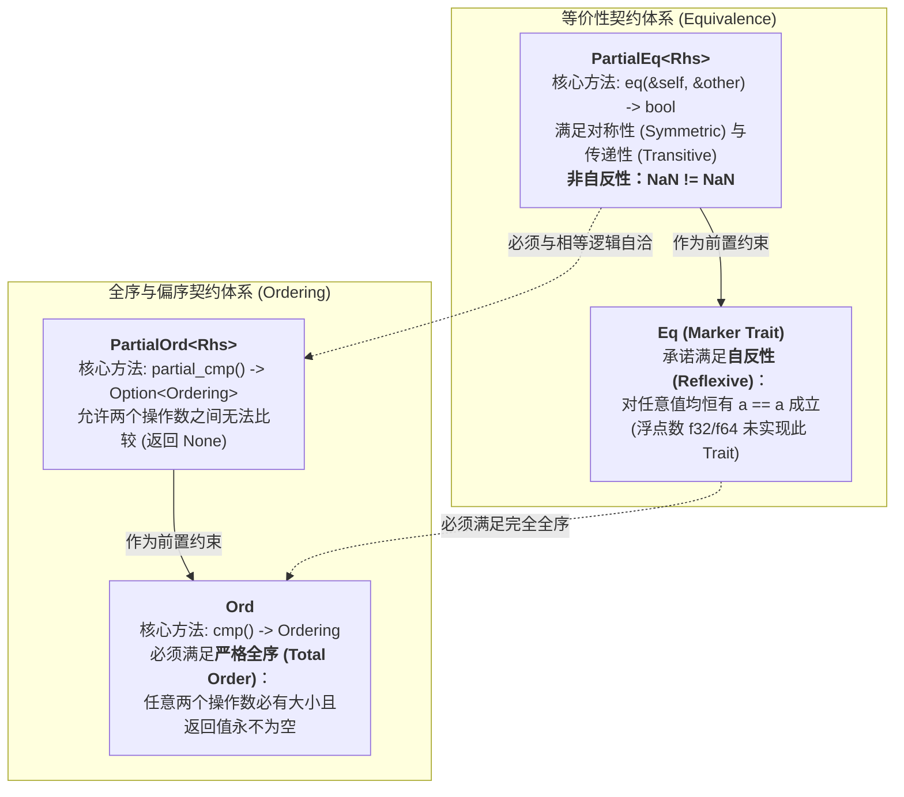

# 核心实战精炼：操作符定制契约与现代代数系统设计

## 1. 核心架构选型矩阵：主流语言操作符机制深层对比

操作符重载（Operator Overloading）是系统级语言中双刃剑的极致体现：若缺乏约束，它会导致诸如将 `+` 重载为清空数据库或启动网络请求等反直觉工程灾难；若完全缺失，又会使得向量运算、定点数金融计算以及矩阵代数充斥着如同 `a.add(b.multiply(c))` 般难以阅读的繁琐方法链。

下表系统化对比了主流编程语言在操作符重载机制上的底层哲学与工程权衡：

| 评估维度 | C++ 操作符重载 (`operator+`) | Java 设计哲学 | Python 动态魔术方法 (`__add__`) | Rust 基于 Trait 的受控重载 (`std::ops`) |
| :--- | :--- | :--- | :--- | :--- |
| **重载机制与约束** | **极其自由且脆弱**：支持自由成员函数或全局函数重载；缺少代数数学公理的强制约束。 | **彻底禁止自定义重载**：仅保留语言内置对 `+` 拼接字符串的特权支持。 | **完全动态运行时查找**：通过 `__add__` / `__radd__` 动态分发，运行时解析方法。 | **严格基于 Trait 契约**：每一个操作符严格对应标准库中的一个泛型 Trait，在编译期完成类型推演与单态化。 |
| **短路求值保全** | 重载 `&&` 或 `||` 时，**短路求值（Short-Circuiting）语义彻底失效**，所有操作数被迫预先求值！ | 不适用。 | 无法重载 `and` 与 `or` 关键字，短路逻辑保持纯粹。 | **语法级硬性禁止重载 `&&` 与 `||`**：确保系统级短路逻辑绝不被开发者破坏，守卫逻辑不变量。 |
| **代数数学关系保证** | 无法强制 `==` 与 `<` 的数学逻辑自洽，重载完全取决于开发者个人细心程度。 | 依赖 `equals()` 与 `compareTo()` 规范，但无静态编译器保证。 | 容易发生自反性、传递性失效，引发哈希表查找死锁。 | **严谨区分偏等（`PartialEq`）与全等（`Eq`）、偏序（`PartialOrd`）与全序（`Ord`）**，彻底隔绝 IEEE 754 NaN 陷阱。 |
| **按值与按引用多态** | 容易发生隐式对象拷贝（Copy Constructor），在深度复杂运算中产生不可见堆栈开销。 | 纯对象引用，但存在自动装箱（Autoboxing）的堆分配损耗。 | 纯动态引用传值，所有数值计算均产生 Python 包装对象堆分配。 | **显式泛型重载矩阵**：可针对 `A + B`、`&A + B`、`A + &B` 以及 `&A + &B` 精确重载，完全杜绝内存深克隆。 |
| **索引访问（Index）语义** | `operator[]` 必须返回左值引用，但在可变访问与只读访问之间缺乏严格的所有权追踪。 | 仅数组支持原生下标，集合必须调用 `.get()` 与 `.set()`。 | 通过 `__getitem__` 与 `__setitem__` 分离，完全依赖运行时动态类型。 | **严格分离 `Index` 与 `IndexMut`**：结合借用检查器，精准区分不可变共享读取与独占可变写入。 |

---

## 2. 生产级架构代码范式：高性能定点数与二维连续内存矩阵切片

在金融量化、物理仿真与图形学领域，为了兼顾裸机计算性能与数学表达直观性，我们需要为自定义数据结构实现完整的操作符契约：

```rust
use std::cmp::Ordering;
use std::ops::{Add, AddAssign, Index, IndexMut, Mul, Neg};

// ============================================================================
// 1. 金融级高精度定点数结构体：实现完整代数运算与全序契约
// ============================================================================

/// 精度缩减因子：1.0000 对应内部 10,000 (4 位小数定点数)
const FIXED_SCALE: i64 = 10_000;

#[derive(Clone, Copy, Debug, Default)]
pub struct FixedPoint(pub i64);

impl FixedPoint {
    #[inline(always)]
    pub const fn from_raw(raw: i64) -> Self {
        Self(raw)
    }

    pub fn from_f64(v: f64) -> Self {
        Self((v * FIXED_SCALE as f64).round() as i64)
    }

    pub fn to_f64(self) -> f64 {
        self.0 as f64 / FIXED_SCALE as f64
    }
}

// ----------------------------------------------------------------------------
// 算术操作符重载：支持按值加法 (A + B) 与复合赋值 (A += B)
// ----------------------------------------------------------------------------

impl Add for FixedPoint {
    type Output = Self;

    #[inline(always)]
    fn add(self, rhs: Self) -> Self::Output {
        Self(self.0 + rhs.0)
    }
}

// 支持按引用相加 (&A + &B)，防止大型对象深拷贝
impl Add for &FixedPoint {
    type Output = FixedPoint;

    #[inline(always)]
    fn add(self, rhs: Self) -> Self::Output {
        FixedPoint(self.0 + rhs.0)
    }
}

impl AddAssign for FixedPoint {
    #[inline(always)]
    fn add_assign(&mut self, rhs: Self) {
        self.0 += rhs.0;
    }
}

impl Neg for FixedPoint {
    type Output = Self;

    #[inline(always)]
    fn neg(self) -> Self::Output {
        Self(-self.0)
    }
}

impl Mul for FixedPoint {
    type Output = Self;

    #[inline(always)]
    fn mul(self, rhs: Self) -> Self::Output {
        // 定点数乘法：注意缩减缩放因子
        Self((self.0 * rhs.0) / FIXED_SCALE)
    }
}

// ----------------------------------------------------------------------------
// 比较操作符重载：满足全等关系 (Eq) 与全序关系 (Ord)
// ----------------------------------------------------------------------------

impl PartialEq for FixedPoint {
    #[inline(always)]
    fn eq(&self, other: &Self) -> bool {
        self.0 == other.0
    }
}

// 标记为严格全等：不存在类似浮点数 NaN 导致的自反性失效
impl Eq for FixedPoint {}

impl PartialOrd for FixedPoint {
    #[inline(always)]
    fn partial_cmp(&self, other: &Self) -> Option<Ordering> {
        Some(self.cmp(other))
    }
}

impl Ord for FixedPoint {
    #[inline(always)]
    fn cmp(&self, other: &Self) -> Ordering {
        self.0.cmp(&other.0)
    }
}

// ============================================================================
// 2. 连续平铺内存的二维高性能矩阵：实现多维索引操作符 Index / IndexMut
// ============================================================================

pub struct Matrix2D<T> {
    pub rows: usize,
    pub cols: usize,
    data: Vec<T>,
}

impl<T: Default + Clone> Matrix2D<T> {
    pub fn new(rows: usize, cols: usize) -> Self {
        Self {
            rows,
            cols,
            data: vec![T::default(); rows * cols],
        }
    }
}

// 通过元组 (row, col) 重载只读索引访问：matrix[(r, c)]
impl<T> Index<(usize, usize)> for Matrix2D<T> {
    type Output = T;

    #[inline(always)]
    fn index(&self, (r, c): (usize, usize)) -> &Self::Output {
        assert!(r < self.rows && c < self.cols, "矩阵二维坐标索引越界: ({r}, {c})");
        &self.data[r * self.cols + c]
    }
}

// 重载可变写入索引：matrix[(r, c)] = new_val;
impl<T> IndexMut<(usize, usize)> for Matrix2D<T> {
    #[inline(always)]
    fn index_mut(&mut self, (r, c): (usize, usize)) -> &mut Self::Output {
        assert!(r < self.rows && c < self.cols, "矩阵二维坐标可变索引越界: ({r}, {c})");
        &mut self.data[r * self.cols + c]
    }
}

// ============================================================================
// 3. 生产级系统验证套件
// ============================================================================

fn main() {
    let price_a = FixedPoint::from_f64(19.99);
    let price_b = FixedPoint::from_f64(10.01);

    // 优雅的自然数学表达（直接内联为一条加法机器指令）
    let total = price_a + price_b;
    assert_eq!(total, FixedPoint::from_raw(30_0000));
    assert_eq!(total.to_f64(), 30.0);

    // 比较操作符自洽性
    assert!(price_a > price_b);
    assert_ne!(price_a, price_b);

    // 二维矩阵索引测试
    let mut mat = Matrix2D::<FixedPoint>::new(4, 4);
    mat[(1, 2)] = FixedPoint::from_f64(99.5); // 触发 IndexMut 脱糖
    let read_back = mat[(1, 2)];              // 触发 Index 脱糖
    assert_eq!(read_back.to_f64(), 99.5);
    println!("✅ 算术与索引操作符重载工业级契约校验通过！");
}
```

---

## 3. 核心机制图解：代数比较公理拓扑与索引脱糖机理

### 3.1 Rust 比较 Trait 体系与 IEEE 754 偏序陷阱



### 3.2 索引表达式底层编译期脱糖（Desugaring）流程

```mermaid
sequenceDiagram
    autonumber
    actor Dev as 业务源码
    participant Compiler as Rust 编译器 (rustc)
    participant IndexTrait as Trait IndexMut / Index
    participant Mem as 物理内存地址

    Dev->>Compiler: 编写赋值表达式: container[idx] = val;
    Note over Compiler: 识别为可变左值上下文，触发 IndexMut 脱糖
    Compiler->>IndexTrait: 调用 IndexMut::index_mut(&mut container, idx)
    IndexTrait-->>Compiler: 返回可变引用借用 &mut T
    Compiler->>Mem: 生成底层机器码: *(&mut T) = val; (直接寻址写入)
```

---

## 4. 核心术语与物理模型映射表

| 核心术语 | 英文对照 | 物理实现与底层机理 | 典型应用与注意事项 |
| :--- | :--- | :--- | :--- |
| **脱糖** | Desugaring | 编译器在编译前端将高级语法糖（如 `a + b`）无损重写为底层标准 Trait 方法调用（`Add::add(a, b)`）。 | 确保重载与直接调用方法在机器码生成阶段 100% 绝对等价。 |
| **自反性** | Reflexivity | 数学代数公理：对集合中任意元素 $x$，均恒有 $x = x$ 成立。 | 浮点数中的 `NaN`（Not a Number）在 IEEE 754 标准中规定 `NaN != NaN`，彻底打破了自反性。 |
| **全序关系** | Total Order | 集合中任意两个元素均具备确定的偏序关系（要么小于、要么等于、要么大于），不存在不可比状态。 | 仅实现了 `Ord` 的类型才被允许作为 `BTreeMap` 的键或直接使用标准库 `.sort()` 算法。 |
| **偏序关系** | Partial Order | 集合中存在部分元素在数学上无法直接判定大小次序（如浮点数与 `NaN` 比较时产出 `None`）。 | 只能使用受限的浮点排序方法 `.sort_by(|a, b| a.partial_cmp(b).unwrap())`。 |
| **复合赋值** | Compound Assignment | 形如 `+=`、`-=`、`*=` 的就地突变算术操作符，由 `AddAssign` 等 Trait 独立提供支持。 | 必须显式独立实现，Rust 绝不会默认从 `Add` 自动推导 `AddAssign`。 |
| **短路求值** | Short-Circuit Evaluation | 在求值逻辑布尔表达式时，若左操作数已能决定最终真伪，则绝对跳过右操作数的执行。 | Rust 语法强制禁止重载 `&&` 与 `||`，捍卫控制流安全。 |

---

## 5. 架构避坑清单 (Do's & Don'ts)

| 典型工程误区 (Don't) | 生产级正确实践 (Do) |
| :--- | :--- |
| **误以为实现了 `Add` 之后，编译器会自动为你提供 `+=`（`AddAssign`）支持。** | 必须显式为类型独立实现 `AddAssign`，才能支持就地复合赋值语法。 |
| **为大型非 Copy 结构体仅仅实现按值加法，导致每次运算被迫发生深层堆克隆。** | 应当同时为 `&A + &B`、`&A + B` 以及 `A + &B` 实现 `Add`，消除所有非必要克隆。 |
| **试图重载 `&&` 或 `||`，以图实现领域特定的谓词链接或查询构造器。** | 绝不可行。短路操作符无法重载，应定义类似 `.and_then()` 或专用构建器方法。 |
| **在为包含浮点数字段的结构体派生 Trait 时，随手加上 `#[derive(Eq, Ord)]`。** | 浮点数不满足全等与全序，强行手动实现 `Eq` 会导致在哈希表或 B 树中发生死锁或找不到键的严重隐患。 |
| **在 `Index` 实现中发生越界时返回一个虚拟的零值，掩盖错误。** | `Index` 必须在越界时直接触发 Panic（保持与标准切片一致），或改用常规的 `.get()` 方法返回 `Option`。 |

<!-- split -->

# 原著完整参考：第 12 章 操作符重载（Operator Overloading）

你是否曾在某种编程语言中遇到过这样令人抓狂的场景：仅仅是为了让两个复数或两个二维坐标向量相加，你却被迫写出如下繁复、丑陋且极易滋生错误的嵌套方法链？

```rust
// 倘若没有操作符重载……
let total = price.add(tax.multiply(rate)).subtract(discount);
```

在系统级工程中，清晰的数学表达是构建物理渲染引擎、定点数金融交易系统以及几何计算内核的生命线。我们渴望书写类似 `let total = price + tax * rate - discount;` 这样直观、纯粹的自然代数符号。

然而，在 C++ 等历史上极度自由的语言中，操作符重载往往因滥用而臭名昭著——某些库甚至恶意地将左移操作符 `<<` 重载为向控制台打印输出、将求模操作符 `%` 重载为字符串格式化，从而彻底破坏了运算符原生的数学语义，导致代码的可维护性雪崩式下降。

Rust 在这片充满争议的工程泥潭中找到了完美的黄金分割点：**Rust 支持全功能的操作符重载，但所有重载行为被牢牢锁死在由标准库严格制定的 Trait 契约骨架之中**。本章将系统揭密 Rust 算术运算符、比较关系运算符、多维索引操作符的重载机理与底层脱糖规律，助你构筑数学语义纯粹且性能极致的系统级类型。

---

# 1. 算术与位运算符（Arithmetic and Bitwise Operators）

在 Rust 中，表达式 `a + b` 在底层完全不是什么不可名状的编译器特殊私货，它纯粹是以下标准 Trait 方法调用的**语法糖（Syntactic Sugar）**：

```rust
std::ops::Add::add(a, b)
```

如果你希望自己的自定义结构体能够顺畅支持加法操作符 `+`，你只需要为其实现标准库中的 `std::ops::Add` Trait。

标准库为所有支持的基本算术与位操作符预设了对应的 Trait，全部归属于 `std::ops` 命名空间：

| 操作符语法 | 对应标准 Trait | 关联核心方法声明 |
| :--- | :--- | :--- |
| `-a`（取反） | `std::ops::Neg` | `fn neg(self) -> Self::Output` |
| `!a`（按位取反/逻辑非） | `std::ops::Not` | `fn not(self) -> Self::Output` |
| `a + b` | `std::ops::Add` | `fn add(self, rhs: Rhs) -> Self::Output` |
| `a - b` | `std::ops::Sub` | `fn sub(self, rhs: Rhs) -> Self::Output` |
| `a * b` | `std::ops::Mul` | `fn mul(self, rhs: Rhs) -> Self::Output` |
| `a / b` | `std::ops::Div` | `fn div(self, rhs: Rhs) -> Self::Output` |
| `a % b` | `std::ops::Rem` | `fn rem(self, rhs: Rhs) -> Self::Output` |
| `a & b` | `std::ops::BitAnd` | `fn bitand(self, rhs: Rhs) -> Self::Output` |
| `a \| b` | `std::ops::BitOr` | `fn bitor(self, rhs: Rhs) -> Self::Output` |
| `a ^ b` | `std::ops::BitXor` | `fn bitxor(self, rhs: Rhs) -> Self::Output` |
| `a << b` | `std::ops::Shl` | `fn shl(self, rhs: Rhs) -> Self::Output` |
| `a >> b` | `std::ops::Shr` | `fn shr(self, rhs: Rhs) -> Self::Output` |

---

## 1.1 一元运算符（Unary Operators）

一元运算符的重载极其直截了当。例如，为二维点结构体实现负号取反 `-point`：

```rust
use std::ops::Neg;

#[derive(Clone, Copy, Debug, PartialEq)]
struct Point {
    x: i32,
    y: i32,
}

impl Neg for Point {
    type Output = Point;

    fn neg(self) -> Point {
        Point { x: -self.x, y: -self.y }
    }
}

let p = Point { x: 10, y: -20 };
assert_eq!(-p, Point { x: -10, y: 20 });
```

---

## 1.2 二元运算符（Binary Operators）

仔细审视二元运算符 Trait 的泛型定义：

```rust
pub trait Add<Rhs = Self> {
    type Output;
    fn add(self, rhs: Rhs) -> Self::Output;
}
```

这里展现了 Rust 泛型系统的精妙之处：
1. **默认类型参数 `Rhs = Self`**：如果你没有显式指定右操作数 `Rhs` 的类型，编译器默认右操作数的类型与左操作数完全相同（即同类型相加 `Point + Point`）；
2. **灵活的跨类型相加**：如果需要，你完全可以将 `Rhs` 声明为另一种截然不同的类型！例如允许一个绝对时间点加上一个时间间隔标量：`impl Add<Duration> for Timestamp`。

### 高性能工程实践：杜绝非必要克隆的重载矩阵

对于包含大型堆分配或昂贵资源的结构体，直接按值传递 `self` 与 `rhs` 可能会意外消耗所有权。
生产级的最佳实践，是针对**引用**进行重载：

```rust
// 支持 &Point + &Point
impl Add for &Point {
    type Output = Point;

    fn add(self, rhs: Self) -> Point {
        Point {
            x: self.x + rhs.x,
            y: self.y + rhs.y,
        }
    }
}
```

如此一来，执行 `let p3 = &p1 + &p2;` 时，底层仅读取指针偏移进行加法运算，而完全无需对 `p1` 和 `p2` 进行复制或掠夺所有权。

---

## 1.3 复合赋值运算符（Compound Assignment Operators）

在日常编码中，`x += y` 是极其高频的操作。
**必须严正指出的一点是：在 Rust 中，实现 `Add` 绝对不会自动为你赠送 `+=`！**

`+=` 对应着独立的标准 Trait——`std::ops::AddAssign`：

```rust
pub trait AddAssign<Rhs = Self> {
    fn add_assign(&mut self, rhs: Rhs);
}
```

注意其方法签名：`&mut self` 表明它直接就地修改左操作数的物理内存，因而避免了重新构造新实例并复制赋值的开销。为自定义类型实现复合赋值范式如下：

```rust
use std::ops::AddAssign;

impl AddAssign for Point {
    fn add_assign(&mut self, rhs: Self) {
        self.x += rhs.x;
        self.y += rhs.y;
    }
}
```

:::en
> **Original**: Rust does not assume that if you have defined `+`, you also want `+=`. In Rust, compound assignment operators like `+=` are completely separate traits... Implementing `AddAssign` doesn't automatically implement `Add`, and implementing `Add` doesn't implement `AddAssign`. You should generally implement both.

**📌 核心术语与语境解析**：
- **Compound Assignment** [ˈkɑːmpaʊnd əˈsaɪnmənt]：*复合赋值*。结合算术计算与就地内存更新的双合一操作符，如 `+=`、`*=`。
- **In-Place Mutation** [ɪn pleɪs mjuːˈteɪʃn]：*就地突变/原地修改*。直接覆盖修改原有物理内存地址，避免多余栈帧分配与浅拷贝。
:::

---

# 2. 等价性比较（Equivalence Comparisons）

在软件工程中，判定两个对象是否相等看似微不足道，实则暗藏深渊。

Rust 严谨地将等价性划分为两重由浅入深的抽象层级：**偏等价关系（`PartialEq`）** 与 **全等价关系（`Eq`）**。

## 2.1 偏等价关系 Trait：`PartialEq`

操作符 `==` 与 `!=` 由 `std::cmp::PartialEq` Trait 统管：

```rust
pub trait PartialEq<Rhs = Self> {
    fn eq(&self, other: &Rhs) -> bool;
    fn ne(&self, other: &Rhs) -> bool {
        !self.eq(other)
    }
}
```

对于绝大多数业务结构体，最省心的方式是直接使用派生宏：
```rust
#[derive(Clone, Copy, Debug, PartialEq)]
struct Complex {
    re: f64,
    im: f64,
}
```

由编译器自动合成的代码会按照结构体中字段声明的物理顺序，逐一比对对应字段是否全部相等。

### 深入数学公理：偏等价关系的边界

在纯粹的代数数学中，一个严格的“等价关系（Equivalence Relation）”必须同时满足以下三条铁律：
1. **对称性（Symmetric）**：若 `a == b` 为真，则 `b == a` 必为真；
2. **传递性（Transitive）**：若 `a == b` 且 `b == c`，则 `a == c` 必为真；
3. **自反性（Reflexive）**：对任何合法的操作数 `a`，恒有 **`a == a` 必须为真**！

然而在计算机系统级物理硬件上，著名的 **IEEE 754 浮点数标准** 却悍然打破了第三条公理：
在浮点标准中，定义了一个特殊的非数字值——**`NaN`（Not a Number）**。
该标准白纸黑字地强制规定：**`NaN` 与任何数值进行比对均为假，包括 `NaN == NaN` 也必须绝对求值为 `false`！**

由于浮点数在物理硬件层面上打破了自反性，标准库因此将其命名为**“偏等价（Partial Equality）”**。

---

## 2.2 全等价关系 Marker Trait：`Eq`

若一个类型不仅满足对称性与传递性，且在物理世界中**绝对恒定满足自反性（即任意值必然等于其自身）**，那么它就可以合法实现 **`Eq` Trait**：

```rust
pub trait Eq: PartialEq<Self> {}
```

审视它的源码：`Eq` 内部没有定义任何额外的方法，它是一个纯粹的 **标记特征（Marker Trait）**！
它的存在完全是为了向编译器证明一项数学契约：**当前类型绝对不存在类似 `NaN` 那样令人发指的自反性断裂！**

因此，基本整型 `i32`、字符串 `String` 等均完美实现了 `Eq`；而单精度浮点数 `f32` 与双精度浮点数 `f64` 则**坚决未实现 `Eq`**。

这一严谨的区分带来了不可估量的系统稳定性：标准库中的 `std::collections::HashMap` 在其泛型键约束中，硬性要求 `K: Eq + Hash`。这意味着你**绝不可能在未经特殊处理的情况下把一个浮点数作为哈希表的 Key**，从而彻底规避了因浮点 `NaN` 破坏自反性而导致的哈希查找死循环与数据永久丢失灾难！

---

# 3. 顺序比较（Ordered Comparisons）

与等价性类似，大小比较操作符（`<`、`<=`、`>`、`>=`）同样被严谨划分为**偏序（`PartialOrd`）**与**全序（`Ord`）**。

## 3.1 偏序关系：`PartialOrd`

```rust
pub trait PartialOrd<Rhs = Self>: PartialEq<Rhs> {
    fn partial_cmp(&self, other: &Rhs) -> Option<Ordering>;
}
```

注意其核心方法返回的是 `Option<Ordering>`：
如果比较的两个值根本处于不可比较的非法状态（例如任何浮点数与 `NaN` 比大小），`partial_cmp` 将直接诚实地返回 `None`！

## 3.2 全序关系：`Ord`

若任意两个同类型对象之间必然能够排出绝对的大小顺序（要么小于、要么等于、要么大于），该类型便可实现 `Ord`：

```rust
pub trait Ord: Eq + PartialOrd<Self> {
    fn cmp(&self, other: &Self) -> Ordering;
}
```

返回的直接是确定性的枚举 `Ordering`（包含 `Less`、`Equal`、`Greater` 三大互斥状态）。唯有实现了 `Ord` 的类型，才具备资格作为 `BTreeMap` 的红黑树索引键，或是顺畅调用标准库切片的原生快排方法 `.sort()`。

:::en
> **Original**: Rust distinguishes between partial and total orderings... Types that implement `PartialOrd` support `<` and `>`, but some pairs of values might not be comparable: comparing them produces `None`. For example, with floating-point numbers, comparing `NaN` to anything else produces `None`... Types that implement `Ord` support a total ordering, meaning that every value can be compared to every other value.

**📌 核心术语与语境解析**：
- **Partial Order** [ˈpɑːrʃl ˈɔːrdər]：*偏序关系*。允许集合中存在不可比元素的弱顺序结构。
- **Total Order** [ˈtoʊtl ˈɔːrdər]：*全序关系*。集合中任意两元素皆绝对具备可比性的一致严格顺序链。
- **Ordering** [ˈɔːrdərɪŋ]：*排序枚举*。标准库中表征比较结果的三态枚举（Less, Equal, Greater）。
:::

---

# 4. 索引访问重载：`Index` 与 `IndexMut`

在底层数据结构（如向量、矩阵、环形缓冲区）的开发中，通过方括号下标直接访问内部元素是最核心的人机交互契约。

Rust 通过标准库的两个 Trait 提供支持：

```rust
pub trait Index<Idx> {
    type Output: ?Sized;
    fn index(&self, index: Idx) -> &Self::Output;
}

pub trait IndexMut<Idx>: Index<Idx> {
    fn index_mut(&mut self, index: Idx) -> &mut Self::Output;
}
```

### 底层脱糖机制深度解密

当你在代码中书写表达式 `let x = arr[i];` 时，底层实际发生了如下精密的**两阶段脱糖**：
1. 编译器首先调用方法 `arr.index(i)`，这产生了一个指向内部目标元素的只读借用引用 `&arr.Output`；
2. 随后，编译器自动在外部施加了一次裸指针解引用解包：`*arr.index(i)`，将其解构为最终的值！

类似地，当你在左值位置书写可变赋值时：
```rust
arr[i] = new_value;
// 等价脱糖为：
*arr.index_mut(i) = new_value;
```

由于 `Index` 关联类型 `Output` 标注了 `?Sized`，这使得下标不仅能返回简单的单个元素，更能够直接重载切片范围语法（如 `arr[2..5]`），返回一个动态尺寸切片 `[T]`，展现了惊人的通用表达力。

---

# 5. 语言级坚决禁止重载的操作符

在探寻了上述强大的重载能力之后，系统架构师同样必须对 Rust 明确设立的**“不可动摇的语言红线”**心怀敬畏。在 Rust 中，以下核心语法操作符**在语言物理层面上坚决禁止被任何开发者重载**：

1. **逻辑与 `&&` 以及逻辑或 `||`**：
   在底层系统工程中，`&&` 与 `||` 最核心的物理价值在于**短路求值（Short-Circuiting）**——若左侧为假，右侧表达式在指令流水线上压根绝不会被执行。如果允许重载它们，由于函数调用的语义必然要求先对所有参数完成求值，短路保证将荡然无存，引发极其隐蔽的空指针或死锁崩溃。
2. **点号成员访问操作符 `.`**：
   成员字段与方法的寻址由语言核心编译器直接接管，防止将属性访问混淆为低效的动态查找。
3. **范围构造操作符 `..` 与 `..=`**：
   始终用于在语法层快速实例化标准库中的 `Range` 结构体，不可改变其底层构造。
4. **问号错误传播操作符 `?`**：
   其控制流由语言内置的 `Try` 契约体系统一管控，不允许开发者肆意曲解其提前返回的控制流本质。

Rust 的操作符重载体系是一场系统工程学上的深刻胜利：它在赋予开发者媲美数学公式般优雅表现力的同时，用冰冷而严密的代数公理与 Trait 防线，彻底终结了 C++ 时代长达数十年的操作符滥用乱局。
