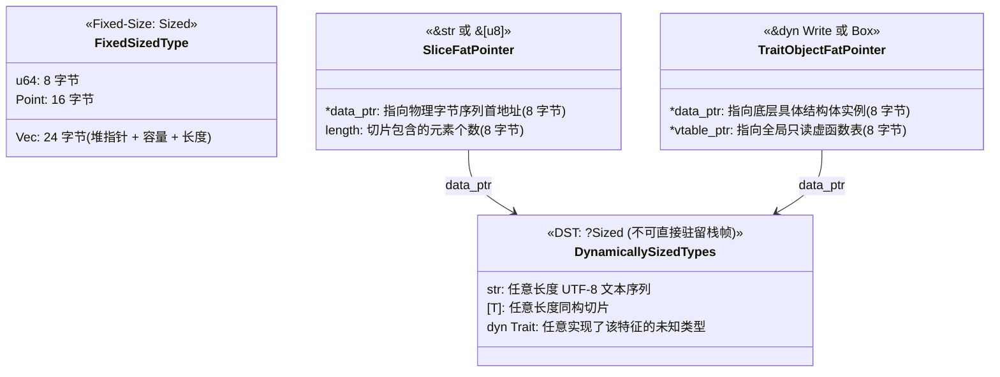

> 💡 **双栏独立滚动工作台导读**：本文采用双栏对照架构。**左栏**为实用 Trait 决策矩阵、RAII 析构时序与智能指针解引用链机理、生产级 Cow 零拷贝文本清洗器实战范式、Mermaid 动态大小类型（DST）胖指针拓扑与避坑清单；**右栏**为原著完整精译参考（Chapter 13: Utility Traits），配齐原著动态大小类型引用图引用与核心术语解析。左右两栏支持独立滚动与宽度比例自由调节。

# 核心实战精炼：现代系统级实用 Trait 契约与解构生态

## 1. 核心架构选型矩阵：核心工具型 Trait 功能与性能权衡

在 Rust 标准库中，有一组极为精巧的 Trait，它们通常不包含复杂的算法，却构成了整个类型系统、内存管理、智能指针与零拷贝流转的“中枢神经”。理解它们的物理行为与编译期语义，是写出地道、高性能 Rust 系统的分水岭。

下表系统化梳理了 Rust 核心实用 Trait 的底层机理与工程职责：

| 核心 Trait | 物理表现与底层开销 | 核心工程职责与语言契约 | 典型工业级使用场景 |
| :--- | :--- | :--- | :--- |
| **`Drop`** | 编译期插入析构调用；若存在条件分支，栈帧引入 1 字节 Drop Flag 标记。 | **RAII 资源释放之基石**：当变量离开作用域时由编译器保证自动执行，严禁手动直接调用 `.drop()`。 | 文件描述符关闭、互斥锁自动解锁、无锁队列内存回收、DMA 内存缓冲区解除映射。 |
| **`Sized` / `?Sized`** | 纯编译期标记特征（Marker Trait），**零运行时开销**。 | 区分编译期已知固定尺寸类型（Fixed-Size）与动态大小类型（DST：`str`、`[T]`、`dyn Trait`）。 | 泛型默认隐式附加 `T: Sized`；通过 `T: ?Sized` 显式解禁以接纳切片和特征对象。 |
| **`Copy` vs `Clone`** | `Copy` 编译期转换为单条 CPU 汇编 `memcpy`，零分配；`Clone` 通常涉及重型堆内存深克隆。 | `Copy` 隐式按位复制，杜绝所有权转移；`Clone` 显式调用 `.clone()` 进行深层复制。 | 标量数值、坐标点实现 `Copy`；`String`、`Vec`、智能指针仅实现 `Clone`。 |
| **`Deref` / `DerefMut`** | 在编译期自动展开为指针偏移解引用操作，纯零额外机器指令开销。 | **解引用强制多级转换（Deref Coercion）**：使智能指针透明表现为其内部承载的目标类型。 | 自定义智能指针封装（`MyArc<T>`）、RAII 锁守卫（`MutexGuard<T> -> &mut T`）。 |
| **`AsRef` vs `Borrow`** | 均为零成本引用到引用的浅层借用转换。 | `AsRef` 仅承诺廉价借用转换；**`Borrow` 额外要求被借用形式与拥有者形式必须具备完全相同的 `Hash` 与 `Eq` 行为**！ | `AsRef<Path>` 用于通用路径传参；`Borrow<Q>` 构成 `HashMap::get` 异构键查询的基础。 |
| **`From` / `Into`** | 纯寄存器传参或移动语义，零额外封装开销。 | **值语义无损转换**：实现 `From<T>` 会由标准库自动逆向推导出 `Into<U>`，广泛集成于 `?` 错误传播。 | 领域错误包装、基本类型拓宽转换、字符串字面量转专属强类型对象。 |
| **`Cow<'a, B>`** | 栈上占用 `&B` 胖指针 + 判别标签大小。 | **写时复制（Copy-on-Write）枚举**：读操作保持只读零拷贝借用；仅在首个写操作发生时惰性深克隆至堆。 | 高吞吐网络请求解析、零拷贝配置模板渲染、文本转义与敏感词脱敏过滤。 |

---

## 2. 生产级架构代码范式：零拷贝文本脱敏器与 RAII 资源守卫

在高性能网关或日志审计系统中，海量的数据流中可能只有不到 1% 的文本包含需要脱敏的敏感信息。若盲目对每个请求执行堆分配 `String::replace`，将导致严重的内存分配器锁争用。

利用 **`Cow<'a, str>` 写时复制** 与 **自定义 RAII 智能指针**，可以实现真正的“无敏感词零堆分配、遇敏感词惰性拷贝”的极致吞吐：

```rust
use std::borrow::Cow;
use std::ops::{Deref, DerefMut};
use std::sync::atomic::{AtomicUsize, Ordering};

// ============================================================================
// 1. 自定义 RAII 内存池借用守卫：演示 Drop、Deref 与 DerefMut
// ============================================================================

static ACTIVE_BUFFERS: AtomicUsize = AtomicUsize::new(0);

/// 模拟从物理硬件/内存池申请的裸缓冲区
#[derive(Debug)]
pub struct PooledBuffer {
    data: Vec<u8>,
}

impl PooledBuffer {
    pub fn allocate(capacity: usize) -> Self {
        ACTIVE_BUFFERS.fetch_add(1, Ordering::Relaxed);
        Self { data: Vec::with_capacity(capacity) }
    }
}

/// 针对 PooledBuffer 的 RAII 自动回收智能指针守卫
pub struct BufferGuard {
    buffer: Option<PooledBuffer>,
}

impl BufferGuard {
    pub fn new(buf: PooledBuffer) -> Self {
        Self { buffer: Some(buf) }
    }
}

// 通过 Deref 使得 BufferGuard 透明表现为 Vec<u8>
impl Deref for BufferGuard {
    type Target = Vec<u8>;

    #[inline(always)]
    fn deref(&self) -> &Self::Target {
        &self.buffer.as_ref().unwrap().data
    }
}

impl DerefMut for BufferGuard {
    #[inline(always)]
    fn deref_mut(&mut self) -> &mut Self::Target {
        &mut self.buffer.as_mut().unwrap().data
    }
}

// 严谨的析构契约：离开作用域时自动将资源归还全局池并更新原子计数
impl Drop for BufferGuard {
    fn drop(&mut self) {
        if let Some(_buf) = self.buffer.take() {
            let remaining = ACTIVE_BUFFERS.fetch_sub(1, Ordering::Relaxed) - 1;
            println!("♻️ [RAII Drop] 物理缓冲区已归还内存池，当前活跃数: {remaining}");
        }
    }
}

// ============================================================================
// 2. 基于 Cow<'a, str> 的零拷贝高性能敏感词脱敏引擎
// ============================================================================

pub struct Redactor {
    sensitive_word: &'static str,
    replacement: &'static str,
}

impl Redactor {
    pub const fn new(sensitive_word: &'static str, replacement: &'static str) -> Self {
        Self { sensitive_word, replacement }
    }

    /// 核心脱敏流水线：纯零拷贝或按需写时复制
    pub fn redact<'a>(&self, input: &'a str) -> Cow<'a, str> {
        // 1. 快速只读扫描：若未命中敏感词，直接原样返回 Borrowed(&str)，零堆分配！
        if !input.contains(self.sensitive_word) {
            return Cow::Borrowed(input);
        }

        // 2. 命中敏感词：惰性触发 Owned 分支，向堆申请内存完成内容替换
        let sanitized = input.replace(self.sensitive_word, self.replacement);
        Cow::Owned(sanitized)
    }
}

// ============================================================================
// 3. 通用多态路径接收器：利用 AsRef<Path> 规范 API
// ============================================================================

use std::path::Path;

pub fn audit_system_log<P: AsRef<Path>>(log_path: P) {
    let p = log_path.as_ref();
    println!("🔍 审计日志目标物理路径: {}", p.display());
}

// ============================================================================
// 4. 验证测试与物理行为分析
// ============================================================================

fn main() {
    let redactor = Redactor::new("TOP_SECRET", "[REDACTED]");

    // 场景 A：无敏感词输入（零拷贝借用路径）
    let clean_text = "System initialized and running smoothly.";
    let result_a = redactor.redact(clean_text);
    match result_a {
        Cow::Borrowed(b) => {
            println!("⚡ [零拷贝分支] 无敏感词，保持只读借用: '{b}'");
            assert_eq!(b.as_ptr(), clean_text.as_ptr()); // 物理内存指针完全同一！
        }
        Cow::Owned(_) => panic!("不应触发堆分配！"),
    }

    // 场景 B：包含敏感词输入（写时复制分支）
    let dirty_text = "Alert: The access token is TOP_SECRET_12345.";
    let result_b = redactor.redact(dirty_text);
    match result_b {
        Cow::Borrowed(_) => panic!("包含敏感词，必须触发脱敏！"),
        Cow::Owned(ref s) => {
            println!("🛡️ [写时复制分支] 触发堆深克隆脱敏: '{s}'");
        }
    }

    // 场景 C：RAII 智能指针作用域析构审计
    {
        let raw_buf = PooledBuffer::allocate(1024);
        let mut guard = BufferGuard::new(raw_buf);

        // 利用 DerefMut 透明追加数据
        guard.extend_from_slice(b"payload block");
        assert_eq!(guard.len(), 13);
        assert_eq!(ACTIVE_BUFFERS.load(Ordering::Relaxed), 1);
    } // 此处 guard 离开大括号作用域，自动触发 Drop 析构！

    assert_eq!(ACTIVE_BUFFERS.load(Ordering::Relaxed), 0);
    println!("✅ 全部实用 Trait 契约验证通过！");
}
```

---

## 3. 核心机制图解：动态大小类型（DST）胖指针与 Deref 解引用流水线

### 3.1 动态大小类型（DST）与固定大小类型的双机器字胖指针拓扑



### 3.2 解引用强制多级转换（Deref Coercion）编译器自动寻址流水线

```text
当调用一个接收 &str 的函数：fn parse(s: &str)
传入一个包含两层智能指针嵌套的对象：Rc<String>

【编译器自动触发的连续 Deref 转换拓扑】
Rc<String> 实例
   │
   ├─► 1. 调用 <Rc<String> as Deref>::deref(&rc)
   │      ==> 产出目标类型：&String
   │
   ├─► 2. 调用 <String as Deref>::deref(&string)
   │      ==> 产出目标类型：&str (切片胖指针)
   │
   └─► 3. 成功匹配参数签名 &str！
整个解引用链条在编译期完成类型推演，运行时直接发射单条偏移指令，零抽象开销！
```

---

## 4. 核心术语与物理模型映射表

| 核心术语 | 英文对照 | 物理实现与底层机理 | 典型应用与注意事项 |
| :--- | :--- | :--- | :--- |
| **资源获取即初始化** | RAII (Resource Acquisition Is Initialization) | 将物理资源的生命周期严格绑定到栈对象的生存期上，离开作用域自动执行 `Drop::drop`。 | 杜绝 C/C++ 中因忘记关闭文件、释放互斥锁而导致的死锁与句柄耗尽。 |
| **析构标记** | Drop Flag | 当结构体在局部作用域中可能被条件移动时，编译器在栈帧中悄悄插入的 1 字节布尔标志位。 | 用于在栈展开或退出时动态判定当前实例是否仍需触发析构。 |
| **解引用强制转换** | Deref Coercion | 编译器在函数传参或方法调用时，若类型不匹配，自动沿着 `Deref` 链条向上递归尝试类型转换。 | 仅对引用生效（`&T -> &U`），绝不会对按值传参进行隐式转换。 |
| **动态大小类型** | Dynamically Sized Types (DST) | 运行时物理尺寸无法在编译期静态确定的类型（`str`、`[T]`、`dyn Trait`）。 | 变量与参数不可直接声明为裸 DST；必须通过宽指针（`&`、`Box`）间接持有。 |
| **借用哈希自洽性** | Borrow Congruence | `Borrow<Borrowed>` 要求借用形式与拥有形式在 `Hash` 与 `Eq` 实现上具有严格同一的数学行为。 | 保证 `HashMap<String, V>` 可以直接用 `&str` 高性能查找且哈希槽位精准吻合。 |
| **写时复制** | Copy-on-Write (`Cow<'a, B>`) | 标准库枚举（`Borrowed(&'a B)` 或 `Owned(<B as ToOwned>::Owned)`）。 | 用于极大减轻读多写少、大部分情况无需变动数据的重型对象堆分配压力。 |

---

## 5. 架构避坑清单 (Do's & Don'ts)

| 典型工程误区 (Don't) | 生产级正确实践 (Do) |
| :--- | :--- |
| **在代码中手动显式调用 `val.drop()` 试图提前释放资源。** | 这是编译错误。若需显式提前释放，必须使用标准库函数 `std::mem::drop(val)` 转移所有权。 |
| **试图让同一个类型同时实现 `Copy` 与 `Drop`。** | 语言硬性禁止！拥有自定义析构逻辑的类型必须具有确定性的单一所有者，绝不可被静默按位 `memcpy`。 |
| **滥用 `Deref` 来模拟面向对象语言的“类继承”多态。** | `Deref` 应严格仅用于智能指针与资源包装类型；对于常规结构体聚合，应使用显式字段访问或 Trait 委托。 |
| **在函数通用入参设计中，固守 `path: &PathBuf` 或 `s: &String`。** | 采用泛型约束 `P: AsRef<Path>` 或切片借用 `&str`，赋予外部调用方传入字符串字面量等任意类型的极致便利。 |
| **为类型实现 `Borrow<T>` 时，随意编写与原类型不一致的哈希逻辑。** | 严守自洽性契约：若 `a == b`，则 `a.hash()` 必须与 `b.hash()` 生成完全一致的哈希值，否则哈希表必发生数据丢失。 |

<!-- split -->

# 原著完整参考：第 13 章 实用 Traits 全解（Utility Traits）

编程语言的精妙之处，往往体现在其标准库核心特质的细节设计中。

在 Rust 的标准库中，有一组极为特殊且地位尊崇的 Trait，被称为**实用 Traits（Utility Traits）**。它们或许并不像复杂的集合库或网络异步运行时那样引人瞩目，但它们却如水和空气一般，无孔不入地渗透在每一行 Rust 代码的脉络深处。

从依托 **RAII** 自动管理物理内存与操作系统的 `Drop`、定义类型物理边界的 `Sized` 与 `?Sized`，到规范内存浅层位拷贝与深层克隆的 `Copy` 与 `Clone`；从让智能指针化于无形的 `Deref` 解引用强制转换，到主导零拷贝生态的 `Cow` 协议——深入透视这组 Trait，不仅能让你彻底读懂标准库 API 的深层脉络，更能让你在设计高并发、低延迟系统架构时，游刃有余地驾驭 Rust 的类型系统。

---

# 1. 资源管理的守护神：Drop

当一个拥有外部资源的对象走向其生命周期的终点时，系统该如何收尾？

在 C 语言中，我们必须手动调用 `free(ptr)` 或 `close(fd)`；在 Java 或 Go 中，我们不得不依赖不确定的垃圾回收器或手写脆弱的 `try-finally`。而在 Rust 中，语言核心给出的终极答案是 **RAII（Resource Acquisition Is Initialization，资源获取即初始化）**——通过 **`std::ops::Drop` Trait** 全自动捍卫：

```rust
pub trait Drop {
    fn drop(&mut self);
}
```

任何类型只要实现了 `Drop`，那么**每当该类型的实例离开其所在的作用域时，Rust 编译器便绝对保证会隐式调用它的 `drop()` 方法**。

```rust
struct Appellation {
    name: String,
    nicknames: Vec<String>,
}

impl Drop for Appellation {
    fn drop(&mut self) {
        print!("正在释放对象: {}", self.name);
        if !self.nicknames.is_empty() {
            print!(" (别名: {})", self.nicknames.join(", "));
        }
        println!();
    }
}
```

### 析构释放的物理时序法则

理解对象的销毁顺序在底层系统工程中至关重要：
1. **局部变量按声明逆序销毁**：在一个代码块中，后声明的变量会率先被 `drop` 析构，从而确保后创建的对象若依赖先创建的资源，依赖关系始终合法。
2. **结构体内部字段按声明正序销毁**：当一个结构体实例触发 `drop` 时，首先会执行用户手写的 `Drop::drop` 方法；随后，编译器会自动按照字段在结构体源码中**声明的物理顺序**，逐一调用各个字段的析构函数！

### 为什么严禁手动调用 `val.drop()`？

如果你在代码中尝试手动书写 `x.drop()`，Rust 编译器将立即给出严厉的编译错误！
其原因在于：`Drop::drop` 接收的是 `&mut self` 借用。如果允许手动调用，那么在方法调用完成后，变量 `x` 在作用域层面依然存活；当它随后离开作用域时，运行时会再次对其执行一次正常的 `drop`，从而不可逆地诱发灾难性的**双重释放（Double Free）**！

若系统程序员出于工程考量，确实需要提前释放某个重型资源（例如提前释放互斥锁以便让其他线程竞争），正统的标准做法是调用标准库函数：

```rust
std::mem::drop(x);
```

查看它的标准库源码，其实现简朴到了极点：
```rust
pub fn drop<T>(_x: T) { }
```
它仅仅是通过值传递掠夺了变量 `x` 的所有权，然后在这个空函数体结束的瞬间，由语言核心机制自然而然地为局部参数 `_x` 执行析构！

:::en
> **Original**: Rust does not let you call `x.drop()` directly. If Rust permitted you to do this, then when `x` went out of scope, Rust would drop it a second time, resulting in a double-free bug... To drop a value before the end of its scope, use the standard library function `std::mem::drop()`. This takes its argument by value, taking ownership from the caller — and then does nothing with it.

**📌 核心术语与语境解析**：
- **Drop Order** [drɑːp ˈɔːrdər]：*析构顺序*。局部变量逆序释放、结构体字段顺序释放的确定性生命周期时序规则。
- **Double Free** [ˈdʌbl friː]：*双重释放*。对同一物理内存或资源句柄执行两次析构导致的典型安全漏洞。
:::

---

# 2. 类型尺寸的基石：`Sized` 与 `?Sized`

在 Rust 的类型宇宙中，绝大多数类型都属于**固定大小类型（Fixed-Size Types）**：每一个 `u64` 占用 8 字节，每一个 `(f32, f32, f32)` 元组占用 12 字节。即使是包含动态堆内存的 `Vec<T>`，其栈上的结构体本身也严格固定占据 24 字节。

所有固定大小类型都自动实现了标准库标记特征 **`std::marker::Sized`**。这是一个完全由编译器自动推导并挂接的零开销 Marker Trait，开发者无法手动为其实现。

### 动态大小类型（Dynamically Sized Types, DST）

然而，Rust 同样拥有极具表现力的**动态大小类型（DST）**：
* 裸文本切片类型 **`str`**（注意，不是 `&str`）；
* 裸数组切片类型 **`[T]`**（注意，不是 `&[T]`）；
* 特征对象类型 **`dyn Trait`**。

在物理内存中，不同 `str` 实例所占据的字节数是千差万别的。正如原著图 13-1 精辟展现的那样：`"diminutive"` 占据 10 字节，而 `"big"` 仅占据 3 字节！


###### 图 13-1. 物理内存中指向动态大小类型的各类胖指针拓扑

**核心物理法则：Rust 坚决不允许直接在栈上分配或声明一个裸 DST 类型的局部变量或参数！**
因为 CPU 在构建函数调用栈帧时，必须在编译期精确知晓当前栈帧究竟需要下移多少字节的栈指针（RSP）。我们唯有通过**胖指针（Fat Pointer）**（如 `&str`、`&[u8]`、`Box<dyn Write>`）才能合法操控它们。胖指针通过额外携带的长度（Length）或虚表指针（vtable），在运行时动态补全了类型在编译期所缺失的物理信息。

### 显式解除默认限制：`?Sized`

由于裸 DST 极为特殊，Rust 的所有泛型参数在默认情况下都会被编译器隐式附加一条隐藏约束：`T: Sized`。
如果你正在编写一个通用的智能指针或包装容器，希望它既能接收普通类型、又能接纳动态大小类型，你必须使用特殊的修饰符**显式宣告解除限制**：

```rust
// 问号意味着：“T 可以是 Sized，也可以是 ?Sized（动态大小类型）”
struct CustomBox<T: ?Sized> {
    ptr: *mut T,
}
```

---

# 3. 内存复制的二元法则：`Clone` 与 `Copy`

在数据搬移时，Rust 严格将复制行为区分为**显式深层克隆（`Clone`）** 与 **隐式底层位拷贝（`Copy`）**。

## 3.1 显式克隆：`Clone`

```rust
pub trait Clone: Sized {
    fn clone(&self) -> Self;
    fn clone_from(&mut self, source: &Self) {
        *self = source.clone();
    }
}
```

`Clone` 专为可能伴随重型堆内存分配或复杂深拷贝操作的类型而生。调用 `.clone()` 意味着开发者清醒地意识到：“此处正在发生深层数据的复制，可能涉及昂贵的物理系统调用与内存申请”。
值得注意的是其内建的优化方法 `clone_from`：如果目标实例自身已经持有了一块足够大的堆缓冲区，它可以直接复用该物理空间覆盖写入，从而彻底避免了“先释放旧堆块、再重新向操作系统申请新堆块”的反复震荡！

## 3.2 隐式按位复制：`Copy`

```rust
pub trait Copy: Clone {}
```

`Copy` 同样是一个 Marker Trait。
**一旦一个类型实现了 `Copy`，在发生赋值、函数传参或模式匹配时，Rust 不会执行所有权转移（Move），而是直接由 CPU 执行底层汇编级的按位物理内存拷贝（相当于 C 语言的 `memcpy`）！**

### 核心物理边界与互斥铁律

1. **若类型实现了 `Drop`，则绝对不能实现 `Copy`！**
   这是系统级安全的基石。试想：如果一个管理物理文件描述符的结构体能够被随意按位 `memcpy` 出多份副本，那么在各个副本离开作用域时，系统将不可避免地对同一个物理描述符执行多次重复关闭，引发系统崩溃。
2. 任何拥有外部堆分配资源的复杂容器（如 `String`、`Vec`、`Box`）均不可实现 `Copy`。唯有纯标量（如整数、浮点数、字符）以及完全由 `Copy` 元素构成的结构体/元组，才能合法实现 `Copy`。

---

# 4. 智能指针的透视镜：`Deref` 与 `DerefMut`

在现代系统设计中，智能指针（Smart Pointers）是构建高级并发与内存拓扑的核心。
我们希望自定义的智能指针（如 `MyRc<T>` 或 `MutexGuard<T>`）能够像原生对象一样顺畅调用内部承载类型 `T` 的所有方法，而不必每一次都写出形如 `(*my_guard).field` 这样令人生厌的冗余解引用。

Rust 通过 **`std::ops::Deref`** 与 **`DerefMut`** Trait 达成了这一壮举：

```rust
pub trait Deref {
    type Target: ?Sized;
    fn deref(&self) -> &Self::Target;
}

pub trait DerefMut: Deref {
    fn deref_mut(&mut self) -> &mut Self::Target;
}
```

### 划时代的编译器特性：解引用强制多级转换（Deref Coercion）

当你书写 `guard.process()` 时，若编译器发现当前的 `guard` 结构体自身并未定义 `process` 方法，它不会立刻绝望报错，而是会检查该类型是否实现了 `Deref`。
若实现了 `Deref`，编译器会自动插入隐式的解引用转换：`guard.deref().process()`！

不仅如此，这种转换在传参时支持**多层链式透传**：
例如，将一个多线程引用计数智能指针 `Arc<String>` 传递给一个接收 `&str` 的函数：
1. 编译器首先将 `&Arc<String>` 自动 deref 为 `&String`；
2. 随后，编译器发现 `String` 自身同样实现了 `Deref<Target=str>`，因而再次自动将其 deref 为 `&str`！
整个层层剥茧的过程全部发生在编译器的静态类型分析阶段，最终生成的汇编代码仅仅是单条指针偏移寻址，**运行时代价绝对纯零！**

:::en
> **Original**: If you have a value of type `Rc<String>`, and you want to pass it to a function that takes `&str`, you can simply pass `&rc`: Rust uses `Deref` coercion to convert `&Rc<String>` to `&String`, and then uses it again to convert `&String` to `&str`. The dereferencing happens automatically, invisibly, and without run-time cost.

**📌 核心术语与语境解析**：
- **Deref Coercion** [dɪˈref koʊˈɜːrʒn]：*解引用强制转换*。编译器利用 `Deref` 契约将智能指针引用隐式提升为内部目标引用的零开销机制。
- **Transparent Wrapper** [trænsˈpærənt ˈræpər]：*透明包装器*。表现行为与其包裹的核心数据完全同一的智能结构体。
:::

---

# 5. 引用类型转换双雄：`AsRef` vs `Borrow`

在编写接收字符串或路径参数的高质量公开 API 时，我们经常面临选择：如何让函数既能接收 `&str`、又能接收 `String`、甚至接收 `&Path`？

## 5.1 通用浅层转换：`AsRef` 与 `AsMut`

```rust
pub trait AsRef<T: ?Sized> {
    fn as_ref(&self) -> &T;
}
```

通过泛型约束 `fn open<P: AsRef<Path>>(path: P)`，外部调用方可以向该函数随意传入字符串字面量 `"/etc/hosts"`、`String` 对象、抑或是 `PathBuf`，函数内部仅需调用 `path.as_ref()` 即可瞬间将其同一化为标准 `&Path` 借用，极大地提升了库的人机交互体验。

## 5.2 严格数学哈希一致性：`Borrow` 与 `BorrowMut`

```rust
pub trait Borrow<Borrowed: ?Sized> {
    fn borrow(&self) -> &Borrowed;
}
```

从表面方法签名来看，`Borrow` 与 `AsRef` 几乎完全一致。但在类型系统的深层数学契约上，两者有着天壤之别！
**`Borrow` 施加了一条极其冷酷的数学公理契约**：
> **如果一个类型实现了 `Borrow<T>`，那么该类型与其借用出来的类型 `T`，在实现 `Hash`（哈希值计算）与 `Eq`（全等比对）时，其产生的物理哈希字节与比较判定必须绝对 100% 完全同一！**

标准库中的 `HashMap<K, V>` 的读取方法 `.get<Q>(&self, key: &Q)`，其泛型约束正是 `K: Borrow<Q>`，而非 `AsRef`！
唯有凭借 `Borrow` 的强力公理背书，哈希表才能保证：当以 `String` 作为持久化 Key 存储时，调用方用一个临时的只读借用切片 `&str` 进表检索时，计算出的哈希槽位物理地址绝对分毫不差！

---

# 6. 值语义转换生态：`From`、`Into` 与 `TryFrom`

在类型之间进行安全的值转换时，Rust 坚决摒弃了 C 语言式的任意裸强转。

```rust
pub trait From<T>: Sized {
    fn from(value: T) -> Self;
}

pub trait Into<T>: Sized {
    fn into(self) -> T;
}
```

**对偶性哲学**：在标准库中，只要你为一个类型实现了 `From<T>`，Rust 会通过泛型全自动为你逆向免费实现对应的 `Into<U>`！
在日常工程中，**请始终优先实现 `From`，而避免直接去实现 `Into`**。
我们在第 7 章中探讨的 `?` 错误传播操作符，其底层正是依靠 `From` Trait 将特定子模块的细粒度错误全自动提升为外层通用错误类型。

对于那些可能会发生转换失败的边界场景（例如将大范围整数 `i64` 压缩为 `i32`），标准库提供了返回 `Result` 的 **`TryFrom`** 与 **`TryInto`** 特征。

---

# 7. 终极实战：谦逊而伟大的写时复制容器 `Cow`

将上述诸多 Trait（`Deref`、`ToOwned`、`Borrow`）融会贯通的集大成者，当属标准库中这只“谦逊的奶牛”——**`std::borrow::Cow<'a, B>`（Copy-on-Write）**：

```rust
pub enum Cow<'a, B: ?Sized + 'a>
where
    B: ToOwned,
{
    Borrowed(&'a B),
    Owned(<B as ToOwned>::Owned),
}
```

在系统级文本解析、网络包清洗与模板替换中，`Cow` 带来了降维打击级别的性能提升：
* **在绝大多数只读无需变更的快乐路径（Happy Path）上**：它是一个轻盈的 `Cow::Borrowed`，在底层仅仅保存对原始外部缓冲区的切片引用，**内存分配次数为绝对的 0**；
* **唯有当检测到特定数据需要修改时**：它才会在内部调用 `to_mut()` 自动触发惰性克隆，将数据深拷贝至堆并转换为 `Cow::Owned`，完成修改。

通过将不可变的共享借用与可变的独占所有权完美糅合在单个强类型枚举中，Rust 的实用 Trait 生态向全世界展示了一套既充满数学严谨性、又紧贴裸机硬件脉搏的现代系统级工程范式。
