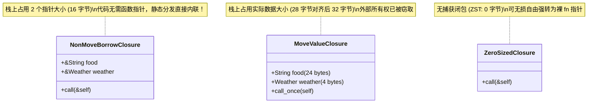
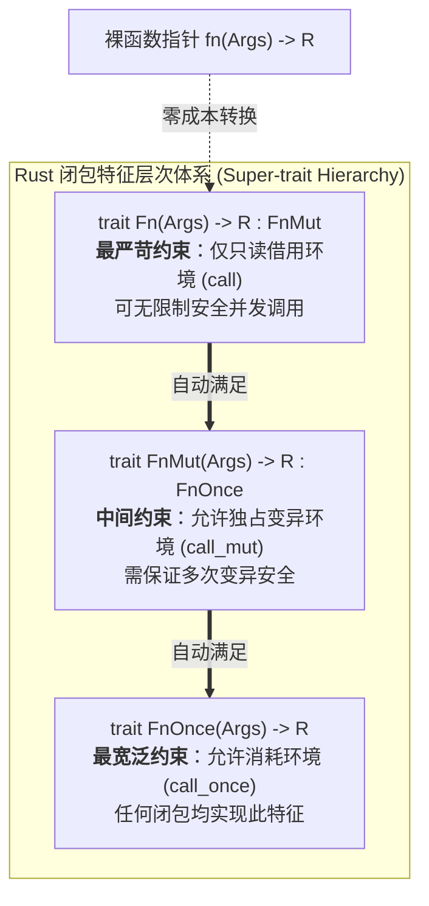

> 💡 **双栏独立滚动工作台导读**：本文采用双栏对照架构。**左栏**为系统级工程技术决策矩阵、闭包底层内存排布、生产级异步事件调度器与避坑清单 (Do's & Don'ts)；**右栏**为原著完整参考（Chapter 14: Closures），附有核心段落的英文原文展开与核心术语解析。左右两栏支持独立滚动与宽度比例自由调节。

# 核心实战精炼：闭包底层实现机理与高阶工程抽象

## 1. 核心架构决策矩阵：Rust 闭包 Trait 层次与函数指针选型

在 Rust 系统级编程中，闭包（Closures）不是一个黑盒语法糖，而是由编译器动态生成的**匿名结构体（Anonymous Struct）**，并根据其捕获环境与调用语义自动实现 `FnOnce`、`FnMut`、`Fn` 特征之一或全部。

理解三者在内存所有权、可调用次数以及并发安全上的边界，是构建高吞吐量回调、异步运行时和流水线抽象的技术基石：

### 1.1 闭包 Trait 层次与函数指针特性决策矩阵

| 特征类型 | 方法签名契约 | 环境捕获行为 | 允许调用次数 | 能否并发共享调用 (`Sync`) | 动态虚表成本 (`dyn`) | 典型工程适用场景 |
| :--- | :--- | :--- | :--- | :--- | :--- | :--- |
| **`FnOnce`** | `fn call_once(self, args) -> R` | 获取捕获值的**所有权（Moves）**，或内部主动销毁（Drop）捕获数据 | **严格仅能调用 1 次**（调用后闭包自身生命周期终结） | 否（调用会消耗自身，无法并发） | `Box<dyn FnOnce(...)>` 需要专用调度容器 | 一次性线程任务派发（如 `thread::spawn`）、事务提交/回滚终结器、资源消费型构建器 |
| **`FnMut`** | `fn call_mut(&mut self, args) -> R` | 独占借用捕获值（`&mut T`），可修改环境状态但**不消耗**所有权 | **可调用多次**（调用方需持有闭包的可变引用 `mut`） | 否（跨线程需包裹 `Mutex` 防数据竞争） | `Box<dyn FnMut(...)>`（带内部可变状态） | 状态机流转、累计计数器、迭代器内部步进适配器（如 `filter_map`、`scan`） |
| **`Fn`** | `fn call(&self, args) -> R` | 仅以不可变引用（`&T`）读取捕获环境，或**无状态**只读计算 | **可任意并发/重复调用**（调用方仅需共享引用 `&`） | **是**（若捕获环境满足 `Sync`，闭包亦自动满足 `Sync`） | `Box<dyn Fn(...)>`（轻量级双指针） | 并发 HTTP 路由处理器（如 Actix-web/Axum）、集合并行计算、多级事件只读分发器 |
| **`fn` 指针** | 机器指令地址标量 (`usize`) | **禁止捕获任何外部环境**（捕获大小为 0） | **无限制重复调用** | **是**（原生 `Copy + Clone + Send + Sync`） | **零成本**（普通间接跳转，无虚表，无堆分配） | 高性能 C-ABI 跨语言绑定 (FFI)、超轻量全局静态路由表、零堆分配底层回调 |

---

## 2. 生产级代码范式：基于类型擦除的高性能动态事件总线

在大型微服务网关或嵌入式控制系统中，我们经常需要实现一个支持动态注册多种不同生命周期回调的**事件总线（Event Bus）**。

下面的生产级范式展示了如何优雅处理闭包的多态性、`'static` 生命周期边界与线程安全，并对比泛型单态化（零成本内联）与 `Box<dyn Fn>` 动态分发的工程折中：

```rust
use std::collections::HashMap;
use std::sync::{Arc, Mutex, RwLock};

/// 生产级事件结构体
#[derive(Debug, Clone)]
pub struct SystemEvent {
    pub topic: String,
    pub payload: Vec<u8>,
    pub timestamp_ms: u64,
}

/// 生产级类型别名：支持跨线程并发安全的多播只读事件监听器
pub type ThreadSafeEventListener = Box<dyn Fn(&SystemEvent) + Send + Sync + 'static>;

/// 生产级动态事件分发器
#[derive(Default)]
pub struct EventDispatcher {
    // 采用读写锁保护订阅路由表，实现高并发只读路由查找与低频动态注册
    subscribers: RwLock<HashMap<String, Vec<ThreadSafeEventListener>>>,
}

impl EventDispatcher {
    pub fn new() -> Self {
        Self {
            subscribers: RwLock::new(HashMap::new()),
        }
    }

    /// 注册事件监听器：
    /// 泛型参数 F 通过 Trait 约束接受任意闭包或函数指针，
    /// 只要其满足 Fn(&SystemEvent) 且内部捕获的所有权具有 'static 存活周期
    pub fn subscribe<F>(&self, topic: &str, listener: F)
    where
        F: Fn(&SystemEvent) + Send + Sync + 'static,
    {
        let mut subs = self.subscribers.write().expect("RwLock poisoned");
        subs.entry(topic.to_string())
            .or_default()
            .push(Box::new(listener));
    }

    /// 高并发广播事件：所有注册的 Fn 闭包并发读取事件切片，无堆拷贝
    pub fn publish(&self, event: &SystemEvent) {
        let subs = self.subscribers.read().expect("RwLock poisoned");
        if let Some(listeners) = subs.get(&event.topic) {
            for listener in listeners {
                // 此处触发虚表间接调用 (vtable dispatch)，零锁争用
                listener(event);
            }
        }
    }
}

/// 生产级一次性任务队列 (FnOnce 模式)：用于工作线程池批量拉取执行
pub struct TaskQueue {
    tasks: Mutex<Vec<Box<dyn FnOnce() + Send + 'static>>>,
}

impl TaskQueue {
    pub fn new() -> Self {
        Self {
            tasks: Mutex::new(Vec::new()),
        }
    }

    pub fn push<F>(&self, task: F)
    where
        F: FnOnce() + Send + 'static,
    {
        let mut lock = self.tasks.lock().expect("Mutex poisoned");
        lock.push(Box::new(task));
    }

    /// 执行并彻底销毁所有已提交任务：转移闭包所有权并触发 call_once
    pub fn execute_all(&self) {
        let mut tasks = {
            let mut lock = self.tasks.lock().expect("Mutex poisoned");
            std::mem::take(&mut *lock)
        };

        for task in tasks.drain(..) {
            task(); // 自动调用 Box<dyn FnOnce>::call_once
        }
    }
}
```

---

## 3. 核心机制底层图解

### 3.1 闭包内存物理排布与匿名结构体转换机理

当 Rust 编译器编译一个闭包时，它会在栈上生成一个专用结构体。结构体的字段完全取决于闭包所捕获的变量及其捕获形式（不可变引用、独占可变引用或值）：



---

### 3.2 FnOnce、FnMut 与 Fn 的子类型包含拓扑

Rust 中的闭包 Trait 并不是三个互斥的平行类型，而是遵循严格的超集继承约束关系：



---

## 4. 架构避坑清单 (Do's & Don'ts)

| 典型工程误区 (Don't) | 生产级正确实践 (Do) |
| :--- | :--- |
| **在循环或只读多播场景中误对捕获值执行消耗操作，导致闭包隐式退化为 `FnOnce` 并引发编译报错。** | 严格审查闭包体：在循环或多次回调中，只读访问使用借用（`&data`），避免在闭包内部调用 `drop(val)` 或按值消费迭代器。 |
| **盲目对所有闭包增加 `move` 关键字，导致外部局部变量所有权被意外移走，无法继续在外部使用。** | 仅在闭包生命周期需要逃逸当前栈帧（如 `thread::spawn`、返回闭包或异步任务）时才显式使用 `move`。 |
| **在高性能紧密计算循环（Tight Loop）中滥用 `Box<dyn Fn>`，引入不必要的堆分配与动态虚表分发。** | 函数参数优先采用泛型 `F: Fn(...)` 静态分发，触发编译器单态化内联（Inlining），消灭函数调用开销。 |
| **尝试在 Rust 中复刻传统面向对象的 MVC 相互回调网状架构，深陷生命周期与借用检查器泥潭。** | 摒弃“对象网状互指”，采用**单向数据流（Unidirectional Data Flow）**，如 Elm / Redux 架构，将数据变更与事件通知解耦。 |
| **在需要跨线程异步调度（如 Tokio/Rayon）时，闭包遗漏 `Send + 'static` 约束，导致编译器警告生命周期逃逸。** | 明确闭包签名约束：异步与线程池回调必须满足 `F: FnOnce() + Send + 'static`，确保捕获的所有权自包含。 |

<!-- split -->

# 原著完整参考：第 14 章 闭包系统（Closures）

> 拯救生态环境！从今天起创建一个闭包！
>
> —— **Cormac Flanagan**（著名计算机科学家）

对一个包含整数的向量（Vector）进行排序非常简单：

```rust
integers.sort();
```

然而在实际工业工程中，我们极少需要仅仅对一串朴素的整数进行排序。更典型的情况是：我们拥有某种结构化业务记录，此时标准库内建的无参 `sort` 方法便无能为力了：

```rust
struct City {
    name: String,
    population: i64,
    country: String,
    // ...
}

fn sort_cities(cities: &mut Vec<City>) {
    cities.sort();  // 编译错误：编译器不知道该依据哪个维度排序
}
```

Rust 编译器会提示 `City` 并没有实现 `std::cmp::Ord` 特征。我们需要显式指定排序的依据，比如这样：

```rust
/// 用于按纬度对城市进行排序的辅助函数
fn city_latitude(city: &City) -> i64 {
    city.latitude
}

fn sort_cities(cities: &mut Vec<City>) {
    cities.sort_by_key(city_latitude);  // 编译通过
}
```

辅助函数 `city_latitude` 接收一个 `City` 记录，并提取出用于排序的**键（Key）**。`sort_by_key` 方法接收该键函数作为参数。

虽然这完全可行，但若将该辅助函数写为**闭包（Closure，即匿名函数表达式）**，代码会显得更加紧凑与清晰：

```rust
fn sort_cities(cities: &mut Vec<City>) {
    cities.sort_by_key(|city| city.latitude);
}
```

这里的闭包就是 `|city| city.latitude`。它接受一个参数 `city`，并返回 `city.latitude`。Rust 会根据闭包的使用上下文，自动推断出参数类型与返回值类型。

在 Rust 标准库中，广泛接收闭包的 API 比比皆是：

* 用于处理序列数据的 `Iterator` 方法，例如 `map` 和 `filter`（我们将在第 15 篇中系统剖析）。
* 线程调度 API，如 `thread::spawn`（用于启动全新的系统原生线程）。并发的核心在于将计算工作转移至其他线程，而闭包恰恰是表达独立“工作单元”的最理想载体（我们将在第 19 篇深入讨论）。
* 某些需要按需惰性计算默认值的集合方法，例如 `HashMap` 条目的 `or_insert_with`。当默认值的计算开销极其昂贵时，通过传入一个闭包，仅在确实需要创建新键值对时才真正触发计算。

在 Java、C#、Python 和 C++ 等现代工业语言中，匿名函数早已随处可见。我们假定你对匿名函数已具备基础认知，因此本章的重心将聚焦于：**究竟是什么让 Rust 的闭包与众不同？** 

在本章中，你将系统掌握闭包如何与标准库协同工作、闭包如何从周围作用域中“捕获”变量、如何编写接收闭包作为参数的自定义函数，以及如何将闭包持久存储以作为异步回调系统。同时，我们还将深入底层机器码视角，彻底揭开 Rust 闭包的内存排布，并解释为什么它们能够实现甚至超越 C++ Lambda 的极致性能。

:::en
> **Original**: Rust complains that `City` does not implement `std::cmp::Ord`. We need to specify the sort order... The helper function, `city_latitude`, takes a `City` record and extracts the *key*, the field by which we want to sort our data. The `sort_by_key` method takes this key function as a parameter. This works fine, but it's more concise to write the helper function as a *closure*, an anonymous function expression... The closure here is `|city| city.latitude`... Rust infers the argument type and return type from how the closure is used.

**📌 核心术语与语境解析**：
- **Closure** [ˈkloʊʒər]：*闭包*。能够捕获其定义上下文环境中自由变量的匿名可调用对象。
- **Type Inference** [taɪp ˈɪnfərəns]：*类型推导*。Rust 编译器根据使用位置的参数传递与期望返回类型，静态补全闭包签名，使开发者无需手动标注类型。
- **Anonymous Function** [əˈnɑːnɪməs ˈfʌŋkʃn]：*匿名函数*。没有正式函数名称声明的内联计算逻辑块。
:::

---

## 1. 捕获变量（Capturing Variables）

闭包可以自由使用属于外层封闭函数的数据。例如：

```rust
/// 根据人口统计数据库按人口数量对城市进行排序
fn sort_by_population(cities: &mut Vec<City>, db: Demographics) {
    cities.sort_by_key(|city| db.get_population(city));
}
```

此处的闭包使用了变量 `db`，而该变量的所有权属于外层函数 `sort_by_population`。在技术语境中，我们称闭包“**捕获（Captures）**”了 `db`。这是闭包最经典的特性之一，Rust 自然提供了原生支持；但在 Rust 中，这项能力带有一道严格的安全“附带条件”。

在绝大多数拥有闭包的语言中，**垃圾回收器（Garbage Collector, GC）**扮演着核心角色。例如在 JavaScript 中：

```javascript
// 启动对城市表格行进行重新排列的动画
function startSortingAnimation(cities, db) {
    function keyfn(city) {
        return db.get_population(city);
    }

    if (pendingSort)
        pendingSort.cancel();

    // 传入 keyfn 启动动画，排序算法稍后会异步调用 keyfn
    pendingSort = new SortingAnimation(cities, keyfn);
}
```

闭包 `keyfn` 被存入了新建的 `SortingAnimation` 对象中，并在 `startSortingAnimation` 函数返回之后才会被调用。在传统运行时中，当函数返回时，所有局部变量和形参原本都会离开栈作用域并被销毁。但由于闭包引用了 `db`，JavaScript 引擎必须以某种方式保留 `db`。多数引擎的做法是：隐式将 `db` 提升分配到托管堆（Heap）上，后续全权交由垃圾回收器回收。

但在 Rust 中，**语言根本没有垃圾回收器**。这套机制该如何安全运转？我们通过两个递进的工程案例来揭晓答案。

### 1.1 借用型闭包（Closures That Borrow）

回顾本节开头的示例：

```rust
fn sort_by_population(cities: &mut Vec<City>, db: Demographics) {
    cities.sort_by_key(|city| db.get_population(city));
}
```

在这种情况下，当 Rust 创建闭包时，编译器会自动**借用 `db` 的引用（Reference）**。逻辑十分自然：既然闭包只是引用了 `db`，那么它内部只需持有一份指向 `db` 的借用指针即可。

后续逻辑水到渠成：该闭包完全受到第 5 篇所阐述的借用和生命周期规则的严格约束。具体而言，由于闭包内部包含指向 `db` 的引用，**Rust 绝不允许该闭包的存活周期超过 `db` 本身**。而在本例中，闭包仅在 `sort_by_key` 排序执行期间被消费，排序完成后闭包立即销毁，因此完全合法且绝对安全。

简而言之，Rust 借助**生命周期（Lifetimes）**替代了厚重的垃圾回收机制。Rust 的方式在执行性能上呈压倒性优势：即使是分配极快的高性能堆分配器，其耗时也远远无法与直接在栈上利用借用引用相比。

### 1.2 窃取型闭包（Closures That Steal / move）

第二个案例则更为棘手：

```rust
use std::thread;

fn start_sorting_thread(
    mut cities: Vec<City>,
    db: Demographics,
) -> thread::JoinHandle<Vec<City>> {
    let key_fn = |city: &City| -> Option<i64> { db.get_population(city) };

    thread::spawn(|| {
        cities.sort_by_key(key_fn);
        cities
    })
}
```

这更贴近 JavaScript 异步调度的场景：`thread::spawn` 接收一个闭包并在操作系统的独立全新线程中并发调用它。

新线程与当前调用线程完全并行执行。当闭包返回时，新线程退出。在此处，闭包 `key_fn` 同样包含对 `db` 的引用。但这一次，**Rust 无法从数理上证明该引用是安全的**。因此，编译器会坚决拒绝编译：

```console
error: closure may outlive the current function, but it borrows `db`,
       which is owned by the current function
   |
33 | let key_fn = |city: &City| -> Option { db.get_population(city) };
   |              ^^^^^^^^^^^^^^^^^^^^^^^^^^^^   -- `db` is borrowed here
   |              |
   |              may outlive borrowed value `db`
```

事实上这里存在两处致命隐患：`cities` 同样被非安全地共享了。新线程完全有可能在当前函数结束、`cities` 与 `db` 在旧线程栈上被析构**之后**，才开始执行计算！

解决这两处问题的工程解法完全一致：明确指示 Rust **将 `cities` 和 `db` 的所有权彻底“移动（Move）”至使用它们的闭包中**，而不是借用它们的引用：

```rust
fn start_sorting_thread(
    mut cities: Vec<City>,
    db: Demographics,
) -> thread::JoinHandle<Vec<City>> {
    let key_fn = move |city: &City| -> Option<i64> {
        db.get_population(city)
    };

    thread::spawn(move || {
        cities.sort_by_key(key_fn);
        cities
    })
}
```

唯一的改动就是在两个闭包前均加上了 `move` 关键字。`move` 关键字明确告知编译器：哪怕闭包代码内部看似仅仅读取了外部变量，也必须强行**窃取（Steal）**这些变量的完整所有权。

第一个闭包 `key_fn` 获取了 `db` 的所有权；紧接着，第二个闭包同时获取了 `cities` 与 `key_fn` 的所有权。

由此，Rust 为闭包从封闭作用域获取数据提供了两条清晰路径：**移动（Moves）与借用（Borrowing）**。编译器默认会根据闭包体的实际语句自动推断捕获方式，但推断仅局限于闭包体内部，不会感知复杂的跨线程生命周期上下文。`move` 关键字赋予了工程师主动重载编译器决策的能力：

* 与语言其他部分完全一致：若移动的是实现了 `Copy` 特征的类型（如 `i32`），则闭包只会复制该值。
* 非 `Copy` 类型（如 `Vec`）将发生真正的所有权转移：赋值给 `move` 闭包后，外层作用域原变量立即失效，严禁再次访问。
* 借由接受这些严苛规则，我们获得了系统级工程中最宝贵的资产：**编译期线程安全**。正是由于向量所有权被完整转移而非跨线程共享，调用方线程绝无可能在新线程修改向量的同时将其意外释放！

:::en
> **Original**: Rust thus offers two ways for closures to get data from enclosing scopes: moves and borrowing. Rust will infer whether a closure needs to steal any captured values, but it only considers the body of the closure, not its context. The `move` keyword lets us override Rust's decision-making... We get something important by accepting Rust's strict rules: thread safety. It is precisely because the vector is moved, rather than being shared across threads, that we know the old thread won't free the vector while the new thread is modifying it.

**📌 核心术语与语境解析**：
- **Move Closure** [muːv ˈkloʊʒər]：*移动闭包*。使用 `move` 关键字修饰的闭包，强制将其引用的所有外部自由变量的所有权完整转移至闭包内部结构体中。
- **Steal** [stiːl]：*窃取/夺取所有权*。作者生动比喻所有权转移：闭包不再只是持有栈指针，而是将变量物理状态占为己有。
- **Thread Safety** [θred ˈseɪfti]：*线程安全性*。通过所有权编译期单向转移，杜绝悬垂指针与跨线程并发数据竞争。
:::

---

## 2. 函数与闭包类型（Function and Closure Types）

在 Rust 中，函数和闭包都是一等公民，它们都可以作为值进行传递与存储，这自然意味着它们具备具体的类型。例如：

```rust
fn city_latitude(city: &City) -> i64 {
    city.latitude
}
```

该函数接收一个 `&City` 参数并返回 `i64`。它的具体类型是 `fn(&City) -> i64`。

你可以像对待其他普通值一样对待函数：将它们保存在变量中、在条件表达式中选择不同的函数分支：

```rust
let my_key_fn = if user.prefs.latitude_sort {
    city_latitude
} else {
    city_longitude
};

cities.sort_by_key(my_key_fn);
```

结构体可以包含函数类型的字段；通用容器如 `Vec` 可以存储大量被称为**函数指针（Function Pointers）**的值（即 `fn` 类型）。`fn` 类型（如 `fn(u32) -> u32`）的行为与闭包非常相似：

```rust
fn add_ten(x: u32) -> u32 {
    x + 10 
}

let fn_ptr: fn(u32) -> u32 = add_ten;
let eleven = fn_ptr(1);  // 11
```

事实上，**不捕获任何外部环境变量的闭包在底层完全等价于 `fn` 指针**，因为它们不需要开辟任何额外空间来存储捕获的数据。只要你显式指定了对应的 `fn` 类型，编译器非常乐意进行自动类型降级转换：

```rust
let closure_ptr: fn(u32) -> u32 = |x| x + 1;
let two = closure_ptr(1);  // 2
```

与有捕获的闭包不同，这种函数指针极其轻量，其物理尺寸仅仅是一个保存机器指令入口地址的指针（在 64 位系统上仅占 8 字节），与 C/C++ 中的函数指针完全一致。

函数同样可以接收另一个函数作为参数：

```rust
fn count_selected_cities(
    cities: &Vec<City>,
    test_fn: fn(&City) -> bool,
) -> usize {
    let mut count = 0;
    for city in cities {
        if test_fn(city) {
            count += 1;
        }
    }
    count
}
```

然而，令人惊讶的是：**闭包与普通函数的类型并不相同**！

如果我们尝试向 `count_selected_cities` 传递一个带有环境捕获的闭包：

```rust
let country = preferences.country();
let n = count_selected_cities(
    &my_cities,
    |city| city.country == country,  // 编译错误：类型不匹配！
);
```

编译器会严正报错。为了支持闭包，我们必须将函数的签名改造为泛型约束：

```rust
fn count_selected_cities<F>(cities: &Vec<City>, test_fn: F) -> usize
where
    F: Fn(&City) -> bool,
{
    let mut count = 0;
    for city in cities {
        if test_fn(city) {
            count += 1;
        }
    }
    count
}
```

改造后的新版本是完全泛型化的。它接受任何类型 `F`，只要 `F` 实现了特殊的 `Fn(&City) -> bool` 特征。所有普通函数以及绝大多数接受单个 `&City` 并返回布尔值的闭包，都自动实现了这一特征：

```rust
fn(&City) -> bool    // fn 类型（裸函数指针：仅涵盖普通函数或无捕获闭包）
Fn(&City) -> bool    // Fn 特征（全面涵盖普通函数与各类捕获闭包）
```

为什么初次尝试会失败？因为闭包虽然可被调用，但它绝不是一个简单的函数指针。闭包内部可能包含数据——从外围作用域借用或夺取的自由变量。这意味着**你所编写的每一个闭包都拥有全局唯一的独立类型**！编译器会为每个闭包量身定制一个尺寸恰好能够容纳其捕获数据的临时结构体。没有任何两个闭包拥有完全相同的物理类型。

因此，处理闭包的高阶代码通常必须采用泛型。虽然语法书写上略显繁琐，但接下来的性能剖析将揭示这种设计的巨大红利。

:::en
> **Original**: In fact, every closure you write has its own type, because a closure may contain data: values either borrowed or stolen from enclosing scopes. This could be any number of variables, in any combination of types. So every closure has an ad hoc type created by the compiler, large enough to hold that data. No two closures have exactly the same type. But every closure implements a `Fn` trait... Since every closure has its own type, code that works with closures usually needs to be generic.

**📌 核心术语与语境解析**：
- **Function Pointer (`fn`)** [ˈfʌŋkʃn ˈpɔɪntər]：*函数指针*。指向可执行机器指令内存地址的裸标量指针，无上下文状态。
- **Ad Hoc Type** [æd ˈhɑːk taɪp]：*特设/临机类型*。编译器在内部为每个闭包表达式独家生成的匿名结构体类型。
- **Generic Bound** [dʒəˈnerɪk baʊnd]：*泛型特征约束*。通过 `F: Fn(...)` 声明泛型，允许接受不同匿名结构体类型的闭包实例。
:::

---

## 3. 闭包性能（Closure Performance）

Rust 闭包的设计目标是极致的高性能：**它们甚至比普通的函数指针更快**，其运行速度足以被毫无顾虑地部署在极度严苛的热点路径（Hot Paths）中。如果你熟悉 C++ 的 Lambda 表达式，你会发现 Rust 闭包在尺寸紧凑度和吞吐性能上完全可以与之媲美，同时还享有绝对的编译期内存安全保障。

在绝大多数主流高级语言中，闭包被分配在堆上、通过虚表进行动态分发，并由垃圾回收器在后台追踪。因此，创建、调用与回收每个闭包都需要付出 CPU 指令开销。更糟糕的是，这种间接调用通常会**阻断编译器的内联展开（Inlining）**，而内联恰恰是现代编译器消除函数调用开销并触发深层矢量化优化的关键前提。

Rust 闭包彻底消除了所有这些性能缺陷：
1. **零堆分配**：除非你显式将闭包置于 `Box` 或 `Vec` 中，否则闭包完全在栈上分配。
2. **零运行时 GC 开销**。
3. **彻底单态化内联**：由于每个闭包都拥有独立的专属具体类型，只要 Rust 编译器在静态期得知被调用闭包的具体类型，它就能够将闭包的机器指令**直接内联展开到调用点**！这使得闭包在紧密内层循环中展现出惊人的吞吐效率。

下图展示了 Rust 闭包在内存中的实际物理排布：


* 闭包 (a) 同时使用了字符串 `food` 和枚举 `weather`。在内存中，该闭包表现为一个包含两个变量引用的精简结构体。注意它**根本不包含指向自身代码的函数指针**！只要编译器知道闭包的具体类型，它在编译期就已确切知晓该执行哪段机器码。
* 闭包 (b) 是一个 `move` 闭包，因此它在结构体内直接保存值本身，而非指针引用。
* 闭包 (c) 不捕获任何环境变量，其结构体物理尺寸为 0（Zero-Sized Type, ZST），在内存中不占用任何物理空间。

在工业生产实践中，经过编译器的激进优化与全面内联，图中所展示的微小栈结构体通常会被进一步彻底优化掉，直接退化为最原始的寄存器操作。

:::en
> **Original**: Rust's closures are designed to be fast: faster than function pointers, fast enough that you can use them even in red-hot, performance-sensitive code. If you're familiar with C++ lambdas, you'll find that Rust closures are just as fast and compact, but safer... And since each closure has a distinct type, whenever the Rust compiler knows the type of the closure you're calling, it can inline the code for that particular closure. This makes it OK to use closures in tight loops.

**📌 核心术语与语境解析**：
- **Inlining** [ˈɪnlaɪnɪŋ]：*函数内联*。编译器将函数或闭包的调用指令替换为被调函数实际主体的优化技术，彻底消除函数栈帧建立与跳转开销。
- **Zero-Sized Type (ZST)** [ˈzɪroʊ saɪzd taɪp]：*零大小类型*。在内存中物理尺寸为 0 字节的类型，无捕获闭包即属此类。
- **Hot-spot Code** [ˈhɑːtspɑːt koʊd]：*高频执行热点代码*。系统中承担最密集循环与 I/O 调度的关键路径。
:::

---

## 4. 闭包与安全性（Closures and Safety）

我们已经看到借用型闭包与窃取型闭包的运作方式。但如果一个闭包在执行时，主动销毁或变异其捕获的值，会发生什么？

### 4.1 杀伤型闭包（Closures That Kill）与 `FnOnce`

在 Rust 中，主动销毁变量的最直观方式是调用 `drop()`：

```rust
let my_string = "hello".to_string();
let f = || drop(my_string);
```

当 `f` 被调用时，`my_string` 被彻底析构。注意我们在此无需手动书写 `move`，Rust 能够清晰识别出 `my_string` 必须被移动至 `f` 中。

那么，如果我们尝试连续调用它两次呢？

```rust
f();
f();  // 编译错误：use of moved value
```

如果是在 C++ 中，第二次调用将引发灾难性的**双重释放（Double Free）**，直接导致内存破坏与段错误。但在 Rust 中，借用检查器在编译期直接拦截：`f` 在首次调用后自身已被消耗，严禁再次调用！

为了在类型系统中精确建模这种只能调用一次的语义，Rust 引入了 `FnOnce` 特征：

```rust
// Fn 与 FnOnce 特征伪代码模型
trait Fn() -> R {
    fn call(&self) -> R;
}

trait FnOnce() -> R {
    fn call_once(self) -> R;
}
```

当调用一个普通的 `Fn` 闭包时，`closure()` 在底层展开为 `closure.call()`，它以引用方式接受 `&self`，因此闭包自身不会被移动；而当调用一个 `FnOnce` 闭包时，`closure()` 展开为 `closure.call_once(self)`，它**以按值传递的方式消耗 `self`**，闭包内部的一切资源连同闭包结构体本身在执行完毕后被一并析构。

### 4.2 写入型闭包与 `FnMut`

如果闭包需要修改外部捕获的变量，Rust 提供了第三类特征：`FnMut`。

在多线程并发场景下，共享不可变的数据是安全的，但如果一个闭包内部包含可变状态却允许并发无锁调用，势必引发严重的数据竞争。因此，任何需要修改环境状态的闭包，其调用方法必须通过 `&mut self` 独占可变借用进行：

```rust
trait FnMut() -> R {
    fn call_mut(&mut self) -> R;
}
```

例如累加器闭包：

```rust
let mut i = 0;
let mut incr = || {
    i += 1;
    println!("i: {i}");
};
```

三者构成了清晰的包含关系（如下文 Venn 图所示）：


* **`Fn` 是最顶层、约束最严苛的子集**：凡是能以 `&self` 安全调用的闭包，必然能够满足以 `&mut self` 或按值 `self` 调用的契约。所有普通的 `fn` 函数指针均属此类。
* **`FnMut` 居中**：可以被多次调用，但每次调用需持有闭包的可变引用。
* **`FnOnce` 是最宽泛的超集**：所有闭包都天生满足 `FnOnce`。

因此，在编写高阶通用函数时，**应当尽可能使用满足需求的最宽泛特征约束**。如果一个函数仅需调用闭包多次但无需跨线程只读共享，声明 `F: FnMut()` 能够最大程度接纳最多的闭包类型。

### 4.3 闭包的 Copy 与 Clone 自动派生推演

Rust 能够自动推理闭包何时具备 `Copy` 与 `Clone` 能力。其推演规则与普通结构体完全一致：

1. **未指定 `move` 的只读闭包**：内部仅持有不可变共享引用（`&T`），由于不可变引用天生实现了 `Copy` 与 `Clone`，因此该闭包自身也是 `Copy` 和 `Clone` 的。
2. **未指定 `move` 的可变闭包**：内部持有独占可变引用（`&mut T`），由于可变借用不可复制，因此此类闭包既非 `Copy` 亦非 `Clone`。
3. **`move` 闭包**：完全取决于其捕获的所有外部字段。若其捕获的所有值均实现了 `Clone`，则闭包自动实现 `Clone`；若全部实现了 `Copy`，则闭包自动实现 `Copy`。

:::en
> **Original**: Every `Fn` meets the requirements for `FnMut`, and every `FnMut` meets the requirements for `FnOnce`. As shown in Figure 14-2, they're not three separate categories. Instead, `Fn()` is a subtrait of `FnMut()`, which is a subtrait of `FnOnce()`. This makes `Fn` the most exclusive and most powerful category. `FnMut` and `FnOnce` are broader categories that include closures with usage restrictions.

**📌 核心术语与语境解析**：
- **Subtrait** [ˈsʌbtreɪt]：*子特征*。在 Trait 声明中继承父 Trait 的要求（如 `trait Fn: FnMut`），表示实现子 Trait 的类型必须首先满足父 Trait。
- **Super-trait** [ˈsuːpətreɪt]：*超特征/父特征*。被子特征所依赖的基础特征规范。
- **Double Free** [ˈdʌbl friː]：*双重释放*。对同一块物理堆内存发起两次释放操作引发的未定义行为，Rust 借由 `FnOnce` 按值转移彻底杜绝此隐患。
:::

---

## 5. 回调系统架构实战（Callbacks）

在现代 Web 框架（如 Actix-web）与 GUI 框架中，**回调函数（Callbacks）**是构筑路由和事件响应的核心手段。

如果我们尝试手写一个极简 HTTP 路由器，将 URL 路径映射到处理闭包：

```rust
struct BasicRouter<C>
where
    C: Fn(&Request) -> Response,
{
    routes: HashMap<String, C>,
}
```

上述代码在添加单个路由时运行良好，但一旦尝试添加第二个路由就会直接崩溃并报类型错误！原因在于：**每个闭包都拥有独立的独一无二类型**。上述声明强行限定了整个路由表只能存储同一种类型的闭包。

### 5.1 解决方案：特征对象（`Box<dyn Fn>`）

为了支持注册任意不同的闭包，我们需要引入**特征对象（Trait Objects）与动态分发**：

```rust
type BoxedCallback = Box<dyn Fn(&Request) -> Response + 'static>;

pub struct BasicRouter {
    routes: HashMap<String, BoxedCallback>,
}

impl BasicRouter {
    pub fn new() -> Self {
        Self { routes: HashMap::new() }
    }

    pub fn add_route<C>(&mut self, url: &str, callback: C)
    where
        C: Fn(&Request) -> Response + 'static,
    {
        self.routes.insert(url.to_string(), Box::new(callback));
    }

    pub fn handle_request(&self, request: &Request) -> Response {
        match self.routes.get(&request.url) {
            None => Response::status_404(),
            Some(callback) => callback(request),
        }
    }
}
```

注意此处的 `'static` 生命周期约束：Rust 强制要求所有装箱存储的回调必须具有 `'static` 生命周期。这是因为如果允许闭包借用当前栈帧上的短期局部变量，当路由器脱离当前函数继续存活时，闭包内部的借用将瞬间变为悬垂指针！

### 5.2 极致优化：裸函数指针路由器

如果业务场景无需闭包捕获任何外部变量，我们还可以构建出**零堆分配的极致轻量级路由器**：

```rust
pub struct FnPointerRouter {
    routes: HashMap<String, fn(&Request) -> Response>,
}
```

在 64 位机器上，每个路由项在 `HashMap` 中仅存储一个 8 字节的裸函数指针标量，彻底消灭了 `Box` 堆分配和虚表指针。

---

## 6. 高效使用闭包：告别 MVC 网状互指，拥抱单向数据流

在传统的面向对象设计中，经典的 **MVC（Model-View-Controller）** 模式被广泛使用：


在 MVC 架构中，Model、View 和 Controller 通常彼此持有对方的引用，通过相互注册回调来实现即时通知。在拥有垃圾回收器的语言中，这种对象网状互指很常见，因为开发者无需考虑“谁拥有谁”的问题。

但在 Rust 中，**这种双向网状互指设计是绝对走不通的**。Rust 的所有权系统要求数据流向与所有权树状层级必须清晰明确，严禁出现隐式循环引用死锁。

现代系统级工程在 Rust 中的替代解法是：**单向数据流（Unidirectional Data Flow）**，以著名的 **Elm 架构** 为代表：


在 Elm 架构中：
1. 用户在 View 层的操作触发一个具名事件（Action/Message）。
2. Dispatcher 将事件提交给统一的 Store。
3. 状态修改完成后，向下单向重新渲染 View。

没有循环引用，无需在闭包中苦苦挣扎于生命周期借用。闭包在其中退化为纯净的状态变换函数，这不仅契合了 Rust 的内存安全哲学，更是现代软件工程走向简洁、高可测与高确定性的必然演进。

:::en
> **Original**: For every element of a user interface, an MVC framework creates three objects: a model... a view... and a controller... Here's the problem. Typically, each object has a reference to one or both of the others, directly or through a callback... You can't implement this pattern in Rust without making some changes. Ownership must be made explicit, and reference cycles must be eliminated... In short, if you try to use Rust closures to make a "sea of objects," you're going to have a hard time. But there are alternatives... like the Elm architecture...

**📌 核心术语与语境解析**：
- **Model-View-Controller (MVC)** [ˈmɑːdl vjuː kənˈtroʊlər]：*模型-视图-控制器架构*。经典的 GUI 模式，在非 GC 语言中易导致复杂的循环引用网络。
- **Sea of Objects** [siː əv ˈɑːbdʒekts]：*对象海洋/网状对象泥潭*。指针相互交错指涉、所有权边界模糊的混乱架构反模式。
- **Unidirectional Data Flow** [ˌjuːnədəˈrekʃənl ˈdeɪtə floʊ]：*单向数据流*。状态变更严格沿着固定单一方向流动的架构模式，彻底杜绝数据竞态与悬垂借用。
:::
