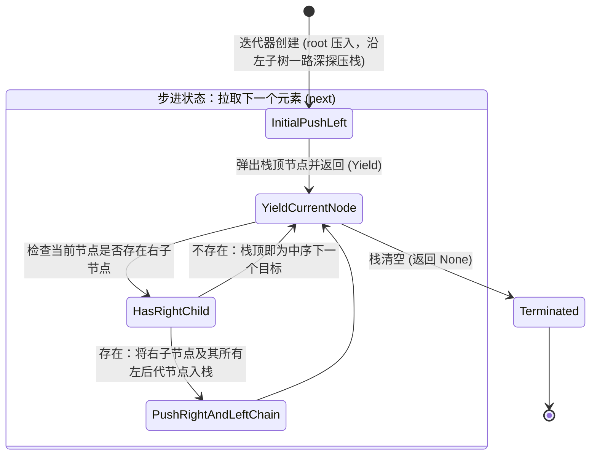

# 核心实战精炼：迭代器模式与零成本高阶流式管道

## 1. 核心架构决策矩阵：迭代器生命周期与流式处理选型

在 Rust 系统级编程中，迭代器是**零成本抽象（Zero-Cost Abstractions）**最极致的体现。与命令式索引循环相比，迭代器不仅消除了边界检查的冗余分支预测损耗，而且借助 LLVM 激进的循环展开（Loop Unrolling）和自动矢量化（Auto-vectorization/SIMD），常常能生成比手写 C 语言更加高效的汇编指令。

下表系统对比了数据流转中核心迭代形态的技术权衡：

### 1.1 迭代器访问形态与生命周期决策矩阵

| 迭代形态 | 核心方法契约 | 产生元素类型 (`Item`) | 集合自身所有权状态 | 是否支持并发读取 | 典型工程适用场景 |
| :--- | :--- | :--- | :--- | :--- | :--- |
| **共享不可变迭代** | `collection.iter()` | `&'a T`（只读借用） | 集合被只读借用，保持原样存活 | **是**（多线程可同时 `iter()`） | 统计指标聚合、点查过滤、只读数据序列化、多轮遍历 |
| **独占可变迭代** | `collection.iter_mut()` | `&'a mut T`（独占借用） | 集合被独占借用，无法结构性增删元素 | 否（独占写互斥） | 原地（In-place）批量数据清洗、状态标志位就地翻转、加密混淆 |
| **消耗转移迭代** | `collection.into_iter()` | `T`（所有权值） | **集合被彻底解构并销毁** | 否（所有权已被移走） | 管道最终阶段消费、异构数据映射转换、向后台线程池转移批处理任务 |
| **切片排除抽取** | `collection.drain(range)` | `T`（指定区间的所有权值）| 集合保留其余元素并复用已分配容量 | 否（需持有集合的 `&mut`） | 环形环状缓冲区消费、批量任务出队、滑动窗口批量丢弃 |

---

## 2. 生产级代码范式：零分配高吞吐系统日志流解析引擎

在处理海量分布式日志、网络报文切片或指标流时，最忌讳在流水线中间环节频繁分配临时 `Vec`。

下面的生产级范式演示了如何将 `Iterator`、`DoubleEndedIterator` 与自定义解析器深度融合，利用**拉式惰性求值（Pull-based Lazy Evaluation）**、`peekable` 前瞻预测以及 `try_fold` 熔断机制，实现完全零额外堆内存分配的高性能日志流管道：

```rust
use std::fmt;

/// 日志级别枚举
#[derive(Debug, PartialEq, Eq, PartialOrd, Ord, Clone, Copy)]
pub enum LogLevel {
    Debug,
    Info,
    Warn,
    Error,
    Fatal,
}

/// 生产级日志条目视图（完全零拷贝，借用原始日志流字符串切片）
#[derive(Debug, PartialEq, Eq)]
pub struct LogEntryView<'a> {
    pub timestamp: &'a str,
    pub level: LogLevel,
    pub service: &'a str,
    pub message: &'a str,
}

/// 生产级错误类型
#[derive(Debug, PartialEq, Eq)]
pub enum ParseError {
    EmptyLine,
    InvalidFormat,
    UnknownLevel,
}

impl fmt::Display for ParseError {
    fn fmt(&self, f: &mut fmt::Formatter<'_>) -> fmt::Result {
        match self {
            Self::EmptyLine => write!(f, "Log line is empty"),
            Self::InvalidFormat => write!(f, "Log line format does not match [TIME] [LEVEL] [SVC] MSG"),
            Self::UnknownLevel => write!(f, "Unknown log level encountered"),
        }
    }
}

/// 解析单行原始日志字符串为只读切片视图
pub fn parse_log_line<'a>(line: &'a str) -> Result<LogEntryView<'a>, ParseError> {
    let trimmed = line.trim();
    if trimmed.is_empty() {
        return Err(ParseError::EmptyLine);
    }

    // 格式约定：[2026-10-25T01:15:00Z] [ERROR] [auth-service] User authentication failed
    let mut parts = trimmed.splitn(4, ' ');
    let timestamp = parts.next().ok_or(ParseError::InvalidFormat)?;
    let level_str = parts.next().ok_or(ParseError::InvalidFormat)?;
    let service = parts.next().ok_or(ParseError::InvalidFormat)?;
    let message = parts.next().ok_or(ParseError::InvalidFormat)?;

    let level = match level_str {
        "[DEBUG]" => LogLevel::Debug,
        "[INFO]" => LogLevel::Info,
        "[WARN]" => LogLevel::Warn,
        "[ERROR]" => LogLevel::Error,
        "[FATAL]" => LogLevel::Fatal,
        _ => return Err(ParseError::UnknownLevel),
    };

    Ok(LogEntryView {
        timestamp,
        level,
        service,
        message,
    })
}

/// 生产级日志流水线统计汇总
#[derive(Debug, Default)]
pub struct LogStatistics {
    pub total_processed: usize,
    pub error_count: usize,
    pub fatal_count: usize,
}

/// 核心工业流式处理函数：全链路零额外内存分配，单遍流式扫描
pub fn process_log_stream<'a, I>(raw_logs: I, target_service: &str) -> Result<LogStatistics, ParseError>
where
    I: IntoIterator<Item = &'a str>,
{
    // 利用 try_fold 实现带短路熔断的零开销流式累加
    raw_logs
        .into_iter()
        .map(parse_log_line)
        // 遇到空行静默丢弃，遇到格式解析错误直接短路向上抛出
        .filter(|res| !matches!(res, Err(ParseError::EmptyLine)))
        .try_fold(LogStatistics::default(), |mut acc, res| {
            let entry = res?; // 若解析错误立即提前终止流水线返回 Err
            
            // 仅过滤统计指定核心服务的告警
            if entry.service.contains(target_service) {
                acc.total_processed += 1;
                match entry.level {
                    LogLevel::Error => acc.error_count += 1,
                    LogLevel::Fatal => acc.fatal_count += 1,
                    _ => {}
                }
            }
            Ok(acc)
        })
}
```

---

## 3. 核心机制底层图解

### 3.1 迭代器三阶段流水线拓扑架构 (Creation -> Adapt -> Consume)

Rust 迭代器严格遵循**拉式驱动（Pull-based）**模型。在消费者显式调用驱动方法之前，所有适配器链**完全不执行任何计算**（纯惰性求值）：

```mermaid
flowchart LR
    subgraph S1["阶段一：数据源与迭代器创建 (Creation)"]
        Src["内存集合 (Vec/Slice/Map)<br/>或 I/O 流 (Lines/Channel)"]
        Iter["IntoIterator / iter() / iter_mut()"]
        Src ==> Iter
    end

    subgraph S2["阶段二：适配器管道惰性组装 (Adapters - 零开销状态机包装)"]
        A1["map(...)"] --> A2["filter(...)"]
        A2 --> A3["enumerate()"]
        A3 --> A4["peekable() / take(N)"]
    end

    subgraph S3["阶段三：消费者驱动求值 (Consumer - 触发 Pull 循环)"]
        C1["fold() / try_fold()<br/>for 循环 / collect()"]
    end

    Iter ==>|包裹构造| S2
    S2 ==>|消费者反复调用 .next() 驱动| S3
```

---

### 3.2 自定义双向二叉树栈式迭代器状态机流转

原著中通过显式保留父节点追溯栈，实现了自定义二叉树的**中序遍历可逆迭代器**。其内部状态转移拓扑如下：



---

## 4. 架构避坑清单 (Do's & Don'ts)

| 典型工程误区 (Don't) | 生产级正确实践 (Do) |
| :--- | :--- |
| **组装了一长串 `.map()` 和 `.filter()` 适配器，却遗漏了终端消费方法，误以为数据已被处理。** | 谨记**迭代器具有严格的惰性（Lazy）**：无终端消费者（如 `for`、`collect()`、`for_each()`）时，适配器代码一行也不会执行。 |
| **在流式处理管道中多处频繁调用 `.collect::<Vec<_>>()`, 导致中间数据不断在堆上分配和拷贝。** | 保持全链路管道化传递，让适配器直接串联，仅在数据必须落盘、跨线程消费或乱序随机索引时调用一次 `collect`。 |
| **对无限生成器迭代器（如 `cycle()`、`repeat()`）直接调用 `count()`、`sum()` 等全局消费方法，导致死循环与 OOM。** | 无界迭代器必须先通过 `.take(n)` 或 `.take_while(...)` 截断为有限序列后，方可传入聚合型消费者。 |
| **在遍历集合时通过下标索引（如 `for i in 0..vec.len() { vec[i] }`）逐个访问元素。** | 直接使用 `for item in &vec` 或 `vec.iter()`，既能让语义更紧凑，更能协助编译器彻底消除数组边界安全检查的分支开销。 |
| **在处理可能失败的流时盲目使用 `.unwrap()` 展开 `Result`，导致单条坏数据击垮整个服务端进程。** | 优先使用 `.filter_map(Result::ok)` 优雅跳过非致命异常，或使用 `.try_fold()` / `.collect::<Result<Vec<_>, _>>()` 实现标准短路熔断。 |

<!-- split -->

# 原著完整参考：第 15 章 迭代器模式与高阶管道（Iterators）

> 那是非常漫长一天的终点。
>
> —— **Phil Connors**（电影《土拨鼠之日》主角）

所谓**迭代器（Iterator）**，是指能够产生一系列值的值，通常用于为循环提供操作的数据流。Rust 标准库不仅为向量（Vectors）、字符串（Strings）、哈希表（Hash Tables）等各类通用集合提供了遍历迭代器，而且还能产生诸如来自输入流的文本行、网络服务器接收到的新建连接、通过跨线程通信通道收到的异步消息等。

当然，你也可以完全为自己的业务类型定制实现迭代器。Rust 的 `for` 循环为迭代器的使用提供了最为自然的语法糖，但迭代器自身更是提供了一套庞大而强大的高阶方法链——用于映射、过滤、拼接、收集等。

Rust 的迭代器兼具灵活性、极强的表达力以及超凡的执行效率。试看以下计算前 `n` 个正整数之和（即第 `n` 个三角形数）的函数：

```rust
fn triangle(n: i32) -> i32 {
    let mut sum = 0;
    for i in 1..=n {
        sum += i;
    }
    sum
}
```

表达式 `1..=n` 是一个 `RangeInclusive` 类型的值。`RangeInclusive` 正是一个能够按闭区间依次产出起始值到结束值整数的迭代器。

迭代器还拥有一个功能极其强大的 `fold` 聚合方法，利用它可以写出如下等价实现：

```rust
fn triangle(n: i32) -> i32 {
    (1..=n).fold(0, |sum, item| sum + item)
}
```

以 `0` 作为初始累加值，`fold` 依次取出 `1..=n` 产生的每个数字，并对当前累加值和新取出的数字应用闭包 `|sum, item| sum + item`。闭包的返回值被采纳为新的累加值；最后一次调用的结果便是 `fold` 的最终输出。

这种写法在极度强调表达力的函数式编程语言中相当普遍。然而在 Rust 中，迭代器在设计之初就融入了严苛的系统级考量：**确保编译器能够将其编译翻译为极致卓越的机器指令**。

在开启了优化编译（`--release`）的构建中，Rust 知道 `fold` 的确切内联定义，因此将 `fold` 直接内联进 `triangle` 函数中；紧接着，累加闭包被再次内联展开。最后，Rust 的底层优化器（LLVM）敏锐地洞察出整个计算存在数学公式解：从 1 到 `n` 的累加必然恒等于 $n \times (n + 1) / 2$。**Rust 最终将整个 `triangle` 函数的主体、循环、闭包以及一切抽象，直接编译成了一条单独的乘法指令与几条极简单的寄存器算术指令！**

这展现了 Rust 抽象哲学的核心基石：**提供无比灵活与现代的高阶语法抽象，但在典型工业使用中施加绝对为零的运行时开销**。

:::en
> **Original**: Rust's iterators are flexible, expressive, and efficient... In a release build of the second definition shown before, Rust knows the definition of `fold` and inlines it into `triangle`. Next, the closure `|sum, item| sum + item` is inlined into that. Finally, Rust examines the combined code and recognizes that there's a simpler way to sum the numbers from one to `n`: the sum is always equal to `n * (n + 1) / 2`. Rust translates the entire body of `triangle`, loop, closure, and all, into a single multiplication instruction and a few other bits of arithmetic.

**📌 核心术语与语境解析**：
- **Iterator** [ˈɪtəreɪtər]：*迭代器*。实现了 `Iterator` 特征的可拉取数据流状态机。
- **Fold** [foʊld]：*折叠/聚合*。高阶函数式原语，通过累加器与二元闭包将序列折叠为单一标量值。
- **Inlining & Scalar Optimization** [ˈɪnlaɪnɪŋ ænd ˈskeɪlər ˌɑːptɪməˈzeɪʃn]：*函数内联与标量优化*。编译器通过剔除函数调用边界，触发常数折叠与代数变换的深度优化。
:::

---

## 1. Iterator 与 IntoIterator 特征契约

迭代器的核心地基是标准库中的 `std::iter::Iterator` 特征：

```rust
trait Iterator {
    type Item;
    fn next(&mut self) -> Option<Self::Item>;
    // ... 大量内建的默认方法
}
```

* `Item` 是该迭代器所产出元素的值类型。
* `next` 方法是整个迭代器引擎的唯一心脏：它要么返回 `Some(v)`（`v` 代表流中的下一个有效值），要么返回 `None` 标志着整个序列已彻底耗尽。

如果某种类型具备自然的遍历方式，那么该类型通常会实现 `std::iter::IntoIterator` 特征：

```rust
trait IntoIterator
where
    Self::IntoIter: Iterator<Item = Self::Item>,
{
    type Item;
    type IntoIter: Iterator;
    fn into_iter(self) -> Self::IntoIter;
}
```

我们将任何实现了 `IntoIterator` 的类型称为**可迭代对象（Iterable）**。

Rust 的 `for` 循环语法糖正是将这些部件严丝合缝地编织在一起：

```rust
let v = vec!["antimony", "arsenic", "aluminum", "selenium"];

for element in &v {
    println!("{element}");
}
```

在底层，每一个 `for` 循环都会被编译器机械而忠实地展开为对 `IntoIterator` 和 `Iterator` 的显式调用：

```rust
let mut iterator = (&v).into_iter();
while let Some(element) = iterator.next() {
    println!("{element}");
}
```

---

## 2. 迭代器的三大家族获取方式

对于标准的集合类型（如 `Vec<T>`、`HashSet<T>`），标准库通常规范化地提供三种迭代器获取途径：

1. **`iter()`**：返回元素只读引用的迭代器，其 `Item` 类型为 `&T`。
2. **`iter_mut()`**：返回元素独占可变引用的迭代器，其 `Item` 类型为 `&mut T`。
3. **`into_iter()`**：以转移所有权的方式消耗集合自身，其 `Item` 类型为 `T`。

此外，标准库还提供了多种强大的独立迭代器构造源：
* **`std::iter::from_fn`**：接收一个返回 `Option<T>` 的闭包，快速将任意逻辑包装为迭代器。
* **`std::iter::successors`**：接收初始种子与递推闭包，生成形如斐波那契数列等后继序列。
* **`drain()`**：从集合中切除指定区间的元素并以迭代器形式交由调用者消费，原集合保留其余部分。

:::en
> **Original**: An iterator is any value that implements the `std::iter::Iterator` trait... `Item` is the type of value the iterator produces. The `next` method either returns `Some(v)`, where `v` is the iterator's next value, or returns `None` to indicate the end of the sequence... Under the hood, every `for` loop is just shorthand for calls to `IntoIterator` and `Iterator` methods.

**📌 核心术语与语境解析**：
- **Pull-based** [pʊl beɪst]：*拉式架构*。数据消费者主动调用 `next()` 索取数据，被动流转，便于按需计算与短路控制。
- **Drain** [dreɪn]：*抽干/排除*。在不重新分配底层存储的前提下，清空或截取容器部分元素的破坏性迭代方法。
:::

---

## 3. 核心迭代器适配器（Iterator Adapters）

适配器是迭代器模式中最绚烂的组件。适配器接收一个既有迭代器，消费并包装它，并返回一个新的特化迭代器。所有适配器都是**完全惰性求值（Lazy）**的。

### 3.1 基础变换与过滤
* **`map(f)` 与 `filter(predicate)`**：高阶变换与条件过滤。
* **`filter_map(f)`**：将过滤与变换融合为一步。闭包返回 `Option<R>`，自动展开 `Some` 并剔除 `None`。
* **`flat_map(f)` 与 `flatten()`**：将嵌套的序列级联拍平为单一连续流。

### 3.2 截断与前瞻
* **`take(n)` 与 `take_while(predicate)`**：按绝对计数或条件预测截断流。
* **`skip(n)` 与 `skip_while(predicate)`**：丢弃前导元素。
* **`peekable()`**：将迭代器转换为前瞻迭代器，允许调用 `.peek()` 在不推进迭代位置的前提下提前探查下一个元素。
* **`fuse()`**：熔断适配器。保证一旦底层迭代器返回过一次 `None`，后续所有 `next()` 调用恒定返回 `None`。

### 3.3 逆序与多流组合
* **`rev()`**：针对实现了 `DoubleEndedIterator`（双向可逆迭代器）的流，实现从尾部向前逆序遍历。
* **`chain(other)`**：将两个产出相同类型元素的迭代器首尾串联。
* **`enumerate()`**：将元素与递增的 `usize` 下标打包为 `(index, item)` 元组。
* **`zip(other)`**：将两个流如同拉链般并排锁合，产出元素配对元组。一旦任意一个流耗尽，整体立即终止。

---

## 4. 终端消费者方法（Consuming Iterators）

只有当终端消费者被触发时，整条适配器管道才会真正开始拉取数据执行运算：

* **基础聚合**：`count()`（统计总数）、`sum()`（累加）、`product()`（累乘）。
* **极值定位**：`max()`、`min()`、`max_by_key()`。
* **谓词判定**：`any(predicate)`（存在任一满足即短路返回 true）、`all(predicate)`（全满足返回 true）。
* **核心折叠**：`fold(init, f)` 与带短路熔断的工业级 `try_fold(init, f)`。
* **集合落地**：`collect()` 与 `extend()`。`collect` 借助强类型推导，能够一键将流落地为 `Vec`、`HashMap`、`BTreeSet` 乃至标准库中的 `Result<Vec<T>, E>`（实现一旦流中有一项错误立即整体提前退出）。

:::en
> **Original**: Adapters are lazy: creating an adapter does no work; it simply produces a new iterator ready to do work when asked. If you create an iterator pipeline and don't consume its values, Rust will warn you that you've done nothing... The `collect` method can build any kind of collection from an iterator, so long as the iterator produces elements of the right type.

**📌 核心术语与语境解析**：
- **Lazy Evaluation** [ˈleɪzi ɪˌvæljuˈeɪʃn]：*惰性求值/按需计算*。仅在结果真正需要呈现时才驱动计算，极大节约计算与内存开销。
- **DoubleEndedIterator** [ˈdʌbl ˈendɪd ˈɪtəreɪtər]：*双端迭代器*。同时支持 `next()` 从前端弹入与 `next_back()` 从后端弹出的高级特征。
- **Short-circuiting** [ʃɔːrt ˈsɜːrkɪtɪŋ]：*短路操作*。在满足预设判定条件时，立刻停止拉取后续流数据以节约时钟周期。
:::

---

## 5. 自定义迭代器实战：二叉树中序遍历状态机

在工业工程中，我们常需要为领域自定义复杂数据结构编写迭代器。原著展示了一个极具代表性的案例：为二叉查找树 `BinaryTree<T>` 实现高效的中序遍历（In-order Traversal）。

为了避免使用低效的深层递归或将整棵树一次性克隆到内存向量中，我们通过显式维护一个保存未访问祖先节点的追溯栈，将遍历过程精确建模为一个状态机：


```rust
enum BinaryTree<T> {
    Empty,
    NonEmpty(Box<TreeNode<T>>),
}

struct TreeNode<T> {
    element: T,
    left: BinaryTree<T>,
    right: BinaryTree<T>,
}

pub struct TreeIter<'a, T> {
    // 存储当前路径上未完成右子树遍历的祖先节点借用引用
    unvisited: Vec<&'a TreeNode<T>>,
}

impl<'a, T> TreeIter<'a, T> {
    fn push_left_edge(&mut self, mut tree: &'a BinaryTree<T>) {
        while let BinaryTree::NonEmpty(ref node) = *tree {
            self.unvisited.push(node);
            tree = &node.left;
        }
    }
}

impl<'a, T> Iterator for TreeIter<'a, T> {
    type Item = &'a T;

    fn next(&mut self) -> Option<Self::Item> {
        // 弹出当前栈顶节点
        let node = self.unvisited.pop()?;
        // 若存在右子树，将右子节点的全部左边界依次入栈
        self.push_left_edge(&node.right);
        Some(&node.element)
    }
}
```

如图 15-1 所示，遍历整棵包含 4 个节点的树，追溯栈经历了 5 个清晰的状态迁移。这种基于栈的状态机实现，空间复杂度严格等于树的高度 $O(h)$，完美兼顾了工业级的低内存占用与流式惰性消费能力。
