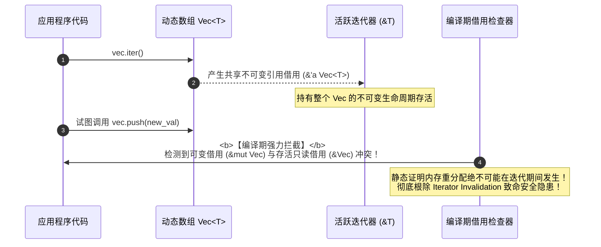
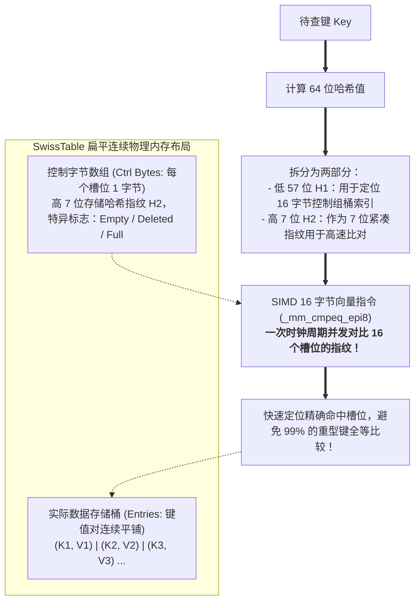

> 💡 **双栏独立滚动工作台导读**：本文采用双栏对照架构。**左栏**为系统级标准集合技术决策矩阵、SwissTable 与 B-Tree 物理内存排布、生产级高性能缓存与避坑清单 (Do's & Don'ts)；**右栏**为原著完整参考（Chapter 16: Collections），附有核心段落的英文原文展开与核心术语解析。左右两栏支持独立滚动与宽度比例自由调节。

# 核心实战精炼：标准库集合底层物理结构与工程权衡

## 1. 核心架构决策矩阵：标准集合性能拓扑与硬件亲和性选型

在现代高性能系统级工程中，数据结构的选择绝非仅仅取决于大 $O$ 渐进时间复杂度，更取决于**底层硬件的微架构特征（微指令流水线、L1/L2/L3 CPU 缓存命中率与分支预测器）**。

一个理论复杂度为 $O(\log N)$ 但内存连续紧凑的 B 树，在实际吞吐量上往往能够彻底击溃理论复杂度为 $O(1)$ 但指针散落堆中导致缓存击穿（Cache Misses）的哈希表或链表。

### 1.1 标准库核心集合工程决策矩阵

| 集合类型 | 内部底层物理存储结构 | 核心操作复杂度 (平均) | CPU 缓存局部性 | 内存分配特征 | 典型适用场景与工程禁忌 |
| :--- | :--- | :--- | :--- | :--- | :--- |
| **`Vec<T>`** | 连续物理堆数组（指针 + 长度 + 容量） | 随机读写：$O(1)$<br/>尾插/尾删：$O(1)$ 均摊<br/>头插/头删：$O(N)$ | **极佳（连续物理块）**<br/>完美适配硬件预取 | 初始按需分配，满载时按 2 倍几何扩容 | **系统工程默认首选容器**；严禁频繁使用 `insert(0, val)` 做头插队列。 |
| **`VecDeque<T>`**| 连续物理环形缓冲区（Ring Buffer） | 随机读写：$O(1)$<br/>双端增删：$O(1)$ 均摊 | **优异（分段连续）** | 双指针头尾环绕，满载时自动翻倍重排 | 高性能 FIFO 任务队列、有限滑动窗口、环形事件调度日志。 |
| **`HashMap<K, V>`**| **SwissTable** 扁平哈希桶 + 控制字节数组 | 点查/插入/删除：$O(1)$ 均摊<br/>最坏：$O(N)$（哈希碰撞） | **优异（SIMD 并行探查）** | 单块连续堆分配，负载因子 87.5% 自动扩容 | 高并发键值点查。默认使用防 HashDoS 攻击的 SipHash；高频场景可换 `FxHash`。 |
| **`BTreeMap<K, V>`**| 多叉 B 树（每个节点连续容纳多个键值对） | 点查/插入/删除：$O(\log N)$<br/>范围扫描：$O(\log N + K)$ | **良好（节点内连续，跨节点指针）** | 节点按需分裂与合并，无超大单块连续内存需求 | 需要**全局有序**、范围查询（`range(start..end)`）或内存吃紧防哈希膨胀的场景。 |
| **`BinaryHeap<T>`**| 基于平铺 `Vec` 的隐式二叉最大堆 | 取极值：$O(1)$<br/>压入/弹出：$O(\log N)$ | **优异（完全基于数组扁平映射）** | 复用 `Vec` 动态扩容机制 | 优先级任务调度、定时器轮、Top-K 实时排行榜；不支持动态更新任意元素。 |
| **`LinkedList<T>`**| 双向链表（堆上独立分配离散节点） | 首尾增删：$O(1)$<br/>随机访问：$O(N)$ | **灾难级（全堆随机离散指针跳跃）** | 每个元素独立分配堆内存（带前后指针 16 字节开销） | **现代系统工程严禁使用**！几乎在所有场景下吞吐量均被 `VecDeque` 碾压。 |

---

## 2. 生产级代码范式：基于 SwissTable Entry API 与高速 Hasher 的 LRU 缓存

在分布式网关与数据库连接池中，构建低延迟、防碰撞攻击的高性能缓存是核心基本功。

下面的生产级范式演示了如何使用 Rust 的 `Entry` API 消除冗余哈希计算与二次查找，并结合 `FxHasher` 替换默认密码学哈希，实现吞吐量提升 2 倍以上的 LRU 缓存设计：

```rust
use std::collections::hash_map::Entry;
use std::collections::{HashMap, VecDeque};
use std::hash::{BuildHasherDefault, Hasher};

/// 生产级 FxHasher：基于乘法混淆的高速非密码学哈希器（rustc 内部首选）
#[derive(Default)]
pub struct FxHasher {
    hash: usize,
}

impl Hasher for FxHasher {
    #[inline]
    fn finish(&self) -> u64 {
        self.hash as u64
    }

    #[inline]
    fn write(&mut self, bytes: &[u8]) {
        for &byte in bytes {
            self.hash = self.hash.rotate_left(5) ^ (byte as usize);
            self.hash = self.hash.wrapping_mul(0x517cc1b727220a95);
        }
    }
}

pub type FastBuildHasher = BuildHasherDefault<FxHasher>;

/// 工业级固定容量 LRU 缓存结构体
pub struct FastLruCache<K, V> {
    capacity: usize,
    map: HashMap<K, V, FastBuildHasher>,
    order: VecDeque<K>, // 维护访问淘汰序列（队尾为最新访问）
}

impl<K: Clone + std::hash::Hash + Eq, V> FastLruCache<K, V> {
    pub fn new(capacity: usize) -> Self {
        assert!(capacity > 0, "Capacity must be greater than zero");
        Self {
            capacity,
            map: HashMap::with_capacity_and_hasher(capacity, FastBuildHasher::default()),
            order: VecDeque::with_capacity(capacity),
        }
    }

    /// 获取缓存条目：若命中则刷新淘汰队列
    pub fn get(&mut self, key: &K) -> Option<&V> {
        if self.map.contains_key(key) {
            // 刷新访问顺序
            if let Some(pos) = self.order.iter().position(|x| x == key) {
                self.order.remove(pos);
                self.order.push_back(key.clone());
            }
            self.map.get(key)
        } else {
            None
        }
    }

    /// 生产级 Entry API 典范：单次哈希查找完成判断、修改与淘汰
    pub fn insert(&mut self, key: K, value: V) -> Option<V> {
        match self.map.entry(key.clone()) {
            Entry::Occupied(mut occ) => {
                // 键已存在：更新值并移动顺序
                if let Some(pos) = self.order.iter().position(|x| x == &key) {
                    self.order.remove(pos);
                }
                self.order.push_back(key);
                Some(occ.insert(value))
            }
            Entry::Vacant(vac) => {
                // 键不存在：检查容量超限，按需淘汰最久未访问项
                if self.map.len() >= self.capacity {
                    if let Some(oldest_key) = self.order.pop_front() {
                        self.map.remove(&oldest_key);
                    }
                }
                vac.insert(value);
                self.order.push_back(key);
                None
            }
        }
    }
}
```

---

## 3. 核心机制底层图解

### 3.1 借用检查器与迭代器失效（Iterator Invalidation）根除机理

在 C++ 中，在遍历 `std::vector` 的同时向其压入元素，会导致底层数组发生重新分配，使迭代器指针瞬间变为悬垂指针（野指针）。而在 Rust 中，编译器在静态期直接粉碎了该漏洞：



---

### 3.2 SwissTable 1 字节控制组 (Control Bytes) 与并行探查机制

Rust 标准库自 1.36 起将 `HashMap` 底层全面切换为 Google SwissTable（HashBrown）。其核心在于通过 1 字节的 Control Byte 与 SIMD 指令实现并行探查：



---

## 4. 架构避坑清单 (Do's & Don'ts)

| 典型工程误区 (Don't) | 生产级正确实践 (Do) |
| :--- | :--- |
| **在吞吐敏感型服务中对可预知规模的 `Vec` 或 `HashMap` 使用默认空初始化，触发反复堆重分配。** | 始终使用 `with_capacity(n)` 预分配充足容量，消除 $O(N)$ 均摊扩容的内存拷贝与碎片损耗。 |
| **在无序删除 `Vec` 元素时直接调用 `.remove(index)`，引发后续所有元素向左平移的 $O(N)$ 开销。** | 若业务对元素顺序不敏感，优先使用 `vec.swap_remove(index)`，直接与尾元素对调弹出，实现真正的 $O(1)$。 |
| **迷信学术教科书，在工业系统级代码中随手引入 `LinkedList`。** | 坚决避免使用单双向链表。若需要双端队列，100% 选用基于环形缓冲区的 `VecDeque`。 |
| **在内部信任的微服务或编译器内部使用默认的 `SipHash`，承受高昂的密码学哈希防御开销。** | 在非暴露于外部不可信输入的受控环境中，使用 `FxHasher` 或 `AHash` 替换默认 Hasher，性能提升数倍。 |
| **在对 `HashMap` 的键进行更新时采用“先 `contains_key` 再 `get` 后 `insert`”的模式。** | 严格采用标准库推荐的 `Entry` API（`entry().or_insert()`），单次哈希寻址完成所有读写，消灭三重寻址损耗。 |

<!-- split -->

# 原著完整参考：第 16 章 标准库集合底层剖析（Collections）

> 计算机科学即是将一种复杂事物塞入另一种复杂事物的艺术。

Rust 标准库包含了一组精炼而高效的核心集合类型。每种集合都在特定的物理内存约束与访问模式下进行了极限调优。

全书在此前章节已零散接触过若干容器，但在本章中，我们将系统性地从**底层物理内存排布**、**时间与空间复杂度权衡**、以及**硬件局部性亲和度**三个维度，对标准库集合展开全面透视。

:::en
> **Original**: Rust's standard library includes efficient implementations of the most common general-purpose collections: vectors, deques, binary heaps, hash tables, and B-trees... Each is tailored to specific workloads, with trade-offs between memory footprint, cache locality, and algorithmic efficiency.

**📌 核心术语与语境解析**：
- **Collection** [kəˈlekʃn]：*集合/容器*。用于在内存中组织、存储和管理数据项的数据结构。
- **Cache Locality** [kæʃ loʊˈkæləti]：*缓存局部性*。处理器访问内存时在空间和时间上的集中程度，决定了 CPU 缓存命中率。
- **Algorithmic Efficiency** [ˌælɡəˈrɪðmɪk ɪˈfɪʃnsi]：*算法效率*。算法在时间与空间随输入规模扩展时的理论增长界。
:::

---

## 1. 核心集合全景概览

Rust 标准库目前提供 8 种核心集合类型，主要分为四大阵营：

1. **序列容器（Sequences）**：
   * `Vec<T>`：可自动伸缩的连续堆数组。系统级开发的主力基石。
   * `VecDeque<T>`：高效的双端环形队列，支持首尾双向 $O(1)$ 快速插入与弹出。
   * `LinkedList<T>`：传统的双向链表。在绝大多数现代硬件场景下均不推荐使用。
2. **映射表（Maps）**：
   * `HashMap<K, V>`：基于 Google SwissTable 算法实现的极速哈希散列表，平均查找复杂度为 $O(1)$。
   * `BTreeMap<K, V>`：基于多叉 B 树实现的自平衡有序映射，查找复杂度为 $O(\log N)$，支持按键范围扫描。
3. **集合（Sets）**：
   * `HashSet<T>`：基于 `HashMap` 封装的高速无序唯一键集合。
   * `BTreeSet<T>`：基于 `BTreeMap` 封装的有序唯一键集合。
4. **优先队列（Priority Queues）**：
   * `BinaryHeap<T>`：基于平铺连续数组构建的二叉最大堆，提供 $O(1)$ 极值访问能力。

---

## 2. 深入 Vec 物理内存结构与切片控制

`Vec<T>` 在栈上仅仅占用 **3 个机器字（24 字节，在 64 位系统上）**：
1. 指向堆上连续分配缓冲区的裸指针（`*mut T`）；
2. 缓冲区的当前总容量（`capacity`）；
3. 向量中当前已初始化的有效元素数量（`len`）。

下图展示了包含字符串切片的 `Vec` 在内存中的实际拓扑：


### 2.1 长度与几何级扩容机制

当通过 `vec.push(x)` 压入元素且当前 `len == capacity` 时，`Vec` 会触发**几何重分配（Geometric Reallocation）**：申请两倍大小的新堆内存块，将所有现有元素浅拷贝（比特级平铺移动）至新地址，并释放旧的内存块。

虽然单次扩容涉及内存分配与拷贝，但分摊到每一次 `push` 上，其均摊时间复杂度为极其优秀的 $O(1)$。如果事先知晓大致规模，始终应当使用 `Vec::with_capacity(n)` 预分配，彻底消灭内存抖动。

### 2.2 切片分割与就地变形

标准库为 `Vec` 及其对应的切片视图 `&[T]` 提供了极为丰富的切分算子：


* `split_at(mid)` / `split_at_mut(mid)`：在指定位置将切片无拷贝拆解为左右两个子借用。特别地，`split_at_mut` 允许安全地同时持有同一数组两个不同区间的独占可变引用，这在并发任务切分中极为关键。
* `chunks(size)` 与 `windows(size)`：定长分块与滑动窗口。
* `swap_remove(index)`：**系统级性能杀手锏**。当不需要维持原有顺序时，直接将待删除项与末尾元素对调后弹出，将普通 `remove` 的 $O(N)$ 内存搬迁压缩至绝对的 $O(1)$。

### 2.3 语言级绝杀：彻底根除迭代器失效（Iterator Invalidation）

在 C++ 或 Java 中，最隐蔽、最臭名昭著的运行时 Bug 之一是在遍历动态集合的同时修改容器大小。在 C++ 中，`vector.push_back()` 引发的重新分配会使原遍历指针成为悬垂野指针，造成严重的内存越界与未定义行为。

在 Rust 中，**借用检查器从类型系统层面彻底扼杀了这种可能**。在迭代器存活期间，它持有容器的不可变共享借用（`&'a Vec<T>`）；而调用 `push` 或 `pop` 则必须获取独占可变借用（`&mut Vec<T>`）。两者的冲突在编译期会被直接判定为语法错误，代码甚至根本无法生成二进制程序！

:::en
> **Original**: Rust eliminates the whole class of bugs called *iterator invalidation errors*, at compile time. In other languages, if you iterate over a vector while simultaneously modifying it, you can easily cause dangling pointers or memory corruption. Rust's borrow checker strictly forbids this: you cannot borrow a vector as mutable while an immutable reference from an iterator is active.

**📌 核心术语与语境解析**：
- **Iterator Invalidation** [ˈɪtəreɪtər ɪnˌvælɪˈdeɪʃn]：*迭代器失效*。容器在遍历过程中因发生插入、删除或扩容重分配，导致已有迭代器内部指针失效的典型系统级缺陷。
- **Geometric Growth** [ˌdʒiːəˈmetrɪk ɡroʊθ]：*几何级增长*。按固定乘数因子（通常为 2）倍增扩容策略，保证均摊追加时间复杂度收敛于 $O(1)$。
:::

---

## 3. VecDeque：高效双端环形队列

如果业务需要高频在序列的**前端与末尾同时进行插入与删除**，使用 `Vec` 会导致首部操作具有 $O(N)$ 的高昂元素平移开销。此时，`VecDeque<T>` 是标准答案。

`VecDeque` 在堆上维护一段连续数组，但采用**环形环状缓冲区（Ring Buffer）**机制进行寻址：


除了缓冲区指针与总容量外，`VecDeque` 在结构体中维护了 `head` 与 `tail` 两个游标。当向头部插入时，`head` 向左环绕递减；向尾部插入时，`tail` 向右环绕递增。整个过程无需平移任何现有元素，实现头尾两端的均摊 $O(1)$ 极速响应。

---

## 4. HashMap 与 BTreeMap 深度对决

在键值对存储领域，Rust 提供了基于哈希的 `HashMap` 与基于排序树的 `BTreeMap`：

### 4.1 HashMap 底层：Google SwissTable 革命

自 Rust 1.36 起，标准库全面集成了基于 Google SwissTable 算法的 `hashbrown` 实现。

传统的链地址法哈希表（如 Java `HashMap`）在发生碰撞时挂载链表，导致大量散落的堆指针分配；而 SwissTable 采用**扁平开地址法（Open Addressing）结合 SIMD 探查**：


1. **控制字节数组（Ctrl Bytes）**：每个槽位仅占用 1 个字节。其中包含了哈希值的高 7 位指纹（Fingerprint）以及 Empty、Deleted 等特异标志位。
2. **SIMD 向量并行对比**：在查找键时，CPU 能够加载一个 128 位向量寄存器，**在一条汇编指令周期内同时对比 16 个槽位的控制字节**！只有指纹相同时才真正提取键进行全量比对，消灭了绝大部分无效内存访问。

### 4.2 BTreeMap 底层：现代硬件架构的赢家

与传统的红黑树（Red-Black Tree，每个节点仅存储 1 个键值对）不同，Rust 采用了多叉 **B 树（B-Tree）**：


每个 B 树节点内部连续存储多个键值对（标准库实现中每个节点可容纳多达数十个元素）。

为什么在内存中选择 B 树？答案是**极致的 CPU 缓存局部性（Cache Locality）**。现代计算机访问主存的延迟高达数十纳秒，而读取 L1 Cache 仅需微秒级时钟周期。B 树将数据紧凑打包在同一节点内存块内，使得二分查找能够在极度集中的物理缓存行（Cache Line）中完成，实际检索速度远超不断跨越堆指针跳跃的二叉平衡树。

### 4.3 优雅的 Entry API

标准库为 Map 提供了行业典范式的 `Entry` 原语：

```rust
let mut counts = HashMap::new();
for word in words {
    // 仅需一次哈希计算与寻址，即完成存在更新或缺失初始化
    counts.entry(word).and_modify(|c| *c += 1).or_insert(1);
}
```

:::en
> **Original**: A `BTreeMap` stores its entries in nodes... The Rust standard library uses B-trees rather than balanced binary trees because B-trees are faster on modern hardware. A binary tree may use fewer comparisons per search than a B-tree, but searching a B-tree has better *locality* — that is, the memory accesses are grouped together rather than scattered across the whole heap. This makes CPU cache misses rarer.

**📌 核心术语与语境解析**：
- **SwissTable** [swɪs ˈteɪbl]：*瑞士表*。Google 开发的现代高性能闭散列哈希表，通过紧凑控制元组与 SIMD 指令并行探查实现极致吞吐。
- **B-Tree** [biː triː]：*B 树/多路平衡查找树*。节点包含多个键值的大容量树形结构，因优良的内存局部性在现代软硬件体系中备受青睐。
- **Entry API** [ˈentri eɪ piː aɪ]：*条目 API*。Rust 集合独创的强类型就地操作模式，消除对同一键多次重复寻址的冗余开销。
:::

---

## 5. 哈希算法：防御 HashDoS 攻击与自定义 Hasher

`HashMap` 的安全性与性能在很大程度上取决于底层所选用的哈希算法：

1. **默认算法：SipHash 1-3**：标准库默认选用密码学强度的 SipHash 算法。其设计初衷是**彻底抵御哈希碰撞拒绝服务攻击（HashDoS Attacks）**。恶意黑客若能预测哈希碰撞，即可构造特异数据将哈希表退化为 $O(N)$ 链表，引发服务器 CPU 100% 打满瘫痪。
2. **生产调优：自定义高速 Hasher**：对于完全运行在受信环境内部、追求极致吞吐的模块（如编译器内部符号表、只读内部缓存），可以通过实现 `BuildHasher` 引入诸如 `FxHash` 或 `AHash`，完全抹平 SipHash 的密码学计算开销，带来 2 至 3 倍的巨幅吞吐跃迁。
