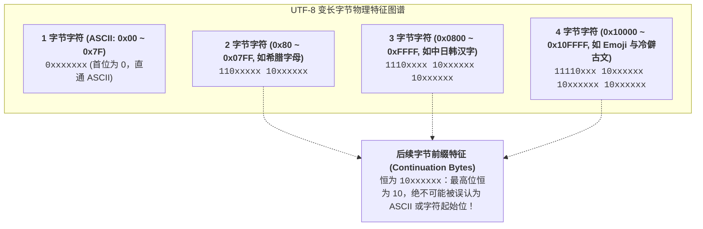
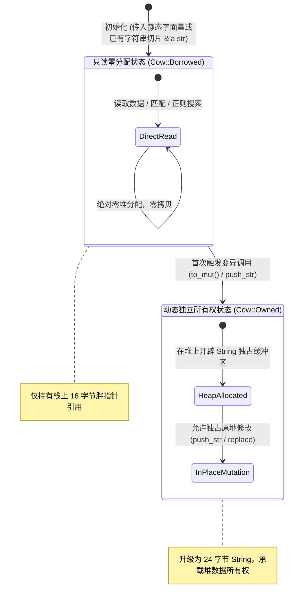

> 💡 **双栏独立滚动工作台导读**：本文采用双栏对照架构。**左栏**为系统级文本类型选型决策矩阵、UTF-8 字节编码拓扑、生产级零拷贝参数清洗器与避坑清单 (Do's & Don'ts)；**右栏**为原著完整参考（Chapter 17: Strings and Text），附有核心段落的英文原文展开与核心术语解析。左右两栏支持独立滚动与宽度比例自由调节。

# 核心实战精炼：文本编码本质与零拷贝文本架构

## 1. 核心架构决策矩阵：系统级文本表示类型与生命周期选型

在许多高级动态语言（如 Python、JavaScript）中，“字符串”是一个被厚重运行时封装的不透明对象。但在 Rust 系统级编程中，**不存在单一的万能字符串**。

Rust 严格区分**所有权归属**、**不可变借用视图**、**系统底层 OS 编码**以及**写时克隆（Copy-on-Write, Cow）优化**：

### 1.1 核心文本表示类型工程决策矩阵

| 类型名称 | 内存布局与底层承载 | 所有权与生命周期 | 是否保证合法 UTF-8 | 能否就地修改 | 典型系统级适用场景 |
| :--- | :--- | :--- | :--- | :--- | :--- |
| **`&str`** | 栈上胖指针（数据指针 + 字节长度，16 字节） | 借用切片（不拥有数据，依赖生命周期 `'a`） | **强保证**（100% 合法 UTF-8） | 否（只读切片） | 高性能只读参数传递、字面量常量、零拷贝协议解析视图 |
| **`String`** | 栈上 24 字节元组（指针 + 容量 + 长度）+ 堆缓冲 | **拥有所有权**，离开作用域自动释放堆内存 | **强保证**（任何修改均强制维护 UTF-8 不变量） | **是**（`push_str`, `clear`） | 动态文本生成、需要持有并独立修改的业务实体字段 |
| **`Cow<'a, str>`** | 枚举：`Borrowed(&'a str)` 或 `Owned(String)` | 混合形态：读时零拷贝借用，写时延迟克隆 | **强保证**（继承底层切片或 String 的不变量） | **是**（通过 `to_mut()` 按需触发堆分配） | 高吞吐只读过滤、HTTP 报文解码、编译器宏展开、配置合并 |
| **`Box<str>`** | 栈上 16 字节胖指针 + 紧凑堆内存（无 capacity） | 拥有堆所有权，但尺寸不可变更 | **强保证** | 否（长度不可变） | 长期驻留只读文本（比 `String` 节约 8 字节栈容量字段） |
| **`&OsStr` / `OsString`**| 平台原生表示（Windows WTF-16 / Unix 任意字节） | `OsStr` 为借用，`OsString` 拥有所有权 | **否**（允许非标准编码） | `OsString` 支持追加 | 操作系统文件路径、环境变量、命令行参数传递 |
| **`&CStr` / `CString`** | 以空字符 `\0` 结尾的字节数组 | `CStr` 为借用，`CString` 拥有堆所有权 | **否**（符合 C 规范，不可含内嵌 `\0`）| `CString` 支持修改 | C 语言动态链接库 FFI 互操作、系统调用绑定 |
| **`&[u8]`** | 裸无符号 8 位字节切片 | 纯粹内存字节序列视图 | **否**（无任何字符编码假设） | 否 | 网络原始二进制报文、底层硬件 I/O 驱动缓冲区 |

---

## 2. 生产级代码范式：基于 Cow 的零拷贝 HTTP URL 解码与清洗器

在工业级 Web 网关（如 Envoy、Nginx）中，解析 URL Query 参数是一条高频热点路径。如果每个请求都盲目分配新的 `String` 进行转义字符处理，将造成灾难性的堆内存碎片与 GC 停顿（其他语言）。

下面的生产级范式演示了如何利用 `Cow<'a, str>` 结合 `char_indices` 与 UTF-8 边界安全探测，在**未包含转义字符时实现绝对零堆分配借用**，仅在出现 `%20` 等转义字符时才按需平滑升级为堆 `String`：

```rust
use std::borrow::Cow;
use std::fmt;

/// URL 解码可能引发的错误
#[derive(Debug, PartialEq, Eq)]
pub enum DecodeError {
    InvalidPercentEncoding(usize),
    InvalidUtf8,
}

impl fmt::Display for DecodeError {
    fn fmt(&self, f: &mut fmt::Formatter<'_>) -> fmt::Result {
        match self {
            Self::InvalidPercentEncoding(pos) => {
                write!(f, "Invalid percent-encoding sequence at byte offset {}", pos)
            }
            Self::InvalidUtf8 => write!(f, "Decoded sequence is not valid UTF-8"),
        }
    }
}

/// 生产级零拷贝 URL 查询参数解码器：
/// 当输入无 '%' 或 '+' 时，直接以 Cow::Borrowed(&'a str) 零成本穿透；
/// 仅当检测到需要解码的转义标记时，才惰性触发堆分配并转为 Cow::Owned(String)
pub fn url_decode<'a>(input: &'a str) -> Result<Cow<'a, str>, DecodeError> {
    // 快速路径：扫描是否包含需要转义的字符
    let needs_decoding = input.bytes().any(|b| b == b'%' || b == b'+');
    if !needs_decoding {
        return Ok(Cow::Borrowed(input));
    }

    // 慢速路径：按需在堆上开辟连续字节缓冲区进行就地重构
    let mut decoded_bytes = Vec::with_capacity(input.len());
    let mut bytes = input.bytes().enumerate();

    while let Some((idx, b)) = bytes.next() {
        match b {
            b'+' => decoded_bytes.push(b' '),
            b'%' => {
                let (_, h1) = bytes
                    .next()
                    .ok_or(DecodeError::InvalidPercentEncoding(idx))?;
                let (_, h2) = bytes
                    .next()
                    .ok_or(DecodeError::InvalidPercentEncoding(idx))?;

                let hex_val = parse_hex_byte(h1, h2)
                    .ok_or(DecodeError::InvalidPercentEncoding(idx))?;
                decoded_bytes.push(hex_val);
            }
            _ => decoded_bytes.push(b),
        }
    }

    // 严苛验证解出的字节流是否满足合法的 UTF-8 编码约束
    let decoded_string = String::from_utf8(decoded_bytes)
        .map_err(|_| DecodeError::InvalidUtf8)?;

    Ok(Cow::Owned(decoded_string))
}

#[inline]
fn parse_hex_digit(digit: u8) -> Option<u8> {
    match digit {
        b'0'..=b'9' => Some(digit - b'0'),
        b'a'..=b'f' => Some(digit - b'a' + 10),
        b'A'..=b'F' => Some(digit - b'A' + 10),
        _ => None,
    }
}

#[inline]
fn parse_hex_byte(high: u8, low: u8) -> Option<u8> {
    let h = parse_hex_digit(high)?;
    let l = parse_hex_digit(low)?;
    Some((h << 4) | l)
}

/// 生产级安全切片截断器：确保切分位置绝不落在多字节 UTF-8 字符内部
pub fn safe_truncate_str(s: &str, max_bytes: usize) -> &str {
    if max_bytes >= s.len() {
        return s;
    }
    // 从 max_bytes 开始向下探查最近的合法字符起始边界
    let mut end = max_bytes;
    while end > 0 && !s.is_char_boundary(end) {
        end -= 1;
    }
    &s[..end]
}
```

---

## 3. 核心机制底层图解

### 3.1 UTF-8 变长物理编码与字节前缀特征拓扑

UTF-8 是针对 Unicode 码点（Code Points: `U+0000` ~ `U+10FFFF`）设计的变长字节流编码。其最高位模式决定了字符占用的总字节数：



---

### 3.2 Cow<'a, str> 写时克隆状态转移与内存流动



---

## 4. 架构避坑清单 (Do's & Don'ts)

| 典型工程误区 (Don't) | 生产级正确实践 (Do) |
| :--- | :--- |
| **假设每个字符等于 1 个字节，直接使用裸切片下标（如 `&s[0..3]`）截断中文或 Emoji 字符串。** | 严禁无保护下标切片！若切割点恰好落在多字节字符中间，将引发**运行时 Panic**。必须使用 `s.is_char_boundary(idx)` 校验或使用字符迭代器 `s.chars().take(n)`。 |
| **在循环拼接字符串时滥用加号连接（`s = s + &other`），导致每次循环都在堆上重新开辟并完整拷贝一次数据。** | 使用 `String::with_capacity(estimated_len)` 预估容量，并通过 `.push_str(&other)` 就地连续追加，实现 $O(1)$ 均摊扩展。 |
| **在操作系统文件路径或环境变量处理中盲目强转 `String`，导致在非 UTF-8 系统上崩溃。** | 涉及系统底层边界时，严格使用 `std::path::Path` / `PathBuf` 或 `OsStr` / `OsString`，它们原生宽容非 UTF-8 历史编码。 |
| **误以为 `s.chars().count()` 返回的值就是终端或屏幕上的实际渲染视觉对齐宽度。** | `chars().count()` 仅统计 Unicode 码点总数。复杂 Emoji（如带肤色修饰或 ZWJ 连接符组合）占用多个码点；排版对齐必须使用 `unicode-width` 库计算列宽。 |
| **在只读查询或解析流水线中频繁调用 `.to_string()` 或 `.to_owned()`，将切片滥转为堆对象。** | 优先保持 `&str` 切片传递；若返回值在不同分支中可能拥有或借用，使用 `Cow<'a, str>` 延缓或彻底消灭堆分配。 |

<!-- split -->

# 原著完整参考：第 17 章 字符串与文本处理（Strings and Text）

> 语言是思想的外衣。
>
> —— **塞缪尔·约翰逊**（Samuel Johnson）

在绝大多数现代编程语言中，字符串处理看似微不足道，实则暗藏巨礁。这很大程度上是因为许多主流语言诞生于对字符集与编码认知尚不完善的时代，或者为了追求表面的简易性而对底层现实进行了不恰当的粉饰。

Rust 从设计之初就立下了一项不可动摇的底线铁律：**Rust 中的所有文本内容必须始终严格保持为格式良好的 UTF-8 编码**。

这一硬性保证彻底根除了缓冲区混淆与非法字节序漏洞。但与此相对应，系统程序员必须深入理解 UTF-8 的底层物理规则，掌握 `String` 与 `&str` 的本质分工，并学会使用 `Cow` 智能指针编写零拷贝的高性能文本算法。

:::en
> **Original**: Rust strings are guaranteed to be valid UTF-8. A `String` or `&str` whose bytes are not valid UTF-8 cannot be created using safe Rust methods... This guarantee makes working with text much safer and more predictable, but it also means that indexing into a string is not as simple as in languages that assume every character is a fixed size.

**📌 核心术语与语境解析**：
- **UTF-8 Invariant** [juː tiː ef eɪt ɪnˈverɪənt]：*UTF-8 不变量*。Rust 语言对文本类型施加的强类型安全契约，确保任何暴露给安全代码的 `String` 或 `&str` 均为合法合规的 UTF-8 序列。
- **Unicode Code Point** [ˈjuːnɪkoʊd koʊd pɔɪnt]：*Unicode 码点*。Unicode 标准中分配给字符的唯一标量编号，范围从 `U+0000` 到 `U+10FFFF`。
- **Non-indexable** [nɑːn ˈɪndeksəbl]：*不可直接下标寻址*。由于字符字节长度不固定，直接通过整数下标随机索引无法在 $O(1)$ 时间内定位字符边界，因此被语言显式禁止。
:::

---

## 1. Unicode 与 UTF-8 底层技术背景

在计算机发展早期，每个字符仅由一个 8 位字节表示（如 ASCII 仅使用低 7 位 `0`~`127`，ISO Latin-1 扩充至 `255`）。然而全球语言的成千上万个字符彻底打破了单字节的物理上限。

Unicode 标准应运而生：它将世界上的所有书写符号映射为一个名为**码点（Code Point）**的数字，记作 `U+0000` 至 `U+10FFFF`。

为了在磁盘与网络中存储传输这些码点，人们提出了多种编码方案：
* **UTF-32**：每个字符统一占用固定 4 个字节。虽然支持 $O(1)$ 随机索引，但存储体积极度膨胀（对于标准 ASCII 英文文本造成高达 4 倍的空间浪费与缓存击穿）。
* **UTF-16**：使用 2 字节或 4 字节（代理对）。历史妥协产物，既失去了定长的纯粹性，又无法与 ASCII 保持字节级向后兼容。
* **UTF-8（绝对工业霸主）**：变长编码（1 至 4 个字节）。在今天的互联网与现代操作系统中，UTF-8 占据了超过 98% 的统治地位。

下图系统展示了 UTF-8 编码的位模式构造：


* **1 字节序列**：最高位为 `0`，其余 7 位完全等同于经典 ASCII。这意味着现存的海量纯英文文本无需做任何转换即可直接作为合法的 UTF-8 读取！
* **多字节序列**：首字节的前导 `1` 的数量精确指示了该字符占用的**总字节数**（例如 `110xxxxx` 代表共 2 字节，`1110xxxx` 代表共 3 字节，`11110xxx` 代表共 4 字节）。
* **后续字节（Continuation Bytes）**：后续所有字节均严格以比特位 `10xxxxxx` 开头。

这一设计堪称天才：**在 UTF-8 字节流中，任何一个后续字节的最高两位恒为 `10`，它绝不可能被误认为是 ASCII 字符或多字节字符的起始字节！**即使从一个被截断的文件的任意中间字节开始向后扫描，解析器也能在最多 3 个字节内瞬间重新与下一个合法字符对齐（自同步特性）。

下图展示了常见字符在 UTF-8 下的物理字节分布实例：


ASCII 符号 `*` 仅需 1 字节；希腊字母 $\mu$ 占用 2 字节；中日韩汉字（如“錆”）通常占用 3 字节；而表情符号（如 🦀）则占用完整的 4 个字节。

---

## 2. 字符类型：char

在 Rust 中，`char` 类型代表一个单独的 **Unicode 标量值（Unicode Scalar Value）**。

在内存排布上，**`char` 始终固定占用 4 个字节（32 位）**，其有效数值范围排除了 UTF-16 专用的代理区（Surrogate Code Points: `0xD800` ~ `0xDFFF`）。

标准库为 `char` 提供了极其丰富的分类与操作方法：
* `ch.is_alphabetic()` / `ch.is_numeric()` / `ch.is_whitespace()` / `ch.is_control()`
* `ch.to_uppercase()` / `ch.to_lowercase()`（注意：单个字符转大写可能产生多个字符，例如德语中的 `ß` 转大写会变为 `SS`，因此该方法返回一个迭代器）
* `ch.len_utf8()`：返回该字符转为 UTF-8 编码时所占用的实际字节数（1 到 4）。

---

## 3. String 与 &str 的物理实现

* **`&str`（字符串切片，只读借用）**：在栈上表现为一个**胖指针（Fat Pointer）**，包含一个指向连续合法 UTF-8 字节的内存地址指针和一个指示切片字节长度的 `usize`。它不拥有底层内存。
* **`String`（动态字符串，所有权堆对象）**：内部完全包装了一个 `Vec<u8>`。在栈上占用 3 个机器字（指针、容量 `capacity`、有效长度 `len`）。它全权掌控堆内存的生命周期，负责扩容与释放。

由于 UTF-8 是变长编码，如果允许像 C 语言数组那样直接调用 `s[i]`，在语法表面看似简单的操作在底层却面临残酷的两难：
1. 若将其解释为“第 $i$ 个字节”，则极易切断多字节字符，破坏 UTF-8 不变量并导致程序后续逻辑全线崩溃；
2. 若将其解释为“第 $i$ 个字符”，由于每个字符长度不一，CPU 必须从头遍历扫描全部前序字节，导致原本看似 $O(1)$ 的简单索引隐式蜕变为 $O(N)$ 的重型线性扫描！

因此，**Rust 编译器直接在语法层面禁用了整数下标索引**！

### 3.1 遍历文本的多重维度

要在 Rust 中访问字符串的内容，开发者必须根据工程诉求明确指定遍历的语义维度：


1. **`s.bytes()`**：产生底层的原始 `u8` 字节流。速度极快，适合底层协议解析。
2. **`s.chars()`**：按 Unicode 标量值产出 `char`。逐个解码变长字节，适合文本语义解析。
3. **`s.char_indices()`**：产出 `(byte_offset, char)` 元组。在记录字符的同时保留其在原始切片中的精确字节偏移量，是编写词法扫描器（Lexer）的利器。
4. **`s.lines()`** 与 **`s.split_whitespace()`**：高级行与分词迭代器。

:::en
> **Original**: There are several ways to iterate over a string slice... `s.bytes()` produces the raw bytes... `s.chars()` produces the Unicode scalar values as `char` values... `s.char_indices()` produces pairs of byte offsets and characters... Rust requires you to be explicit about what kind of iteration you want.

**📌 核心术语与语境解析**：
- **Fat Pointer** [fæt ˈpɔɪntər]：*胖指针*。包含数据起始地址与长度元数据的双倍字宽指针，`&str` 便是其典型形态。
- **Byte Offset** [baɪt ˈɔːfset]：*字节偏移量*。相对于数据缓冲区起点的绝对物理字节跨度，切片截断必须严格对齐于有效字符的起始偏移。
:::

---

## 4. 延迟分配与 Cow 智能指针

在编写严苛的高性能文本算法（如转义解码、字符串清洗、模板渲染）时，我们常常面临一个两难困境：函数是否应该返回一个新分配的 `String`？

考虑以下场景：如果传入的文本原本就不包含需要清洗的字符，直接返回对原字符串的只读借用（`&str`）无疑是性能最高的零拷贝解法；但若检测到需要修改，函数又必须返回一个在堆上独立开辟的新 `String`。

Rust 标准库提供的 `std::borrow::Cow<'a, B>`（写时克隆，Clone-on-Write）智能指针正是为了解决这一工业痛点：

```rust
pub enum Cow<'a, B: ?Sized + 'a>
where
    B: ToOwned,
{
    Borrowed(&'a B),
    Owned(<B as ToOwned>::Owned),
}
```

针对字符串切片，`Cow<'a, str>` 能够以透明统一的接口容纳 `&'a str` 与 `String`：

```rust
use std::borrow::Cow;

fn sanitize_input<'a>(input: &'a str) -> Cow<'a, str> {
    if input.contains("bad_word") {
        // 发现敏感词：升级为堆分配 String，执行替换
        Cow::Owned(input.replace("bad_word", "******"))
    } else {
        // 无敏感词：直接零开销借用原切片穿透返回！
        Cow::Borrowed(input)
    }
}
```

在调用方看来，`Cow<'a, str>` 实现了 `Deref<Target = str>`，因此可以像对待普通 `&str` 一样无缝对它调用所有的只读方法或传入格式化宏；而一旦确实需要就地修改它，只需调用 `cow.to_mut()`，它会在必要时自动触发克隆，并在原地提供一个独占的 `&mut String`。

这种**将内存分配推迟到不可避免时刻（Putting Off Allocation）**的工程思想，构成了现代 Rust 高吞吐基础设施的核心竞争力。
