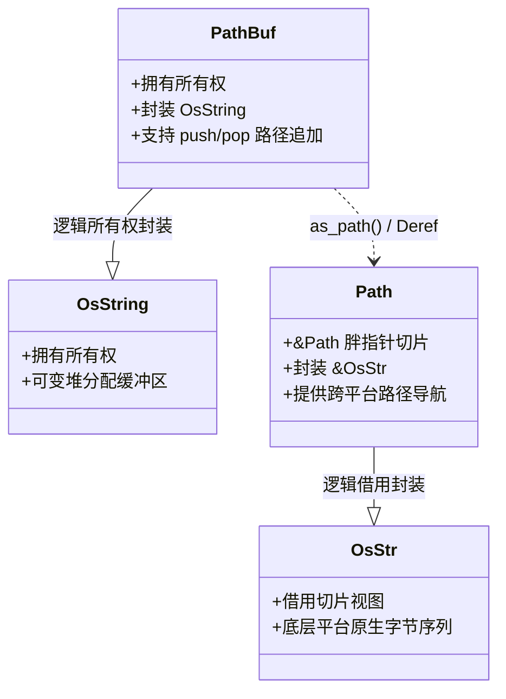

# 核心实战精炼：系统级 I/O 流契约与跨平台文件引擎

## 1. 核心架构决策矩阵：标准 I/O 原语与缓冲策略选型

在操作系统层面，每一次物理 I/O 操作都涉及用户态（User Space）向内核态（Kernel Space）的上下文切换（Context Switch）。

如果程序在每次读取一个字符或写入几个字节时都直接触发裸 `read`/`write` 系统调用，CPU 会将超过 90% 的时钟周期浪费在陷入内核和软中断调度上。

### 1.1 核心 I/O 抽象组件决策矩阵

| I/O 抽象类型 | 核心 Trait 契约 | 缓冲层级与机制 | 系统调用开销 | 错误处理与析构契约 | 典型系统级适用场景 |
| :--- | :--- | :--- | :--- | :--- | :--- |
| **`std::fs::File`** | `Read`, `Write`, `Seek` | **无用户态缓冲**（直通 OS 内核页缓存） | 高（每次方法调用直接触发 `read`/`write` syscall） | `Drop` 时自动关闭文件描述符，忽略潜在 I/O 错误 | 大块数据（如 64KB+ 块）直接搬迁、mmap 映射源文件、零拷贝 sendfile |
| **`BufReader<R>`** | `Read`, `BufRead`, `Seek` | **用户态 8KB 预取缓冲区**（按需批量从内核读取） | **极低**（单次内核调用满足成百上千次应用级读取） | 无析构副作用 | 逐行扫描日志文本（`lines()`）、协议头部定长解析、小包流式消费 |
| **`BufWriter<W>`** | `Write`, `Seek` | **用户态 8KB 写聚合缓冲区**（满载或显式 `flush` 刷盘）| **极低**（小包多次写入聚合成单次大块内核写） | **高风险**：`Drop` 中隐式 flush 的错误会被静默吞没！**必须手动 `.flush()?`** | 日志追加落盘、格式化文本输出、批量持久化序列化数据 |
| **`LineWriter<W>`** | `Write` | **行缓冲**（遇到换行符 `\n` 时自动强制刷盘） | 中等（与行数正相关） | 同 `BufWriter` | 交互式终端交互输出、实时告警行追加、控制台重定向 |
| **`Cursor<T>`** | `Read`, `Write`, `Seek` | **纯内存字节切片/向量**（无系统调用） | **绝对零**（纯寄存器与内存指针移动） | 纯内存操作，无掉电数据风险 | 单元测试模拟网络/文件流、离线数据反序列化校验、报文组包 |
| **`std::io::copy`** | 内置高效搬运 | 内部维护专用临时 8KB 环状缓冲区 | 针对管道/Socket 经过极致调优 | 返回成功复制的总字节数，异常短路 | 高性能流式中继网关、大文件极速复制、标准输入转存文件 |

---

## 2. 生产级代码范式：崩溃安全（Crash-Safe）的原子文件写入引擎

在分布式存储、配置中心与数据库 WAL（预写日志）中，最致命的故障是写文件写到一半时突然断电或进程崩溃，导致目标配置文件留下半截残缺乱码。

工业级系统必须保证**写入的原子性（All-or-Nothing）**与**持久性（Durability）**。

下面的生产级范式演示了基于**带缓冲临时文件写入 -> 显式 Flush 刷盘 -> OS 底层 `fsync` 物理落盘 -> 操作系统级原子重命名（Atomic Rename）**的高可靠写入器设计：

```rust
use std::fs::{self, File, OpenOptions};
use std::io::{self, BufWriter, Write};
use std::path::{Path, PathBuf};

/// 生产级原子文件写入器配置
pub struct AtomicWriteOptions {
    pub sync_data_to_disk: bool, // 是否强制调用 fsync 刷入物理介质
    pub buffer_capacity: usize,  // 用户态缓冲区尺寸（默认 8KB）
}

impl Default for AtomicWriteOptions {
    fn default() -> Self {
        Self {
            sync_data_to_disk: true,
            buffer_capacity: 8 * 1024,
        }
    }
}

/// 崩溃安全的原子文件覆盖落盘函数
pub fn write_file_atomically<P: AsRef<Path>, F>(
    destination: P,
    options: AtomicWriteOptions,
    write_fn: F,
) -> io::Result<()>
where
    F: FnOnce(&mut BufWriter<File>) -> io::Result<()>,
{
    let dest_path = destination.as_ref();
    let parent_dir = dest_path.parent().unwrap_or_else(|| Path::new("."));

    // 1. 在目标文件同级目录下创建带唯一 PID 与时间戳特征的隐藏临时文件
    // 关键设计：必须在同级目录（同一文件系统分区），否则跨文件系统 rename 会退化为非原子拷贝！
    let temp_file_name = format!(
        ".tmp_{}_{}_{}",
        std::process::id(),
        std::time::SystemTime::now()
            .duration_since(std::time::UNIX_EPOCH)
            .unwrap_or_default()
            .as_nanos(),
        dest_path.file_name().and_then(|n| n.to_str()).unwrap_or("file")
    );
    let temp_path: PathBuf = parent_dir.join(temp_file_name);

    // 2. 以排他创建模式（create_new）创建临时文件
    let raw_file = OpenOptions::new()
        .write(true)
        .create_new(true)
        .open(&temp_path)?;

    // 使用 RAII 自动清理守卫：若后续发生 panic 或提前 return Err，守卫析构自动删除残留临时文件
    let cleanup_guard = TempFileCleanupGuard {
        path: temp_path.clone(),
        active: true,
    };

    // 3. 构建带指定容量的用户态缓冲写入器
    let mut writer = BufWriter::with_capacity(options.buffer_capacity, raw_file);

    // 4. 执行业务写入闭包
    write_fn(&mut writer)?;

    // 5. 核心防御：显式调用 flush，确保用户态缓冲区中的全部字节被完整推送进内核页缓存
    writer.flush()?;

    // 6. 若配置了持久性保障，执行系统级 fsync（物理落盘）
    if options.sync_data_to_disk {
        let file = writer.get_ref();
        // sync_all 强制将文件数据及元数据（修改时间、尺寸）全部物理写入磁盘存储介质
        file.sync_all()?;
    }

    // 7. 析构并关闭写入器，交还底层文件句柄
    drop(writer);

    // 8. 调用操作系统的原子重命名语义（POSIX rename / Windows MoveFileExW）
    // 该系统调用保证瞬间原子覆盖目标文件，绝不存在半截文件的中间损坏状态！
    fs::rename(&temp_path, dest_path)?;

    // 9. 取消临时文件清理守卫，落盘圆满成功
    cleanup_guard.disarm();

    Ok(())
}

/// RAII 守卫：确保在发生 I/O 错误时自动清理脏临时文件，防止磁盘泄露
struct TempFileCleanupGuard {
    path: PathBuf,
    active: bool,
}

impl TempFileCleanupGuard {
    fn disarm(mut self) {
        self.active = false;
    }
}

impl Drop for TempFileCleanupGuard {
    fn drop(&mut self) {
        if self.active {
            let _ = fs::remove_file(&self.path);
        }
    }
}
```

---

## 3. 核心机制底层图解

### 3.1 用户态缓冲流与内核页缓存（Page Cache）分层协作体系

```mermaid
flowchart TD
    subgraph UserSpace["用户空间 (User Space)"]
        App["应用程序业务逻辑 (Application)"]
        Buf["BufReader / BufWriter 内存缓冲区 (默认 8KB)"]
        App <==>|极速指针读写 (纳秒级)| Buf
    end

    subgraph KernelSpace["操作系统内核空间 (Kernel Space)"]
        Syscall["系统调用边界 (System Call: read/write)"]
        PageCache["操作系统统一页缓存 (Kernel Page Cache: 4KB 物理页内存)"]
        Buf <==>|高吞吐大块批量 syscall (微秒级)| Syscall
        Syscall <==> PageCache
    end

    subgraph Hardware["物理硬件介质 (Hardware)"]
        DiskController["存储控制器 (NVMe / SSD Controller)"]
        NAND["持久化闪存颗粒 (NAND Flash Block)"]
        PageCache <==>|物理 DMA / 脏页异步后台刷盘 (毫秒级)| DiskController
        DiskController <==> NAND
    end

    Fsync["<b>fsync / sync_all</b><br/>穿透所有缓存层，强制物理落盘！"]
    Buf -.->|强制穿透| Fsync
    Fsync -.-> NAND
```

---

### 3.2 跨平台 Path 与 PathBuf 架构拓扑

Rust 坚决不使用普通 `String` 存储文件路径，而是设计了专门的 `Path` 与 `PathBuf`，以兼容各操作系统的原生底层编码：



---

## 4. 架构避坑清单 (Do's & Don'ts)

| 典型工程误区 (Don't) | 生产级正确实践 (Do) |
| :--- | :--- |
| **在循环读取文件时直接使用未加缓冲的裸 `File.read(&mut buf)`，导致成千上万次陷入内核的上下文切换。** | 无论读取还是写入，始终使用 `BufReader::new(file)` 或 `BufWriter::new(file)` 进行多层包装。 |
| **依赖 `BufWriter` 的 `Drop` 自动刷盘，忽略了其内部错误无法向上传播的致命风险。** | 必须在逻辑结束前显式调用 `writer.flush()?`，严谨捕获因磁盘已满或写入超时导致的落盘异常。 |
| **在读取数据时假设一次 `reader.read(&mut buf)` 调用必定会填满整个传入的切片。** | 谨记 `read()` 的底层契约：它只保证读取**至少 1 个字节**（到达 EOF 时返回 `Ok(0)`）。若需读满特定尺寸，必须使用 `reader.read_exact(&mut buf)`。 |
| **跨平台路径拼接使用字符串字面量（如 `format!("{}/{}", dir, file)`），在 Windows 路径分隔符上翻车。** | 始终使用 `PathBuf::join` 或 `path.push()`，它会根据目标宿主系统自动选择正斜杠 `/` 或反斜杠 `\`。 |
| **将大文件完整读入内存使用 `fs::read_to_string()`，瞬间撑爆微服务 RAM 导致 OOM 崩溃。** | 采用基于 `reader.lines()` 或流式流（Chunk-based Streaming）的增量拉取模式，单次仅常驻单行或固定尺寸缓冲区。 |

<!-- split -->

# 原著完整参考：第 18 章 系统级输入输出体系（Input and Output）

> 计算机必须能与外部世界通信，否则它不过是一台昂贵的电暖气。

在任何现代操作系统中，**输入与输出（I/O）**都是最核心、最精密的基础设施。

从表面上看，I/O 无非是将一串字节读入程序，或将一串字节从程序推向外界。然而在底层，系统程序员必须面对千差万别的硬件现实：从纳秒级的内存指针拷贝、微秒级的内核软中断系统调用，到毫秒级的固态硬盘物理闪存擦写与不可预测的网络光纤延迟。

Rust 并没有采用庞大笨重的类继承体系，而是通过一组高度正交、严谨且可组合的 **Trait 契约（`Read`, `Write`, `BufRead`, `Seek`）**，在保持零成本抽象的前提下，构筑起了一套兼具极致性能与跨平台安全性的现代 I/O 架构体系。

:::en
> **Original**: Rust's standard library provides a flexible, modular foundation for input and output, centered around two core traits: `std::io::Read` for byte-oriented input and `std::io::Write` for byte-oriented output... For efficiency, Rust provides buffered readers and writers that group multiple small reads or writes into larger system calls.

**📌 核心术语与语境解析**：
- **I/O Trait Contract** [aɪ oʊ treɪt ˈkɑːntrækt]：*输入输出特征契约*。通过强类型 Trait 规范数据源与输出端的基础行为，使得文件、套接字与内存流能够无缝多态组合。
- **System Call Batching** [ˈsɪstəm kɔːl ˈbætʃɪŋ]：*系统调用批处理*。通过在用户空间聚合多次细碎操作，显著降低进入内核态引起的 CPU 模式切换开销。
- **Byte-oriented** [baɪt ˈɔːrientɪd]：*面向字节流的*。处理未经解释的裸二进制数据流，与上层带字符编码的文本流明确分工。
:::

---

## 1. 读取器与写入器契约体系（Readers and Writers）

### 1.1 Read 特征契约

所有能够产出字节流的类型都实现了 `std::io::Read` 特征。其核心方法是：

```rust
trait Read {
    fn read(&mut self, buf: &mut [u8]) -> io::Result<usize>;
    // ...
}
```

关于 `read` 方法的底层契约，有三条至关重要的系统级工程法则：
1. **非阻塞填满保证**：该方法只承诺向 `buf` 中读取“部分”可用数据，**绝不保证填满传入的切片**。返回值 `Ok(n)`（其中 $n \le buf.len()$）指示了本次实际读取的字节数。
2. **EOF（流结束）标志**：当且仅当传入的 `buf.len() > 0` 且方法返回 `Ok(0)` 时，才代表流已经彻底结束（End-of-File）。
3. **安全抽象保证**：调用 `read` 必须传入已初始化的内存切片。传入未初始化内存会导致未定义行为（Rust 借用检查器与类型系统会从根本上阻止裸未初始化内存的传递）。

基于核心 `read` 方法，Trait 派生出了丰富的辅助方法：
* `reader.read_to_end(&mut vec)`：读取剩余全部数据并追加到向量中。
* `reader.read_to_string(&mut string)`：读取全部内容并校验其为合法的 UTF-8 编码。
* `reader.read_exact(&mut buf)`：**严格读满指定大小的切片**，若中途提前到达 EOF 则返回 `UnexpectedEof` 错误。
* `reader.take(n)`：将流截断为至多产出 $n$ 字节的包装读取器。

### 1.2 Write 特征契约

所有能够消费并持久化字节流的类型都实现了 `std::io::Write` 特征：

```rust
trait Write {
    fn write(&mut self, buf: &[u8]) -> io::Result<usize>;
    fn flush(&mut self) -> io::Result<()>;
    // ...
}
```

类似于读取契约，`write` 方法同样可能发生**短写（Short Write）**：它可能仅将 `buf` 中的前 $n$ 个字节写入底层流。因此，在绝大多数生产场景中，工程师应当使用更为完备的 `writer.write_all(buf)`，它内部通过循环确保切片中的所有字节被全部推送成功。

`flush` 方法则强制要求底层流将任何暂存的中间缓冲区全量推送至目标系统。

---

## 2. 缓冲流架构（Buffered Readers and Writers）

系统调用极其昂贵。现代操作系统在执行一次系统调用时，必须保存用户态寄存器、切换内核页表、执行安全参数校验，并在完成后恢复上下文。

为了消灭这种无谓的开销，标准库引入了**用户态双重缓冲体系**：


如图 18-1 所示，数据流经三层物理架构：
1. **物理磁盘介质**：原始字节按磁道扇区或闪存块物理排布。
2. **操作系统的预读缓存（OS Read-Ahead Page Cache）**：操作系统内核自身维护着庞大的页缓存，提前预读后续扇区。
3. **应用程序的 `BufReader` 用户空间内存切片**：默认预分配 8KB 的连续内存缓冲区。

当应用程序调用 `.read_line()` 或循环读取几字节时，`BufReader` 直接从自身位于用户空间的内存切片中快速切割指针，**完全无需发生任何内核系统调用**！仅当自身 8KB 缓冲区被彻底读光时，才发起一次单次的批量系统调用从操作系统拉取下一个大块。

### 2.1 BufRead 特征与逐行读取

`BufReader` 实现了专门的 `BufRead` 特征，解锁了文本处理的核心武器：

```rust
let file = File::open("access.log")?;
let reader = BufReader::new(file);

// 产生高效的行迭代器，自动剥离 Windows (\r\n) 与 Unix (\n) 换行符
for line in reader.lines() {
    let line = line?; // 单行 I/O 错误处理
    println!("{line}");
}
```

对于追求极致吞吐的高频解析器，更可以调用 `reader.read_line(&mut line_buffer)`，在外部复用同一个分配好的 `String` 缓冲区，彻底消灭循环中反复分配字符串的开销。

:::en
> **Original**: For efficiency, readers and writers can be *buffered*, which simply means they have a chunk of memory (a buffer) that holds some input or output data in memory. This saves on system calls... The application reads data from the `BufReader`... The `BufReader` in turn gets its input in larger chunks from the operating system... This matters because system calls are slow.

**📌 核心术语与语境解析**：
- **Context Switch** [ˈkɑːntekst swɪtʃ]：*上下文切换*。CPU 从执行用户代码切换至操作系统内核态执行特权指令的硬件与寄存器保存恢复过程。
- **BufRead** [bʌf riːd]：*带缓冲读取特征*。提供直接访问内部流式缓冲指针能力的专用高级抽象。
- **Page Cache** [peɪdʒ kæʃ]：*操作系统页缓存*。内核在物理 RAM 中为磁盘文件块建立的只读与脏写缓存池。
:::

---

## 3. 文件系统与跨平台 Path 哲学

不同操作系统对文件路径的物理编码存在着巨大的鸿沟：
* **Unix / Linux**：路径本质上是以非空斜线 `/` 分隔的**任意非零字节序列**，根本不强制保证是合法的 UTF-8。
* **Windows**：路径本质上是以反斜线 `\` 分隔的 **16 位 Unicode 码点序列（WTF-16）**，可能包含孤立的代理对字符。

为了在跨平台系统开发中彻底摆脱这一泥潭，Rust 在标准库中构建了清晰的路径类型抽象：

### 3.1 Path 与 PathBuf

* **`&Path`**：类似于 `&str`，它是对路径的**不可变切片借用**。它内部并不强求合法的 UTF-8，而是封装了一个 `&OsStr`。
* **`PathBuf`**：类似于 `String`，它是拥有独立堆分配所有权的路径容器，封装了一个 `OsString`。

通过使用 `PathBuf`，你无需关心当前运行平台是 Windows 还是 POSIX：
```rust
let mut path = PathBuf::from("/var");
path.push("log");
path.push("system.log");
```
`push` 方法会自动在 Linux 下追加正斜杠 `/`，在 Windows 下追加反斜杠 `\`。

### 3.2 文件元数据与权限

通过 `std::fs::metadata(path)`，程序可以获取文件的物理元数据：
* `metadata.len()`：文件的物理字节尺寸。
* `metadata.is_dir()` / `metadata.is_file()` / `metadata.is_symlink()`：判定节点拓扑属性。
* `metadata.permissions()`：跨平台通用权限（只读标识）。在 Unix 系统下，通过引入 `std::os::unix::fs::PermissionsExt`，更可以直接操作底层的 9 位 POSIX 权限八进制位模式（如 `0o755`）。

:::en
> **Original**: Because file paths are not guaranteed to be valid UTF-8 on all platforms, Rust provides `std::path::Path` and `PathBuf` instead of using plain strings... Under the hood, these types wrap `OsStr` and `OsString`, which can hold whatever sequence of bytes or 16-bit units the host operating system uses for paths.

**📌 核心术语与语境解析**：
- **Path Canonicalization** [pæθ kəˌnɑːnɪkələˈzeɪʃn]：*路径规范化*。解析符号链接并消除 `.` 与 `..`，将相对路径转化为全系统全局唯一的绝对物理规范路径。
- **Symlink Metadata** [ˈsɪmlɪŋk ˈmetədeɪtə]：*符号链接元数据*。探测链接本身属性而非其所指向目标实体的专用文件系统系统调用。
:::

---

## 4. 同步网络 I/O 流模型

除了操作本地文件，Rust 标准库将网络通信完全统一在相同的 `Read` 和 `Write` 体系之下：

* **`std::net::TcpListener`**：绑定本地端口并监听外部 TCP 握手。调用 `listener.accept()` 阻塞等待新连接，并返回一个 `TcpStream`。
* **`std::net::TcpStream`**：代表一条全双工的双向 TCP 连接。它同时实现了 `Read` 和 `Write`！

这意味着，你可以将一个 `TcpStream` 直接传递给 `BufReader::new(stream)` 进行带缓冲的高效协议解码，或者将其作为参数传入 `std::io::copy(&mut reader, &mut stream)`，从而在完全不修改任何业务代码的前提下，将文件或内存流极速推向互联网。这种 Traits 深度组合性，正是现代系统级软件工程最纯粹的优雅所在。
