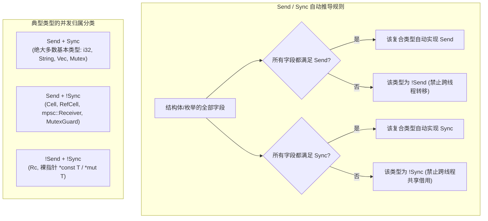
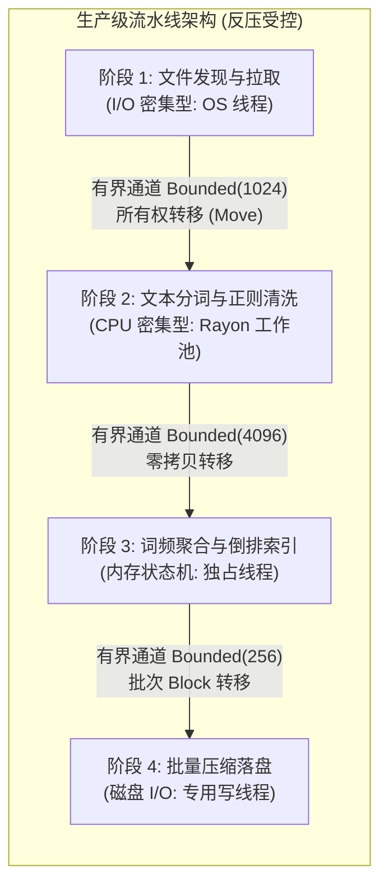

> 💡 **双栏独立滚动工作台导读**：本文采用双栏对照架构。**左栏**为现代多线程并发体系核心架构选型矩阵、`Send`/`Sync` 类型推导拓扑、流水线与反压设计模式、高并发生产代码范式与避坑清单；**右栏**为原著完整精译参考（Chapter 19: Threads），包含图 19-1 至 19-11 拓扑图谱、原著关键段落英文对照及核心术语剖析。左右两栏支持独立滚动与宽度比例调节。

# 核心实战精炼：无畏并发与现代多线程工程基石

## 1. 架构选型矩阵：现代多线程并发模型与同步原语全景

在传统的 C/C++ 系统级编程中，并发编程往往伴随着“未定义行为（UB）黑洞”——数据竞争、内存可见性错乱、死锁以及破坏性的悬垂引用。Rust 通过其独特的所有权和借用检查器，以及标记特征（Marker Traits）`Send` 与 `Sync`，在**编译期**彻底消除了数据竞争（Data Races），奠定了“无畏并发”（Fearless Concurrency）的基石。

下表系统对比了工业界常用的多线程并发模式，帮助工程师在不同架构诉求下做出理性选型：

| 并发模式 | 核心原语 / 库 | 数据交互机制 | 吞吐量与延迟特征 | 优势与收益 | 潜在风险与局限 | 典型工程场景 |
| :--- | :--- | :--- | :--- | :--- | :--- | :--- |
| **Fork-Join 作用域并发** | `std::thread::scope`, `crossbeam::scope` | 栈上借用父作用域数据（无需 `'static`），切片互斥分治 | 极低延迟，零额外内存堆分配 | 编译期保证所有子线程在作用域结束前 `join`，允许零拷贝共享可变与不可变借用 | 线程创建与销毁开销受限于系统线程数，不适合纳秒级微小任务 | 批量图像分块渲染、批量文件解析、局部数据分治算法 |
| **数据并行 (Data Parallelism)** | `rayon::par_iter`, `par_chunks_mut` | 工作窃取调度器（Work-stealing Pool），无锁任务切分 | 极限吞吐，CPU 核心利用率最大化，自适应平衡负载 | 开发体验接近单线程链式迭代器，自动处理工作倾斜（Work Skew） | 仅适用于 CPU 密集型纯计算，若有长时间阻塞 I/O 会耗尽工作线程池 | 矩阵计算、大数据流统计过滤、光线追踪、加密哈希碰撞 |
| **流水线管道 (Pipelines)** | `crossbeam_channel`, `std::sync::mpsc` | 消息所有权转移（Move 语义），阶段间解耦 | 阶段吞吐匹配，天然具备背压控制能力（Bounded Channel） | 彻底消除跨线程共享内存锁竞争；各阶段职责单一，易于水平扩容 | 消息在队列中有浅拷贝与内存分配成本；阶段间吞吐不均易形成积压 | 工业级日志分析流水线、视频转码分片管线、事件溯源管道 |
| **共享状态互斥 (Shared State)** | `Arc<Mutex<T>>`, `Arc<RwLock<T>>` | 动态内部可变性，通过 RAII 锁守卫排他/共享访问 | 读多写少下延迟极低；写竞争激烈时上下文切换剧烈 | 直观映射传统面向对象状态机模型；支持灵活的动态拓扑结构 | 容易产生锁争用（Lock Contention）与死锁；持锁跨 await/系统调用破坏吞吐 | 进程级共享指标收集器、动态配置中心、全局连接池管理器 |
| **无锁原子同步 (Lock-free Atomics)** | `std::sync::atomic::{AtomicUsize, AtomicBool...}` | 硬件级 CAS 指令与内存顺序（Memory Ordering） | 纳秒级极速响应，零系统调用上下文切换 | 杜绝死锁与阻塞，吞吐量极致 | 难以组合多个状态；容易陷入死循环活锁；内存屏障模型心智负担重 | 计数器、无锁环形队列（Ring Buffer）、状态标志位、优雅停机信号 |

### 1.1 同步原语深度选型对照

| 维度 / 原语 | `std::sync::Mutex<T>` | `std::sync::RwLock<T>` | `std::sync::Condvar` | `std::sync::atomic::*` |
| :--- | :--- | :--- | :--- | :--- |
| **访问控制模式** | 单时刻独占排他访问（单写或单读） | 允许多读独占一写（Shared-Exclusive） | 必须搭配 `MutexGuard` 阻塞等待特定谓词成立 | 硬件原子指令（Load, Store, CAS, FetchAdd） |
| **锁毒化机制 (Poisoning)** | 支持（若持有锁的线程 panic 则锁被标记毒化） | 支持（同 Mutex） | 不直接毒化，受所关联的 Mutex 毒化状态波及 | 无锁概念，不存在毒化 |
| **读饥饿 / 写饥饿** | 依据 OS 调度器实现（通常公平排队） | 许多系统实现可能偏向读者，高频读导致写者饥饿 | 虚假唤醒（Spurious Wakeup）需在循环中重检 | 无饥饿概念，但在高竞争 CAS 下存在活锁消耗 |
| **内存与调用开销** | 极低（现代标准库基于 futex / OS 轻量原语） | 略高于 Mutex（需维护读者计数与写标志位） | 极低（基于内核等待队列） | 裸机寄存器/单机器字操作，零系统调用开销 |
| **适用临界区特征** | 短平快更新、读写频率均等的复合状态 | 读频率远超写频率（例如 95% 读、5% 写）的配置/路由表 | 状态转换通知、生产者-消费者条件等待、资源池唤醒 | 独立自增 ID、统计指标、布尔开关、无锁单向链表 |

---

## 2. 核心原理与心智模型：无畏并发与类型系统契约

### 2.1 Send 与 Sync 的数学契约

Rust 的无畏并发并非通过在运行时部署重量级的防竞争监视器，而是基于两个内置的标记特征（Marker Traits）：

$$\text{T: Send} \iff \text{类型 } T \text{ 的所有权可以安全地从一个线程转移到另一个线程}$$
$$\text{T: Sync} \iff \&T \text{ 是 Send} \iff \text{类型 } T \text{ 可以在多个线程间安全地通过共享引用并发访问}$$



> **核心洞察**：
> 1. **为什么 `Rc<T>` 既不是 `Send` 也不是 `Sync`？** 因为其引用计数增减使用的是非原子的单核操作。如果有两个线程同时持有不同的 `Rc` 指针克隆，并在同一纳秒并发自增计数，将引发底层数据竞争与内存双重释放灾难。替换方案为 `Arc<T>`（Atomic Reference Counting）。
> 2. **为什么 `RefCell<T>` 是 `Send` 但不是 `Sync`？** 因为 `RefCell` 允许通过不可变借用获取可变借用（内部可变性），但其借用计数器（Borrow Counter）不是原子的。跨线程转移所有权无竞争（因此是 `Send`），但多线程并发借用会导致计数器撕裂（因此是 `!Sync`）。
> 3. **为什么 `Mutex<T>` 是 `Sync`，即使 `T` 包含内部可变性？** 只要 `T: Send`，`Mutex<T>` 就自动是 `Sync`。因为互斥锁的内部硬件锁原语确保同一时刻仅有一个线程能够越过防线获取底层 `&mut T`。

### 2.2 生产级流水线拓扑与背压机制



---

## 3. 生产级实战范式与工业代码

### 3.1 工业级反压多阶段流式索引流水线 (基于 `std::thread::scope` 与有界 Channel)

下面的生产级范式演示了如何构建一个包含**反压控制（Backpressure）**、**零全局锁**、**优雅停机**以及**错误聚合**的高吞吐倒排索引流水线：

```rust
use std::collections::HashMap;
use std::io::{self, Write};
use std::sync::mpsc::{sync_channel, Receiver, SyncSender};
use std::thread;
use std::time::Instant;

/// 阶段一数据载荷：原始文档元数据与内容
#[derive(Debug)]
pub struct RawDocument {
    pub id: u64,
    pub path: String,
    pub content: String,
}

/// 阶段二数据载荷：分词并清洗后的词频元组
#[derive(Debug)]
pub struct TokenizedDocument {
    pub id: u64,
    pub term_frequencies: HashMap<String, u32>,
}

/// 生产级流水线调度控制器
pub struct InvertedIndexPipeline {
    channel_capacity: usize,
}

impl InvertedIndexPipeline {
    pub fn new(channel_capacity: usize) -> Self {
        Self { channel_capacity }
    }

    /// 执行多阶段并发流水线处理
    pub fn execute(&self, documents: Vec<(u64, String, String)>) -> io::Result<HashMap<String, Vec<(u64, u32)>>> {
        let start_time = Instant::now();

        // 使用标准库 thread::scope 构建确定性生命周期作用域，无需 'static 或 Arc
        let final_index = thread::scope(|s| {
            // 阶段 1 -> 阶段 2 的有界通道 (提供反压)
            let (stage1_tx, stage1_rx): (SyncSender<RawDocument>, Receiver<RawDocument>) =
                sync_channel(self.channel_capacity);

            // 阶段 2 -> 阶段 3 的有界通道
            let (stage2_tx, stage2_rx): (SyncSender<TokenizedDocument>, Receiver<TokenizedDocument>) =
                sync_channel(self.channel_capacity);

            // 1. 启动阶段一：数据加载与清洗生产者
            s.spawn(move || {
                for (id, path, content) in documents {
                    let doc = RawDocument { id, path, content };
                    // 当下游消费滞后时，send() 将自动阻塞当前线程，产生物理背压
                    if stage1_tx.send(doc).is_err() {
                        eprintln!("[WARN] 阶段一下游接收通道已关闭，提前终止数据拉取");
                        break;
                    }
                }
                // stage1_tx 在此处离开作用域隐式 drop，向 stage1_rx 发送 EOF 断开信号
            });

            // 2. 启动阶段二：CPU 密集型分词与词频统计工作流
            s.spawn(move || {
                // 迭代直至上游 channel 耗尽并关闭
                while let Ok(raw_doc) = stage1_rx.recv() {
                    let mut freq_map: HashMap<String, u32> = HashMap::new();
                    // 工业级文本归一化与分词清洗
                    for raw_token in raw_doc.content.split_whitespace() {
                        let token: String = raw_token
                            .chars()
                            .filter(|c| c.is_alphanumeric())
                            .flat_map(|c| c.to_lowercase())
                            .collect();

                        if !token.is_empty() {
                            *freq_map.entry(token).or_insert(0) += 1;
                        }
                    }

                    let tokenized = TokenizedDocument {
                        id: raw_doc.id,
                        term_frequencies: freq_map,
                    };

                    if stage2_tx.send(tokenized).is_err() {
                        eprintln!("[WARN] 阶段二下游接收通道已关闭，提前终止分词处理");
                        break;
                    }
                }
                // stage2_tx 在此自动 drop，通知阶段三数据流终结
            });

            // 3. 启动阶段三：内存倒排索引聚合消费者 (直接在 scope 内部汇聚结果)
            let collector_handle = s.spawn(move || {
                let mut inverted_index: HashMap<String, Vec<(u64, u32)>> = HashMap::new();

                while let Ok(tokenized_doc) = stage2_rx.recv() {
                    for (term, freq) in tokenized_doc.term_frequencies {
                        inverted_index
                            .entry(term)
                            .or_default()
                            .push((tokenized_doc.id, freq));
                    }
                }

                inverted_index
            });

            // 等待阶段三聚合完成并获取其最终结果
            collector_handle.join().expect("聚合线程发生异常崩溃")
        });

        println!("[INFO] 倒排索引流水线构建完毕，耗时: {:?}", start_time.elapsed());
        Ok(final_index)
    }
}
```

### 3.2 生产级高并发配置中心与指标收集器 (`RwLock` + `Condvar` + `Atomics`)

在需要读多写少的高并发后台服务中，配置变更要求全局即时可见，同时统计指标需要纳秒级更新且不可阻塞业务读：

```rust
use std::sync::atomic::{AtomicU64, Ordering};
use std::sync::{Arc, Condvar, Mutex, RwLock};
use std::time::Duration;

/// 系统全局运行时动态配置
#[derive(Debug, Clone)]
pub struct DynamicConfig {
    pub max_connections: usize,
    pub timeout_ms: u64,
    pub feature_flag_v2: bool,
}

/// 高性能无死锁配置中心与指标统计管理器
pub struct RuntimeCoordinator {
    // 读多写少配置采用 RwLock
    config: RwLock<DynamicConfig>,
    // 纳秒级性能计数器采用原子类型
    total_requests: AtomicU64,
    active_connections: AtomicU64,
    // 停机通知总线：Mutex + Condvar
    shutdown_sync: Mutex<bool>,
    shutdown_cond: Condvar,
}

impl RuntimeCoordinator {
    pub fn new(initial_config: DynamicConfig) -> Self {
        Self {
            config: RwLock::new(initial_config),
            total_requests: AtomicU64::new(0),
            active_connections: AtomicU64::new(0),
            shutdown_sync: Mutex::new(false),
            shutdown_cond: Condvar::new(),
        }
    }

    /// 高频业务路径：零锁竞争读取配置快照并记录请求指标
    pub fn process_incoming_request(&self) -> DynamicConfig {
        // Relaxed 顺序对无依赖的数据自增拥有极高性能
        self.total_requests.fetch_add(1, Ordering::Relaxed);
        self.active_connections.fetch_add(1, Ordering::SeqCst);

        // 获取读锁：并发读取互不阻塞
        let current_cfg = {
            let guard = self.config.read().expect("配置读锁已被毒化");
            guard.clone()
        };

        // 模拟业务处理...
        current_cfg
    }

    pub fn complete_request(&self) {
        self.active_connections.fetch_sub(1, Ordering::SeqCst);
    }

    /// 低频运维路径：动态更新配置（排他写）
    pub fn update_config(&self, new_config: DynamicConfig) {
        let mut guard = self.config.write().expect("配置写锁已被毒化");
        println!("[CONFIG] 更新配置参数: {:?}", new_config);
        *guard = new_config;
    }

    /// 触发系统优雅停机广播
    pub fn broadcast_shutdown(&self) {
        let mut shutdown = self.shutdown_sync.lock().expect("停机锁已被毒化");
        *shutdown = true;
        // 唤醒所有阻塞在 Condvar 上的工作线程
        self.shutdown_cond.notify_all();
    }

    /// 工作线程等待退出信号（带虚假唤醒防护循环）
    pub fn wait_for_shutdown(&self, timeout: Duration) -> bool {
        let mut shutdown = self.shutdown_sync.lock().expect("停机锁已被毒化");
        while !*shutdown {
            let result = self.shutdown_cond.wait_timeout(shutdown, timeout).unwrap();
            shutdown = result.0;
            if result.1.timed_out() {
                return false;
            }
        }
        true
    }
}
```

---

## 4. 架构避坑清单 (Do's & Don'ts)

| 决策维度 | 严禁反模式 (Don'ts) | 生产推荐范式 (Do's) |
| :--- | :--- | :--- |
| **互斥锁临界区范围** | **持锁执行阻塞 I/O 或跨越异步 `.await` 点**：直接导致所有并发线程饥饿卡死，系统吞吐暴跌数个数量级。 | **严控锁守卫生命周期**：仅在极简内存拷贝时加锁，数据获取后立即通过大括号作用域或 `drop(guard)` 释放。 |
| **锁依赖拓扑设计** | **以不确定次序在多个线程中嵌套获取多把锁**：线程 A 获取 Lock 1 再索取 Lock 2，线程 B 获取 Lock 2 再索取 Lock 1，诱发死锁。 | **严格执行全局偏序锁定协议（Lock Ordering）**：始终按既定全局顺序加锁；或重构系统通过通道消息统一路由状态变更。 |
| **通道缓冲设计** | **在未受限生产速率的外部入口处使用无界通道 `channel()`**：网络洪峰涌入时消息无限堆积，引发 OOM 进程崩溃。 | **强制使用有界通道 `sync_channel(N)`**：显式设定容量阈值，当下游拥塞时自然反压上游生产者，保护内存边界。 |
| **锁毒化容错** | **遇到 `PoisonError` 直接无脑 `.unwrap()` 导致崩溃蔓延**：一个工作线程的 panic 导致整个后台核心服务连环爆炸。 | **根据业务容灾等级显式处理毒化**：调用 `poison_err.into_inner()` 恢复底层数据做一致性校验，或平稳熔断该服务模块。 |
| **原子操作内存序** | **盲目对全部原子操作使用最严格的 `Ordering::SeqCst`**：强制多核流水线清空 Store Buffer，丧失底层硬件极致性能。 | **精确匹配语义**：纯计数器使用 `Relaxed`，发布-订阅状态同步使用 `Release-Acquire` 屏障配对，兼顾正确性与吞吐。 |
| **线程栈空间预估** | **在深度递归或高并发批处理任务中随意调用 `thread::spawn`**：默认每个线程申请 2MB~8MB 虚拟栈空间，瞬间耗尽系统 PID/内存。 | **使用 `thread::Builder` 显式裁剪栈尺寸**，或者对 CPU 密集型细粒度分治任务全面采用 Rayon 工作窃取线程池。 |

<!-- split -->

# 原著完整参考：多线程并发体系（Chapter 19: Threads）

> “从长远来看，在允许无限制使用存储位置及其地址的面向机器语言中编写大型并发程序是不可取的。我们根本无法使这类程序可靠（即便借助复杂的硬件机制也是徒劳）。”
> 
> —— 佩尔·布林奇·汉森（Per Brinch Hansen，1977 年）

> “通信的模式，就是并行的模式。”
> 
> —— 惠特·莫里斯（Whit Morriss）

如果在你的职业生涯中，你对多线程的态度经历过翻天覆地的转变，请放心，你绝不是一个人。这是一个极其普遍的心路历程。

刚开始接触多线程编程时，一切看起来轻松而充满乐趣。各类工具——锁、队列、条件变量——学起来顺手，用起来直观。确实存在不少陷阱，但幸运的是，你自以为清楚它们都在哪里，并且在编码时格外小心翼翼，力求不出差错。

然而在某个时间点，你被迫去调试别人写的多线程代码，你不得不痛苦地得出结论：**某些人真的根本不应该被允许碰这些工具**。

接着，在未来的某一天，你不得不调试**你自己编写的**多线程代码。

实战经验会逐渐在你心中注入一种对线程普遍存在的怀疑态度，甚至演变为直截了当的犬儒主义。时不时出现的一篇深度文章更是火上浇油——它以令人头皮发麻的细节层层揭示，为什么某种看起来显然正确的加锁惯用法在底层其实完全行不通（这一切都与底层的“内存模型”紧密相关）。但历经千锤百炼后，你最终还是会摸索出一种自认为可以现实运用而不至于频频翻车的并发模式。你把几乎所有的系统需求都强行套进这个模式里；如果你真的足够老练，你学会了对一切节外生枝的额外复杂性坚定地说“不”。

当然，业界存在的并发模式五花八门。系统程序员最常采用的套路包括：
- **后台常驻线程**：承担单一固定职责，周期性地被唤醒执行任务；
- **通用工作线程池**：通过任务队列与客户端通信；
- **流水线架构（Pipelines）**：数据从一个线程流向下一个线程，每个线程处理工序中的一小部分；
- **数据并行（Data Parallelism）**：假定整个机器此时主要在执行一项宏大的计算，因此将任务划分为 $N$ 份分发到 $N$ 个线程上，期望一举压榨完所有 CPU 核心；
- **同步对象海洋（A sea of synchronized objects）**：多个线程自由访问相同数据，利用基于互斥锁等底层原语的特定加锁方案避免竞争（Java 对此模型提供了内置语言支持，在 20 世纪 90 年代和 21 世纪初曾风靡一时）；
- **原子整数操作（Atomics）**：允许多个核心通过传递单机器字长大小的字段交换信息（这比前面所有方法都更难写对，除非交换的仅仅是字面整数；而在实践中，传递的往往是指针）。

久而久之，你或许已经熟练掌握了上述几种模式，并能够安全地组合使用它们。你成为了并发艺术的大师。一切似乎都很美好——**只要永远不允许任何其他人对这个系统做哪怕一行代码修改**。那些能将多线程驾驭得当的程序，字里行间无不充满了各种“不成文的隐性规则”。

Rust 为并发开辟了一条更优越的道路：它并没有强迫所有程序都削足适履地采用单一模式（这对于系统程序员而言根本算不上解决方案），而是**为安全地支持多种并发模式提供了语言级保障**。那些原本只存在于老程序员脑海中的“潜规则”，在 Rust 中都被白纸黑字地写进了代码契约，并由编译器在编译期强制执行。

你一定听过“Rust 能让你编写出安全、高效且并发的程序”这一论断。在本章中，我们将为你全面揭晓这一切是如何实现的。我们将系统讲解在 Rust 中使用线程的三大支柱方式：
1. **Fork-Join 并行计算模型**；
2. **基于通道的消息传递（Channels）**；
3. **共享可变状态（Shared Mutable State）**。

而在下一章中，我们将进一步拓展视野，将轻量级协作式并发模型——**异步代码（Asynchronous Code）**纳入版图。异步代码与操作系统原生线程是并发领域的两条不同路径，但它们都构建在完全相同的 Rust 核心基石之上。既然原生线程更加底层、更为本质且心智模型相对纯粹，我们首先对其展开探索。

当你学习 Rust 线程时，你将调动迄今为止所学到的全部 Rust 语言知识。Rust 对引用、可变性以及生命周期的严格把控，在单线程程序中固然已经极具价值；但唯有置身于并发编程的洪流之中，这些规则的真正深远意义才会淋漓尽致地展现出来。它们使你能够迅速且正确地构建多种风格的多线程系统——不再带有怀疑，不再心存悲观，**彻底告别恐惧**。

:::en
> **Original**: Rust offers a better way to use concurrency: not by forcing all programs to adopt a single style (which for systems programmers would be no solution at all), but by supporting multiple styles safely. The unwritten rules are written down — in code — and enforced by the compiler.
> You've heard that Rust lets you write safe, fast, concurrent programs. This is the chapter where we show you how it's done... As you learn about threads in Rust, you're going to use everything you've learned so far about the language. The care Rust takes with references, mutability, and lifetimes is valuable enough in single-threaded programs, but it is in concurrent programming that the true significance of those rules becomes apparent.

**📌 核心术语与语境解析**：
- **Unwritten Rules** [ʌnˈrɪtn ruːlz]：*不成文的规则 / 潜规则*。传统 C/C++ 多线程中依赖开发者自律的防御约定（例如“访问字段 X 前必须持有锁 Y”、“指针 Z 转移后原线程不得再读”）。
- **Fearless Concurrency** [ˈfɪərləs kənˈkʌrənsi]：*无畏并发*。Rust 核心宣传口号，指依靠编译器类型系统的静态证明，彻底免疫数据竞争与内存破坏，使重构并发程序无需战战兢兢。
- **Fork-Join Parallelism** [fɔːrk dʒɔɪn ˈpærəlelɪzəm]：*分支-合并并行*。将主任务分裂派生（Fork）为多个并发执行的子任务，并在关键汇聚点等待全部完成（Join）后再继续主干流程的经典模式。
:::

---

## 1. Fork-Join 并行计算模型

当我们需要同时处理几个彼此完全独立的任务时，便产生了线程最纯粹的应用场景。

假设我们要对一个海量文档语料库执行自然语言处理。在单线程下，我们会写出一个循环：

```rust
fn process_files(filenames: Vec<String>) -> io::Result<()> {
    for document in filenames {
        let text = load(&document)?;  // 读取源文件
        let results = process(text);  // 计算统计指标
        save(&document, results)?;    // 写入输出文件
    }
    Ok(())
}
```


*图 19-1：`process_files()` 的单线程顺序执行时序图*

如图 19-1 所示，CPU 一次只能处理一个文档。假设我们在四核机器上运行此程序，另外三个核心将在漫长等待中处于闲置浪费状态。

如果我们采用分支-合并（Fork-Join）策略，将文档集合分发给多个子线程并发执行，时序图将变为图 19-2：


*图 19-2：使用 Fork-Join 方法的多线程文件处理*

各个线程之间并不需要步调一致，右侧完成时间参差不齐，但主线程会同步等待所有派生线程汇聚（Join）。

### 1.1 spawn 与 join

Rust 标准库提供了 `std::thread::spawn` 函数用于创建操作系统线程。它接收一个闭包并返回一个 `JoinHandle`：

```rust
use std::thread;

let handle = thread::spawn(|| {
    // 在独立 OS 线程中执行的任务
    println!("来自新线程的问候！");
});

// 等待线程执行完毕
handle.join().unwrap();
```

需要注意的是，传递给 `thread::spawn` 的闭包必须拥有 `'static` 生命周期，这意味着它不能借用外部函数栈帧上的任何非 `'static` 引用。为了将外部数据带入新线程，必须使用 `move` 关键字转移所有权。

### 1.2 作用域线程 (Scoped Threads)

在现代 Rust（Rust 1.63+ 正式稳定）中，标准库引入了 `std::thread::scope`。它从根本上重塑了 Fork-Join 并发范式：

```rust
use std::thread;

let mut data = vec![1, 2, 3, 4];

thread::scope(|s| {
    s.spawn(|| {
        println!("在子线程中安全读取父作用域切片: {:?}", &data[0..2]);
    });
    s.spawn(|| {
        println!("在另一个子线程读取其余切片: {:?}", &data[2..4]);
    });
}); // 编译器在此处自动阻塞并等待所有内部派生线程 join() 完成！

// 保证所有子线程已退出，此时父线程可再次安全修改 data
data.push(5);
```

`thread::scope` 构建了一个编译期受控的作用域。借用检查器确信：**所有在闭包内创建的线程绝不可能活得比该作用域更久**。因此，闭包内的线程可以直接借用父栈帧上的局部变量，彻底甩掉了必须 `'static` 或滥用 `Arc` 的心智包袱。

### 1.3 跨线程共享不可变数据 (`Arc`)

当多个线程需要长期共享同一份只读数据，且任务生命周期无法局限于单一函数栈作用域时，标准库提供了 `Arc<T>`（原子引用计数智能指针）：

```rust
use std::sync::Arc;
use std::thread;

let shared_data = Arc::new(vec![100, 200, 300]);

for _ in 0..4 {
    let data_clone = Arc::clone(&shared_data);
    thread::spawn(move || {
        println!("共享数据求和: {}", data_clone.iter().sum::<i32>());
    });
}
```

每个 `Arc::clone` 只会原子性递增堆上的强引用计数器，开销极低且完全线程安全。当最后一个引用离开作用域被 drop 时，底层数据结构才会触发析构释放。

### 1.4 数据并行生态：Rayon

手写线程循环派生往往需要面对负载倾斜问题。Rayon 是 Rust 生态中最著名的数据并行计算库。它的设计理念极其优雅：只需将普通迭代器 `.iter()` 替换为 `.par_iter()`，Rayon 便会自动利用底层的全局工作窃取（Work-stealing）线程池完成任务切分与执行：


*图 19-3：Rayon 的设计理论与实践（(a) 每个元素生成一个线程的低效模型；(b) 按 CPU 核心构建工作线程池并高效分治）*

```rust
use rayon::prelude::*;

fn process_parallel(data: &mut [f64]) {
    // 自动将切片分治分发到全核执行
    data.par_iter_mut().for_each(|x| {
        *x = x.sqrt().sin();
    });
}
```

### 1.5 重温 Mandelbrot 分形渲染中的负载不均

在第 2 章中，我们将 Mandelbrot 图像划分为 8 个水平带状区域进行多线程渲染。图 19-4 揭示了均匀几何切分在复杂任务面前的局限性：


*图 19-4：Mandelbrot 图像中 8 个水平切片的不均匀耗时分布（从 115 毫秒到 1429 毫秒不等）*

由于黑色分形边缘的数学逃逸迭代次数远高于外围空白区域，负责中间带状的线程耗时是边缘线程的 10 倍以上。如果采用 Rayon 的动态工作窃取，空闲核心会自动从繁忙核心的任务队列尾部“偷取”细粒度切片，从而让全核计算曲线完全抹平。

:::en
> **Original**: Rayon provides a standard thread pool that is tuned for data parallelism. It uses work-stealing algorithms to balance work across threads. When a thread finishes its own work, it looks at the work queues of other threads and takes some of their remaining tasks. This makes Rayon very effective at balancing uneven workloads like our Mandelbrot calculation.

**📌 核心术语与语境解析**：
- **Work-Stealing** [wɜːrk ˈstiːlɪŋ]：*工作窃取算法*。每个工作线程拥有本地双端队列；本地线程以 LIFO（后进先出）推送/弹出微任务以保障 CPU 缓存局部性；当空闲时，以 FIFO（先进先出）从其他核窃取粗粒度任务。
- **Workload Skew** [ˈwɜːrkloʊd skjuː]：*工作负载倾斜*。并发分治中因不同分片内在复杂度差异，导致部分核心严重过载而其余核心空转的木桶效应。
:::

---

## 2. 基于通道的消息传递 (Channels)

除了共享内存，另一条经典的并发哲学源自 CSP（通信顺序进程）模型：“**不要通过共享内存来通信，而要通过通信来共享内存**”。

在 Rust 中，通道（Channel）由发送端（Sender）与接收端（Receiver）组成。发送操作将数据的所有权从发送线程无缝移交至接收线程：


*图 19-5：字符串通道：字符串 `msg` 的所有权从线程 1 彻底转移至线程 2*

一旦 `sender.send(msg)` 成功执行，线程 1 便在编译期彻底失去了对 `msg` 的访问权，任何后续读写都会在编译阶段被借用检查器严正拦截——数据竞争因此在源头上被物理掐灭。

### 2.1 倒排索引流水线系统

在复杂的批处理程序中，将单一大任务拆分为多阶段的流水线架构，能够大幅提升系统总吞吐量：


*图 19-6：经典 Unix 管道的并行时序重叠*


*图 19-7：五阶段倒排索引构建器流水线架构，阶段之间通过 Channels 连接*

如图 19-7 所示，各阶段之间通过通道形成装配线作业：读取磁盘文件、分词提取、构建局部索引与合并排序重叠执行。

### 2.2 通道特性与多生产者拓扑

标准库的 `std::sync::mpsc` 代表“多生产者，单消费者”（Multi-Producer, Single-Consumer）。发送端 `Sender` 可以被无限 `.clone()` 并分发给任意多的工作线程，所有线程的请求都将汇流至唯一的 `Receiver`：


*图 19-8：单通道汇集多线程请求：航天导航、反应堆控制与星际通信线程并发向日志记录线程发送日志*

```rust
use std::sync::mpsc::channel;
use std::thread;

let (tx, rx) = channel();

for i in 0..3 {
    let tx_clone = tx.clone();
    thread::spawn(move || {
        tx_clone.send(format!("任务 {} 完成", i)).unwrap();
    });
}
drop(tx); // 关闭初始发送端，确保当所有克隆端退出后 rx 能正确感知流终止

for msg in rx {
    println!("收到日志: {}", msg);
}
```

:::en
> **Original**: A channel has two ends: a `Sender` and a `Receiver`. Values are sent with `sender.send(value)` and received with `receiver.recv()`. Channels are typed: a channel that transmits strings is a `Sender<String>` and a `Receiver<String>`. Sending a value moves it, transferring ownership from the sending thread to the receiving thread.

**📌 核心术语与语境解析**：
- **MPSC (Multi-Producer Single-Consumer)**：*多生产者单消费者通道*。支持多个写入源并发推入数据，由单一接收者按序处理消费。
- **Transfer of Ownership** [trænsˈfɜːr əv ˈoʊnərʃɪp]：*所有权转移*。Rust 杜绝数据竞争的终极法宝；数据随通道消息物理移动后，原持有者被静态标记为失效，从数理上根除了多线程同时修改的可能。
:::

---

## 3. 线程安全底层契约：Send 与 Sync

究竟什么样的类型可以在线程间传递，什么样的类型可以跨线程并发共享？在 C/C++ 中，这完全取决于程序员的记忆力与文档注释；但在 Rust 中，这是由类型系统的两个内置 Trait——`Send` 与 `Sync` 严格裁定的。


*图 19-9：`Send` 与 `Sync` 类型的文氏图（绝大多数类型均同时满足两项契约）*

如文氏图所示：
- 绝大多数普通值类型（`i32`, `String`, `Vec<u8>`, `TcpStream`）既是 `Send` 也是 `Sync`；
- `Cell`、`RefCell` 是 `Send` 但不是 `Sync`；
- `Receiver<T>` 是 `Send` 但不是 `Sync`（不可跨线程并发共享同一个 Receiver）；
- `Rc<T>` 既不是 `Send` 也不是 `Sync`。

### 3.1 为什么 `Rc` 既不是 Send 也不是 Sync？

图 19-10 直观展现了如果允许 `Rc` 跨越线程边界，会发生何等可怕的灾难：


*图 19-10：`Rc` 缺乏原子同步保障带来的内存灾难：两个线程同时对其执行 `clone()`，非原子自增引发计数丢失与内存撕裂*

如果线程 1 和线程 2 同时对其堆上的引用计数执行非同步递增操作，原本应该增加 2 次的计数最终可能只递增了 1 次。随后两个线程分别析构，导致堆上的数据在其中一个线程仍在访问时被提前销毁，引发 Use-After-Free 悬垂指针黑洞。因此，Rust 编译器在 `Rc` 的定义中显式标记了 `impl<T> !Send for Rc<T>` 和 `impl<T> !Sync for Rc<T>`。

:::en
> **Original**: `Send` and `Sync` are marker traits: they have no methods, and you cannot implement them yourself directly except by using `unsafe`. A type is `Send` if it is safe to pass by value to another thread. It is `Sync` if it is safe to pass by reference to another thread. Most types are both.
> Rust's type system ensures that you cannot send non-`Send` types across threads, nor can you share non-`Sync` types across threads. The compiler catches these bugs at compile time.

**📌 核心术语与语境解析**：
- **Marker Traits** [ˈmɑːrkər treɪts]：*标记特征*。不定义任何具体方法，专门用于向编译器转达某种特定内存/并发契约的静态标签。
- **Auto Traits** [ˈɔːtoʊ treɪts]：*自动特征*。编译器根据结构体内部所有成员属性自动合成实现的特征；只要所有子字段都是 `Send`，包含它的外层结构体就自动成为 `Send`。
:::

---

## 4. 共享可变状态 (Shared Mutable State)

虽然消息传递（Channels）在架构上极为优雅，但在许多底层系统场景中（如共享大容量缓存、连接池管理、硬件寄存器状态同步），**共享可变状态**依然是性能最优、最直接的实现路径。

### 4.1 互斥锁 `Mutex` 与 RAII Guard

在传统语言中，互斥锁与被它保护的数据是彼此分离的：你定义一个整数 `counter`，并在旁边定义一个 `pthread_mutex_t lock`。至于访问 `counter` 前是否先锁定了 `lock`，纯粹靠自律。

而在 Rust 中，**锁和它所保护的数据被封装在同一个类型里**：`Mutex<T>`。如果不先成功获取锁，你甚至根本没有物理途径拿到内部的 `T`！

```rust
use std::sync::Mutex;

let counter = Mutex::new(0);

{
    // lock() 返回一个 Result<MutexGuard<i32>, PoisonError>
    let mut guard = counter.lock().unwrap();
    // MutexGuard 实现了 DerefMut，允许像普通可变借用一样修改数据
    *guard += 1;
} // guard 在此离开作用域自动析构，锁在此处自动释放！绝不发生遗漏解锁！
```

### 4.2 复合类型的解析之道

当我们在生产代码中看到类似 `Arc<Mutex<Receiver<T>>>` 的嵌套类型时，应该如何理解？图 19-11 提供了解读这种俄罗斯套娃式类型的绝佳视角：


*图 19-11：复合类型解读：`Arc<Mutex<Receiver<FernEvent>>>` 是一个 (1) 堆上分配的、原子引用计数的，(2) 互斥锁保护的，(3) 接收器，用于接收 (4) 蕨类植物生长事件*

### 4.3 读写锁 `RwLock`、条件变量 `Condvar` 与硬件原子操作

除了基础互斥锁，Rust 还提供了更细粒度的同步原语：
- **`RwLock<T>`**：读写锁。允许多个线程同时持有读锁（`read()`），但在写锁（`write()`）申请时强制独占排他。非常适合配置查询等读极多写极少的场景。
- **`Condvar`**：条件变量。用于挂起当前线程，直至另一线程满足特定业务谓词并发出通知。常用于实现自定义任务队列与资源池等待。
- **`Atomic` 系列**：位于 `std::sync::atomic` 下。直接映射到底层 CPU 硬件指令（如 x86 的 `LOCK XADD`、`LOCK CMPXCHG`），提供纳秒级的无锁同步。

### 4.4 全局变量：从 `lazy_static` 到 `LazyLock`

在旧版 Rust 中，初始化包含堆分配或运行期初始化的全局静态变量通常需要引入第三方库 `lazy_static` 或 `once_cell`。在现代 Rust（Rust 1.70+ 及 2024 Edition）中，标准库正式引入了 `std::sync::LazyLock`：

```rust
use std::sync::LazyLock;
use std::collections::HashMap;

// 在程序首次访问 GLOBAL_METRICS 时安全、线程同步且惰性地完成一次性初始化
static GLOBAL_METRICS: LazyLock<HashMap<&'static str, u64>> = LazyLock::new(|| {
    let mut m = HashMap::new();
    m.insert("version", 3);
    m.insert("max_retries", 5);
    m
});
```

---

## 5. 总结：在 Rust 中编写并发代码的工程体验

在 Rust 中编写并发系统，带来的是一种颠覆性的工程心理变化。

曾经，在 C++ 或 Java 中重构一段复杂的多线程数据流是一件让人提心吊胆的苦差事：任何微小的指针借用变动，都可能在数周后引发一场随机发生、难以复现的线上死锁或内存撕裂崩溃。

而在 Rust 中，**如果你的并发重构能够通过编译，它就几乎可以 100% 确保不存在数据竞争**。编译器化身为了全天候严谨的架构合规审查员。一旦你掌握了 `Send` 与 `Sync` 的推导机理，习惯了通过有界通道进行所有权流转，并在恰当的时机运用 `Arc<Mutex<T>>` 或 `RwLock<T>`，你将真正体会到随心所欲驾驭多核硬件的无畏自由。
