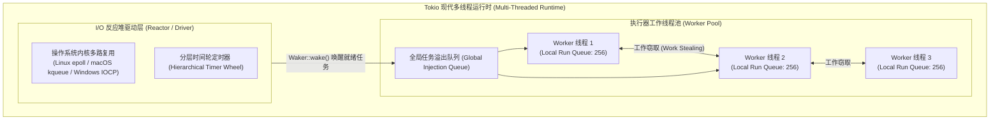
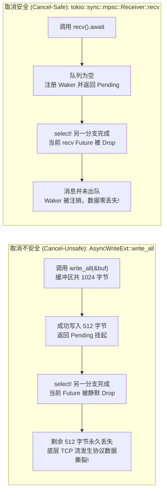

> 💡 **双栏独立滚动工作台导读**：本文采用双栏对照架构。**左栏**为现代异步编程核心架构选型矩阵、Tokio 调度器与反应堆拓扑、取消安全（Cancel Safety）数学判定矩阵、生产级高可靠异步调度代码与避坑清单；**右栏**为原著完整精译参考（Chapter 20: Asynchronous Programming），包含图 20-1 与 20-2 对比图谱、原著关键段落英文对照及核心术语解析。左右两栏支持独立滚动与宽度比例自由调节。

# 核心实战精炼：异步任务调度与取消安全工程范式

## 1. 架构选型矩阵：同步多线程 vs 异步协程运行时

在现代高并发网络服务器和云原生基础设施中，架构师必须在高吞吐、低延迟与内存占用之间做出严谨的工程权衡。Rust 的异步系统是一套**协作式多任务（Cooperative Multitasking）**体系，与操作系统原生线程、Go 语言的 Goroutine 以及 Java 的 Virtual Threads 存在本质差异。

下表系统对比了主流并发执行模型的技术特征：

| 评估维度 | Rust 异步任务 (Tokio Task) | OS 原生线程 (`std::thread`) | Go 协程 (Goroutine) | Java 虚拟线程 (Project Loom) |
| :--- | :--- | :--- | :--- | :--- |
| **内存开销 (单任务)** | **极小 (~几百字节)**<br/>仅包含由编译器生成的 Future 状态机枚举大小，无独立用户栈。 | **较大 (~20KB~8MB)**<br/>受限于操作系统分配的虚拟内存页与保护页（Guard Page）。 | **小 (~2KB~4KB 起步)**<br/>连续可伸缩栈（Contiguous Stack），由 Go 运行时动态扩缩容。 | **小 (~几百字节~几KB)**<br/>基于堆上挂载的 Continuation 栈帧。 |
| **上下文切换开销** | **极低 (零系统调用)**<br/>纯用户态函数指针跳转与状态枚举赋值，CPU 缓存局部性极高。 | **较高 (内核陷阱)**<br/>需进入内核态保存/恢复全部通用寄存器，引发 TLB 刷新与缓存抖动。 | **较低 (用户态调度)**<br/>Go 运行时抢占协作切换，仍需保护整套协程寄存器上下文。 | **较低 (用户态调度)**<br/>JVM 调度器在载体线程（Carrier Thread）上切换。 |
| **调度方式** | **协作式调度 (Cooperative)**<br/>仅在显式 `.await` 挂起点让渡 CPU；若执行死循环会饿死 Worker。 | **抢占式调度 (Preemptive)**<br/>由操作系统内核时钟中断驱动强制时间片轮转。 | **协作式 + 信号抢占**<br/>函数序言桩检查与 OS 信号抢占相结合。 | **协作式 + 挂起挂载**<br/>遇到阻塞系统调用由 JVM 卸载挂起。 |
| **运行时损耗 (Runtime)** | **严格零成本抽象**<br/>无全局垃圾回收器（GC），按需引入轻量 Tokio，可剥离编译至裸机微控制器。 | **零抽象**<br/>直接对接底层操作系统 `pthread` 或 Windows 线程。 | **重运行时依赖**<br/>强绑定并发垃圾回收器、STW 停顿与复杂的 M:N 调度内核。 | **依赖 JVM 虚拟机**<br/>受限于 JVM 堆内存管理与分代 GC 回收暂停。 |
| **取消语义与安全** | **RAII Drop 即取消**<br/>Future 被析构即自动中止，但需开发者严谨防范**取消安全（Cancel Safety）**。 | 不支持安全外部强制 Kill（易导致资源泄漏与锁破坏）。 | 依赖 `context.Context` 显式轮询 Done 信号通道，无法强行掐断代码流。 | 依赖线程中断标志位（Thread.interrupt()）协作轮询。 |
| **最佳工程场景** | 高并发网关、海量长连接 WebSocket、微服务 RPC、I/O 密集型高吞吐存储引擎。 | CPU 密集型纯并行计算、系统级驱动管理、少量长生命周期守护作业。 | 快速交付的业务微服务、常规分布式后台、DevOps 自动化运维脚本。 | 遗留大型企业级 Java 系统的平滑高并发并发改造。 |

### 1.1 异步同步原语深度决策表

在异步代码中，锁的选择直接决定了系统的稳定性与吞吐量：

| 同步原语 / 场景 | `tokio::sync::Mutex<T>` | `parking_lot::Mutex<T>` | `tokio::sync::mpsc` | `tokio::sync::watch` | `tokio::sync::broadcast` |
| :--- | :--- | :--- | :--- | :--- | :--- |
| **是否支持跨 await** | **完全支持**（锁守卫实现了 `Send`） | **严禁跨 await**（会导致 Worker 线程被物理阻塞） | 具备异步 `.send().await` 反压 | 具备单写多读、仅保留最新值的轻量广播 | 具备多生产者多消费者、支持全量消息广播 |
| **性能损耗与开销** | 涉及异步 Future 挂起与唤醒，临界区耗时纳秒级时偏重 | 纯用户态无锁 CAS 旋转自旋，纳秒级临界区性能极限 | 内部无锁环形队列，吞吐极高 | 纳秒级原子版本号比对，开销几乎为零 | 环形缓冲区，消费慢的客户端会滞后溢出 |
| **推荐适用场景** | 临界区内部必须执行网络 I/O 或等待下游 `.await` | 临界区仅做纳秒级内存计数更新或哈希表极速查找 | 异步流水线任务分发、工作队列拉取 | 运行时动态配置热更新推送、停机信号监听 | 分布式聊天室广播、实时事件推流总线 |

---

## 2. 核心原理与心智模型：Tokio 调度架构与取消安全

### 2.1 Tokio 多线程调度器与反应堆拓扑

Tokio 运行时采用分层的反应堆-执行器（Reactor-Executor）拓扑。每个工作线程维护一个本地无锁任务队列，并通过**工作窃取（Work-Stealing）**平衡各核心负载：



### 2.2 取消安全（Cancel Safety）的底层根源

在 Rust 中，“取消一个异步操作”是通过**丢弃该 Future（Drop）**来实现的。在 `tokio::select!` 宏中，当其中一个分支就绪完成后，其余尚未完成的分支对应的 Future 将被立即 `drop`。

如果一个 Future 在被挂起（`Poll::Pending`）与恢复执行之间维护了中间缓冲区状态，而其被丢弃时没有将已读取或已写入的部分持久化，就会引发**状态撕裂或数据丢失**：



### 2.3 核心 API 取消安全判定矩阵

| 异步 API | 取消安全性 | 行为机理与工程防御指引 |
| :--- | :--- | :--- |
| `tokio::sync::mpsc::Receiver::recv()` | **安全 (Safe)** | 仅在消息完整出队后才返回 `Poll::Ready`；若中途 drop，消息保留在通道中。 |
| `tokio::sync::oneshot::Receiver` | **安全 (Safe)** | 尚未收到值时 drop 仅注销等待，值后续会被发送者妥善释放。 |
| `tokio::time::sleep()` | **安全 (Safe)** | 丢弃时直接从时间轮注销定时器，无隐式状态副作用。 |
| `AsyncReadExt::read()` | **安全 (Safe)** | 若在读取到数据前被取消，未读任何字节；若已读取，则当前步立即返回 Ready。 |
| `AsyncBufReadExt::read_line()` | **不安全 (Unsafe)** | 底层流中部分字节可能已被吸入内部缓冲区，中途 drop 导致该行前半段数据彻底丢失。 |
| `AsyncWriteExt::write_all()` | **不安全 (Unsafe)** | 若仅成功写入了前半部分字节后被取消，无法知晓写入了多少字节，流协议撕裂。 |
| `tokio::net::TcpStream::connect()` | **安全 (Safe)** | 若连接未建立完成被取消，底层 socket 文件描述符被直接关闭。 |

---

## 3. 生产级实战范式与工业代码

### 3.1 工业级高可靠并发调度器：限流、超时感知与取消令牌优雅停机

本范式展现了工业级微服务网络网关中处理批量并发请求的黄金标准：集成 `Semaphore` 并发度控制、`tokio_util::sync::CancellationToken` 级联停机树，以及严格的取消安全防护：

```rust
use std::sync::Arc;
use std::time::Duration;
use tokio::sync::{mpsc, Semaphore};
use tokio::time::{self, Instant};
use tokio_util::sync::CancellationToken;

/// 任务执行结果信封
#[derive(Debug)]
pub struct TaskResult {
    pub task_id: u64,
    pub payload: String,
    pub elapsed: Duration,
}

/// 生产级并发工作流调度引擎
pub struct RobustTaskDispatcher {
    concurrency_limit: Arc<Semaphore>,
    cancel_token: CancellationToken,
}

impl RobustTaskDispatcher {
    pub fn new(max_concurrency: usize, cancel_token: CancellationToken) -> Self {
        Self {
            concurrency_limit: Arc::new(Semaphore::new(max_concurrency)),
            cancel_token,
        }
    }

    /// 调度单项任务：受控并发度、硬超时熔断与取消安全保证
    pub async fn dispatch_single_task(
        &self,
        task_id: u64,
        url: String,
        timeout_duration: Duration,
    ) -> Result<TaskResult, String> {
        let start_time = Instant::now();

        // 1. 获取信号量许可，防止击穿下游网络 (具有反压效果)
        let permit = self
            .concurrency_limit
            .clone()
            .acquire_owned()
            .await
            .map_err(|_| "调度器信号量已被关闭".to_string())?;

        // 2. 将核心处理挂载至超时与取消感知总线
        let task_future = async move {
            // permit 会在 task_future 执行完毕或提前取消时自动 Drop 归还
            let _held_permit = permit;

            // 模拟真实网络请求与 I/O 读取
            time::sleep(Duration::from_millis(50)).await;
            format!("成功抓取目标: {}", url)
        };

        // 3. 利用 tokio::select! 汇聚完成、硬超时与系统全局停机信号
        tokio::select! {
            // 分支 A：全局停机取消令牌触发
            _ = self.cancel_token.cancelled() => {
                Err(format!("任务 {} 因系统收到优雅停机广播而被中止", task_id))
            }
            // 分支 B：单任务执行硬超时熔断
            _ = time::sleep(timeout_duration) => {
                Err(format!("任务 {} 执行超时 (阈值: {:?})", task_id, timeout_duration))
            }
            // 分支 C：常规业务处理成功 (保证其取消安全)
            payload = task_future => {
                Ok(TaskResult {
                    task_id,
                    payload,
                    elapsed: start_time.elapsed(),
                })
            }
        }
    }

    /// 运行批处理调度集群并流式聚合结果
    pub async fn run_batch_pipeline(
        self: Arc<Self>,
        tasks: Vec<(u64, String)>,
    ) -> mpsc::Receiver<Result<TaskResult, String>> {
        let (tx, rx) = mpsc::channel(100);

        for (task_id, url) in tasks {
            let dispatcher = Arc::clone(&self);
            let tx_clone = tx.clone();
            let token = self.cancel_token.clone();

            // 派发至独立的异步 Task，交由 Tokio 工作窃取线程池调度
            tokio::spawn(async move {
                if token.is_cancelled() {
                    return;
                }

                let result = dispatcher
                    .dispatch_single_task(task_id, url, Duration::from_secs(3))
                    .await;

                // 异步发送结果，当下游消费缓慢时自动反压
                let _ = tx_clone.send(result).await;
            });
        }

        rx
    }
}
```

### 3.2 现代 Trait 异步方法 (AFIT) 与异步闭包实战

在 Rust 2024 / 1.75+ 中，官方原生支持在 Trait 中声明 `async fn`，无需引入 `#[async_trait]` 宏带来的额外堆装箱（`Box<dyn Future>`）开销：

```rust
use std::future::Future;

/// 原生支持零成本抽象的异步数据层 Trait (AFIT)
pub trait AsyncRepository: Send + Sync {
    type Entity: Send + 'static;
    type Error: std::error::Error + Send + Sync + 'static;

    /// 编译期静态分发的异步方法，返回具体单态化 Future，零堆分配
    async fn find_by_id(&self, id: u64) -> Result<Option<Self::Entity>, Self::Error>;
    
    async fn save(&self, entity: Self::Entity) -> Result<(), Self::Error>;
}

/// 接收异步闭包的高阶处理管线范式 (Rust 2024 Async Closures)
pub async fn with_retry<T, E, F>(mut operation: F, max_attempts: usize) -> Result<T, E>
where
    F: AsyncFnMut() -> Result<T, E>,
{
    let mut attempt = 0;
    loop {
        attempt += 1;
        match operation().await {
            Ok(val) => return Ok(val),
            Err(e) if attempt >= max_attempts => return Err(e),
            Err(_) => {
                tokio::time::sleep(Duration::from_millis(100 * attempt as u64)).await;
            }
        }
    }
}
```

---

## 4. 架构避坑清单 (Do's & Don'ts)

| 决策维度 | 严禁反模式 (Don'ts) | 生产推荐范式 (Do's) |
| :--- | :--- | :--- |
| **异步中阻塞 CPU** | **在 `async fn` 中直接调用耗时加密计算或标准库阻塞 I/O（如 `std::fs::read`）**：导致承载该任务的 Tokio Worker 线程彻底被卡死，整核调度瘫痪。 | **将重型 CPU 任务或阻塞 I/O 隔离至专用阻塞池**：显式使用 `tokio::task::spawn_blocking` 或 Rayon，保持异步反应堆纳秒级周转。 |
| **跨 await 持有同步锁** | **持有 `std::sync::MutexGuard` 跨越 `.await` 点**：不仅引发编译期 `!Send` 报错，若被强制绕过则必定诱发多线程死锁。 | **严控临界区或选用专用锁**：在 `.await` 前显式 `drop(guard)`；或必须跨 await 时统一使用 `tokio::sync::Mutex`。 |
| **取消安全陷阱** | **在 `tokio::select!` 循环中反复使用取消不安全的 Future（如 `read_line` 或 `write_all`）**：分支中途被 drop 导致流数据丢失或协议乱序。 | **选用取消安全的单次 API**（如 `read_buf`）并在外部循环维护专属状态机缓冲区；或将不安全操作移至独立 `tokio::spawn` 保护执行。 |
| **任务无界生成** | **在接收客户端网络连接的循环中无脑 `tokio::spawn(handle(sock))`**：突发流量洪峰瞬间派生数百万个 Task，耗尽机器内存引发 OOM。 | **通过 `tokio::sync::Semaphore` 严格设定最大并发阈值**，实现自适应反压（Backpressure），拒载过载流量。 |
| **优雅停机盲区** | **收到退出信号直接调用 `std::process::exit(0)`**：未完成的落盘数据与正在处理的外部事务被强行截断，造成数据损坏。 | **采用 `CancellationToken` 构建自顶向下的层级广播**，等待各业务 Worker 消费完当前批次后有序注销退出。 |

<!-- split -->

# 原著完整参考：现代异步编程（Chapter 20: Asynchronous Programming）

在上一章中，我们详细探讨了如何在 Rust 中利用操作系统原生线程将计算密集型任务分发到多个 CPU 核心，从而全负荷调动机能。在本章及接下来的第 21 章中，我们将转向线程之外的另一种选择——**为 I/O 密集型程序提供兼具更高并发度与更低系统开销的并发模型：异步编程**。

对于 CPU 密集型任务（例如我们在第 2 章和第 19 章中实现的多线程 Mandelbrot 分形渲染），程序的性能瓶颈几乎完全取决于对物理 CPU 时钟周期的榨取效率。这类计算对处理器的消耗是如此纯粹，以至于其他硬件资源几乎感受不到任何负载。在压榨多核算力方面，操作系统线程的表现极其出色。

然而，网络服务（Network Services）却呈现出截然不同的性能特征。如果网络服务为每一个进入的并发连接都派生一个独立的操作系统线程，那么这个线程生命周期中 99% 的时间都将耗费在**被动阻塞等待网络或磁盘 I/O** 上。处理业务逻辑所需的 CPU 指令极其微小，以至于单台服务器完全具备同时服务成千上万甚至数十万并发请求的理论潜力。此时，系统的吞吐瓶颈彻底转变为：**对内存的高效使用，以及任务创建与上下文切换的极速响应**。

操作系统线程在这些方面是相当昂贵的。即便一个原生线程处于完全静止挂起状态，在大多数现代操作系统中，它仅内存占用（包含内核栈与用户空间栈）就高达约 20 KB；而一旦该线程开始执行真实调用，其调用栈往往会膨胀到数十甚至数百 KB。此外，向操作系统内核申请创建原生线程的系统调用也是一个相对沉重的操作。

Rust 的**异步代码（Asynchronous Code）**是一种**协作式多任务（Cooperative Multitasking）系统**，它以极低甚至可以忽略不计的运行时开销，赋予了程序与多线程代码完全媲美的表达力。

在异步体系中，与“线程”相对应的轻量级执行单元被称为**任务（Task）**。Rust 的异步任务在概念上类似于 C# 中的 Task、Go 语言中的 Goroutine，或是现代 Java 中的虚拟线程（Virtual Thread）。虽然上述语言通过深度的语言运行时为开发者提供了更加平滑的开发体验，但它们也无可避免地强依赖于重量级的运行时环境支持。与此相反，**Rust 的异步代码不仅能够以极致性能运行在云端工业级服务器上，甚至能够直接剥离标准库运行在资源极度匮乏的裸机微控制器（Microcontrollers）上**。

如果没有异步代码，每个线程在同一时刻只能单调地做一件事。

例如，考虑一个单线程程序调用 `reqwest::blocking::get("https://red-bean.com")` 发起 HTTP 请求的场景。图 20-1 从左向右展示了该程序执行过程中函数调用栈的简化视图：


*图 20-1：同步 HTTP 请求的执行时序（深色区域表示线程被动等待操作系统系统调用的时间）*

调用栈自底向上堆叠。很显然，`get` 函数在整个生命周期中持续存活。它依次调用标准库的 `TcpStream::connect`、`write_all` 和 `read_to_string`。这些调用最终会转化为向操作系统内核发起的**系统调用（System Calls）**，例如打开 TCP 套接字、发送数据包或接收网络响应。

图 20-1 中的深色背景标示了程序被动等待操作系统内核完成系统调用的漫长时间。此函数绝大多数时间都在无所事事地等待；如果按真实物理时间比例绘制，实际执行 Rust 业务代码的白色切片将被压缩得宛如几根细不可见的丝线。

当该函数等待系统调用返回时，其所属的单一线程处于**阻塞（Blocked）**状态：在系统调用完成前，它无法做任何其他事情。考虑到线程栈动辄占用数十上百 KB 内存，如果在一个大型系统中让数万个线程同时进行类似的阻塞等待，单纯线程自身所带来的内存与调度开销就足以击垮系统。

异步代码则允许单个操作系统线程**同时处理多件事情**。

图 20-2 展示了在单个线程中并发运行三个异步任务的情形，每个任务都使用异步版本的 `reqwest::get` 发送各自的 HTTP 请求：


*图 20-2：在单个操作系统线程上交替并发运行三个异步任务*

在图 20-2 的上半部分，我们从每个任务各自的局部视角观察其执行轨迹：每一项看起来都与图 20-1 的同步流程极其相似。然而，异步代码被设计为**轮流协作让渡（Take Turns）**。在图的下半部分，我们看到了三者在单一线程上交替插入、错落有致的最终执行流。

每个独立的网络请求所耗费的绝对总耗时与同步版本大体相当，但在同步版本中线程只能发呆等待网络的那些漫长空白期，在异步模型下被其他就绪的任务见缝插针地填满了。图 20-2 同样未按物理比例绘制；事实上，在这条线程完全吃满单颗 CPU 核心之前，你可以在其中塞入数百倍于此的并发请求！

:::en
> **Original**: Rust's asynchronous code is a cooperative multitasking system that offers the expressiveness of threaded code with lower overhead — sometimes much lower. The asynchronous counterpart of a thread is called a *task*.
> If you're doing compute-intensive work, you'll need to use threads to exploit your machine's parallelism. But for a given budget of memory and processor time, asynchronous code can handle many more I/O-bound tasks simultaneously. This is why most popular I/O-related crates in the Rust ecosystem provide asynchronous interfaces.

**📌 核心术语与语境解析**：
- **Cooperative Multitasking** [koʊˈɑːpərətɪv ˈmʌltiˌtæskɪŋ]：*协作式多任务*。任务自身主动在遇到 I/O 阻塞或等待点时交出 CPU 控制权，与操作系统基于硬件时钟强制打断的抢占式多任务（Preemptive）相对。
- **Asynchronous Task** [eɪˈsɪŋkrənəs tæsk]：*异步任务*。Rust 异步世界里的“超轻量级绿色线程”，本质上是由编译器推导生成的 Future 状态机，单个任务仅占用数百字节内存。
- **I/O-Bound vs Compute-Bound**：*I/O 密集型 vs 计算密集型*。系统瓶颈分别受制于外部网络/磁盘传输延迟与 CPU 算力吞吐的两种根本业务形态。
:::

---

## 1. 异步代码的直观样貌与现代语法

虽然异步代码的最大价值在创建海量并发任务时最为夺目，但其语法骨架在极简场景下最容易理解。

以下是一个利用流行 HTTP 客户端 `reqwest` 抓取网页的异步程序：

```rust
use anyhow::Result;

async fn make_request() -> Result<String> {
    let url = "https://rust-lang.org/";
    let response = reqwest::get(url)
        .await?
        .text()
        .await?;
    Ok(response)
}

fn main() -> Result<()> {
    // 手动构建 Tokio 运行时
    let runtime = tokio::runtime::Runtime::new()?;
    // 阻塞等待顶级异步函数执行完毕
    let response = runtime.block_on(make_request())?;
    println!("{response}");
    Ok(())
}
```

其核心组件与同步代码高度相似，但包含了几个驱动协作式多任务的关键概念：
1. **异步函数 (`async fn`)**：其执行可以被安全挂起（Suspend）。调用异步函数并不会立即执行其内部代码，而是瞬间返回一个代表“未决计算”的 `Future` 状态机。
2. **Await 表达式 (`.await`)**：虽然看起来像在访问名为 `await` 的结构体字段，但 `.await` 实际上是 Rust 内置的原生后置操作符。如果底层操作尚未就绪，`.await` 会将当前异步函数挂起，将线程控制权返还给运行时，待数据就绪后由运行时自动唤醒恢复执行。
3. **异步运行时 (Async Runtime)**：Rust 语言本身并不内置异步运行时！开发者必须显式引入运行时（如 Tokio）。运行时扮演着类似操作系统内核线程调度器的角色：维护就绪任务队列，监听底层的 epoll/kqueue 事件通知，并调度 Task 在线程池间轮转。

为了免去手动创建 Runtime 并调用 `block_on` 的样板代码，Tokio 提供了属性宏 `#[tokio::main]`：

```rust
#[tokio::main]
async fn main() -> Result<()> {
    let response = reqwest::get("https://rust-lang.org/")
        .await?
        .text()
        .await?;
    println!("{response}");
    Ok(())
}
```

:::en
> **Original**: In any program that uses asynchronous code, you must specify the *runtime* that will run your asynchronous tasks. An async runtime is Rust's analogue of the operating system's thread scheduler: it maintains a queue of runnable tasks and tracks tasks that are blocked on operations like I/O, waiting for a timer, or acquiring a mutex. When an await expression suspends an asynchronous function call, it is the runtime that resumes it later.

**📌 核心术语与语境解析**：
- **Postfix Operator** [ˈpoʊstfɪks ˈɑːpəreɪtər]：*后置操作符*。Rust 团队经过长期社区大讨论确立的语法，`.await` 放在表达式末尾，完美支持类似 `foo().await?.bar().await?` 的优雅链式调用，彻底避免了嵌套圆括号（如 `await(await foo())`）的地狱。
- **Async Runtime** [ˈeɪsɪŋk ˈrʌntaɪm]：*异步运行时*。负责将 Future 绑定至操作系统内核 I/O 事件多路复用器（epoll/kqueue/IOCP）并驱动轮询的支撑环境。
:::

---

## 2. 异步多任务并发：`tokio::spawn` 与网络爬虫实战

单调地线性使用 `.await` 只是实现了非阻塞，并没有真正榨取异步的并行吞吐。为了并发执行多个任务，我们需要使用 `tokio::spawn`。

### 2.1 任务生成与 `'static` / `Send` 边界

`tokio::spawn` 类似于多线程中的 `std::thread::spawn`：它接收一个 Future，将其包装为一个独立的 Task，并立即注册进 Tokio 运行时的任务调度队列：

```rust
let handle = tokio::spawn(async {
    // 在 Tokio 线程池中独立并发执行
    fetch_data_from_remote().await
});

// 可选：等待任务完成并获取其返回值
let result = handle.await.unwrap();
```

需要强调的是，在多线程运行时环境下，被 `tokio::spawn` 派发的任务可能在不同的 Worker 线程之间发生**工作窃取迁移**。因此，传递给 `tokio::spawn` 的 Future 必须满足两项硬性编译期契约：
1. **`'static` 生命周期**：任务不能借用局部栈帧数据（因为任务可能比当前函数存活更久）；
2. **`Send` Trait**：任务内部捕获的所有局部变量在跨越 `.await` 挂起点时，必须能够安全地从一个 OS 线程转移至另一个 OS 线程。

### 2.2 异步版本的阻塞工具与锁的选择

在传统同步多线程中，我们习惯使用 `std::sync::Mutex`。而在异步世界中，如果你持有一把 `std::sync::MutexGuard` 并在其生命周期内执行了 `.await`，编译器会直接报出 `!Send` 编译错误！

原因显而易见：如果当前任务在一个线程上锁定了互斥量，随后在 `.await` 处挂起，稍后被 Tokio 调度到另一个线程上恢复执行并试图解锁，而底层 OS 原生互斥锁要求必须在加锁的同一个线程上解锁，这直接破坏了系统的内存模型。

为此，Tokio 提供了异步版本的 `tokio::sync::Mutex`。它的 `.lock()` 返回一个实现了 Future 的异步锁守卫，完全支持跨越 `.await`。但需要注意：**如果临界区极其短小（仅纳秒级更新内存），应优先在独立作用域内使用同步锁并迅速释放，避免过度引入异步锁带来的调度开销**。

---

## 3. 现代 Rust 语法新演进：AFIT 与异步闭包

在 Rust 2024 及近期的核心版本中，异步语法迎来了重磅演进：

### 3.1 Trait 中的异步函数 (AFIT - Async Fn in Traits)

在早期的 Rust 中，由于编译期单态化与关联类型推导的复杂性，在 Trait 中声明 `async fn` 是被禁止的，开发者不得不依赖第三方宏 `#[async_trait]` 将返回值强制装箱为 `Pin<Box<dyn Future>>`，带来了不必要的堆分配开销。

从 Rust 1.75 开始，官方正式稳定了 Trait 中的异步函数：

```rust
trait DatabaseDriver {
    // 零成本抽象，直接由编译器推导关联 Future 类型
    async fn execute_query(&self, sql: &str) -> Result<u64, DbError>;
}
```

### 3.2 异步闭包 (Async Closures)

Rust 2024 进一步引入了原生的异步闭包语法（`async || {}`）及核心特征 `AsyncFn`、`AsyncFnMut`、`AsyncFnOnce`。这使得诸如集合的高阶流式变换、带重试机制的异步包装器等函数式模式得以丝滑书写。

---

## 4. 取消机制与取消安全 (Cancel Safety)

在多任务并发中，我们经常需要处理竞速、超时熔断与停机清理。这引出了异步编程中最凶险也是最容易被忽视的课题：**取消安全（Cancel Safety）**。

### 4.1 `tokio::select!` 竞争求值与 Future 丢弃

`tokio::select!` 允许我们同时等待多个异步分支。一旦某一个分支率先就绪完成，`select!` 会立即执行该分支的代码块，并**静默且同步地丢弃（Drop）其余所有尚未完成的分支**：

```rust
tokio::select! {
    msg = socket.read_message() => {
        process(msg);
    }
    _ = tokio::time::sleep(Duration::from_secs(5)) => {
        println!("读取超时！");
    }
}
```

如果在 5 秒超时前消息到达，`sleep` 的定时器 Future 被丢弃，定时器从时间轮安全注销；如果 5 秒超时先发生，`read_message()` Future 被直接丢弃。

### 4.2 为什么必须高度警惕取消不安全？

如果一个操作在完成之前需要多步中间状态，中途丢弃它可能导致不可挽回的系统状态撕裂：
- 例如，使用 `tokio::io::AsyncWriteExt::write_all` 向 TCP 写入 1024 字节数据。如果刚成功写入了 200 字节时任务被 `select!` 取消，该 Future 被立即析构。此时已写入的 200 字节已经发送到对端网络，而剩余 824 字节永久丢失。连接底层的应用层协议帧遭到严重损坏！
- 又如，使用 `read_line(&mut buf)` 时被取消，已经从内核缓冲区读入但尚未遇到换行符的内容在 Future 丢弃时被直接废弃，下一轮读取将导致数据截断。

**在编写任何包含 `select!` 的并发控制逻辑前，必须查阅相关 API 的官方文档，确认其是否明确标明为 Cancel-Safe！**

---

## 5. 优雅停机模式 (Graceful Shutdown)

在生产环境中，粗暴杀死进程（Kill -9）往往会导致未完成的事务状态错乱或数据落盘损坏。一个健全的异步系统必须具备**三级优雅停机拓扑**：

1. **操作系统信号捕获**：监听 SIGINT（Ctrl+C）与 SIGTERM 信号；
2. **取消令牌层级广播**：使用 `tokio_util::sync::CancellationToken`，父级令牌取消时，所有由其派生的子令牌自动收到级联取消通知；
3. **汇聚等待与超时熔断**：主线程利用 `mpsc` 通道或 `JoinSet` 收集所有工作任务的退出状态；设置 10~30 秒优雅退出宽限期，超时后方才执行强制终止。
