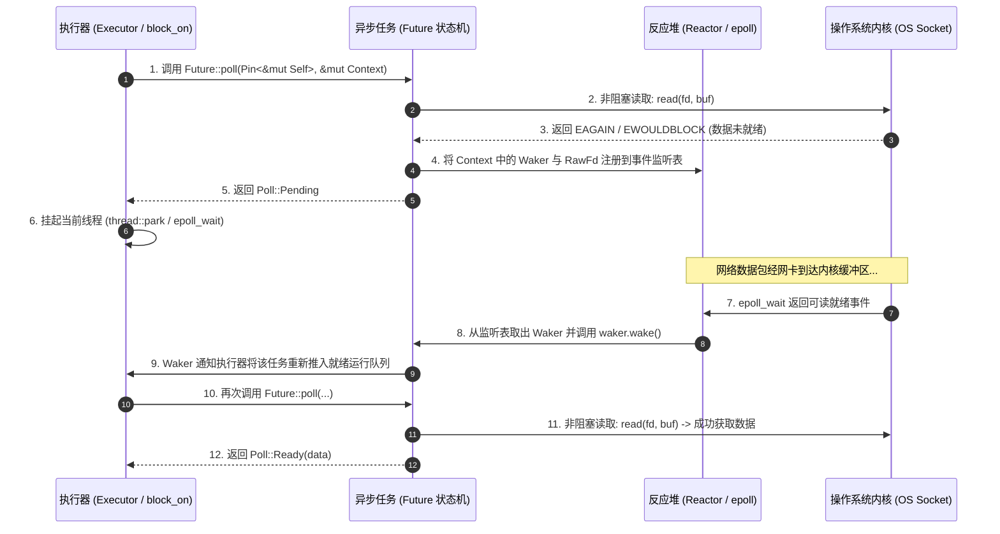
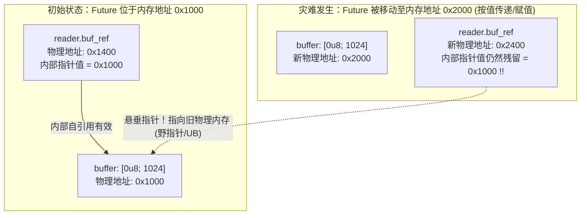

# 核心实战精炼：Future 状态机逆向与 Pin 内存安全契约

## 1. 架构选型矩阵：异步底层核心组件与心智模型决策

在编写上层异步业务时，`async`/`.await` 带来了近乎同步代码的平滑体验。但在构建底层高性能网络中间件、硬件驱动或者自研异步运行时（如嵌入式微控制器定制执行器）时，工程师必须直面裸露出水面的底层三要素：**`Future` 轮询接口**、**`Waker` 唤醒通知机制**以及**`Pin` 内存防移动屏障**。

下表系统梳理了异步底层关键技术组件的权衡与决策准则：

| 评估维度 / 组件 | `Future::poll` 协作式轮询 | 基于 OS 线程的阻塞同步 | 基于回调事件驱动 (Callback) | 绿色线程栈切换 (Go/Loom) |
| :--- | :--- | :--- | :--- | :--- |
| **内存排布与开销** | **栈/堆紧凑状态机**<br/>单态化枚举，内存大小恰好容纳活跃变量的最大交集，零栈浪费。 | **固定/动态线程栈**<br/>每个线程 20KB~8MB，海量并发时极易耗尽虚拟内存。 | **闭包堆分配 (Box)**<br/>每次注册监听均需在堆上分配回调闭包，碎片化严重。 | **连续可伸缩栈**<br/>初始 2KB~4KB，在发生深度调用时触发栈拷贝扩容。 |
| **任务唤醒机制** | **惰性拉取 + 精确唤醒**<br/>返回 `Pending` 时注册 `Waker`；就绪后由 Reactor 单次精准唤醒。 | **内核等待队列**<br/>由操作系统内核调度器在系统调用返回时将线程置为就绪态。 | **中断/事件循环直调**<br/>I/O 事件触发时由 Loop 线程直接内联调用回调函数。 | **运行时调度器介入**<br/>Go 运行时通过 `runtime.ready` 将 G 放入 P 的本地队列。 |
| **自引用借用风险** | **存在严重自引用风险**<br/>跨 `.await` 借用局部变量会导致自身包含指向自身的裸指针，**必须 Pin 住**。 | **无自引用破坏风险**<br/>所有局部变量驻留在由寄存器 ESP/RSP 维护的独立调用栈上。 | **通过所有权转移规避**<br/>通过 `Arc`/`Rc` 共享内存，避开栈上跨生命周期借用。 | **编译器与运行时重定位**<br/>栈扩容时由 Go 运行时遍历全部指针并执行地址重定位修复。 |
| **适用工程层级** | 高并发网络底座、自定义协议解码器、嵌入式无标准库（`#[no_std]`）裸机固件。 | 纯 CPU 算力密集型计算、底层同步硬件接口通信、遗留 C 库桥接。 | 简单的 GUI 事件监听、非高频异步通知、轻量级硬件中断钩子。 | 快速交付的通用业务服务，对单机内存极致紧凑度无苛刻要求的场景。 |

### 1.1 Pinning 钉住机制决策表

| 固定方式 | 核心 API | 堆分配开销 | 生命周期约束 | 生产推荐场景 |
| :--- | :--- | :--- | :--- | :--- |
| **栈上钉住 (Stack Pinning)** | `std::pin::pin!(val)` | **零堆分配**（完全驻留在局部函数调用栈） | 受限于当前大括号作用域，离开作用域自动析构 | 在局部函数内使用 `tokio::select!` 同时等待多个命名 Future |
| **堆上钉住 (Heap Pinning)** | `Box::pin(val)` | **单次堆分配**（包含指针元数据与数据体） | `'static` 或受特定生命周期约束，可在线程间自由移动指针 | 动态异构任务调度、向任务池 `tokio::spawn` 派发、Trait 对象（`Pin<Box<dyn Future>>`） |
| **侵入式结构投影 (Pin Projection)** | `pin_project` 宏 / 手写 Unsafe | **零开销**（结构体内字段按需投影） | 依赖结构体自身的外层固定状态 | 手工编写复合 Future、包装器（如超时包装器、流式重试器） |

---

## 2. 核心原理与心智模型：Poll 驱动闭环与自引用内存拓扑

### 2.1 Future 轮询与 Reactor-Executor 事件唤醒闭环



### 2.2 为什么必须“钉住”（Pinning）：自引用状态机内存撕裂深度逆向

在普通的同步函数中，局部变量存储在物理调用栈上。但在 `async fn` 中，所有**跨越 `.await` 挂起点的局部变量**必须被捕获进编译器生成的匿名结构体中，以便在被唤醒时能够恢复现场：

```rust
async fn example() {
    let mut buffer = [0u8; 1024];          // 字段 A: 局部数据
    let mut reader = get_reader(&buffer);  // 字段 B: 内部引用，直接指向 buffer 的内存地址！
    reader.read_async().await;             // 挂起点！
}
```



> **编译期防线：`Pin` 类型契约**：
> `Pin<P>` 并非对底层硬件内存施加物理写保护，而是一个**编译期类型安全守卫**。当一个非 `Unpin` 的类型（如包含内部自引用的异步 Future）被包装为 `Pin<&mut T>` 或 `Pin<Box<T>>` 之后，编译器将物理封锁任何能够通过安全代码执行 `std::mem::swap` 或移动 `T` 的途径。要获取 `&mut T`，必须通过极具仪式感的 `unsafe` 代码并由开发者亲自向编译器立下内存不变量保证！

---

## 3. 生产级实战范式与工业代码

### 3.1 手工实现极简 `block_on` 异步驱动执行器

理解异步的最佳途径莫过于亲手构建一个轻量级执行器。以下工业级范式展示了如何使用标准库的 `thread::park` 与 `thread::unpark` 实现零依赖的 `block_on`：

```rust
use std::future::Future;
use std::pin::pin;
use std::sync::atomic::{AtomicBool, Ordering};
use std::sync::Arc;
use std::task::{Context, Poll, RawWaker, RawWakerVTable, Waker};
use std::thread::{self, Thread};

/// 线程唤醒控制器：利用 OS 线程休眠机制
struct ThreadWaker {
    thread: Thread,
    unparked: AtomicBool,
}

impl ThreadWaker {
    fn new() -> Self {
        Self {
            thread: thread::current(),
            unparked: AtomicBool::new(false),
        }
    }

    /// 触发唤醒：如果线程尚未被唤醒，则调用 unpark
    fn wake(&self) {
        if !self.unparked.swap(true, Ordering::Release) {
            self.thread.unpark();
        }
    }
}

/// 虚表定义：将 Arc<ThreadWaker> 转换为标准库的 Waker
static VTABLE: RawWakerVTable = RawWakerVTable::new(
    // clone: 递增引用计数
    |ptr| {
        let arc = unsafe { Arc::from_raw(ptr as *const ThreadWaker) };
        let cloned = arc.clone();
        let _ = Arc::into_raw(arc);
        RawWaker::new(Arc::into_raw(cloned) as *const (), &VTABLE)
    },
    // wake: 消费自身并触发唤醒
    |ptr| {
        let arc = unsafe { Arc::from_raw(ptr as *const ThreadWaker) };
        arc.wake();
    },
    // wake_by_ref: 借用唤醒
    |ptr| {
        let arc = unsafe { &*(ptr as *const ThreadWaker) };
        arc.wake();
    },
    // drop: 释放引用计数
    |ptr| {
        let _ = unsafe { Arc::from_raw(ptr as *const ThreadWaker) };
    },
);

/// 生产级极简 block_on 执行器
pub fn mini_block_on<F: Future>(future: F) -> F::Output {
    // 1. 使用标准库 pin! 宏在当前线程栈上钉住 Future，确保自引用安全
    let mut pinned_future = pin!(future);

    // 2. 构造基于当前线程的 Waker
    let waker_data = Arc::new(ThreadWaker::new());
    let raw_waker = RawWaker::new(Arc::into_raw(waker_data.clone()) as *const (), &VTABLE);
    let waker = unsafe { Waker::from_raw(raw_waker) };
    let mut cx = Context::from_waker(&waker);

    // 3. 驱动轮询事件循环
    loop {
        // 重置唤醒标志
        waker_data.unparked.store(false, Ordering::Release);

        // 轮询底层 Future
        match pinned_future.as_mut().poll(&mut cx) {
            Poll::Ready(output) => return output,
            Poll::Pending => {
                // 如果在挂起与休眠之间未收到唤醒通知，则将当前线程休眠
                while !waker_data.unparked.load(Ordering::Acquire) {
                    thread::park();
                }
            }
        }
    }
}
```

### 3.2 手工实现工业级原始 Future：高精度定时器

演示如何手动实现 `Future` Trait，正确管理 `Waker` 注册、并发跨线程通知以及状态跃迁：

```rust
use std::future::Future;
use std::pin::Pin;
use std::sync::{Arc, Mutex};
use std::task::{Context, Poll, Waker};
use std::thread;
use std::time::{Duration, Instant};

/// 跨线程共享的定时器状态机
struct TimerState {
    completed: bool,
    waker: Option<Waker>,
}

/// 手工实现的高精度定时器 Future
pub struct AsyncTimer {
    shared_state: Arc<Mutex<TimerState>>,
}

impl AsyncTimer {
    pub fn new(duration: Duration) -> Self {
        let shared_state = Arc::new(Mutex::new(TimerState {
            completed: false,
            waker: None,
        }));

        let thread_state = Arc::clone(&shared_state);
        // 派发后台独立计时线程
        thread::spawn(move || {
            thread::sleep(duration);
            let mut state = thread_state.lock().unwrap();
            state.completed = true;
            // 定时到达，精准唤醒注册的执行器
            if let Some(waker) = state.waker.take() {
                waker.wake();
            }
        });

        Self { shared_state }
    }
}

// 由于 AsyncTimer 内部所有字段均为普通值，不包含自引用，因此天然满足 Unpin 契约
impl Future for AsyncTimer {
    type Output = Instant;

    fn poll(self: Pin<&mut Self>, cx: &mut Context<'_>) -> Poll<Self::Output> {
        let mut state = self.shared_state.lock().unwrap();

        if state.completed {
            Poll::Ready(Instant::now())
        } else {
            // 关键：必须在每次返回 Pending 前用最新的 Context Waker 覆盖更新，
            // 应对 Future 在不同执行器线程之间迁移被轮询的场景！
            state.waker = Some(cx.waker().clone());
            Poll::Pending
        }
    }
}
```

---

## 4. 架构避坑清单 (Do's & Don'ts)

| 决策维度 | 严禁反模式 (Don'ts) | 生产推荐范式 (Do's) |
| :--- | :--- | :--- |
| **Waker 覆盖保存** | **仅在首次 `poll` 时保存 `cx.waker()`，后续 `poll` 忽略更新**：任务被转移到其他 Worker 线程时，旧 Waker 唤醒了错误的线程，导致任务陷入永久假死挂起。 | **每次返回 `Poll::Pending` 前必须无条件更新 `Waker`**：使用 `if !waker.will_wake(cx.waker()) { waker = cx.waker().clone(); }` 刷新引用。 |
| **就绪后重复轮询** | **对已经返回 `Poll::Ready` 的 Future 再次调用 `poll()`**：违反 Future 底层生命周期契约，引发未定义状态、状态机恐慌崩溃。 | **使用 `futures::future::Fuse` 包装器**：对可能被重复轮询的 Future 加上熔断防护，就绪后后续轮询永久幂等返回 `Pending`。 |
| **Pin 投影误用** | **手写裸指针强转从 `Pin<&mut Outer>` 中移出非 `Unpin` 的内部字段**：直接破坏内存钉住不变性，引发悬垂指针与段错误崩溃。 | **引入经严格形式化验证的 `pin-project` 或 `pin-project-lite` 宏**：自动安全展开字段结构投影，由宏机制证明钉住安全性。 |
| **堆分配滥用** | **在热点处理函数中为了将其传给 `poll()` 肆意使用 `Box::pin(fut)`**：数万 QPS 下引发疯狂堆分配与内存碎片化，吞吐严重退化。 | **优先使用标准库的 `std::pin::pin!(fut)`**：完全在当前函数调用栈上原地钉住，享受纯粹的零成本抽象。 |
| **虚假唤醒空转** | **在未确立就绪条件的非阻塞尝试失败后，仍高频频繁调用 `waker.wake()`**：导致执行器陷入无休止的 100% CPU 忙轮询死循环。 | **仅在底层 I/O 驱动或条件变量切实触发就绪状态后才执行唤醒**；执行器端在等待时必须通过 `park` 或 epoll 真正挂起。 |

<!-- split -->

# 原著完整参考：深入 Futures 底层（Chapter 21: Futures）

在第 20 章中，我们系统介绍了如何使用 `async`/`await` 语法和 Tokio 运行时构建高性能异步程序。然而，在不破坏 Rust 严密的所有权与内存安全法则、同时又完全不妥协运行时性能的前提下，赋予一门系统级语言异步多任务能力，其底层工程实现绝非微不足道。

在本章中，我们将深入异步机制的引擎盖下，系统剖析支撑现代 Rust 异步生态的三大基石构件：
1. **`Future` Trait**：定义了“等待者（Things that wait）”与“被等待者（Things that need to be waited for）”之间的通用交互契约；
2. **`Waker` 唤醒机制**：允许异步任务在外部 I/O 事件就绪时精准做出响应，免去无休止的 CPU 轮询；
3. **运行时与反应堆（Runtimes & Reactors）**：将 Futures、Wakers 与底层操作系统原生异步 I/O 接口紧密粘合为一个协同运转的精密机器。

虽然使用 `async fn` 声明异步函数极其便捷，但亲自动手用底层结构体实现 `Future`，能让任务的**确切内存排布、结构体尺寸以及状态流转逻辑**在代码中彻底透明可见。当你在构建全新的通信协议栈、开发定制硬件 I/O 驱动，或是调试第三方库中隐蔽的异步 Bug 时，这些底层洞察将成为不可或缺的硬核武器。

:::en
> **Original**: In Chapter 20, we covered how to use Rust's asynchronous programming system with `async`/`await` syntax and the Tokio runtime. Enabling asynchronous programming without either violating Rust's rules of ownership and memory safety or compromising on performance isn't trivial.
> In this chapter, we'll cover three foundational elements of asynchronous programming in Rust: The `Future` trait, The waker mechanism, and Runtimes and reactors.

**📌 核心术语与语境解析**：
- **Foundational Elements** [faʊnˈdeɪʃənl ˈelɪmənts]：*基石要素*。Rust 异步生态分层架构的核心：语言层仅定义最简 Trait 与语法，将运行时调度完全解耦留给库生态。
- **Piñata Model** [pɪnˈjɑːtə ˈmɑːdl]：*皮纳塔玩具模型*。形象比喻 Future 机制：Future 自身不会主动在后台跑，唯一的交互方式就是拿 `poll()` 一次次“敲打”它，直到计算结果掉出来。
:::

---

## 1. `Future` Trait 与轮询契约

标准库中 `Future` Trait 的核心定义如下：

```rust
pub trait Future {
    type Output;
    // 暂时将 Pin<&mut Self> 理解为普通的 &mut Self
    fn poll(self: Pin<&mut Self>, cx: &mut Context<'_>) -> Poll<Self::Output>;
}

pub enum Poll<T> {
    Ready(T),
    Pending,
}
```

当 `Future::poll` 首次被调用时，它正式启动该 Future 的计算逻辑。在每次调用中，它都会尝试在不阻塞当前线程的前提下推进状态：
- 如果计算已经全部完成，`poll` 立即返回 `Poll::Ready(output)`；
- 如果操作因为等待外部数据而无法完成，它返回 `Poll::Pending`，并且**向调用者立下严肃契约：一旦未来底层数据就绪、值得再次调用 `poll` 时，它会主动通过传入的 `Context` 中的 `Waker` 唤醒执行器**。

所有现代操作系统都提供了用于实现此类轮询接口的系统调用变体。例如在 Unix 和 Windows 上，当你将网络套接字设置为非阻塞模式（Nonblocking Mode）时，如果在无数据时调用 `read` 或 `write`，内核不会挂起线程，而是立刻返回一个 `WouldBlock`（或 `EAGAIN`）错误。操作系统这套非阻塞机制，正是内核层面的 `Future` 雏形——它明确告知调用者：“我现在没有数据，请先离开，稍后再试”。

### 1.1 手动构建 `ReadToEndFuture` 结构体

假设我们要为一个非阻塞的 `TcpStream` 手动编写异步读取全部数据的 Future，其结构体定义如下：

```rust
use std::net::TcpStream;

pub struct ReadToEndFuture<'a> {
    stream: &'a mut TcpStream,
    buf: &'a mut Vec<u8>,
    bytes: usize,
}
```

这个手动编写的 Future 内部清晰地捕获了完成该异步操作所必需的全部上下文状态：被借用的数据流引用、目标缓冲区引用以及当前已读取的字节偏移量。

---

## 2. 究竟何时应该轮询？Waker 唤醒机制

当一个 Future 返回 `Poll::Pending` 后，执行器（如 `block_on` 或 Tokio Worker）会进入休眠状态，以避免空转耗尽 CPU。但执行器究竟应该在何时醒来？

这就是 **`Waker` 回调机制**的用武之地。当执行器轮询一个 Future 时，必须在 `Context` 中附带一个 `Waker`。如果底层 Future 尚未就绪，它必须将这个 `Waker` 的克隆体妥善暂存起来：

```rust
use std::task::Waker;

struct MyPrimitiveFuture {
    waker: Option<Waker>,
}

impl Future for MyPrimitiveFuture {
    type Output = ();

    fn poll(mut self: Pin<&mut Self>, cx: &mut Context<'_>) -> Poll<()> {
        if check_ready() {
            return Poll::Ready(());
        }

        // 保存执行器的 Waker 句柄
        self.waker = Some(cx.waker().clone());
        Poll::Pending
    }
}
```

当外部硬件中断、网络包或定时器触发条件成立时，持有该 `Waker` 的后台线程或驱动层只需调用其 `wake()` 方法：

```rust
if let Some(waker) = self.waker.take() {
    waker.wake(); // 执行器被唤醒，立即重新调度该 Future 再次执行 poll
}
```

:::en
> **Original**: When an executor like `block_on` polls a future, it must pass in a callback called a *waker*. If the future is not ready yet, the rules of the `Future` trait say that it must return `Poll::Pending` for now and arrange for the waker to be invoked later, if and when the future is worth polling again.
> Futures, however, should be careful to invoke a waker only when polling would make actual progress: a cycle of spurious wakeups and polls can prevent an executor from ever sleeping at all, wasting power and leaving the processor less responsive to other tasks.

**📌 核心术语与语境解析**：
- **Spurious Wakeups** [ˈspjʊriəs ˈweɪkʌps]：*虚假唤醒*。在没有实际进展时盲目调用 `wake()`，导致执行器频繁被空转唤醒并再次返回 `Pending`，白白耗散机器电量与算力。
- **Waker::wake vs Waker::wake_by_ref**：前者按值消费所有权，某些调度器能够以此优化内部通道锁争用；后者以借用形式唤醒，适合高频重复触发。
:::

---

## 3. 反应堆与执行器协同架构 (Reactors & Executors)

在工业级运行时中，单靠单个 Future 是无法直接监听操作系统的网络套接字的。这需要**反应堆（Reactor）**的介入。图 21-1 展示了异步读操作中任务、反应堆与操作系统内核的三方协同序列：


*图 21-1：反应堆协同执行异步读取的时序图谱（❶ 发起读取 -> ❷ 返回未就绪 -> ❸ 注册至 Reactor -> ❹ 操作系统通知 -> ❺ 触发 wake -> ❻ 执行器再次 poll）*

在典型的 Linux 体系下，反应堆通过封装底层 `epoll`（或跨平台的 `poll`/`kqueue`）系统调用实现：
1. 当任务读取网络流遭遇 `WouldBlock` 时，任务将文件描述符 `RawFd` 与自身的 `Waker` 注册到反应堆的内部哈希表中；
2. 反应堆在独立的内核监听线程中执行阻塞式 `epoll_wait`；
3. 一旦网卡收到 TCP 数据包，操作系统唤醒反应堆线程；
4. 反应堆从哈希表中查出对应的 `Waker` 并执行 `waker.wake()`；
5. 执行器收到信号，重新将该任务推入就绪队列再次触发 `poll`。

### 3.1 协作式多任务与预算削减机制 (`consume_budget`)

Tokio 运行时不仅需要响应 I/O，还必须确保多个并发任务之间的公平性。如果某个任务包含一个长达数十万次的循环，且内部调用的异步方法总是恰好瞬间返回 `Poll::Ready`，那么这个任务就会霸占 Worker 线程，导致其他就绪任务被活活饿死！

为了解决这一难题，Tokio 在内部引入了**预算配额系统（Budget System）**。在每次轮询时，Tokio 会为任务分配固定点数的计算预算。通过在循环中调用 `tokio::task::consume_budget().await`，如果任务的预算已经耗尽，它会被强制返回一次 `Poll::Pending` 并自动将自身排到就绪队列末尾，从而让出 CPU 供其他任务轮流调度。

---

## 4. 内存钉住（Pinning）：自引用数据结构的终极救赎

在绝大多数 Rust 场景中，值的存储位置是可以随意变动的。你可以随意将一个 `i32`、`String` 或自定义结构体按值传递、从函数返回、装箱进 `Box`——移动它们绝不会带来未定义行为。

然而，某些特殊类型的有效性严格绑定在其特定的物理内存地址上，它们被称为**地址敏感值（Address-sensitive Values）**。`async fn` 生成的 Future 状态机就是典型的地址敏感值！

### 4.1 Future 生命周期的两个阶段

考虑以下简单的异步函数：

```rust
async fn fetch_string(address: &str) -> io::Result<String> {
    // 挂起点 ❶
    let mut socket = TcpStream::connect(address).await?;
    // 挂起点 ❷
    let mut buf = String::new();
    socket.read_to_string(&mut buf).await?;
    // 挂起点 ❸
    Ok(buf)
}
```

当我们仅仅调用该函数而不进行 await 时：

```rust
let response_future = fetch_string("localhost:6502");
```

此时 `response_future` 进入了其**生命周期的第一阶段（Stage 1: Creation）**。其内存排布如图 21-2 所示：


*图 21-2：为调用 `fetch_string` 刚刚构造出的 Future 内存状态（仅包含恢复点标记 ❶ 与入参指针）*

在这一阶段，异步函数体内的代码尚未开始执行，不存在任何局部借用。因此，**它像普通 Rust 值一样，可以完全安全地在内存中移动、装箱或跨线程传递**。

然而，一旦执行器对其发起了第一次 `poll()`，代码执行推进到挂起点 ❷ 并因为等待网络返回了 `Poll::Pending`，状态机内存排布发生了根本性突变，进入**生命周期的第二阶段（Stage 2: Active & Borrowed）**，如图 21-3 所示：


*图 21-3：执行到挂起点 ❸ 时的 Future 内存拓扑：`read_to_string` 子 Future 内部持有了指向同一结构体内兄弟字段 `socket` 和 `buf` 的可变借用指针！*

请务必注意：此时子 Future 内部的指针直接指向了外部结构体自身的内存空间！**这是一个自引用结构体（Self-referential Struct）**。

### 4.2 如果在第二阶段移动 Future 会发生什么灾难？

假设在这个时刻，外部调用者将 `response_future` 赋值给了一个新变量，或者将其移动到了堆上的另一个内存地址：

```rust
let new_location = response_future; // 物理内存移动！
```

图 21-4 揭示了由此引发的毁灭性后果：


*图 21-4：自引用 Future 被移动后的内存惨状：子 Future 内部的指针依然顽固地指向原先的旧内存地址，而原地址已被标记为未初始化或被后续栈帧覆盖——野指针诞生了！*

借用检查器在面对栈上局部变量时能够严防移动，但当这些变量被打包塞进一个在堆/栈间随意流转的 Future 结构体内部时，借用检查器出现了盲区。为了履行 Rust 100% 内存安全的铁律，语言设计者引入了 **`Pin` 机制**。

### 4.3 `Pin` 指针与 `Unpin` 标记特征

`Pin` 并非对内存施加硬件锁，而是一个针对指针类型的智能包装器：

```rust
pub struct Pin<P> {
    pointer: P, // 字段非 pub，无法直接构造或解包！
}
```

只有通过严密受控的构造器（如 `std::pin::pin!` 栈宏、`Box::pin` 堆分配），我们才能获得一个 `Pin<P>`。一旦一个指针被包装为 `Pin`，你就再也无法通过安全 Rust 代码从其中获取未被钉住的 `&mut T` 并执行 `std::mem::swap`。

- **`Unpin` Trait**：绝大多数普通的 Rust 类型（`i32`, `String`, `Vec`）的内存地址无关紧要，因此编译器为它们自动实现了 `Unpin` 标记特征。对于 `T: Unpin`，`Pin<&mut T>` 可以随意自由地解包获取 `&mut T`。
- **`!Unpin`**：编译器为 `async fn` 和 `async` 块自动生成的匿名状态机类型被显式标记为 `!Unpin`。对于它们，只要一旦通过 `Pin` 证明了其内存不可漂移，你才能被允许调用其 `poll(Pin<&mut Self>, ...)` 方法。

这一精妙的设计闭环，既保留了第一阶段按值传递组合异步任务的灵活性，又在第二阶段以绝对的编译期静态证明彻底杜绝了自引用内存破坏漏洞！
