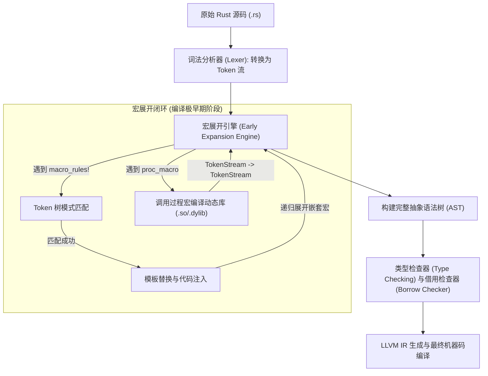
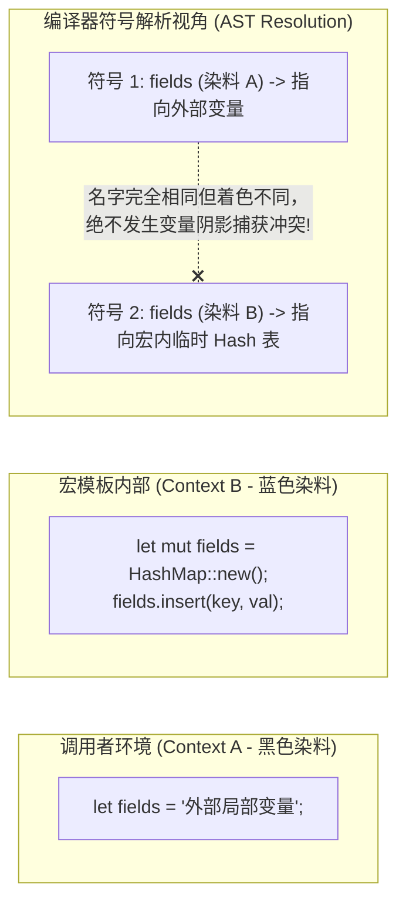

# 核心实战精炼：TokenStream 变换与编译期代码生成

## 1. 架构选型矩阵：现代 Rust 元编程方案全景决策

在现代系统级软件工程中，编写干燥（DRY - Don't Repeat Yourself）且类型安全的代码是一大核心诉求。Rust 提供了在**编译期**执行代码生成的两套强大元编程武器：**声明式宏（Declarative Macros）**与**过程宏（Procedural Macros）**，以及辅助性的构建脚本（`build.rs`）。

下表系统化对比了这三种元编程方案的核心特征与技术选型权衡：

| 评估维度 | 声明式宏 (`macro_rules!`) | 派生过程宏 (Derive Macro) | 类属性/类函数过程宏 (Attribute/Function-like) | 构建脚本 (`build.rs`) |
| :--- | :--- | :--- | :--- | :--- |
| **底层实现机制** | 基于 Token 树（Token Tree）模式匹配与模板替换的高级 DSL。 | 独立编译的宿主动态库，接收 AST `TokenStream` 并生成附加代码。 | 类似编译器插件，可彻底重写、替换或生成原目标项的 AST。 | 在宿主机器编译期执行的普通 Rust 二进制程序，输出文件或环境指令。 |
| **输入语境约束** | 必须由合法 Rust Token 或配对括号构成的片段。 | 仅依附于 `struct` / `enum` / `union` 声明。 | 可修饰任意 Rust 代码项（函数、模块、语句等），甚至任意 DSL。 | 任意外部文件（C 头文件、Protobuf 定义、SQL 文件、环境变量）。 |
| **上下文与外部 I/O** | **零外部 I/O 能力**<br/>无法访问本地文件系统或网络，纯纯函数式代码展开。 | **具备完整外部 I/O**<br/>可读取配置文件，但官方建议保持确定性。 | **具备完整外部 I/O**<br/>可连接数据库校验 SQL（如 `sqlx::query!`）。 | **具备不受限系统权限**<br/>执行系统编译链接、运行 `cmake`、生成大文件。 |
| **宏卫生性 (Hygiene)** | **内置局部变量卫生性**<br/>自动着色隔离局部变量，杜绝意外命名冲突。 | **非自动卫生（手动维护）**<br/>需显式通过 `syn::Ident::new` 结合 Span 维持卫生。 | **非自动卫生**<br/>需要开发者自行管理标识符作用域和 Span 信息。 | **完全无卫生性概念**<br/>生成的纯文本代码直接通过 `include!` 嵌入模块。 |
| **编译开销与工具链** | **极低**<br/>由编译器内部快速解释展开，无额外依赖编译。 | **较高**<br/>依赖 `syn`、`quote`、`proc-macro2`，初次编译耗时明显。 | **较高**<br/>同 Derive 过程宏，增加了宏展开与词法解析开销。 | **中等**<br/>构建脚本每次改动均会导致 crate 完全重编译。 |
| **典型工业界代表** | `vec!`, `println!`, `tokio::select!`, `matches!` | `#[derive(Serialize, Deserialize)]`, `#[derive(Debug)]` | `#[tokio::main]`, `#[actix_web::get]`, `sqlx::query!` | `bindgen` (C-ABI 绑定生成), `prost-build` (Protobuf) |

### 1.1 声明式宏匹配片段类型（Fragment Types）与跟随集限制决策表

| 片段类型 | 含义与典型匹配示例 | 语法跟随集（紧随其后允许出现的合法 Token） | 典型适用场景 |
| :--- | :--- | :--- | :--- |
| `expr` | 任意有效 Rust 表达式（如 `1 + 1`, `foo.bar()`, `"text"`） | `=>` `,` `;` | 计算求值、参数传递、断言判定 |
| `ty` | 任意有效 Rust 类型定义（如 `Vec<String>`, `&'a mut [u8]`） | `=>` `,` `;` `=` `\|` `{` `[` `:` `>` `as` `where` | 容器类型声明、类型强转、泛型实例化 |
| `ident` | 单一标识符名称（如变量名、函数名、字段名） | 任何 Token（无跟随限制） | 动态方法定义、字段映射、自动实现 Trait |
| `tt` | 单一 Token 树（单 Token 或由 `()`, `[]`, `{}` 包裹的匹配树） | 任何 Token（无跟随限制） | **构建非 Rust 语法 DSL**（如 JSON、SQL、Lisp） |
| `pat` | 模式匹配语法（如 `Some(x)`, `_`, `ref mut val`） | `=>` `,` `=` `\|` `if` `in` | 状态机解构、`match` 循环展开 |
| `path` | 路径表达式（如 `std::sync::Arc`, `crate::models::User`） | `=>` `,` `;` `=` `\|` `{` `[` `:` `>` `as` `where` | 全限定类型导入、命名空间路由 |
| `block` | 大括号代码块（如 `{ let a = 1; a }`） | 任何 Token（无跟随限制） | 作用域封装、事务包裹执行 |
| `literal` | 编译期字面量（如 `42`, `"hello"`, `0xFA`） | 任何 Token（无跟随限制） | 常量配置注入、格式化模板串 |

---

## 2. 核心原理与心智模型：宏展开生命周期与卫生性着色算法

### 2.1 宏在编译器编译管线中的拓扑定位



> **核心洞察**：
> 宏展开发生在**语法解析极早期**，甚至远远早于类型系统和生命周期检查器的运行！这意味着宏在展开时根本不知道变量的类型是什么。因此，宏无法基于“如果 `$x` 是整数则走分支 A，是字符串则走分支 B”来做模式匹配——这种类型分流必须借由 Rust 的 Trait 机制（如 `From` / `Into`）推迟到类型检查阶段进行多态分发。

### 2.2 宏卫生性（Macro Hygiene）着色模型

与 C/C++ 宏简单的纯文本暴力字符替换不同，Rust 宏具备来自 Lisp/Scheme 谱系的**语法卫生性（Hygienic Macros）**。



- **局部变量的色彩隔离**：宏内部定义的局部变量会被打上独立的语法上下文标签（Syntax Context）。即便调用方恰好拥有同名变量，两者在符号表中也拥有不同的着色，编译器绝不会将其混淆。
- **全局项的“色盲”特性**：宏卫生性仅局限于局部变量与函数参数。对于类型名（如 `HashMap`, `Box`）、Trait 方法名以及常量，编译器是“色盲”的。因此，**在宏内部引用外部类型必须使用全限定路径或 `$crate`**，否则一旦外部未引入该类型，宏就会在展开处报错。

---

## 3. 生产级实战范式与工业代码

### 3.1 工业级声明式宏：类型安全的嵌套 Config DSL

下面的范式演示了如何编写一个支持**递归解析、嵌套字典与数组、可选尾逗号、表达式内联与 `$crate` 安全导出**的现代 DSL 宏：

```rust
#[doc(hidden)]
pub mod __macro_support {
    pub use std::collections::BTreeMap;
    pub use std::string::ToString;
}

/// 生产级动态配置值强类型枚举
#[derive(Debug, Clone, PartialEq)]
pub enum ConfigValue {
    Null,
    Bool(bool),
    Number(f64),
    String(String),
    List(Vec<ConfigValue>),
    Map(std::collections::BTreeMap<String, ConfigValue>),
}

// 利用 Trait 在类型检查期完成自动转换
impl From<bool> for ConfigValue {
    fn from(b: bool) -> Self {
        ConfigValue::Bool(b)
    }
}

impl From<f64> for ConfigValue {
    fn from(n: f64) -> Self {
        ConfigValue::Number(n)
    }
}

impl From<i32> for ConfigValue {
    fn from(n: i32) -> Self {
        ConfigValue::Number(n as f64)
    }
}

impl From<&str> for ConfigValue {
    fn from(s: &str) -> Self {
        ConfigValue::String(s.to_string())
    }
}

impl From<String> for ConfigValue {
    fn from(s: String) -> Self {
        ConfigValue::String(s)
    }
}

/// 生产级配置构建宏：支持嵌套 Map、List 与表达式求值
#[macro_export]
macro_rules! config {
    // 1. 匹配空/Null
    ( null ) => {
        $crate::ConfigValue::Null
    };

    // 2. 匹配 List: [ element1, element2, ... (可选尾逗号) ]
    ([ $( $element:tt ),* $(,)? ]) => {
        $crate::ConfigValue::List(vec![
            $( $crate::config!($element) ),*
        ])
    };

    // 3. 匹配 Map: { key => value, ... (可选尾逗号) }
    ({ $( $key:expr => $val:tt ),* $(,)? }) => {
        {
            let mut map = $crate::__macro_support::BTreeMap::new();
            $(
                map.insert(
                    $crate::__macro_support::ToString::to_string(&$key),
                    $crate::config!($val),
                );
            )*
            $crate::ConfigValue::Map(map)
        }
    };

    // 4. 终结符兜底匹配：数字、布尔、字符串或任意复合表达式 (例如 (x * 2))
    ( $other:expr ) => {
        $crate::ConfigValue::from($other)
    };
}
```

### 3.2 生产级过程宏（Derive Proc-Macro）架构与实战

在复杂系统工程中，为结构体自动生成建造者（Builder）模式需要过程宏的支持。过程宏必须置于独立的专用 crate（带有 `proc-macro = true` 属性）中：

```rust
// Cargo.toml
// [lib]
// proc-macro = true
//
// [dependencies]
// syn = { version = "2.0", features = ["full", "extra-traits"] }
// quote = "1.0"
// proc-macro2 = "1.0"

use proc_macro::TokenStream;
use quote::quote;
use syn::{parse_macro_input, Data, DeriveInput, Fields, Ident};

/// 工业级 Builder 模式派生宏实现
#[proc_macro_derive(CustomBuilder)]
pub fn derive_custom_builder(input: TokenStream) -> TokenStream {
    // 1. 解析输入的语法树
    let ast = parse_macro_input!(input as DeriveInput);
    let name = &ast.ident;
    let builder_name = Ident::new(&format!("{}Builder", name), name.span());

    // 2. 仅支持结构体
    let fields = match ast.data {
        Data::Struct(ref s) => match s.fields {
            Fields::Named(ref fields) => &fields.named,
            _ => panic!("CustomBuilder 仅支持具有具名字段的结构体"),
        },
        _ => panic!("CustomBuilder 仅支持结构体"),
    };

    // 3. 为 Builder 生成 Option 包裹字段
    let builder_fields = fields.iter().map(|f| {
        let name = &f.ident;
        let ty = &f.ty;
        quote! { #name: std::option::Option<#ty> }
    });

    // 4. 生成 Builder 的 Setter 方法
    let builder_methods = fields.iter().map(|f| {
        let name = &f.ident;
        let ty = &f.ty;
        quote! {
            pub fn #name(&mut self, value: #ty) -> &mut Self {
                self.#name = std::option::Option::Some(value);
                self
            }
        }
    });

    // 5. 生成 build() 方法中的字段校验与提取
    let build_checks = fields.iter().map(|f| {
        let name = &f.ident;
        quote! {
            #name: self.#name.take().ok_or_else(|| {
                format!("字段 {} 未完成初始化设置", stringify!(#name))
            })?
        }
    });

    // 6. 展开生成代码并输出
    let expanded = quote! {
        pub struct #builder_name {
            #( #builder_fields, )*
        }

        impl #builder_name {
            #( #builder_methods )*

            pub fn build(&mut self) -> std::result::Result<#name, std::string::String> {
                std::result::Result::Ok(#name {
                    #( #build_checks, )*
                })
            }
        }

        impl #name {
            pub fn builder() -> #builder_name {
                #builder_name {
                    #( #builder_fields: std::option::Option::None, )*
                }
            }
        }
    };

    TokenStream::from(expanded)
}
```

---

## 4. 架构避坑清单 (Do's & Don'ts)

| 决策维度 | 严禁反模式 (Don'ts) | 生产推荐范式 (Do's) |
| :--- | :--- | :--- |
| **副作用重复求值** | **在宏模板中多次插值同一个表达式片段（如 `$expr`）**：调用方传入带副作用的函数（如 `vec.pop()`），导致逻辑被意外重复执行两次以上。 | **在展开代码块中仅求值一次并暂存**：通过 `let evaluated = &$expr;` 借用捕获计算结果，后续所有引用仅读取该变量。 |
| **所有权意外转移** | **在未加引用的情况下在宏内部 `let val = $expr;`**：若外部传入非 `Copy` 类型（如 `String`），宏展开会导致外部变量的所有权被悄无声息移走。 | **一律使用不可变借用捕获参数**：使用 `let val = &$expr;`，确保断言宏与辅助宏对调用方的变量所有权处于零侵入状态。 |
| **跨包导出符号迷失** | **在由 `#[macro_export]` 导出的宏内部直接书写未经限定的包内类型（如 `Json::Null`）**：下游 crate 调用该宏时报找不到类型的编译错误。 | **强制使用全限定路径与 `$crate`**：统一书写为 `$crate::Json::Null` 或 `$crate::__support::*`，确保在任何命名空间下均能自解析。 |
| **递归宏死循环** | **在递归宏中遗漏针对空参数或终结条件的精确模式分支**：引发编译期递归深度溢出错误（`recursion limit reached`）。 | **定义明确的 Base Case 分支**，并在输入存在复杂性时使用 `#![recursion_limit = "256"]` 显式设置防御边界。 |
| **过程宏侵蚀编译速度** | **滥用过程宏替代简单的模板特化，并在过程宏内部引入重型网络或磁盘 I/O**：导致 CI/CD 流水线构建耗时成倍膨胀。 | **遵循“声明式宏优先，派生宏次之，属性宏兜底”原则**；在过程宏内部坚决避免非确定性网络调用。 |

<!-- split -->

# 原著完整参考：元编程与宏体系（Chapter 22: Macros）

> “集句诗（Cento，源自拉丁语‘拼凑物’）是一种完全由引用另一位诗人的诗句拼接而成的诗篇。”
> 
> —— 马特·马登（Matt Madden）

Rust 支持**宏（Macros）**——这是一种以超越常规函数能力的方式对语言本身进行扩展的强大机制。

例如，我们在之前的章节中频繁使用过的 `assert_eq!` 宏，它在测试中表现得极为顺手：

```rust
assert_eq!(gcd(6, 10), 2);
```

这段逻辑固然也可以被编写为一个泛型函数，但 `assert_eq!` 宏能够做到常规函数根本无法企及的多项能力：其中最典型的一点是，当断言失败时，`assert_eq!` 允许用户传入额外的格式化字符串与动态参数以打印自定义的调试报错。在 Rust 中，常规函数不支持可变长参数（Variadic Arguments），而宏之所以能支持，是因为**宏的运转机理与常规函数存在本质的不同**。

宏是一种代码速记法。在编译器编译源码的极早期阶段——远在进行类型检查之前，更是远远早于生成底层机器码之前——每一个宏调用都会被**展开（Expanded）**：也就是说，宏调用会被编译器原位替换为真正的 Rust 源码。前面的断言宏展开后，大体等价于如下代码：

```rust
match (&gcd(6, 10), &2) {
    (left_val, right_val) => {
        if !(*left_val == *right_val) {
            panic!(
                "assertion `left == right` failed\
                \n  left: {left_val:?}\
                \n right: {right_val:?}",
            );
        }
    }
}
```

其中的 `panic!` 本身也是一个宏，它会进一步被递归展开为更多的底层代码。整个 crate 中所有的宏调用彻底完成平铺展开后，Rust 编译器才会继续推进到后续的类型分析与借用检查阶段。

如果你是从 C++ 转向 Rust 的开发者，你在以往的工程中可能对 C/C++ 宏有过相当不愉快的遭遇。Rust 宏采取了截然不同的技术路线，更接近于 Lisp/Scheme 语言中的 `syntax-rules` 语法。与脆弱的 C++ 宏相比，Rust 宏与语言的其他部分咬合得更加紧密，因而极不易出错：
1. **显式的感叹号标识**：宏调用始终带有一个醒目的感叹号（`!`），因此在阅读源码时一眼即明，绝不会在你想调用普通函数时意外误触宏；
2. **括号语法闭合保证**：Rust 宏绝不可能插入不对称的括号或括号不匹配的代码；
3. **内置模式匹配**：Rust 宏具备强大的模式匹配能力，使得编写既易于维护又优雅易用的宏变得轻松自如。

在本章中，我们将通过几个循序渐进的范例全面展现宏的编写艺术，并手把手带你设计一个能够直接在 Rust 程序中内嵌 JSON 数据的工业级宏。

:::en
> **Original**: Macros are a kind of shorthand. During compilation, before types are checked and long before any machine code is generated, each macro call is *expanded* — that is, it's replaced with some Rust code...
> Compared to C++ macros, Rust macros are better integrated with the rest of the language and therefore less error-prone. Macro calls are always marked with an exclamation point, so they stand out when you're reading code, and they can't be called accidentally when you meant to call a function. Rust macros never insert unmatched brackets or parentheses. And Rust macros come with pattern matching, making it easier to write macros that are both maintainable and appealing to use.

**📌 核心术语与语境解析**：
- **Macro Expansion** [ˈmækroʊ ɪkˈspænʃn]：*宏展开*。编译器编译极早期，根据模式规则将宏调用就地替换为具体语法树 AST 节点的过程。
- **Syntax Rules** [ˈsɪntæks ruːlz]：*语法规则/模式语法*。源自 Scheme 语言的高级宏概念，基于结构化代码模式匹配而非单纯字符串文本替换。
- **Variadic Arguments** [ˌveəriˈædɪk ˈɑːɡjumənts]：*可变参数*。允许接收任意数量传入参数的调用形式；Rust 函数本身不支持原生可变参数，必须依托宏来实现。
:::

---

## 1. 声明式宏基础：`macro_rules!`

图 22-1 呈现了标准库中 `assert_eq!` 宏定义的截取源码：


*图 22-1：`assert_eq!` 宏的核心结构剖析（模式 Pattern 与输出模板 Template）*

`macro_rules!` 是在 Rust 中定义声明式宏的核心语法。请注意：在宏定义的名称后并没有 `!` 号；感叹号仅在**调用**宏时才使用。

通过 `macro_rules!` 定义的宏，其运作机制完全依托于**模式匹配**。宏的主体由一系列规则分支构成：

```rust
( pattern1 ) => ( template1 );
( pattern2 ) => ( template2 );
```

调用宏时，使用圆括号、方括号或大括号在语义上是完全等价的：
- `assert_eq!(a, b);`
- `vec![1, 2, 3];`
- `macro_rules! my_macro { ... }`

按照官方编码惯例，通常对断言类调用使用圆括号，对列表集合类使用方括号，对宏定义本身使用大括号。

### 1.1 宏展开的第一步：模式匹配入参

当编译器展开 `assert_eq!(gcd(6, 10), 2)` 时，其过程类似于执行 `match` 表达式。编译器首先将调用处传入的参数与宏定义的模式进行词法匹配，如图 22-2 所示：


*图 22-2：展开宏的第一步：对参数 `$left:expr` 与 `$right:expr` 进行 Token 树模式匹配*

宏模式是 Rust 内部的一套迷你语言。它们本质上是专门用于匹配代码的“正则表达式”。但与操作字符的正则不同，宏模式操作的是 **Token（词法标记）**——数字、标识符、标点符号。因此，注释和多余的空白符根本不影响宏的匹配。

在此模式中：
- `$left:expr` 告诉编译器匹配一个有效的 Rust 表达式（即 `gcd(6, 10)`），并为其绑定变量名 `$left`；
- 随后模式中的逗号严格匹配参数间的逗号；
- `$right:expr` 匹配表达式 `2`。

### 1.2 宏展开的第二步：填入模板

当所有参数均成功匹配后，编译器进入第二步——将捕获到的代码片段填充至对应的输出模板中，如图 22-3 所示：


*图 22-3：展开宏的第二步：将匹配到的代码片段原样塞入模板*

编译器将模板中的 `$left` 与 `$right` 无缝替换为刚才捕获的具体表达式。

:::en
> **Original**: Macro patterns are a mini-language within Rust. They're essentially regular expressions for matching code. But where regular expressions operate on characters, patterns operate on *tokens* — the numbers, names, punctuation marks, and so forth that are the building blocks of Rust programs...
> Rust replaces `$left` and `$right` with the code fragments it found during matching.

**📌 核心术语与语境解析**：
- **Token** [ˈtoʊkən]：*词法记号*。编译器词法分析的最小不可分割单元（关键字、标识符、字面量、操作符）。
- **Fragment** [ˈfræɡmənt]：*语法片段*。宏模式中由 `$` 引导的捕获单元，如 `$name:expr`（表达式片段）、`$ty:ty`（类型片段）。
:::

---

## 2. 宏设计中的潜在副作用防范

将代码片段像积木一样拼装进模板，与常规按值传递的函数有着极其微妙的差异。

让我们思考两个关键问题：

**问题一：为什么 `assert_eq!` 宏必须在内部创建 `left_val` 和 `right_val` 临时变量？为什么不直接把 `$left` 和 `$right` 填入打印宏？**
```rust
// 幼稚的错误写法：
if !($left == $right) {
    panic!("assertion failed: left: {:?}, right: {:?}", $left, $right);
}
```
假设调用者传入的是 `assert_eq!(letters.pop(), Some('z'))`。如果模板中两处直接书写 `$left`，那么 `letters.pop()` 就会被**执行整整两次**！这不仅导致性能开销翻倍，更严重的是第二次调用将弹出完全不同的元素，直接诱发灾难性的逻辑 Bug！因此，**优秀的宏必须保证每个表达式参数在模板中仅被求值一次**。

**问题二：为什么宏中要借用引用 `(&$left, &$right)`，而不是直接定义 `let left_val = $left;`？**
如果直接按值赋值，当调用者将一个非 `Copy` 的类型（例如 `String`）传入断言宏时，**该变量的所有权会被宏强行移走（Move）**！调用者在断言之后再次访问该变量就会引发借用检查器报错。通过引入引用借用，宏对外部变量的存活性保持了完美的零侵入。

### 2.1 重复模式（Repetition）与 `vec!` 宏逆向

标准库的 `vec!` 宏支持多种调用方式：
- `vec![]`（空向量）
- `vec![0u8; 1000]`（定长重复）
- `vec!["udon", "ramen", "soba"]`（列表初始化）

其核心实现如下：

```rust
macro_rules! vec {
    () => {
        ::std::vec::Vec::new()
    };
    ($elem:expr ; $n:expr) => {
        ::std::vec::from_elem($elem, $n)
    };
    ( $( $x:expr ),* $(,)? ) => {
        <[_]>::into_vec(Box::new([ $( $x ),* ]))
    };
}
```

第三个分支利用了**重复语法（Repetition）**：
- `$( $x:expr ),*`：匹配由逗号分隔的 0 个或多个表达式；
- 结尾处的 `$(,)?` 优雅地容忍了合法的可选尾随逗号；
- 模板中的 `$( $x ),*` 则将匹配到的所有表达式展开，逗号排布。

---

## 3. 实战案例：从零构建 `json!` 宏

假设我们定义了一个用于表示 JSON 数据的经典枚举：

```rust
#[derive(Clone, PartialEq, Debug)]
pub enum Json {
    Null,
    Boolean(bool),
    Number(f64),
    String(String),
    Array(Vec<Json>),
    Object(Box<HashMap<String, Json>>),
}
```

手动书写该枚举极其繁琐。我们的目标是支持像写字面量一样写 JSON：

```rust
let data = json!({
    "name": "Jim Blandy",
    "class_of": 1926,
    "scores": [98.5, 100.0]
});
```

### 3.1 引入 Token Tree (`tt`) 解析非标准 Rust 语法

JSON 中的对象结构（`{"key": value}`）并不是合法的 Rust 表达式，因此使用 `$x:expr` 匹配必然失败。

为此，我们引入通用性最强的匹配器：**`tt`（Token 树）**。一个 `tt` 可以匹配由括号配对包裹的整个子树，或是任意单个非括号 Token。这使得宏能够解析任意合法的嵌套 JSON 结构！

### 3.2 递归展开与 Trait 多态分发

宏本身不具备运行时类型推断能力。对于布尔值、数字和字符串，我们通过实现 `From` Trait，将具体的类型转换推迟给 Rust 强类型编译器：

```rust
impl From<bool> for Json { fn from(b: bool) -> Self { Json::Boolean(b) } }
impl From<f64> for Json { fn from(n: f64) -> Self { Json::Number(n) } }
impl From<String> for Json { fn from(s: String) -> Self { Json::String(s) } }
impl<'a> From<&'a str> for Json { fn from(s: &'a str) -> Self { Json::String(s.to_string()) } }
```

最终宏的递归模板定义如下：

```rust
macro_rules! json {
    (null) => {
        $crate::Json::Null
    };
    ([ $( $element:tt ),* ]) => {
        $crate::Json::Array(vec![ $( $crate::json!($element) ),* ])
    };
    ({ $( $key:tt : $value:tt ),* }) => {
        {
            let mut fields = $crate::macros::Box::new($crate::macros::HashMap::new());
            $(
                fields.insert(
                    $crate::macros::ToString::to_string($key),
                    $crate::json!($value),
                );
            )*
            $crate::Json::Object(fields)
        }
    };
    ($other:tt) => {
        $crate::Json::from($other)
    };
}
```

:::en
> **Original**: Token trees are exactly what we need for our `json!` macro. Every JSON value is a single token tree: numbers, strings, Boolean values, and null are all single tokens; objects and arrays are bracketed...
> Writing complex macros always poses puzzles. It's important to remember that macros themselves are not the only puzzle-solving tool at your disposal... Fortunately, there is a standard way to convert values of various types to one specified type: the `From` trait.

**📌 核心术语与语境解析**：
- **Token Tree (`tt`)**：*标记树*。由匹配的圆括号、中括号、大括号及其内部所有嵌套 Token 构成的离散语法树单元，是构建领域特定语言（DSL）的利器。
- **Macro Recursion** [ˈmækroʊ rɪˈkɜːrʒn]：*宏递归*。宏在模板生成中重新调用自身以处理嵌套结构的机制；默认递归上限为 128 层。
:::

---

## 4. 宏的作用域、卫生性与跨包导出

### 4.1 卫生性（Hygiene）防冲突机制

如果在宏模板内部定义了临时变量 `let mut fields = ...;`，而调用宏的上下文中恰好也有一个名为 `fields` 的变量，会发生命名冲突吗？

答案是：**完全不会！**
Rust 拥有严格的**宏卫生性**。你可以想象，每次宏被展开时，宏内部定义的所有局部变量都被编译器刷上了一层独特的颜色（比如蓝色），而外部调用者的变量保持黑色。编译器在符号解析时会同时比对名称和颜色。由于颜色不同，两组变量在符号表中绝不会发生冲突。

### 4.2 跨包导出利器：`$crate`

当你在库中编写宏供其他外部 crate 调用时，外部 crate 的命名空间中可能根本没有引入你所引用的结构体或 Trait。

为此，宏模式提供了特殊的 `$crate` 语法。`$crate` 会在下游 crate 调用时，**被自动精确替换为定义该宏的那个 crate 的根模块绝对路径**。结合 `#[macro_export]` 属性，你的宏就能够无视下游环境的依赖导入差异，稳健可靠地在任何工程中正确展开。

---

## 5. 超越声明式宏：过程宏（Procedural Macros）与代码生成

虽然 `macro_rules!` 极其强大，但当我们需要直接读取物理文件、校验 SQL 语句、在编译期连接远程数据库或者为结构体自动生成实现代码时，模式匹配就力不从心了。

为此，Rust 提供了**过程宏（Procedural Macros）**：
- 它们必须被定义在拥有 `proc-macro = true` 的独立 crate 中；
- 过程宏本质上是**编译期的编译器插件函数**，函数入参为 `TokenStream`，返回值亦为 `TokenStream`；
- 分为三大流派：
  1. **自定义派生宏（Custom Derive）**：如 `#[derive(Serialize)]`；
  2. **类属性宏（Attribute-like）**：如 `#[tokio::main]`；
  3. **类函数宏（Function-like）**：如 `sqlx::query!(...)`。

配合生态中著名的 `syn`（语法树解析器）和 `quote`（代码生成器）库，系统级程序员能够将 Rust 的类型安全与元编程表达力推向极致。
