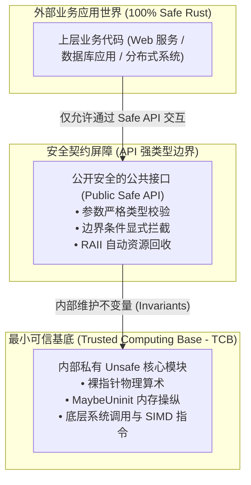

# 核心实战精炼：未定义行为边界与安全抽象契约

## 1. 架构选型矩阵：安全边界与 Unsafe 契约工程决策

系统级编程的魅力在于：在所有优雅的类型系统与高级抽象之下，底层硬件永远是一片由寄存器、物理内存页和裸字节流构成的狂暴旋涡。Rust 并不是要将开发者与底层硬件隔绝，而是提供了一套明确的机制——**Unsafe Rust**，允许开发者在清晰标记的边界内直面硬件。

下表系统对比了 Safe Rust 与 Unsafe Rust 在编译器保证维度的异同：

| 编译器检查与安全保障项 | Safe Rust 行为模式 | Unsafe Rust 行为模式 | 开发者承担的核心责任 |
| :--- | :--- | :--- | :--- |
| **类型检查 (Type Checking)** | **严格强制执行** | **严格强制执行**（绝不妥协） | 遵循类型契约，禁止通过裸指针滥用非法位模式假冒类型。 |
| **生命周期与借用检查** | **严格静态证明** | **对 Safe 引用依然生效** | 裸指针不受生命周期约束，开发者必须自行证明指针所指对象依然存活。 |
| **数组索引边界检查** | **强制边界验证**（越界 Panic） | **Safe 切片访问依然检查** | 若使用裸指针偏移或 `get_unchecked`，开发者必须证明偏移量在容量之内。 |
| **解引用裸指针 (`*ptr`)** | **编译期严厉禁止** | **允许解引用** | 证明指针非空（Non-null）、按类型自然对齐（Aligned）、已正确初始化。 |
| **调用 `unsafe fn`** | **编译期严厉禁止** | **允许显式调用** | 必须全盘阅读并严格遵守被调用函数文档中规定的**调用契约（Preconditions）**。 |
| **实现 `unsafe trait`** | **禁止手动不安全实现** | **允许显式 `unsafe impl`** | 保证实现满足该 Trait 的全局不变性（例如证明自身完全线程安全才能 `impl Send`）。 |
| **访问/修改 `static mut`** | **编译期严厉禁止** | **允许显式读写** | 开发者必须自行通过互斥原语或原子操作保证多线程访问无数据竞争。 |
| **访问 `union` 联合体字段** | **编译期严厉禁止** | **允许显式读取字段** | 开发者必须自行记录当前激活的变体，杜绝非法类型字节误读。 |

### 1.1 底层内存移动与拷贝原语决策表

在手动管理未初始化内存或构建自定义集合时，选择正确的内存移动原语是杜绝未定义行为（UB）的关键：

| 原语函数 | 签名机理 | 内存重叠安全性 | 析构行为 (Drop) | 生产推荐场景 |
| :--- | :--- | :--- | :--- | :--- |
| `std::ptr::read(src)` | 从 `*const T` 复制出值 `T` | 不适用 | **不触发**源内存析构 | 从未受管内存或临时缓冲区中转移出元素所有权。 |
| `std::ptr::write(dst, val)` | 将 `val` 写入 `*mut T` | 不适用 | **不析构**目标内存旧数据 | 向未初始化的物理堆/栈内存槽位中写入全新值。 |
| `std::ptr::copy(src, dst, count)` | 复制 `count * size_of::<T>()` 字节 | **完全安全**（底层类似 `memmove`） | **纯位复制**，不调用任何 Drop | 缓冲区内部存在重叠的数据块搬移（如插入字符滑动间隙）。 |
| `std::ptr::copy_nonoverlapping` | 复制连续字节流 | **严禁重叠**（底层类似 `memcpy`） | **纯位复制**，不调用任何 Drop | 两个完全分离的独立内存块之间极速批量传输。 |
| `std::mem::replace(dest, src)` | 互换并返回旧值 | 必须为有效引用 | 正常析构外部接收的旧值 | 在拥有 `&mut T` 时偷出所有权并塞入替代值。 |
| `std::mem::MaybeUninit<T>` | 包装器类型 | 告知编译器内存未初始化 | 仅当调用 `.assume_init()` 时才受管 | 替代已废弃的 `mem::uninitialized()`，构造未初始化的连续缓冲。 |

---

## 2. 核心原理与心智模型：最小可信基底 (TCB) 与内存对齐

### 2.1 最小可信基底（TCB）与安全封装边界拓扑

在 Rust 哲学中，Unsafe 不是代码坏味道，而是**安全抽象的基石**。标准库中的 `Vec`、`Arc`、`String` 底层无一例外都包含 Unsafe 代码。



> **安全封装黄金律**：
> 一个设计优良的系统模块，其 `unsafe` 代码块的规模应当被严格收敛至最小可信基底（TCB）之内。**外部调用者无论传入什么样的合法参数、触发何种边界条件，都绝不可能从 Safe API 穿透引发底层的未定义行为（UB）**。

### 2.2 裸指针打标（Pointer Tagging）与内存对齐原理

在 64 位体系结构中，指针的大小为 8 字节。大多数复合结构体在内存中按其内部最大字段对齐（例如 8 字节对齐）。这意味着其有效物理内存地址的十六进制数值**末尾 3 位二进制必定恒为 0**（地址均为 8 的倍数）：

```text
对齐地址示例: 0x7FFF_FFFF_F010 -> 二进制末 3 位: ...000
对齐地址示例: 0x7FFF_FFFF_F018 -> 二进制末 3 位: ...000
```

这空闲的低 3 位可以被用来存储至多 $2^3 = 8$ 种布尔标志位或小型枚举状态，从而将指针和状态压缩在单一机器字长（8 字节）中，实现极致缓存友好。

---

## 3. 生产级实战范式与工业代码

### 3.1 零内存开销的指针打标器：`TaggedPointer<T>`

以下工业级实现展示了如何利用裸指针算术与位操作，在单一裸指针内紧凑存储一个引用与两个布尔标志位，同时对外提供 100% 安全的生命周期借用接口：

```rust
use std::marker::PhantomData;
use std::mem::align_of;
use std::ptr::NonNull;

/// 紧凑型指针打标器：利用低 2 位存储标志位，零额外内存开销
pub struct TaggedPointer<'a, T> {
    // 采用 NonNull 获得空指针优化（Option<TaggedPointer> 大小仍为 8 字节）
    tagged_ptr: NonNull<T>,
    // 维护与目标对象相绑定的编译期生命周期契约
    _marker: PhantomData<&'a T>,
}

impl<'a, T> TaggedPointer<'a, T> {
    const TAG_MASK: usize = 0b11; // 仅使用低 2 位
    const PTR_MASK: usize = !Self::TAG_MASK;

    /// 构造安全的打标指针：动态静态双重断言对齐边界
    pub fn new(reference: &'a T, tag: u8) -> Self {
        // 静态断言：目标类型对齐量必须 >= 4 字节
        assert!(
            align_of::<T>() >= 4,
            "类型对齐量不足，无法利用低 2 位存储 Tag"
        );
        assert!(tag <= 0b11, "Tag 数值超出 2 位二进制上限 (0~3)");

        let raw = reference as *const T as usize;
        assert_eq!(raw & Self::TAG_MASK, 0, "物理指针未按预期对齐");

        let combined = raw | (tag as usize);
        let non_null = unsafe { NonNull::new_unchecked(combined as *mut T) };

        Self {
            tagged_ptr: non_null,
            _marker: PhantomData,
        }
    }

    /// 获取底层不可变引用：清除低位打标后解引用
    pub fn get_ref(&self) -> &'a T {
        let clean_ptr = (self.tagged_ptr.as_ptr() as usize & Self::PTR_MASK) as *const T;
        // 安全证明：构造时由 &'a T 保证了指针非空、对齐且在 'a 生命周期内绝对存活
        unsafe { &*clean_ptr }
    }

    /// 读取打标标志位数值
    pub fn get_tag(&self) -> u8 {
        (self.tagged_ptr.as_ptr() as usize & Self::TAG_MASK) as u8
    }
}
```

### 3.2 生产级高性能动态间隙缓冲区：`GapBuffer<T>`

文本编辑器的核心数据结构是**间隙缓冲区（GapBuffer）**。它在文本光标处维护一段未初始化的“间隙”。当用户连续输入字符时，直接写入间隙而无需反复挪动整个数组；光标移动时只需将间隙两侧的数据进行块滑动（`ptr::copy`）：

```rust
use std::fmt;
use std::mem::MaybeUninit;
use std::ptr;

/// 生产级高性能间隙缓冲区：常用于文本编辑器与动态切片操作
pub struct GapBuffer<T> {
    // 存储未初始化内存块的物理堆指针
    storage: Box<[MaybeUninit<T>]>,
    // 间隙开始索引
    gap_start: usize,
    // 间隙结束索引（开区间）
    gap_end: usize,
}

impl<T> GapBuffer<T> {
    pub fn with_capacity(capacity: usize) -> Self {
        assert!(capacity > 0, "容量必须大于 0");
        let storage = Box::new_uninit_slice(capacity);
        Self {
            storage,
            gap_start: 0,
            gap_end: capacity,
        }
    }

    /// 获取当前有效元素总数
    pub fn len(&self) -> usize {
        self.storage.len() - (self.gap_end - self.gap_start)
    }

    /// 当前光标位置
    pub fn position(&self) -> usize {
        self.gap_start
    }

    /// 移动光标位置：滑动物理间隙
    pub fn set_position(&mut self, pos: usize) {
        assert!(pos <= self.len(), "光标位置越界");

        let base = self.storage.as_mut_ptr() as *mut T;

        if pos < self.gap_start {
            // 光标左移：将 [pos, gap_start) 的数据块向右移动至 gap_end 左侧
            let count = self.gap_start - pos;
            let src = unsafe { base.add(pos) };
            let dst = unsafe { base.add(self.gap_end - count) };
            unsafe {
                ptr::copy(src, dst, count);
            }
            self.gap_start -= count;
            self.gap_end -= count;
        } else if pos > self.gap_start {
            // 光标右移：将 [gap_end, gap_end + count) 的数据块向左移动至 gap_start 处
            let count = pos - self.gap_start;
            let src = unsafe { base.add(self.gap_end) };
            let dst = unsafe { base.add(self.gap_start) };
            unsafe {
                ptr::copy(src, dst, count);
            }
            self.gap_start += count;
            self.gap_end += count;
        }
    }

    /// 在当前光标处高效插入元素
    pub fn insert(&mut self, item: T) {
        if self.gap_start == self.gap_end {
            self.enlarge_gap();
        }

        unsafe {
            let p = (self.storage.as_mut_ptr() as *mut T).add(self.gap_start);
            // 写入未初始化内存必须使用 ptr::write，避免触发旧内存析构
            ptr::write(p, item);
        }
        self.gap_start += 1;
    }

    /// 扩容间隙
    fn enlarge_gap(&mut self) {
        let old_cap = self.storage.len();
        let new_cap = old_cap * 2;
        let mut new_storage = Box::new_uninit_slice(new_cap);

        let old_base = self.storage.as_mut_ptr() as *mut T;
        let new_base = new_storage.as_mut_ptr() as *mut T;

        unsafe {
            // 复制间隙左半部分
            ptr::copy_nonoverlapping(old_base, new_base, self.gap_start);
            // 复制间隙右半部分到新内存末尾
            let right_count = old_cap - self.gap_end;
            let new_gap_end = new_cap - right_count;
            ptr::copy_nonoverlapping(
                old_base.add(self.gap_end),
                new_base.add(new_gap_end),
                right_count,
            );

            self.gap_end = new_gap_end;
            self.storage = new_storage;
        }
    }
}

// 确保在 Drop 时正确调用所有有效元素的析构函数，杜绝内存泄漏
impl<T> Drop for GapBuffer<T> {
    fn drop(&mut self) {
        let base = self.storage.as_mut_ptr() as *mut T;
        unsafe {
            // 析构间隙左侧所有有效元素
            for i in 0..self.gap_start {
                ptr::drop_in_place(base.add(i));
            }
            // 析构间隙右侧所有有效元素
            for i in self.gap_end..self.storage.len() {
                ptr::drop_in_place(base.add(i));
            }
        }
    }
}
```

---

## 4. 架构避坑清单 (Do's & Don'ts)

| 决策维度 | 严禁反模式 (Don'ts) | 生产推荐范式 (Do's) |
| :--- | :--- | :--- |
| **未初始化内存构造** | **使用已彻底废弃的 `std::mem::uninitialized()`**：直接产生无效位模式（如布尔值包含除 0/1 外的字节），触发即刻未定义行为。 | **强制使用 `std::mem::MaybeUninit<T>`**：向编译器显式声明该槽位可能未初始化，唯有写入完成后方可调用 `.assume_init()`。 |
| **裸指针地址计算** | **通过普通借用转换为裸指针后再做越界算术**：`(&array[0] as *const T).add(offset)` 若越界直接破坏编译期无别名假设。 | **统一使用现代裸引用操作符**：使用 `&raw const` / `&raw mut` 或 `std::ptr::addr_of!`，从源头避免构造悬垂合法引用。 |
| **未对齐内存解引用** | **将未对齐的字节数组直接强转为结构体引用 `&*(bytes.as_ptr() as *const MyStruct)`**：在 ARM/RISC-V 架构下引发硬件 Bus Error 崩溃。 | **使用 `std::ptr::read_unaligned`**：或通过 `#[repr(packed)]` 明确声明紧凑排布，确保在任何目标芯片上均安全解码。 |
| **内存重叠复制混淆** | **在同一内存块内部滑动切片时调用 `copy_nonoverlapping` (memcpy)**：硬件重叠拷贝导致数据源被前序字节破坏覆盖。 | **凡涉及同一连续缓冲区内部位移，坚决使用 `std::ptr::copy` (memmove)**；唯有来源与目标绝对分离时才用 nonoverlapping。 |
| **Panic 异常安全盲区** | **在未初始化内存被填满前，调用的代码中途发生 Panic 导致栈展开**：Drop 析构器试图释放垃圾地址指针，造成二次崩溃。 | **维护严格的计数器状态**，或使用 Guard 模式在 Panic 时仅回收已明确初始化的前驱部分。 |

<!-- split -->

# 原著完整参考：Unsafe Rust 与底层契约（Chapter 23: Unsafe Code）

> “愿无人视我为卑微、懦弱或顺从；  
> 愿世人明晓我乃另类灵魂：  
> 于敌凶险凌厉，于友忠贞不渝。  
> 荣耀唯属于此等生灵。”
> 
> —— 欧里庇得斯，《美狄亚》（Medea）

系统级编程那隐秘而纯粹的快感在于：**在每一个自诩绝对安全的编程语言与精心构建的高级抽象地基之下，都潜伏着由裸机机器指令与微观位操作交织构成的狂暴旋涡**。

在 Rust 中，你同样有权书写这片旋涡。

本书行文至此所呈现的 Rust 语言特性，通过类型系统、静态生命周期标注和数组边界检查，全自动地为你的程序筑起了一道免于内存损坏与数据竞争的铜墙铁壁。然而，这种自动化推导机制终究有其理论边界——存在着大量在现实工程中极具价值、且在底层绝对健壮的技术技巧，是编译器无论如何也无法自动证明其安全性的。

**Unsafe 代码（Unsafe Code）**允许你向 Rust 编译器发出郑重声明：“我在此选择使用你无法自动保证其安全性的高级特权。”

通过将一段代码标记为 `unsafe` 代码块，你解锁了一套全新的底层能力：调用标准库中的 `unsafe` 函数、解引用裸指针（Raw Pointers）、以及调用由 C 或 C++ 等外部语言编写的函数。值得反复强调的是：**Rust 的其他常规安全检查在此处依然毫厘不爽地生效**——类型检查照常运行、生命周期约束毫不松懈、数组下标索引仍然受到边界检查的严密保护。Unsafe 代码仅仅是对一小撮受控的特权特性开放了绿灯。

正是这种跳出 Safe Rust 绝对边界的工程能力，使得 Rust 能够**完全使用 Rust 语言自身来实现其最为基础的核心基础设施**——正如 C 和 C++ 被用来构建它们自己的标准库一样。正是 Unsafe 代码赋予了 `Vec` 极致高效管理底层物理内存缓冲区的能力；让 `std::io` 能够与底层操作系统内核畅通无阻地对话；并使得 `std::thread` 和 `std::sync` 模块得以孕育出坚不可摧的多线程并发同步原语。

在本章中，我们将系统探讨驾驭 Unsafe 特性的关键法则：
1. **知情权衡**：当你确信某些一致性或边界检查对性能构成严重损耗且毫无必要时，通过调用 `from_utf8_unchecked` 等不安全函数主动跳过检查；
2. **绕开类型系统**：执行底层字节重解释，如将 `&[u8]` 切片就地投影为 `&[u32]`；
3. **自研内存管理与并发原语**：不依赖标准库，亲手编写属于你自己的 `Vec` 或 `Arc` 容器；
4. **操控 CPU 硬件指令**：调用特定芯片架构的向量化 SIMD 指令与编译器内置函数（Intrinsics）；
5. **安全封装之道**：将 Unsafe 代码精密包裹在 100% 具备防呆保障的 Safe API 内部，确保终端使用者——以及未来的你自己——能够在高枕无忧的前提下享受极致性能的果实。

:::en
> **Original**: The secret joy of systems programming is that underneath every single safe language and carefully designed abstraction is a swirling maelstrom of wildly unsafe machine language and bit fiddling. You can write that in Rust, too...
> Unsafe code lets you tell Rust, "I am opting to use features whose safety you cannot guarantee." By marking off a block of code as unsafe, you acquire the ability to call `unsafe` functions in the standard library, dereference raw pointers, and call functions written in other languages like C and C++, among other powers. Rust's other safety checks still apply: type checks, lifetime checks, and bounds checks on indices all occur normally.

**📌 核心术语与语境解析**：
- **Unsafe Code** [ʌnˈseɪf koʊd]：*非安全代码*。并非指代码注定存在安全漏洞，而是指其正确性无法由 rustc 静态证明，责任完全移交由程序员自负。
- **Swirling Maelstrom** [ˈswɜːrlɪŋ ˈmeɪlstrəm]：*狂暴的漩涡*。系统底层物理内存与 CPU 寄存器由于缺乏硬件级类型概念，属于纯粹的裸二进制字节映射。
- **Trusted Computing Base (TCB)**：*可信计算基*。系统级工程中需要被高度审查的最小 Unsafe 核心集，外部所有安全保证均依赖于该基底的无瑕疵。
:::

---

## 1. 摆脱安全的代价：未定义行为与契约

在本专栏的第一篇中，我们展示了一段仅仅因为一次数组越界写入、便导致程序诡异打印出系统私密密码文件报错并段错误的 C 程序。在 Rust 中，我们同样可以复刻出这样一段诡异的代码：

```rust
fn main() {
    let mut a: usize = 0;
    // 使用现代 Rust 的裸引用操作符 &raw mut 获取裸指针
    let ptr = &raw mut a;
    unsafe {
        *ptr.add(4) = 0x7ffff7d48a38;
    }
}
```

运行这段代码，会在终端输出近乎一致的诡异崩溃：

```console
$ cargo run
crash: Error: .netrc file is readable by others.
Segmentation fault (core dumped)
```

这段程序使用 `&raw mut a` 获取了局部变量 `a` 的 `*mut usize` 裸指针，并通过 `.add(4)` 方法使指针在物理内存上向高地址越界前进了 4 个字长——这恰好是调用栈上保存函数返回地址（Saved RIP）的物理位置。程序用一个魔数硬生生覆写了返回地址，从而在 `main` 函数返回时引发了灾难。

使这场崩溃成为可能的原因，正是程序对 Unsafe 特性的错误使用——具体来说，就是**对裸指针进行了非法的解引用**。

一项 Unsafe 特性必然伴随着一项**契约（Contract）**：这是一组 Rust 编译器无法自动验证、但你必须自行恪守以杜绝**未定义行为（Undefined Behavior, UB）**的铁律。

例如，裸指针的契约严厉禁止你解引用一个已经漂移超出其原始被引用对象物理边界的指针。上述代码践踏了该契约。然而正如输出所示，Rust 编译器在编译期对这段代码没有提出任何异议。当你敲下 `unsafe` 关键字时，你便独自背负起了确保代码严格遵守调用契约的全部重担。

未定义行为并不只是意味着段错误崩溃；更可怕的是，**一旦发生 UB，你与编译器之间立下的所有契约便彻底撕毁，编译器被赋予了做任何极端假设的自由**。现代编译器优化器可能会直接将自认为不可能执行的代码分支整块裁剪（Dead Code Elimination），或者在黑客手中将系统的完全控制权拱手相让。

:::en
> **Original**: An unsafe feature is one that imposes a *contract*: rules that Rust cannot enforce automatically, but which you must nonetheless follow to avoid *undefined behavior*.
> When you invoke undefined behavior, you have broken your half of your bargain with Rust, and Rust declines to predict the consequences. Dredging up irrelevant error messages from the depths of system libraries and crashing is one possible consequence; handing control of your computer over to an attacker is another.

**📌 核心术语与语境解析**：
- **Contract** [ˈkɑːntrækt]：*契约 / 前置条件*。使用 Unsafe 特性时程序员必须自行保证的数学不变量（如指针非空、对齐、生命周期有效）。
- **Undefined Behavior (UB)** [ˌʌndɪˈfaɪnd bɪˈheɪvjə]：*未定义行为*。语言规范对其执行后果不作任何承诺的状态；LLVM 可基于“无 UB”假设进行摧毁性优化重排。
:::

---

## 2. `unsafe` 块与五大特权

`unsafe` 块看起来就像普通的 Rust 大括号代码块，前缀以 `unsafe` 关键字。

它向你开放了且仅开放了以下五项超能力：
1. **调用 `unsafe` 函数**；
2. **解引用裸指针**；
3. **访问 `union` 联合体的字段**；
4. **读写可变静态全局变量 (`static mut`)**；
5. **访问外部跨语言链接声明的函数或全局变量（FFI）**。

将 Unsafe 限制在显式标记的块中，其最大工程价值在于**吸引代码审查者的焦点**。任何涉及 `unsafe` 的 PR 都应该受到安全团队最高级别的重点审查，并由自动化审计工具（如 Miri）进行全量内存探测。

### 2.1 实战案例：极致高效的 ASCII 字符串类型 `Ascii`

为了展示如何用 Unsafe 构建坚不可摧的安全抽象，原著给出了一个精妙的 `Ascii` 类型设计：

```rust
mod my_ascii {
    #[derive(Debug, Eq, PartialEq)]
    pub struct Ascii(Vec<u8>);

    impl Ascii {
        pub fn from_bytes(bytes: Vec<u8>) -> Result<Ascii, NotAsciiError> {
            if bytes.iter().any(|&byte| !byte.is_ascii()) {
                return Err(NotAsciiError(bytes));
            }
            Ok(Ascii(bytes))
        }

        // 零成本转换为标准 String：耗时 0 纳秒！
        pub fn into_string(self) -> String {
            // 安全证明：由于 self.0 在构造时已严格校验每一个字节均为合法 ASCII (<= 0x7F)，
            // 而所有合法的 ASCII 字节在 UTF-8 编码下均为绝对合法的单字节 UTF-8 字符序列，
            // 因此此处跳过 UTF-8 校验是 100% 健全的！
            unsafe {
                String::from_utf8_unchecked(self.0)
            }
        }
    }
}
```

通过这一设计，外部用户无论怎么调用 `Ascii`，都不可能制造出非法的 UTF-8 字符串；而在需要转为 `String` 时，又完全免去了对几百兆字节文本做全量重新扫描的沉重开销——这正是系统级工程安全与性能兼得的典范！

---

## 3. 裸指针（Raw Pointers）与指针算术

在 Rust 中，裸指针包含两种形态：`*const T`（不可变裸指针）与 `*mut T`（可变裸指针）。

它们与普通引用 `&T` 和 `&mut T` 的根本区别在于：
- 裸指针**可能为 null**；
- 裸指针**不受任何生命周期约束**，所指内存可能已遭释放；
- 多个裸指针**可以同时拥有读写别名（Aliasing）**，借用检查器对此完全放行；
- 裸指针**不一定按类型尺寸自然对齐**。

创建裸指针是绝对安全的（Safe Rust），但**唯有对其执行解引用（`*ptr`）才属于 Unsafe**。

### 3.1 内存中的数组排布与指针加法

图 23-1 展示了在内存中包含 4 个 `i32` 元素的数组排布：


*图 23-1：内存中的数组：每个 `i32` 元素占 4 字节，`array[3]` 的物理偏移量为 12 字节*

当调用 `ptr.add(3)` 时，Rust 编译器会根据类型 `T` 的尺寸（此处为 4 字节），自动将偏移量乘以 `size_of::<T>()`。因此指针在物理内存地址上实际前进了 12 个字节。

---

## 4. 内存的深层移动：从 `ptr::read` 到 `MaybeUninit`

在 Rust 的常规所有权体系中，变量的移动是在栈帧间发生的，如图 23-2 所示：


*图 23-2：将一个 `String` 变量从 `pot` 移动到 `plate`：`pot` 依然残留指针和容量数值，但在逻辑上已被标记为失效*

然而，当我们要自己实现一个类似 `Vec` 的动态数组时，我们申请了一块物理堆内存，但此时内部并没有有效的数据，如图 23-3 所示：


*图 23-3：一个持有一个元素、预留有一个空闲容量的向量与未初始化变量 `last`*

当我们在向量末尾推入一个新元素时（图 23-4），我们**绝不能调用普通的赋值操作符 `*ptr = soba`**！因为普通赋值会试图对该物理地址上原先存在的“旧数据”调用 `drop()` 析构函数，而该内存此时全是未初始化的垃圾字节，强行 drop 将立刻引发段错误！


*图 23-4：将 `soba` 推入向量的空闲预留槽位*

正确的方式是使用 **`std::ptr::write(ptr, value)`**——它纯粹将数据按位写入目标地址，坚决不触发旧数据的析构。

同理，当我们从向量中弹出一个元素时（图 23-5），我们使用 **`std::ptr::read(ptr)`** 将数据的所有权无声无息地搬移出来，而不损坏向量中残留的原有字节。


*图 23-5：从向量中将末尾元素弹出并转移至变量 `last`*

在现代 Rust 中，所有用于容纳未初始化数据的连续缓冲区，必须统一使用 **`std::mem::MaybeUninit<T>`** 进行包裹建模，以告知编译器此段内存属于未就绪状态。

---

## 5. 综合实战：间隙缓冲区（GapBuffer）架构

在像 Emacs 这样的文本编辑器中，用户在光标处的打字输入是高频事件。如果采用普通 `Vec<char>`，每次在文本中段插入一个字，都需要将后续数十万个字符向后搬移数兆字节。

**间隙缓冲区（GapBuffer）**是解决该性能瓶颈的终极经典结构。它在当前光标处维持一段预留的“空隙”，如图 23-6 所示：


*图 23-6：存储了文本 "Lord of the Rings" 的间隙缓冲区，中间维护了 11 个字符的未初始化间隙*

当用户在光标处输入新文字（例如插入 "Onion "）时，新字符直接连续填充进间隙，无需移动任何现有文本！间隙尺寸随之缩小，如图 23-7 所示：


*图 23-7：插入 "Onion " 后的状态：字符被直接写入间隙，间隙被压缩至 5 个字符*

当光标在文本中左右移动时，只需使用 `std::ptr::copy`（安全重叠拷贝）将跨越光标的字符从一端复制到另一端，滑动间隙位置。通过这种方式，在光标处的连续输入操作耗时被彻底降低至极其惊人的 $O(1)$！

结合正确的 `Drop` 析构实现与 Panic 安全屏障，我们便在 Unsafe 的狂暴旋涡之上，铸就了一座既拥有裸机极致性能、又对外提供 100% 内存安全承诺的现代化系统级工程丰碑！
