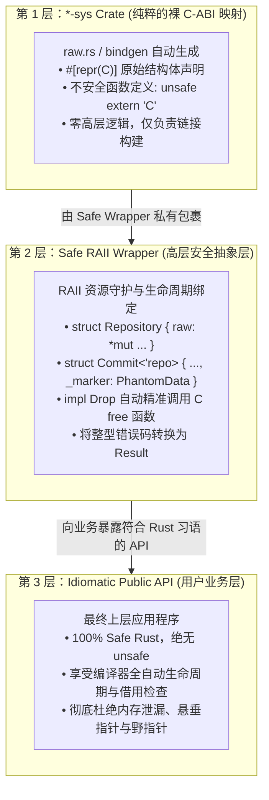
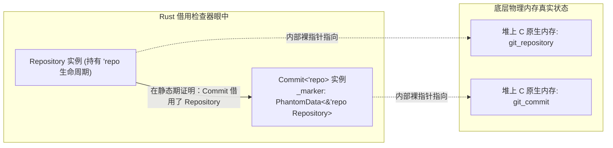

> 💡 **双栏独立滚动工作台导读**：本文采用双栏对照架构。**左栏**为跨语言 FFI 技术选型矩阵、三层绑定分层架构、C-ABI 内存排布与生命周期绑架（Lifetime Bonding）拓扑、双向 FFI 生产代码范式与避坑清单；**右栏**为原著完整精译参考（Chapter 24: Foreign Functions），详述 libgit2 裸接口与安全封装全流程、原著关键段落英文对照及跨语言底层术语解析。左右两栏支持独立滚动与宽度比例自由调节。

# 核心实战精炼：C-ABI 兼容性与高层安全抽象架构

## 1. 架构选型矩阵：现代跨语言互操作技术全景

在系统级工程实战中，任何新兴语言都无法脱离遗留工业生态孤立存在。几乎所有主流操作系统的内核 API、图形驱动、底层加密库（OpenSSL）以及海量经典工业基础设施（如 SQLite、libgit2）均以 C 语言接口的形式对外暴露。

下表系统对比了现代 Rust 跨语言交互的几种主流技术方案：

| 交互方案 | 核心技术载体 | 性能开销 | 跨语言类型映射深度 | 适用工程场景 | 典型生态库 |
| :--- | :--- | :--- | :--- | :--- | :--- |
| **原生 C-ABI (Rust FFI)** | `extern "C"`, `#[repr(C)]`, 动态/静态链接 | **零成本**（单条 CPU `call` 指令跳转） | 原生支持 C 标量、裸指针、C 结构体与函数指针 | 链接底层 OS 系统库、C/C++ 高性能中间件 | `libc`, `bindgen`, `cc` |
| **C++ 深度桥接** | `cxx`  crate, Clang AST 分析 | 极低（直接内联 C++ 头文件与模板） | 自动在 C++ 与 Rust 的原生类型（`std::string`, `rust::Str`）间安全转换 | 嵌入大型 C++ 引擎（Chromium、LLVM、游戏物理引擎） | `cxx`, `autocxx` |
| **Python 原生扩展** | Python C-API, GIL 锁管理 | 极低（避免了 RPC 进程间通信） | 依托 PyO3 在 Rust 类型与 Python 对象间零拷贝/浅拷贝互通 | 机器学习高性能算子、AI 管道加速、数据分析库 | `PyO3`, `maturin` |
| **Node.js 运行时扩展** | Node-API (N-API), V8 隔离 | 极低（跨线程异步 Worker 调度） | 映射 JS 对象、Buffer、Promise 与 Rust 异步 Future | 高并发 Node.js 后台 CPU 密集型模块重写 | `napi-rs`, `neon` |
| **WebAssembly 互操作** | WASM 线性内存, JS 胶水代码 | 极低（基于 SharedArrayBuffer 传输） | 通过 `wasm-bindgen` 桥接 DOM API 与复杂数据结构 | 浏览器端高性能渲染、边缘计算运行时（Cloudflare Workers） | `wasm-bindgen` |

### 1.1 跨语言边界数据类型与字符串转换决策表

| Rust 类型 | 对应 C-ABI 类型 | 内存布局与终结符特征 | 转换成本与生命周期风险 | 生产推荐场景 |
| :--- | :--- | :--- | :--- | :--- |
| `i8 / u8 / i32 / i64` | `int8_t / uint8_t / int / int64_t` | 二进制完全同构 | **零开销**，按值传递 | 基础标量参数、状态码、错误码 |
| `usize / isize` | `size_t / ptrdiff_t` | 取决于目标 CPU 架构字长（32/64 位） | **零开销**，严格对齐 | 数组长度、内存偏移量 |
| `#[repr(C)] struct` | C `struct` | 严格遵从 C 语言内存布局与对齐填充 | **零开销**，字段顺序不被 Rust 编译器重排 | 跨语言元数据传递、配置结构体 |
| `&CStr` | `const char*` | 物理内存末尾必须包含 `\0` 字节 | **零开销**，借用现有已对齐且带 `\0` 的内存 | 接收来自 C 语言返回的只读字符串 |
| `CString` | `char*` (拥有所有权) | 堆上分配连续字节流，自动追加 `\0` | **需单次堆分配**，若内容包含内部 `\0` 则报错 | 向 C 接口传递动态构造的文本字符串 |
| `c"hello"` (C 字符串字面量) | `&'static CStr` | 编译期直接在静态只读段内嵌 `\0` | **绝对零开销**，无需任何运行时分配 | 传递硬编码的 C 函数参数或标志名 |
| `Option<extern "C" fn(...)>` | C 函数指针 | 空指针优化（`None` 映射为 `NULL`） | **零开销**，原生寄存器传递 | 跨语言回调函数（Callbacks）注册 |

---

## 2. 核心原理与心智模型：C-ABI 兼容性与生命周期绑架 (Lifetime Bonding)

### 2.1 工业级安全 FFI 封装三层架构拓扑

在生产级 Rust 工程中，直接在业务代码中散落 `unsafe extern "C"` 是严重的架构反模式。工业界严格遵从**三层隔离架构**：



### 2.2 利用 `PhantomData` 实现跨语言生命周期绑架（Lifetime Bonding）

在 C 语言中，指针的从属关系只写在开发者的文档中。例如：
`git_commit_lookup` 返回的 `git_commit*` 指针，其内部深深依赖于初始的 `git_repository*`。一旦外部开发者提前调用 `git_repository_free(repo)`，后续对 `git_commit` 的任何操作都将成为经典的 Use-After-Free 悬垂指针灾难。

Rust 通过 `PhantomData` 创造性地解决了这一世纪难题：



代码中虽然只有一个裸指针 `*mut raw::git_commit`，但加上了 `_marker: PhantomData<&'repo Repository>` 后，**Rust 编译器会断定：`Commit` 在整个生命周期内对 `Repository` 持有不可变借用！**
如果你试图在 `Commit` 尚未 drop 前销毁或移动 `Repository`，编译器会直接无情地报出生命周期借用冲突，在**编译期物理掐灭了 C 库底层悬垂指针的产生**！

---

## 3. 生产级实战范式与工业代码

### 3.1 工业级双向 FFI：Rust 导出共享库供 C/C++ 安全调用

除了在 Rust 中调用 C，系统工程师经常需要使用 Rust 编写高性能底层模块，并将其打包为 `.so` 或 `.dll` 供 C/C++ 或 Go/Python 调用。

以下生产级范式演示了如何规范实现：**C-ABI 函数导出、阻止跨语言 Panic 崩溃、以及跨语言堆内存所有权安全交换**：

```rust
use std::ffi::{c_char, c_int, CStr, CString};
use std::panic::catch_unwind;
use std::ptr;

/// 内部业务状态机
pub struct CalculationEngine {
    base_factor: f64,
    history: Vec<f64>,
}

/// 1. 构造实例：向 C 侧返回不透明裸指针 (Opaque Pointer)
#[no_mangle]
pub unsafe extern "C" fn engine_new(factor: f64) -> *mut CalculationEngine {
    // 拦截任何潜在 Panic，严防跨语言栈展开导致崩溃
    let result = catch_unwind(|| {
        let engine = Box::new(CalculationEngine {
            base_factor: factor,
            history: Vec::new(),
        });
        // 放弃 Box 管理权，将其转化为裸指针转移给 C
        Box::into_raw(engine)
    });

    result.unwrap_or(ptr::null_mut())
}

/// 2. 业务调用：接收 C 传入的不透明指针并操作
#[no_mangle]
pub unsafe extern "C" fn engine_compute(
    engine: *mut CalculationEngine,
    input: f64,
    out_result: *mut f64,
) -> c_int {
    let result = catch_unwind(|| {
        if engine.is_null() || out_result.is_null() {
            return -1; // 错误：空指针
        }

        // 将裸指针暂时借用为 Rust 引用
        let engine = unsafe { &mut *engine };
        let computed = input * engine.base_factor;
        engine.history.push(computed);

        unsafe {
            *out_result = computed;
        }
        0 // 成功
    });

    result.unwrap_or(-2) // Panic 兜底返回错误码
}

/// 3. 安全销毁：由 C 侧显式调用析构函数回收内存
#[no_mangle]
pub unsafe extern "C" fn engine_free(engine: *mut CalculationEngine) {
    let _ = catch_unwind(|| {
        if !engine.is_null() {
            // 重新夺回 Box 所有权，在离开作用域时由 RAII 自动释放堆内存
            unsafe {
                let _ = Box::from_raw(engine);
            }
        }
    });
}
```

### 3.2 生产级 `libgit2` 安全 RAII 封装实战

以下为包含单例初始化、错误转换、`PhantomData` 绑定的工业级封装关键实现：

```rust
use std::ffi::{c_char, c_int, CStr, CString};
use std::marker::PhantomData;
use std::path::Path;
use std::ptr;
use std::sync::Once;

// 模拟裸 C-ABI 声明
mod raw {
    use std::ffi::{c_char, c_int};
    #[repr(C)]
    pub struct git_repository { _private: [u8; 0] }
    #[repr(C)]
    pub struct git_commit { _private: [u8; 0] }

    unsafe extern "C" {
        pub fn git_libgit2_init() -> c_int;
        pub fn git_libgit2_shutdown() -> c_int;
        pub fn git_repository_open(out: *mut *mut git_repository, path: *const c_char) -> c_int;
        pub fn git_repository_free(repo: *mut git_repository);
        pub fn git_commit_free(commit: *mut git_commit);
        pub fn git_commit_message(commit: *const git_commit) -> *const c_char;
    }
}

/// 工业级强类型错误
#[derive(Debug)]
pub struct GitError {
    pub code: i32,
    pub message: String,
}

/// 统一生命周期管理：全局仅初始化一次，进程退出时调用 shutdown
fn init_git_subsystem() {
    static INIT: Once = Once::new();
    INIT.call_once(|| unsafe {
        raw::git_libgit2_init();
        libc::atexit(exit_handler);
    });
}

extern "C" fn exit_handler() {
    unsafe {
        raw::git_libgit2_shutdown();
    }
}

/// 安全的 Git 仓库所有权句柄
pub struct SafeRepository {
    raw: *mut raw::git_repository,
}

impl SafeRepository {
    pub fn open<P: AsRef<Path>>(path: P) -> Result<Self, GitError> {
        init_git_subsystem();

        let c_path = CString::new(path.as_ref().to_str().unwrap()).map_err(|e| GitError {
            code: -1,
            message: e.to_string(),
        })?;

        let mut raw_repo = ptr::null_mut();
        let status = unsafe { raw::git_repository_open(&mut raw_repo, c_path.as_ptr()) };

        if status < 0 {
            Err(GitError {
                code: status,
                message: "打开 Git 仓库失败".into(),
            })
        } else {
            Ok(Self { raw: raw_repo })
        }
    }
}

impl Drop for SafeRepository {
    fn drop(&mut self) {
        if !self.raw.is_null() {
            unsafe {
                raw::git_repository_free(self.raw);
            }
        }
    }
}

/// 绑定在 Repository 生命周期上的安全 Commit
pub struct SafeCommit<'repo> {
    raw: *mut raw::git_commit,
    _owner: PhantomData<&'repo SafeRepository>,
}

impl<'repo> SafeCommit<'repo> {
    pub fn message(&self) -> Option<&str> {
        unsafe {
            let msg_ptr = raw::git_commit_message(self.raw);
            if msg_ptr.is_null() {
                None
            } else {
                CStr::from_ptr(msg_ptr).to_str().ok()
            }
        }
    }
}

impl Drop for SafeCommit<'_> {
    fn drop(&mut self) {
        if !self.raw.is_null() {
            unsafe {
                raw::git_commit_free(self.raw);
            }
        }
    }
}
```

---

## 4. 架构避坑清单 (Do's & Don'ts)

| 决策维度 | 严禁反模式 (Don'ts) | 生产推荐范式 (Do's) |
| :--- | :--- | :--- |
| **跨语言 Panic 处理** | **放任 Rust 内部的 Panic 越过 `extern "C"` 边界展开至 C 栈**：直接触发进程即刻强制 Abort 退出或未定义行为（UB）。 | **在每个导出的 FFI 顶层函数内强制包裹 `std::panic::catch_unwind`**：将异常转化为整型错误码或空指针平稳返回。 |
| **内存释放权归属** | **使用 Rust 的 `drop()` 或 `dealloc` 去释放由 C 库 `malloc` 分配的指针**：不同编译器的堆管理器元数据不同，必引发段错误。 | **谁分配谁释放**：C 侧分配的内存调用 C 库的 free 函数释放；Rust 分配的内存由 Rust 的 free 函数回收。 |
| **C 字符串指针借用** | **将 Rust 的临时 `CString::new("...").unwrap().as_ptr()` 直接传给外部异步引用**：`CString` 临时值在语句结束立即被释放，造成野指针。 | **严格确保 `CString` 在 C 消费期间持续存活**，或者由外部接收方立即在 C 侧执行 `strdup` 深拷贝。 |
| **枚举类型直连** | **直接用 Rust 的带判别值的 `enum` 镜像 C 语言的 `enum`**：C 允许传递枚举定义之外的任意整数，传入 Rust 导致核心不变量破坏。 | **使用强类型标量别名替代**：定义 `type MyEnum = std::ffi::c_int;` 搭配公开关联常量（`const`），确保全范围整数安全。 |
| **结构体内存重排** | **遗漏对用于跨语言传递的 Rust 结构体标注 `#[repr(C)]`**：Rust 默认重排字段顺序，导致 C 语言读写字段时产生致命偏移错位。 | **凡跨越 FFI 边界的复合数据结构，强制添加 `#[repr(C)]`**，并通过静态断言验证其 `size_of` 与 `align_of`。 |

<!-- split -->

# 原著完整参考：FFI 跨语言互操作（Chapter 24: Foreign Functions）

> “赛博空间。难以想象的复杂性。意识的非物理空间中排列的道道光流，数据的簇群与星座。宛如城池夜景，渐渐远逝……”
> 
> —— 威廉·吉布森，《神经漫游者》（Neuromancer）

令人遗憾的是，这个世界上并非每一个程序都是用 Rust 编写的。在现实软件工程中，存在着海量由其他语言精心实现、具有绝对统治地位的关键基础库与系统接口，我们迫切希望能够在 Rust 系统中无缝复用它们。

Rust 的**外部函数接口（Foreign Function Interface, FFI）**赋予了 Rust 代码直接调用 C 语言函数（以及在某些特定场景下调用 C++）的强大能力。由于绝大多数主流操作系统原生提供 C 语言接口，Rust 的 FFI 使得开发者能够直接推开底层硬件与操作系统内核的大门。

在本章中，我们将亲自构建一个与 `libgit2` 进行深层链接的系统级程序——这是一个由纯 C 语言编写、用于直接操作 Git 版本控制系统的工业级基础设施。首先，我们将展示如何直接从 Rust 中操纵原生的 C 函数，体会上一章所探讨的 Unsafe 特性在真实战场中的运用。随后，我们将从开源的 `git2-rs` 库中汲取灵感，展示**如何运用 Rust 的类型系统与 RAII 机制，在极其繁琐危险的 C 语言接口之上，构建出一套 100% 具备内存安全与生命周期保障的高级接口**。

我们假定读者已经对 C 语言以及编译、链接 C 程序的底层机理具备基本了解，同时也对 Git 的内部模型有初步认识。

虽然社区中存在着专门用于与 Python（如 PyO3）、JavaScript（如 NAPI-RS）、Lua 和 Java 进行互通的高阶库，但其终极基石无一例外全都是构建在 C-ABI 跨语言接口之上的。因此，无论你的最终目标是连接何种宿主语言，本章都将为你奠定最坚实的底层技术地基。

:::en
> **Original**: Tragically, not every program in the world is written in Rust. There are many critical libraries and interfaces implemented in other languages that we would like to be able to use in our Rust programs. Rust's *foreign function interface* (FFI) lets Rust code call functions written in C, and in some cases C++. Since most operating systems offer C interfaces, Rust's FFI allows immediate access to all sorts of low-level facilities.
> In this chapter, we'll write a program that links with `libgit2`, a C library for working with the Git version control system... Then, we'll show how to construct a safe interface to `libgit2`, taking inspiration from the open source `git2-rs` crate.

**📌 核心术语与语境解析**：
- **Foreign Function Interface (FFI)** [ˈfɔːrən ˈfʌŋkʃn ˈɪntərfeɪs]：*外部函数接口*。允许一种编程语言编写的代码能够直接跨越运行时屏障调用另一种编程语言函数的系统级机制。
- **C-ABI (Application Binary Interface)**：*C 应用程序二进制接口*。定义了函数在机器指令级别的调用约定（参数如何入栈/存入寄存器、返回值如何传递、栈帧如何对齐与平衡），是跨语言互通的“世界普通话”。
- **Thin Safe Wrapper** [θɪn seɪf ˈræpər]：*轻量安全包装层*。工业级 Rust 最佳实践：通过 RAII 智能指针与生命周期标注，把不可信的裸 C 指针精密驯化为完全符合 Rust 借用规则的安全类型。
:::

---

## 1. 寻找共同的数据表示 (Common Data Representations)

Rust 与 C 语言的最大公约数是**裸机指令与物理内存排布**。要预判 Rust 的值在 C 代码眼中是何种形态，你必须站在底层机器级表示的视角进行考量。

C 语言在其类型宽度上历来是相当宽松甚至模糊的：例如 `int` 通常是 32 位，但也可以是 16 位；`char` 究竟是有符号还是无符号完全由目标编译器决定。为了解决这一离散性，Rust 的 `std::ffi` 模块为 C 的基础类型提供了严格保证一一对应的 Rust 别名类型（如表 24-1 所示）。

### 表 24-1：`std::ffi` 核心类型映射

| C 语言原生类型 | 对应的 Rust `std::ffi` 类型 | 底层机器字长特征 |
| :--- | :--- | :--- |
| `short` / `unsigned short` | `c_short` / `c_ushort` | 通常为 16 位整型 |
| `int` / `unsigned int` | `c_int` / `c_uint` | 通常为 32 位整型 |
| `long` / `unsigned long` | `c_long` / `c_ulong` | 在 Linux-x64 为 64 位，在 Windows-x64 为 32 位 |
| `long long` / `unsigned long long` | `c_longlong` / `c_ulonglong` | 恒为 64 位整型 |
| `char` | `c_char` | 依据操作系统判定（通常为 `i8` 或 `u8`） |
| `float` / `double` | `c_float` / `c_double` | 单精度 32 位 / 双精度 64 位浮点 |
| `void*` / `const void*` | `*mut c_void` / `*const c_void` | 不透明裸指针 |

此外：
- Rust 原生的 `usize` 与 `isize` 分别精确对齐 C 语言中的 `size_t` 与 `ptrdiff_t`；
- C/C++ 的指针与引用直接映射为 Rust 的裸指针类型 `*mut T` 与 `*const T`。

### 1.1 结构体内存兼容性：`#[repr(C)]`

为了定义与 C 语言结构体完全兼容的 Rust 结构体，必须使用 `#[repr(C)]` 属性。

在纯 Safe Rust 中，为了追求极致的内存利用率与对齐压缩，编译器被允许**自由重排结构体内部字段的物理顺序**，并且零尺寸类型（ZST）不占任何空间。而 C 和 C++ 则保证结构体成员在内存中严格按照它们在源码中声明的顺序依次排列。

`#[repr(C)]` 明确指示 Rust 编译器：**放弃激进的内存重排优化，严格遵照 C 编译器的规则排列字段并插入填充字节（Padding）**。

例如，`libgit2` 的错误结构体在 C 中定义为：
```c
typedef struct {
    char *message;
    int klass;
} git_error;
```
在 Rust 中必须声明为：
```rust
use std::ffi::{c_char, c_int};

#[repr(C)]
pub struct git_error {
    pub message: *const c_char,
    pub klass: c_int,
}
```

### 1.2 为什么不建议用 Rust 枚举直接映射 C 枚举？

在 C 语言中，`enum` 本质上就是整型常量，C 编译器对赋给枚举变量的数值毫不关心；即使其数值超出枚举声明列表，在 C 中也完全合法。

但在 Rust 中，**如果一个枚举变量的底层内存字节不匹配其声明中的任何一个具体变体，这被 Rust 规范定义为即刻引发未定义行为（Instant UB）！** 若将这样的数值传递给 `match` 或派生 `Debug`，优化器会产生严重错乱。因此，针对 C 枚举，工程最佳实践是将其声明为 `c_int` 的别名，并将各个状态声明为关联常量。

### 1.3 跨语言文本传输：`CString` 与 `CStr`

C 语言将字符串表示为一个指向连续字符数组的指针，并以**空字符（`\0`）**作为流的终结符。
而 Rust 的字符串（`String` 与 `&str`）内部明确维护了切片的长度（Fat Pointer），且文本内部完全允许包含合法的 `\0` 字节。

因此，你绝不能直接将一个 Rust 的 `&str` 裸指针抛给 C 函数！如果文本中间恰好有 `\0`，C 函数会误以为字符串已提前结束；而如果文本末尾没有 `\0`，C 函数会直接越界扫描物理内存直至触发段错误！

为此，Rust 标准库提供了专门的跨语言字符串类型：
- **`CString`**：拥有所有权，在堆上分配，自动在末尾紧跟 `\0`，对应 C 侧的拥有所有权缓冲区；
- **`CStr`**：只读借用，表示一块已知以 `\0` 结尾的外部连续字节切片；
- **`c"..."`**：在现代 Rust 中原生支持的编译期 C 字符串字面量，类型为 `&'static CStr`。

:::en
> **Original**: For defining Rust struct types compatible with C structs, you can use the `#[repr(C)]` attribute. Placing `#[repr(C)]` above a struct definition asks Rust to lay out the struct's fields in memory the same way a C compiler would lay out the analogous C struct type...
> In the `std::ffi` module, the `CString` and `CStr` types represent owned and borrowed null-terminated arrays of bytes. Compared to `String` and `str`, the methods on `CString` and `CStr` are quite limited, restricted to construction and conversion to other types.

**📌 核心术语与语境解析**：
- **`#[repr(C)]`**：*C 表现形式修饰符*。强制 rustc 禁用结构体字段重排，完全遵循 System V ABI 或 MSVC ABI 的字节对齐填充规则。
- **Null-Terminated String** [nʌl ˈtɜːrmɪneɪtɪd strɪŋ]：*空字符终结的字符串*。以单字节 `0x00` 结尾的 C 字符串传统结构；与 Rust 维护显式长度的切片（Fat Pointer: ptr + len）形成鲜明对比。
:::

---

## 2. 声明外部函数与链接系统库

### 2.1 外部块：`unsafe extern "C"`

要告知 Rust 某些函数由外部库提供，我们使用 `extern "C"` 块：

```rust
use std::ffi::c_char;

unsafe extern "C" {
    fn strlen(s: *const c_char) -> usize;
}
```

调用声明在此块中的任何函数，都必须置于 `unsafe` 块之中，因为编译器无法核实外部函数是否会践踏内存。

结合 `CString`，调用示例清晰明了：

```rust
use std::ffi::CString;

let s = CString::new("Hello FFI").unwrap();
let len = unsafe { strlen(s.as_ptr()) };
assert_eq!(len, 9);
```

### 2.2 库链接驱动与构建脚本 (`build.rs`)

在 `extern` 块上方添加 `#[link(name = "git2")]` 属性，能够指示编译器在生成最终可执行文件时将其与系统库动态链接（底层向链接器传递 `-lgit2` 参数）。

当库文件处于非标准系统路径时，我们在项目根目录下编写 `build.rs` 构建脚本：

```rust
fn main() {
    // 告知 Cargo 在指定物理路径中搜寻本地动态库/静态库
    println!(r"cargo:rustc-link-search=native=/opt/libgit2/lib");
    // 告知 Cargo 需要链接的库名称
    println!(r"cargo:rustc-link-lib=git2");
}
```

按照 Cargo 命名惯例，直接映射 C 库裸接口的包统一命名为 `*-sys`（例如 `libgit2-sys`）。它只包含 `#[repr(C)]` 声明与链接指令，不夹杂任何高层封装，供上层安全库作为基础依赖。

---

## 3. 构建高层安全接口：将潜规则转化为编译期证明

`libgit2` 是一个设计极其优良的 C 库，但它充满了一整套需要程序员自律遵守的“潜规则”：
1. 必须在执行任何操作前调用 `git_libgit2_init`，并在程序退出时调用 `git_libgit2_shutdown`；
2. 凡通过指针的指针（`out: *mut *mut git_repository`）返回的对象，所有权归调用方所有，使用完毕必须显式调用对应的 `free` 函数；
3. 从 `git_commit` 获取的作者签名 `git_signature` 和提交信息，其生命周期深深依附于父级 `git_commit`，父级一旦释放，子级指针立即失效；
4. `git_commit` 自身又依附于 `git_repository`，仓库关闭后，对提交的任何访问都属于非法悬垂引用！

**Safe Rust 封装的核心使命，就是把上述所有用英文写在文档里的规则，全盘翻译为借用检查器与类型系统在编译期强行拦截的硬性语法报错！**

### 3.1 单例生命周期与退出清理

我们使用 `std::sync::Once` 与 C 运行时的 `atexit` 机制，保证子系统全局仅初始化一次，且在进程退出前必定执行关闭：

```rust
fn ensure_initialized() {
    static ONCE: std::sync::Once = std::sync::Once::new();
    ONCE.call_once(|| unsafe {
        raw::git_libgit2_init();
        libc::atexit(shutdown_wrapper);
    });
}

extern "C" fn shutdown_wrapper() {
    unsafe {
        raw::git_libgit2_shutdown();
    }
}
```

### 3.2 借助 `PhantomData` 证明提交与仓库的依赖约束

为了防止用户在关闭 `Repository` 后继续使用 `Commit`，我们在 `Commit` 中引入幽灵标记字段：

```rust
use std::marker::PhantomData;

pub struct Commit<'repo> {
    raw: *mut raw::git_commit,
    // 编译期静态声明：Commit 在整个生命周期内借用了 'repo 对应的 Repository！
    _marker: PhantomData<&'repo Repository>,
}

impl Repository {
    // 省略生命周期参数后，编译器自动推导出：Commit 的生命周期与 &self 绑定！
    pub fn find_commit(&self, oid: &Oid) -> Result<Commit<'_>, Error> {
        // ... 调用 raw::git_commit_lookup
    }
}
```

当 `Commit` 离开作用域时，其专属的 `Drop` 自动触发 `raw::git_commit_free`。而一旦调用者试图在 `Commit` 依然处于活跃期时提前释放 `Repository`，Rust 借用检查器将毫不留情地阻断编译！

### 3.3 输出参数与 `MaybeUninit` 的优雅配合

在 C 语言中，大量函数要求传入一个指针，由函数负责就地写入返回值。在 Rust 中，为了避免给尚未赋值的内存执行无意义的清零初始化，我们采用 `MaybeUninit`：

```rust
use std::mem::MaybeUninit;

pub fn reference_to_id(&self, name: &str) -> Result<Oid, Error> {
    let c_name = CString::new(name)?;
    let mut oid = MaybeUninit::<raw::git_oid>::uninit();

    unsafe {
        check(raw::git_reference_name_to_id(
            oid.as_mut_ptr(),
            self.raw,
            c_name.as_ptr(),
        ))?;
        // 只有在 check 验证 C 函数返回成功之后，才将未初始化内存提升为合法结构体！
        Ok(Oid { raw: oid.assume_init() })
    }
}
```

---

## 4. 总结与生态展望

跨越语言边界历来是系统软件工程中最容易滋生幽灵 Bug 的灰色地带。

然而，通过本章的探索，我们见证了 Rust 在系统级生态互操作上所展现出的无与伦比的优雅与深厚底蕴：
- 依靠 `#[repr(C)]`，Rust 能够以**完全对齐裸机物理内存**的方式无缝融入既有的 C 基础设施；
- 依托 `MaybeUninit` 与 `CString`，数据流在跨越边界时的转换损耗被彻底压缩至零；
- 而最为震撼的是：**Rust 的所有权系统、RAII 析构保障以及基于 `PhantomData` 的泛型生命周期标注，能够化身为最坚固的装甲，将原本最脆弱、最充斥着内存泄漏风险的遗留 C 语言接口，彻底锻造为 100% 免疫内存崩溃的现代工业级 Safe API！**
