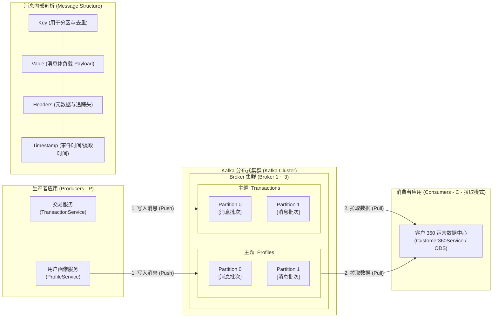

# 《Kafka for Architects》架构师全书导读与前言

> 原作者：Katya Gorshkova  
> 序言作者：Viktor Gamov（Confluent 首席开发者倡导者，《Kafka in Action》合著者）  
> 出版社：Manning Publications (2026)  
> 中文译释与架构解析：深度精译版

---

## 目录
1. [Viktor Gamov 推荐序](#viktor-gamov-推荐序)
2. [作者自序（Katya Gorshkova）](#作者自序katya-gorshkova)
3. [关于本书：架构师的定位与核心价值](#关于本书架构师的定位与核心价值)
4. [全书架构全景路线图](#全书架构全景路线图)
5. [Kafka 核心流转机制全景示意（导图）](#kafka-核心流转机制全景示意导图)

---

## Viktor Gamov 推荐序

即便是经验丰富的软件架构师与核心研发团队，在面对系统伸缩（Scaling）、数据状态更新以及维持全系统稳定性时，也常常感到举步维艰。Apache Kafka 固然能够化解这些复杂的分布式挑战，但很多时候它给人的感觉就像一件虽然威力无比、却缺少详尽“使用指南”的重型武器。因此，站在架构师视角的同理心与务实的工程建议便显得弥足珍贵——这正是 Katya Gorshkova 所著《Kafka for Architects》的卓越非凡之处。

Katya 拥有长达二十年的软件工程与系统架构经验，即便在最棘手的工程困境中也能抽丝剥茧。她在这本书中牢牢聚焦于架构师最关心的核心议题：**宏观设计思维、艰难的架构权衡（Trade-offs）以及具有实操落地价值的工程建议**。从第 1 章事件驱动架构（EDA）的基础出发，层层递进直面企业级现实挑战，让你能够充满信心地在企业中运用 Kafka。

Katya 极其坦诚地展现了 Kafka 在真实工业界中的全貌——既客观剖析它的巨大优势，也毫不避讳它可能带来的延迟、复杂性与潜在陷阱，这让每一位身处一线架构实践的读者都能产生强烈的共鸣。书中关于数据契约治理与实战模式的章节，能帮助架构团队避开代价惨重的系统性误区；针对集群治理、跨集群扩展以及结合流处理与 AI 驱动的前沿探索，更让读者对现代流式架构的未来满怀信心。

市面上许多关于 Kafka 的书籍都陷在逐行代码与客户端 API 调用的泥潭中。本书截然不同：**它致力于帮助你纵览全局，做出明智的架构抉择**。通过真实的架构案例、对利弊得失的客观权衡，它将指导技术决策者以现实主义路线推行事件驱动架构。读完本书，你所准备构建的将不仅是单个系统，而是一个能够随着业务长期生长、经久不衰的分布式数据生态。

事件驱动设计正在重塑现代软件架构。在 Katya 的指引下，Kafka 将不再仅仅是一门通信技术，而是你构建未来架构的战略基石！

— **Viktor Gamov**  
*Principal Developer Advocate, Confluent / Co-author of Kafka in Action*

---

## 作者自序（Katya Gorshkova）

某天，我的技术负责人走到我桌前，随口问了一句：“嗨，外面新出了个叫 Kafka 的消息系统，你能去调研一下对我们有没有用吗？”——这就是我和 Apache Kafka 故事的起点。

初见之时，Kafka 的架构设计显得干净而优雅。然而，推进第一个落地项目的过程却绝非一帆风顺。在那个时期，它太偏底层、太具分布式特性，而且严重缺乏我们今天习以为常的周边生态工具。我很快意识到：虽然 Kafka 蕴含着巨大的颠覆性潜力，但它要求架构师对分布式系统的底层原理有着远比传统消息队列深得多的深刻理解。

几年后，我受邀主讲一门 Kafka 进阶架构课程。教学的过程逼迫我去寻找最清晰、最直观的方式来传达事件驱动架构（EDA）背后的思维方式——不仅是 Kafka *如何运作*，更是**如何在架构维度上对它建立心智模型**。我发现，大多数资深工程师和架构师并不缺客户端 API 怎么写的教程，他们真正迫切渴望解答的是更宏观的架构命题：
- **我们的项目到底适不适合引入 Kafka？**
- **它该如何无缝融入企业现有的系统版图？**
- **应该采用何种架构模式，才能让基于 Kafka 构建的系统经受住时间与规模的长期考验？**

Kafka 开源社区在技术文档方面做了大量工作，但几乎所有教程都停留在“如何把 Kafka 跑起来”的入门层面。极少有资料去直面那些真正艰难的问题：我们究竟该不该用 Kafka？它与现有数据库、微服务、分析系统该如何边界划分？如何在不过度设计的前提下，在吞吐量、顺序性保证与容错性之间找到精准平衡？一旦系统出现异常，如何追溯链路职责并定位根因？

《Kafka for Architects》正是在这一系列真实踩坑经验与反思中孕育而生的。它的使命正是填补那片长久以来的空白——连接**“Kafka 部署成功”**与**“Kafka 真正为业务创造持久价值”**之间的鸿沟。

翻开这本书，你可能已经在考虑将 Kafka 引入企业的核心版图中。我衷心希望本书能帮助你不仅“把 Kafka 用起来”，更能在未来漫长的工程岁月里，**把它用对、用好**。

---

## 关于本书：架构师的定位与核心价值

### 核心定位
软件架构师的核心职责之一，是定义和治理分布式系统之间的交互与通信范式。在微服务与分布式体系中，通过**事件（Events）**协同工作已成为公认的高效解法。
市面上的中间件很多，每一款都在可靠性、灵活性与集成成本之间有着不同的取舍。Apache Kafka 从最初的高性能消息系统，逐步发展成兼具**持久化日志存储、流处理生态、Schema 契约治理与连接器生态**的综合性分布式事件流平台。

然而，Kafka 绝不是即插即用的万灵药。本书抛弃细枝末节的 API 代码教学，通篇聚焦于**架构决策、事件建模、契约演进、集成模式以及系统治理**，帮助你建立清晰的架构决策矩阵。

### 适合读者
- **软件架构师 / 系统架构师**：需要评估 Kafka 是否契合业务、设计高可用高伸缩数据骨干网络；
- **技术总监 / Tech Lead**：需要制定企业级数据集成规范、Schema 演进策略与团队协同规范；
- **资深后端 / 分布式系统研发工程师**：渴望跳出单纯的 `KafkaProducer` / `KafkaConsumer` 编程，洞察底层 Commit Log、KRaft 协调、分区设计与再均衡机制的架构本质。

---

## 全书架构全景路线图

本书分为三大部分，共 12 章，逻辑结构严密清晰：

```mermaid
flowchart TD
    subgraph Part1["第一部分：探索 Kafka 基础架构基石（第 1-4 章）"]
        Ch1["第 1 章：架构师视角下的 Kafka<br/>• EDA 架构范式转型<br/>• 核心角色与 KRaft 控制器<br/>• 生态全貌与架构决策"]
        Ch2["第 2 章：Kafka 集群数据架构<br/>• 分区与并发模型<br/>• 副本复制与 ISR 机制<br/>• Commit Log 物理存储与日志压缩"]
        Ch3["第 3 章：客户端通信与消息生产<br/>• 生产者内部架构与批处理<br/>• 分区策略与 ACK 权衡<br/>• 幂等性与重试机制"]
        Ch4["第 4 章：构建消费者应用程序<br/>• 消费者组与并行消费<br/>• 偏移量提交策略<br/>• Rebalance 机制演进与新协议"]
    end

    subgraph Part2["第二部分：借助 Kafka 解决实战架构难题（第 5-8 章）"]
        Ch5["第 5 章：Kafka 真实场景应用与选型<br/>• EDA 微服务集成 / 数据集成<br/>• 与 RabbitMQ、Pulsar、云服务选型对比"]
        Ch6["第 6 章：定义数据契约与 Schema 治理<br/>• 事件建模（事实 vs 增量）<br/>• Schema Registry 与兼容性规则演进"]
        Ch7["第 7 章：Kafka 交互模式与架构实践<br/>• CQRS 与 Event Sourcing<br/>• 事务与 Transactional Outbox 模式<br/>• Kafka Connect 数据管道"]
        Ch8["第 8 章：设计流处理应用程序<br/>• Kafka Streams 核心架构<br/>• 窗口计算、流表对偶与状态存储<br/>• ksqlDB 与 Apache Flink 选型对比"]
    end

    subgraph Part3["第三部分：在企业中交付与运营 Kafka（第 9-12 章）"]
        Ch9["第 9 章：企业级 Kafka 治理与安全<br/>• KRaft 元数据管理与仲裁容灾<br/>• 自建 vs 托管云部署权衡<br/>• mTLS、SASL 与 RBAC 安全加固"]
        Ch10["第 10 章：规划与组织 Kafka 工程项目<br/>• 事件溯源与需求提炼（Event Storming）<br/>• 基于 GitOps 的集群配置声明式治理<br/>• 单元测试、集成测试与压测方法论"]
        Ch11["第 11 章：集群运维与性能调优实战<br/>• Broker 扩缩容与数据重平衡<br/>• 关键监控指标栈（Prometheus/Grafana）<br/>• 吞吐量、延迟与高可用调优诊所<br/>• 跨地域容灾（DR）与 RPO/RTO 控制"]
        Ch12["第 12 章：Kafka 未来演进与 AI 融合<br/>• 编排平台化与 Serverless/Wasm 边缘计算<br/>• 存储计算分离（Tiered Storage）<br/>• Kafka 在实时 AI/ML 特征工程与 AI Agent 中的核心角色"]
    end

    Part1 --> Part2
    Part2 --> Part3
```

---

## Kafka 核心流转机制全景示意（导图）

在进入各章前，作者在开篇通过一张清晰的宏观架构图概括了数据在 Kafka 中的存储与消费模型：

### 架构师核心观察点：
1. **推-拉分离模型（Push-Pull）**：生产者主动 Push 消息给 Broker，而消费者通过 Pull 模型自主控制消费速率，天然具备**背压保护（Backpressure）**能力。
2. **多级抽象结构**：消息归集于主题（Topic），Topic 物理切分为多个分区（Partition），每个 Partition 内部严格按写入顺序分配连续递增的偏移量（Offset）。
3. **元数据自包含**：每条消息不仅包含业务载荷（Value），还包含用于分区路由与状态合并的 Key，以及用于分布式追踪、Schema 契约版本绑定的 Headers。
