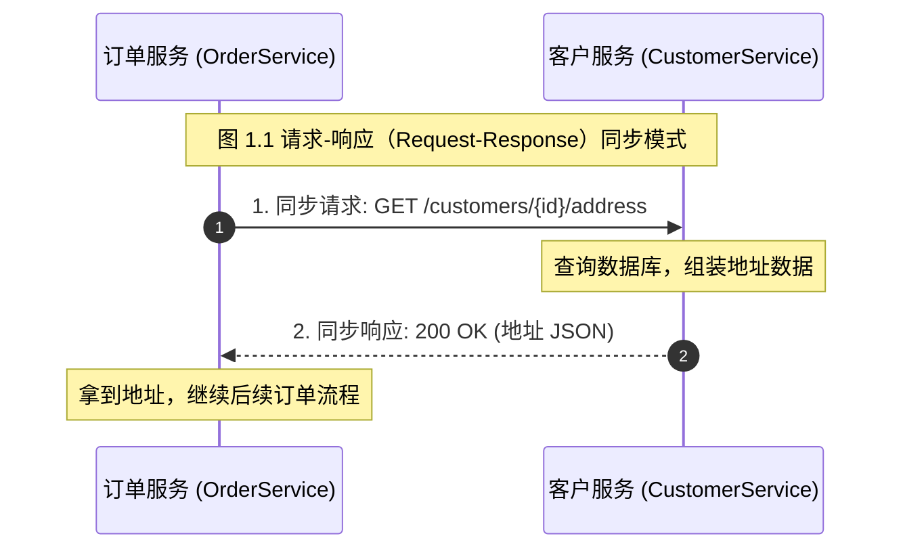
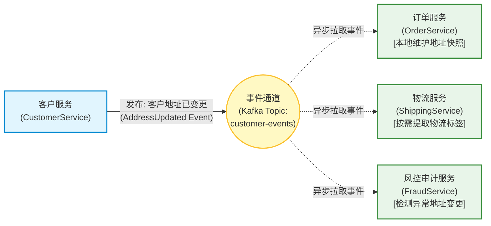
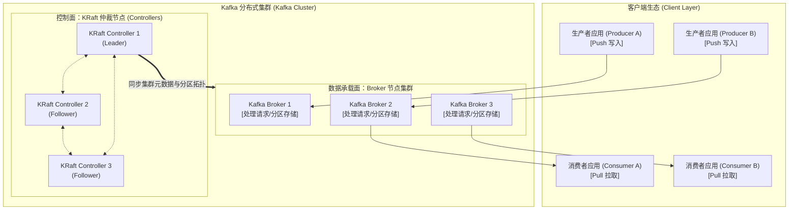
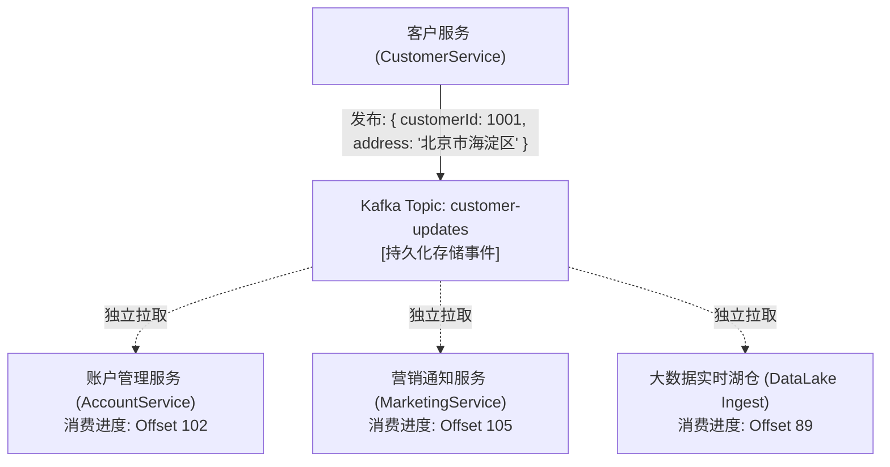
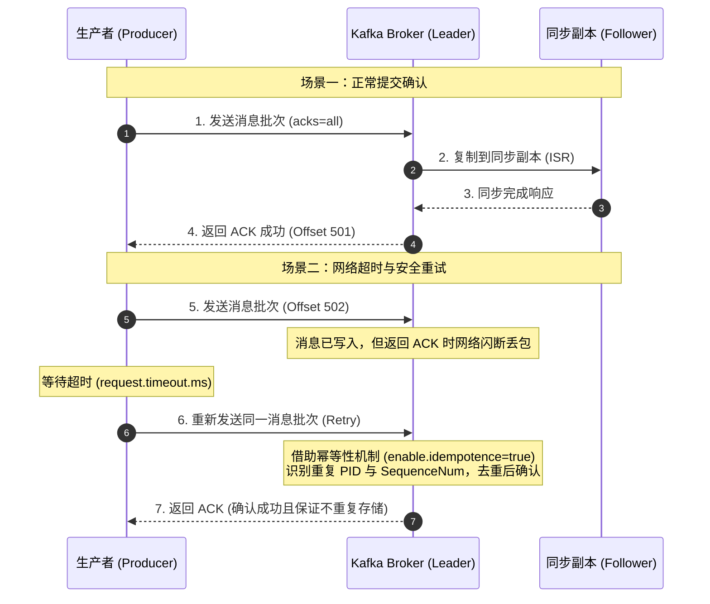
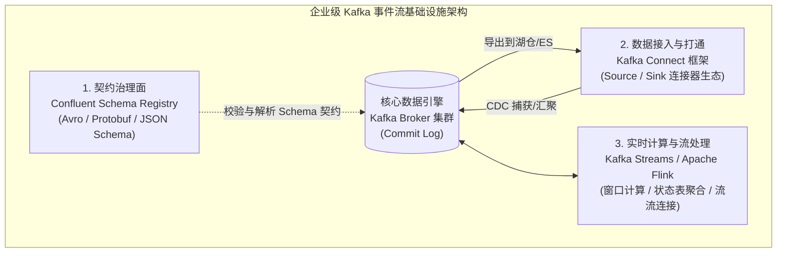
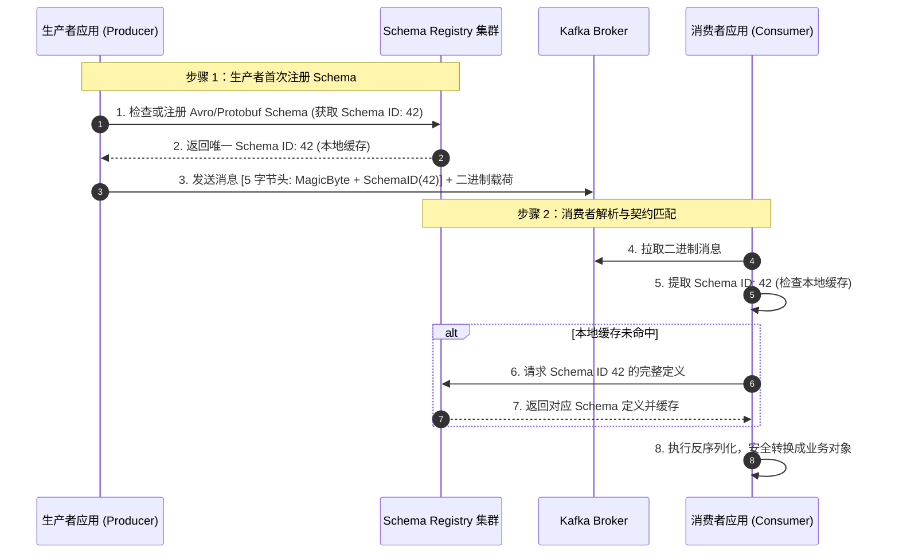
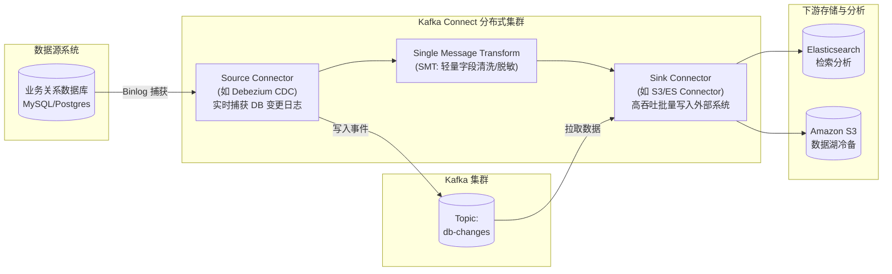
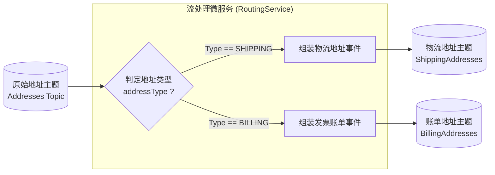
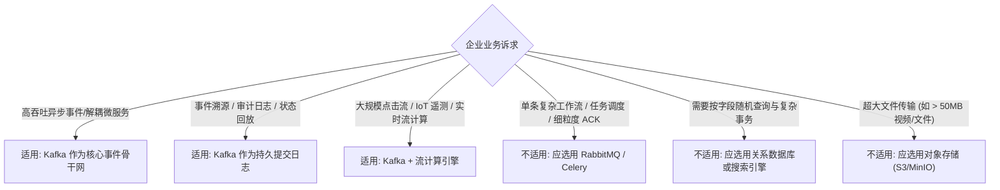

# 第 1 章：架构师视角下的 Kafka (Getting to Know Kafka as an Architect)

> 本章核心目标：站在系统架构师的顶层视角，理解事件驱动架构（EDA）的本质转变，剖析 Kafka 在现代分布式架构中的关键定位，厘清核心组件、交互协议、高可靠交付原则与生态系统（Schema Registry、Kafka Connect、流处理引擎）。

---

## 本章目录
1. [1.1 架构师眼中的 Kafka](#11-架构师眼中的-kafka)
   - [1.1.1 事件驱动架构（EDA）的范式演进](#111-事件驱动架构eda的范式演进)
   - [1.1.2 驾驭海量数据洪流](#112-驾驭海量数据洪流)
2. [1.2 架构手记：事件驱动项目的演进之路](#12-架构手记事件驱动项目的演进之路)
3. [1.3 Kafka 生态系统的核心角色](#13-kafka-生态系统的核心角色)
   - [1.3.1 Broker 与客户端（Client）](#131-broker-与客户端client)
   - [1.3.2 控制器（KRaft Controller）：管理集群元数据](#132-控制器kraft-controller管理集群元数据)
4. [1.4 实践 Kafka 的核心架构原则](#14-实践-kafka-的核心架构原则)
   - [1.4.1 发布-订阅模式（Pub/Sub）](#141-发布-订阅模式pubsub)
   - [1.4.2 可靠消息交付与确认机制](#142-可靠消息交付与确认机制)
   - [1.4.3 提交日志（The Commit Log）的威力](#143-提交日志the-commit-log的威力)
5. [1.5 设计与治理数据流向](#15-设计与治理数据流向)
   - [1.5.1 Schema Registry：管理分布式数据契约](#151-schema-registry管理分布式数据契约)
   - [1.5.2 Kafka Connect：无代码的数据双向集成](#152-kafka-connect无代码的数据双向集成)
   - [1.5.3 流处理框架：实时计算流中的数据](#153-流处理框架实时计算流中的数据)
6. [1.6 运维考量与基础设施规划](#16-运维考量与基础设施规划)
   - [1.6.1 性能调优与日常维护](#161-性能调优与日常维护)
   - [1.6.2 本地私有化部署 vs 云原生托管服务](#162-本地私有化部署-vs-云原生托管服务)
   - [1.6.3 云服务商替代方案对比](#163-云服务商替代方案对比)
7. [1.7 Kafka 在企业系统中的落地定位](#17-kafka-在企业系统中的落地定位)
   - [1.7.1 作为消息总线：解耦异步通信](#171-作为消息总线解耦异步通信)
   - [1.7.2 作为持久化存储：事件回放与历史溯源](#172-作为持久化存储事件回放与历史溯源)
   - [1.7.3 Kafka 与传统消息系统的本质差异](#173-kafka-与传统消息系统的本质差异)
8. [1.8 本章小结与延伸资源](#18-本章小结与延伸资源)

---

## 1.1 架构师眼中的 Kafka

在传统企业应用集成中，当出现新的业务对接需求时，技术团队最直观的做法是构建一个新的服务。架构师此时面临的关键决策是：**该服务应当如何与其他现有服务进行通信？**

在过去的漫长岁月里，主流方案几乎是清一色的**同步远程调用**（如 HTTP/REST 或 RPC）。每个服务被设计为专注于特定的业务领域。

例如，一个电商系统中的订单服务（`OrderService`）在处理用户下单时，需要获取用户的收货地址，而该地址归属于客户服务（`CustomerService`）维护。在传统 REST 架构下，每当一笔订单生成，`OrderService` 就会通过 HTTP 向 `CustomerService` 发送一个包含 `customerId` 的同步请求，并在收到包含地址的响应后继续推进流程。

这种经典的“请求-响应”（Request-Response）设计模式非常直观、文档工具丰富（如 OpenAPI/Swagger），并且易于理解。然而，随着微服务数量急剧膨胀，**链式同步调用暴露出致命的架构缺陷**：
1. **强耦合与级联故障（Cascading Failures）**：调用链上任何一个下游节点的延迟或宕机，都会瞬间向上游蔓延，耗尽线程池与连接资源，最终拖垮整个系统；
2. **可用性乘法衰减**：若系统由 10 个可用性为 99.9% 的同步服务串联构成，整体可用性将骤降至 $(0.999)^{10} \approx 99\%$；
3. **性能瓶颈与网络风暴**：复杂业务编排往往导致大量 N+1 查询与高延迟网络开销。

为了摆脱上述困境，现代架构正在全面拥抱**事件驱动架构（Event-Driven Architecture, EDA）**。

---

### 1.1.1 事件驱动架构（EDA）的范式演进

在 EDA 模式下，系统间的交互从“主动索取”变成了“事后通告”。当领域内发生了一件值得关注的业务事实（即**事件，Event**），产生该事实的服务无需关心谁会用到它，只需向中间事件通道发布一条事件通知。随后，其他感兴趣的下游系统各自独立地订阅并响应这条事件。

> **架构定义**：**事件驱动架构（EDA）**是一种将事件的产生、捕获、消费与响应置于系统核心地位的架构风格。Apache Kafka 正是专为支撑大规模 EDA 构建的高性能分布式流处理平台。

回到前面的地址查询场景，如果我们重构为事件驱动风格：
- `OrderService` 不再向 `CustomerService` 发起远程调用；
- `CustomerService` 只要发现用户修改了地址，就向 Kafka 发送一条 `AddressUpdated` 事件；
- `OrderService` 与物流服务、风险控制服务作为订阅方，各自异步消费该事件，并在自己的本地数据存储中同步冗余一份最新的地址快照。

#### EDA 架构的核心价值与架构代价
- **极致解耦与服务自治（Autonomy）**：生产者与消费者互不感知。新增一个风控审计服务完全不需要通知或修改 `CustomerService`；
- **弹性容灾与时间解耦（Temporal Decoupling）**：如果 `OrderService` 停机维护或发布上线，事件会稳稳积攒在 Kafka 中；当它重新上线后，可以从上次断开的偏移量（Offset）继续消费，绝不丢失任何业务更新；
- **架构师必须面对的权衡——最终一致性（Eventual Consistency）**：
  从地址在 `CustomerService` 变更，到 `OrderService` 收到事件并写入本地，存在微小的时间窗口。架构师必须明确业务是否能接受这段短暂的不一致，并设计针对乱序事件（Out-of-order Events）与重复投递（Idempotence）的处理策略。

---

### 1.1.2 驾驭海量数据洪流

除了解耦微服务，现代企业面临的另一个巨大挑战是**数据体量的指数级暴增**。传统的集中式关系数据库或单机消息队列（如经典 ActiveMQ/RabbitMQ）在面对每秒几十万至数百万事件的写入时，往往在磁盘 I/O、连接池和锁争用上面临瓶颈。

Kafka 的诞生背景正是为了应对 LinkedIn 级别的高吞吐场景：
- **点击流与用户行为日志**（Clickstreams）；
- **全链路 APM 与分布式追踪**（Tracing & Metrics）；
- **大规模 IoT 物联网设备遥测数据**；
- **金融高频交易与实时反欺诈**。

Kafka 通过**分布式水平切片（Partitions）**与**顺序追加磁盘写入（Sequential Disk I/O）**，将吞吐能力提升到了令人惊叹的量级，使企业能够跨越离线批处理与实时分析之间的鸿沟。

---

## 1.2 架构手记：事件驱动项目的演进之路

在真实的企业实战中，架构演进往往伴随着深刻的阵痛。

> **【架构实战笔记】某大型跨国零售企业的数据架构蜕变**  
> 
> - **阶段一：夜间批量 ETL 的黄昏**  
>   起初，该企业的库存与客户数据依赖每晚执行的批处理 ETL 脚本。各业务线白天产生的修改，必须等到凌晨 2 点集中同步。结果，早晨的业务报表经常滞后数小时，白天客服系统更常常因为数据陈旧引发客户投诉。
> 
> - **阶段二：引入 Kafka 后的阵痛**  
>   团队决定引入 Kafka 实现准实时同步。然而最初因为缺乏架构契约治理，开发团队将未经过滤的数据库原始日志（CDC）直接丢进同一个巨型 Topic 中，没有统一的 Schema 规范。当某个核心表做字段重命名时，下游十几个消费服务瞬间集体崩溃。
> 
> - **阶段三：走向成熟的事件驱动治理**  
>   架构团队踩坑后确立了三项铁律：
>   1. **严禁无契约通信**：接入 Confluent Schema Registry，强制使用 Protobuf/Avro 并开启向前兼容性检查；
>   2. **区分业务事件与技术变更**：业务领域事件（Domain Events）与底层数据库变更（CDC）分别走不同的 Topic 体系；
>   3. **幂等兜底**：消费者必须按业务主键设计幂等消费逻辑。
>   改造完成后，全企业数据流转延迟从 **24 小时断崖式下降到 200 毫秒以内**，支撑了双十一高峰期平稳度过。

---

## 1.3 Kafka 生态系统的核心角色

理解 Kafka 的整体架构，首先要建立起其核心组件的角色心智模型。

### 1.3.1 Broker 与客户端（Client）

- **Kafka Broker（代理节点）**：
  Broker 是无状态逻辑与持久化存储的混合体。Broker 集群负责接收生产者写入的消息、追加写入磁盘日志文件，并响应消费者的拉取请求。单个集群通常包含 3 个到数百个 Broker 节点。
- **生产者（Producer）——主动推（Push）**：
  生产者负责创建消息，并根据分区策略（如基于 Key 的哈希或轮询）决定将消息路由到哪一个 Broker 节点的特定分区中。
- **消费者（Consumer）——主动拉（Pull）**：
  与许多传统消息队列服务端强制推消息不同，Kafka 的消费者采用**拉取模型（Pull Model）**。消费者根据自身处理能力批量拉取数据，避免在流量峰值时被瞬间压垮（自带天然背压流量控制）。

### 1.3.2 控制器（KRaft Controller）：管理集群元数据

在早期 Kafka 架构中，集群元数据依赖外部的 Apache ZooKeeper 集群进行协调。从 Kafka 2.8 引入并在 3.x 成熟、4.0 完全强制的 **KRaft（Kafka Raft Metadata Mode）** 彻底终结了对 ZooKeeper 的依赖。

- **KRaft 控制器仲裁集（Controller Quorum）**：
  由一组专用的 Controller 节点（通常为 3 或 5 个）通过 Raft 共识协议选举出一个 Active Controller。
- **元数据提交日志（Metadata Log）**：
  集群所有的元数据（Topic 配置、分区分配、ISR 成员列表、ACL 安全策略等）不再散落在外部树状节点中，而是以一条特殊的内部事件流形式持久化在 Controller 中。这使得集群元数据传播速度提高了几个数量级，能够轻松支持数百万个分区的超大规模集群。

---

## 1.4 实践 Kafka 的核心架构原则

### 1.4.1 发布-订阅模式（Pub/Sub）

Kafka 采用经久考验的发布-订阅模式。一条消息一旦写入 Topic，只要没有超过保留期限，就可以被任意多个独立的消费者应用重复读取。

每个消费者团队不需要向生产者申请专属队列，他们只需注册一个属于自己的**消费者组（Consumer Group）**，即可独立维护自己的消费游标（Offset），彼此互不干扰。

---

### 1.4.2 可靠消息交付与确认机制

分布式环境下，网络抖动与节点故障是常态。Kafka 提供了严密的端到端确认机制（Acknowledgments, ACK）。

架构师需要平衡的三种确认级别（`acks` 参数）：
- `acks=0`：生产者发后即忘（Fire-and-forget），吞吐最高，但面临极高的数据丢失风险；
- `acks=1`：只需 Partition Leader 节点落盘即响应，兼顾速度与一般可靠性（但 Leader 宕机且未同步给 Follower 时仍有丢数据风险）；
- `acks=all`（或 `-1`）：必须等全部同步副本集合（In-Sync Replicas, ISR）均复制落盘才返回成功，提供金融级数据持久保证。配合**幂等生产者（Idempotent Producer）**，可直接规避重试引发的消息重复问题。

---

### 1.4.3 提交日志（The Commit Log）的威力

Kafka 之所以具备颠覆性的性能与持久能力，核心在于它对底层存储的重新构想——**追加型提交日志（Append-only Commit Log）**。

1. **磁盘顺序读写极快**：
   机械硬盘和现代 SSD 在面对随机 I/O（Random I/O）时性能急剧下降，但在进行顺序写入（Sequential Write）时，速度甚至能逼近内存操作。Kafka 将所有消息严格按顺序追加写入分区的末尾；
2. **PageCache 与零拷贝（Zero-Copy）技术**：
   Kafka 大量利用操作系统的页面缓存（PageCache），并且在将数据从磁盘发送至网卡时，采用 Linux 的 `sendfile` 系统调用（DMA 零拷贝），避免了在操作系统内核态与 JVM 用户态内存之间进行来回拷贝，极大减轻了 CPU 负荷与 GC 压力；
3. **不可变性（Immutability）**：
   写入 Log 的事件不可修改。历史数据可以通过配置保留时间（Retention Hours）或大小阈值自动清理，或者通过主键日志压缩（Log Compaction）保留每个 Key 的最新状态。

---

## 1.5 设计与治理数据流向

在企业级落地中，单纯收发消息是远远不够的。成熟的事件流平台需要三大关键支柱：

### 1.5.1 Schema Registry：管理分布式数据契约

当生产者和消费者分属于不同研发团队时，消息的序列化格式变更是最常见的“生产事故根源”。如果生产者悄悄删除了某个字段或变更了数据类型，消费者就会在反序列化时抛出致命异常。

**Schema Registry（模式注册表）**充当了事件流的中央契约管理中心：

- **极低的传输带宽消耗**：消息体中不再需要携带冗长的 JSON 字段键名，只需在前置 5 个字节中编码 Schema ID，其余均为紧凑的二进制 Payload；
- **严格的兼容性演进规则**：Schema Registry 支持配置 `BACKWARD`（向后兼容）、`FORWARD`（向前兼容）或 `FULL`（完全兼容），从服务端根本上杜绝破坏性字段变更。

---

### 1.5.2 Kafka Connect：无代码的数据双向集成

很多时候，数据并不来源于我们自己编写的业务应用，而是存在于现有的数据库（MySQL、PostgreSQL、Oracle）、缓存（Redis）、搜索引擎（Elasticsearch）或对象存储（S3）中。

**Kafka Connect** 是 Kafka 官方提供的声明式、可插拔的数据集成框架：

- **免编写集成代码**：仅需编写一段 JSON 或 YAML 配置，即可建立生产级的容错数据同步管道；
- **丰富的开源生态**：拥有数百种现成的 Source 与 Sink 插件，开箱即用支持 CDC（变更数据捕获）。

---

### 1.5.3 流处理框架：实时计算流中的数据

在过去，数据先存入数据库，然后再由批处理引擎（如 Hadoop、Spark Batch）定期查询计算。而在现代架构中，**数据在流动中就应当被实时计算与过滤**。

常用的流计算场景包括：
- **基于内容的实时路由（Content-Based Routing）**；
- **滑动时间窗口的实时统计聚合**（例如：“统计过去 5 分钟内同一银行卡在不同城市的刷卡频次”）；
- **流-流连接（Stream-Stream Join）与流-表连接（Stream-Table Join）**。

常见的技术选型：
- **Kafka Streams**：轻量级 Java 原生库，非常适合嵌入微服务中做状态流计算，无独立集群运维负担；
- **Apache Flink**：重量级全功能分布式流计算引擎，适合跨大规模数据流的复杂事件处理（CEP）与超大规模有状态计算。

---

## 1.6 运维考量与基础设施规划

在将 Kafka 纳入企业架构蓝图时，架构师必须提前评估基础设施与运维成本。

### 1.6.1 性能调优与日常维护
- **操作系统与文件系统**：推荐选用 Linux XFS 或 ext4 文件系统；调大文件描述符上限（`nofile >= 100,000`）；调整 `vm.max_map_count` 与系统脏页刷新比例（`vm.dirty_background_ratio`）；
- **JVM 堆内存调优**：Kafka Broker 自身其实不需要过大的 JVM Heap（通常分配 6GB - 16GB 即可，推荐使用 G1 收集器），应将充足的物理内存留给 OS 充当 **PageCache**，以获得极限 I/O 吞吐。

### 1.6.2 本地私有化部署 vs 云原生托管服务

| 决策维度 | 本地/私有云自建 (Bare Metal / K8s) | 云原生托管服务 (Confluent Cloud / AWS MSK) |
| :--- | :--- | :--- |
| **资本与人力开销** | 硬件与专职 Kafka 运维工程师成本高 | 按用量订阅付费，无底层服务器维护包袱 |
| **控制力与合规性** | 具备绝对掌控力，满足严苛的金融监管数据隔离 | 需遵循云厂商 SLA，受多租户与公网限制 |
| **扩容与弹性** | 扩容节点需要手动采购、布线与数据均衡迁移 | 支持秒级/分钟级弹性自动扩容 |
| **灾备与跨地域复制**| 需自行配置 MirrorMaker 2 或自研跨机房方案 | 云厂商通常提供开箱即用的多可用区/多地域复制 |

### 1.6.3 云服务商替代方案对比
- **AWS Amazon MSK**：标准托管版 Apache Kafka，兼容原生生态；
- **Azure Event Hubs**：提供针对 Kafka 客户端协议的兼容适配层，免管理 Broker；
- **Google Cloud Pub/Sub**：无分区概念的全局 Pub/Sub 架构，操作极其简单，但无法获得原生 Kafka 分区局部有序性与紧密的流计算绑定。

---

## 1.7 Kafka 在企业系统中的落地定位

为了避免“手里拿着锤子，看什么都像钉子”，架构师必须清楚 Kafka 适用的边界：

### 1.7.1 作为消息总线：解耦异步通信
提供跨系统、跨网络边界的高可靠异步解耦通道，吸收突发流量（削峰填谷）。

### 1.7.2 作为持久化存储：事件回放与历史溯源
由于消息是不可变物理追加的，只要磁盘足够，Kafka 可以将事件保留数天、数月乃至永久。当出现业务逻辑 Bug 需要修复，或者算法模型需要重新用全量历史数据训练时，只需将新消费者的 Offset 重置为 0，即可完整回放历史事实。

### 1.7.3 Kafka 与传统消息系统的本质差异

| 核心特性 | 传统消息队列 (如 RabbitMQ / ActiveMQ) | Apache Kafka |
| :--- | :--- | :--- |
| **消息消费模型** | Broker 维护消费者状态；消息被确认消费后立即物理删除 | 客户端自主维护 Offset 游标；消息按保留策略持久化，允许多次重复消费 |
| **处理吞吐量** | 通常在每秒数万条级别（受限于内存索引与单队列锁） | 轻松达每秒数十万至数百万条（受益于分区并行与零拷贝） |
| **Broker 侧复杂度** | 高：Broker 负责复杂交换机路由、死信分发、重试计时 | 极简：Broker 仅负责顺序写入与拉取，业务路由由客户端完成（Smart Endpoints, Dumb Pipes） |
| **数据顺序性保证** | 单队列内保证先进先出，但在并发消费者模式下全局顺序易乱 | **单分区内（In-partition）严格单调递增有序** |

---

## 1.8 本章小结与延伸资源

### 核心架构要点提炼
1. **范式转变**：从同步 REST 的紧密耦合，迈向基于事件驱动（EDA）的时间解耦与服务自治；
2. **两大数据面**：Kafka 结合了**Broker 高效数据分发面**与**KRaft 极速元数据控制面**；
3. **生态三大件**：在企业架构落地中，必须将**Schema Registry 契约治理**、**Kafka Connect 无代码集成**与**流处理引擎**作为整体进行规划；
4. **架构师权衡**：Kafka 牺牲了随机删除与全局绝对单一队列有序性，换取了极致吞吐、分区横向伸缩与无限回放能力。

### 延伸资源与推荐阅读
- *Confluent KRaft Documentation*: 深入了解无 ZooKeeper 模式下的 Raft 元数据机制；
- *AsyncAPI Specification*: 异步事件驱动架构的标准契约描述规范（类似于 REST 的 OpenAPI）；
- *The Log: What every software engineer should know about real-time data's unifying abstraction* by Jay Kreps: 理解 Commit Log 思想的经典文献。
