# 第 2 章：Kafka 集群数据架构 (Kafka Cluster Data Architecture)

> 本章核心目标：深入剖析 Kafka 核心数据存储与并发计算架构，从逻辑模型（Topic、Partition、Message）贯穿到底层物理存储（Commit Log、Segment、Index），彻底掌握分区并发、分区有序性、ISR 副本冗余机制以及日志压缩（Log Compaction）的运作原理与架构设计准则。

---

## 本章目录
1. [2.1 走进 Kafka 集群内部](#21-走进-kafka-集群内部)
   - [2.1.1 核心概念层次剖析](#211-核心概念层次剖析)
   - [2.1.2 贯穿全书实战案例：Customer 360 ODS 项目](#212-贯穿全书实战案例customer-360-ods-项目)
2. [2.2 数据处理的核心机制](#22-数据处理的核心机制)
   - [2.2.1 主题分区化（Topic Partitioning）](#221-主题分区化topic-partitioning)
   - [2.2.2 基于分区的并发消费模型](#222-基于分区的并发消费模型)
   - [2.2.3 分区内的消息绝对保序](#223-分区内的消息绝对保序)
   - [2.2.4 使用 AsyncAPI 规范定义架构元数据](#224-使用-asyncapi-规范定义架构元数据)
3. [2.3 分区副本与高可用机制（Replication）](#23-分区副本与高可用机制replication)
   - [2.3.1 副本 Leader 与 Followers 的协同](#231-副本-leader-与-followers-的协同)
   - [2.3.2 复制因子（RF）与最小同步副本集（min.insync.replicas）权衡](#232-复制因子rf与最小同步副本集mininsyncreplicas权衡)
   - [2.3.3 在 AsyncAPI 中扩展副本定义](#233-在-asyncapi-中扩展副本定义)
4. [2.4 深入主题（Topic）内部细节](#24-深入主题topic内部细节)
   - [2.4.1 消息的解构：Key、Value、Headers 与 Timestamp](#241-消息的解构keyvalueheaders-与-timestamp)
   - [2.4.2 在 AsyncAPI 中定义消息模型](#242-在-asyncapi-中定义消息模型)
   - [2.4.3 消息批次（Batch）与偏移量（Offset）](#243-消息批次batch与偏移量offset)
   - [2.4.4 分区的物理文件存储：Segments、.log 与 .index](#244-分区的物理文件存储segmentslog-与-index)
   - [2.4.5 数据保留策略（Retention）：基于时间 vs 基于大小](#245-数据保留策略retention基于时间-vs-基于大小)
   - [2.4.6 分区数（Partition Count）的容量规划与计算准则](#246-分区数partition-count的容量规划与计算准则)
5. [2.5 日志压缩主题（Compacted Topics）](#25-日志压缩主题compacted-topics)
   - [2.5.1 压缩的核心思想：流（Stream）与表（Table）的二重性](#251-压缩的核心思想流stream与表table的二重性)
   - [2.5.2 日志压缩的工作流程与墓碑消息（Tombstone）](#252-日志压缩的工作流程与墓碑消息tombstone)
   - [2.5.3 压缩触发时机与脏页比率控制](#253-压缩触发时机与脏页比率控制)
   - [2.5.4 压缩策略的架构权衡：Delete vs Compact vs 混合模式](#254-压缩策略的架构权衡delete-vs-compact-vs-混合模式)
6. [2.6 本章小结与延伸资源](#26-本章小结与延伸资源)

---

## 2.1 走进 Kafka 集群内部

在分布式系统中，如果把 Kafka 比作一个庞大的数据库，那么它的数据组织逻辑与传统的关系数据库有着根本不同。

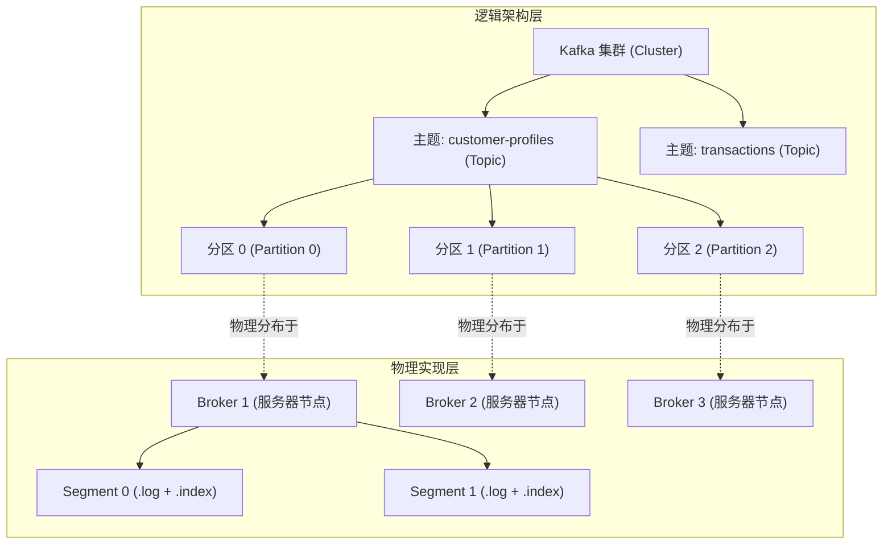

### 2.1.1 核心概念层次剖析
- **Topic（主题）**：消息的逻辑分类单元。主题相当于数据库中的表名，或消息中间件中的主题通道；
- **Partition（分区）**：Kafka 实现高吞吐与水平伸缩的核心物理基础。一个 Topic 在逻辑上由一个或多个 Partition 构成，每个 Partition 是一个**有序、不可变的提交日志追加序列（Commit Log）**；
- **Message / Record（消息记录）**：Kafka 数据流转的最小原子单元，由 **Key（键）**、**Value（值）**、**Headers（请求头键值对）** 以及 **Timestamp（时间戳）** 构成；
- **Offset（偏移量）**：在单个 Partition 内部，每条写入的消息都会被分配一个严格单调递增的 64 位整数编号（从 0 开始），这就是 Offset。Offset 是定位分区内消息的唯一逻辑坐标。

---

### 2.1.2 贯穿全书实战案例：Customer 360 ODS 项目

为了让架构理论落地，本书引入了一个贯穿全书的企业级真实案例——**“客户全景 360° 运营数据中心”（Customer 360 Operational Data Store, ODS）**。

业务痛点：
企业的客户基本信息存放在用户画像系统（`ProfileService`），而每时每刻的借记卡/信用卡交易明细产生于交易系统（`TransactionService`）。客服团队与营销看板需要实时看到每一位客户的完整画像与最新账户变动。

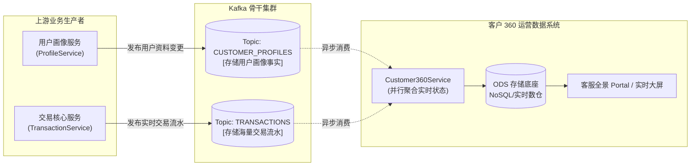

---

## 2.2 数据处理的核心机制

### 2.2.1 主题分区化（Topic Partitioning）

如果一个 Topic 的所有数据都挤在一台单机服务器上，吞吐量必然受限于单台主机的网络网卡带宽与磁盘 I/O 上限。
**分区化（Partitioning）是 Kafka 破局的利刃**：一个 Topic 被切分为 $N$ 个独立的 Partition，这些 Partition 可以分散存放在不同的 Broker 服务器节点上。

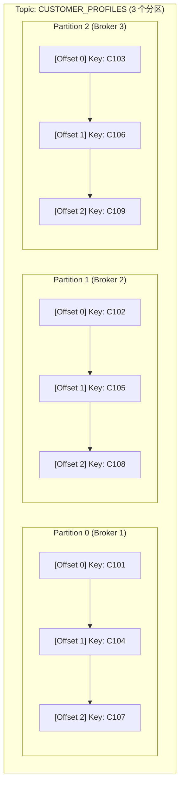

---

### 2.2.2 基于分区的并发消费模型

在传统消息中间件中，多个消费者监听同一个队列时，容易发生严重的线程锁竞争与上下文切换开销。Kafka 采用了一种极简且性能极高的并发模型：**分区是消费并行的基本粒度**。

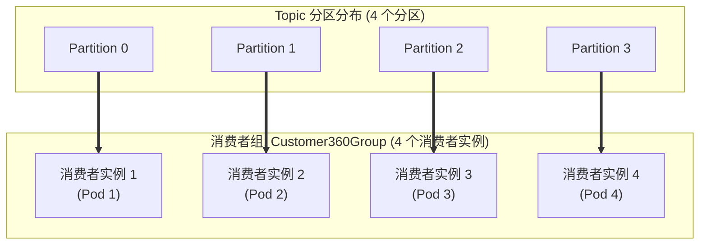

> **架构铁律**：  
> **同一个消费者组（Consumer Group）内部，每个 Partition 只能由其中一个消费者实例独占读取！**  
> 
> - **如果 消费者实例数 == 分区数**：每个消费者分配 1 个分区，达到资源最均衡的理想并行状态；
> - **如果 消费者实例数 < 分区数**：部分消费者实例会同时负责读取多个分区（例如 2 个消费者均摊 4 个分区）；
> - **如果 消费者实例数 > 分区数**：多出来的消费者实例将处于**完全空闲状态（Idle）**，无法协助分担流量，只能充当冷备等待故障转移！

---

### 2.2.3 分区内的消息绝对保序

许多开发者常犯的一个架构误解是：“Kafka 能保证全局所有消息严格有序”。
**事实是：Kafka 仅保证单分区（Single Partition）内部的消息绝对单调有序，跨分区之间没有全局时间顺序！**

在很多业务中，我们并不需要全局完全有序，只需要**同一实体的相关事件按时间顺序处理**（例如：同一个客户的“创建账户”必须先于“账户扣款”，而不同客户之间的扣款事件谁先谁后并不重要）。

Kafka 通过**消息的 Key（键）**达成此目标：

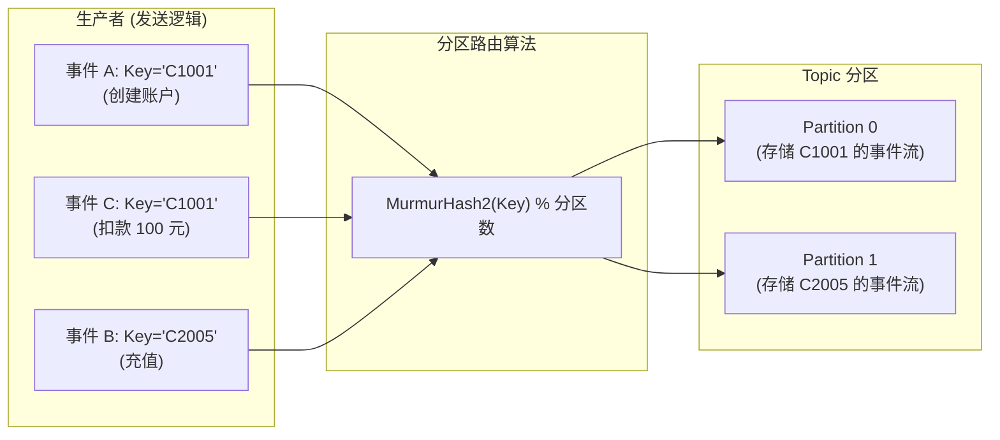

只要生产者指定了固定的业务 Key（如 `customerId`），哈希算法就会确保该 Key 的所有历史与未来消息都会严格路由到**同一个 Partition**。消费者在单线程读取该 Partition 时，即可天然保证处理顺序的严密一致。

---

### 2.2.4 使用 AsyncAPI 规范定义架构元数据

在现代微服务体系中，OpenAPI 用于定义 REST 接口；而面向事件驱动架构，国际通用标准是 **AsyncAPI**。架构师应当在代码编写前，使用 AsyncAPI 清晰定义 Topic 名称、分区数与绑定参数。

```yaml
# Listing 2.1: Customer 360 项目的 AsyncAPI 3.0 初始设计规范
asyncapi: 3.0.0
info:
  title: Customer 360 运营数据中心 (Customer 360 ODS)
  version: 1.0.0
  description: 汇聚全企业用户画像与实时交易流水，提供 360 度全景实时数据能力。

channels:
  customerProfile:
    address: CUSTOMER_PROFILES
    description: 客户基本画像变更事件流
    bindings:
      kafka:
        partitions: 9       # 规划 9 个分区以支撑横向并行消费
        replicas: 3         # 跨 3 个 Broker 容灾备份

  transactions:
    address: TRANSACTIONS
    description: 借记卡与信用卡实时交易流水事件流
    bindings:
      kafka:
        partitions: 12      # 交易流水吞吐量更高，规划 12 个分区
        replicas: 3
```

---

## 2.3 分区副本与高可用机制（Replication）

单个分区如果只存放在一台物理机上，一旦硬件损坏，数据就会丢失。Kafka 通过**主从副本复制机制（Replication Factor, RF）**解决高可用问题。

### 2.3.1 副本 Leader 与 Followers 的协同

每个 Partition 拥有多个副本（Replica）。在所有副本中，有且仅有一个被推举为 **Leader**，其余统称为 **Follower**。

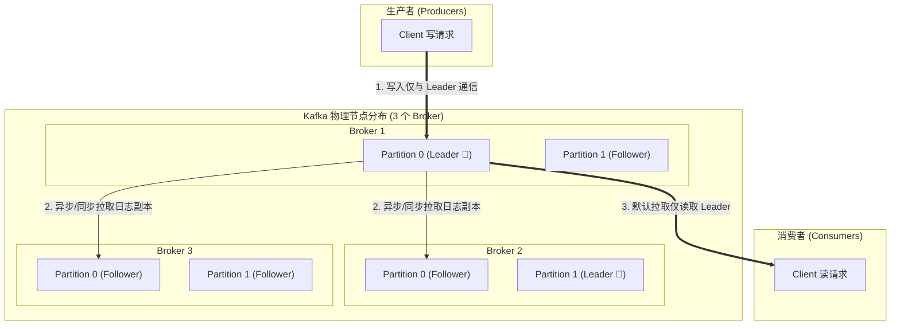

- **Leader 节点**：负责承载客户端所有的写入和绝大部分读取请求（注：Kafka 2.4+ 允许机架感知下的 Fetch from Follower，但在标准架构下核心读写仍走 Leader）；
- **Follower 节点**：像普通的消费者一样，不断向 Leader 发送 `FetchRequest`，将 Leader 新落盘的日志追加复制到本地磁盘。

---

### 2.3.2 复制因子（RF）与最小同步副本集（min.insync.replicas）权衡

衡量副本健康度的核心概念是 **ISR（In-Sync Replicas，同步副本集合）**。只有紧跟 Leader 日志同步进度（落后延迟不超过 `replica.lag.time.max.ms`）的副本才有资格留在 ISR 集合中。

| 架构配置项 | 典型推荐值 | 架构师考量与系统权衡 |
| :--- | :--- | :--- |
| **`replication.factor` (RF)** | `3` | 分区的数据副本数。生产环境强烈推荐设为 3，允许集群在任意挂掉 1 台机器时完全不影响读写与容错。 |
| **`min.insync.replicas`** | `2` | 当生产者使用 `acks=all` 时，服务端至少需要几个健康的 ISR 副本成功落盘才允许向客户端返回确认。 |
| **`unclean.leader.election.enable`** | `false` | 当所有 ISR 副本都挂掉时，是否允许不在 ISR 中的落后副本上位当 Leader。设为 `false` 保障**数据绝对不丢（一致性优先）**；设为 `true` 则优先保障**可用性（但可能丢数据）**。 |

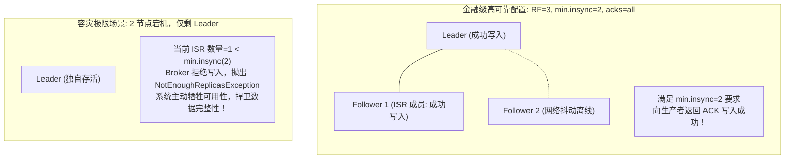

---

## 2.4 深入主题（Topic）内部细节

### 2.4.1 消息的解构：Key、Value、Headers 与 Timestamp

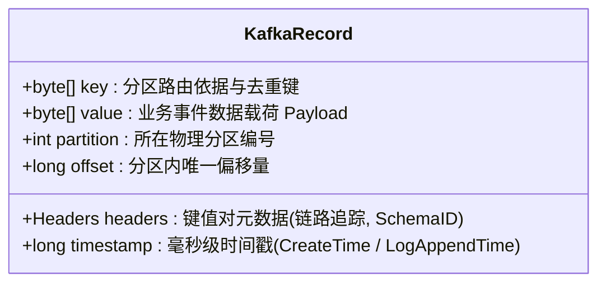

1. **Key（键）**：可为空。非空时用于哈希散列计算确定分区归属；也是 Compacted Topic 状态合并的唯一主键；
2. **Value（值）**：实际业务数据（Payload）。Kafka 原生只将其视作不透明的二进制字节数组（`byte[]`），业务格式可自由选择 JSON、Avro、Protobuf 等；
3. **Headers（头部元数据）**：从 Kafka 0.11 引入，支持存放键值对，常用于传递 W3C 分布式追踪链路上下文（`traceparent`）、TenantId、Schema 版本号等，**无需为了技术元数据而污染业务 Value**；
4. **Timestamp（时间戳）**：可选择为生产者创建时间（`CreateTime`）或 Broker 接收落盘时间（`LogAppendTime`），在流计算的时间窗口处理中至关重要。

---

### 2.4.2 在 AsyncAPI 中定义消息模型

在 AsyncAPI 中明确指定业务消息格式，确保各团队协作统一：

```yaml
components:
  messages:
    CustomerProfileMessage:
      name: CustomerProfileUpdated
      title: 客户资料变更事件
      summary: 当客户更新联系电话、地址或等级时发布
      headers:
        type: object
        properties:
          traceparent:
            type: string
            description: OpenTelemetry 分布式追踪上下文
          schemaVersion:
            type: integer
            description: 契约版本号
      payload:
        type: object
        properties:
          customerId:
            type: string
          fullName:
            type: string
          email:
            type: string
          updatedAt:
            type: string
            format: date-time
```

---

### 2.4.3 消息批次（Batch）与偏移量（Offset）

为了获得极高吞吐，Kafka 绝不会单条单条地发送或写入消息。
生产者会在客户端本地内存缓冲区中，将发往同一个分区的多条消息合并为一个**记录批次（RecordBatch）**，整体压缩后打包发往 Broker。Broker 也是将整个批次原封不动地顺序追加写入磁盘。

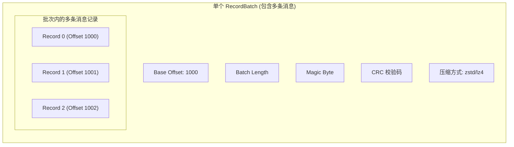

---

### 2.4.4 分区的物理文件存储：Segments、.log 与 .index

在物理服务器的磁盘上，一个 Partition 对应文件系统中的一个独立子目录，目录名格式为 `{topic_name}-{partition_index}`（如 `CUSTOMER_PROFILES-0`）。

如果一个分区的数据写了 3 年、体积达 10 TB，如果放在单个巨型文件中，无论查找还是清理都会面临性能灾难。Kafka 采用了**分段存储（Segment）机制**：

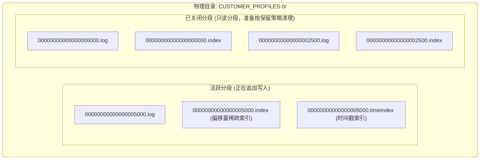

- **`.log` 数据文件**：真正存放消息二进制字节的文件；
- **`.index` 偏移量索引文件**：稀疏索引（Sparse Index）。并不为每条消息建立索引，而是每隔一段字节（`index.interval.bytes=4096`）记录一条 `Offset -> 物理文件位置(Physical Position)` 的映射。消费者查找特定 Offset 时，首先在内存中对索引文件做**二分查找（Binary Search）**，随后直接跳转到磁盘对应位置顺序读取，速度极其惊人；
- **`.timeindex` 时间索引文件**：记录 `时间戳 -> 逻辑 Offset` 的映射，用于基于时间戳回溯消费。

---

### 2.4.5 数据保留策略（Retention）：基于时间 vs 基于大小

Kafka 提供了两种互补的清理策略：
1. **基于时间保留**：`log.retention.hours`（例如默认 168 小时即 7 天）。一旦某个已关闭的分段中所有消息的最新时间戳早于阈值，整个 Segment 文件即可被后台线程直接从磁盘物理删除；
2. **基于大小保留**：`log.retention.bytes`（例如单分区最大保留 500GB）。当历史数据总容量超出该值时，从最早的 Segment 开始逐个删除。

---

### 2.4.6 分区数（Partition Count）的容量规划与计算准则

分区数是系统架构中最重要的容量参数，一旦确定，虽然后续允许调大，但**绝不允许调小**（因为缩容分区会导致基于 Key 哈希的全局一致性彻底破坏）。

> **架构师规划公式**：  
> 设整个 Topic 预期的总生产峰值吞吐为 $T_p$（MB/s），单分区最大写入能力为 $P_{write}$（通常为 10-20 MB/s）；  
> 设单个消费者业务处理能力上限为 $C_{consume}$（MB/s），目标消费吞吐为 $T_c$：
> 
> $$N_{partitions} = \max\left(\left\lceil \frac{T_p}{P_{write}} \right\rceil, \left\lceil \frac{T_c}{C_{consume}} \right\rceil\right)$$

#### 分区过多可能引发的副作用：
- **客户端端到端延迟变高**：生产者需要为每一个分区在本地内存中分配独立的 Buffer 批次池；
- **操作系统文件句柄剧增**：每个 Segment 对应 3 个以上文件句柄；
- **Controller 故障切换耗时增加**：元数据变大，选举耗时加长（KRaft 极大缓解了此问题，但仍需合理规划）。通常单个 Broker 承载的活跃分区数建议控制在 **2000 ~ 4000 个** 以内。

---

## 2.5 日志压缩主题（Compacted Topics）

对于流水型事件（如刷卡流水），基于时间的删除策略（Delete Policy）完全适用。但对于**状态型数据（Stateful Data）**（如“用户当前收货地址”、“银行账户当前余额”），业务关心的是**最新状态是什么**，而不是历史被修改过多少次。

### 2.5.1 压缩的核心思想：流（Stream）与表（Table）的二重性

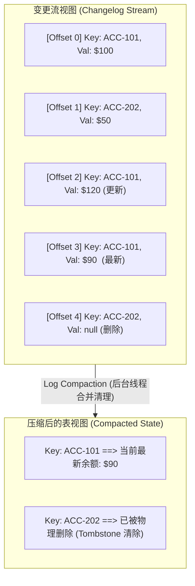

---

### 2.5.2 日志压缩的工作流程与墓碑消息（Tombstone）

在启用了日志压缩（`cleanup.policy=compact`）的主题中：
- 分区日志被分为两部分：**Clean 部分**（已完成去重压缩的历史分段）与 **Dirty 部分**（新写入、包含重复键的活跃日志）；
- 核心算法：后台 Cleaner 线程在后台构建最新 Key 的内存哈希映射，扫描历史分段，保留**具有相同 Key 的记录中 Offset 最大的那一条**，将旧记录丢弃并重写紧凑的分段；
- **如何处理“删除状态”？**  
  如果要注销某个客户或删除某个账户，生产者必须发送一条特殊的**墓碑消息（Tombstone）**：即 `Key = 目标Key, Value = null`。  
  Cleaner 线程在压缩时会先保留这条墓碑消息一段时间（由 `delete.retention.ms` 控制，默认 24 小时），确保下游所有消费者都能读到“该 Key 已被删除”的事实，随后在下一次清理中彻底从磁盘抹去。

---

### 2.5.3 压缩触发时机与脏页比率控制

Cleaner 线程不会无休止地狂刷磁盘，而是通过 `min.cleanable.dirty.ratio` 参数（默认 0.5）控制触发：
当未压缩的脏数据体积占该分区总日志体积的比例超过 50% 时，才会触发后台 Compaction，以最小化磁盘 I/O 抖动。

---

### 2.5.4 压缩策略的架构权衡：Delete vs Compact vs 混合模式

| 清理策略 (`cleanup.policy`) | 核心行为 | 适用典型场景 |
| :--- | :--- | :--- |
| **`delete`**（默认值） | 超过保留时间或大小阈值的 Segment 整体物理丢弃 | 监控指标、IoT 遥测数据、高频点击流、交易流水审计 |
| **`compact`** | 永远不按时间清理，同一 Key 仅保留最新一条非空记录 | 用户画像快照、系统配置字典、产品价格表、KTable 状态存储 |
| **`compact,delete`**（混合策略） | 既保留每个 Key 的最新快照，又设定一个最大保留期限（如 90 天未更新自动过期清理） | 会话 Session 状态缓存、临时令牌授权白名单 |

---

## 2.6 本章小结与延伸资源

### 核心架构要点提炼
1. **分区分治**：Partition 既是并发读写的最小单元，也是高可用副本复制的基本单位；
2. **顺序与吞吐的辩证法**：Kafka 通过基于 Key 的哈希路由，在避免全局锁的前提下巧妙实现了**实体级别的局部严格单调保序**；
3. **物理存储极简之美**：追加写（Append-only）、分段存储（Segment）、稀疏索引（Sparse Index）与页缓存协同，造就了其磁盘级极致吞吐；
4. **日志压缩赋能状态机**：Log Compaction 让 Kafka 超越了单纯的消息管道，成为具备状态持久化能力且支持快速回放恢复的分布式数据源。

### 延伸资源与推荐阅读
- *Apache Kafka Internal Design*: 官方关于 Log Segment 与 Index 物理文件存储格式的详细白皮书；
- *AsyncAPI Bindings for Kafka*: 深入学习如何编写符合企业级治理规范的事件契约文件；
- *Designing Data-Intensive Applications* (by Martin Kleppmann, Chapter 11): 深入剖析基于日志的消息与流处理基石。
