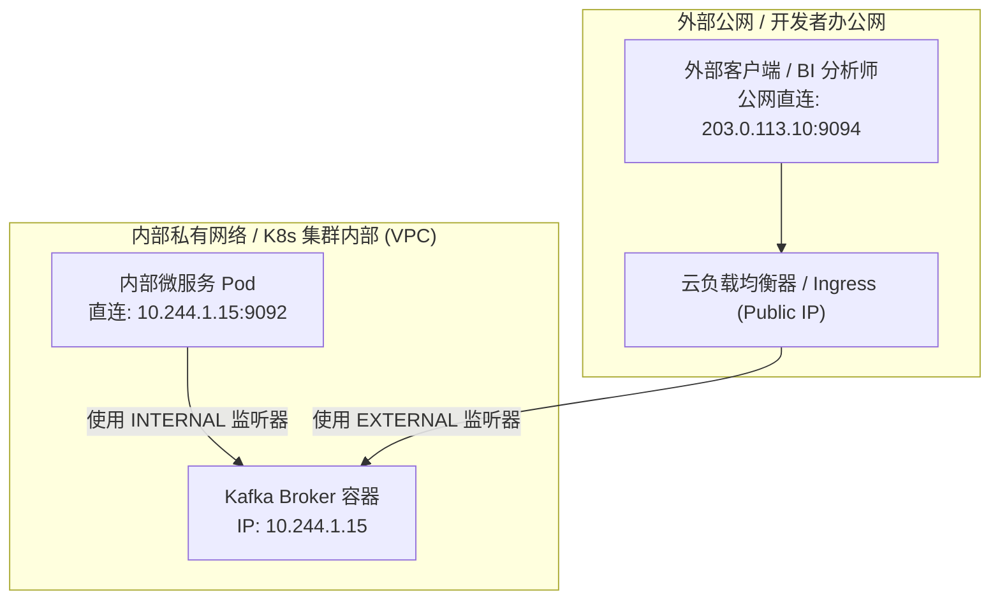
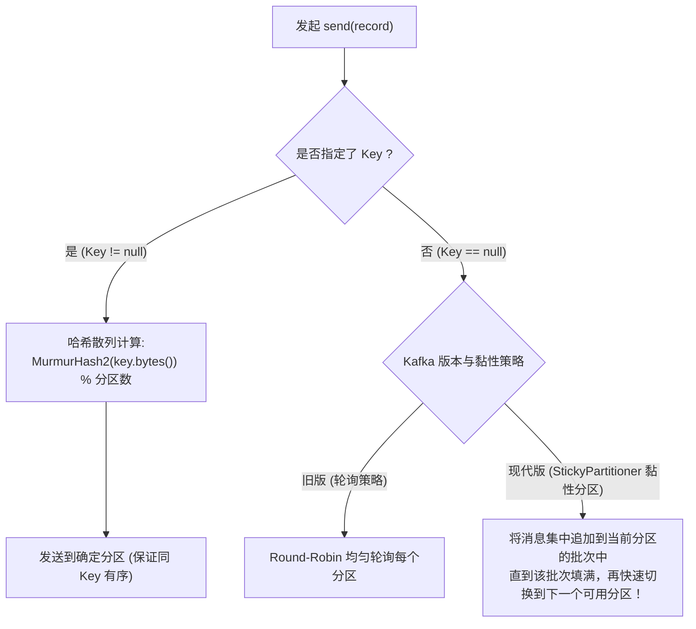
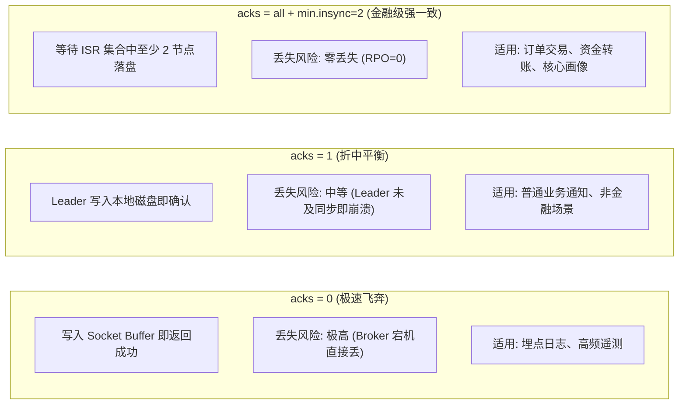

# 第 3 章：Kafka 客户端与消息生产 (Kafka Clients and Message Production)

> 本章核心目标：系统拆解 Kafka 生产者（Producer）的底层运行时机制与通信拓扑，深入掌握网络监听器（Listeners）配置陷阱、批处理缓冲池（RecordAccumulator）、分区路由策略、高可靠 ACK 权衡、客户端配额（Quotas）以及避免乱序与丢数据的关键参数调优。

---

## 本章目录
1. [3.1 与 Kafka 集群建立通信](#31-与-kafka-集群建立通信)
   - [3.1.1 生产者内部执行流水线](#311-生产者内部执行流水线)
   - [3.1.2 客户端核心配置与协议版本协商](#312-客户端核心配置与协议版本协商)
   - [3.1.3 网络拓扑与 Listeners 配置避坑指南](#313-网络拓扑与-listeners-配置避坑指南)
   - [3.1.4 数据的序列化机制](#314-数据的序列化机制)
   - [3.1.5 客户端流量配额（Quotas）治理](#315-客户端流量配额quotas治理)
   - [3.1.6 架构实战：Customer 360 项目的生产者定义](#316-架构实战customer-360-项目的生产者定义)
2. [3.2 深度掌握消息发送机制](#32-深度掌握消息发送机制)
   - [3.2.1 分区路由策略（Partitioning Strategies）](#321-分区路由策略partitioning-strategies)
   - [3.2.2 架构实战：ODS 项目的分区键选择](#322-架构实战ods-项目的分区键选择)
   - [3.2.3 确认机制（ACK Strategies）与可用性权衡](#323-确认机制ack-strategies与可用性权衡)
   - [3.2.4 批处理缓冲与超时链路（Batching & Timeouts）](#324-批处理缓冲与超时链路batching--timeouts)
   - [3.2.5 生产者常见疑难架构问题与解法](#325-生产者常见疑难架构问题与解法)
3. [3.3 本章小结与延伸资源](#33-本章小结与延伸资源)

---

## 3.1 与 Kafka 集群建立通信

许多开发者认为生产者调用 `producer.send(record)` 就会立即把数据发到网络中。但从架构底层看，Kafka 客户端是一个高度异步、多线程并发的流水线系统。

### 3.1.1 生产者内部执行流水线

```mermaid
flowchart TD
    subgraph UserThread["用户业务线程空间 (调用 send())"]
        App["业务代码 (OrderService)"]
        Interceptors["1. 生产者拦截器 (ProducerInterceptors)"]
        Serializer["2. 序列化器 (Serializer: Key/Value 编码)"]
        Partitioner["3. 分区选择器 (Partitioner: 确定目标分区)"]
    end

    subgraph MemoryPool["内存缓冲区 (RecordAccumulator)"]
        direction TB
        B0["Partition 0 缓冲批次队列<br/>[Batch A] -> [Batch B (正在填充)]"]
        B1["Partition 1 缓冲批次队列<br/>[Batch C] -> [Batch D (正在填充)]"]
        B2["Partition 2 缓冲批次队列<br/>[Batch E] -> [Batch F (正在填充)]"]
    end

    subgraph SenderThread["后台 I/O 线程空间 (Sender Thread)"]
        Selector["NetworkClient / Java NIO Selector"]
    end

    subgraph KafkaBrokers["远程 Kafka Broker 集群"]
        Broker1["Broker 1 (承载 P0 Leader)"]
        Broker2["Broker 2 (承载 P1 Leader)"]
    end

    App --> Interceptors --> Serializer --> Partitioner
    Partitioner -->|追加写入内存批次| MemoryPool
    MemoryPool -->|批次就绪 (达到 batch.size 或超时 linger.ms)| SenderThread
    SenderThread == "Socket NIO 异步网络批量发送" ==> KafkaBrokers
```

整个生产过程分为前台主线程与后台 `Sender` 线程：
1. **主线程阶段**：业务线程执行拦截器逻辑、将对象序列化为二进制字节、计算分区号，随后将消息追加到内存缓冲池（`RecordAccumulator`）中对应分区的批次末尾并立即返回一个 `Future`；
2. **后台 I/O 阶段**：独立的 `Sender` 守护线程持续扫描缓冲池，当批次填满（达到 `batch.size`）或者等待时间超过设定阈值（`linger.ms`）时，将发往同一个 Broker 节点的多个批次合并为一个网络请求，批量刷入 Socket 网卡。

---

### 3.1.2 客户端核心配置与协议版本协商

- **`bootstrap.servers`（引导服务列表）**：
  客户端不需要配置集群所有 Broker 的 IP，只需提供 2~3 个作为集群初始发现的“种子节点”。客户端在启动时会向种子节点发送 `MetadataRequest`，获取集群全量 Broker 列表、Topic 分区拓扑以及当前的 Leader 分布，随后**直接与对应分区的 Leader Broker 建立专属 TCP 长连接**；
- **`client.id`（客户端标识符）**：
  每个生产者实例都应配置有业务含义的 `client.id`（如 `payment.producer.pod-1`），它是服务端追踪日志、指标监控与配额限流的核心依据；
- **API 协议版本自动协商（Version Negotiation）**：
  新版 Kafka 客户端与旧版 Broker（或反之）通信时，握手阶段会自动查询 `ApiVersionsRequest`，动态降级或升级通信协议，保证企业平滑升级。

---

### 3.1.3 网络拓扑与 Listeners 配置避坑指南

这是跨云、跨容器（Docker / Kubernetes）部署 Kafka 时最容易导致客户端“连得上种子节点、却发不出消息”的头号致命陷阱。

> **核心原理**：客户端请求 `bootstrap.servers` 时，Broker 返回给客户端的是它自己声明的 **`advertised.listeners`**（公开通告地址）。客户端随后会使用该地址去直连分区 Leader。



#### 架构师必备配置范例（`server.properties`）：
```properties
# 1. 监听本地绑定的所有物理网卡接口
listeners=INTERNAL://0.0.0.0:9092,EXTERNAL://0.0.0.0:9094

# 2. 真正告诉客户端“你应该连我哪个地址”
advertised.listeners=INTERNAL://kafka-broker-1.internal.domain:9092,EXTERNAL://public-ip.company.com:9094

# 3. 指定内部集群通信走内网通道
listener.security.protocol.map=INTERNAL:PLAINTEXT,EXTERNAL:SSL
inter.broker.listener.name=INTERNAL
```

---

### 3.1.4 数据的序列化机制

Kafka 原生提供了常见基本类型的序列化器：`StringSerializer`、`ByteArraySerializer`、`IntegerSerializer`。而在现代企业微服务中，复杂实体必须依赖强类型的契约序列化工具：
- **Apache Avro**：紧凑高效，与 Confluent Schema Registry 深度绑定；
- **Google Protocol Buffers (Protobuf)**：跨语言性能优异，多语言 SDK 生成工具成熟；
- **JSON Schema**：兼顾人类可读性与模式校验，但传输开销较大。

---

### 3.1.5 客户端流量配额（Quotas）治理

在企业多租户共享 Kafka 集群的场景下，若某个 Bug 导致某业务服务进入死循环疯狂生产消息，可能瞬间打满 Broker 磁盘与网络，引发“吵闹邻居（Noisy Neighbor）”效应。
架构师应配置配额限制：
- **Produce Byte-Rate Quotas（生产速率配额）**：限制特定 `client.id` 或 IAM 用户的每秒最大写入字节数（例如 `10 MB/s`）；
- 一旦客户端超额，Broker 不会抛错中断连接，而是**故意延迟响应时间（Throttling Delay）**，迫使客户端本地阻塞降速，实现优雅削峰。

---

### 3.1.6 架构实战：Customer 360 项目的生产者定义

在 AsyncAPI 中对系统中的生产者操作进行声明式规范：

```yaml
# Listing 3.1: 在 AsyncAPI 中定义生产者操作契约
operations:
  updateCustomerProfile:
    title: 客户资料变更生产操作
    description: 当主数据系统完成客户资料更新后，向总线发送广播
    action: send
    channel:
      $ref: '#/channels/customerProfile'
    bindings:
      kafka:
        clientId:
          type: string
          enum: ['profile.srv.producer']

  newTransactionEvent:
    title: 新交易发生事件
    description: 实时上报持卡人最新借记与贷记流水
    action: send
    channel:
      $ref: '#/channels/transactions'
    bindings:
      kafka:
        clientId:
          type: string
          enum: ['trans.srv.producer']
```

---

## 3.2 深度掌握消息发送机制

### 3.2.1 分区路由策略（Partitioning Strategies）

发送消息时，消息如何落到具体的 Partition？



> **架构师认知升级——为什么引入黏性分区器（StickyPartitioner）？**  
> 早期当没有指定 Key 时，默认轮询策略会将每条消息均匀分散在各个分区的批次里，导致每个分区的批次都只有稀疏的 1~2 条消息就超时被迫发送，网络小包林立，批量压缩率极低。  
> 现代 **UniformStickyPartitioner** 会“黏住”某一个分区，迅速把这个批次塞满并一次性发送，随后再切换到下一个分区。**在完全不破坏宏观负载均衡的前提下，大幅降低了端到端延迟并提升了 4~6 倍的压缩吞吐！**

---

### 3.2.2 架构实战：ODS 项目的分区键选择

在 Customer 360 项目中，架构师的分区键设计：
1. **`CUSTOMER_PROFILES` 主题**：必须选用 `customerId` 作为 Key。因为单个客户的信息更新必须严格按照先后顺序在下游更新，绝不能出现“先改了新地址，后收到旧地址覆盖”的灾难；
2. **`TRANSACTIONS` 主题**：选用 `transactionId` 或 `accountId` 作为 Key。
   - 若选用 `accountId`：同一个银行账户的扣款流水可保证顺序，并路由到同一个分区，便于流计算引擎对单账户进行实时防洗钱风控检测；
   - 若选用 `transactionId`：各交易完全独立，利用全局哈希最大化打散热点。

---

### 3.2.3 确认机制（ACK Strategies）与可用性权衡

生产端可靠性由三个协同配置决定：
1. 生产端：`acks`（`0`, `1`, `all`）
2. 生产端：`enable.idempotence`（`true`）
3. 服务端：`min.insync.replicas`（如 `2`，在 RF=3 时）



---

### 3.2.4 批处理缓冲与超时链路（Batching & Timeouts）

高并发系统架构中，超时参数链条配置错误是导致服务“雪崩”的主要原因。

```mermaid
flowchart LR
    T0["调用 send()"] -->|max.block.ms<br/>(默认 60s: 等待缓冲池空间)| T1["写入 RecordAccumulator"]
    T1 -->|linger.ms (批次等待延迟)<br/>batch.size (批次容量字节)| T2["批次就绪"]
    T2 -->|request.timeout.ms<br/>(单次网络请求超时 30s)| T3["Broker 响应 ACK"]
    
    T0 -. "总全链路交付超时控制: delivery.timeout.ms (默认 120s)" .-> T3
```

- **`batch.size`**：单个分区批次内存上限（默认 16 KB）。高吞吐生产环境下通常建议调大到 **64 KB ~ 512 KB**；
- **`linger.ms`**：生产者在发送批次前人为等待更多消息流入的微小延迟（默认 0ms）。生产环境强烈建议设置为 **5ms ~ 20ms**。仅需牺牲几毫秒延迟，就能让 Kafka 形成大批次，吞吐量提升数倍，网卡 I/O 中断大幅减少；
- **`buffer.memory`**：生产者客户端用于消息缓冲的总内存大小（默认 32 MB）。如果生产速度持续高于网络发送速度，缓冲区用满后，`send()` 方法最多阻塞 `max.block.ms`（默认 60s），超时后将抛出 `TimeoutException`；
- **`delivery.timeout.ms`**：现代 Kafka 引入的全局终极超时上限。无论重试了多少次，只要从 `send()` 进队到最终收到 ACK 的时间超出此阈值，直接宣告失败。

---

### 3.2.5 生产者常见疑难架构问题与解法

#### 难题 1：重试导致的消息乱序（Message Reordering）
当网络闪断触发生产者重试时，如果连接上允许同时存在多个处于在途状态的请求（`max.in.flight.requests.per.connection > 1`），后发送的批次可能先于重试批次到达 Broker，导致业务乱序！

> **终极解决方案**：**全面开启幂等生产者（Idempotent Producer）**  
> 设置 `enable.idempotence=true`（Kafka 3.0+ 默认开启）。  
> 
> 原理：Broker 为每个生产者分配一个唯一的 `Producer ID (PID)`，并为发送给每个分区的消息维护单调递增的 `Sequence Number`。Broker 服务端会自动去重已接收的序号，并只允许 `Sequence Number = Last + 1` 的消息按序写入！  
> 此时即使 `max.in.flight.requests.per.connection <= 5`，Kafka 也能在**绝对单调有序的前提下实现多路并发流水线**！

#### 难题 2：超大消息处理（Large Messages Handling）
Kafka 默认单条消息上限为 1 MB（`max.request.size` 和 `message.max.bytes`）。如果业务产生了几十兆的 PDF 或图片，直接往 Kafka 塞会导致 Broker 内存剧烈颠簸和 GC 停顿。

**架构设计模式——申领支票模式（Claim-Check Pattern）**：
1. 生产者将超大二进制文件上传到 S3 / MinIO 对象存储；
2. 生产者向 Kafka 发送一条极小的引用事件：包含该文件的 URI、Hash、大小与元数据；
3. 消费者消费到该引用事件后，从 S3 下载对应内容进行业务处理。

---

## 3.3 本章小结与延伸资源

### 核心架构要点提炼
1. **异步双线程结构**：主线程做轻量序列化与分区分流，后台 `Sender` 线程专注批量合并与高并发网络 I/O；
2. **通告地址是生命线**：深入理解 `advertised.listeners` 的路由机制，是破解容器和云网络连接障碍的关键；
3. **黏性分区是现代标配**：无 Key 消息依赖 `StickyPartitioner` 兼顾极致性能与均衡分布；
4. **黄金三要素组合**：`acks=all` + `enable.idempotence=true` + `min.insync.replicas=2`，构成了企业级金融不丢、不重、不乱序的坚实基石。

### 延伸资源与推荐阅读
- *KIP-98: Exactly Once Delivery and Transactional Messaging in Kafka*: 深入理解 PID、Sequence Number 与事务实现的原始架构提案；
- *KIP-399: Sticky Partitioner in Kafka Producer*: 黏性分区设计细节；
- *Enterprise Integration Patterns: Claim Check Pattern*: 企业级大文件处理的标准模式。
