# 第 4 章：构建消费者应用程序 (Creating Consumer Applications)

> 本章核心目标：全面掌握 Kafka 消费者（Consumer）与消费者组（Consumer Group）的架构精髓，深入攻克再均衡（Rebalance）停顿痛点、分区分配策略演进、偏移量提交（Offset Commit）与数据交付语义保证、死信队列（DLQ）容错设计，以及划时代的 KIP-848 新一代消费组协调协议。

---

## 本章目录
1. [4.1 消费者应用程序的组织模型](#41-消费者应用程序的组织模型)
   - [4.1.1 经典消费事件循环机制](#411-经典消费事件循环机制)
   - [4.1.2 消费者组（Consumer Group）与多租户独立消费](#412-消费者组consumer-group与多租户独立消费)
2. [4.2 深度掌握消息拉取与消费机制](#42-深度掌握消息拉取与消费机制)
   - [4.2.1 基于分区的并行扩展模型](#421-基于分区的并行扩展模型)
   - [4.2.2 架构实战：Customer 360 项目的消费者配置](#422-架构实战customer-360-项目的消费者配置)
   - [4.2.3 核心角色：组协调者（Coordinator）与组 Leader（Group Leader）](#423-核心角色组协调者coordinator与组-leadergroup-leader)
   - [4.2.4 偏移量提交策略（Commit Strategies）与权衡](#424-偏移量提交策略commit-strategies与权衡)
   - [4.2.5 批次拉取调优与背压控制](#425-批次拉取调优与背压控制)
   - [4.2.6 超时检测与避免幽灵再均衡（False Rebalance）](#426-超时检测与避免幽灵再均衡false-rebalance)
   - [4.2.7 静态成员身份（Static Group Membership）：容器化发布救星](#427-静态成员身份static-group-membership容器化发布救星)
   - [4.2.8 分区分配策略深度演进：从 Range 到 CooperativeSticky](#428-分区分配策略深度演进从-range-到-cooperativesticky)
   - [4.2.9 划时代的突破：KIP-848 新一代消费组再均衡协议](#429-划时代的突破kip-848-新一代消费组再均衡协议)
   - [4.2.10 动态订阅 vs 静态手动分配（subscribe vs assign）](#4210-动态订阅-vs-静态手动分配subscribe-vs-assign)
   - [4.2.11 消费压缩主题（Compacted Topics）的特殊考量](#4211-消费压缩主题compacted-topics的特殊考量)
3. [4.3 消费端常见疑难架构痛点与排障](#43-消费端常见疑难架构痛点与排障)
   - [4.3.1 消费积压监控（Consumer Lag）](#431-消费积压监控consumer-lag)
   - [4.3.2 毒丸消息（Poison Pill）与死信队列（DLQ）设计](#432-毒丸消息poison-pill与死信队列dlq设计)
   - [4.3.3 新消费者位点初始化（auto.offset.reset）策略](#433-新消费者位点初始化autooffsetreset策略)
   - [4.3.4 端到端精确一次交付（EOS）与外部系统交互](#434-端到端精确一次交付eos与外部系统交互)
4. [4.4 端到端数据压缩（Compression）性能调优](#44-端到端数据压缩compression性能调优)
5. [4.5 通过 Confluent REST Proxy 访问 Kafka](#45-通过-confluent-rest-proxy-访问-kafka)
6. [4.6 本章小结与延伸资源](#46-本章小结与延伸资源)

---

## 4.1 消费者应用程序的组织模型

在传统消息中间件中，Broker 负责将消息强行推向消费者，并时刻跟踪哪条消息被哪个客户端消费确认。而在 Kafka 的极简哲学中，**状态完全交由客户端自主掌控**。

### 4.1.1 经典消费事件循环机制

Kafka 消费者本质上是一个基于 `poll()` 驱动的单线程事件循环：

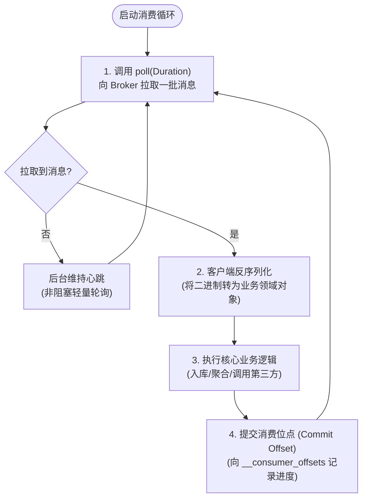

- **天然的背压保护（Backpressure）**：消费者的拉取频率完全由自身处理速度决定。如果外部数据库变慢，业务处理耗时拉长，`poll()` 的频率自然降低，绝不会发生服务端无脑推送导致消费者 OOM 崩溃的情况。

---

### 4.1.2 消费者组（Consumer Group）与多租户独立消费

一个 Topic 中的数据可以被多个完全不同的业务部门或微服务系统共享消费。它们通过唯一的 `group.id` 进行逻辑隔离。

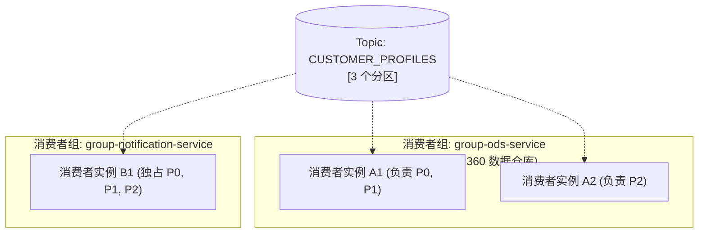

- **组内竞争，组间广播**：
  同一个消费者组内部的多个实例共同分担该 Topic 的分区集合；而不同的消费者组之间互不影响，每个组都在 Kafka 内部维护一份属于自己的独立消费偏移量。

---

## 4.2 深度掌握消息拉取与消费机制

### 4.2.1 基于分区的并行扩展模型

分区数决定了单消费者组的最大物理伸缩上限：

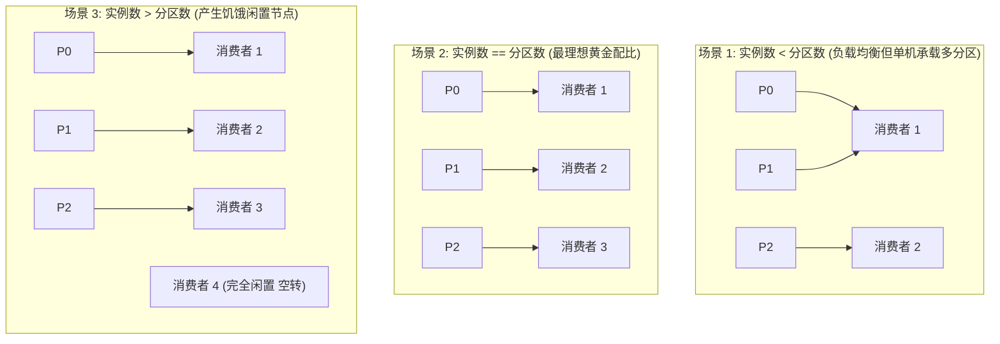

---

### 4.2.2 架构实战：Customer 360 项目的消费者配置

使用 AsyncAPI 3.0 定义下游消费者的监听操作契约：

```yaml
# Listing 4.1: Customer 360 下游消费者的 AsyncAPI 规范
operations:
  onUpdateCustomerProfile:
    title: 消费客户画像变更
    description: 实时拉取并更新 ODS 中的客户画像表
    action: receive
    channel:
      $ref: '#/channels/customerProfile'
    bindings:
      kafka:
        groupId:
          type: string
          enum: ['cust360-group']
        clientId:
          type: string
          enum: ['cust360-profile-worker']

  onNewTransaction:
    title: 消费实时交易明细
    description: 实时计算单账户近实时借贷总额
    action: receive
    channel:
      $ref: '#/channels/transactions'
    bindings:
      kafka:
        groupId:
          type: string
          enum: ['cust360-group']
        clientId:
          type: string
          enum: ['cust360-trans-worker']
```

---

### 4.2.3 核心角色：组协调者（Coordinator）与组 Leader（Group Leader）

在消费者组的动态生命周期中，有两个关键角色协同维护分区分配：

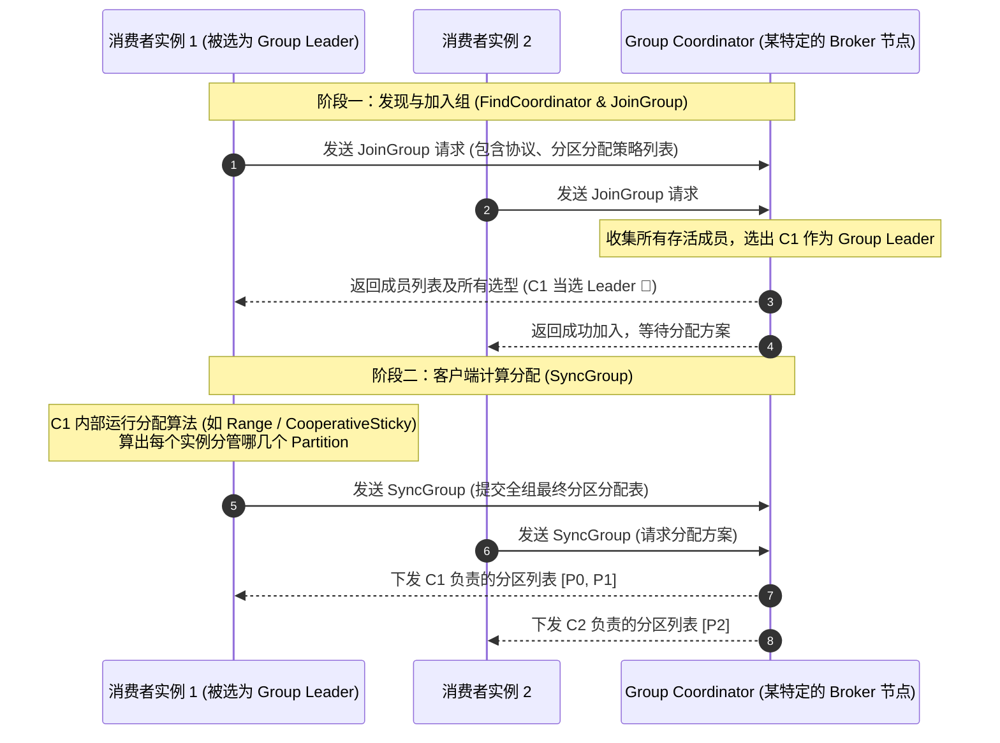

- **Group Coordinator（组协调者）**：运行在 Broker 端的服务。根据 `Math.abs(group.id.hashCode()) % __consumer_offsets 分区数` 算出的 Partition 所在的 Broker Leader，即为该消费组专属的 Coordinator；
- **Group Leader（消费者组长）**：加入组的第一个消费者实例。传统 Kafka 将分区分配的具体算法从 Broker 解耦至 Group Leader 客户端执行，保证了算法演进的灵活性。

---

### 4.2.4 偏移量提交策略（Commit Strategies）与权衡

| 提交方式 | 配置方式 | 核心机制 | 交付语义 | 架构风险与利弊 |
| :--- | :--- | :--- | :--- | :--- |
| **自动提交 (Auto Commit)** | `enable.auto.commit=true`<br/>`auto.commit.interval.ms=5000` | 后台定时器每隔 5 秒在 `poll()` 时顺便提交上次处理的最大位点 | **至多一次 (At-Most-Once)** 或 **至少一次 (At-Least-Once)** | 极不可控。若拉取批次后业务处理中途崩溃，位点可能已提前提交，导致**消息永久丢失**！生产核心严禁开启！ |
| **同步手动提交 (CommitSync)** | `enable.auto.commit=false`<br/>`consumer.commitSync()` | 业务逻辑彻底执行完毕后，同步阻塞等待 Broker 确认写入 `__consumer_offsets` | **至少一次 (At-Least-Once)** | 最安全直观，但由于每个批次都要网络阻塞等待 ACK，吞吐量受到一定抑制。 |
| **异步手动提交 (CommitAsync)** | `consumer.commitAsync(callback)` | 业务处理完后非阻塞异步发送提交请求，不等待直接进入下一轮 `poll()` | **至少一次 (At-Least-Once)** | 吞吐最高。但若出现网络失败，由于不重试（防止旧位点覆盖新位点），可能掩盖提交失败风险。通常在进程关闭前配合 `commitSync()` 兜底。 |

---

### 4.2.5 批次拉取调优与背压控制
- **`max.poll.records`**：单次 `poll()` 调用返回的最大消息条数（默认 500）。如果下游业务处理较慢，建议调小为 **50 ~ 100**，确保业务能在超时限期内处理完毕；
- **`fetch.min.bytes` 与 `fetch.max.wait.ms`**：Broker 侧等待攒批的机制。若对实时性要求极高，设为 1 字节与 500ms；若对吞吐要求高，可调大至 64KB 与 1000ms。

---

### 4.2.6 超时检测与避免幽灵再均衡（False Rebalance）

Kafka 客户端通过两个独立的超时机制来监控消费者状态：

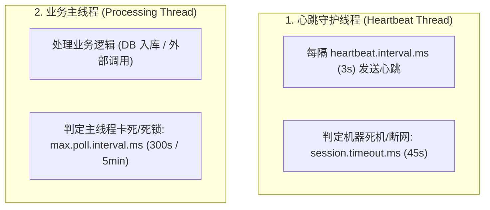

> **经典生产事故——“幽灵再均衡风暴”**：  
> 某次拉取了 500 条大订单，下游数据库慢查询导致这批数据处理了 6 分钟，超过了 `max.poll.interval.ms`（5 分钟）。  
> Broker Coordinator 认为该消费者主线程已死锁僵死，**强制将其踢出消费组并触发 Rebalance**！  
> 正在处理中的业务被打断，分区被抢夺给其他实例；其他实例拿到该批次后再次超时，进而引发全组持续死锁崩盘！  
> 
> **解法**：合理评估单条处理耗时，将 `max.poll.records` 降下来，或适当调大 `max.poll.interval.ms`。

---

### 4.2.7 静态成员身份（Static Group Membership）：容器化发布救星

在 Kubernetes 环境下执行滚动发布（Rolling Update）时，旧 Pod 销毁、新 Pod 启动会频繁触发全组 Rebalance，导致全组所有实例发生停顿（Stop-the-World）。

从 Kafka 2.3 开始，引入了 **`group.instance.id`**（静态成员身份）：
- 为每个 Pod 分配一个固定的实例标识（例如 StatefulSet 的 Hostname：`consumer-pod-0`）；
- 当 Pod 升级重启时，只要在 `session.timeout.ms` 时间内重新连上，Broker Coordinator 就会**直接恢复其原本分配的分区，期间绝不触发任何全组 Rebalance！**

---

### 4.2.8 分区分配策略深度演进：从 Range 到 CooperativeSticky

```mermaid
flowchart TD
    A["传统 RangeAssignor (按 Topic 字典排序连续分配)"] -->|缺点: 跨多 Topic 时导致倾斜| B["RoundRobinAssignor (跨所有 Topic 严格轮询)"]
    B -->|缺点: 重平衡时推倒重来 (Eager Rebalance)| C["StickyAssignor (黏性策略: 尽量保留原分配)"]
    C -->|跨越式演进: 渐进式协作| D["CooperativeStickyAssignor (协同黏性策略)"]
```

#### Eager Rebalance vs Cooperative Rebalance（协作再均衡）
- **Eager 模式（推倒重来）**：一旦发生再均衡，所有消费者必须**全部停止消费、放弃所有手头的分区**，经历漫长的全局 STW，直到分配完成才重新开始；
- **Cooperative 模式（渐进式迁移）**：只有发生归属变动的少数几个分区会被暂时撤销，其余绝大多数没有变动的分区在整个 Rebalance 期间**继续正常消费，毫不停顿！**

---

### 4.2.9 划时代的突破：KIP-848 新一代消费组再均衡协议

在 Kafka 3.x 预览并在 4.0 成为新一代核心标准的 **KIP-848**，彻底重构了消费组协议：

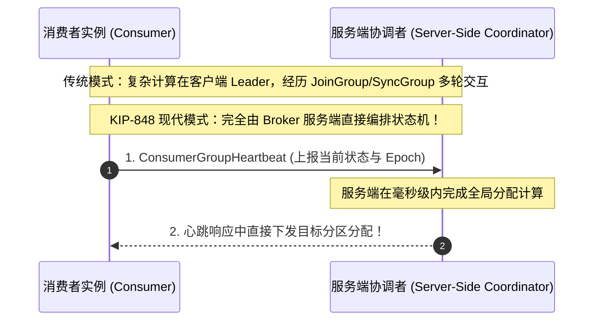

- **秒级/毫秒级再均衡**：摒弃了客户端反复握手协商的冗长步骤，由 Broker 端原生管理成员生命周期与分配计算；
- **彻底告别 STW 停顿**：真正的无感渐进式分区重新编排。

---

### 4.2.10 动态订阅 vs 静态手动分配（subscribe vs assign）
- **`consumer.subscribe(topics)`**：标准方式。享受消费者组、自动负载均衡、故障转移与弹性伸缩；
- **`consumer.assign(partitions)`**：手动硬编码绑定特定的 Partition（如仅读取 `Partition 0`）。此时**完全绕开消费者组机制与 Coordinator**，不具备动态故障转移能力，通常用于流处理框架内部的精准低级控制。

---

### 4.2.11 消费压缩主题（Compacted Topics）的特殊考量
在消费配置了日志压缩的 Topic 时：
1. **必须妥善处理墓碑消息（Tombstone）**：即接收到 `record.value() == null` 时，业务代码绝不能无脑调用 `value.getXXX()` 导致空指针崩溃，而必须将其识别为“该 Key 对应的业务实体已被物理注销”；
2. **随机跳转与全量快照构建**：通过 `seekToBeginning()` 从 Offset 0 开始全量扫描，可以在内存中完整重建该主题的最终最新状态字典（KTable 思想）。

---

## 4.3 消费端常见疑难架构痛点与排障

### 4.3.1 消费积压监控（Consumer Lag）

**Consumer Lag（消费延迟）** 是衡量系统健康状况最核心的指标：

$$\text{Consumer Lag} = \text{Log End Offset (LEO)} - \text{Current Committed Offset}$$

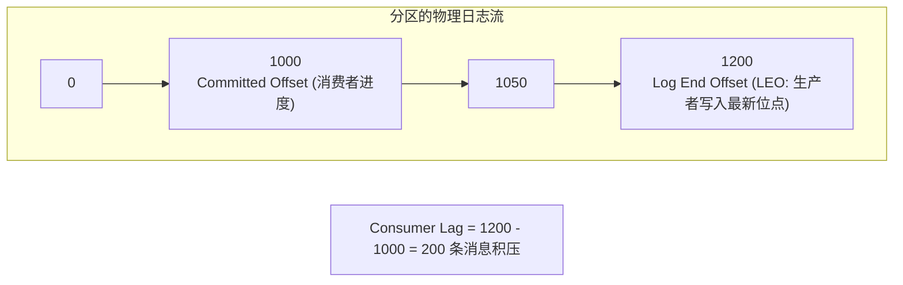

> **架构建议**：使用开源工具（如 **Burrow**、Prometheus `kafka_consumergroup_lag` 指标）设置告警。Lag 持续飙升说明生产速率已经超越了消费处理极限，必须扩容消费者实例或优化业务 I/O 耗时。

---

### 4.3.2 毒丸消息（Poison Pill）与死信队列（DLQ）设计

如果某条消息因为上游 Bug 格式损坏，或者包含非法业务数据，导致消费者每次反序列化或业务处理时都抛出未捕获异常。消费者崩溃重启后再次拉取该消息，陷入**无限崩溃死循环**。

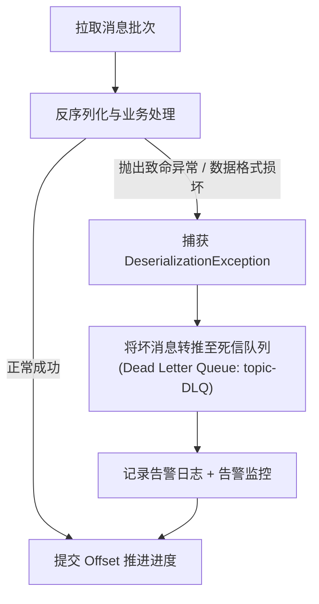

---

### 4.3.3 新消费者位点初始化（auto.offset.reset）策略

当一个全新的消费组首次启动，或者某个消费组在 Kafka 中记录的位点早已过期被物理删除时，`auto.offset.reset` 参数决定其行为：

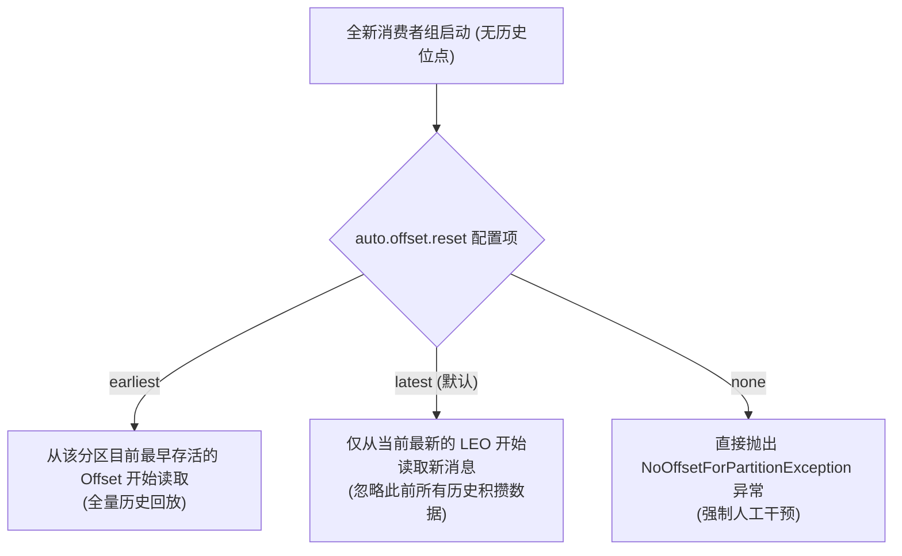

---

### 4.3.4 端到端精确一次交付（EOS）与外部系统交互

在将 Kafka 数据写入外部 MySQL / PostgreSQL / ES 时，仅靠 Kafka 自身机制无法天然保证外部系统的精确一次。
**架构师的标准防重范式**：
1. **下游幂等更新（Idempotent Upsert）**：以业务唯一主键（如 `orderId`）执行 `INSERT ... ON DUPLICATE KEY UPDATE`，重复消费无论多少次，最终数据库状态始终一致；
2. **位点与业务数据共存事务（Transactional Dual-Write）**：将 Kafka Offset 与业务数据保存在同一个关系数据库事务中提交。

---

## 4.4 端到端数据压缩（Compression）性能调优

数据压缩是 Kafka 极具杀伤力的架构特性之一：
- **生产者压缩**：由生产者在本地批次内存中完成压缩（`compression.type`）；
- **Broker 零解压穿透**：Broker 服务端直接将压缩后的二进制批次落盘，不耗费 Broker 的 CPU 进行解压；
- **消费者解压**：仅在消费者拉取到消息后，由客户端在反序列化前完成解压。

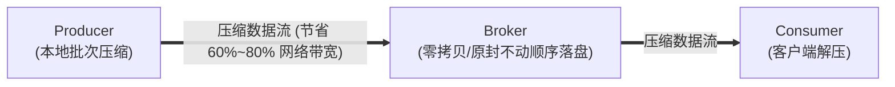

#### 压缩算法性能横向对比：
- **`lz4`**：CPU 开销极低，吞吐极大，综合表现最均衡，适合绝大多数常规业务；
- **`zstd`**：Facebook 研发的高性能算法，具备媲美 `gzip` 的极限压缩比，且解压速度极快，是日志类与大数据传输的首选；
- **`snappy`**：Google 早期算法，性能表现优异，历史兼容性最好；
- **`gzip`**：压缩比最高，但极其消耗 CPU 算力，通常不推荐。

---

## 4.5 通过 Confluent REST Proxy 访问 Kafka

在某些企业架构中，边缘设备、前端网页或基于 Python / Shell / 老旧大型机的客户端无法使用原生的 Kafka TCP 客户端。

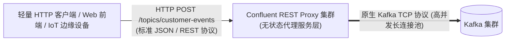

REST Proxy 屏蔽了底层的分区路由、Rebalance 和复杂的长连接管理，允许异构系统通过标准 HTTP POST/GET 轻松收发事件。

---

## 4.6 本章小结与延伸资源

### 核心架构要点提炼
1. **拉取模型带来极强自治**：Consumer 掌控轮询节奏，兼顾背压与自我保护；
2. **从推倒重来到渐进式协作**：从早期粗暴的全局停顿 Eager Rebalance，到 CooperativeSticky，再到 KIP-848 服务端驱动，Kafka 彻底攻克了重平衡痛点；
3. **位点提交决定系统命脉**：生产严禁使用自动提交，业务完成前绝不能提前确认位点，并必须配套 DLQ 死信兜底；
4. **全链路压缩实现网络跨越**：端到端压缩（推荐 `lz4` / `zstd`）在节约 70% 专线带宽的同时大幅减轻磁盘压力。

### 延伸资源与推荐阅读
- *KIP-848: The Next Generation Consumer Rebalance Protocol*: 深入学习 Kafka 消费组架构的终极革新；
- *KIP-345: Introducing static membership to consumer groups*: 静态成员身份技术规范；
- *Kafka: The Definitive Guide* (Chapter 4: Kafka Consumers): 深入理解消费者客户端源码运行细节。
