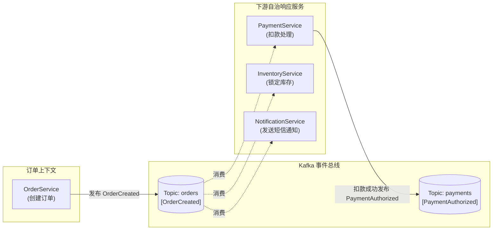
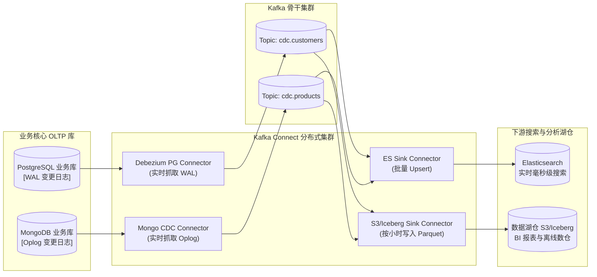
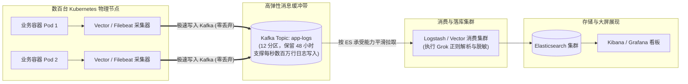
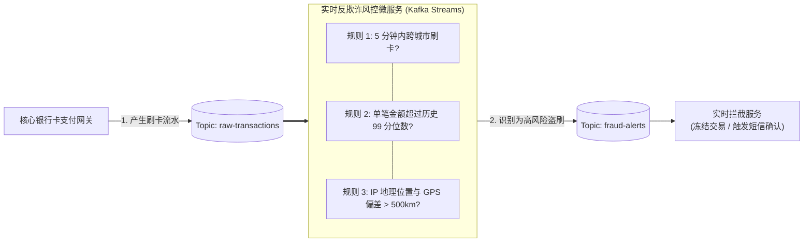
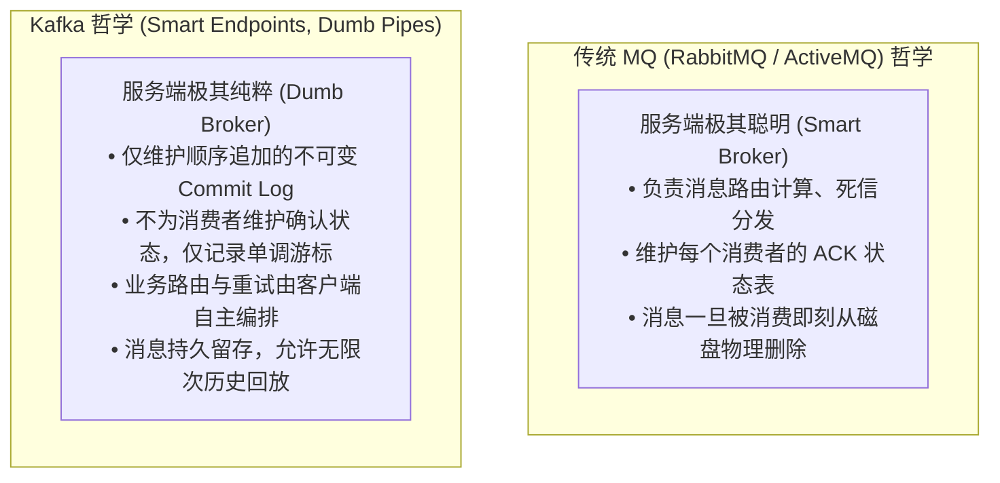
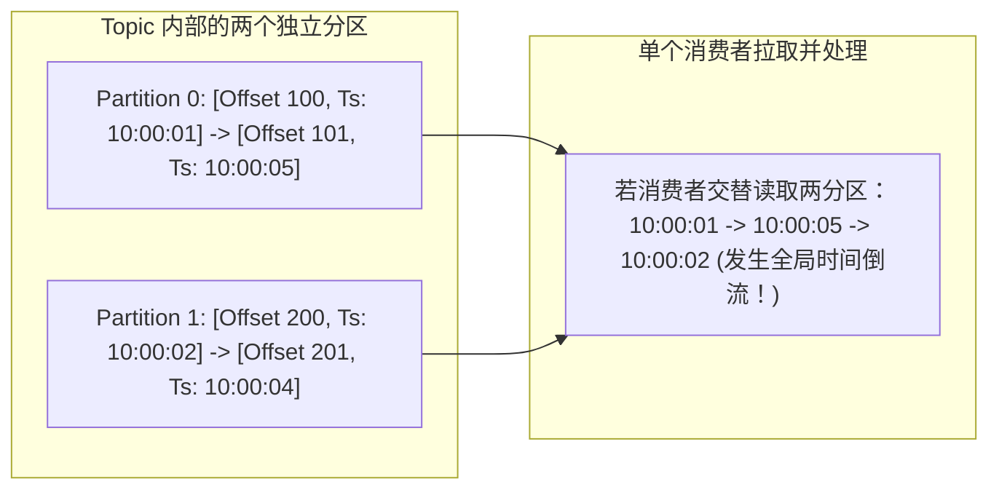
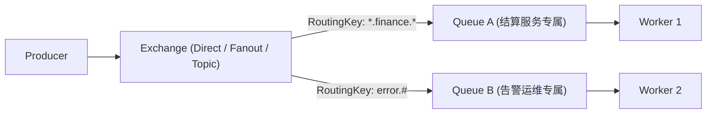
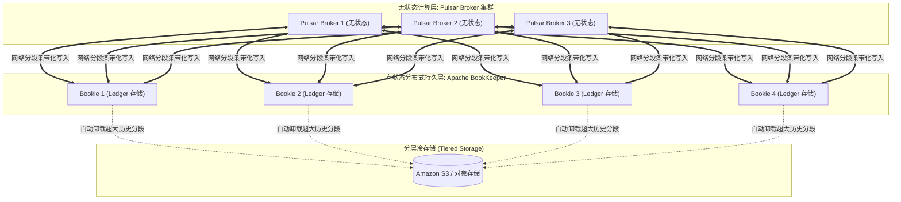
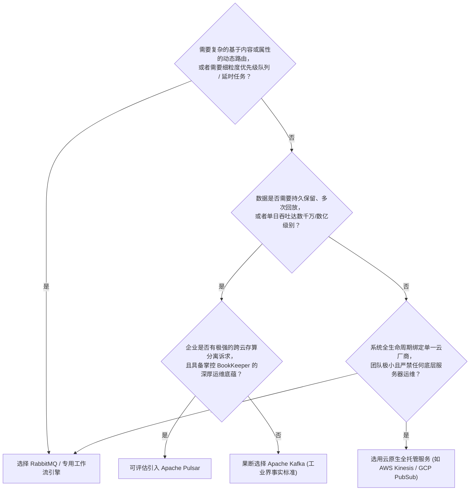

# 第 5 章：Kafka 真实场景应用与选型对比 (Kafka in Real-World Use Cases)

> 本章核心目标：立足企业真实业务战场，深度剖析 Kafka 在事件驱动微服务、企业数据集成（CDC）、海量日志与可观测性管道、实时流计算反欺诈等四大核心场景的架构落地方案；并与 RabbitMQ、Apache Pulsar 及云原生消息产品展开全方位、多维度的技术选型深度对比。

---

## 本章目录
1. [5.1 驾驭四大真实业务场景落地](#51-驾驭四大真实业务场景落地)
   - [5.1.1 场景一：事件驱动微服务与业务编排](#511-场景一事件驱动微服务与业务编排)
   - [5.1.2 场景二：企业异构数据集成（CDC 与湖仓打通）](#512-场景二企业异构数据集成cdc-与湖仓打通)
   - [5.1.3 场景三：海量日志收集与可观测性数据管道](#513-场景三海量日志收集与可观测性数据管道)
   - [5.1.4 场景四：实时事件计算与实时反欺诈风控](#514-场景四实时事件计算与实时反欺诈风控)
2. [5.2 Kafka 与传统消息中间件的本质差异](#52-kafka-与传统消息中间件的本质差异)
   - [5.2.1 发布-订阅模型的根本重构](#521-发布-订阅模型的根本重构)
   - [5.2.2 数据分区分治带来的横向扩展力](#522-数据分区分治带来的横向扩展力)
   - [5.2.3 “哑管道与聪明端点”（Dumb Pipes, Smart Endpoints）](#523-哑管道与聪明端点dumb-pipes-smart-endpoints)
   - [5.2.4 顺序访问与磁盘追加写入](#524-顺序访问与磁盘追加写入)
   - [5.2.5 持久化存储与有限留存期](#525-持久化存储与有限留存期)
   - [5.2.6 大消息处理的物理局限与架构规避](#526-大消息处理的物理局限与架构规避)
   - [5.2.7 全局有序性的缺失与业务妥协](#527-全局有序性的缺失与业务妥协)
3. [5.3 竞品全景技术选型决策矩阵](#53-竞品全景技术选型决策矩阵)
   - [5.3.1 RabbitMQ：灵活路由与细粒度任务队列的王者](#531-rabbitmq灵活路由与细粒度任务队列的王者)
   - [5.3.2 Apache Pulsar：存算分离与多租户原生架构](#532-apache-pulsar存算分离与多租户原生架构)
   - [5.3.3 主流公有云消息托管产品对比（AWS / Azure / GCP）](#533-主流公有云消息托管产品对比aws--azure--gcp)
4. [5.4 本章小结与架构师选型决策树](#54-本章小结与架构师选型决策树)

---

## 5.1 驾驭四大真实业务场景落地

### 5.1.1 场景一：事件驱动微服务与业务编排

在现代微服务体系中，服务之间的协作存在两种核心范式：
- **服务编排（Orchestration）**：由一个集中式协调器（如 Temporal、Camunda 或集中式订单 Saga 引擎）像乐队指挥一样依次发起同步或异步调用；
- **服务协同（Choreography）**：没有中心指挥官，各个自治服务像舞者一样，仅通过观察周围事件作出独立响应。

Kafka 是实现**去中心化协同（Choreography）**的最理想基座。

#### 借助 Compacted Topics 作为微服务的状态真相源（Source of Truth）
当微服务需要重建本地视图或冷启动时，配置为 `cleanup.policy=compact` 的 Topic 可以直接充当系统的**只读只追加数据库**。新上线的服务只需重置 Offset 到 0 扫描全量，即可在内存中重建最新的业务全局状态字典，彻底免除跨服务远程 RPC 批量查询的巨大开销。

---

### 5.1.2 场景二：企业异构数据集成（CDC 与湖仓打通）

现代企业普遍存在关系数据库（PostgreSQL/MySQL）、文档数据库（MongoDB）、搜索引擎（Elasticsearch）与数据湖（Snowflake/Iceberg/S3）并存的数据孤岛。

**变更数据捕获（Change Data Capture, CDC） + Kafka Connect** 构成了现代数据栈（Modern Data Stack）的黄金管道：

- **业务代码零侵入**：Debezium 直接从数据库底层二进制日志（Binlog / WAL）解析出行级别的变更事件（Insert / Update / Delete），业务代码无需编写双写逻辑；
- **天然解决双写不一致**：彻底终结了“先写 DB 还是先写 ES”引发的分布式脑裂问题。

---

### 5.1.3 场景三：海量日志收集与可观测性数据管道

在数十万容器并发运行的云原生时代，日志、分布式链路追踪（Traces）与指标（Metrics）汇聚成了海啸般的吞吐量。若让采集 Agent（如 Filebeat、Vector、FluentBit）直接写入 Elasticsearch，往往会在业务流量高峰期将 ES 写入线程池打满，导致 ES 节点熔断甚至丢日志。

**Kafka 在可观测性链路中充当无敌的“蓄水池与弹性缓冲垫”**：

即使 Elasticsearch 因垃圾回收（GC）或节点恢复停机 2 小时，全网日志仍然安全暂存在 Kafka 磁盘中；待 ES 恢复后，消费者以最大安全速率消化积压，业务系统无感知。

---

### 5.1.4 场景四：实时事件计算与实时反欺诈风控

以金融风控为例，反欺诈系统必须在刷卡交易发生的 **50 毫秒以内** 完成风险识别与阻断，传统的离线 T+1 跑批无法阻挡资金损失。

Kafka 凭借微秒级的单分区顺序追加与毫秒级的端到端通信延迟，成为金融反欺诈与实时决策大脑的黄金通道。

---

## 5.2 Kafka 与传统消息中间件的本质差异

许多从传统中间件（ActiveMQ / RabbitMQ / IBM MQ）转型的架构师，常常带着旧有的心智模型去设计 Kafka，从而导致严重的架构反模式。

### 核心差异横向全景对比矩阵：

| 评估维度 | 传统消息系统 (以 RabbitMQ 为代表) | Apache Kafka |
| :--- | :--- | :--- |
| **通信模型** | 交换机（Exchange）+ 细粒度队列（Queue），支持灵活的 Header/Topic 模式匹配路由 | 主题（Topic）+ 分区（Partition），客户端按 Key 进行确定性哈希路由 |
| **消息销毁机制** | **消费确认即物理删除（Destructive Consumption）**，消息队列常态下趋近于 0 才是健康的 | **不可变提交日志（Immutable Log）**，按保留时间或大小物理留存，允许多个独立消费组重复读取 |
| **吞吐能力上限** | 单节点通常在数万条/秒（受限于内存索引与多消费者锁竞争） | 单集群可轻松突破数百万条/秒（受益于分区横向并行与零拷贝内核旁路） |
| **数据顺序性** | 单队列 FIFO，但多个并发消费者监听同一队列时顺序性彻底失效 | **单分区内部保证严格绝对单调有序**（全局多分区无序） |
| **消息追踪与重放** | 不支持历史回放；一旦 ACK，历史数据彻底蒸发 | **支持任意时间点重置 Offset 回放**（Time-travel replay） |
| **单条大消息处理** | 相对较好支持（几兆至数十兆均可直接入队） | 不推荐直接存储超大消息（单条宜控制在 1MB 以内，超大推荐 Claim-Check） |

---

### 5.2.7 全局有序性的缺失与业务妥协

在跨多个分区的 Topic 中，消息产生的时间戳即使在生产者侧是递增的，由于网络波动、客户端缓冲批次不同以及 Broker 各自分区 Leader 的调度差异，**全局多分区绝对时间有序是无法保证的**：

> **架构师警示**：如果你的业务场景**必须要求全系统全局绝对单调有序**，你的唯一选择是将 Topic 的分区数硬性设置为 1。然而，**分区数设为 1 意味着你彻底放弃了 Kafka 所有的并发与吞吐优势**！  
> 绝大多数情况下，业务只需要“实体内有序”（如同一个客户、同一个订单），正确使用业务 Key 路由到相同分区才是正道。

---

## 5.3 竞品全景技术选型决策矩阵

### 5.3.1 RabbitMQ：灵活路由与细粒度任务队列的王者

- **优势**：支持极为复杂的路由绑定（AMQP 协议）、支持消息优先级队列（Priority Queues）、支持单条消息维度的延时投递与死信转关、支持极低延迟的推模型（Push-based）；
- **劣势**：无法处理海量事件留存，消息积压严重时 Erlang 节点内存暴涨会导致吞吐雪崩，不支持历史数据回放，无法水平线扩容单队列吞吐。

---

### 5.3.2 Apache Pulsar：存算分离与多租户原生架构

Apache Pulsar 作为后起之秀，在架构上做出了激进的**存算分离（Separation of Storage and Compute）**：

- **优势**：
  1. **Broker 无状态**：Broker 节点崩溃无需数据迁移（Rebalance），秒级恢复；
  2. **内置分层存储（Tiered Storage）**：自动将冷数据卸载至 S3，存储成本极低；
  3. **原生百万级多租户**：资源配额与权限隔离深度内嵌。
- **劣势**：架构极度复杂（需要维护 Pulsar Broker、ZooKeeper、BookKeeper 三套分布式集群），运维门槛极高，开源社区生态成熟度与稳定性案例显著落后于 Kafka。

---

### 5.3.3 主流公有云消息托管产品对比

| 技术方案 | 协议与生态兼容 | 架构特点与优势 | 潜在瓶颈与短板 |
| :--- | :--- | :--- | :--- |
| **AWS Kinesis Data Streams** | AWS 私有 API（提供 KCL SDK） | 原生集成 AWS Lambda / S3 / Redshift，按分片（Shard）计费，免运维 | 单 Shard 写入严格限制 1MB/s，灵活性较差，跨云迁移成本极高 |
| **Azure Event Hubs** | 支持原生 Kafka 协议（Kafka on Azure） | 无需管理 Broker 实例，通过吞吐单元（TU）弹性计费，支持自动扩容 | 高级 Kafka 内部配置（如自定义日志分段、特定压缩模式）无法深度干预 |
| **Google Cloud Pub/Sub** | Google 专用 gRPC / REST API | **完全无分区概念**，全托管无服务器架构，无限自动伸缩，开发极其简单 | 无法实现原生单分区保序，流处理集成（与 Flink/Beam）调试复杂度高 |

---

## 5.4 本章小结与架构师选型决策树

### 核心结论
- **选 Kafka**：当你的业务核心是构建企业级数据中台、解耦大规模微服务、搭建实时日志指标流管道、实现事件溯源（Event Sourcing）与实时流计算；
- **选 RabbitMQ**：当你的核心是执行复杂单条异步业务任务调度、订单延时超时取消、强交互型 RPC 响应；
- **选 Pulsar**：当你面对 PB 级持久化数据且需要物理存算分离、超大集群跨租户资源隔离时（且运维技术储备雄厚）。
