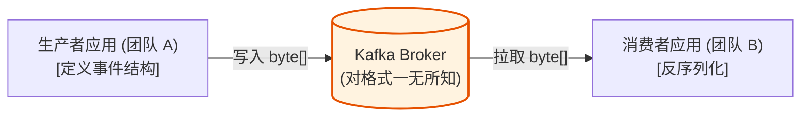
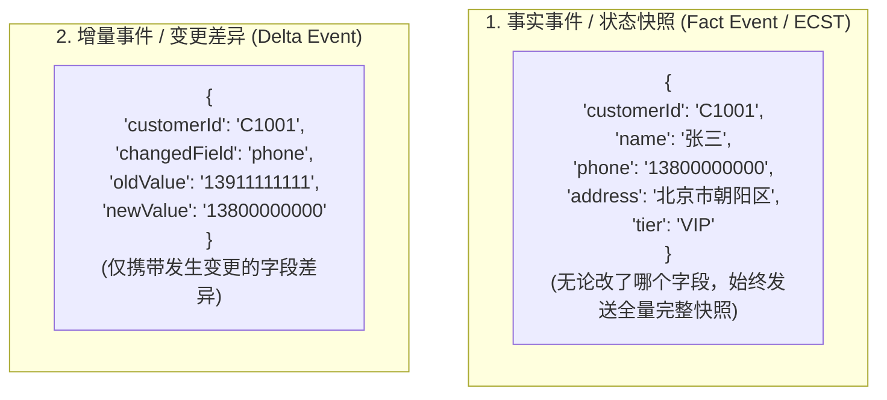
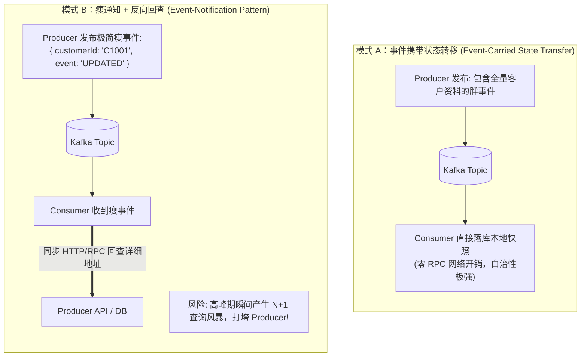
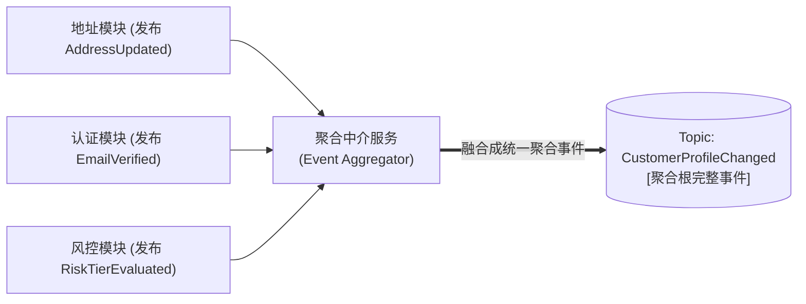
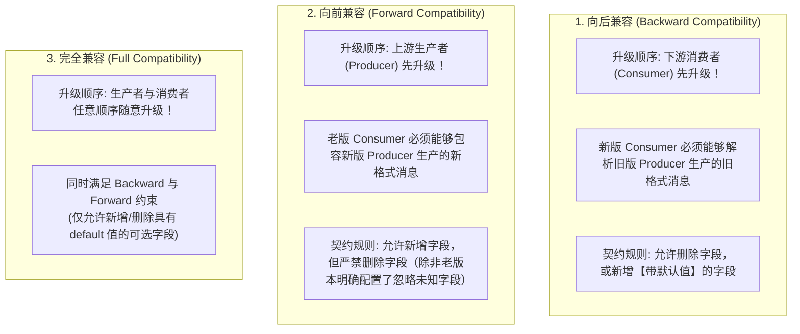
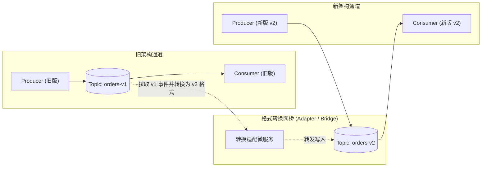
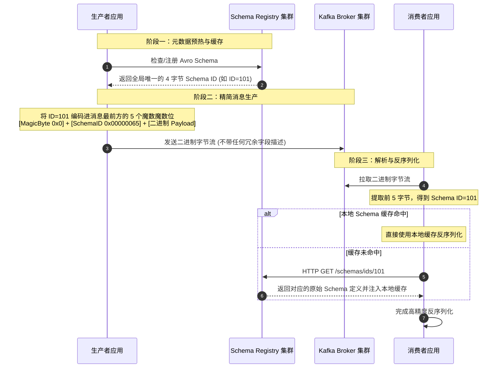
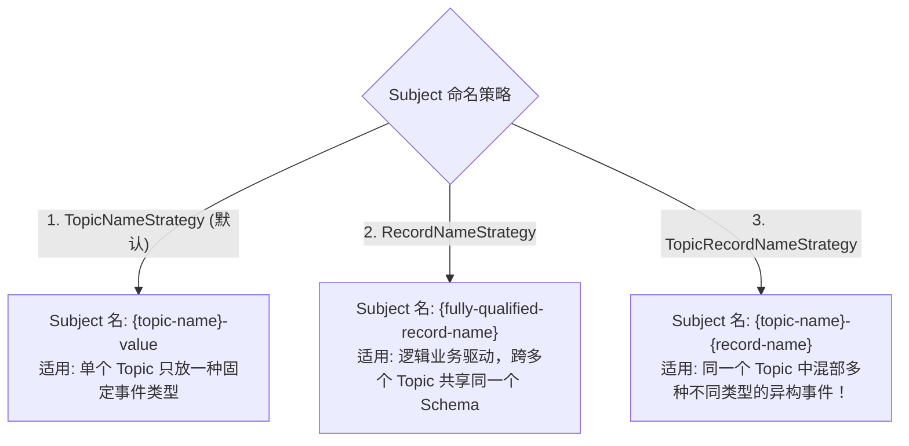

# 第 6 章：定义数据契约与 Schema 治理 (Defining Data Contracts)

> 本章核心目标：攻克分布式事件驱动架构中最大的团队协作与稳定性痛点——数据契约失控。系统解析事实事件（Fact）与增量事件（Delta）的建模取舍、事件状态转移（ECST）vs 瘦通知模式、Avro/Protobuf/JSON Schema 深度选型、Schema Registry 运作底层机制、演进兼容性模式（Backward/Forward/Full），以及企业级 Schema 治理的最佳实践与陷阱规避。

---

## 本章目录
1. [6.1 Kafka 如何处理事件结构（Schema 盲区）](#61-kafka-如何处理事件结构schema-盲区)
2. [6.2 领域事件的建模设计方法论](#62-领域事件的建模设计方法论)
   - [6.2.1 事实事件（Fact Events）vs 增量事件（Delta Events）](#621-事实事件fact-events-vs-增量事件delta-events)
   - [6.2.2 事件携带状态转移（ECST）vs 瘦通知回查模式](#622-事件携带状态转移ecst-vs-瘦通知回查模式)
   - [6.2.3 复合事件、原子事件与聚合根事件](#623-复合事件原子事件与聚合根事件)
   - [6.2.4 契约演进兼容性设计（向后、向前与完全兼容）](#624-契约演进兼容性设计向后向前与完全兼容)
   - [6.2.5 破局非兼容性变更：中介转换与双通道蓝绿迁移](#625-破局非兼容性变更中介转换与双通道蓝绿迁移)
   - [6.2.6 架构实战：Customer 360 项目的事件建模策略](#626-架构实战customer-360-项目的事件建模策略)
3. [6.3 企业级事件资产治理（Event Governance）](#63-企业级事件资产治理event-governance)
   - [6.3.1 序列化协议深度横向测评（JSON vs Avro vs Protobuf）](#631-序列化协议深度横向测评json-vs-avro-vs-protobuf)
   - [6.3.2 数据所有权（Data Ownership）：谁为契约负责？](#632-数据所有权data-ownership谁为契约负责)
   - [6.3.3 在 AsyncAPI 中固化并发布企业数据契约](#633-在-asyncapi-中固化并发布企业数据契约)
4. [6.4 深入 Schema Registry 体系](#64-深入-schema-registry-体系)
   - [6.4.1 Schema Registry 在 Kafka 架构中的交互闭环](#641-schema-registry-在-kafka-架构中的交互闭环)
   - [6.4.2 命名空间与 Subject 命名策略（Naming Strategies）](#642-命名空间与-subject-命名策略naming-strategies)
   - [6.4.3 七大兼容性校验级别详解](#643-七大兼容性校验级别详解)
   - [6.4.4 无注册中心方案 vs 商业级数据契约扩展](#644-无注册中心方案-vs-商业级数据契约扩展)
5. [6.5 契约治理中的经典陷阱与防御](#65-经典陷阱与防御)
   - [6.5.1 服务端缺乏强校验的漏洞与 Broker 端校验插件](#651-服务端缺乏强校验的漏洞与-broker-端校验插件)
   - [6.5.2 生产环境禁止自动注册 Schema（Auto-Register Anti-Pattern）](#652-生产环境禁止自动注册-schemaauto-register-anti-pattern)
   - [6.5.3 Compacted Topics 中无法向前兼容的致命陷阱](#653-compacted-topics-中无法向前兼容的致命陷阱)
   - [6.5.4 跨大版本事件重放与历史状态迁移（State Migration）](#654-跨大版本事件重放与历史状态迁移state-migration)
6. [6.6 本章小结与延伸资源](#66-本章小结与延伸资源)

---

## 6.1 Kafka 如何处理事件结构（Schema 盲区）

从设计哲学上看，**Kafka Broker 自身是“模式盲（Schema-Agnostic）”的**。在 Broker 眼中，所有消息的 Key 和 Value 都只是一串不可分割的、未经解析的二进制字节数组（`byte[]`）。

这种设计使得 Broker 极其轻量、速度极快，但也带来了一个严峻的架构挑战：**数据契约的解析与约束被完全甩到了生产者与消费者的代码层面**。



如果团队 A 在新版发布中删除了一个关键字段，或者将 `orderAmount` 从数字型改为了字符串型，Broker 不会做任何拦截。结果，下游十几个消费端系统在收到消息时，会瞬间同时抛出反序列化致命异常，导致大面积业务雪崩！

为了解决这一问题，企业必须在 Kafka 之外建立一套权威的**中央契约管理中心（Schema Registry）**。

---

## 6.2 领域事件的建模设计方法论

### 6.2.1 事实事件（Fact Events）vs 增量事件（Delta Events）

在事件驱动架构中，如何表达一个对象的状态变化？主要有两种流派：



| 选型维度 | 事实事件 (Fact Events / 全量状态转移) | 增量事件 (Delta Events / 差异事件) |
| :--- | :--- | :--- |
| **消费者自治能力** | **极高**。消费者无需持有历史状态，仅凭这一条消息即可更新本地完整视图 | **较弱**。消费者必须维护历史状态上下文，否则无法理解“差异”叠加后的最终结果 |
| **对乱序的容忍度** | **高**。结合时间戳或递增版本号，遇到旧版本直接丢弃即可 | **极低**。一旦发生网络抖动乱序，增量叠加必然导致数据彻底错乱！ |
| **网络带宽消耗** | 较高（包含未变更的冗余全量属性） | 极低（只传递发生改动的几字节） |
| **典型适用场景** | 客户画像、商品详情、订单最终状态、配置同步 | 资金流水（借贷金额变更）、库存扣减流水、计数器累加 |

---

### 6.2.2 事件携带状态转移（ECST）vs 瘦通知回查模式

这是微服务架构中最经典的权衡博弈：



> **架构师建议**：优先选用 **ECST 模式**。它让消费者在时间与空间上达到真正的独立自治，彻底消除了微服务之间的同步运行时依赖。

---

### 6.2.3 复合事件、原子事件与聚合根事件

在 DDD（领域驱动设计）实践中，一个业务操作可能涉及多个子实体的变动。
- **原子事件（Atomic Events）**：针对子实体的独立事件（如 `AddressUpdated`、`EmailVerified`、`PhoneChanged`）；
- **复合事件 / 聚合根事件（Composite / Aggregate Events）**：在中介层或业务域边界，将相关的多个事件融合成一个以**聚合根（Aggregate Root）**为单位的统一事件（如 `CustomerProfileUpdated`）。



---

### 6.2.4 契约演进兼容性设计（向后、向前与完全兼容）

软件系统必然演进，字段的新增、废弃在所难免。如何做到上游发布新契约时，下游老版本消费者不崩溃？



---

### 6.2.5 破局非兼容性变更：中介转换与双通道蓝绿迁移

如果业务发生了剧烈重构，必须进行**破坏性（Breaking Change）的非兼容性变更**（例如：将整套 Schema 结构推倒重写），此时强行在同一个 Topic 升级必然导致灾难。

**架构迁移方案：双通道双写蓝绿迁移法**：



1. 创建全新的主题 `orders-v2`；
2. 搭建转换网桥服务，将 `v1` 实时翻译注入 `v2`；
3. 下游各团队按自己的节奏逐步将客户端迁移到 `orders-v2`；
4. 当所有下游均迁移完成后，退役 `v1` 主题与转换服务。

---

### 6.2.6 架构实战：Customer 360 项目的事件建模策略

在 Customer 360 ODS 项目中：
- `CUSTOMER_PROFILES` 采用 **事实事件（Fact Events / ECST） + 日志压缩（Log Compaction）**：每次均广播用户的最新全量快照，下游 ODS 服务拿到即可直接覆盖本地缓存；
- `TRANSACTIONS` 采用 **不可变流水事件（Immutable Audit Log） + 时间保留（Delete Retention）**：每条交易是一笔已发生不可篡改的事实，永久追加留存。

---

## 6.3 企业级事件资产治理（Event Governance）

### 6.3.1 序列化协议深度横向测评（JSON vs Avro vs Protobuf）

| 评测维度 | 纯 JSON (无模式) | Apache Avro | Protocol Buffers (Protobuf) | JSON Schema |
| :--- | :--- | :--- | :--- | :--- |
| **数据自描述性** | 极高（可读文本） | 纯二进制（依赖外部 Schema） | 纯二进制（依赖生成的代码/契约） | 适中（JSON 文本 + 校验元数据） |
| **网络序列化体积** | 庞大（大量重复 Key 字符串） | **极致精炼**（体积仅为 JSON 的 20%~30%） | **极致精炼**（体积紧凑高效） | 较大 |
| **序列化/反序列化性能**| 慢（密集 CPU 字符串解析） | **极快**（二进制内存映射） | **极快**（业界最高性能标准） | 较慢 |
| **模式演进规范** | 缺乏原生支持 | **原生内置强规则**（与 Schema Registry 绝配） | **基于字段编号（Tag）的天然兼容性** | 支持，工具链较复杂 |
| **多语言代码生成** | 无需生成 | 支持多语言代码生成与通用泛型对象 | **全语言一流的强类型代码生成** | 工具生态较杂 |

---

### 6.3.2 数据所有权（Data Ownership）：谁为契约负责？

在微服务体系中，必须建立明确的治理原则：
> **数据契约的终极责任人是数据生产者所属的领域团队（Domain Team）！**  
> 
> - 生产者团队负责设计 Schema、编写业务字段注释、向 Schema Registry 注册新版本并保证向前/向后兼容；
> - 严禁消费者团队随意要求在生产者事件中塞入仅属于单个消费者的定制化私有字段；
> - 数据事件被定义为一种对全企业公开的**数据产品（Data as a Product）**。

---

### 6.3.3 在 AsyncAPI 中固化并发布企业数据契约

```yaml
# Listing 6.6: 在 AsyncAPI 中直接绑定 Avro 格式定义
components:
  schemas:
    CustomerProfileAvro:
      schemaFormat: 'application/vnd.apache.avro;version=1.9.0'
      schema:
        type: record
        name: CustomerProfile
        namespace: com.bookorbit.customer360
        doc: 客户全景画像核心数据契约
        fields:
          - name: customerId
            type: string
            doc: 客户唯一全局编号 (主键)
          - name: fullName
            type: string
            doc: 客户真实姓名
          - name: email
            type: string
            doc: 认证电子邮箱
          - name: riskLevel
            type: string
            default: "NORMAL"   # 设置默认值以确保向后兼容性！
            doc: 风险评级 (新增字段)
```

---

## 6.4 深入 Schema Registry 体系

### 6.4.1 Schema Registry 在 Kafka 架构中的交互闭环



- **高可用存储底座**：Schema Registry 本身是无状态的，它将所有的 Schema 变更以事件形式保存在 Kafka 集群内部的一个特殊单分区主题中——**`_schemas`**。每个节点通过消费该主题在本地内存中构建全量快照，并利用 Leader 选举进行并发控制。

---

### 6.4.2 命名空间与 Subject 命名策略（Naming Strategies）

Schema Registry 使用 **Subject（主题域）** 来标识一个 Schema 的演进版本链。有三种标准策略：



---

### 6.4.3 七大兼容性校验级别详解

| 兼容性级别 | 允许的变更规则 | 升级安全顺序 |
| :--- | :--- | :--- |
| **`BACKWARD`**（默认） | 只能删除字段，或添加带默认值的可选字段 | **消费者先升级**，再升级生产者 |
| **`FORWARD`** | 只能添加新字段，或删除带有默认值的字段 | **生产者先升级**，再升级消费者 |
| **`FULL`** | 只能添加或删除带有默认值的字段 | 生产者和消费者可按任意顺序自由升级 |
| **`NONE`** | 关闭所有兼容性校验（极度危险，生产严禁） | 无约束（可能引发下游瞬间崩溃） |
| **`BACKWARD_TRANSITIVE`** | 新版本不仅兼容上一版本，还必须兼容历史**所有旧版本**！ | 长期有历史消息回放诉求的系统必须开启 |
| **`FORWARD_TRANSITIVE`** | 新版本必须与历史所有旧版本的消费者兼容 | 存在超长生命周期消费者的场景 |
| **`FULL_TRANSITIVE`** | 跨历史所有版本的双向全量兼容 | 金融核心与最高等级公共数据资产的标准 |

---

### 6.4.4 无注册中心方案 vs 商业级数据契约扩展

- **轻量替代：代码共享库（Shared Jar / Git Submodule）**：
  不搭建 Schema Registry，直接在 Git 仓库维护 `.proto` 文件，通过 CI/CD 构建出 Java/Go/Python 的客户端 Jar 包供各团队引用。  
  *缺陷*：缺乏运行时拦截能力，老版本客户端即使跑在生产上也无法被中心化识别与阻断；
- **企业级 Stream Governance（如 Confluent Cloud 扩展）**：
  支持字段级基于 CEL（Common Expression Language）的业务规则校验（Data Quality Rules），以及基于密钥管理系统的**字段级实时透明加解密（Field-Level Encryption, CSFLE）**，保证身份证号、信用卡号在流转中自动加密。

---

## 6.5 契约治理中的经典陷阱与防御

### 6.5.1 服务端缺乏强校验的漏洞与 Broker 端校验插件
即使客户端接入了 Schema Registry，如果有未经验收的边缘程序或第三方工具绕过序列化器直接往 Topic 发送裸 JSON，Broker 依然会照单全收。
**防御策略**：在现代 Kafka 中开启 **Broker-Side Schema Validation（服务端模式校验插件）**，Broker 在收到批次时直接提取 Schema ID 并验证其在 Registry 中是否存在，若不合规直接拒绝写入（`INVALID_RECORD`）。

### 6.5.2 生产环境禁止自动注册 Schema（Auto-Register Anti-Pattern）
```properties
# 客户端配置参数：
auto.register.schemas=false # 生产环境必须强制关闭！
use.latest.version=true
```
若开启 `auto.register.schemas=true`，开发人员本地测试时的测试字段在启动瞬间就会自动上传到 Schema Registry 成为正式版本，造成元数据污染与冲突。
**正确姿势**：在 CI/CD 流水线中，通过 Maven/Gradle 插件或 Schema Registry API 进行严格的预编译兼容性校验与审批注册。

### 6.5.3 Compacted Topics 中无法向前兼容的致命陷阱
在启用了日志压缩（Log Compaction）的 Topic 中，**历史数据永远不会按时间过期！**  
如果新版消费者启动并从头回放数据，它会遇到 3 年前用 `v1` 版本 Schema 序列化的消息。如果系统仅配置了普通的非传递兼容性（`BACKWARD` 而非 `BACKWARD_TRANSITIVE`），新版消费者很可能在读取数年前的历史快照时发生反序列化崩溃。

---

## 6.6 本章小结与延伸资源

### 核心架构要点提炼
1. **契约即生命线**：在事件驱动架构中，Schema 就是服务之间的公共 API 协议，治理不可缺失；
2. **首选 ECST 事实事件**：让事件携带全量状态，消除运行时 RPC 依赖，赋予微服务真正自治；
3. **选型定乾坤**：高吞吐低带宽首选 Avro / Protobuf，并配合 Schema Registry 屏蔽底层字段名；
4. **守住兼容性底线**：生产环境务必采用 `FULL` 或 `TRANSITIVE` 级别，关闭客户端自动注册，将契约校验前置到 CI/CD 流水线中。

### 延伸资源与推荐阅读
- *Confluent Schema Registry Official Documentation*: 深入掌握 Subject 演进与 API 操作；
- *Google Protocol Buffers Language Guide (proto3)*: Protobuf 语法与向前兼容最佳实践；
- *Data Contracts: Modern Approaches for Delivering Reliable Data*: 探索现代数据契约在企业数据网格（Data Mesh）中的治理实践。
