# 第 7 章：Kafka 交互模式与架构实践 (Kafka Interaction Patterns)

> 本章核心目标：系统掌握在微服务与企业分布式环境中运用 Kafka 的高阶架构模式。深度解析哑管道与智能端点哲学、异步请求-响应模式（Request-Response）、CQRS 读写分离、事件溯源（Event Sourcing）与快照机制、分层存储（Tiered Storage）、数据网格（Data Mesh）下事件作为数据产品、Kafka Connect 内部运行机制、Kafka 跨多分区分布式事务与原子广播、以及解决双写不一致的终极解法——本地事务发件箱模式（Transactional Outbox Pattern）。

---

## 本章目录
1. [7.1 微服务架构中的 Kafka 交互模式](#71-微服务架构中的-kafka-交互模式)
   - [7.1.1 聪明端点与哑管道（Smart Endpoints, Dumb Pipes）](#711-聪明端点与哑管道smart-endpoints-dumb-pipes)
   - [7.1.2 异步请求-响应模式（Request-Response Pattern）](#712-异步请求-响应模式request-response-pattern)
   - [7.1.3 命令查询职责分离（CQRS）模式落地](#713-命令查询职责分离cqrs模式落地)
   - [7.1.4 事件溯源（Event Sourcing）与带位点的状态快照（Snapshotting）](#714-事件溯源event-sourcing与带位点的状态快照snapshotting)
   - [7.1.5 冷热数据分离与分层存储（Tiered Storage）](#715-冷热数据分离与分层存储tiered-storage)
2. [7.2 基于数据网格（Data Mesh）去中心化分析数据](#72-基于数据网格data-mesh去中心化分析数据)
   - [7.2.1 领域数据自治（Domain Ownership）](#721-领域数据自治domain-ownership)
   - [7.2.2 数据即产品（Data as a Product）在 Kafka 中的映射](#722-数据即产品data-as-a-product在-kafka-中的映射)
   - [7.2.3 联邦计算治理与自助式基础设施](#723-联邦计算治理与自助式基础设施)
3. [7.3 深度驾驭 Kafka Connect 数据集成管道](#73-深度驾驭-kafka-connect-数据集成管道)
   - [7.3.1 Kafka Connect 核心架构与分布式集群模型](#731-kafka-connect-核心架构与分布式集群模型)
   - [7.3.2 Connector、Task 与 Worker 的动态负载调度](#732-connectortask-与-worker-的动态负载调度)
   - [7.3.3 转换器（Converters）与序列化隔离](#733-转换器converters与序列化隔离)
   - [7.3.4 单消息转换器（SMT：Single Message Transformations）](#734-单消息转换器smt-single-message-transformations)
   - [7.3.5 Source 连接器：定时轮询 vs CDC 日志捕获](#735-source-连接器定时轮询-vs-cdc-日志捕获)
   - [7.3.6 Sink 连接器：批量写入与幂等 Upsert](#736-sink-连接器批量写入与幂等-upsert)
   - [7.3.7 架构实战：构建 Customer 360 数据接入连接器](#737-架构实战构建-customer-360-数据接入连接器)
   - [7.3.8 Kafka Connect 生产踩坑防范与故障排障](#738-kafka-connect-生产踩坑防范与故障排障)
4. [7.4 严密的端到端交付保障（Delivery Guarantees）](#74-严密的端到端交付保障delivery-guarantees)
   - [7.4.1 单机幂等写入（Idempotent Producer）的底层局限](#741-单机幂等写入idempotent-producer的底层局限)
   - [7.4.2 深入 Kafka 分布式事务（Consume-Transform-Produce）](#742-深入-kafka-分布式事务consume-transform-produce)
   - [7.4.3 隔离级别（read_committed）与提交标记（Commit Marker）](#743-隔离级别read_committed与提交标记commit-marker)
   - [7.4.4 双写不一致的克星：事务发件箱模式（Transactional Outbox Pattern）](#744-双写不一致的克星事务发件箱模式transactional-outbox-pattern)
5. [7.5 本章小结与延伸资源](#75-本章小结与延伸资源)

---

## 7.1 微服务架构中的 Kafka 交互模式

### 7.1.1 聪明端点与哑管道（Smart Endpoints, Dumb Pipes）

微服务设计先驱 Martin Fowler 提出的经典箴言——“聪明端点与哑管道”，在 Kafka 的设计中得到了最极致的体现。

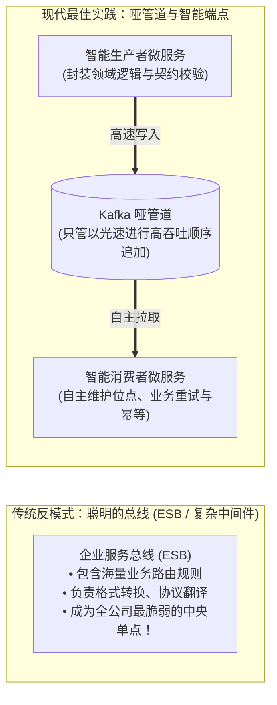

Kafka 故意保持 Broker 的极简与中立，业务语义的编排与转换完全交由两端的微服务完成。这样可以确保核心消息总线拥有极限的高性能与高可用性，业务变更无需改动任何中间件配置。

---

### 7.1.2 异步请求-响应模式（Request-Response Pattern）

尽管 Kafka 天生是单向发布-订阅的事件总线，但在某些特定场景下，调用方需要向目标服务发起异步询问并等待其回复。

为了在 Kafka 上实现请求-响应，需要使用 **关联标识符（Correlation ID）** 与 **回复主题（Reply Topic）**：

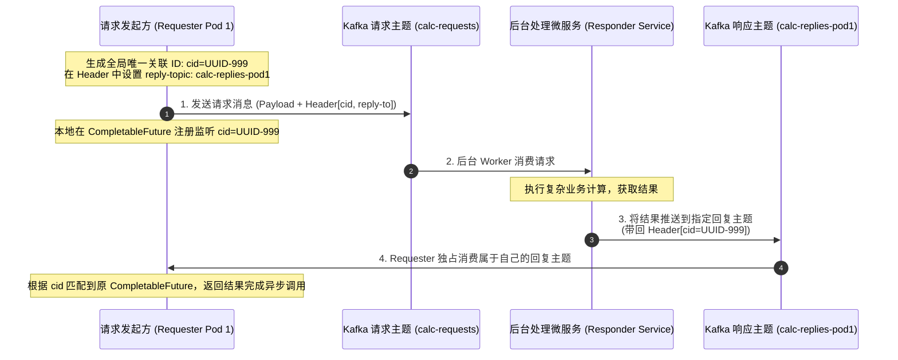

> **架构师警示与防坑要点**：
> 1. **避免为每次请求创建临时主题**：创建 Topic 涉及 Controller 元数据变更与磁盘文件分配，开销极大！
> 2. **推荐方案：每个客户端实例专属单个回复主题（或独占回复分区）**：Pod 启动时订阅自己的回复主题，实例崩溃退出时注销；
> 3. **超时兜底**：必须在内存中对请求设置严格的超时清除器，防止未响应的请求导致内存泄露。

---

### 7.1.3 命令查询职责分离（CQRS）模式落地

在复杂业务系统中，写模型（Command）需要严密的领域完整性校验与高并发写入；而读模型（Query）需要面向多样化业务界面的组合投影（Projections）。

Kafka 是连接 CQRS 写端与读端的天然桥梁：

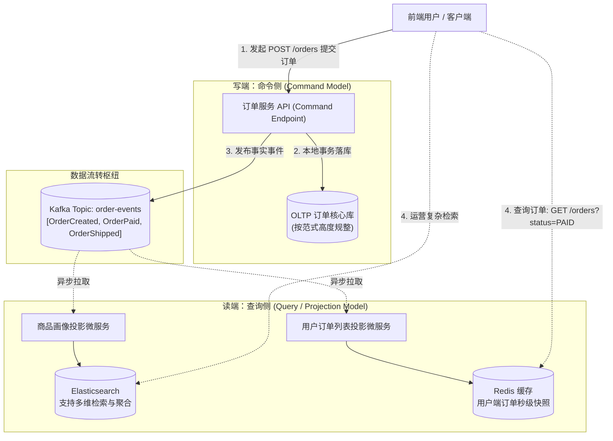

- **读写完全解耦**：查询端的扩容、挂掉甚至重建投影，完全不会对核心下单交易链路造成哪怕 1 毫秒的性能影响；
- **多维视图异构**：同一个事件流，可以根据业务需要同时投影进 Elasticsearch、Redis 或 Neo4j 图数据库中。

---

### 7.1.4 事件溯源（Event Sourcing）与带位点的状态快照（Snapshotting）

在事件溯源（Event Sourcing）架构中，**系统的持久化状态不是当前的一条记录，而是导致该状态发生的所有历史事件日志的全集**。

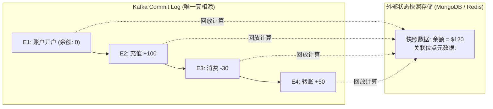

#### 状态重构的性能痛点与快照机制（Snapshotting）：
如果一个系统运行了 5 年，某个实体的历史事件多达数万条，若每次实例重启都从 Offset 0 开始重新计算，启动时间将长达数小时。  
**解法**：
1. 定期（如每 1000 个事件或每晚）将实体的计算结果生成一份快照写入外部存储（MongoDB / RocksDB）；
2. 快照中**必须严格附带对应的 `<topic, partition, offset>` 坐标**；
3. 实例重启时：直接加载快照状态，随后调用 `consumer.seek(partition, snapshot_offset + 1)`，仅需增量回放快照之后极少量的几个事件即可瞬间恢复最新状态！

---

### 7.1.5 冷热数据分离与分层存储（Tiered Storage）

长期以来，Kafka 最大的痛点是持久化数据成本极高——所有数据都必须存放在昂贵的本地高性能 NVMe SSD 磁盘上。

从 Kafka 3.6 开始引入并在现代架构中普及的 **分层存储（Tiered Storage）** 带来了质的飞跃：

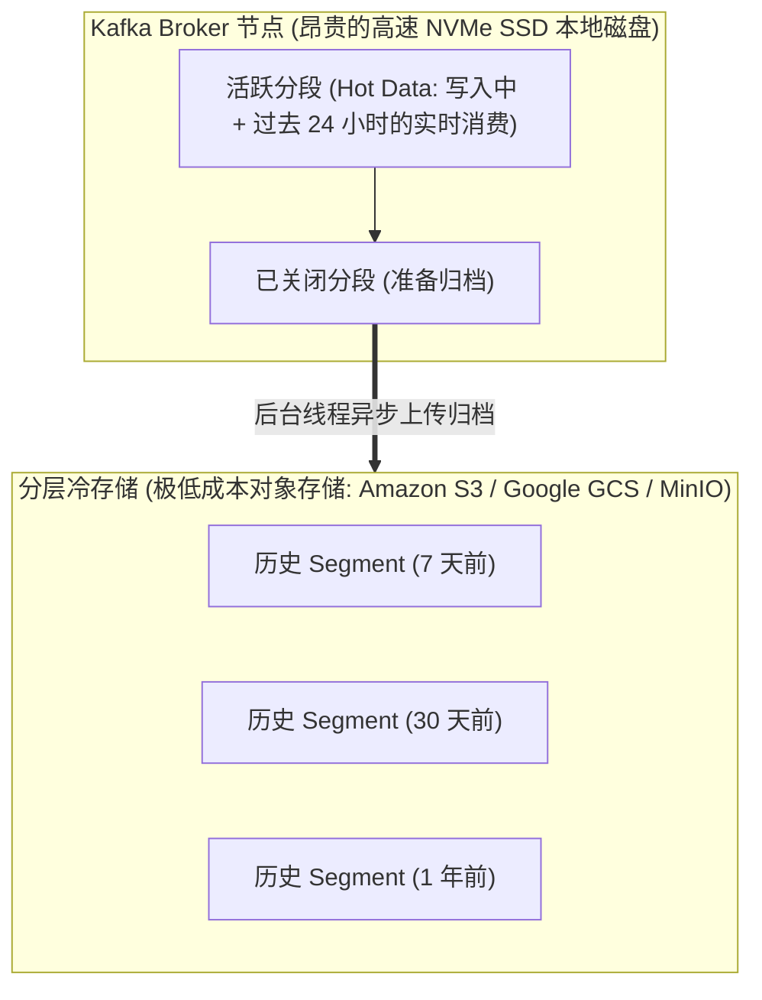

- **大幅降低 70%~90% 的存储成本**：Broker 本地 SSD 仅需保留数小时到 1 天的热数据；历史数据全自动透明迁移到廉价对象存储；
- **存算分离的优雅折中**：写入与最新消费完全享受本地 NVMe SSD 的极致性能与零拷贝，历史分析回放时由 Broker 负责从 S3 流式拉取分段返回给客户端。

---

## 7.2 基于数据网格（Data Mesh）去中心化分析数据

传统集中式大数据团队（Data Team）常常成为企业创新的瓶颈。数据网格（Data Mesh）主张将分析数据的责任归还给各个业务领域团队。

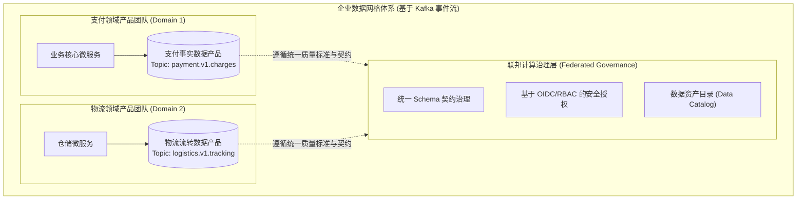

### 数据作为产品（Data as a Product）的四大核心准则：
1. **可发现性（Discoverability）**：所有对外的 Kafka Topic 必须在中央 Catalog 注册，配备清晰的业务含义描述；
2. **可理解性（Understandability）**：强制绑定规范的 Schema（Protobuf/Avro），提供字段级文档；
3. **可信度（Trustworthiness）**：生产者团队必须提供 SLO 承诺（如事件投递延迟 < 1 秒，可用性 99.99%）；
4. **原生安全性（Security）**：基于 mTLS 与细粒度 ACL 访问控制。

---

## 7.3 深度驾驭 Kafka Connect 数据集成管道

### 7.3.1 Kafka Connect 核心架构与分布式集群模型

Kafka Connect 是 Kafka 生态系统中专门用于无代码双向集成的独立分布式计算框架：

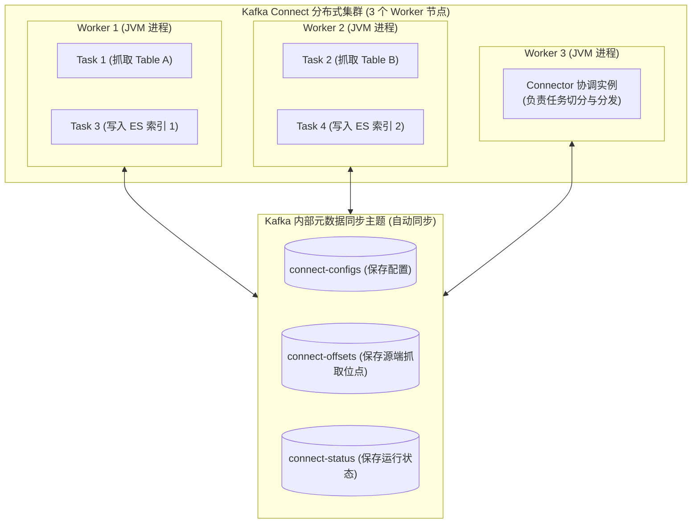

- **内部状态主题化**：Connect 自身不需要任何独立的数据库，它使用 3 个特殊的内部 Kafka Topic（配置表、位点表、状态表）来同步集群状态，天然享受 Kafka 自身的高可用与容灾；
- **高弹性自愈**：当某台 Worker 物理机宕机时，集群内部会通过类似消费者组的机制自动触发内部 Rebalance，将其承载的 Tasks 迅速迁移至健康的 Worker 节点上恢复执行。

---

### 7.3.2 Connector、Task 与 Worker 的动态负载调度
- **Connector**：负责定义数据从哪里来、到哪里去，并负责将大任务物理拆分为多个平行的子任务配置；
- **Task**：真正执行数据搬运与网络 I/O 的并发工作线程。每个 Task 负责处理数据源的一个切片（例如 Debezium 中的一个表或分库）；
- **Worker**：实际承载 Task 运行的宿主 JVM 进程或 Docker 容器。

---

### 7.3.3 转换器（Converters）与序列化隔离

这是 Kafka Connect 最容易混淆的概念。ConnectRecord 在框架内部是强类型的 Java 对象模型，**转换器（Converter）负责在内部模型与 Kafka Topic 的二进制字节之间进行编解码**：

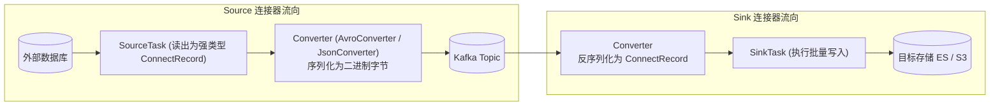

---

### 7.3.4 单消息转换器（SMT：Single Message Transformations）

在数据流入 Kafka 或导出至下游前，常常需要做一些微小、无状态的轻量处理（如敏感字段脱敏、时间戳提取路由、修改 Topic 名称）。

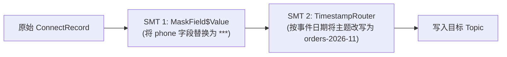

---

### 7.3.5 Source 连接器：定时轮询 vs CDC 日志捕获

| 捕获方式 | 代表实现 | 核心机制 | 致命缺陷与隐患 |
| :--- | :--- | :--- | :--- |
| **基于时间戳轮询 (Query-based)** | JDBC Source Connector | 定时执行 `SELECT * WHERE update_time > :last_offset` | 1. 无法感知物理删除（DELETE 操作直接漏掉）；<br/>2. 频繁扫大表对业务数据库产生巨大慢查压力；<br/>3. 时间戳精度不够时在高并发下漏数据。 |
| **变更数据捕获 (Log-based CDC)** | Debezium (Postgres/MySQL) | 伪装成从库直接读取底层的 Binlog / WAL 物理事务日志 | 1. 完美捕获 INSERT/UPDATE/DELETE 全量动作；<br/>2. 零业务表查询开销，极低延迟（毫秒级）。 |

---

### 7.3.6 架构实战：构建 Customer 360 数据接入连接器

```json
// Listing 7.1: 为 Customer 360 ODS 创建基于 Debezium 的 PostgreSQL CDC 声明式配置
{
  "name": "customer-profile-cdc-source",
  "config": {
    "connector.class": "io.debezium.connector.postgresql.PostgresConnector",
    "tasks.max": "1",
    "database.hostname": "pg-cluster.internal",
    "database.port": "5432",
    "database.user": "cdc_user",
    "database.password": "secure_pass",
    "database.dbname": "core_business",
    "database.server.name": "customer_db",
    "table.include.list": "public.customer_profiles",
    
    // 强制使用 Avro 与 Schema Registry
    "key.converter": "io.confluent.connect.avro.AvroConverter",
    "key.converter.schema.registry.url": "http://schema-registry:8081",
    "value.converter": "io.confluent.connect.avro.AvroConverter",
    "value.converter.schema.registry.url": "http://schema-registry:8081",
    
    // 使用 SMT 提取真实变更后的新状态
    "transforms": "unwrap",
    "transforms.unwrap.type": "io.debezium.transforms.ExtractNewRecordState"
  }
}
```

---

## 7.4 严密的端到端交付保障（Delivery Guarantees）

### 7.4.1 单机幂等写入（Idempotent Producer）的底层局限
如第 3 章所述，开启 `enable.idempotence=true` 只能保证**单个生产者会话向单个分区追加写入时的不重不漏**。但如果一个业务涉及跨多个 Topic、或者跨“读取-计算-写出”的复合操作，幂等生产者就无能为力了。

---

### 7.4.2 深入 Kafka 分布式事务（Consume-Transform-Produce）

在流处理微服务中，最核心的诉求是：**原子地处理输入消息并产生输出消息与位点提交**。要么全部成功，要么全部回滚！

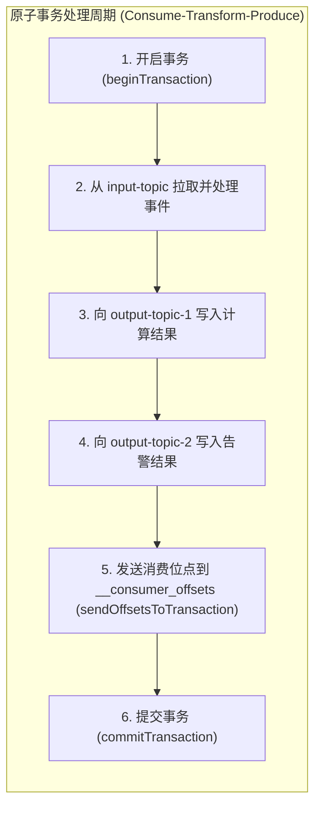

#### 底层协调机制：
1. **Transaction Coordinator（事务协调者）**：运行在某个 Broker 上的核心组件，负责驱动两阶段提交（2PC）；
2. **事务状态日志主题（`__transaction_state`）**：以极为严格的复制因子与持久化参数记录每个事务的生命周期（`Ongoing` -> `PrepareCommit` -> `Committed`）；
3. **提交控制标记（Commit Marker）**：当事务成功时，Coordinator 会向本次事务涉及的所有分区末尾写入一条特殊的**控制消息（Control Batch）**。

---

### 7.4.3 隔离级别（read_committed）与提交标记（Commit Marker）

消费者通过配置 `isolation.level` 决定其可见性：

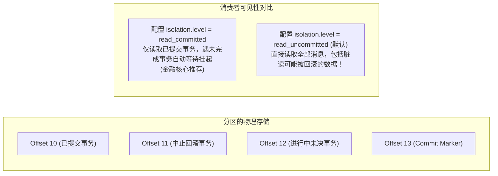

---

### 7.4.4 双写不一致的克星：事务发件箱模式（Transactional Outbox Pattern）

微服务中最臭名昭著的事故之一就是**“先写本地数据库还是先发 Kafka”的分布式双写难题**：
- 先写数据库成功，发送 Kafka 时网络中断 $\rightarrow$ 下游永远丢失事件！
- 先发 Kafka 成功，本地数据库事务提交失败回滚 $\rightarrow$ 下游处理了虚假幽灵事件！

**业界终极标准解法：本地事务发件箱模式（Transactional Outbox Pattern）**：

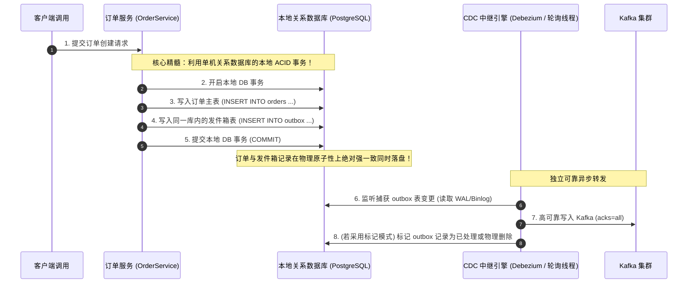

- **保证零数据丢失**：通过本地单机事务彻底规避了分布式两阶段提交（XA/2PC）的致命性能瓶颈与脆弱性；
- **实现端到端 At-Least-Once**：发件箱事件必定能稳定流入 Kafka。

---

## 7.5 本章小结与延伸资源

### 核心架构要点提炼
1. **坚守哑管道底线**：将复杂业务逻辑下沉在两端微服务端点中，守护消息骨干的高性能与极简；
2. **读写分离与事件溯源**：CQRS 与 Event Sourcing 让状态的演进具备了时空回放与按需多维投影的强大能力；
3. **Kafka Connect 赋能数据网格**：利用成熟的 CDC 插件（Debezium）与声明式 SMT，消除冗余的手写集成代码；
4. **事务与发件箱守门**：分布式场景下拒绝直连双写，牢牢依靠 Transactional Outbox 捍卫业务与事件的原子强一致。

### 延伸资源与推荐阅读
- *Transactional Outbox Pattern Documentation (Microservices.io by Chris Richardson)*: 事务发件箱设计规范；
- *Debezium Official Architecture Guide*: 深入学习基于底层数据库日志的 CDC 实现；
- *Kafka Connect Deep Dive (Confluent)*: Connectors, Tasks, and Converters 深度进阶指南。
