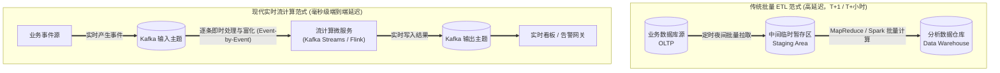
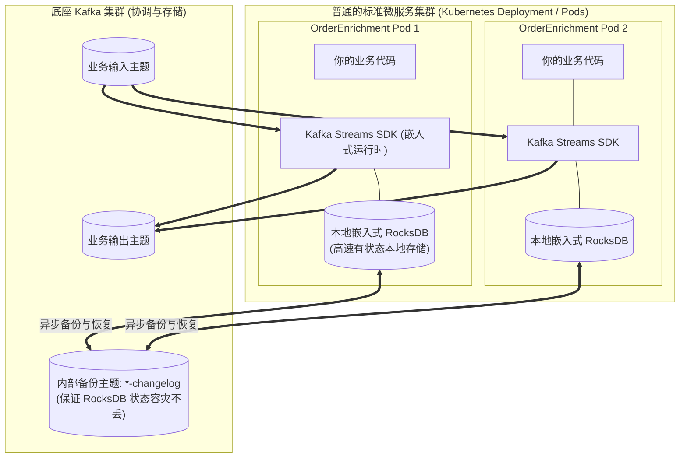
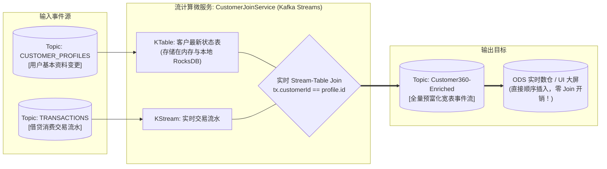
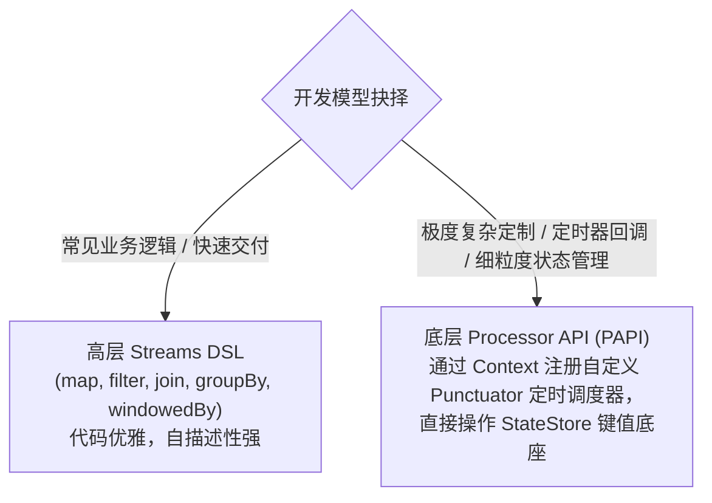
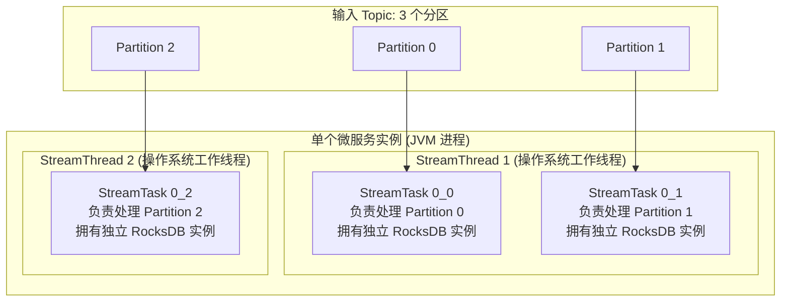
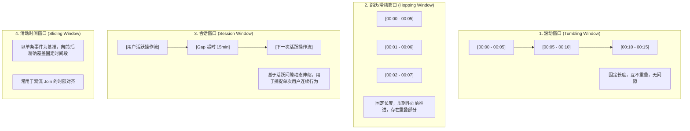
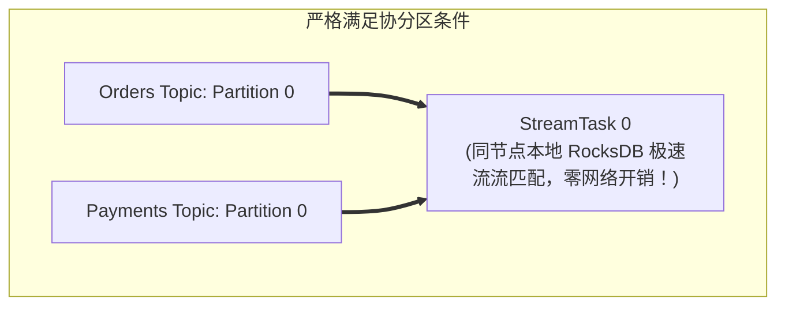
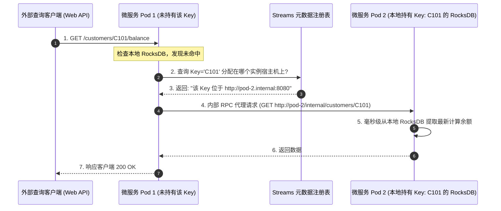
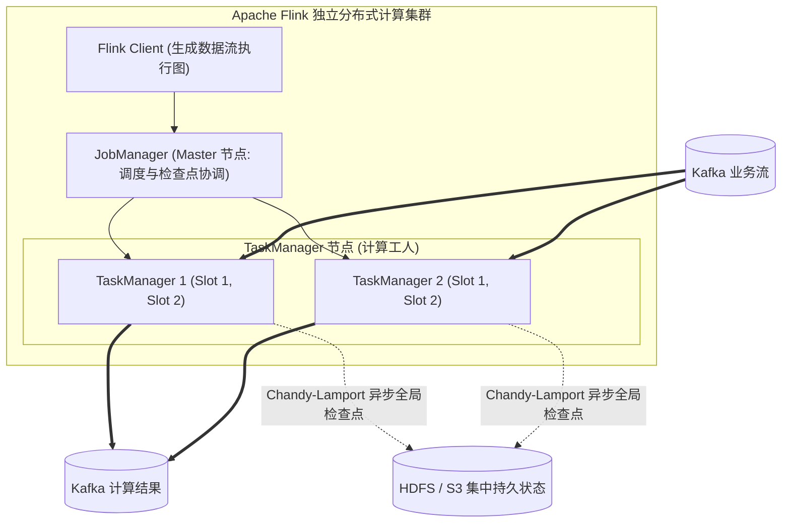

# 第 8 章：设计流处理应用程序 (Designing Streaming Applications)

> 本章核心目标：系统掌握在 Kafka 生态中构建生产级有状态与无状态实时流计算系统的架构心智。深度剖析传统批处理 ETL/ELT 与流处理的本质分野、Kafka Streams 内部运行时模型（Stream Threads、Tasks 与嵌入式 RocksDB）、窗口计算、流-流/流-表 Join 的协分区（Co-partitioning）硬性约束、交互式查询（Interactive Queries）、以及主流选型（Kafka Streams vs ksqlDB vs Apache Flink）的架构决策矩阵与容错调优。

---

## 本章目录
1. [8.1 流处理基础与 Kafka Streams 架构体系](#81-流处理基础与-kafka-streams-架构体系)
   - [8.1.1 批处理 ETL/ELT 与实时流计算的范式演变](#811-批处理-etlelt-与实时流计算的范式演变)
   - [8.1.2 Kafka Streams 核心架构与轻量级无依赖设计](#812-kafka-streams-核心架构与轻量级无依赖设计)
   - [8.1.3 拓扑构建：Streams DSL 与声明式算子](#813-拓扑构建streams-dsl-与声明式算子)
2. [8.2 架构实战：基于流处理重构 Customer 360 ODS](#82-架构实战基于流处理重构-customer-360-ods)
3. [8.3 深度驾驭数据流计算核心算子与机制](#83-深度驾驭数据流计算核心算子与机制)
   - [8.3.1 无状态操作（Stateless Operations）](#831-无状态操作stateless-operations)
   - [8.3.2 有状态操作（Stateful Operations）与状态存储底座](#832-有状态操作stateful-operations与状态存储底座)
   - [8.3.3 底层 Processor API (PAPI) 与高层 DSL 的权衡](#833-底层-processor-api-papi-与高层-dsl-的权衡)
   - [8.3.4 内部运行时解构：Threads、Tasks 与故障自愈](#834-内部运行时解构threads-tasks-与故障自愈)
   - [8.3.5 四大时间窗口计算（Windowing Operations）](#835-四大时间窗口计算windowing-operations)
   - [8.3.6 双流连接（Joins）与协分区（Co-partitioning）铁律](#836-双流连接joins与协分区co-partitioning铁律)
   - [8.3.7 交互式查询（Interactive Queries）：去中心化内存数据库](#837-交互式查询interactive-queries去中心化内存数据库)
4. [8.4 替代流计算技术全景横向选型](#84-替代流计算技术全景横向选型)
   - [8.4.1 Confluent ksqlDB：声明式流式 SQL 与推拉查询](#841-confluent-ksqldb声明式流式-sql-与推拉查询)
   - [8.4.2 Apache Flink：企业级全功能分布式有状态流计算引擎](#842-apache-flink企业级全功能分布式有状态流计算引擎)
   - [8.4.3 云厂商托管流计算服务权衡](#843-云厂商托管流计算服务权衡)
5. [8.5 流处理工程落地中的经典挑战与防御](#85-流处理工程落地中的经典挑战与防御)
   - [8.5.1 内存与磁盘容量规划（RocksDB 堆外内存防 OOM）](#851-内存与磁盘容量规划rocksdb-堆外内存防-oom)
   - [8.5.2 乱序数据与迟到事件（Late-Arriving Data）优雅处理](#852-乱序数据与迟到事件late-arriving-data优雅处理)
   - [8.5.3 状态恢复耗时与热备任务（Standby Tasks）防雪崩](#853-状态恢复耗时与热备任务standby-tasks防雪崩)
6. [8.6 本章小结与延伸资源](#86-本章小结与延伸资源)

---

## 8.1 流处理基础与 Kafka Streams 架构体系

### 8.1.1 批处理 ETL/ELT 与实时流计算的范式演变

传统数据仓库采用批量抽取-转换-加载（ETL）模式：



- **批处理是流处理的特例**：流处理视所有数据为**无界的持续事件流（Unbounded Stream）**，无需等待数据落盘即在流动中直接计算，彻底消除了数据价值随时间流逝而衰减的痛点。

---

### 8.1.2 Kafka Streams 核心架构与轻量级无依赖设计

市面上绝大多数流计算引擎（如 Apache Flink、Spark Streaming）都是重型框架，要求架构师额外部署和运维一个独立的分布式计算集群（包含 Master/Worker、资源管理器 YARN/K8s Operator 等）。

**Kafka Streams 的设计哲学截然相反：它只是一个标准的 Java 原生类库（Library）！**



- **零额外集群运维**：只需在 Spring Boot / Quarkus 微服务中引入 Maven 依赖，即可像启动普通 Web 容器一样直接水平扩容；
- **利用 Kafka 原生能力**：利用 Kafka 消费组实现并发分区分配与动态故障转移，利用 Kafka 内部日志主题（Changelog Topic）保证本地状态存储的高可用。

---

### 8.1.3 拓扑构建：Streams DSL 与声明式算子

Kafka Streams 使用**处理拓扑（Processor Topology）**描述计算逻辑。通过高级声明式 DSL，几行代码即可构建生产级流计算链路：

```java
// Listing 8.1: 实时订单过滤与富化流水线示例
StreamsBuilder builder = new StreamsBuilder();

// 1. 从原始 orders 主题拉取无界流
KStream<String, OrderEvent> rawOrders = builder.stream("orders");

// 2. 声明式拓扑管道：过滤高价值订单并清洗数据
KStream<String, HighValueOrder> processedOrders = rawOrders
    .filter((orderId, order) -> order.getAmount() > 1000.0) // 过滤小于 1000 元的订单
    .mapValues(order -> new HighValueOrder(order.getId(), order.getAmount(), order.getCustomerId()))
    .selectKey((k, v) -> v.getCustomerId()); // 将 Key 改写为 customerId 以便后续聚合

// 3. 将计算结果实时输出到目标主题
processedOrders.to("high-value-orders");

KafkaStreams streams = new KafkaStreams(builder.build(), config);
streams.start();
```

---

## 8.2 架构实战：基于流处理重构 Customer 360 ODS

在第 2 章中，Customer 360 系统的初版设计是由下游消费者直接监听 `CUSTOMER_PROFILES` 与 `TRANSACTIONS` 两个主题，在写入 ODS 数据库时做繁重的联合查询。随着交易吞吐飙升，ODS 数据库连接池被打爆。

**流计算架构重构方案——引入中间流式连接服务（`CustomerJoinService`）**：



交易事件流在流入 ODS 之前，就在流动中与客户画像完成了内存级的秒速拼接富化，下游数据库只需无脑单表写入，吞吐提升了 **10 倍以上**！

---

## 8.3 深度驾驭数据流计算核心算子与机制

### 8.3.1 无状态操作（Stateless Operations）
处理单条事件时不依赖历史上下文：
- `filter` / `filterNot`：条件筛选；
- `map` / `mapValues`：单条转换；
- `flatMap` / `flatMapValues`：一对多展开；
- `branch`：条件分流。

### 8.3.2 有状态操作（Stateful Operations）与状态存储底座
当计算需要依赖历史状态时（如：统计各区域过去 1 小时的订单总金额、对账去重、双流拼接）：
- **RocksDB 嵌入式状态存储（State Store）**：Kafka Streams 默认在本地磁盘集成高效的 C++ 键值存储引擎 RocksDB，读写完全基于本地内存与磁盘，避开网络 RPC；
- **Changelog Topic 远程容灾**：本地 RocksDB 的每一次状态变更，后台线程都会静默异步写入 Kafka 内部的压缩主题（`*-changelog`）。当该 Pod 宕机被 K8s 调度到新节点时，新节点拉取该主题即可迅速在本地重建 RocksDB 状态！

---

### 8.3.3 底层 Processor API (PAPI) 与高层 DSL 的权衡



---

### 8.3.4 内部运行时解构：Threads、Tasks 与故障自愈



- **Task 是并发执行与状态隔离的原子单元**；
- 输入 Topic 有几个分区，Kafka Streams 内部就会恰好实例化出几个 Task；
- 每个 Task 独占属于自己的本地 RocksDB 状态分片，**完全没有任何跨线程的锁争用与资源死锁**。

---

### 8.3.5 四大时间窗口计算（Windowing Operations）



---

### 8.3.6 双流连接（Joins）与协分区（Co-partitioning）铁律

在分布式环境中，将两股独立的流进行 Join 计算（如 `Orders.join(Payments)`）是一个巨大的挑战。如果订单事件落在 Broker 1 的 Partition 0，而对应的支付事件落在 Broker 3 的 Partition 2，流处理任务将不得不通过网络进行跨节点数据重分布（Shuffle），引发网络海啸。

> **Kafka Streams 的核心架构铁律——协分区约束（Co-partitioning Requirement）**：  
> 参与 Join 的所有输入 Topic，必须满足以下三大前置条件：
> 1. **分区数量必须完全相等**（例如两者都必须是 12 分区）；
> 2. **分区键（Key）必须一致**（例如都按 `orderId` 分区）；
> 3. **使用的分区路由哈希算法必须完全相同**。



如果两者的分区数不一致，Kafka Streams 拓扑在启动时会抛出致命异常，或者被迫在底层隐式创建一个内部重分区主题（`repartition`），导致额外的网络双写与磁盘开销。

---

### 8.3.7 交互式查询（Interactive Queries）：去中心化内存数据库

通常，计算结果必须写入外部数据库（如 Redis/MySQL），业务前端才能查询。
**Kafka Streams 提供了革命性的“交互式查询”能力**：每个微服务实例内部的 RocksDB 状态存储本身就是一个微型、低延迟的 NoSQL 数据库！



架构师完全可以借助 Interactive Queries 省去外部集中式缓存的搭建与授权成本。

---

## 8.4 替代流计算技术全景横向选型

### 8.4.1 Confluent ksqlDB：声明式流式 SQL 与推拉查询

ksqlDB 是专门为 Kafka 打造的事件流数据库。开发人员无需编写一行 Java 代码，只需编写标准的 SQL 语句即可完成流计算拓扑构建。

```sql
-- Listing 8.2: 在 ksqlDB 中声明持久流并按区域实时统计订单量
CREATE STREAM orders_stream (
    order_id VARCHAR KEY,
    customer_id VARCHAR,
    region VARCHAR,
    amount DOUBLE
) WITH (
    KAFKA_TOPIC = 'orders',
    VALUE_FORMAT = 'AVRO'
);

-- 创建物化视图：实时统计每分钟各区域的销售总额
CREATE TABLE regional_sales_per_minute AS
SELECT region,
       COUNT(*) AS order_count,
       SUM(amount) AS total_revenue
FROM orders_stream
WINDOW TUMBLING (SIZE 1 MINUTE)
GROUP BY region
EMIT CHANGES;
```

- **Push Query（推查询）**：客户端通过 HTTP/2 长连接订阅，一旦后台计算出新结果，持续推流给客户端；
- **Pull Query（拉查询）**：类似于传统 SQL 查询，瞬间拉取当前物化视图中的最新状态快照。

---

### 8.4.2 Apache Flink：企业级全功能分布式有状态流计算引擎

当流计算的复杂度超越了单应用微服务范畴，走向全公司跨数据源的大规模复杂事件处理（CEP）时，**Apache Flink** 是当之无愧的工业界霸主。



#### Kafka Streams vs Apache Flink 核心选型决胜矩阵：

| 评估维度 | Kafka Streams | Apache Flink |
| :--- | :--- | :--- |
| **部署与运维形态** | **轻量 Java 类库**。无独立集群，打包进业务 Pod，随微服务一同通过 K8s 部署扩缩容 | **重量级独立计算集群**。需专门维护 JobManager、TaskManager、独立网络与存储资源 |
| **数据源支持** | **仅原生支持 Kafka**（输入与输出都必须是 Kafka Topic） | **极其广泛的通用连接器**（Kafka、Pulsar、HDFS、Iceberg、JDBC、Kinesis 等） |
| **流处理表达力** | 面向常规微服务事件富化、聚合、窗口与 Join 足够优秀 | **图计算、复杂事件处理 (CEP)、机器学习在线推理、批流完全一体** |
| **状态快照机制** | 本地 RocksDB + 写入 Kafka Changelog 压缩主题 | **Chandy-Lamport 异步全局分布式快照**（Checkpoints 到 HDFS/S3） |
| **最佳业务归宿** | **微服务架构团队**。想要将流计算当作业务逻辑内嵌，免去平台运维包袱 | **大数据平台与专业数仓团队**。构建统一的大规模实时数据流处理中台 |

---

## 8.5 流处理工程落地中的经典挑战与防御

### 8.5.1 内存与磁盘容量规划（RocksDB 堆外内存防 OOM）
RocksDB 属于 C++ JNI 本地内存调用，其内存分配不受 JVM `-Xmx` 限制。许多团队把 JVM 堆设为 16GB，运行一段时间后 Pod 突然被 K8s 内核以 **OOMKilled (Exit Code 137)** 强制杀死，就是因为 RocksDB 的 MemTable 与 BlockCache 占满了容器物理内存！
> **架构调优**：必须实现 `RocksDBConfigSetter` 接口，显式严格压低 `BlockBasedTableConfig.setBlockCacheSize` 与 `writeBufferSize`。

### 8.5.2 乱序数据与迟到事件（Late-Arriving Data）优雅处理
网络延迟可能导致 5 分钟前产生的事件现在才流入。
窗口算子提供了 **宽限期（Grace Period）** 机制：
```java
TimeWindows.ofSizeWithNoGrace(Duration.ofMinutes(5)) // 严苛丢弃
TimeWindows.ofSizeAndGrace(Duration.ofMinutes(5), Duration.ofMinutes(1)) // 额外允许迟到 1 分钟内的事件补算入历史窗口！
```

### 8.5.3 状态恢复耗时与热备任务（Standby Tasks）防雪崩
如果某个 Pod 崩溃，且其本地 RocksDB 积累了 50GB 状态数据，新节点从 Kafka Changelog 重建 50GB 数据可能需要漫长的 20 分钟，在此期间整个分区的流处理将处于瘫痪停顿状态！  
**架构防御**：开启 **`num.standby.replicas=1`**。让其他存活的 Pod 在后台实时预热拉取热备副本。一旦主实例挂掉，备用实例在 **毫秒级内无缝接管计算**，彻底消灭恢复延迟！

---

## 8.6 本章小结与延伸资源

### 核心架构要点提炼
1. **打破批处理枷锁**：事件在流动的毫秒瞬间即被计算与富化，这是业务竞争力的巨大跃迁；
2. **微服务选 Kafka Streams，大数据平台选 Flink**：根据团队运维能力与系统边界进行理性选型，严禁为了流计算而无脑引入重型大数据集群；
3. **协分区是 Join 核心基石**：分区数与 Key 哈希不一致，双流 Join 必然引发灾难；
4. **防御状态雪崩**：严密管控 RocksDB 堆外内存，配置 Standby Replicas 抵御冷启动重放停顿。

### 延伸资源与推荐阅读
- *Kafka Streams in Action* by Bill Bejeck: 实战掌握 Topology、StateStore 与流处理最佳实践；
- *Stream Processing with Apache Flink* by Fabian Hueske: 深入理解无界事件流与 Chandy-Lamport 分布式快照；
- *ksqlDB: The Event Streaming Database*: 学习声明式流式 SQL 的架构实现。
