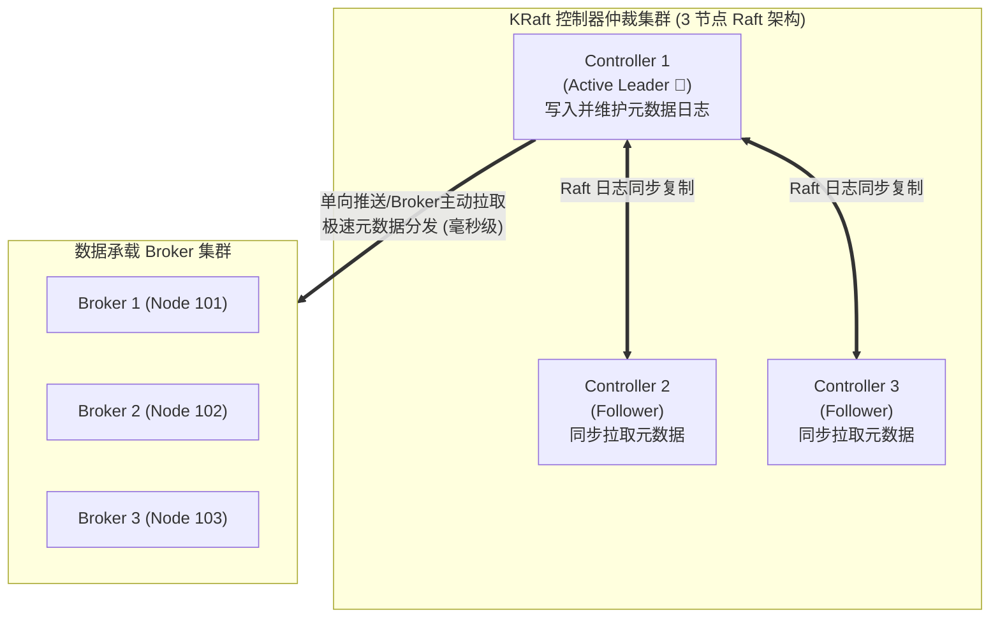
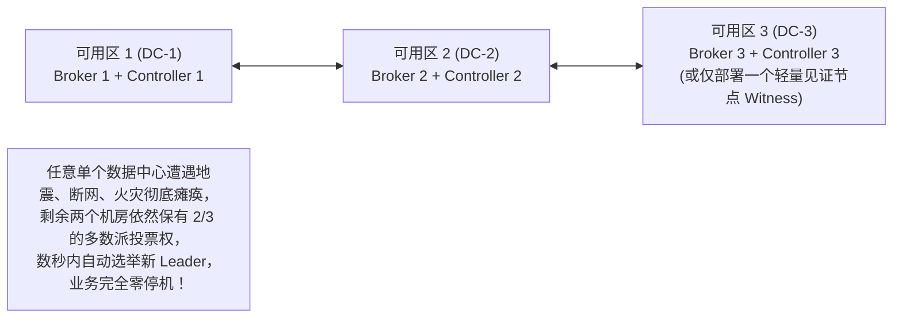
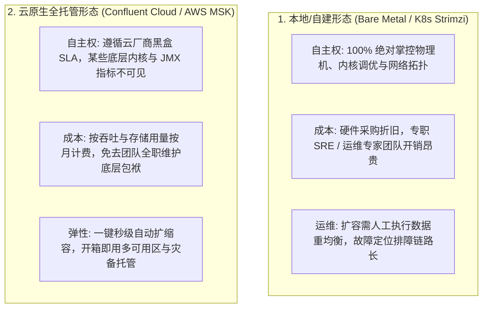
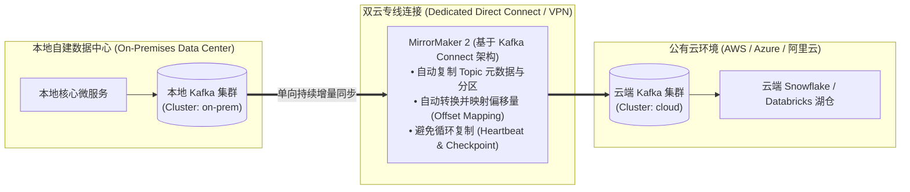
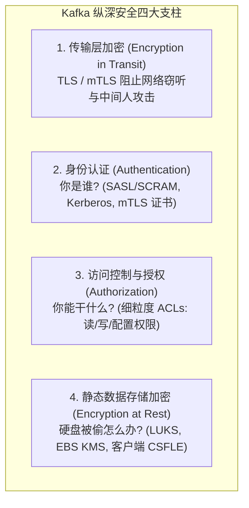
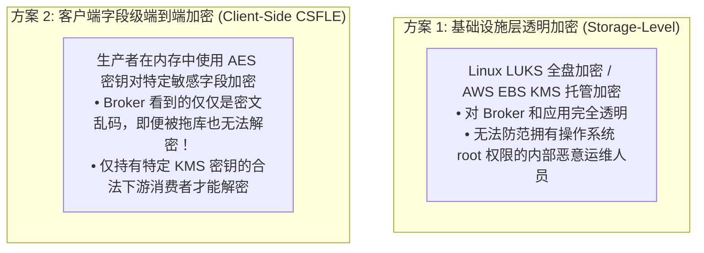

# 第 9 章：企业级 Kafka 管理与安全 (Managing Kafka within the Enterprise)

> 本章核心目标：系统掌握 Kafka 在大型企业 IT 基础设施中的生产级治理与纵深安全防御。深入解析新一代 KRaft 控制器仲裁机制、跨多数据中心（Multi-DC）容灾与法定人数（Quorum）设计、自建 vs 云原生托管部署权衡、混合云数据同步网桥（MirrorMaker 2）、以及全链路安全闭环：mTLS 双向传输加密、SASL 认证矩阵、细粒度 ACL 鉴权与端到端静态数据加密（Data-at-Rest Encryption）。

---

## 本章目录
1. [9.1 现代元数据治理：全面拥抱 KRaft 架构](#91-现代元数据治理全面拥抱-kraft-架构)
   - [9.1.1 KRaft 控制器仲裁（Controller Quorum）与 Raft 共识协议](#911-kraft-控制器仲裁controller-quorum与-raft-共识协议)
   - [9.1.2 跨机房容灾与脑裂防范：为什么必须是 3 个数据中心？](#912-跨机房容灾与脑裂防范为什么必须是-3-个数据中心)
   - [9.1.3 元数据提交日志（Metadata Log）与内存快照加速](#913-元数据提交日志metadata-log与内存快照加速)
   - [9.1.4 生产级集群节点配置实战（Broker 角色与 Controller 角色隔离）](#914-生产级集群节点配置实战broker-角色与-controller-角色隔离)
   - [9.1.5 控制器主从切换与故障演练](#915-控制器主从切换与故障演练)
   - [9.1.6 告别 ZooKeeper：历史局限与演进全景](#916-告别-zookeeper历史局限与演进全景)
2. [9.2 基础设施部署形态全方位权衡](#92-基础设施部署形态全方位权衡)
   - [9.2.1 本地私有化自建 vs 公有云托管服务深度评估](#921-本地私有化自建-vs-公有云托管服务深度评估)
   - [9.2.2 混合云架构（Hybrid Cloud）：Kafka Connect 与 MirrorMaker 2 跨云网桥](#922-混合云架构hybrid-cloudkafka-connect-与-mirrormaker-2-跨云网桥)
   - [9.2.3 架构实战：Customer 360 项目的部署选型决策](#923-架构实战customer-360-项目的部署选型决策)
3. [9.3 构筑企业级纵深安全防御体系（Security Solution）](#93-构筑企业级纵深安全防御体系security-solution)
   - [9.3.1 Kafka 安全体系全景框架](#931-kafka-安全体系全景框架)
   - [9.3.2 传输层加密：TLS 与 mTLS 双向身份鉴权](#932-传输层加密tls-与-mtls-双向身份鉴权)
   - [9.3.3 身份认证（Authentication）技术选型矩阵（PLAIN / SCRAM / Kerberos / OAuth）](#933-身份认证authentication技术选型矩阵plain--scram--kerberos--oauth)
   - [9.3.4 细粒度资源访问控制列表（ACLs 授权）](#934-细粒度资源访问控制列表acls-授权)
   - [9.3.5 静态数据加密（Data-at-Rest Encryption）：客户端、代理层与存储层](#935-静态数据加密data-at-rest-encryption客户端代理层与存储层)
   - [9.3.6 架构实战：为 Customer 360 落地全链路安全加固](#936-架构实战为-customer-360-落地全链路安全加固)
4. [9.4 本章小结与延伸资源](#94-本章小结与延伸资源)

---

## 9.1 现代元数据治理：全面拥抱 KRaft 架构

在 Apache Kafka 3.x 以前，集群的元数据（主题、分区分布、ISR 成员、访问控制 ACL）存放在外部的 Apache ZooKeeper 集群中。这导致了严重的两大瓶颈：
1. **元数据同步双重开销**：Broker 既要维持与 ZooKeeper 的心跳，又要由单一的 Active Controller 充当翻译官，向其他 Broker 单向同步，百万级分区时 Controller 经常面临 OOM 和长 GC 停顿；
2. **运维复杂度高**：两套分布式系统并存，安全认证、网络监控与备份恢复全部需要双倍精力。

**从 Kafka 3.3 GA、4.0 强制使用的 KRaft（Kafka Raft Metadata Mode）从根本上统一了控制面！**

---

### 9.1.1 KRaft 控制器仲裁（Controller Quorum）与 Raft 共识协议



- **Controller Quorum（仲裁集）**：由奇数台节点（通常为 3 或 5 个）组成；
- **Active Leader**：所有元数据变更（如新建 Topic、修改配置）由 Leader Controller 统一接收，追加到自己的元数据日志中，并向 Followers 同步。只要多数派（Majority）确认写入，该变更即宣告成功落盘。

---

### 9.1.2 跨机房容灾与脑裂防范：为什么必须是 3 个数据中心？

在跨可用区（AZ）或跨数据中心（DC）规划容灾时，许多团队直觉上会选择部署 2 个数据中心（如主机房 DC-A 部署 2 个 Controller，备用机房 DC-B 部署 1 个 Controller）。

> **架构师警示：双机房部署是分布式仲裁的致命死穴！**

```mermaid
flowchart TD
    subgraph DC_A["数据中心 A (DC-A: 部署 2 个 Controller)"]
        C1["Controller 1"]
        C2["Controller 2"]
    end

    subgraph DC_B["数据中心 B (DC-B: 部署 1 个 Controller)"]
        C3["Controller 3"]
    end

    DC_A <-.-|机房间光纤挖断 / 网络分区|-> DC_B

    ResultA["DC-A 拥有 2 票（刚好满足 3 节点的多数派 $\ge 2$）<br/>勉强维持集群运行"]
    ResultB["DC-B 仅剩 1 票（$< 2$ 丧失 Quorum）<br/>无法提供任何元数据写入与故障切换！<br/>若断电的是 DC-A，全系统瞬间脑死亡！"]
```

#### 正确的企业级多机房容灾范式——3 个可用区架构：



---

### 9.1.3 元数据提交日志（Metadata Log）与内存快照加速

KRaft 将整个集群的状态视作一个专用的、特殊的只追加分区：`@metadata-0`。
- **内存元数据高速缓存**：所有 Controller 和 Broker 都在本地内存中维护一份最新的元数据树（Metadata Cache），客户端发起查询时直接从内存无锁读取，延迟几乎为零；
- **定期元数据快照（Metadata Snapshots）**：随着时间推移，元数据日志不可能无休止膨胀。Controller 会定期生成快照文件（如 `00000000000000050000.checkpoint`），新上线的 Broker 无需从头回放几十万条日志，只需加载最新快照并追加最新的少量增量记录即可秒级完成初始化！

---

### 9.1.4 生产级集群节点配置实战（Broker 角色与 Controller 角色隔离）

在开发或微型测试环境中，可以将单个节点同时配置为 `process.roles=broker,controller`（混合模式）。但在**企业级生产环境，强烈推荐实行物理角色隔离**：

```properties
# Listing 9.1: 专用控制器节点配置 (kraft-controller-1.properties)
node.id=1
process.roles=controller
listeners=CONTROLLER://kafka-ctrl-1.internal:9093
controller.listener.names=CONTROLLER
# 定义整个 Quorum 的固定投票节点拓扑
controller.quorum.voters=1@kafka-ctrl-1.internal:9093,2@kafka-ctrl-2.internal:9093,3@kafka-ctrl-3.internal:9093
metadata.log.dir=/var/lib/kafka/metadata-log
```

```properties
# Listing 9.2: 专用 Broker 数据节点配置 (kafka-broker-1.properties)
node.id=101
process.roles=broker
listeners=INTERNAL://0.0.0.0:9092,EXTERNAL://0.0.0.0:9094
advertised.listeners=INTERNAL://broker-101.internal:9092,EXTERNAL://public-lb.corp.com:9094
controller.listener.names=CONTROLLER
# 指定 Controller 仲裁列表
controller.quorum.voters=1@kafka-ctrl-1.internal:9093,2@kafka-ctrl-2.internal:9093,3@kafka-ctrl-3.internal:9093
inter.broker.listener.name=INTERNAL
log.dirs=/data/disk1/kafka-data,/data/disk2/kafka-data
```

---

## 9.2 基础设施部署形态全方位权衡

### 9.2.1 本地私有化自建 vs 公有云托管服务深度评估



---

### 9.2.2 混合云架构（Hybrid Cloud）：Kafka Connect 与 MirrorMaker 2 跨云网桥

许多跨国企业或金融机构要求：核心生产库必须保留在本地私有数据中心，而大数据分析、机器学习模型训练与弹性报表运行在公有云上。

**基于 MirrorMaker 2 的跨云主动数据复制（Active-Passive / Active-Active）**：



- **MM2 核心特性**：不同于早期脆弱的 MM1，MirrorMaker 2 底层基于 Kafka Connect 分布式架构运行。它会自动在云端创建命名空间隔离的镜像主题（如 `on-prem.orders`），并且通过内部的 `checkpoints` 主题持续记录两套集群之间的**消费位点映射表**，允许消费者在发生灾难时实现跨云无缝故障转移！

---

## 9.3 构筑企业级纵深安全防御体系（Security Solution）

未配置安全的 Kafka 集群在内网中相当于**完全裸奔**：任何人只要知道 IP 和端口，就能随意读取核心客户数据、甚至调用 AdminClient 删除核心主题。



---

### 9.3.2 传输层加密：TLS 与 mTLS 双向身份鉴权

通过配置双向 TLS（mTLS），不仅网络流量全部被高强度加密，Broker 还能直接通过客户端出具的 X.509 数字证书提取客户端公钥指纹进行身份鉴别。

```properties
# Listing 9.3: Broker 端 TLS 核心配置
listeners=SSL://0.0.0.0:9093
ssl.keystore.location=/var/private/ssl/server.keystore.jks
ssl.keystore.password=KeystorePassword123
ssl.key.password=KeyPassword123
ssl.truststore.location=/var/private/ssl/server.truststore.jks
ssl.truststore.password=TruststorePassword123
# 强制要求客户端提供合法的证书（双向认证 mTLS）
ssl.client.auth=required
```

---

### 9.3.3 身份认证（Authentication）技术选型矩阵

| 认证协议 | 底层依赖与原理 | 安全强度 | 架构复杂度 | 最佳适用场景 |
| :--- | :--- | :--- | :--- | :--- |
| **`mTLS`** | 基于 CA 签发的 X.509 客户端证书 | 极高 | 证书轮转与到期更新需要专门自动化工具（如 Cert-Manager） | 服务间通信（Service-to-Service）、跨数据中心网桥 |
| **`SASL/SCRAM`**（SCRAM-SHA-512） | 基于加盐哈希的用户名/密码质询，密码不在网络中明文传输 | 高 | 适中。账号直接保存在 Kafka 内部元数据中，无需外部服务 | **绝大多数常规企业私有集群的黄金首选！** |
| **`SASL/GSSAPI` (Kerberos)** | 依赖企业 Active Directory (AD) 或 MIT Kerberos KDC | 极高 | 极重！需要维护 KDC、Keytab 分发和时钟严格同步 | 传统金融行业、大型银行内网体系 |
| **`SASL/OAUTHBEARER`** | 基于标准 OAuth 2.0 / OIDC JWT 令牌，向 IdP（如 Keycloak、Okta）验签 | 极高 | 适中。云原生生态友好 | 现代云原生微服务、企业统一单点登录与移动端接入 |

---

### 9.3.4 细粒度资源访问控制列表（ACLs 授权）

一旦客户端通过认证并确立了主权身份（`Principal: User:order-service`），Kafka 的内置授权器（AclAuthorizer）就会对每一次操作进行拦截裁决。

```bash
# Listing 9.8: 使用 kafka-acls CLI 为订单服务授予最小权限原则的 ACL 规则
# 允许用户 order-service 向以 "orders-" 开头的主题进行并发写入
kafka-acls --bootstrap-server kafka-broker:9092 \
  --add \
  --allow-principal User:order-service \
  --operation Write \
  --operation Describe \
  --topic orders- \
  --resource-pattern-type prefixed

# 允许其在特定消费者组内拉取数据
kafka-acls --bootstrap-server kafka-broker:9092 \
  --add \
  --allow-principal User:order-service \
  --operation Read \
  --group order-service-group
```

---

### 9.3.5 静态数据加密（Data-at-Rest Encryption）

即使启用了 TLS 和 SASL，如果黑客直接侵入服务器偷走物理硬盘，或者从云平台创建了磁盘快照，依然能从磁盘二进制 `.log` 文件中看到明文。



---

### 9.3.6 架构实战：为 Customer 360 落地全链路安全加固

在 Customer 360 项目中，架构师制定的安全落地方案：
1. **网络层**：全链路强制启用 TLS 1.3 传输加密；
2. **认证层**：内部服务采用 **SASL/SCRAM-SHA-512** 统一认证体系；
3. **授权层**：
   - `ProfileService` 仅拥有对 `CUSTOMER_PROFILES` 的 `Write` 权限；
   - `TransactionService` 仅拥有对 `TRANSACTIONS` 的 `Write` 权限；
   - `Customer360Service` 仅拥有对两者的 `Read` 权限，严禁反向越权写入；
4. **合规审计**：对客户的电话、身份证号在流入总线前采用客户端字段级加密，保障数据满足 GDPR 与国家数据安全法规范。

---

## 9.4 本章小结与延伸资源

### 核心架构要点提炼
1. **KRaft 彻底重塑运维**：摒弃 ZooKeeper 后，单集群分区能力跃升，3 可用区部署是避免脑裂的黄金标准；
2. **混合云首选 MirrorMaker 2**：借助成熟的 Connect 架构与位点自动映射，搭建跨云跨地域数据高速公路；
3. **安全绝无后补，必须开箱即行**：生产集群必须在第一天即落地 `mTLS/SASL` 认证与基于白名单的最小特权 ACL 治理；
4. **纵深防御策略**：结合基础设施全盘加密与敏感数据客户端 CSFLE，抵御多维度黑客渗透。

### 延伸资源与推荐阅读
- *KIP-500: Replace ZooKeeper with a Self-Managed Metadata Quorum*: 深入掌握 KRaft 架构蓝图；
- *Strimzi Apache Kafka on Kubernetes*: 官方出品的 K8s Operator 生产实战指南；
- *Kafka Security Official Documentation*: SSL、SASL 与 ACL 参数配置全景白皮书。
