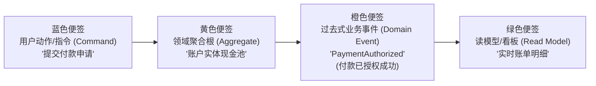
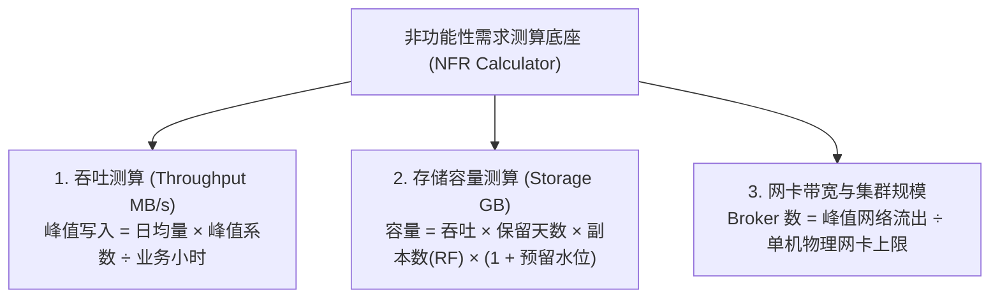
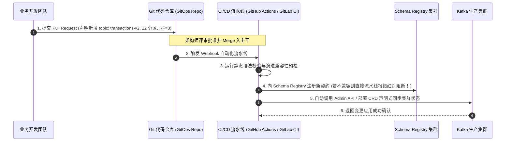
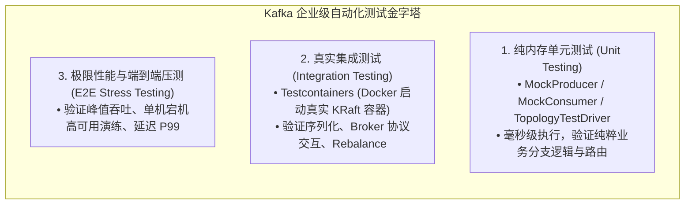
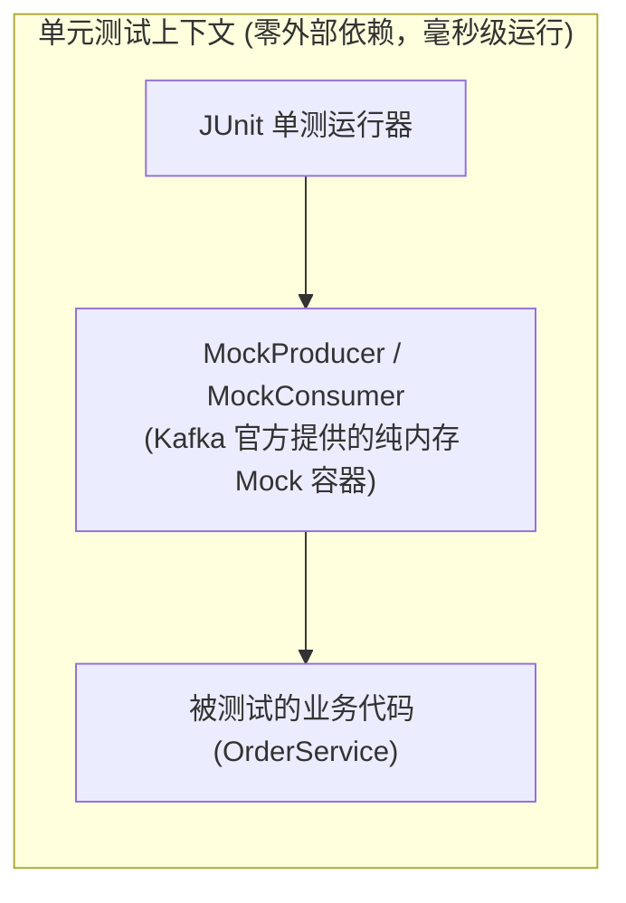
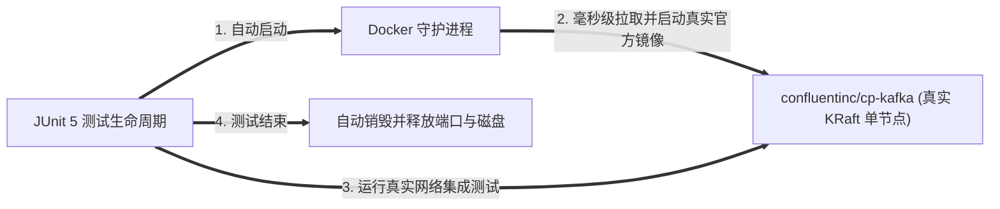

# 第 10 章：规划与组织 Kafka 工程项目 (Organizing a Kafka Project)

> 本章核心目标：系统掌握从 0 到 1 推动 Kafka 工程项目落地的完整方法论。深入剖析事件风暴（Event Storming）需求提炼工作坊、非功能性需求（吞吐、延迟、RPO/RTO、存储）容量测算模型、基于 GitOps 与 Kubernetes Operator 的声明式集群基础设施治理、多环境隔离策略、以及完备的三层测试金字塔（Mock 单元测试、Embedded 内存测试、Testcontainers 容器集成测试与压测实操）。

---

## 本章目录
1. [10.1 提炼与定义 Kafka 项目需求](#101-提炼与定义-kafka-项目需求)
   - [10.1.1 业务事件流的挖掘：事件风暴（Event Storming）实战](#1011-业务事件流的挖掘事件风暴event-storming实战)
   - [10.1.2 从业务流程到领域事件建模](#1012-从业务流程到领域事件建模)
   - [10.1.3 主题（Topic）功能性需求清单梳理](#1013-主题topic功能性需求清单梳理)
   - [10.1.4 架构师必备：非功能性需求（NFR）精细化容量测算](#1014-架构师必备非功能性需求nfr精细化容量测算)
2. [10.2 声明式维护集群拓扑结构（GitOps）](#102-声明式维护集群拓扑结构gitops)
   - [10.2.1 告别手动黑盒：关闭自动建表（auto.create.topics.enable=false）](#1021-告别手动黑盒关闭自动建表autocreatetopicsenablefalse)
   - [10.2.2 现代 GitOps 流水线：Git + CI/CD 声明式驱动变更](#1022-现代-gitops-流水线git--cicd-声明式驱动变更)
   - [10.2.3 基于 Kubernetes Operator (Strimzi) 与 Argo CD 的自动化编排](#1023-基于-kubernetes-operator-strimzi-与-argo-cd-的自动化编排)
   - [10.2.4 编程式管理：深入 Kafka Admin API](#1024-编程式管理深入-kafka-admin-api)
   - [10.2.5 多环境（Dev / Staging / Prod）隔离治理方案](#1025-多环境dev--staging--prod隔离治理方案)
   - [10.2.6 架构实战：Customer 360 项目的环境拓扑治理](#1026-架构实战customer-360-项目的环境拓扑治理)
3. [10.3 构建完备的 Kafka 测试金字塔（Testing Strategy）](#103-构建完备的-kafka-测试金字塔testing-strategy)
   - [10.3.1 第一层：单元测试（Unit Testing）与 Mock 虚拟驱动](#1031-第一层单元测试unit-testing与-mock-虚拟驱动)
   - [10.3.2 第二层：集成测试（Integration Testing）选型与实践](#1032-第二层集成测试integration-testing选型与实践)
     - [方案 A：共享测试集群（Shared Staging Cluster）](#方案-a共享测试集群shared-staging-cluster)
     - [方案 B：内存嵌入式集群（EmbeddedKafkaBroker）](#方案-b内存嵌入式集群embeddedkafkabroker)
     - [方案 C：现代黄金标准——基于 Testcontainers 的容器化真实测试](#方案-c现代黄金标准基于-testcontainers-的容器化真实测试)
   - [10.3.3 第三层：极限性能压测（Performance & Stress Testing）](#1033-第三层极限性能压测performance--stress-testing)
4. [10.4 本章小结与延伸资源](#104-本章小结与延伸资源)

---

## 10.1 提炼与定义 Kafka 项目需求

在许多失败的 Kafka 项目中，团队往往在技术选型一开始就陷入了“建几个分区、开几个副本”的技术细节，却从未真正从业务领域出发理清“系统到底在传递什么事实”。

### 10.1.1 业务事件流的挖掘：事件风暴（Event Storming）实战

**事件风暴（Event Storming）** 是一种源自 DDD 的轻量级、跨职能业务建模工作坊。业务专家、领域架构师与核心开发人员共聚一堂，用不同颜色的便签在白板上重塑全流程：



- **核心原则：用过去式（Past Tense）命名事件**！  
  例如：`OrderCreated`（订单已创建）、`InventoryReserved`（库存已锁定）、`InvoiceGenerated`（发票已开具）。  
  过去式强制团队建立正确心智——**事件是已经发生的不可变更的客观事实，绝不允许撤回或修改**！

---

### 10.1.2 从业务流程到领域事件建模

在梳理完业务脉络后，需要将其规整为结构化的事件契约字典：

| 业务步骤 | 领域事件名称 | 触发源系统 | 消费者系统 | 核心承载载荷 (Payload) |
| :--- | :--- | :--- | :--- | :--- |
| 用户更改手机号 | `CustomerPhoneUpdated` | 用户画像系统 | 营销系统、风控系统、客服门户 | `{ customerId, newPhone, verifyChannel }` |
| 线下 POS 机刷卡 | `CardSwipedEvent` | 支付网关服务 | 核心账务、实时反欺诈引擎 | `{ txId, cardNo, amount, merchantId, timestamp }` |

---

### 10.1.3 主题（Topic）功能性需求清单梳理

在为每个事件落地 Kafka Topic 之前，必须在架构评审中明确以下四项功能指标：
1. **分区键（Partition Key）**：决定事件按什么维度强保序与负载均衡；
2. **保序范围（Ordering Scope）**：是单实体内有序（指定 Key），还是无需保序追求极限打散（无 Key / 黏性分区）；
3. **交付语义（Delivery Semantics）**：是否允许重试重复（At-Least-Once），还是必须金融级幂等甚至跨系统 Exactly-Once；
4. **清理策略（Cleanup Policy）**：是流水型随时间删除（`delete`），还是快照状态型按主键压缩留存（`compact`）。

---

### 10.1.4 架构师必备：非功能性需求（NFR）精细化容量测算

很多团队在项目上线前不知道要买多少台服务器、多大带宽。架构师必须通过严密的物理数学公式推导全系统容量：



#### 真实容量测算范例：
设某零售交易系统：
- 峰值写入事件量：$10,000\text{ 消息/秒}$；
- 单条消息平均体积：$2\text{ KB}$；
- 副本因子（RF）：$3$；
- 目标保留期限：$7\text{ 天}$；
- 操作系统与索引额外开销：预留 $20\%$。

$$\text{峰值写入带宽} = 10,000 \times 2\text{ KB} = 20,000\text{ KB/s} \approx 20\text{ MB/s}$$

考虑 3 副本同步，集群物理总写入流量为：$20\text{ MB/s} \times 3 = 60\text{ MB/s}$。  
若下游有 3 个独立的消费者组拉取，总网络流出带宽为：$20\text{ MB/s} \times 3 = 60\text{ MB/s}$。

$$\text{7 天裸数据净存储} = 20\text{ MB/s} \times 3600 \times 24 \times 7 \approx 12.09\text{ TB}$$
$$\text{考虑 3 副本与安全预留} = 12.09\text{ TB} \times 3 \times 1.2 \approx \mathbf{43.5\text{ TB SSD 本地存储}}$$

---

## 10.2 声明式维护集群拓扑结构（GitOps）

### 10.2.1 告别手动黑盒：关闭自动建表（auto.create.topics.enable=false）

在默认情况下，Kafka 的 `auto.create.topics.enable=true`。这意味着任何开发人员在代码里把 Topic 名字拼错了一个字母（如把 `orders` 写成 `odrers`），生产者一发消息，Broker 就会**悄悄用默认的 1 个分区、1 个副本自动在生产建表**！

> **生产第一铁律**：**所有生产集群必须全局强制设置 `auto.create.topics.enable=false`！**  
> 严禁代码运行时隐式创建主题，所有主题必须经过审批，通过自动化声明式工具提前创建。

---

### 10.2.2 现代 GitOps 流水线：Git + CI/CD 声明式驱动变更

在成熟的企业架构中，禁止任何工程师通过 SSH 直连生产 Broker 敲 CLI 命令新建 Topic 或修改配置。所有资产由 **Git 代码仓库充当唯一真相源（Single Source of Truth）**。



---

### 10.2.3 基于 Kubernetes Operator (Strimzi) 与 Argo CD 的自动化编排

在云原生 Kubernetes 体系中，**Strimzi Operator** 提供了标准的自定义资源（Custom Resource Definition, CRD）：

```yaml
# 声明一个生产级 Kafka 主题资源 (KafkaTopic CRD)
apiVersion: kafka.strimzi.io/v1beta2
kind: KafkaTopic
metadata:
  name: customer-profiles
  labels:
    strimzi.io/cluster: production-cluster
spec:
  partitions: 9
  replicas: 3
  config:
    cleanup.policy: compact
    min.insync.replicas: 2
    segment.bytes: 1073741824 # 1GB 一个 Segment
```

**Argo CD** 控制器时刻监听 Git 仓库与 K8s 集群状态的差异，一旦在 Git 中将 `partitions: 9` 改为 `partitions: 12` 并推送到仓库，Argo CD 就会在几十毫秒内自动捕获差异，命令 Strimzi Operator 自动安全完成在线扩容！

---

### 10.2.4 编程式管理：深入 Kafka Admin API
在微服务集成自动化运维工具时，可通过 Java / Go 原生的 `AdminClient` 实现自动化探活与元数据审查：
- `createTopics(Collection<NewTopic> newTopics)`；
- `describeTopics(Collection<String> topicNames)`；
- `describeConsumerGroups(Collection<String> groupIds)`；
- `alterConsumerGroupOffsets(String groupId, Map<TopicPartition, OffsetAndMetadata> offsets)`。

---

### 10.2.5 多环境（Dev / Staging / Prod）隔离治理方案

| 隔离方案 | 架构形态 | 成本投入 | 隔离安全性 | 建议采纳场景 |
| :--- | :--- | :--- | :--- | :--- |
| **物理集群完全硬隔离** | Dev、Staging、Prod 各自拥有完全独立的物理机器与 KRaft 仲裁 | 高 | **极高**（零穿透风险，压测完全不影响生产） | **企业核心生产环境的唯一推荐标准！** |
| **软隔离：主题名称前缀** | 共享同一套大集群，通过 `dev.orders` 与 `prod.orders` 区分 | 低 | 极低（开发人员可能连错端口直接把测试脏数据写进生产，且共享同一套磁盘 I/O） | 仅预算极度有限的初期 PoC 试验环境 |

---

## 10.3 构建完备的 Kafka 测试金字塔（Testing Strategy）

分布式事件系统的测试难度远高于传统单体系统。必须构筑层次分明、各司其职的测试金字塔：



---

### 10.3.1 第一层：单元测试（Unit Testing）与 Mock 虚拟驱动

在编写业务微服务单测时，**绝不应该启动任何外部 Kafka 进程**。



- **生产端验证**：使用 `MockProducer<String, String>`，业务调用 `send()` 后，单测直接断言 `mockProducer.history().size() == 1`，并检查发送的 Value 是否符合预期；
- **流计算验证**：Kafka Streams 官方提供了神级工具 **`TopologyTestDriver`**。它无需任何 Broker，完全在纯内存中模拟时间推进、窗口翻滚与状态表 Join，单测可在 20 毫秒内瞬间执行完毕！

---

### 10.3.2 第二层：集成测试（Integration Testing）选型与实践

#### 方案 A：连接远程共享测试集群（Shared Staging Cluster）
- *痛点*：多名开发人员同时跑本地集成测试时，由于共享了相同的 Topic 和消费组，测试数据互相污染、位点被别人抢先提交，测试结果极不稳定（Flaky Tests）。

#### 方案 B：嵌入式内存集群（EmbeddedKafkaBroker）
- 通过 Spring Kafka 提供的 `@EmbeddedKafka`，在单机 JVM 进程内启动一个临时的轻量 Broker；
- *局限*：与真实 Linux 环境下的生产 Broker 存在行为差异，对特定原生 C/C++ 依赖或最新版本特性支持滞后。

#### 方案 C：现代黄金标准——基于 Testcontainers 的容器化真实测试



```java
// Listing 10.1: 使用 Testcontainers 构建的确定性集成测试
@Testcontainers
class CustomerProfileIntegrationTest {

    @Container
    static KafkaContainer kafka = new KafkaContainer(DockerImageName.parse("confluentinc/cp-kafka:7.6.0"));

    @Test
    void shouldProduceAndConsumeRealMessage() {
        // 动态注入容器生成的随机映射端口
        String bootstrapServers = kafka.getBootstrapServers();
        
        // 运行真实的 Producer 发送真实 Avro 消息
        // 运行真实的 Consumer 验证端到端落库一致性
    }
}
```

- **绝对隔离**：每个测试类运行在完全独立的纯净容器沙箱中，测试完毕秒级回收，彻底消灭环境污染。

---

### 10.3.3 第三层：极限性能压测（Performance & Stress Testing）

在系统正式切流量上线前，必须执行全链路极限压测。Kafka 原厂提供了两款高性能压测利器：

```bash
# 1. 生产者吞吐与延迟压测脚本
kafka-producer-perf-test --topic perf-test-topic \
  --num-records 1000000 \
  --record-size 1024 \
  --throughput -1 \
  --producer-props bootstrap.servers=broker:9092 acks=all linger.ms=10 compression.type=lz4

# 输出指标分析：
# 1000000 records sent, 98452.1 records/sec (96.15 MB/sec), 12.3 ms avg latency, 45.0 ms max latency, 15.0 ms 95th, 28.0 ms 99th.

# 2. 消费者拉取能力压测脚本
kafka-consumer-perf-test --bootstrap-server broker:9092 \
  --topic perf-test-topic \
  --messages 1000000 \
  --threads 4
```

---

## 10.4 本章小结与延伸资源

### 核心架构要点提炼
1. **需求始于业务事实而非技术参数**：善用事件风暴梳理领域事件，用数学公式严谨推导吞吐、存储与物理机配比；
2. **强制推行 GitOps 声明式建表**：生产环境锁死 `auto.create.topics.enable=false`，以 Git 作为全系统配置的唯一不可篡改版本基准；
3. **构筑稳固测试金字塔**：业务分支用 Mock/TopologyTestDriver，组件集成用 Testcontainers 真实容器，上线前用原生 Perf-Tool 进行极限抗压摸底。

### 延伸资源与推荐阅读
- *EventStorming: Introducing EventStorming by Alberto Brandolini*: 领域驱动设计事件风暴权威宝典；
- *Strimzi GitOps Best Practices Guide*: 生产级 K8s 运行 Kafka 最佳实战；
- *Testcontainers Kafka Module Documentation*: 现代分布式测试第一准则。
