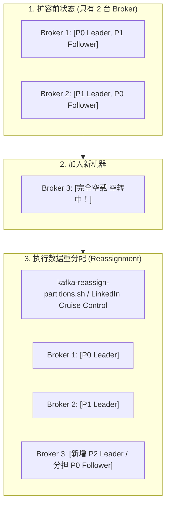
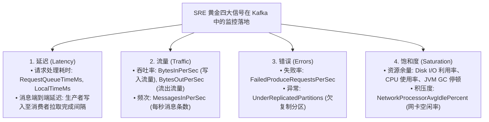
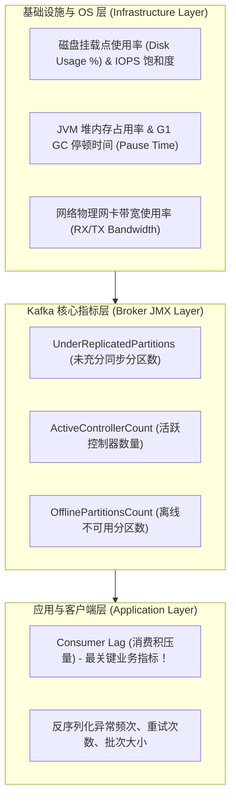
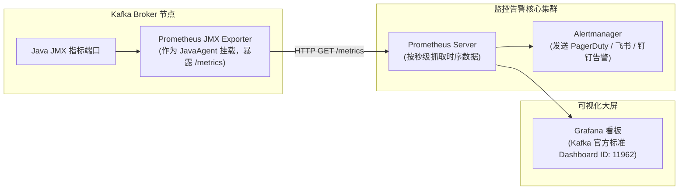
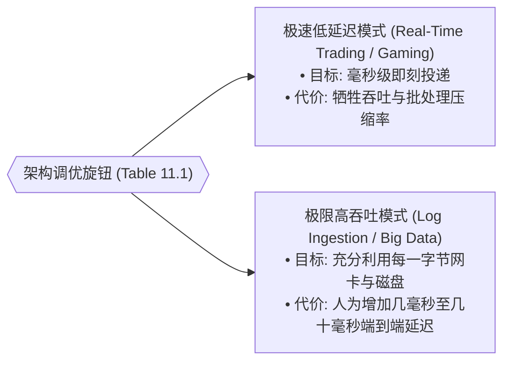
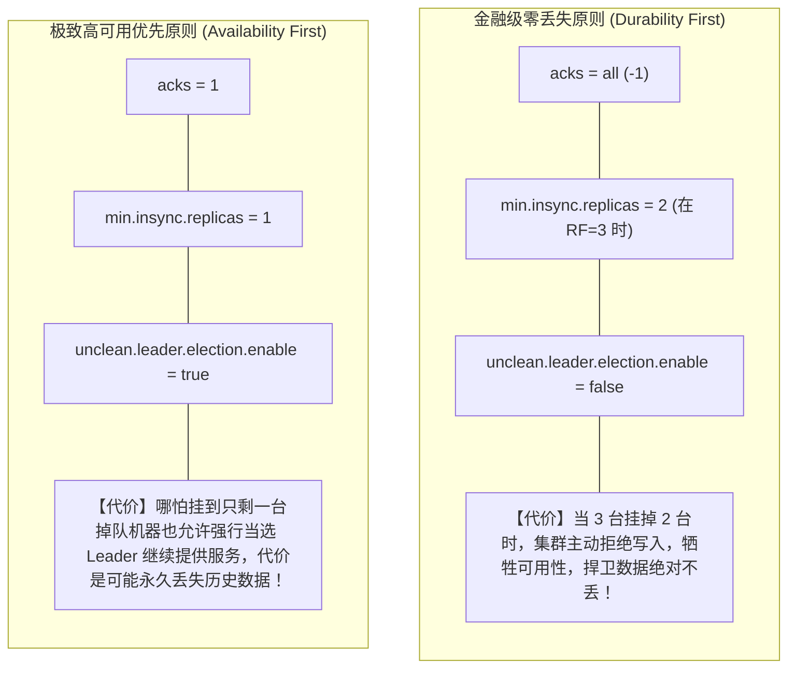
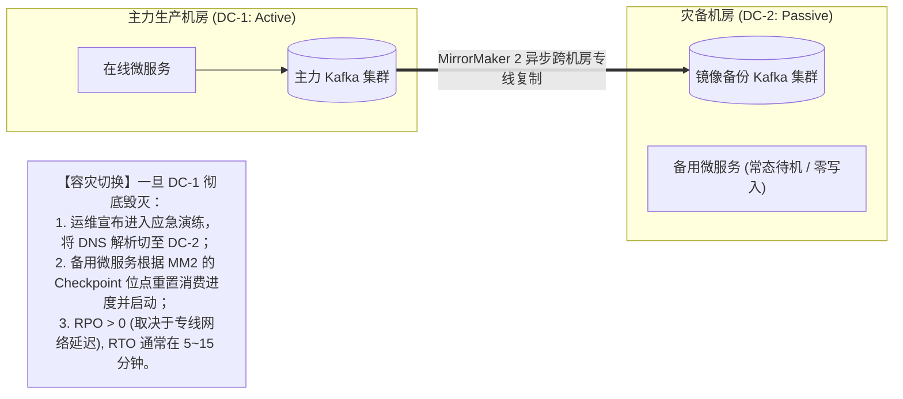
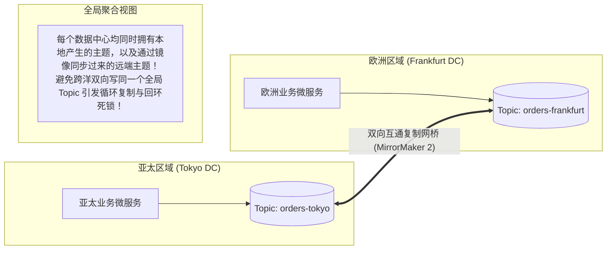

# 第 11 章：Kafka 集群运维与性能调优 (Operating Kafka)

> 本章核心目标：全面掌握大规模 Kafka 集群在生产运行期的 SRE 运维保障与性能调优精髓。深入解析 Broker 在线平滑扩缩容与数据重均衡（Reassignment / Cruise Control）、基于黄金四信号（Latency, Traffic, Errors, Saturation）的全栈监控告警体系、极致吞吐 vs 极限延迟的调优诊所矩阵、高可用与强一致的权衡矩阵、以及多机房容灾（DR）、RPO/RTO 控制与双活架构（Active-Active）。

---

## 本章目录
1. [11.1 集群演进与平滑运维（Upgrades & Maintenance）](#111-集群演进与平滑运维upgrades--maintenance)
   - [11.1.1 扩容 Broker 节点与数据在线重平衡](#1111-扩容-broker-节点与数据在线重平衡)
   - [11.1.2 节点优雅下线与退役（Decommissioning）](#1112-节点优雅下线与退役decommissioning)
   - [11.1.3 客户端与服务端滚动升级最佳实践](#1113-客户端与服务端滚动升级最佳实践)
   - [11.1.4 数据移动性与备份恢复思维转变](#1114-数据移动性与备份恢复思维转变)
2. [11.2 构建全方位可观测性监控体系（Monitoring Stack）](#112-构建全方位可观测性监控体系monitoring-stack)
   - [11.2.1 SRE 黄金四大信号（Golden Signals）的 Kafka 映射](#1121-sre-黄金四大信号golden-signals的-kafka-映射)
   - [11.2.2 监控对象全景分层剖析](#1122-监控对象全景分层剖析)
   - [11.2.3 必须配置 P0 报警的九大核心指标清单](#1123-必须配置-p0-报警的九大核心指标清单)
   - [11.2.4 监控职责划分：平台团队 vs 业务微服务团队](#1124-监控职责划分平台团队-vs-业务微服务团队)
   - [11.2.5 现代 Prometheus + Grafana 监控技术栈落地](#1125-现代-prometheus--grafana-监控技术栈落地)
3. [11.3 架构师专属：性能调优实战诊所（Tuning Clinic）](#113-架构师专属性能调优实战诊所tuning-clinic)
   - [11.3.1 诊室一：吞吐量（Throughput）与延迟（Latency）的极限平衡](#1131-诊室一吞吐量throughput与延迟latency的极限平衡)
   - [11.3.2 诊室二：数据安全性（Durability）与系统可用性（Uptime）的博弈](#1132-诊室二数据安全性durability与系统可用性uptime的博弈)
4. [11.4 灾难恢复与跨地域容灾工程（Disaster Recovery）](#114-灾难恢复与跨地域容灾工程disaster-recovery)
   - [11.4.1 RTO 与 RPO 工程化控制体系](#1141-rto-与-rpo-工程化控制体系)
   - [11.4.2 主备冷备容灾模式（Active-Passive DR）](#1142-主备冷备容灾模式active-passive-dr)
   - [11.4.3 跨地域双活架构（Active-Active Multi-Cluster）](#1143-跨地域双活架构active-active-multi-cluster)
5. [11.5 本章小结与延伸资源](#115-本章小结与延伸资源)

---

## 11.1 集群演进与平滑运维（Upgrades & Maintenance）

### 11.1.1 扩容 Broker 节点与数据在线重平衡

当业务流量持续上涨，现有 Broker 节点的 CPU 或磁盘接近瓶颈时，我们需要向集群中添加新的 Broker 节点。

> **架构常识：向 Kafka 集群中加入新节点，新节点并不会自动分担既有主题的数据！**  
> 默认情况下，新加入的 Broker 只会承载新建主题的分区。已有的历史主题和分区依然留存在旧 Broker 上。



#### 在线数据重平衡的生产操作规范：
1. **生成迁移拓扑计划**：通过 `kafka-reassign-partitions.sh --generate` 计算目标分布；
2. **强制限制迁移带宽（Throttling）**！  
   这是导致无数新手运维把生产网络打满的头号陷阱。执行重平衡时，新节点会从老节点全速拉取数十 TB 的数据，瞬间吃满网卡与磁盘 I/O，导致正常业务消费全部超时中断！  
   必须显式配置迁移带宽限流：
   ```bash
   kafka-reassign-partitions.sh --execute \
     --reassignment-json-file migration.json \
     --throttle 50000000 # 严格限制跨节点复制流量不超过 50 MB/s
   ```
3. **企业级方案——LinkedIn Cruise Control**：
   大型企业通常部署 Cruise Control。它时刻监控每个分区的实时流量、CPU 负荷与磁盘容量，自动、智能地执行多目标动态优化重平衡。

---

### 11.1.2 节点优雅下线与退役（Decommissioning）

当需要下线某台老旧服务器或进行硬件更换时，**绝对不能直接 `kill -9` 强行拔电源**！
必须遵循标准优雅下线流程：
1. **驱逐所有副本**：执行分区重平衡，将该节点上所有的 Leader 副本和 Follower 副本迁移至集群其他健康节点；
2. **确认副本同步完成**：观察该节点上的底层数据目录已清空，且全集群 `UnderReplicatedPartitions == 0`；
3. **优雅停机**：发送 `SIGTERM` 信号让 Broker 安全关闭网络连接并刷盘日志。

---

### 11.1.3 客户端与服务端滚动升级最佳实践

Kafka 具备享誉业界的**跨大版本双向兼容性（Bidirectional Compatibility）**：
- 升级 Broker 集群时，采用**逐台滚动重启（Rolling Upgrade）**，期间全集群客户端完全零感知、零停机；
- 建议遵循：先将客户端升级至新版本 SDK，测试验证无误后，再将 Broker 集群滚动升级至对应版本。

---

### 11.1.4 数据移动性与备份恢复思维转变

传统数据库（如 Oracle、MySQL）依靠每日执行 `mysqldump` 或物理快照进行冷备。
在每秒几十万写入、存储达数百 TB 的 Kafka 集群中，**全量打冷备包是完全不切实际的**！

Kafka 的容灾哲学是**以实时复制代替传统备份**：
1. **同集群内**：依靠 `replication.factor=3` 在物理机损坏时实现毫秒级自动容错；
2. **跨地域级别**：依靠 MirrorMaker 2 或云端分层存储（Tiered Storage 到 S3）实现异地准实时副本持久化。

---

## 11.2 构建全方位可观测性监控体系（Monitoring Stack）

### 11.2.1 SRE 黄金四大信号（Golden Signals）的 Kafka 映射

Google SRE 体系将分布式系统的可观测性归纳为四大黄金信号：



---

### 11.2.2 监控对象全景分层剖析



---

### 11.2.3 必须配置 P0 报警的九大核心指标清单

任何企业的监控大屏，必须将以下指标设为最高告警级别（短信/电话即时触达）：

| 报警级别 | 监控指标名称 (JMX MBean) | 安全阈值 | 触发告警意味着什么？（架构根因剖析） |
| :--- | :--- | :--- | :--- |
| **P0 致命** | `OfflinePartitionsCount` | **恒等于 0** | **发生灾难！** 部分分区的所有副本全部宕机，该分区目前既不可读也不可写，业务局部彻底中断！ |
| **P0 致命** | `ActiveControllerCount` | **整个集群必须恒等于 1** | 若为 0 说明集群处于无主脑死亡状态，无法处理任何元数据变更；若 > 1 说明发生**脑裂（Split-Brain）**！ |
| **P0 致命** | `UnderReplicatedPartitions` (URP) | **恒等于 0** | 存在分区的部分 Follower 副本严重掉队或宕机，系统容灾冗余能力降级，随时有丢数据风险！ |
| **P1 严重** | `Consumer Lag`（按消费组与分区） | 视业务而定（通常持续上升即告警） | 下游消费者处理变慢、发生阻塞死锁、或生产端突发海量流量，即将引发数据超时过期风险！ |
| **P1 严重** | `NetworkProcessorAvgIdlePercent` | **$> 30\%$** | 若低于 30%，说明 Broker 的网络接收线程池已严重过载，必须扩容网卡或 Broker 节点！ |
| **P1 严重** | `Disk Space Utilization` | **$< 80\%$** | 若磁盘使用率超过 85%，Broker 会自动暂停追加写入，引发全链路级联雪崩！ |
| **P2 关注** | `ISRShrinkRate` 与 `ISRExpandRate` | 常态为 0 | ISR 频繁收缩与扩张说明网络存在严重抖动，或者某个 Broker 发生长 GC 假死。 |
| **P2 关注** | `LeaderElectionRateAndTimeMs` | 极低 | 频繁触发 Leader 选举说明有 Broker 在不断反复崩溃重启。 |
| **P2 关注** | `JVM GC Pause Time` | **$< 100\text{ ms}$** | 若 G1 GC 停顿超过 1~2 秒，会导致 Broker 错过心跳被 Controller 误判为死亡。 |

---

### 11.2.4 监控职责划分：平台团队 vs 业务微服务团队
- **平台/基础架构团队（Platform SRE）**：负责 Broker 物理机健康、磁盘容量告警、网络打满治理、KRaft 控制器稳定性；
- **业务微服务团队（Domain Team）**：负责业务 Topic 的 **Consumer Lag** 消化进度、反序列化异常抛错监控、以及生产端发送失败重试率。

---

### 11.2.5 现代 Prometheus + Grafana 监控技术栈落地



---

## 11.3 架构师专属：性能调优实战诊所（Tuning Clinic）

### 11.3.1 诊室一：吞吐量（Throughput）与延迟（Latency）的极限平衡

在分布式系统中，**极限高吞吐与极限低延迟是一对不可兼得的物理矛盾**。



#### Table 11.1：吞吐量 vs 延迟调优参数核心对照表：

| 关键配置项 | 归属端 | 极限低延迟配置 (Low Latency) | 极限高吞吐配置 (High Throughput) | 架构师底层原理解析 |
| :--- | :--- | :--- | :--- | :--- |
| **`linger.ms`** | 生产者 | `0` (或 `1~2 ms`) | **`10 ~ 50 ms`** | 允许生产者多等待几毫秒以聚合出超大批次，极大提高网卡传输效率与压缩率。 |
| **`batch.size`** | 生产者 | `16384` (默认 16 KB) | **`131072 ~ 524288` (128KB ~ 512KB)** | 增大批次内存上限，使压缩算法（如 lz4/zstd）能跨更多消息获得极高压缩比。 |
| **`compression.type`**| 生产者 | `none` (省去压缩 CPU 耗时) | **`lz4`** 或 **`zstd`** | 生产环境强烈推荐 `lz4`，CPU 开销微乎其微，但能立减 70% 网络带宽！ |
| **`fetch.min.bytes`** | 消费者 | `1` (只要有 1 字节立刻返回) | **`65536` (64 KB)** | 告诉 Broker：若没有攒够 64KB 数据就继续等待，避免消费者频繁拉取空包或小包。 |
| **`fetch.max.wait.ms`**| 消费者 | `100 ~ 200 ms` | **`500 ~ 1000 ms`** | 配合 `fetch.min.bytes` 使用的最长等待超时时间。 |
| **`vm.dirty_background_ratio`** | 操作系统 | `5` | `10 ~ 15` | 控制 Linux 内核将脏页刷入物理磁盘的积极程度，避免大文件一次性刷盘引发 I/O 卡顿。 |

---

### 11.3.2 诊室二：数据安全性（Durability）与系统可用性（Uptime）的博弈



#### Table 11.2：数据安全性 vs 可用性架构配置矩阵：

| 核心参数 | 严格金融级强一致（推荐用于订单、资金） | 极致可用性优先（推荐用于日志、IoT 遥测） |
| :--- | :--- | :--- |
| **`acks`** | `all` (或 `-1`) | `1` |
| **`min.insync.replicas`** | `2` (当 RF=3) | `1` |
| **`unclean.leader.election.enable`** | **`false`** (严禁脏选举) | `true` (允许非同步副本上位救活服务) |
| **`enable.idempotence`** | `true` (开启幂等防止重试重复) | `false` (省去序列号内存跟踪) |

---

## 11.4 灾难恢复与跨地域容灾工程（Disaster Recovery）

### 11.4.1 RTO 与 RPO 工程化控制体系

在评估系统容灾能力时，架构师必须与管理层确立两大基准指标：
- **RPO（Recovery Point Objective，数据恢复点目标）**：发生灾难时，**系统最多允许丢失多少时间的数据？**（RPO=0 意味着绝对一条不丢）；
- **RTO（Recovery Time Objective，恢复时间目标）**：从灾难爆发到备用系统重新接管对外服务，**最多允许停机多长时间？**

---

### 11.4.2 主备冷备容灾模式（Active-Passive DR）



---

### 11.4.3 跨地域双活架构（Active-Active Multi-Cluster）

在跨国或超大规模互联网系统中，每个地域的数据中心都在实时接收本地用户的读写请求：



- **防循环复制（Loop Prevention）**：MirrorMaker 2 会自动为远端 Topic 加上数据源前缀（例如在法兰克福集群中命名为 `tokyo.orders`），从而根本避免事件在两个机房之间来回无限弹射！

---

## 11.5 本章小结与延伸资源

### 核心架构要点提炼
1. **平滑扩容必须限流**：向集群增添节点是第一步，通过严格限流的数据重分配让负载均匀分散才是关键；
2. **盯紧 P0 黄金告警**：`UnderReplicatedPartitions`、`ActiveControllerCount` 与 `Consumer Lag` 是守护 Kafka 生死存亡的三道防线；
3. **性能调优因地制宜**：调大 `linger.ms` 与 `batch.size` 并开启 `lz4` 压缩，是零硬件成本获得数倍吞吐提升的灵丹妙药；
4. **容灾没有免费午餐**：必须在 RPO=0 与系统可用性之间做出理性的工程取舍，多机房部署首选 3 AZ 架构。

### 延伸资源与推荐阅读
- *Site Reliability Engineering: How Google Runs Production Systems*: SRE 四大黄金信号方法论；
- *LinkedIn Cruise Control Documentation*: 深入学习自动化集群资源与分区负载均衡；
- *Kafka SRE Runbook Best Practices*: 常见线上生产告警的排障操作手册。
