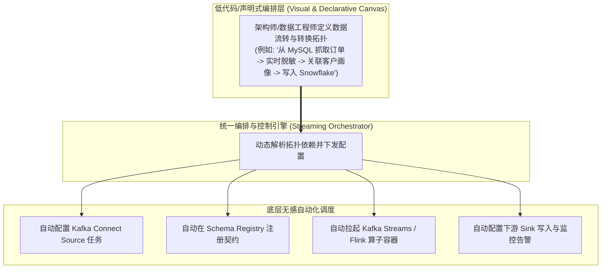
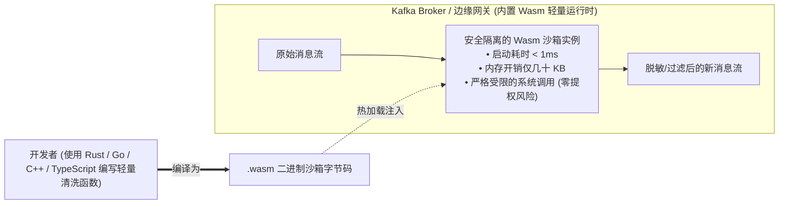
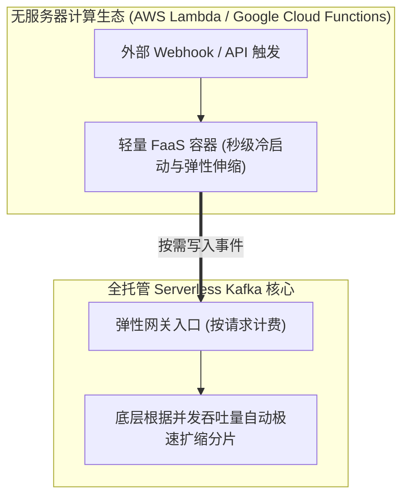
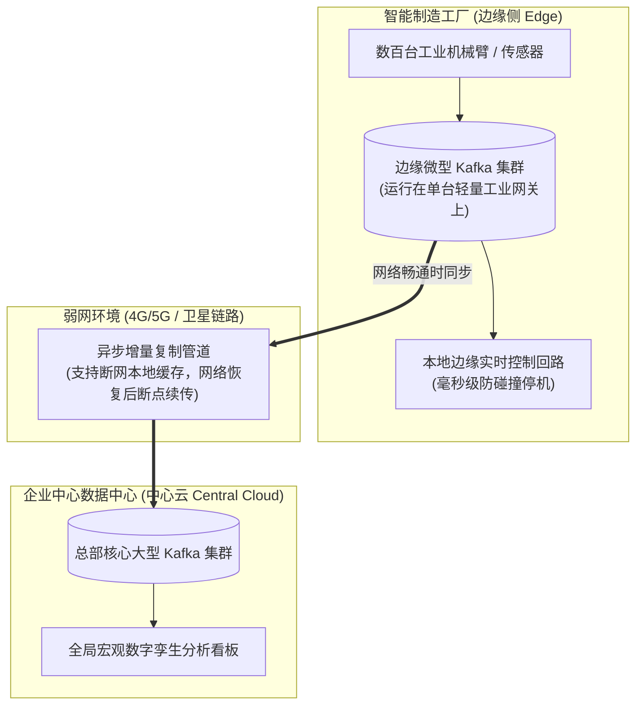
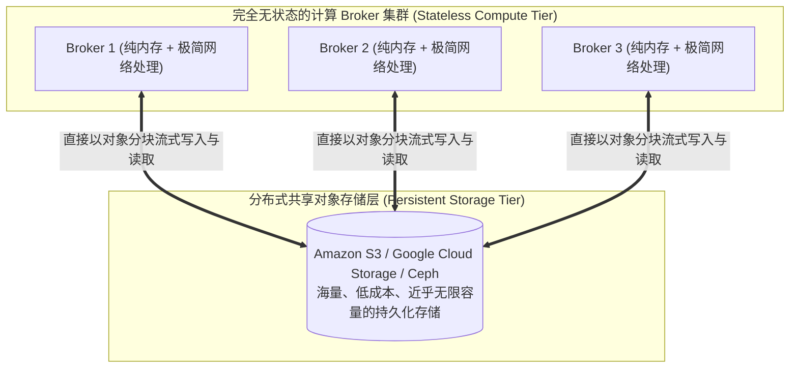
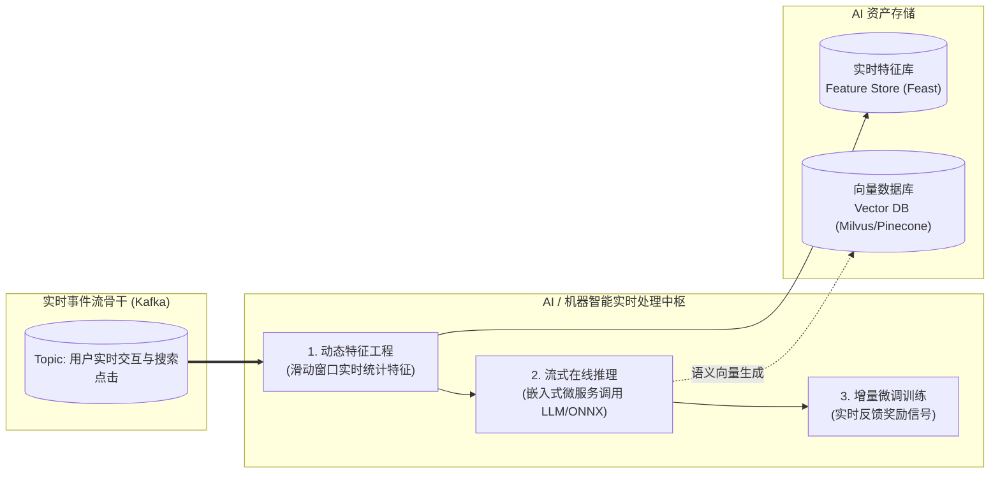
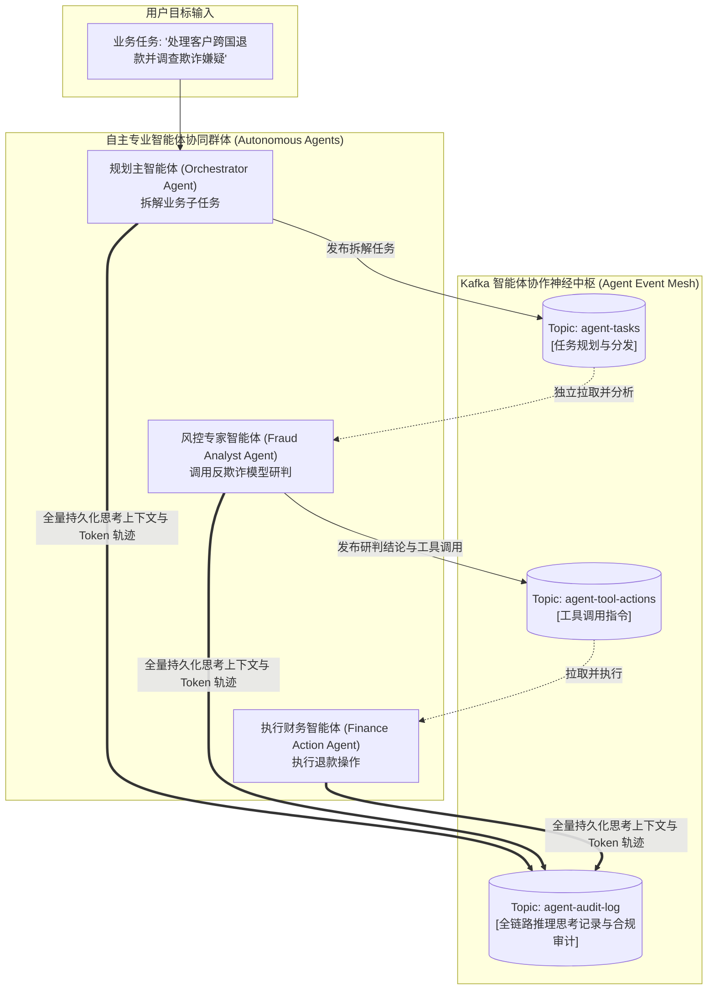

# 第 12 章：Kafka 未来演进与 AI 融合 (What’s Next for Kafka)

> 本章核心目标：洞悉分布式事件流平台的最前沿演进浪潮与未来架构蓝图。系统剖析 Kafka 迈向声明式流式编排平台、WebAssembly（Wasm）沙箱轻量运行时集成、Serverless 无服务器与边缘计算（Edge Computing）、彻底走向存算分离的无盘化架构（Diskless Kafka）、以及在现代 AI/ML 与自主智能体（AI Agents）生态中充当数据血脉与智能体协同神经中枢的核心角色。

---

## 本章目录
1. [12.1 迈向全功能流式编排平台（Orchestration Platform）](#121-迈向全功能流式编排平台orchestration-platform)
   - [12.1.1 声明式数据管道与可视化编排](#1211-声明式数据管道与可视化编排)
   - [12.1.2 统一数据集成、处理与工作流调度](#1212-统一数据集成处理与工作流调度)
2. [12.2 与新兴运行时（Runtimes）深度融合](#122-与新兴运行时runtimes深度融合)
   - [12.2.1 WebAssembly（Wasm）：安全隔离的可插拔函数](#1221-webassemblywasm安全隔离的可插拔函数)
   - [12.2.2 Serverless Kafka：真正的弹性按需付费](#1222-serverless-kafka真正的弹性按需付费)
   - [12.2.3 边缘计算（Kafka at the Edge）：智能物联网架构](#1223-边缘计算kafka-at-the-edge智能物联网架构)
3. [12.3 终极变革：无盘化 Kafka 与彻底存算分离（Diskless Kafka）](#123-终极变革无盘化-kafka-与彻底存算分离diskless-kafka)
   - [12.3.1 传统有状态 Broker 的扩展痛点](#1231-传统有状态-broker-的扩展痛点)
   - [12.3.2 真正无状态的 Broker：分层存储的终极演进](#1232-真正无状态的-broker分层存储的终极演进)
   - [12.3.3 零数据重均衡（Zero Rebalance）的弹性飞跃](#1233-零数据重均衡zero-rebalance的弹性飞跃)
4. [12.4 Kafka 与现代 AI / ML 时代的全面共振](#124-kafka-与现代-ai--ml-时代的全面共振)
   - [12.4.1 流式在线推理（In-Stream Real-Time Inference）](#1241-流式在线推理in-stream-real-time-inference)
   - [12.4.2 增量学习（Incremental Continuous Learning）](#1242-增量学习incremental-continuous-learning)
   - [12.4.3 动态特征工程（Feature Engineering in Motion）与实时特征库](#1243-动态特征工程feature-engineering-in-motion与实时特征库)
   - [12.4.4 Kafka 与多自主智能体（AI Agents）的协作神经中枢](#1244-kafka-与多自主智能体ai-agents的协作神经中枢)
5. [12.5 全书总结与架构师终极思考](#125-全书总结与架构师终极思考)

---

## 12.1 迈向全功能流式编排平台（Orchestration Platform）

在很长一段时间里，Kafka 仅被视为一个底层的事件传输通道。要构建完整的业务流，工程师需要手工拼装 Kafka、Kafka Connect、Schema Registry、Flink 以及外部任务调度器（如 Airflow）。

未来的演进趋势正在将这些散落的拼图融合成统一的**声明式流式编排平台**：

工程师不再需要手动管理繁杂的命令行、配置文件与网络配置，只需在画布上定义数据血缘与流转意图，平台底层即可自动完成端到端资源的供给与调度。

---

## 12.2 与新兴运行时（Runtimes）深度融合

### 12.2.1 WebAssembly（Wasm）：安全隔离的可插拔函数

在传统的 Kafka Connect 或流处理中，如果想要支持用户自定义的轻量清洗逻辑（如 SMT 转换或数据脱敏），通常需要编写 Java 代码并打成 Jar 包上传到服务器，这带来了类加载冲突（Classpath Hell）和巨大的安全隐患。

**WebAssembly（Wasm）为流式计算带来了革命性的安全沙箱**：

企业能够允许普通开发者、甚至第三方租户编写自定义的流处理脚本，并在 Broker 端或边缘代理中安全地并发执行，完全无需重启任何基础设施进程。

---

### 12.2.2 Serverless Kafka：真正的弹性按需付费

传统 Kafka 集群必须为峰值流量预留充足的虚拟机节点与磁盘空间，在业务低谷期（如凌晨）硬件资源大量闲置浪费。

**真正的 Serverless Kafka 架构范式（如 Confluent Cloud Serverless、Upstash）**：

- **秒级自动弹性伸缩**：完全无需预先规划 Broker 数量与磁盘大小；
- **按实际调用与流量计费**：没有消息传输时不产生任何费用，从根本上降低了中小企业与创新业务的试错门槛。

---

### 12.2.3 边缘计算（Kafka at the Edge）：智能物联网架构

在智能制造工厂、智慧医院、高铁以及自动驾驶车载系统中，边缘物理设备每秒产生数以万计的遥测数据，且边缘与中心云之间的网络经常发生断网或高延迟。

**云-边协同架构（Kafka at the Edge）**：

- **边缘自治**：断网期间，本地微型 Kafka 独立记录所有生产遥测数据，驱动工厂闭环运转；
- **云端汇聚**：网络恢复后，以极高压缩率将历史数据批量同步至总部大数据中心。

---

## 12.3 终极变革：无盘化 Kafka 与彻底存算分离（Diskless Kafka）

在经典的 Kafka 架构中，Broker 兼具了“网络协议计算”与“本地磁盘持久化”的双重身份。当某个分区发生倾斜或节点过载时，必须在网络中跨物理机搬迁数 TB 的数据，耗时长达数小时。

**“无盘化 Kafka”（Diskless Kafka / 彻底存算分离）是业界的终极演进方向**：

### 存算分离带来的颠覆性优势：
1. **瞬间扩容，零数据重均衡（Zero-Rebalance Scaling）**：  
   当流量高峰来临，只需在 Kubernetes 中将 Broker Deployment 的副本数从 3 调为 20。新上线的 Broker **无需从旧节点复制任何历史数据**，直接连接对象存储即可立即开始分担流量，扩容耗时从“数小时”锐减至“数秒钟”！
2. **极速故障自愈（Instant Failover）**：  
   某个 Broker 物理节点崩溃，控制器只需在元数据中将该分区的 Leader 映射变更为另一个存活的 Broker。新的 Leader 节点无需拷贝历史文件，直接读取底层的共享对象分段即可接管服务，彻底消除了 URP（欠复制分区）的隐患！

---

## 12.4 Kafka 与现代 AI / ML 时代的全面共振

传统机器学习依赖离线批处理数据，模型每隔数周或数月在静态历史数据集上训练一次。在生成式 AI 与大语言模型（LLM）风靡的今天，**“数据在运动中即被 AI 理解”成为核心竞争力**。

---

### 12.4.1 流式在线推理（In-Stream Real-Time Inference）

在金融欺诈检测或电商实时推荐中，微服务直接在 Kafka Streams / Flink 的消费拓扑内部内嵌轻量级推理引擎（如 ONNX Runtime、TensorFlow Lite），或者通过低延迟 gRPC 批量调用大型模型，**在事件通过流通道的数毫秒内完成风险评分或个性化预测并打入下游主题**。

---

### 12.4.2 增量学习（Incremental Continuous Learning）

对于时效性极强的算法模型（如股市高频预测、实时广告点击率预估 CTR）：
- 模型不再进行沉重的全量重新训练；
- 而是通过消费 Kafka 中的小批量最新标注事件（Micro-batches），以梯度下降持续对模型权重进行微调（Online Fine-tuning），使算法时刻与现实世界的最新变化保持严密同步。

---

### 12.4.3 动态特征工程（Feature Engineering in Motion）与实时特征库

机器学习最大的挑战是“训练与预测时的特征不一致（Training-Serving Skew）”。
通过在 Kafka Streams 中使用时间窗口计算（如“该用户过去 10 分钟内的点击频次”、“该信用卡过去 1 小时内在异地的刷卡总额”），这些**在流动中实时计算出的特征**被同步推入在线特征库（Feature Store，如 Feast / Hopsworks），供模型在线推理时瞬间获取。

---

### 12.4.4 Kafka 与多自主智能体（AI Agents）的协作神经中枢

随着自主 AI Agent（如智能客服 Agent、自动化运维 Agent、自动化代码审查 Agent）走向企业生产，**Agent 与 Agent 之间、Agent 与工具系统之间的通信机制成为架构核心**。

传统的同步 HTTP/RPC 调用在面对耗时较长、非确定性的 Agent 规划推理时显得极其脆弱。

**基于 Kafka 构建的自主智能体协同总线（Agentic Event Bus）**：

- **异步时间解耦**：某个 Agent 调用 LLM 耗时思考 30 秒，完全不会阻塞其他协作 Agent；
- **绝对可追溯与可解释（Explainability & Auditability）**：Kafka 的 Commit Log 忠实、不可篡改地记录了多智能体协商的每一步 Prompt、工具调用与决策逻辑，为金融与医疗等合规审查提供了坚如磐石的凭证。

---

## 12.5 全书总结与架构师终极思考

至此，我们完成了穿越 Apache Kafka 宏观世界的完整架构之旅。

回顾全书三大篇章与 12 章精要：
1. **第一部分（基石篇，第 1-4 章）**：我们告别了同步 REST 的脆弱耦合，确立了事件驱动（EDA）与提交日志（Commit Log）的思维模型；掌握了 Broker 分区并行、ISR 高可用冗余、生产端批处理与确认权衡、以及消费组再均衡与新一代 KIP-848 协议；
2. **第二部分（实战篇，第 5-8 章）**：我们厘清了 Kafka 与传统 MQ 的本质边界；树立了以 Schema Registry 为核心的数据契约治理铁律；深入践行了 CQRS、事件溯源、Kafka Connect 数据打通与本地事务发件箱（Outbox）模式；并驾驭了流计算拓扑与状态存储的威力；
3. **第三部分（工程交付篇，第 9-12 章）**：我们建立了基于 KRaft 仲裁与纵深安全防御的企业基础设施；以 GitOps 和完备测试金字塔规范工程交付；掌握了性能调优诊所与多机房 RPO/RTO 容灾工程；并站在时代前沿，眺望了存算分离无盘化与 AI 智能体协作的壮阔未来。

> **架构师的终极心智法则**：  
> 技术工具层出不穷，但分布式系统的底层规律永恒不变——**状态、日志、顺序、容错与权衡**。  
> 
> Kafka 不仅仅是一套高性能的消息中间件，它是一种**以时间为轴、以事件为事实、以日志为真相**的系统设计哲学。愿你在未来的架构设计征途中，以本书为指南针，构建出稳健、敏捷、历经岁月考验的分布式数据基业！
