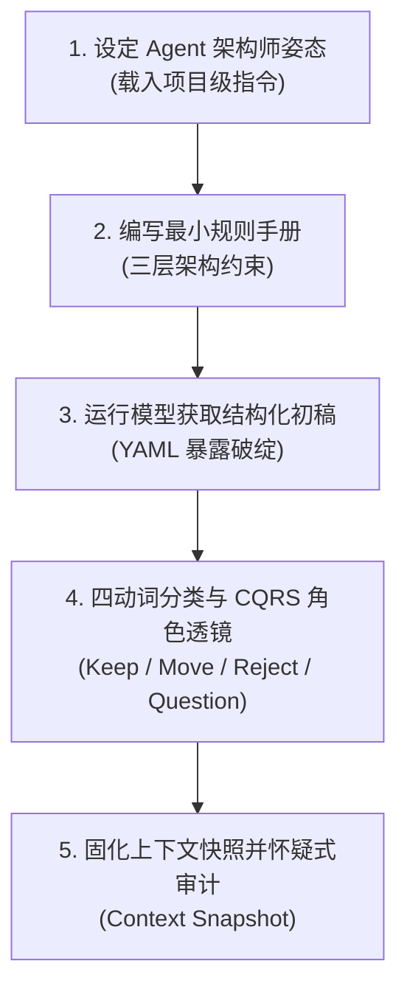

# DDD 限界上下文规则与精化技能包 (DDD Context Refiner)

本技能包沉淀自《AI 增强的领域驱动设计》第 5~6 章的核心工程实践。它旨在解决大语言模型在进行领域驱动建模时极易出现的**隐性错误（Silently Wrong）**、**聚合捏造**、**工作流概念压缩**与**归属权越界**问题。

你可以直接阅读本规程，也可以点击右上角 **「下载技能包 (.zip)」**，将模版解压后直接放入你的项目指令目录（如 `.claude/skills/`、`.cursorrules` 或团队知识库）中使用。

---

## 一、 技能工作流 (Workflow SOP)

当与 AI 助手协作开展限界上下文建模时，严格按照以下 5 个步骤执行：

### 步骤 1：确立 Agent 行为姿态（Who）
在向 AI 提出具体任务前，确保助手已加载项目级架构师守则：
* **严守限界上下文边界**：禁止跨上下文合并概念。
* **严禁凭空捏造**：未获上下文支持的聚合、不变量与业务规则一律不得自行脑补。
* **急刹车机制**：领域知识不全时，输出明确的 `open_questions`，禁止用“貌似合理的假设”假装完备。

### 步骤 2：加载特定限界上下文的规则手册（Rulebook）
针对当前建模的上下文（如 Payment、Order Management），加载对应微规格：
* **语言层**：强制 Canonical Vocabulary，声明 `forbidden_synonyms`（只记录踩过坑的词）。
* **语义层**：硬性约束不变量（如退款仅能针对已捕获款项发起）。
* **输出结构层**：强制 YAML 输出，字段包括 `owned_aggregates`、`commands`、`internal_events`、`external_inputs`、`policies`、`open_questions`。

### 步骤 3：运用“四动词过滤器”审查初稿
AI 产出首版草案后，运用人类架构师的判断力，对其进行四动词分类审查：
1. **Keep（保留）**：确凿属于当前上下文的核心资产。
2. **Move（移至外部输入）**：由外部产生、但本上下文需要感知的领域事实（放入 `external_inputs`）。
3. **Reject（否决）**：越俎代庖、试图将外部概念作为自有聚合的虚构条目。
4. **Question（质疑保留）**：权属争议或业务不确定性，如实保留为 `open_questions`。

### 步骤 4：通过 CQRS 透镜进行角色分离
防止 AI 把业务交互压平成一条单向流水账：
* **命令（Command）**：区分为 `user_initiated`（用户发起）与 `policy_triggered`（策略触发，如 ConfirmOrder）。
* **内部事件（Internal Event）**：严格限定仅能由自身聚合抛出。
* **外部输入（External Input）**：外部事实，仅能触发策略，不能直接篡改内部聚合状态。
* **查询（Query）与读模型（Read Model）**：严格只读，杜绝副作用。

### 步骤 5：固化上下文快照（Context Snapshot）与防倒退审计
* 将精炼成果固化到 `docs/contexts/<context_name>_snapshot.yaml` 中，提交 Git 进行版本控制。
* 运行配套的怀疑式审计提示词，检查是否存在跨迭代的概念死灰复燃。

---

## 二、 包内资源索引 (Package Manifest)

本技能包包含以下开箱即用的工程文件：

* **`templates/rulebook-template.yaml`**：针对单一限界上下文的标准规则手册模版。
* **`templates/context-snapshot-template.yaml`**：限界上下文快照 YAML 规格模版。
* **`templates/audit-prompt.yaml`**：防止 AI 脑补规则的怀疑式自洽性审查提示词。
* **`references/chapter-05-defining-rules.md`**：第 5 章完整论述与 BrewUp 支付案例背景。
* **`references/chapter-06-iterative-refinement.md`**：第 6 章完整论述与订单管理精炼推演细节。
